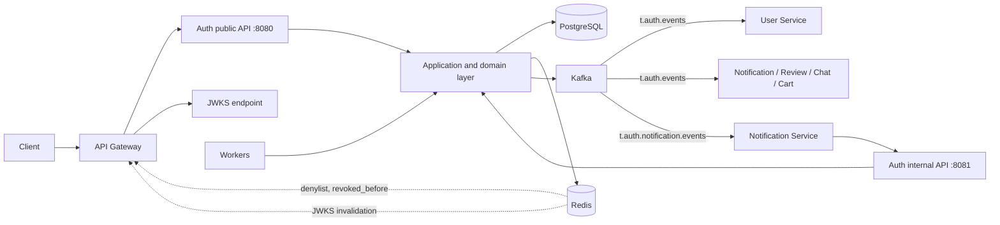

# Auth Service — Architecture

> File này trả lời: “Auth Service gồm những thành phần nào và chúng phối hợp ra sao?”

## 1. Architecture context

Auth nằm tại trust boundary giữa client/Gateway và các protected API. Client dùng
Auth để lấy token; Gateway dùng JWKS để verify token cục bộ và kiểm tra tín hiệu
revocation trong Redis. Auth chỉ phát event về thay đổi identity; User, Notification,
Review, Chat và Cart tự sở hữu side effect của chúng. Notification gọi ngược Auth qua
listener internal để lấy nội dung email.

`t.auth.events` mang `USER_VERIFIED_SUCCESS` (chỉ User) và `USER_DELETED` (User,
Notification, Review, Chat, Cart); `t.auth.notification.events` chỉ Notification consume.
Auth không consume event nào.

## 2. Components and responsibilities

| Component | Package | Trách nhiệm | Không được làm | Dependencies |
|---|---|---|---|---|
| HTTP/JWKS adapter | `internal/api` (handler, middleware, router, httpx, dto) | Hai engine: public (8080) và internal (8081); nhận request, trả `application/problem+json` | Chứa rule nghiệp vụ hoặc query chéo service | Application layer |
| Application/domain layer | `internal/domain` (service, entity, vo, port, event) | Thực thi command, rule, transaction boundary; chỉ biết `port` | Biết chi tiết HTTP/Kafka adapter | Repository, cache, publisher qua port |
| Credential/session repository | `internal/infrastructure/postgres` | Lưu credential, refresh token family, JWT key | Lưu profile người dùng | PostgreSQL |
| Security cache adapter | `internal/infrastructure/redis` | Denylist, revoke marker, rate limit, OTP/reset state, delivery state, worker lock | Là source of truth cho refresh token; fail open | Redis |
| Crypto | `internal/infrastructure/crypto` | Argon2id, RS256 signer, mã hóa private key AES-256-GCM | Để lộ private key | Master key (secret) |
| Event adapter | `internal/infrastructure/kafka`, `redis/jwks_notifier.go` | Phát CloudEvents và tín hiệu JWKS invalidation | Thay đổi domain state ngoài application layer | Kafka, Redis Pub/Sub |
| Workers | `internal/workers` | Cleanup refresh token, auto-unlock, hard delete, xoay/retire khóa ký | Bỏ qua lock, timeout hay logging | Application layer, Redis lock |

## 3. Processing model

Đăng nhập, refresh, logout, đổi mật khẩu và thay đổi account state là command đồng bộ
trên PostgreSQL. Cache write và event publish là side effect chạy **sau** commit và
không rollback được thay đổi đã commit. Event được publish trực tiếp, không dùng
outbox: retry có giới hạn với cùng CloudEvent `id`, lỗi cuối cùng chỉ được log
([ADR-005](./decisions/ADR-005-event-publication-reliability.md)). Với thao tác không thể
lặp lại (xóa account, đổi email, đổi/reset mật khẩu), event được phát trước khi ghi
revocation marker để lỗi Redis không làm mất event
([ADR-006](./decisions/ADR-006-publish-before-revocation-marker.md)).

OTP, reset token, rate limit và denylist có TTL ở Redis, được consume nguyên tử bằng Lua
script và fail closed khi Redis không trả lời. Worker xử lý cleanup, tự unlock, hard
delete account và key lifecycle bất đồng bộ trong cùng process với API.

## 4. Consistency and concurrency

Credential, account state và refresh-token rotation cần strong consistency:

- **Refresh rotation** là một câu lệnh SQL duy nhất (CTE `UPDATE ... RETURNING` rồi `INSERT`):
  token cũ chỉ bị consume khi chưa revoke và chưa hết hạn (cả sliding lẫn absolute), nên
  hai request đồng thời chỉ có một request nhận token mới.
- **Account update là compare-and-set** trên `updated_at` (`entity.Account.Revision`):
  `UPDATE ... WHERE id = $1 AND updated_at = $revision`. Service đọc account, làm việc chậm
  (verify Argon2 khoảng 100 ms, gọi Redis) rồi mới lưu; nếu trong lúc đó một request khác
  đã commit đổi mật khẩu, đổi email hoặc xóa account, bản lưu cũ sẽ ghi đè trạng thái đó
  (khôi phục mật khẩu cũ, hoặc đưa account `DELETED` về `ACTIVE` kèm email). Repository trả
  `ErrConcurrentUpdate`, và `updateAccount` ở service tải lại row rồi áp dụng lại thay đổi
  trên bản mới (tối đa 4 lần), kiểm lại điều kiện trên bản mới (mật khẩu đã xác minh vẫn
  là mật khẩu hiện tại, account chưa bị xóa). Cạn 4 lần thì trả `CONCURRENT_UPDATE`
  (HTTP 500, retryable). Nhờ đó các lần đăng nhập sai chồng nhau đều được đếm.
- Unlock lock hết hạn có thể do login, refresh hoặc worker thực hiện; chỉ bên thắng
  compare-and-set mới phát `USER_UNLOCKED`.

Notification, tạo profile và cache invalidation có thể eventual consistency; lỗi publish
được ghi log để reconcile thủ công.

## 5. Deployment topology

Một binary chạy API public, API internal và worker. PostgreSQL, Redis và Kafka là runtime
dependency (Kafka có thể tắt bằng `kafka.enabled=false` khi chạy local). API scale theo
request load; worker singleton qua Redis lock (`auth:lock:{worker}`) nên nhiều replica
không chạy trùng một lượt. Auth không consume event nên không có ràng buộc partition.
Listener internal không bao giờ được publish qua Gateway; admission của caller do mesh
thực thi ([ADR-007](./decisions/ADR-007-internal-caller-auth-delegated-to-mesh.md)).

## 6. Architecture constraints

- Không đọc/ghi trực tiếp database của service khác.
- Không log password, raw refresh token, OTP, reset token hay private key.
- Direct event publisher có retry và log lỗi; metric, alert và reconciliation chưa có
  (known gap trong [README](./README.md#9-known-gaps)).
- Adapter không chứa business rule; domain không phụ thuộc HTTP/Kafka framework.
- Gateway chỉ nhận public JWKS; private key chỉ ở Auth (mã hóa trong `auth.jwt_keys`).
- Mọi lần ghi `auth.accounts` đi qua `AccountRepository.Update` (compare-and-set); không
  được thêm đường ghi cả row không kiểm version.

## 7. Trade-offs and decisions

Các trade-off được ghi riêng trong [Decision index](./decisions/README.md):
dual-token, refresh rotation không grace period, JWKS rotation, Redis revocation,
reliability của event, thứ tự publish/marker và xác thực caller qua mesh.
