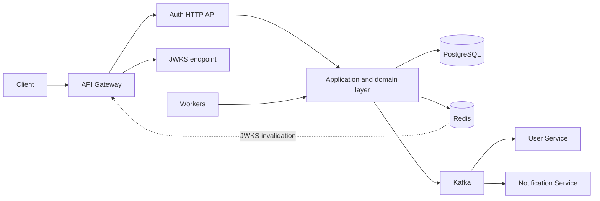

# Auth Service — Architecture

> File này trả lời: “Auth Service gồm những thành phần nào và chúng phối hợp ra sao?”

## 1. Architecture context

Auth nằm tại trust boundary giữa client/Gateway và các protected API. Client dùng
Auth để lấy token; Gateway dùng JWKS để verify token cục bộ và kiểm tra tín hiệu
revocation trong Redis. Auth chỉ phát event về thay đổi identity; User và
Notification Service tự sở hữu side effect của chúng.

## 2. Components and responsibilities

| Component | Trách nhiệm | Không được làm | Dependencies |
|---|---|---|---|
| HTTP/JWKS adapter | Nhận request, xác thực transport, trả lỗi interface | Chứa rule nghiệp vụ hoặc query chéo service | Application layer |
| Application/domain layer | Thực thi command, rule, transaction boundary | Biết chi tiết HTTP/Kafka adapter | Repository, cache, publisher |
| Credential/session repository | Lưu credential, refresh token family, JWT key | Lưu profile người dùng | PostgreSQL |
| Security cache adapter | Denylist, revoke marker, rate limit, OTP/reset state | Là source of truth cho refresh token | Redis |
| Event adapter | Phát/nhận event theo contract | Thay đổi domain state ngoài application layer | Kafka/Redis PubSub |
| Workers | Cleanup, unlock, key rotation/retirement | Bỏ qua lock, idempotency hoặc observability | Application layer |

## 3. Processing model

Đăng nhập, refresh, logout, đổi mật khẩu và thay đổi account state là synchronous
command có transaction trên PostgreSQL. Cache write và event publish là side
effect. Event được publish trực tiếp sau commit, không dùng outbox; lỗi Kafka/Redis
phải có retry, metric và reconciliation theo
[ADR-005](./decisions/ADR-005-event-publication-reliability.md).

OTP, rate limit và denylist có TTL ở Redis. Worker xử lý cleanup, tự unlock,
hard delete account và key lifecycle bất đồng bộ.

## 4. Consistency and concurrency

Credential, account state và refresh-token rotation cần strong consistency.
Notification, tạo profile và cache invalidation có thể eventual consistency,
nhưng failure phải được phát hiện/reconcile.

Refresh token rotation phải xử lý một token chỉ thành công một lần; các request
đồng thời không được cùng cấp hai token pair. Account transition phải tuần tự
theo user. Cơ chế lock/optimistic version cụ thể là phần cần được
xác minh trước khi tài liệu đạt `verified`.

## 5. Deployment topology

Triển khai gồm API server và worker/scheduler. Consumer, scheduler và API có thể
chạy cùng hoặc tách process, nhưng worker dùng distributed lock khi một lượt xử
lý phải singleton. PostgreSQL, Redis và Kafka là runtime dependency. API scale
theo request load; consumer scale theo partition/lag và không được vượt ordering
constraint của một user.

## 6. Architecture constraints

- Không đọc/ghi trực tiếp database của service khác.
- Không log password, raw refresh token, OTP, reset token hay private key.
- Direct event publisher phải có retry, metric và reconciliation sau lỗi publish.
- Adapter không chứa business rule; domain không phụ thuộc HTTP/Kafka framework.
- Gateway chỉ nhận public JWKS; private key chỉ ở Auth/KMS theo thiết kế.

## 7. Trade-offs and decisions

Các trade-off được ghi riêng trong [Decision index](./decisions/README.md):
dual-token, refresh rotation không grace period, JWKS rotation, Redis revocation
và reliability của event. Không quyết định nào trong số này được coi là verified
chỉ từ tài liệu hiện có.
