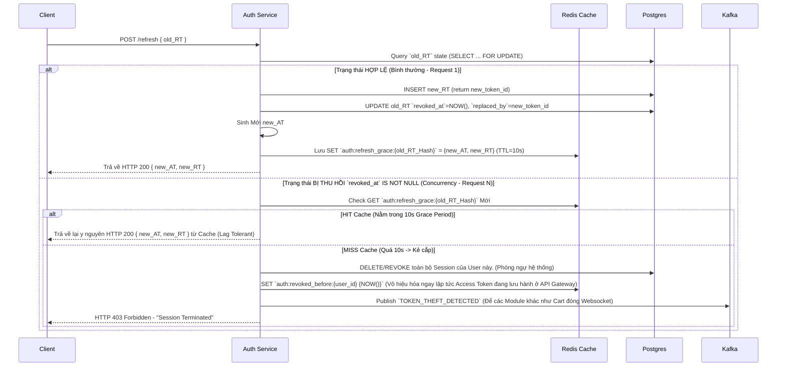
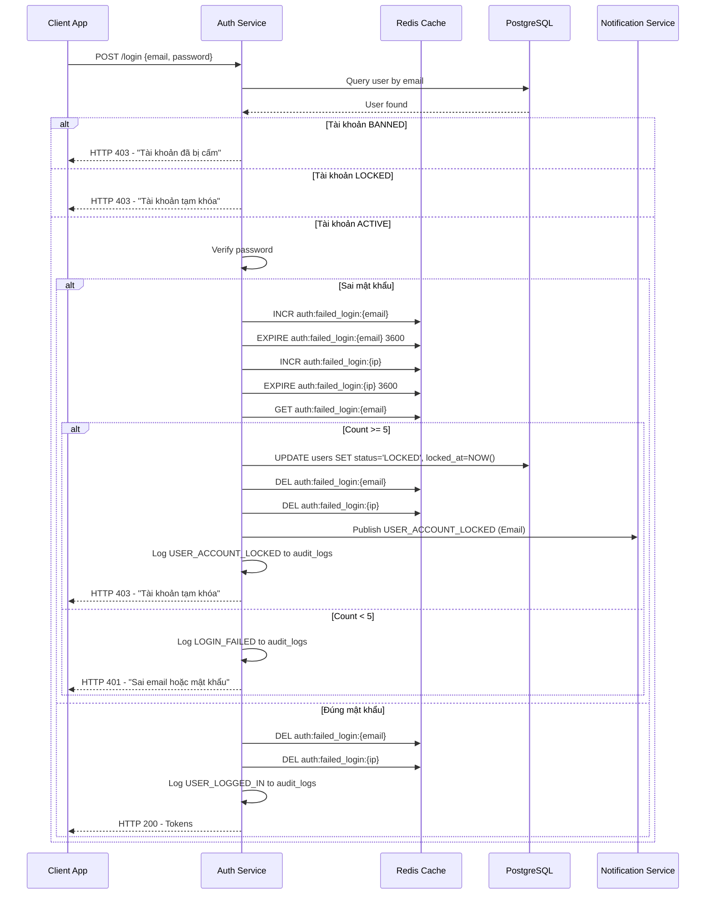
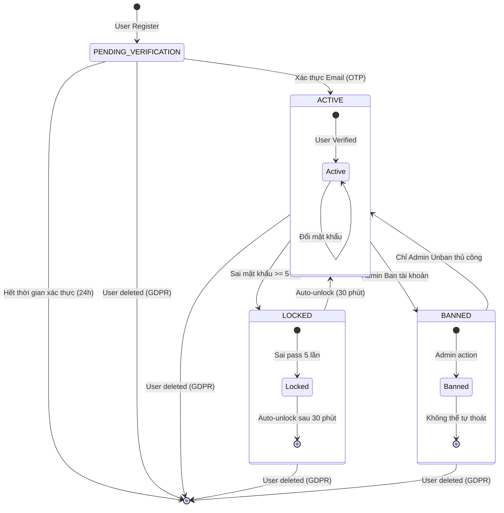

# Auth Service - Workflows & Grace Period Strategy

**Liên kết nhanh:**
*   [Workflows (API & Data Flow)](auth_workflows.md)
*   [Background Workers & Jobs](auth_workers.md)
*   [Caching Schema (Redis)](auth_caching_schema.md)
*   [Database Schema](auth_db_design.md)
*   [Events Structure & Kafka Topics](auth_events.md)

---
Tài liệu này trình bày luồng API và Logical Flow cho các tính năng trọng yếu nhất của Auth Service. Các flow khác như Đăng ký / Đăng xuất hoạt động theo Best Practice chuẩn thông thường, nhưng **Endpoint Cấp Mới (Refresh Token)** được đặc tả cực kỳ chi tiết hóa với Cơ chế thời gian ân hạn (Grace Period).

## 1. Luồng Refresh Token Với Grace Period 10s 

### 1.1 Khởi Nguyên Bài Toán (The Race Condition Problem)
Nếu Frontend ứng dụng của bạn là Single Page App, ví dụ có 5 Component trên màn hình thi nhau cắm Request XHR (Call API Cart, Checkout, Info) bằng cục Access_Token sắp hết hạn.
1. Access_Token HẾT HẠN. API Gateway trả về `401 Unauthorized`.
2. Theo Interceptor thiết kế của Axios, Client sẽ Pause 5 Request trên lại và spawn ra **1 Request đi /refresh** Token.
3. **TUY NHIÊN**, do code logic App dở tệ, chập chờn hoặc do user ấn F5 n lần, client không Hold được 5 Request trên mà lại phóng tiếp **nhiều request `/refresh` cùng lúc lên Server Auth**.
4. Auth Server nhận Request thứ 1: Cắt Refresh Token cũ, đẻ ra Refresh Mới.
5. Auth Server nhận Request thứ 2 cùng Refresh Token Cũ của Request 1: Server nghĩ "thằng này tái sử dụng" -> Xem là Hacker chặn đứng. **Kết quả**: Client gián đoạn toàn bộ, User bị văng ra khỏi hệ thống vô cớ.

### 1.2 Giải Pháp: Workflow Grace Period (Thời gian ân hạn)



### 1.3 Lợi ích tuyệt đối của mô hình Thiết Kế này:
1.  **Duy trì An Toàn Vòng Tròn Xoay Token (Rotation Guarantee)**: Xóa sổ các cách tiếp cận chỉ dùng Long-Live Refresh Token. Nó luôn xoay mà vẫn chịu đựng được lỗi ngớ ngẩn từ Frontend.
2.  **Performance Vượt Trội**: Với Request Concurrent thứ 2 và 3, ta xử lý trực tiếp bằng cách **HIT Redis O(1)** để trả ngay chuỗi string thay vì thực thi mật mã RSA Sign Token lại từ đầu tốn tiền CPU.
3.  **Lưu ý Vận Hành**: Mặc định Grace Period là 10 giây. Tùy theo mạng lưới Cloud, nếu Network Latency quá cao gây đứt quãng (chẳng hạn Mobile 3G yếu), hãy cân nhắc tăng TTL ở Redis lên 15-30s cho phù hợp SLA.

## 2. Luồng Đăng Nhập (Login Flow Tóm Tắt)

1.  Client POST `/login` gửi `email`, `password_plain`.
2.  Auth chọc DB, kiểm tra `status`. Nếu là `PENDING_VERIFICATION`, báo lỗi 403 "Vui lòng xác thực email". Nếu `BANNED/LOCKED`, báo lỗi 403 tương ứng.
3.  Lấy `password_hash` tiến hành Verify. (Dùng Cache đếm sai Pass -> Block ngay sau 5 lần).
4.  Cấp Phát Access_Token: Generate `jti` UUID mới. Signed content: `user_id, roles, exp (15m)`.
5.  Cấp Phát Refresh_Token: Chuỗi `random_string_v4()`. Hash sha-256 chuỗi này.
6.  INSERT vào Database -> `token_hash = sha256_result`, kèm `device_id` và `device_info` từ request.
7.  Trả Opaque (chuỗi ngẫu nhiên chưa Hash) Refresh_Token cho Http Only Cookie/Body Client. Đồng thời, **trực tiếp ghi (insert) log `USER_LOGGED_IN` vào bảng `audit_logs` một cách đồng bộ**.

## 2.1 Luồng Brute-Force Protection (Chống đoán mật khẩu)

### 2.1.1 Bài Toán
Hacker có thể sử dụng danh sách password phổ biến để thử đăng nhập vào tài khoản user. Nếu không có cơ chế bảo vệ, hacker có thể thử hàng triệu password mà không bị chặn.

### 2.1.2 Giải Pháp: Cơ Chế Đếm Sai Pass Tự Động Lock



### 2.1.3 Ngưỡng và Thời Gian

| Ngưỡng | Giá trị | Hành động |
|--------|---------|-----------|
| Số lần sai liên tiếp | **5 lần** | Khóa tài khoản (`LOCKED`) |
| Thời gian tự mở khóa | **30 phút** | Worker auto-unlock |
| TTL Redis counter | **60 phút** | Counter tự reset nếu không có attempt mới |

### 2.1.4 Chi Tiết Kỹ Thuật

**Redis Keys:**
```
auth:failed_login:{email}   # Counter theo email (TTL: 60 phút)
auth:failed_login:{ip}     # Counter theo IP (TTL: 60 phút)
```

**Database Updates khi Lock:**
```sql
UPDATE users
SET status = 'LOCKED',
    locked_at = NOW(),
    failed_login_attempts = 0
WHERE email = ? AND status = 'ACTIVE';
```

**Lưu ý bảo mật:**
- Không tiết lộ số lần sai còn lại cho client (trả generic message)
- Có thể bị bypass nếu user đổi IP (sử dụng thêm email-based counter)
- Worker auto-unlock chạy mỗi 5 phút sẽ kiểm tra và mở khóa tài khoản

## 3. Luồng Đăng Xuất & Thay Đổi Mật Khẩu (Logout Flow)

1.  Client truyền lên `/logout` với xác thực Authentication.
2.  Tại Header có Access Token, chứa mã `jti`.
3.  Auth chép `jti` này đóng băng nó vào Redis Denylist: `SET auth:denylist:{jti} 1 EX remaining_seconds`.
4.  Cầm cái Refresh Token Hash chọc vào PostgreSQL, mark `revoked_at=NOW()` để chết vĩnh viễn khỏi vòng luân hồi.
5.  *(Khi Đổi Pass)*: Revoke toàn bộ các bản ghi thuộc `user_id` đang NULL ở `revoked_at` để Kick sạch thiết bị ra khỏi DB. Sau đó Gắn cờ **User Revision Timestamp** vào Redis: `SET auth:revoked_before:{user_id} {NOW()}`. Mọi Access Token Đang Sống ở các máy khác lập tức bị chặn ở Gateway. Đồng thời **trực tiếp ghi cảnh báo `USER_PASSWORD_CHANGED` vào `audit_logs`**.

## 4. Luồng Đăng Ký & Xác Minh (Email Verification)
1.  Người dùng POST `/register` với Email, Password & token xác nhận `ReCaptcha v3 / Turnstile` (Bắt buộc để chống Botnet tạo account rác).
2.  Server Verify Captcha qua dịch vụ bên thứ 3. Kiểm tra Rate Limit Đăng ký để chặn Spam.
3.  Server tạo bản ghi `users` với `status = PENDING_VERIFICATION`. Sinh mã OTP ngẫu nhiên 6 số.
4.  Lưu OTP vào Redis `auth:otp:register:{email}`. Bắn Kafka event `USER_OTP_REQUESTED`.
5.  Người dùng nhận Email, nhập mã lên `/verify-email`.
6.  Server check Redis. Nếu đúng -> Update DB `status = ACTIVE`, `email_verified_at = NOW()`. Ghi log trực tiếp `USER_VERIFIED_SUCCESS` vào `audit_logs` và bắn event Kafka tương ứng để các dịch vụ khác biết.

## 5. Luồng Quên & Đặt Lại Mật Khẩu (Forgot Password)
1.  Người dùng POST `/forgot-password` gửi Email kèm token `ReCaptcha / Turnstile` (Chống API Spamming gây cháy túi tiền gửi Email/SMS).
2.  Server sinh chuỗi token dài 32 ký tự, hash lại, đưa vào Redis `auth:reset_pw:{token_hash} = user_id` sống trong 15 phút.
3.  Server ném Kafka Event `PASSWORD_RESET_REQUESTED` chứa Link Reset (trong đó url có kẹp raw token không hash).
4.  Người dùng click link, vào trang web POST mật khẩu mới kèm raw token tại `/reset-password`.
5.  Server thực hiện Hash cái raw token từ body, kiểm tra nó xem có nằm trong Redis không. Nếu HIT, cho phép Update pass. Xóa Token ở Redis, Force Logout all related sessions bằng `auth:revoked_before:{user_id}`, đồng thời **trực tiếp ghi cảnh báo `USER_PASSWORD_CHANGED` vào `audit_logs`**. Nếu gửi token sai lệch quá nhiều, **trực tiếp ghi log `PASSWORD_RESET_FAILED` vào `audit_logs`**.

## 6. Quản Lý Phiên (Session Management) - Xem & Thu hồi thiết bị cụ thể
1.  UI Người dùng mở "Thiết bị của tôi", gọi `GET /sessions`.
2.  Server rà bảng `refresh_tokens`, lọc ra các Token thuộc `user_id` mà `revoked_at IS NULL` và `expires_at > NOW()`. Data trả về gồm `device_info`, `device_id`, `created_at`, `id`.
3.  Nếu User nghi ngờ một thiết bị lạ, bấm "Đăng xuất máy này". Client gọi `DELETE /sessions/{refresh_token_id}`.
4.  Server Update DB mark `revoked_at=NOW()` đúng với `id` đó. Cái Access Token đang pair với nó cũng sẽ vứt văng vào Denylist trong Redis để Gateway block ngay lập tức request tiếp theo nếu hacker cầm nó trên tay.

## 7. Luồng API Cung Cấp Data Audit (Client API)

### 7.1 API Tra cứu Lịch sử cho User (`GET /api/v1/auth/audit/my-login-history`)
Chức năng: Trả về danh sách thời gian và thiết bị để phục vụ UI Frontend "Giao diện Bảo mật tài khoản".
*   **Caller**: API Gateway -> truyền `X-User-Id` Header xuống Auth Service.
*   **Logic Xử lý**:
    1.  Query PostgreSQL: `SELECT * FROM audit_logs WHERE actor_id = X-User-Id AND event_type = 'USER_LOGGED_IN' ORDER BY occurred_at DESC LIMIT 20`.
    2.  Format kết quả thân thiện (translate timezone, parse Tên OS từ chuỗi UserAgent) và trả về Client.

### 7.2 API Điều Tra Cho Admin (`GET /api/v1/auth/audit/admin/history-logs`)
Chức năng: Dùng ở CMS Portal cho Ban Quản Trị Hệ Thống tra cứu lịch sử log toàn hệ thống.
*   **Caller**: Chuyên viên hệ thống CMS tra cứu. Chỉ được fetch nếu Role = `ADMIN`.
*   **Logic Xử lý**:
    1.  Hỗ trợ các tham số lọc đa dạng: theo khoảng thời gian (`from_date`, `to_date`), loại rủi ro (`security_level=WARNING`), loại hành vi, ID người dùng cụ thể.
    2.  Query SQL sử dụng các Index hiện có trên bảng `audit_logs` để truy xuất nhanh và phân trang.

## 8. Sơ Đồ Trạng Thái Tài Khoản (User Account State Machine)

### 8.1 State Diagram



### 8.2 Chi Tiết Các Trạng Thái

| Trạng thái | Mô tả | Chuyển sang ACTIVE | Chuyển sang trạng thái khác |
|------------|--------|-------------------|------------------------------|
| `PENDING_VERIFICATION` | Chờ xác thực email | Xác thực OTP | Tự xóa sau 24h không xác thực |
| `ACTIVE` | Tài khoản hoạt động bình thường | - | LOCKED (sai pass), BANNED (admin) |
| `LOCKED` | Tạm khóa do sai mật khẩu | Auto-unlock sau 30 phút | ACTIVE, BANNED (admin) |
| `BANNED` | Cấm vĩnh viễn do vi phạm | **Chỉ Admin unban thủ công** | Không tự chuyển |

### 8.3 Luồng Chuyển Trạng Thái Chi Tiết

**1. PENDING_VERIFICATION → ACTIVE**
- **Trigger**: User nhập đúng mã OTP từ email
- **Action**: `UPDATE users SET status = 'ACTIVE', email_verified_at = NOW() WHERE id = ?`
- **Event**: `USER_VERIFIED_SUCCESS` (Kafka)

**2. ACTIVE → LOCKED**
- **Trigger**: Đăng nhập sai mật khẩu >= 5 lần liên tiếp trong 60 phút
- **Action**:
  ```
  UPDATE users SET status = 'LOCKED', locked_at = NOW() WHERE id = ?
  ```
- **Event**: `USER_ACCOUNT_LOCKED` (Kafka - Email notification)

**3. LOCKED → ACTIVE (Auto-unlock)**
- **Trigger**: `locked_at + 30 minutes <= NOW()` (Worker auto-unlock)
- **Action**:
  ```
  UPDATE users SET status = 'ACTIVE', locked_at = NULL WHERE id = ?
  ```
- **Event**: `USER_UNLOCKED` (Kafka - Email notification)

**4. ACTIVE → BANNED**
- **Trigger**: Admin thực hiện Ban user từ Dashboard
- **Action**:
  ```
  UPDATE users SET status = 'BANNED' WHERE id = ?
  UPDATE refresh_tokens SET revoked_at = NOW() WHERE user_id = ?
  SET auth:revoked_before:{user_id} = NOW() -- Redis
  ```
- **Event**: `USER_BANNED_NOTIFICATION` (Kafka - Email notification)

**5. BANNED → ACTIVE (Admin Unban)**
- **Trigger**: Admin thực hiện Unban user từ Dashboard
- **Action**:
  ```
  UPDATE users SET status = 'ACTIVE' WHERE id = ?
  ```
- **Event**: Không có event tự động (Admin chủ động thông báo)

### 8.4 Lưu Ý Quan Trọng

> **BANNED là trạng thái vĩnh viễn**: Tài khoản bị BANNED **không thể tự động quay về ACTIVE**. Chỉ Admin mới có quyền unban tài khoản. Điều này đảm bảo:
> - Admin kiểm soát hoàn toàn việc cấm user vi phạm
> - Tránh trường hợp hacker tự kích hoạt lại tài khoản sau một thời gian
> - Yêu cầu user phải liên hệ support nếu muốn khôi phục tài khoản
