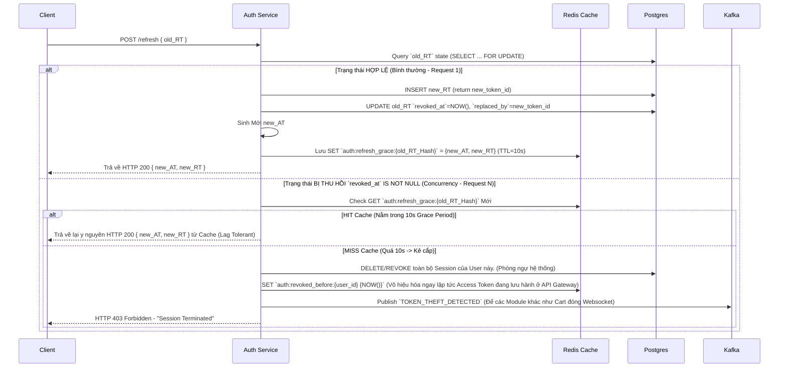

# Auth Service - Workflows & Grace Period Strategy

**Liên kết nhanh:**
*   [Workflows (API & Data Flow)](auth_workflows.md)
*   [Background Workers & Jobs](auth_workers.md)
*   [Caching Schema (Redis & Caffeine)](auth_caching_schema.md)
*   [Database Schema](auth_db_design.md)
*   [Events Structure & Kafka Topics](auth_events.md)

---
Tài liệu này trình bày luồng API và Logical Flow cho các tính năng trọng yếu nhất của Auth Service. Các flow khác như Đăng ký / Đăng xuất hoạt động theo Best Practice chuẩn thông thường, nhưng **Endpoint Cấp Mới (Refresh Token)** được đặc tả cực kỳ chi tiết hóa với Cơ chế thời gian ân hạn (Grace Period).

## 1. Luồng Refresh Token Với Grace Period 10s 

### 1.1 Khởi Nguyên Bài Toán (The Race Condition Problem)
Nếu Frontend ứng dụng của bạn là Single Page App, ví dụ có 5 Component trên màn hình thi nhau cắm Request XHR (Call API Cart, Checkout, Info) bằng cục Access_Token sắp hết hạn.
1. Access_Token HẾT HẠN. API Gateway trả về `401 Unauthorized`.
2. Theo Interceptor thiết kế của Axios, Client sẽ Pause 5 Request trên lại và spawn ra **1 Request đi /refresh** Token.
3. **TUY NHIÊN**, do code logic App dở tệ, chập chờn hoặc do user ấn F5 n lần, client không Hold được 5 Request trên mà lại phóng tiếp **nhiều request `/refresh` cùng lúc lên Server Auth**.
4. Auth Server nhận Request thứ 1: Cắt Refresh Token cũ, đẻ ra Refresh Mới.
5. Auth Server nhận Request thứ 2 cùng Refresh Token Cũ của Request 1: Server nghĩ "thằng này tái sử dụng" -> Xem là Hacker chặn đứng. **Kết quả**: Client gián đoạn toàn bộ, User bị văng ra khỏi hệ thống vô cớ.

### 1.2 Giải Pháp: Workflow Grace Period (Thời gian ân hạn)

**Ghi chú đồng bộ:** Để tránh tạo ra 2 Refresh Token mới từ cùng một `old_RT`, cần khóa dòng bằng `SELECT ... FOR UPDATE` hoặc dùng optimistic lock (`version`/`revoked_at IS NULL` trong WHERE) và chỉ cho phép một request cập nhật thành công.

### 1.3 Lợi ích tuyệt đối của mô hình Thiết Kế này:
1.  **Duy trì An Toàn Vòng Tròn Xoay Token (Rotation Guarantee)**: Xóa sổ các cách tiếp cận chỉ dùng Long-Live Refresh Token. Nó luôn xoay mà vẫn chịu đựng được lỗi ngớ ngẩn từ Frontend.
2.  **Performance Vượt Trội**: Với Request Concurrent thứ 2 và 3, ta xử lý trực tiếp bằng cách **HIT Redis O(1)** để trả ngay chuỗi string thay vì thực thi mật mã RSA Sign Token lại từ đầu tốn tiền CPU.
3.  **Lưu ý Vận Hành**: Mặc định Grace Period là 10 giây. Tùy theo mạng lưới Cloud, nếu Network Latency quá cao gây đứt quãng (chẳng hạn Mobile 3G yếu), hãy cân nhắc tăng TTL ở Redis lên 15-30s cho phù hợp SLA.

## 2. Luồng Đăng Nhập (Login Flow Tóm Tắt)

1.  Client POST `/login` gửi `email`, `password_plain`.
2.  Auth chọc DB, kiểm tra `status`. Nếu là `PENDING_VERIFICATION`, báo lỗi 403 "Vui lòng xác thực email". Nếu `BANNED/LOCKED`, báo lỗi 403 tương ứng.
3.  Lấy `password_hash` tiến hành Verify. (Dùng Cache đếm sai Pass -> Block ngay sau 5 lần).
4.  **[KIỂM TRA 2FA]**: Nếu `is_2fa_enabled == true`:
    *   Hệ thống KHÔNG CẤP Access Token.
    *   Sinh một chuỗi `mfa_token` random (độ dài an toàn). Cục này để hạn chế gọi MFA không cần thiết và xác minh luồng liên quan tới `user_id`. Lưu vào Redis: `auth:mfa_pending:{mfa_token} = user_id`. Khuyến nghị TTL là **5 phút** (300s). Đừng cho thời hạn sống lâu hơn phòng hacker vét ngẫu nhiên.
    *   Trả về HTTP 206 Partial Content (hoặc 401 kèm body `mfa_token`) yêu cầu nhập OTP. Client sẽ mang Token này gọi `/login/mfa`.
5.  **[NẾU KHÔNG CÓ 2FA hoặc ĐÃ QUA BƯỚC 4]**: Cấp Phát Access_Token: Generate `jti` UUID mới. Signed content: `user_id, roles, exp (15m)`.
6.  Cấp Phát Refresh_Token: Chuỗi `random_string_v4()`. Hash sha-256 chuỗi này.
7.  INSERT vào Database -> `token_hash = sha256_result`, kèm `device_id` và `device_info` từ request.
8.  Trả Opaque (chuỗi ngẫu nhiên chưa Hash) Refresh_Token cho Http Only Cookie/Body Client. Emit event `USER_LOGGED_IN` cho Kafka (Audit Service hứng).

## 3. Luồng Đăng Xuất & Thay Đổi Mật Khẩu (Logout Flow)

1.  Client truyền lên `/logout` với xác thực Authentication.
2.  Tại Header có Access Token, chứa mã `jti`.
3.  Auth chép `jti` này đóng băng nó vào Redis Denylist: `SET auth:denylist:{jti} 1 EX remaining_seconds`.
4.  Cầm cái Refresh Token Hash chọc vào PostgreSQL, mark `revoked_at=NOW()` để chết vĩnh viễn khỏi vòng luân hồi.
5.  *(Khi Đổi Pass)*: Revoke toàn bộ các bản ghi thuộc `user_id` đang NULL ở `revoked_at` để Kick sạch thiết bị ra khỏi DB. Sau đó Gắn cờ **User Revision Timestamp** vào Redis: `SET auth:revoked_before:{user_id} {NOW()}`. Mọi Access Token Đang Sống ở các máy khác lập tức bị chặn ở Gateway. Bắn event `USER_PASSWORD_CHANGED` cho Audit Service.

## 4. Luồng Đăng Ký & Xác Minh (Email Verification)
1.  Người dùng POST `/register` với Email, Password & token xác nhận `ReCaptcha v3 / Turnstile` (Bắt buộc để chống Botnet tạo account rác).
2.  Server Verify Captcha qua dịch vụ bên thứ 3. Kiểm tra Rate Limit Đăng ký để chặn Spam.
3.  Server tạo bản ghi `users` với `status = PENDING_VERIFICATION`. Sinh mã OTP ngẫu nhiên 6 số.
4.  Lưu OTP vào Redis `auth:otp:register:{email}`. Bắn Kafka event `USER_OTP_REQUESTED`.
5.  Người dùng nhận Email, nhập mã lên `/verify-email`.
6.  Server check Redis. Nếu đúng -> Update DB `status = ACTIVE`, `email_verified_at = NOW()`. Bắn event `USER_VERIFIED_SUCCESS` (Audit Service ghi log).

## 5. Luồng Quên & Đặt Lại Mật Khẩu (Forgot Password)
1.  Người dùng POST `/forgot-password` gửi Email kèm token `ReCaptcha / Turnstile` (Chống API Spamming gây cháy túi tiền gửi Email/SMS).
2.  Server sinh chuỗi token dài 32 ký tự, hash lại, đưa vào Redis `auth:reset_pw:{token_hash} = user_id` sống trong 15 phút.
3.  Server ném Kafka Event `PASSWORD_RESET_REQUESTED` chứa Link Reset (trong đó url có kẹp raw token không hash).
4.  Người dùng click link, vào trang web POST mật khẩu mới kèm raw token tại `/reset-password`.
5.  Server thực hiện Hash cái raw token từ body, kiểm tra nó xem có nằm trong Redis không. Nếu HIT, cho phép Update pass. Xóa Token ở Redis, Force Logout all related sessions bằng `auth:revoked_before:{user_id}`, đồng thời bắn cảnh báo `USER_PASSWORD_CHANGED`. Nếu gửi token sai lệch quá nhiều, bắn event `PASSWORD_RESET_FAILED` cho Audit.

## 6. Luồng Kích Hoạt 2FA (Dành cho Admin/Seller)
1.  Admin đang login hợp lệ (có Access Token), gọi API `POST /2fa/setup`.
2.  Server dùng thư viện sinh 1 chuỗi ngẫu nhiên Base32, tạo URI chuẩn `otpauth://totp/App:email?secret={Base32}&issuer=App`. Trả URI (hoặc Base64 QR code) về Client.
3.  Admin quét QR lưu vào app Google Authenticator của điện thoại. Nhập 6 số hiện lên app bấm "Xác nhận".
4.  Server check xem mã 6 số đó đi qua hàm TOTP Verify (khớp với Base32 Secret sinh ở Bước 2) xem có đúng không.
5.  Đúng -> Cập nhật `is_2fa_enabled = true` và lưu cái `Base32 Secret` vào trường `two_fa_secret` của bảng `users`. Bắn event `USER_2FA_ENABLED` cho Audit.

## 7. Luồng Đăng nhập Đặc Quyền Mạo Danh (Impersonation)
Luồng này sinh ra để bộ phận Customer Service (CS) giả lập giao diện của người dùng (Customer) để xử lý sự cố.
1. CS Team (đã có Role `ADMIN` hoặc `CS_SUPPORT`) gọi lệnh `POST /impersonate` cùng ID của Customer muốn giả lập.
2. Auth Service check phân quyền, nếu hợp lệ -> Sinh ra một JWT Access_Token đặc biệt không có Refresh_Token đi kèm.
3. Trong JWT mang claim: `user_id = {customer_id}` nhưng kẹp thêm claim `impersonator_id = {admin_id}` và thời gian sống ngắn, ví dụ 1 giờ.
4. Bắn event siêu nhạy cảm `ADMIN_IMPERSONATED_USER` ra Kafka cho Audit Service và Alert System (Lưu lại bằng chứng kiểm toán).

## 8. Quản Lý Phiên (Session Management) - Xem & Thu hồi thiết bị cụ thể
1.  UI Người dùng mở "Thiết bị của tôi", gọi `GET /sessions`.
2.  Server rà bảng `refresh_tokens`, lọc ra các Token thuộc `user_id` mà `revoked_at IS NULL` và `expires_at > NOW()`. Data trả về gồm `device_info`, `device_id`, `created_at`, `id`.
3.  Nếu User nghi ngờ một thiết bị lạ, bấm "Đăng xuất máy này". Client gọi `DELETE /sessions/{refresh_token_id}`.
4.  Server Update DB mark `revoked_at=NOW()` đúng với `id` đó. Cái Access Token đang pair với nó cũng sẽ vứt văng vào Denylist trong Redis để Gateway block ngay lập tức request tiếp theo nếu hacker cầm nó trên tay.
