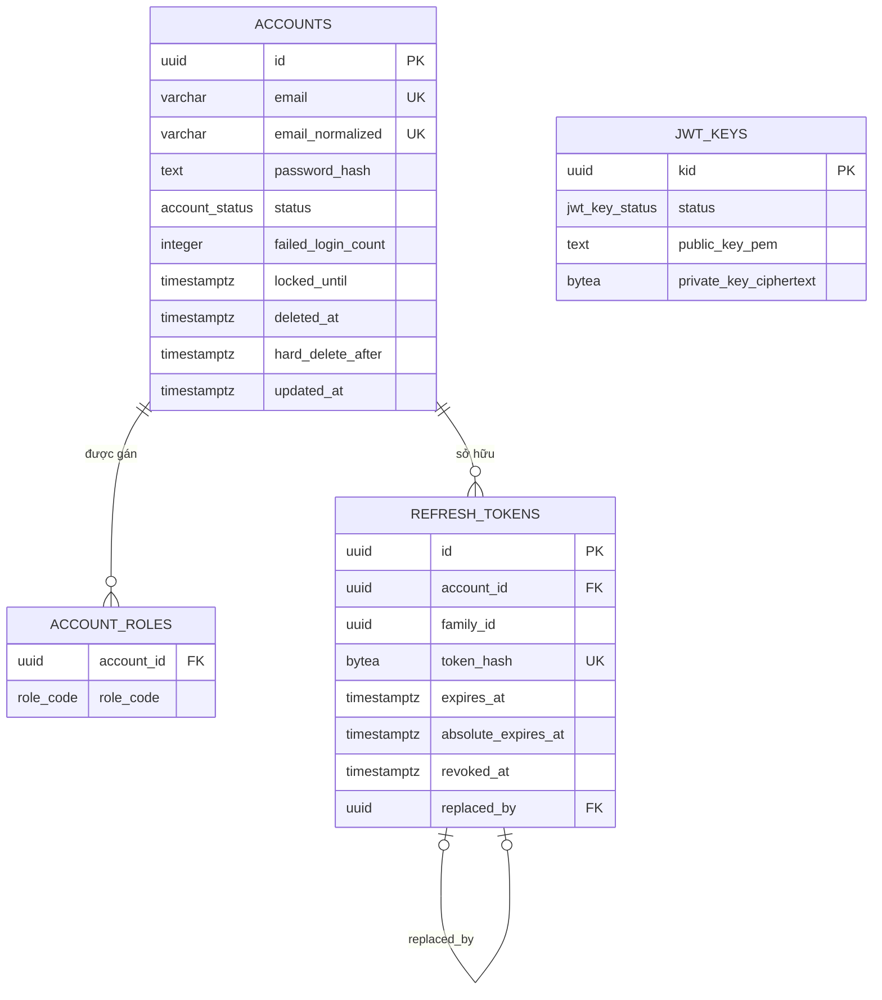

# Auth Service — Thiết kế dữ liệu

> Nguồn chuẩn cho schema là
> [`0001_initial_auth_schema.sql`](./schema/0001_initial_auth_schema.sql); file này giống từng
> byte với `go/services/auth-service/migrations/0001_initial_auth_schema.up.sql` (integration test nạp
> migration thẳng vào PostgreSQL). File này giải thích ownership, mục đích và các quy tắc của schema đó.

## 1. Quyền sở hữu dữ liệu

Auth sở hữu identity, credential, role, refresh-token session và JWT signing key.
User Service chỉ sở hữu profile; không được đọc hoặc ghi trực tiếp schema `auth`.

| Kho lưu trữ | Dữ liệu | Nguồn chân lý |
|---|---|---|
| PostgreSQL `auth` | Account, role, refresh token và JWT key | Auth Service |
| Redis | Denylist, revoke marker, rate limit, OTP/reset secret, retry counter, trạng thái giao thông báo, worker lock | Trạng thái TTL-bound |
| Kafka | Identity event | Không phải database nguồn |

Redis không lưu refresh token. Không có bảng outbox, inbox, audit log, OTP hay
reset-password token trong PostgreSQL.

## 2. Nguồn schema và bootstrap

- [Initial schema](./schema/0001_initial_auth_schema.sql) tạo toàn bộ schema mới.
- [Admin seed template](./schema/seed-admin.sql.example) là bootstrap an toàn;
  email, UUID và Argon2id hash thật được cấp qua secret, không commit vào Git.
- UUID v4 được application sinh; timestamp dùng `TIMESTAMPTZ` theo UTC.

## 3. Logical data model

## 4. Tables và constraints chính

### `auth.accounts`

Đây là aggregate gốc của identity. Email bắt buộc và unique toàn hệ thống qua
`email_normalized`; application phải lưu dạng `lower(btrim(email))`. Password
được giữ dưới dạng Argon2id PHC string, không mã hóa hoặc log plaintext.

| Nhóm field | Nội dung |
|---|---|
| Identity | `id`, `email`, `email_normalized` |
| Credential | `password_hash`, `password_changed_at` |
| State | `status`: `PENDING_VERIFICATION`, `ACTIVE`, `LOCKED`, `DELETED` |
| Lockout durable | `failed_login_count`, `last_failed_login_at`, `locked_until` |
| Deletion | `deleted_at`, `hard_delete_after`, `deletion_reason` |
| Lifecycle | `created_at`, `updated_at` |

`LOCKED` bắt buộc có `locked_until`. `DELETED` bắt buộc có lý do và mốc hard-delete
đúng 90 ngày sau `deleted_at`; đồng thời email, normalized email và password hash
phải là `NULL`. Vì vậy cùng email có thể đăng ký lại ngay sau khi account cũ bị
anonymize, nhưng account cũ không thể được khôi phục.

`updated_at` do trigger `trg_accounts_set_updated_at` đặt lại về `NOW()` ở mọi `UPDATE`, và đồng thời là
**token optimistic-concurrency**: application chỉ lưu `UPDATE ... WHERE id = $1 AND updated_at = $revision`
(`entity.Account.Revision`, đọc cùng lúc với row) và nhận `RETURNING updated_at`. Row đã bị ghi bởi request khác thì
`UPDATE` không khớp dòng nào và repository trả `ErrConcurrentUpdate`
([ADR-008](./decisions/ADR-008-account-optimistic-concurrency.md)). Không có cột `version` riêng.

### `auth.account_roles`

Role thuộc Auth, không thuộc User Service. Enum chỉ gồm `USER` và `ADMIN`.
Account thông thường có một row `USER`; admin có hai row `USER` và `ADMIN`, nên
admin vẫn có mọi capability của người mua. Không có shop table hay `shop_id` vì
hệ thống chỉ có một shop.

### `auth.refresh_tokens`

Mỗi row là một opaque refresh token của một session. Chỉ SHA-256 hash 32-byte
được lưu. `family_id` nhóm các token cùng một session; `replaced_by` tạo chain
rotation. `expires_at` là sliding expiry của token hiện tại, còn
`absolute_expires_at` là giới hạn không được vượt qua khi refresh. Row còn lưu ngữ cảnh thiết bị
(`device_id`, `device_name`, `user_agent`, `ip_address`) và `last_used_at` để liệt kê session.

Token revoked hoặc expired là không hợp lệ. Replay token revoked chỉ trả lỗi,
không thay đổi thêm dữ liệu. Account delete/password change/email change revoke
toàn bộ token của account; hard delete account cascade xóa session còn lại. Worker
`refresh-token-cleanup` xóa row đã hết hạn hoặc revoke quá 7 ngày. Không có quota session theo
account hoặc thiết bị.

### `auth.jwt_keys`

`jwt_keys` lưu public key PEM và private key đã mã hóa AES-256-GCM. Master key
được cung cấp bằng secret của Auth Service, không lưu trong database.
`private_key_nonce` có đúng 12 byte và `encryption_key_version` hỗ trợ master-key
rotation. Chỉ có một key `ACTIVE`; `PHASE_OUT` được giữ trong JWKS đến khi access
token cuối cùng sử dụng nó hết hạn.

## 5. Indexes và query patterns

| Index/constraint | Query hoặc invariant phục vụ |
|---|---|
| `uq_accounts_email_normalized` | Tìm và đảm bảo một identity email duy nhất |
| `idx_accounts_hard_delete` | Compliance worker tìm account `DELETED` đến hạn hard delete |
| `uq_refresh_tokens_token_hash` | Lookup refresh token và chống hash trùng |
| `idx_refresh_tokens_account_active` | Liệt kê/revoke session active theo account |
| `idx_refresh_tokens_family_active` | Xử lý session family và refresh rotation |
| `idx_refresh_tokens_cleanup` | Cleanup token expired/revoked |
| `uq_jwt_keys_one_active` | Không có hai signing key `ACTIVE` |
| `idx_jwt_keys_jwks` | Đọc key `ACTIVE`/`PHASE_OUT` để phát JWKS |

## 6. Transaction, concurrency và cache

Refresh rotation chạy trong **một câu lệnh SQL**: CTE `UPDATE` consume token theo `token_hash` (chỉ khi chưa
revoke và chưa hết hạn sliding/tuyệt đối) rồi `INSERT` token mới cùng `family_id`. Ràng buộc `replaced_by` yêu cầu
token cũ đã `revoked_at` trước khi trỏ đến token mới. Hai refresh đồng thời chỉ được phép cho một request thành công.

Xóa account chạy trong một transaction: revoke refresh token, rồi compare-and-set `accounts` sang `DELETED`.

Redis dùng hai namespace tách biệt (key do `keybuilder` tạo; prefix cấu hình được là `redis.revocation_prefix` và
`redis.state_prefix`).

Namespace `auth:revocation:*` là contract dùng chung với `gateway-auth` theo
[Gateway runtime contract](../gateway/runtime-contract.md#6-quy-ước-xác-thực):
Auth có quyền ghi, Gateway chỉ đọc.

- `auth:revocation:denylist:{jti}` thu hồi một access token. TTL lý tưởng bằng thời gian còn lại tới claim `exp`,
  nhưng Gateway chỉ chuyển tiếp `jti` mà không kèm `exp`, nên Auth dùng cận trên là **access TTL + clock skew
  (`jwt.access_token_ttl` + `jwt.clock_skew`, mặc định 15m30s)** — entry có thể sống lâu hơn token vài phút, tốn
  bộ nhớ nhưng không bao giờ cho token đã thu hồi đi qua.
- `auth:revocation:user:{sub}:revoked_before` lưu timestamp UTC dạng Unix seconds với TTL cũng là access TTL +
  clock skew (không ngắn hơn access-token lifetime tối đa). Gateway từ chối mọi JWT có `iat` không mới hơn giá trị này
  (`iat <= revoked_before`). Cả `iat` lẫn marker chỉ có độ phân giải 1 giây, nên token cấp trong cùng giây với lần thu hồi
  cũng bị từ chối: đây là chủ ý, vì không thể phân biệt token cấp ngay trước hay ngay sau lúc thu hồi, và bên an
  toàn là từ chối cả hai ([ADR-001](./decisions/ADR-001-dual-token-revocation.md)). Logout all, đổi mật khẩu,
  đổi email và xóa account đều buộc đăng nhập lại, nên chỉ client tự đăng nhập lại trong vòng một giây mới gặp một
  lần `401` rồi refresh.

Đổi tên namespace này là breaking change vì phải đổi đồng thời ở cả hai service.

Namespace `auth:*` còn lại chỉ thuộc Auth, chỉ tồn tại ở Redis với TTL, được consume nguyên tử (Lua) và fail closed khi
Redis unavailable:

| Key | Nội dung | TTL |
|---|---|---|
| `auth:otp:{purpose}:{account_id}` | Hash OTP, subject (email đã chuẩn hóa), số lần thử; `purpose` = `REGISTRATION_VERIFICATION` hoặc `EMAIL_CHANGE_VERIFICATION` | 5 phút |
| `auth:otp:resend:{purpose}:{account_id}` | Bộ đếm gửi lại | 15 phút |
| `auth:reset:{token_hash}` và `auth:reset:account:{account_id}` | Reset token (chỉ hash) và chỉ mục ngược; token mới thay token cũ của cùng account | 15 phút |
| `auth:delivery:{delivery_id}` | Trạng thái giao thông báo: email đích, template, dữ liệu render (OTP hoặc reset URL) | tối thiểu 30 phút, và không ngắn hơn secret chứa trong đó |
| `auth:ratelimit:{scope}:{subject}` | Counter fixed-window | theo window của rule |
| `auth:lock:{worker}` | Worker lock singleton | `workers.lock_ttl` (5 phút) |
| channel `auth:jwks:update` | Tín hiệu invalidation JWKS | không lưu |

Với đổi email, Redis lưu state OTP gắn với `account_id`, `new_email` đã chuẩn hóa, thời hạn, số lần thử và số lần
gửi lại. State này không phải nguồn dữ liệu cho email; chỉ sau khi consume OTP thành công, Auth mới cập nhật bền vững
trong PostgreSQL.

Redis cũng lưu notification delivery state theo `delivery_id`. Chỉ Notification Service được resolve state này qua
internal API (caller do mesh admit, [ADR-007](./decisions/ADR-007-internal-caller-auth-delegated-to-mesh.md)); thao tác
resolve idempotent trong TTL và không consume OTP/reset token.

## 7. Data lifecycle, security và privacy

Luồng delete set account thành `DELETED`, anonymize credential/identity ngay,
revoke session, rồi phát `USER_DELETED` với `GDPR_REQUEST` hoặc `ADMIN_DELETION`.
Compliance worker hard delete record sau 90 ngày; không giữ audit data sau đó.

Kết nối database phải dùng TLS (`database.sslmode` mặc định `disable` chỉ cho local; dùng `require` hoặc
`verify-full` ở môi trường thật) và storage phải được mã hóa at rest theo hạ tầng.
Không cần column encryption cho email vì cần unique lookup; private JWT key là
ngoại lệ và luôn được application mã hóa trước khi ghi. IP, user agent và email
là PII, chỉ được log/redact theo chính sách privacy.
