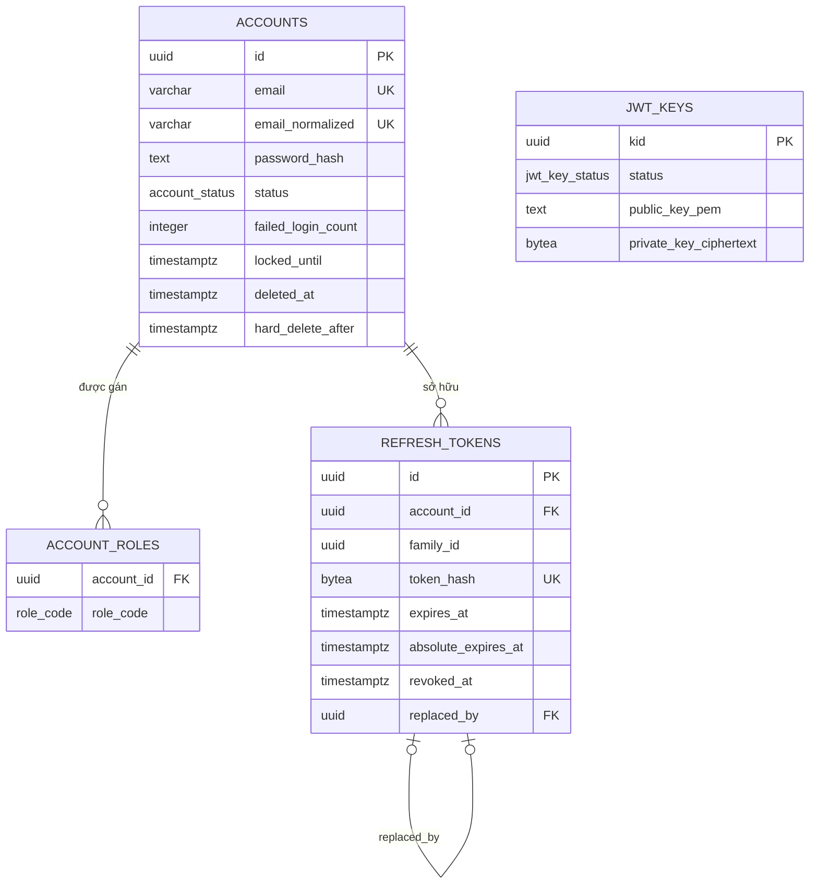

# Auth Service — Thiết kế dữ liệu

> Nguồn chuẩn cho schema là
> [`0001_initial_auth_schema.sql`](./schema/0001_initial_auth_schema.sql).
> File này giải thích ownership, mục đích và các quy tắc của schema đó.

## 1. Quyền sở hữu dữ liệu

Auth sở hữu identity, credential, role, refresh-token session và JWT signing key.
User Service chỉ sở hữu profile; không được đọc hoặc ghi trực tiếp schema `auth`.

| Kho lưu trữ | Dữ liệu | Nguồn chân lý |
|---|---|---|
| PostgreSQL `auth` | Account, role, refresh token và JWT key | Auth Service |
| Redis | Denylist, revoke marker, rate limit, OTP/reset secret và retry counter | Trạng thái TTL-bound |
| Kafka | Identity event | Không phải database nguồn |

Redis không lưu refresh token. Không có bảng outbox, inbox, audit log, OTP hay
reset-password token trong PostgreSQL.

## 2. Nguồn schema và bootstrap

- [Initial schema](./schema/0001_initial_auth_schema.sql) tạo toàn bộ schema mới.
- [Admin seed template](./schema/seed-admin.sql.example) là bootstrap an toàn;
  email, UUID và Argon2id hash thật được cấp qua secret, không commit vào Git.
- UUID v4 được application sinh; timestamp dùng `TIMESTAMPTZ` theo UTC.

## 3. Logical data model

## 4. Tables và constraints chính

### `auth.accounts`

Đây là aggregate gốc của identity. Email bắt buộc và unique toàn hệ thống qua
`email_normalized`; application phải lưu dạng `lower(btrim(email))`. Password
được giữ dưới dạng Argon2id PHC string, không mã hóa hoặc log plaintext.

| Nhóm field | Nội dung |
|---|---|
| Identity | `id`, `email`, `email_normalized` |
| Credential | `password_hash`, `password_changed_at` |
| State | `status`: `PENDING_VERIFICATION`, `ACTIVE`, `LOCKED`, `DELETED` |
| Lockout durable | `failed_login_count`, `last_failed_login_at`, `locked_until` |
| Deletion | `deleted_at`, `hard_delete_after`, `deletion_reason` |
| Lifecycle | `created_at`, `updated_at` |

`LOCKED` bắt buộc có `locked_until`. `DELETED` bắt buộc có lý do và mốc hard-delete
đúng 90 ngày sau `deleted_at`; đồng thời email, normalized email và password hash
phải là `NULL`. Vì vậy cùng email có thể đăng ký lại ngay sau khi account cũ bị
anonymize, nhưng account cũ không thể được khôi phục.

### `auth.account_roles`

Role thuộc Auth, không thuộc User Service. Enum chỉ gồm `USER` và `ADMIN`.
Account thông thường có một row `USER`; admin có hai row `USER` và `ADMIN`, nên
admin vẫn có mọi capability của người mua. Không có shop table hay `shop_id` vì
hệ thống chỉ có một shop.

### `auth.refresh_tokens`

Mỗi row là một opaque refresh token của một session. Chỉ SHA-256 hash 32-byte
được lưu. `family_id` nhóm các token cùng một session; `replaced_by` tạo chain
rotation. `expires_at` là sliding expiry của token hiện tại, còn
`absolute_expires_at` là giới hạn không được vượt qua khi refresh.

Token revoked hoặc expired là không hợp lệ. Replay token revoked chỉ trả lỗi,
không thay đổi thêm dữ liệu. Account delete/password change/email change revoke
toàn bộ token của account; hard delete account cascade xóa session còn lại. Không
có quota session theo account hoặc thiết bị.

### `auth.jwt_keys`

`jwt_keys` lưu public key PEM và private key đã mã hóa AES-256-GCM. Master key
được cung cấp bằng secret của Auth Service, không lưu trong database.
`private_key_nonce` có đúng 12 byte và `encryption_key_version` hỗ trợ master-key
rotation. Chỉ có một key `ACTIVE`; `PHASE_OUT` được giữ trong JWKS đến khi access
token cuối cùng sử dụng nó hết hạn.

## 5. Indexes và query patterns

| Index/constraint | Query hoặc invariant phục vụ |
|---|---|
| `uq_accounts_email_normalized` | Tìm và đảm bảo một identity email duy nhất |
| `idx_accounts_hard_delete` | Compliance worker tìm account `DELETED` đến hạn hard delete |
| `uq_refresh_tokens_token_hash` | Lookup refresh token và chống hash trùng |
| `idx_refresh_tokens_account_active` | Liệt kê/revoke session active theo account |
| `idx_refresh_tokens_family_active` | Xử lý session family và refresh rotation |
| `idx_refresh_tokens_cleanup` | Cleanup token expired/revoked |
| `uq_jwt_keys_one_active` | Không có hai signing key `ACTIVE` |
| `idx_jwt_keys_jwks` | Đọc key `ACTIVE`/`PHASE_OUT` để phát JWKS |

## 6. Transaction, concurrency và cache

Refresh rotation phải chạy trong một transaction: lock/compare-and-set record
theo `token_hash`, revoke token cũ, tạo token mới cùng `family_id`, rồi commit.
Ràng buộc `replaced_by` yêu cầu token cũ đã `revoked_at` trước khi trỏ đến token
mới. Hai refresh đồng thời chỉ được phép cho một request thành công.

Redis key dùng prefix `auth:`. `auth:denylist:{jti}` thu hồi một access token;
`auth:revoked_before:{account_id}` thu hồi access token cũ của toàn account.
OTP/reset token, attempt counter và resend counter chỉ tồn tại Redis với TTL,
phải được consume atomically và fail closed khi Redis unavailable.

Với đổi email, Redis còn lưu state OTP gắn với `account_id`, `new_email` đã chuẩn hóa,
thời hạn, số lần thử, số lần gửi lại và trạng thái đã dùng. State này không phải nguồn dữ liệu
cho email; chỉ sau khi consume OTP thành công, Auth mới cập nhật bền vững trong PostgreSQL.

Redis cũng lưu notification delivery state TTL-bound theo `delivery_id`: email đích,
template và dữ liệu render (OTP hoặc reset URL khi có). Chỉ Notification Service
được resolve state này qua mTLS internal API; thao tác resolve idempotent trong TTL
và không consume OTP/reset token.

## 7. Data lifecycle, security và privacy

Luồng delete set account thành `DELETED`, anonymize credential/identity ngay,
revoke session, rồi phát `USER_DELETED` với `GDPR_REQUEST` hoặc `ADMIN_DELETION`.
Compliance worker hard delete record sau 90 ngày; không giữ audit data sau đó.

Kết nối database phải dùng TLS và storage phải được mã hóa at rest theo hạ tầng.
Không cần column encryption cho email vì cần unique lookup; private JWT key là
ngoại lệ và luôn được application mã hóa trước khi ghi. IP, user agent và email
là PII, chỉ được log/redact theo chính sách privacy.
