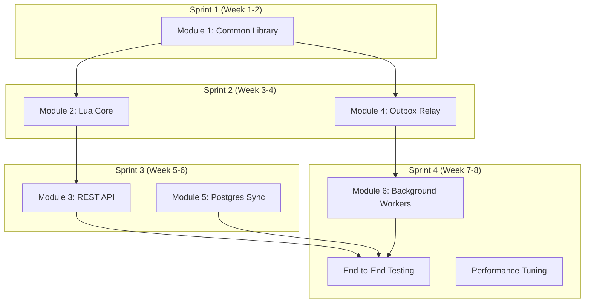

# Cart Service - Implementation Plan

> **Document Version:** 1.0  
> **Date:** May 8, 2026  
> **Status:** Ready for Development  
> **Architecture:** Redis-First, Event-Driven, CQRS  
> **Language:** Go

---

## Table of Contents

1. [Architecture Overview & Scope](#1-architecture-overview--scope)
2. [Module Decomposition & Dependency Matrix](#2-module-decomposition--dependency-matrix)
3. [Module Details](#3-module-details)
4. [Integration & End-to-End Testing Plan](#4-integration--end-to-end-testing-plan)
5. [Environment Configuration & CI/CD](#5-environment-configuration--cicd)
6. [Observability & Operations](#6-observability--operations)
7. [Risks & Mitigation Strategies](#7-risks--mitigation-strategies)

---

## 1. Architecture Overview & Scope

### 1.1 System Architecture

```
�������������������������������������������������������������������������������
�                              Cart Service                                    �
�                                                                             �
�  ����������������     ����������������     ����������������               �
�  �  REST API   �����▶�   Lua Core   �����▶� Redis Hash  �◀�� Write Path �
�  �  (Echo/Chi) �     �   Scripts    �     �   + Streams �               �
�  ����������������     ����������������     ����������������               �
�         �                                           �                       �
�         � Read Path                                 �                       �
�         ▼                                           ▼                       �
�  ����������������     ����������������     ����������������               �
�  �  Product     �◀�����  gRPC Client �     �   Outbox    �                �
�  �  Service     �     � (Pull Model) �     �   Relay     �                �
�  ����������������     ����������������     ����������������               �
�                                                    �                       �
������������������������������������������������������������������������������
                                                     �
                                        �������������▼�������������
                                        �      Kafka Cluster        �
                                        �   t.cart.events (12 ptn) �
                                        ���������������������������
                                                     �
                          ���������������������������������������������������������
                          �                           �                           �
                          â–¼                           â–¼                           â–¼
                   ����������������          ����������������          ����������������
                   �  Postgres    �          � Analytics/   �          � Notification �
                   �   Sync      �          �   Notif      �          �   Service    �
                   ����������������          ����������������          ����������������
                          �
                          â–¼
                   ����������������
                   � PostgreSQL   �
                   � (Cold Store) �
                   ����������������
```

### 1.2 Design Principles

| Principle | Implementation |
|-----------|----------------|
| **Redis-First** | Redis is Source of Truth for Cart State; all CRUD happens on Redis |
| **Event-Driven** | Outbox Pattern via Redis Streams → Kafka → PostgreSQL |
| **Pull Model** | Product prices fetched via gRPC at read-time, not pushed via workers |
| **Lua Atomicity** | All cart mutations via Lua scripts to prevent race conditions |
| **Stream ID Ordering** | Redis Stream ID is the single ordering/idempotency key |

### 1.3 Scope of Implementation

**In Scope:**
- Cart CRUD APIs (Add, Read, Batch Delete)
- Redis Lua Scripts (Add/Update, Batch Delete, Silent Rehydrate)
- Outbox Relay Worker (Redis Stream → Kafka)
- Postgres Sync Consumer (Kafka → PostgreSQL)
- Background Workers (Abandoned Marker, Archival Cleaner, Stream Trimmer, Order Event Consumer, DLQ Handler)
- Circuit Breaker for gRPC calls to Product Service
- Observability (Prometheus metrics, structured logging, tracing)

**Out of Scope:**
- Product Service integration (external dependency, assumed available)
- Frontend/UI
- Authentication (assumed handled by API Gateway)
- Order Service (we consume events from it)

### 1.4 Key Technical Constraints

> **CRITICAL RULES (derived from design documents):**

1. **Hash Tag Mandatory:** All Redis keys must use Hash Tag `{cart:user:{user_id}}` to ensure Lua scripts execute without CROSSSLOT errors
2. **No MAXLEN on XADD:** Never use MAXLEN on XADD; delegate memory management to Stream Trimmer
3. **Read-Only TTL Rule:** Cache-hit reads MUST NOT call EXPIRE; only Write operations or Rehydrate may reset TTL
4. **No XADD in Rehydrate Script:** Silent Rehydrate Lua script must NOT emit events
5. **Intent Index Protocol:** All XADD operations MUST be preceded by `ZADD outbox_publish_intents` and followed by publish path
6. **Stream ID as Ordering Key:** Use Redis Stream ID (not timestamp) as idempotency key everywhere
7. **Cart ID = Redis Key:** `cart_id` in DB, Events, Kafka equals exactly the Redis key name

---

## 2. Module Decomposition & Dependency Matrix

### 2.1 Module Overview

| Module | Name | Type | Parallelizable |
|--------|------|------|----------------|
| M1 | Common Library | Library | ✅ Independent |
| M2 | Redis Lua Core | Library | ✅ After M1 |
| M3 | REST API Layer | Service | ✅ After M1, M2 (mockable) |
| M4 | Outbox Relay | Worker | ✅ After M1 |
| M5 | Postgres Sync | Worker | ✅ After M1 |
| M6 | Background Cronjobs | Workers | ✅ After M4 |

### 2.2 Dependency Graph

```
M1: Common Library
��� Structs: Cart, CartItem, Event payloads
��� Constants: TTL, limits, config
��� Interfaces: RedisClient, KafkaProducer, ProductServiceClient, PostgresDB
��� Kafka message builder

M2: Redis Lua Core (depends on M1)
��� Add/Update Lua Script
��� Batch Delete Lua Script
��� Silent Rehydrate Lua Script
��� Intent Index management (Go layer)
��� Negative cache handling

M3: REST API Layer (depends on M1, M2)
��� POST /api/v1/carts/items (Add/Update)
��� GET /api/v1/carts/mine (Read)
��� DELETE /api/v1/carts/items (Batch Delete)
��� gRPC Product Service client
��� Circuit Breaker integration
��� Response construction

M4: Outbox Relay (depends on M1)
��� Pub/Sub subscriber
��� ZSET Fallback worker (30s interval)
��� Intent Recovery worker (30s interval)
��� Stream consumer (XREADGROUP)
��� Kafka Producer with headers
��� DLQ handling

M5: Postgres Sync (depends on M1)
��� Kafka Consumer (group: cart-db-sync)
��� Batch event processor
��� Cart Items upsert with stream_id guard
��� Carts status manager
��� Hard delete handler

M6: Background Workers (depends on M1, M4)
��� Abandoned Cart Marker (Cronjob)
��� Data Archival Cleaner (Cronjob)
��� Stream Trimmer (Goroutine)
��� Order Event Consumer (Kafka)
��� DLQ Handler (Goroutine)
```

### 2.3 Parallel Development Guidance



### 2.4 Sprint Breakdown

| Sprint | Duration | Modules | Deliverables |
|--------|----------|---------|--------------|
| Sprint 1 | 2 weeks | M1 (Common) | Project scaffold, shared types, interfaces, constants, Kafka message builder |
| Sprint 2 | 2 weeks | M2 (Lua), M4 (Outbox) | All Lua scripts, unit tests, Outbox Relay worker with Pub/Sub + ZSET recovery |
| Sprint 3 | 2 weeks | M3 (API), M5 (PG Sync) | REST endpoints with Circuit Breaker, Kafka consumer with batch processing |
| Sprint 4 | 2 weeks | M6 (Workers), E2E | All cronjobs, stream trimmer, DLQ handler, integration tests |
| Sprint 5 | 1 week | Perf, UAT | Load testing, tuning, user acceptance testing |

---

## 3. Module Details

---

### Module 1: Common Library (`/internal/common`)

#### 3.1.1 Functional Objective

Provides shared types, constants, interfaces, and utilities used across all modules. This is the foundation that enables parallel development.

#### 3.1.2 Interfaces & Contracts

**Go Interfaces (for dependency injection & mocking):**

```go
// internal/common/interfaces.go

// RedisClient wraps Redis operations needed by cart service
type RedisClient interface {
    Eval(ctx context.Context, script string, keys []string, args ...interface{}) *redis.Cmd
    HGetAll(ctx context.Context, key string) *redis.MapStringStringCmd
    HSet(ctx context.Context, key string, values ...interface{}) *redis.IntCmd
    Exec(ctx context.Context, pipe *redis.Pipeline) ([]redis.Cmder, error)
    // ... other methods as needed
}

// KafkaProducer interface for outbox relay
type KafkaProducer interface {
    Produce(ctx context.Context, topic string, key []byte, value []byte, headers []Header) error
    Flush(timeout time.Duration) error
}

// PostgresDB interface for GORM
type PostgresDB interface {
    Cliuse(...clause.Interface) *gorm.DB
    Exec(sql string, values ...interface{}) *gorm.DB
    // ... other methods as needed
}

// ProductServiceClient for gRPC
type ProductServiceClient interface {
    GetProductSku(ctx context.Context, skuID string) (*ProductSkuResponse, error)
    GetBatchProductSkus(ctx context.Context, skuIDs []string) (*BatchProductSkusResponse, error)
}
```

**Redis Key Schema:**

| Key Pattern | Type | TTL | Description |
|-------------|------|-----|-------------|
| `{cart:user:{user_id}}` | Hash | 7 days | Cart items (Hash Field = sku_id, Value = JSON) |
| `{cart:user:{user_id}}:outbox` | Stream | None | Outbox stream per cart |
| `{cart:user:{user_id}}:notfound` | String | 60s | Negative cache |
| `cart:idemp:order_paid:{order_id}` | String | 24h | Idempotency key for ORDER_PAID |
| `outbox_publish_intents` | ZSET | None | Intent tracking (score = timestamp_ms) |
| `active_outbox_streams` | ZSET | None | Active streams to process (score = timestamp_ms) |
| `outbox_notifications` | Channel | N/A | Pub/Sub channel |
| `cart_outbox_dlq` | Stream | None | Dead Letter Queue |

**Kafka Message Format (Topic: `t.cart.events`):**

```json
{
  "event_id": "018e7b4a-1234-7def-8abc-123456789abc",
  "event_type": "CART_ITEM_ADDED",
  "aggregate_type": "Cart",
  "aggregate_id": "{cart:user:12345}",
  "correlation_id": "req-123",
  "timestamp": "2026-02-28T10:00:00Z",
  "source": "cart-service",
  "stream_id": "1708530000123-0",
  "stream_timestamp_ms": "1708530000123",
  "event_sequence": "0",
  "payload": { ... }
}
```

#### 3.1.3 Task List

| # | Task | Effort (h) | Dependencies | Status |
|---|------|------------|--------------|--------|
| 1.1 | Create Go module structure (`go.mod`, `go.sum`) | 2 | - | [X] |
| 1.2 | Define all shared structs (Cart, CartItem, Event payloads) | 4 | - | [X] |
| 1.3 | Define constants (TTL, limits, config defaults) | 1 | - | [X] |
| 1.4 | Implement Redis key builders with Hash Tag validation | 3 | - | [X] |
| 1.5 | Implement Kafka message header builder | 3 | - | [X] |
| 1.6 | Implement deterministic event_id generator (UUIDv5 from stream_id + cart_id) | 2 | - | [X] |
| 1.7 | Implement circuit breaker wrapper for gRPC | 4 | 1.5 | [X] |
| 1.8 | Create configuration loader (env vars + config file) | 3 | - | [X] |
| 1.9 | Write unit tests for key builders and message builder | 4 | 1.2, 1.4, 1.6 | [X] |

**Estimated Total: ~26 hours**

#### 3.1.4 Testing Requirements

**Unit Tests:**
- [X] Key builder validates Hash Tag format
- [X] Event ID generator produces deterministic output
- [X] Kafka headers are correctly populated
- [X] Circuit breaker state transitions

**Integration Tests (future):**
- Mock Redis client works with miniredis

#### 3.1.5 Implementation Notes

- All `cart_id` values must equal Redis key exactly: `{cart:user:{user_id}}`
- Use `strconv.FormatInt()` to normalize user_id to string before any Lua call
- Timestamps must use **milliseconds** (not microseconds) to avoid JSON precision loss in JS clients

---

### Module 2: Redis Lua Core (`/internal/redis`)

#### 3.2.1 Functional Objective

Implements all Lua scripts for atomic cart operations and the Go wrapper layer that manages Intent Index protocol.

#### 3.2.2 Interfaces & Contracts

```go
// internal/redis/cart_operations.go

// CartOperations defines Redis cart operations
type CartOperations interface {
    // AddOrUpdateItem executes Lua script for atomic add/update
    AddOrUpdateItem(ctx context.Context, userID, skuID string, payloadJSON string, step int64, eventTimeMs int64) (string, error)
    
    // BatchDeleteItems executes Lua script for batch delete
    BatchDeleteItems(ctx context.Context, userID string, skuIDs []string, clearEventType string, eventTimeMs int64) (int64, error)
    
    // SilentRehydrate executes Lua script for cache-miss recovery
    SilentRehydrate(ctx context.Context, userID string, items []RehydrateItem) error
    
    // GetCart retrieves all items from cart
    GetCart(ctx context.Context, userID string) (map[string]string, error)
}

// RehydrateItem represents an item to rehydrate
type RehydrateItem struct {
    SkuID  string `json:"sku_id"`
    Value  string `json:"value"`
}
```

**Lua Scripts to Implement:**

1. **add_update.lua** � Atomic add/update with race condition prevention
2. **batch_delete.lua** � Batch delete with event emission
3. **silent_rehydrate.lua** � Cache recovery without event emission
4. **stream_trim.lua** � Atomic empty stream cleanup

#### 3.2.3 Task List

| # | Task | Effort (h) | Dependencies | Status |
|---|------|------------|--------------|--------|
| 2.1 | Implement `add_update.lua` script | 8 | M1.4 | [X] |
| 2.2 | Implement `batch_delete.lua` script | 6 | M1.4 | [X] |
| 2.3 | Implement `silent_rehydrate.lua` script | 4 | M1.4 | [X] |
| 2.4 | Implement Go wrapper for Add/Update (with Intent Index) | 6 | M1.2, 2.1 | [X] |
| 2.5 | Implement Go wrapper for Batch Delete (with Intent Index) | 5 | M1.2, 2.2 | [X] |
| 2.6 | Implement Go wrapper for Silent Rehydrate | 4 | M1.2, 2.3 | [X] |
| 2.7 | Implement negative cache management | 2 | - | [X] |
| 2.8 | Write Redis test instances with Lua unit tests | 8 | 2.1-2.7 | [X] |
| 2.9 | Implement idempotency key management for ORDER_PAID | 4 | M1.2 | [X] |

**Estimated Total: ~47 hours**

#### 3.2.4 Testing Requirements

**Unit Tests (with Testcontainers or miniredis):**

| Scenario | Expected Behavior |
|----------|-------------------|
| Add new item | Cart has new item, stream has event |
| Update existing item | Quantity is accumulated, event emitted |
| Add when cart full (50 SKUs) | Return error "Cart Full" |
| Update when quantity > max (100) | Quantity capped at 100 |
| Decrement non-existing item | Return error |
| Batch delete existing items | Items removed, events emitted |
| Batch delete when cart becomes empty | DEL cart key, emit CART_CLEARED/CART_CHECKED_OUT |
| Silent Rehydrate - item not exists | HSET new item |
| Silent Rehydrate - item exists, incoming newer | HSET overwrite |
| Silent Rehydrate - item exists, incoming older | Skip (no change) |
| Silent Rehydrate - no XADD | No events in stream |

**Edge Cases:**
- Race condition: 3 concurrent adds → final quantity = sum of all steps
- Out-of-order: Older event arrives after newer → guard by stream_id downstream

#### 3.2.5 Implementation Notes

> **CRITICAL IMPLEMENTATION NOTES FROM DESIGN:**

1. **Never use MAXLEN on XADD** � Memory management is delegated to Stream Trimmer
2. **ARGV differences** � Add/Update and Batch Delete have completely different ARGV layouts; do NOT reuse
3. **Timestamp as string** � Use `tostring()` for timestamps in JSON to avoid scientific notation
4. **Intent Index Protocol (Go layer):**
   ```
   1. ZADD outbox_publish_intents <now_ms> <stream_key>
   2. EVALSHA Lua (Hash + XADD)
   3. ZADD active_outbox_streams <now_ms> <stream_key>
   4. PUBLISH outbox_notifications <stream_key>
   5. ZREM outbox_publish_intents <stream_key>  [on success]
   ```
5. **Negative Cache Invalidation:** After any successful Write, `DEL cart:user:{id}:notfound`
6. **is_available = false exception:** When gRPC returns unavailable product in Cache Hit path, `HSET` only the `is_available` field (no EXPIRE, no XADD)

---

### Module 3: REST API Layer (`/internal/api`)

#### 3.3.1 Functional Objective

Implements Cart Service REST endpoints with Circuit Breaker protection for gRPC calls to Product Service.

#### 3.3.2 API Endpoints

| Method | Endpoint | Description |
|--------|----------|-------------|
| POST | `/api/v1/carts/items` | Add/Update item in cart |
| GET | `/api/v1/carts/mine` | Get current user's cart |
| DELETE | `/api/v1/carts/items` | Batch delete items |

**POST /api/v1/carts/items**

Request:
```json
{
  "sku_id": "sku-1001",
  "quantity": 2
}
```

Response (200 OK):
```json
{
  "success": true,
  "cart_id": "{cart:user:12345}",
  "item": {
    "sku_id": "sku-1001",
    "quantity": 2,
    "product_name": "�o Thun Nam",
    "unit_price_at_add": 150000
  }
}
```

**GET /api/v1/carts/mine**

Response (200 OK):
```json
{
  "cart_id": "{cart:user:12345}",
  "items": [
    {
      "latest_item_at": 1708616400456,
      "items": [
        {
          "sku_id": "sku-1001",
          "product_name": "�o Thun Nam",
          "variant_info": "Màu �en, Size L",
          "image_url": "https://cdn.example.com/ao.jpg",
          "quantity": 2,
          "unit_price_at_add": 150000,
          "current_price": 165000,
          "is_available": true,
          "added_at": "1708530000123",
          "updated_at": "1708616400456"
        }
      ]
    }
  ],
  "is_price_degraded": false,
  "total_items": 2,
  "total_unique_skus": 2
}
```

**DELETE /api/v1/carts/items**

Request:
```json
{
  "cart_id": "{cart:user:12345}",
  "sku_ids": ["sku-1001", "sku-1002"]
}
```

Response (200 OK):
```json
{
  "success": true,
  "deleted_count": 2
}
```

#### 3.3.3 Task List

| # | Task | Effort (h) | Dependencies |
|---|------|------------|--------------|
| 3.1 | Setup Echo/Chi router with middleware (logging, tracing) | 4 | M1 |
| 3.2 | Implement POST /carts/items handler | 8 | M2 |
| 3.3 | Implement GET /carts/mine handler (Cache Hit path) | 10 | M2 |
| 3.4 | Implement GET /carts/mine handler (Cache Miss path) | 8 | M2, M5 (for DB fallback) |
| 3.5 | Implement DELETE /carts/items handler | 6 | M2 |
| 3.6 | Implement gRPC Product Service client with Circuit Breaker | 6 | M1.7 |
| 3.7 | Implement response construction and grouping | 4 | - |
| 3.8 | Write unit tests for handlers (with mocks) | 8 | 3.1-3.7 |
| 3.9 | Write integration tests (with testcontainers) | 12 | 3.1-3.7 |

**Estimated Total: ~66 hours**

#### 3.3.4 Testing Requirements

**Unit Tests (mocked dependencies):**

| Scenario | Expected |
|----------|----------|
| Add item - success | Lua called, event emitted, HTTP 200 |
| Add item - product unavailable | HTTP 400 |
| Add item - cart full (50 SKUs) | HTTP 422 |
| Read cart - cache hit | gRPC called, merged response |
| Read cart - cache miss | DB query, rehydrate, gRPC |
| Read cart - gRPC timeout | Response with is_price_degraded=true |
| Read cart - product banned | is_available=false written to Redis |
| Delete items - batch success | Items deleted, events emitted |
| Delete items - idempotency | Duplicate safe |

**Integration Tests:**

| Scenario | Setup | Validation |
|----------|-------|------------|
| Add → Read roundtrip | Redis only | Item in Redis, event in Stream |
| Add → Read → Kafka → DB | Full stack | Item in PostgreSQL |
| Cache miss → DB → Rehydrate | Redis empty, DB has data | Redis populated, correct items |
| Circuit breaker open | Mock Product Service fails | is_price_degraded=true |

#### 3.3.5 Implementation Notes

> **CRITICAL FLOW NOTES:**

**Cache Hit Path (GET /carts/mine):**
1. `HGETALL cart_key` → decode items
2. Call `GetBatchProductSkus` gRPC (timeout 200ms, Circuit Breaker)
3. Merge `current_price` and `is_available` into response
4. **Exception:** If gRPC returns `is_available=false`, `HSET` the field back to Redis (no EXPIRE, no XADD)
5. **Never call EXPIRE on cache hit reads**

**Cache Miss Path (GET /carts/mine):**
1. Check `cart:user:{id}:notfound` negative cache
2. If not found → query PostgreSQL
3. If DB empty → set negative cache TTL 60s, return empty cart
4. If DB has data → call gRPC, merge `is_available`
5. Execute Silent Rehydrate Lua (no XADD)
6. Return merged response with `is_price_degraded` flag

---

### Module 4: Outbox Relay Worker (`/internal/workers/outbox_relay`)

#### 3.4.1 Functional Objective

Reliably forwards events from Redis Streams to Kafka using a hybrid approach (Pub/Sub + ZSET Fallback + Intent Recovery).

#### 3.4.2 Architecture

```
┌─────────────────────────────────────────────────────────────────�
│                    Outbox Relay Architecture                     │
│                                                                  │
│  ┌─────────────�      ┌─────────────�      ┌─────────────�     │
│  │   Lua API   │─────▶│   Intent    │      │    Pub/Sub  │     │
│  │   Write     │      │   Index     │      │  Subscriber │     │
│  └─────────────┘      └──────┬──────┘      └──────┬──────┘     │
│                              │                     │             │
│                              ▼                     ▼             │
│                      ┌─────────────────────────────────────�    │
│                      │         Go Channel Buffer            │    │
│                      │   (receives stream names)            │    │
│                      └─────────────────────────────────────┘    │
│                                      │                          │
│         ┌───────────────────────────┼───────────────────────────┤
│         │                           │                           │
│         ▼                           ▼                           ▼
│  ┌─────────────�          ┌─────────────�          ┌─────────────�
│  │ ZSET Fallback│         │  Intent     │          │   Stream    │
│  │  Worker     │          │  Recovery   │          │  Consumer   │
│  │ (30s loop)  │          │  Worker     │          │ (Goroutines)│
│  └─────────────┘          │  (30s loop) │          └──────┬──────┘
│                           └─────────────┘                 │
│                                                           ▼
│                                                  ┌─────────────�
│                                                  │    Kafka    │
│                                                  │  Producer   │
│                                                  └─────────────┘
```

#### 3.4.3 Task List

| # | Task | Effort (h) | Dependencies | Status |
|---|------|------------|--------------|--------|
| 4.1 | Implement Pub/Sub subscriber to `outbox_notifications` | 6 | M1 | [X] |
| 4.2 | Implement ZSET Fallback worker (30s interval) | 4 | M1 | [X] |
| 4.3 | Implement Intent Recovery worker (30s interval) | 6 | M1 | [X] |
| 4.4 | Implement Stream consumer (XREADGROUP) | 8 | M1 | [X] |
| 4.5 | Implement Kafka Producer with header enrichment | 6 | M1 | [X] |
| 4.6 | Implement XACK and XAUTOCLAIM logic | 4 | - | [X] |
| 4.7 | Implement DLQ routing for failed messages | 4 | M1 | [X] |
| 4.8 | Write unit tests | 8 | 4.1-4.7 | [ ] |
| 4.9 | Write integration tests (Redis + Kafka) | 12 | 4.1-4.7 | [ ] |

**Estimated Total: ~58 hours**

#### 3.4.4 Testing Requirements

**Unit Tests:**

| Scenario | Expected |
|----------|----------|
| Pub/Sub message received | Stream name pushed to channel |
| ZSET Fallback - finds stale stream | Stream name pushed to channel |
| Intent Recovery - stream has messages | Publish path executed |
| Intent Recovery - stream empty | Intent removed, no publish |
| XREADGROUP - NOGROUP error | XGROUP CREATE called, then retry |
| Kafka Produce success | XACK called |
| Kafka Produce failure | Message stays pending, retry |
| Retry > 5 times | Message moved to DLQ |

**Integration Tests:**

| Scenario | Setup | Validation |
|----------|-------|------------|
| Add item → event in Kafka | Full flow | Event in Kafka topic |
| Worker crash → message recovered | Kill worker mid-processing | Message reprocessed |
| Kafka down → message pending | Stop Kafka | Message stays in stream |
| DLQ routing | Mock Kafka always fails | Message in DLQ stream |

#### 3.4.5 Implementation Notes

> **CRITICAL PROTOCOLS:**

1. **Deterministic event_id:** Generate from `SHA256(stream_id + cart_id)` → UUIDv5 format. Never use random UUID.
2. **Kafka Partition Key:** Use `cart_id` to ensure ordering per cart
3. **XACK only after Kafka ACK:** Use `acks=all` Kafka config
4. **Pending Message Handling:** Use `XAUTOCLAIM` for messages pending > 60 seconds
5. **Never ZREM from active_outbox_streams:** Stream Trimmer reads this ZSET

---

### Module 5: Postgres Sync Consumer (`/internal/workers/postgres_sync`)

#### 3.5.1 Functional Objective

Consumes events from Kafka and persists cart data to PostgreSQL with idempotency guarantees using stream_id guards.

#### 3.5.2 Database Schema

```sql
-- carts table
CREATE TABLE carts (
    cart_id VARCHAR(255) PRIMARY KEY,
    user_id VARCHAR(255) NOT NULL,
    status VARCHAR(50) DEFAULT 'ACTIVE',
    last_event_stream_id VARCHAR(64),
    abandoned_event_published_at TIMESTAMPTZ,
    created_at TIMESTAMPTZ NOT NULL DEFAULT NOW(),
    updated_at TIMESTAMPTZ NOT NULL DEFAULT NOW()
);

CREATE INDEX idx_carts_user_id ON carts(user_id);
CREATE INDEX idx_carts_status ON carts(status);
CREATE INDEX idx_carts_updated_at ON carts(updated_at);

-- cart_items table
CREATE TABLE cart_items (
    item_id VARCHAR(255) PRIMARY KEY,  -- format: cart_id || ':' || sku_id
    cart_id VARCHAR(255) NOT NULL,
    product_id VARCHAR(255) NOT NULL,
    sku_id VARCHAR(255) NOT NULL,
    quantity INT NOT NULL DEFAULT 0,
    unit_price_at_add DECIMAL(15,2) NOT NULL DEFAULT 0.00,
    product_snapshot JSONB NOT NULL,
    redis_stream_id VARCHAR(64),
    created_at TIMESTAMPTZ NOT NULL DEFAULT NOW(),
    updated_at TIMESTAMPTZ NOT NULL DEFAULT NOW()
);

CREATE INDEX idx_cart_items_cart_id ON cart_items(cart_id);
CREATE INDEX idx_cart_items_product_id ON cart_items(product_id);
CREATE INDEX idx_cart_items_sku_id ON cart_items(sku_id);
```

#### 3.5.3 Task List

| # | Task | Effort (h) | Dependencies |
|---|------|------------|--------------|
| 5.1 | Create GORM models and migrations | 4 | M1 |
| 5.2 | Implement Kafka Consumer (group: cart-db-sync) | 8 | M1 |
| 5.3 | Implement event grouping by cart_id | 3 | - |
| 5.4 | Implement batch upsert for cart_items | 6 | - |
| 5.5 | Implement stream_id guard logic | 4 | M1 |
| 5.6 | Implement status transitions for carts | 4 | - |
| 5.7 | Implement hard delete for CART_ITEM_DELETED | 3 | - |
| 5.8 | Implement offset commit strategy | 4 | 5.2 |
| 5.9 | Write unit tests | 8 | 5.1-5.8 |
| 5.10 | Write integration tests | 12 | 5.1-5.8 |

**Estimated Total: ~56 hours**

#### 3.5.4 Testing Requirements

**Unit Tests:**

| Scenario | Expected |
|----------|----------|
| CART_ITEM_ADDED - new item | Insert into cart_items, upsert cart status=ACTIVE |
| CART_ITEM_ADDED - duplicate stream_id | Skip (no update) |
| CART_ITEM_ADDED - older stream_id | Skip (no update) |
| CART_ITEM_UPDATED - newer stream_id | Update quantity |
| CART_ITEM_DELETED - item exists | Hard delete from cart_items |
| CART_ITEM_DELETED - item not exists | Safe (0 rows affected) |
| CART_CLEARED - newer stream_id | Update status=DELETED |
| CART_CLEARED - older stream_id | Skip |
| CART_CHECKED_OUT - newer stream_id | Update status=CHECKED_OUT |
| Out-of-order delivery | Older events ignored |

**SQL Test Cases:**

```sql
-- Test upsert with stream_id guard
INSERT INTO cart_items (...) VALUES (...) 
ON CONFLICT (item_id) 
DO UPDATE SET quantity = EXCLUDED.quantity, redis_stream_id = EXCLUDED.redis_stream_id
WHERE cart_items.redis_stream_id < EXCLUDED.redis_stream_id;

-- Test status update with guard
UPDATE carts SET status = 'DELETED', last_event_stream_id = $2
WHERE cart_id = $1 AND last_event_stream_id < $2;
```

#### 3.5.5 Implementation Notes

> **CRITICAL RULES:**

1. **Hard Delete for CART_ITEM_DELETED:** `DELETE FROM cart_items WHERE item_id = ? AND redis_stream_id < ?`
2. **No Cascade Delete:** cart_items has virtual FK; must delete in correct order
3. **Transaction per cart_id:** Each cart processed in its own transaction
4. **Offset commit:** Commit after ALL cart transactions succeed
5. **unit_price_at_add:** Stored in separate column, NOT inside product_snapshot JSONB

---

### Module 6: Background Workers (`/internal/workers/cronjobs`)

#### 3.6.1 Worker Specifications

| Worker | Type | Schedule | Purpose |
|--------|------|----------|---------|
| Abandoned Cart Marker | Cronjob | Daily 2:00 AM UTC | Mark carts inactive > 30 days as ABANDONED |
| Data Archival Cleaner | Cronjob | Weekly Sun 3:00 AM UTC | Hard delete DELETED/CHECKED_OUT > 3 months, ABANDONED > 6 months |
| Stream Trimmer | Goroutine | Every 5 minutes | Trim acknowledged messages from Redis Streams |
| Order Event Consumer | Kafka Consumer | Real-time | Process ORDER_PAID from t.order.events |
| DLQ Handler | Goroutine | Every 5 minutes | Monitor and replay DLQ messages |

#### 3.6.2 Task List

| # | Task | Effort (h) | Dependencies |
|---|------|------------|--------------|
| 6.1 | Implement Abandoned Cart Marker cronjob | 10 | M1, M4 |
| 6.2 | Implement Data Archival Cleaner cronjob | 8 | M1 |
| 6.3 | Implement Stream Trimmer goroutine | 12 | M1, M4 |
| 6.4 | Implement Order Event Consumer | 10 | M1, M2, M4 |
| 6.5 | Implement DLQ Handler | 6 | M1 |
| 6.6 | Write unit tests for all workers | 12 | 6.1-6.5 |
| 6.7 | Write integration tests | 8 | 6.1-6.5 |

**Estimated Total: ~66 hours**

#### 3.6.3 Testing Requirements

**Abandoned Cart Marker:**

| Scenario | Expected |
|----------|----------|
| Cart ACTIVE > 30 days | status → ABANDONED, CART_ABANDONED event emitted |
| Cart already ABANDONED | Skip |
| Cart DELETED | Skip |
| Crash after DB update, before Redis | Next run finds abandoned_event_published_at=NULL, replays |

**Data Archival Cleaner:**

| Scenario | Expected |
|----------|----------|
| Cart DELETED > 3 months | Hard delete from cart_items, then carts |
| Cart CHECKED_OUT > 3 months | Hard delete |
| Cart ABANDONED > 6 months | Hard delete |
| Cart ABANDONED < 6 months | Skip |

**Stream Trimmer:**

| Scenario | Expected |
|----------|----------|
| Stream empty (XLEN=0) with group | DEL stream, ZREM from ZSET |
| Stream has messages, all ACKed | XTRIM MINID to lowest_safe_id |
| Stream has pending messages | Skip (don't trim pending) |
| Stream has messages but NO group | Skip entirely |

---

## 4. Integration & End-to-End Testing Plan

### 4.1 Test Environment Setup

```yaml
# docker-compose.yml for local development
version: '3.8'

services:
  redis:
    image: redis:7.2-alpine
    ports:
      - "6379:6379"
    command: redis-server --appendonly yes
  
  redis-cluster:
    image: redis:7.2-alpine
    ports:
      - "6380:6379"
    command: redis-server --cluster-enabled yes --cluster-config-file nodes.conf

  kafka:
    image: confluentinc/cp-kafka:7.5.0
    ports:
      - "9092:9092"
    environment:
      KAFKA_BROKER_ID: 1
      KAFKA_ZOOKEEPER_CONNECT: zookeeper:2181
      KAFKA_ADVERTISED_LISTENERS: PLAINTEXT://localhost:9092
      KAFKA_NUM_PARTITIONS: 12
    depends_on:
      - zookeeper

  postgres:
    image: postgres:15-alpine
    ports:
      - "5432:5432"
    environment:
      POSTGRES_DB: cart_service
      POSTGRES_USER: cart_user
      POSTGRES_PASSWORD: cart_pass

  product-service-mock:
    image: mock servers
    ports:
      - "50051:50051"
```

### 4.2 End-to-End Test Scenarios

| # | Scenario | Steps | Validation |
|---|----------|-------|------------|
| E2E-1 | Add Item Flow | POST item → GET cart → Check DB | Item in Redis, Kafka, PostgreSQL |
| E2E-2 | Update Item Flow | Add item → Update qty → Read cart | Quantity accumulated, events ordered |
| E2E-3 | Batch Delete Flow | Add 5 items → Delete 3 → Read | 2 items remain, 3 deleted events |
| E2E-4 | Checkout Flow | Add items → ORDER_PAID → Read cart | Cart empty, CHECKED_OUT status |
| E2E-5 | Cache Miss Recovery | Clear Redis → GET cart | DB → Redis → Response |
| E2E-6 | Circuit Breaker | Mock Product Service down → GET | is_price_degraded=true |
| E2E-7 | Race Condition | 3 concurrent adds same SKU | Final qty = sum |
| E2E-8 | Out-of-Order | Send older event after newer | Older ignored |
| E2E-9 | Abandoned Cart | Inactive cart 30+ days → Cron runs | Status = ABANDONED |
| E2E-10 | Idempotency | Send same event twice | Only one DB record |
| E2E-11 | DLQ Routing | Kafka fails 5 times | Message in DLQ |
| E2E-12 | Stream Memory | Add many items → Check Redis | No memory leak |

### 4.3 Contract Testing with Product Service

```go
// internal/tests/contracts/product_service_test.go

func TestProductServiceContract(t *testing.T) {
    // Test that Cart Service correctly calls Product Service
    // and handles all response scenarios
    
    scenarios := []struct {
        name           string
        mockResponse    *ProductSkuResponse
        expectedInCart  bool
        expectedDegraded bool
    }{
        {
            name:           "Product available",
            mockResponse:   &ProductSkuResponse{IsAvailable: true, CurrentPrice: 150000},
            expectedInCart:  true,
            expectedDegraded: false,
        },
        {
            name:           "Product banned",
            mockResponse:   &ProductSkuResponse{IsAvailable: false},
            expectedInCart:  true, // Still in cart, marked unavailable
            expectedDegraded: false,
        },
        {
            name:           "Product service timeout",
            mockResponse:   nil, // timeout
            expectedInCart:  true,
            expectedDegraded: true,
        },
    }
    // ...
}
```

---

## 5. Environment Configuration & CI/CD

### 5.1 Configuration Schema

```yaml
# config.yaml
app:
  name: cart-service
  env: development

server:
  host: "0.0.0.0"
  port: 8080

redis:
  addresses:
    - "redis-primary:6379"
    - "redis-replica:6379"
  password: ""
  db: 0
  pool_size: 100
  dial_timeout: 5s
  read_timeout: 3s
  write_timeout: 3s

redis_cluster:
  enabled: true
  startup_nodes:
    - "redis-cluster-0:6379"
    - "redis-cluster-1:6379"
    - "redis-cluster-2:6379"

kafka:
  brokers:
    - "kafka-1:9092"
    - "kafka-2:9092"
    - "kafka-3:9092"
  topic: "t.cart.events"
  consumer_group: "cart-db-sync"
  order_topic: "t.order.events"
  order_consumer_group: "cart-order-consumer"
  producer:
    acks: all
    retries: 3
    retry_backoff: 100ms
  consumer:
    session_timeout: 30s
    heartbeat_interval: 3s
    max_poll_records: 50

postgres:
  dsn: "host=postgres port=5432 user=cart_user password=cart_pass dbname=cart_service sslmode=disable"
  max_open_conns: 25
  max_idle_conns: 5
  conn_max_lifetime: 5m

product_service:
  address: "product-service:50051"
  timeout: 200ms
  circuit_breaker:
    max_failures: 5
    failure_timeout: 30s
    half_open_max_requests: 3

cart:
  max_quantity_per_item: 100
  max_unique_skus: 50
  ttl: 604800  # 7 days in seconds
  negative_cache_ttl: 60
  abandoned_threshold_days: 30
  deleted_retention_days: 90
  abandoned_retention_days: 180

workers:
  outbox_relay:
    consumer_count: 10
    batch_size: 50
    poll_timeout: 1s
    pending_timeout_ms: 60000
    max_retries: 5
  stream_trimmer:
    interval: 5m
    batch_size: 100
  abandoned_marker:
    schedule: "0 2 * * *"  # 2:00 AM daily
    batch_size: 1000
  archival_cleaner:
    schedule: "0 3 * * 0"  # 3:00 AM Sunday
    batch_size: 500
  dlq_handler:
    interval: 5m
    auto_quarantine_hours: 24
    max_dlq_size: 10000

observability:
  prometheus:
    enabled: true
    port: 9090
    path: /metrics
  tracing:
    enabled: true
    jaeger_endpoint: "http://jaeger:14268/api/traces"
    sampling_rate: 0.1
  logging:
    level: info
    format: json
```

### 5.2 Environment Variables

```bash
# .env.example

# Application
APP_ENV=development
APP_NAME=cart-service

# Redis
REDIS_ADDRESSES=redis-primary:6379,redis-replica:6379
REDIS_PASSWORD=
REDIS_DB=0

# PostgreSQL
POSTGRES_DSN=host=postgres port=5432 user=cart_user password=cart_pass dbname=cart_service

# Kafka
KAFKA_BROKERS=kafka-1:9092,kafka-2:9092,kafka-3:9092

# Product Service
PRODUCT_SERVICE_ADDR=product-service:50051
PRODUCT_SERVICE_TIMEOUT=200ms

# Observability
JAEGER_ENDPOINT=http://jaeger:14268/api/traces
PROMETHEUS_ENABLED=true
```

### 5.3 CI/CD Pipeline

```yaml
# .github/workflows/ci.yml

name: Cart Service CI

on:
  push:
    branches: [main, develop]
  pull_request:
    branches: [main]

jobs:
  lint:
    runs-on: ubuntu-latest
    steps:
      - uses: actions/checkout@v4
      - uses: actions/setup-go@v5
        with:
          go-version: '1.22'
      - run: go install golangci-lint@latest
      - run: golangci-lint run ./...

  test:
    runs-on: ubuntu-latest
    services:
      redis:
        image: redis:7.2-alpine
        ports:
          - 6379:6379
      postgres:
        image: postgres:15-alpine
        env:
          POSTGRES_DB: cart_test
          POSTGRES_USER: cart_user
          POSTGRES_PASSWORD: cart_pass
        ports:
          - 5432:5432
    steps:
      - uses: actions/checkout@v4
      - uses: actions/setup-go@v5
        with:
          go-version: '1.22'
      - run: go test -v -race -coverprofile=coverage.out ./...
      - uses: actions/upload-artifact@v4
        with:
          name: coverage
          path: coverage.out

  build:
    runs-on: ubuntu-latest
    needs: [lint, test]
    steps:
      - uses: actions/checkout@v4
      - uses: actions/setup-go@v5
        with:
          go-version: '1.22'
      - name: Build Docker image
        run: |
          docker build -t cart-service:${{ github.sha }} .
          docker tag cart-service:${{ github.sha }} cart-service:latest

  deploy-staging:
    runs-on: ubuntu-latest
    needs: build
    if: github.ref == 'refs/heads/develop'
    environment: staging
    steps:
      - uses: actions/checkout@v4
      - run: kubectl apply -f k8s/staging/
      - run: kubectl rollout status deployment/cart-service -n staging

  smoke-test:
    runs-on: ubuntu-latest
    needs: deploy-staging
    steps:
      - run: |
          curl -f https://cart-staging.example.com/health || exit 1
          curl -f -X POST https://cart-staging.example.com/api/v1/carts/items \
            -H "Content-Type: application/json" \
            -d '{"sku_id":"test-sku","quantity":1}' || exit 1
```

### 5.4 Dockerfile

```dockerfile
# Build stage
FROM golang:1.22-alpine AS builder

WORKDIR /app

# Install dependencies
RUN apk add --no-cache git ca-certificates

# Copy go mod files
COPY go.mod go.sum ./
RUN go mod download

# Copy source code
COPY . .

# Build
RUN CGO_ENABLED=0 GOOS=linux go build -a -installsuffix cgo -o cart-service .

# Final stage
FROM alpine:3.19

WORKDIR /app

RUN apk --no-cache add ca-certificates tzdata

COPY --from=builder /app/cart-service .
COPY --from=builder /app/config.yaml .

EXPOSE 8080

HEALTHCHECK --interval=30s --timeout=3s --start-period=5s --retries=3 \
  CMD wget --no-verbose --tries=1 --spider http://localhost:8080/health || exit 1

ENTRYPOINT ["./cart-service"]
CMD ["--config", "config.yaml"]
```

---

## 6. Observability & Operations

### 6.1 Prometheus Metrics

| Metric Name | Type | Labels | Description |
|-------------|------|--------|-------------|
| `cart_http_requests_total` | Counter | method, path, status | Total HTTP requests |
| `cart_http_request_duration_seconds` | Histogram | method, path | Request latency |
| `cart_lua_script_duration_seconds` | Histogram | script_name | Lua script execution time |
| `cart_redis_operations_total` | Counter | operation, status | Redis operation count |
| `cart_kafka_produce_duration_seconds` | Histogram | topic | Kafka produce latency |
| `cart_kafka_consumer_lag` | Gauge | consumer_group, topic | Consumer lag |
| `cart_outbox_stream_pending` | Gauge | - | Pending messages in streams |
| `cart_outbox_dlq_length` | Gauge | - | Dead letter queue size |
| `cart_circuit_breaker_state` | Gauge | service | Circuit breaker state (0=closed, 1=open, 2=half-open) |
| `cart_grpc_product_duration_seconds` | Histogram | status | gRPC call latency to Product Service |
| `cart_db_operations_total` | Counter | operation, status | Database operation count |
| `cart_abandoned_carts_marked_total` | Counter | - | Abandoned carts marked |
| `cart_archival_cleaner_deleted_total` | Counter | status | Records deleted by archival |

### 6.2 Alerting Rules

```yaml
# prometheus/alerts.yml

groups:
  - name: cart-service
    rules:
      # Critical - Data Loss Risk
      - alert: CartServiceDLQHasMessages
        expr: cart_outbox_dlq_length > 0
        for: 1m
        labels:
          severity: critical
        annotations:
          summary: "DLQ has messages - potential data loss"
          description: "Cart outbox DLQ has {{ $value }} messages. Immediate investigation required."

      - alert: CartServiceDLQGrowing
        expr: rate(cart_outbox_dlq_length[5m]) > 0
        labels:
          severity: critical
        annotations:
          summary: "DLQ is growing"

      # High - Performance Degradation
      - alert: CartServiceHighLatency
        expr: histogram_quantile(0.95, rate(cart_http_request_duration_seconds_bucket[5m])) > 0.5
        for: 5m
        labels:
          severity: high
        annotations:
          summary: "High request latency"

      - alert: CartServiceLuaScriptSlow
        expr: histogram_quantile(0.95, rate(cart_lua_script_duration_seconds_bucket[5m])) > 0.01
        for: 5m
        labels:
          severity: high
        annotations:
          summary: "Lua script execution slow"

      # Medium - Consumer Lag
      - alert: CartServiceKafkaLag
        expr: cart_kafka_consumer_lag{consumer_group="cart-db-sync"} > 1000
        for: 2m
        labels:
          severity: medium
        annotations:
          summary: "Kafka consumer lag growing"

      # Warning - Circuit Breaker
      - alert: CartServiceCircuitBreakerOpen
        expr: cart_circuit_breaker_state{service="product-service"} == 1
        for: 1m
        labels:
          severity: warning
        annotations:
          summary: "Circuit breaker to Product Service is open"

      # Info - Stream Health
      - alert: CartServiceStreamNoGroup
        expr: cart_outbox_stream_no_group_count > 0
        labels:
          severity: warning
        annotations:
          summary: "Streams without consumer group detected"
```

### 6.3 Structured Logging

```go
// Log format example
{
  "timestamp": "2026-05-08T10:30:00.123Z",
  "level": "info",
  "message": "Cart item added",
  "service": "cart-service",
  "correlation_id": "req-12345",
  "stream_id": "1708530000123-0",
  "cart_id": "{cart:user:12345}",
  "sku_id": "sku-1001",
  "quantity": 2,
  "duration_ms": 5
}
```

**Required Log Fields:**
- `correlation_id`: From request header or generated
- `stream_id`: Redis Stream ID for event traceability
- `cart_id`: Cart identifier
- `event_type`: For event-related logs

### 6.4 Health Checks

```go
// Health check endpoints
// GET /health/live   - Liveness probe (is process alive?)
// GET /health/ready  - Readiness probe (is service ready to accept traffic?)

type HealthStatus struct {
    Status    string            `json:"status"`
    Checks    map[string]Check `json:"checks"`
}

type Check struct {
    Status  string `json:"status"`
    Message string `json:"message,omitempty"`
}

// Readiness checks:
// - Redis: PING command
// - PostgreSQL: SELECT 1
// - Kafka: ListTopics
```

### 6.5 Runbook: Common Issues

| Issue | Diagnosis | Resolution |
|-------|-----------|------------|
| High DLQ size | Kafka produce failures or consumer errors | Check Kafka connectivity, increase retry limits |
| Consumer lag growing | Consumer not keeping up with producer | Scale consumer instances (max = partition count) |
| Circuit breaker open | Product Service unhealthy | Check Product Service health, wait for recovery |
| Memory pressure on Redis | Streams not being trimmed | Verify Stream Trimmer is running |
| Outbox streams without group | Relay Worker not creating groups | Check Relay Worker logs |

---

## 7. Risks & Mitigation Strategies

### 7.1 Risk Register

| Risk ID | Risk Description | Impact | Probability | Mitigation Strategy |
|---------|-----------------|--------|-------------|---------------------|
| R-01 | Redis memory pressure leading to eviction | High | Medium | Stream Trimmer runs every 5 min; monitor Redis memory; set maxmemory policy |
| R-02 | CROSSSLOT errors in Lua scripts | High | Medium | Strict Hash Tag validation in code; tests covering cluster mode |
| R-03 | Kafka backlog during outages | Medium | Low | Redis Streams buffer events; at-least-once delivery guaranteed |
| R-04 | PostgreSQL out-of-sync with Redis | Medium | Low | Stream ID idempotency guards; reconciliation jobs |
| R-05 | Race condition in concurrent updates | High | Low | Lua scripts provide atomicity; unit tests cover race scenarios |
| R-06 | Circuit breaker affecting user experience | Medium | Medium | Graceful degradation with `is_price_degraded` flag; UI warning |
| R-07 | Lost intent during Pod crash | Medium | Low | Intent Recovery worker scans every 30s; ZSET fallback |
| R-08 | Write amplification from Product Service | Low | Low | Pull Model eliminates this; eliminated Reverse Index design |
| R-09 | Outbox stream memory leak | Medium | Low | Stream Trimmer with MINID trimming; XLEN monitoring |
| R-10 | DLQ accumulation | High | Low | Alerting when DLQ > 0; auto-quarantine after 24h |

### 7.2 Disaster Recovery

| Scenario | Recovery Time | Recovery Point | Procedure |
|----------|--------------|----------------|-----------|
| Redis pod failure | < 1 min | Cache miss (DB fallback) | Kubernetes restarts; data restored from cold store |
| Kafka broker failure | < 5 min | Event buffering in Redis | Kafka recovery; Relay resumes; some delay in DB sync |
| PostgreSQL failure | < 30 min | Event replay from Kafka | PostgreSQL recovery; offset reset; replay events |
| Cart Service pod failure | < 30 sec | Zero (stateless) | Kubernetes restarts; pending streams resume |

### 7.3 Capacity Planning

| Resource | Expected Load | Peak Load | Scaling Trigger |
|----------|---------------|-----------|------------------|
| Redis memory | 50MB per 10K carts | 500MB | > 70% memory |
| Kafka throughput | 100 msg/sec avg | 1000 msg/sec | Consumer lag > 1000 |
| PostgreSQL | 1000 writes/sec avg | 5000 writes/sec | Connection pool saturation |
| Cart Service pods | 2 replicas | 12 replicas (HPA) | CPU > 70% or lag growing |

---

## Appendix A: Lua Scripts Reference

### A.1 Add/Update Script

```lua
-- KEYS[1]: cart_key
-- KEYS[2]: outbox_stream
-- ARGV[1]: sku_id
-- ARGV[2]: payload_json
-- ARGV[3]: max_qty
-- ARGV[4]: max_skus
-- ARGV[5]: step
-- ARGV[6]: event_time_ms
-- ARGV[7]: user_id
-- See full implementation in cart_caching_schema.md
```

### A.2 Batch Delete Script

```lua
-- KEYS[1]: cart_key
-- KEYS[2]: outbox_stream
-- ARGV[1]: current_timestamp_ms
-- ARGV[2]: clear_event_type
-- ARGV[3]: user_id
-- ARGV[4]: sku_ids_json
-- See full implementation in cart_caching_schema.md
```

### A.3 Silent Rehydrate Script

```lua
-- KEYS[1]: cart_key
-- ARGV[1]: items_json_array
-- ARGV[2]: ttl_seconds
-- NO XADD in this script
-- See full implementation in cart_caching_schema.md
```

---

## Appendix B: Event Payload Reference

All event payloads are defined in `cart_events.md`. Key contracts:

- `current_price` is **NOT** in any event payload (runtime field only)
- `unit_price_at_add` is **NOT** in product_snapshot (separate DB column)
- All timestamps use **milliseconds** epoch (string format)
- `cart_id` equals Redis key exactly

---

---

## Appendix D: Verification Checklist & Progress Tracking

This checklist maps every design requirement from source documents to implementation tasks. Use this to track implementation progress and verify completeness.

### How to Use This Checklist

| Status | Meaning |
|--------|---------|
| `[ ]` | Not Started |
| `[P]` | In Progress |
| `[X]` | Complete |
| `[N/A]` | Not Applicable |

---

### D.1 Source Documents Coverage Matrix

| # | Source Document | Sections Covered | Tasks Mapped |
|---|----------------|------------------|--------------|
| 1 | cart_caching_schema.md | §2-§3 | M2 |
| 2 | cart_db_schema.md | §2-§4 | M5, M6 |
| 3 | cart_events.md | §1-§3 | M1, M4, M5 |
| 4 | cart_idempotency.md | §1-§3 | M5 |
| 5 | cart_outbox_pattern.md | §1-§3 | M2, M4 |
| 6 | cart_workers.md | §1-§7 | M4, M5, M6 |
| 7 | cart_workflow.md | §1-§5 | M3 |

---

### D.2 Design Rules Verification (Critical Constraints)

These rules are NON-NEGOTIABLE and must be verified in code review.

| # | Rule | Source | Verified By | Status |
|---|------|--------|------------|--------|
| DR-01 | Redis keys MUST use Hash Tag `{cart:user:{user_id}}` | outbox_pattern.md §2.3 | Code review + Unit test | [X] |
| DR-02 | Lua script MUST NOT use MAXLEN on XADD | caching_schema.md §3.1 | Code review | [ ] |
| DR-03 | Cache-hit reads MUST NOT call EXPIRE | caching_schema.md §2.3, workflow.md §3.1 | Integration test | [ ] |
| DR-04 | Silent Rehydrate script MUST NOT call XADD | outbox_pattern.md §2.1 | Code review | [ ] |
| DR-05 | Intent Index protocol MUST be followed | outbox_pattern.md §2.2 | Integration test | [X] |
| DR-06 | stream_id is the ONLY ordering/idempotency key | idempotency.md §2 | Unit test | [X] |
| DR-07 | cart_id in DB/Events/Kafka equals Redis key exactly | caching_schema.md §2.1, db_schema.md §2.1 | Unit test | [X] |
| DR-08 | unit_price_at_add in separate DB column, NOT in product_snapshot | db_schema.md §2.2 | Code review | [ ] |
| DR-09 | is_available=false MUST be written to Redis on product ban (no XADD) | caching_schema.md §2.2, workflow.md §3.1 | Integration test | [ ] |
| DR-10 | Negative cache invalidated after every successful Write | caching_schema.md §3.1 | Unit test | [X] |
| DR-11 | No CASCADE DELETE on cart_items (virtual FK only) | db_schema.md §3 | Code review | [ ] |
| DR-12 | Batch Delete ARGV layout differs from Add/Update ARGV | workflow.md §4.1 | Unit test | [ ] |
| DR-13 | user_id normalized to string before Lua calls | events.md §3.1 | Unit test | [X] |
| DR-14 | Timestamps in milliseconds (not microseconds) | caching_schema.md §2.2 | Unit test | [X] |

---

### D.3 Workflow Implementation Checklist

#### D.3.1 POST /api/v1/carts/items (Add/Update Flow)

| # | Task | Source | Module | Status |
|---|------|--------|--------|--------|
| W1-01 | Accept `sku_id`, `quantity` from request body | workflow.md §2 | M3 | [X] |
| W1-02 | Extract `user_id` from `X-User-Id` header | workflow.md §2 | M3 | [X] |
| W1-03 | Validate `user_id` is not empty | - | M3 | [X] |
| W1-04 | Call Product Service gRPC `GetProductSku(sku_id)` | workflow.md §2 | M3 | [X] |
| W1-05 | Extract `promotional_price ?? original_price` as unit_price_at_add | workflow.md §2 | M3 | [X] |
| W1-06 | Map `main_image_url` to `image_url` | workflow.md §2 | M3 | [X] |
| W1-07 | Convert `variant_attributes` to display string | workflow.md §2 | M3 | [X] |
| W1-08 | Validate `sku_status` and `product_status` = ACTIVE | workflow.md §2 | M3 | [X] |
| W1-09 | Validate `display_quantity` sufficient for requested quantity | workflow.md §2 | M3 | [X] |
| W1-10 | Build JSON payload with all required fields | workflow.md §2 | M3 | [X] |
| W1-11 | Pre-register intent: `ZADD outbox_publish_intents` | outbox_pattern.md §2.2 | M2 | [X] |
| W1-12 | Execute Add/Update Lua script | caching_schema.md §3.1 | M2 | [X] |
| W1-13 | Handle "Cart Full" error (max 50 SKUs) | caching_schema.md §3.1 | M2 | [X] |
| W1-14 | Handle "Quantity Invalid" error (step ≤ 0 for existing) | caching_schema.md §3.1 | M2 | [X] |
| W1-15 | Handle "Step Invalid" error | caching_schema.md §3.1 | M2 | [X] |
| W1-16 | Delete negative cache: `DEL cart:user:{id}:notfound` | caching_schema.md §3.1 | M2 | [X] |
| W1-17 | Publish path: `ZADD active_outbox_streams` | outbox_pattern.md §2.2 | M2 | [X] |
| W1-18 | Publish path: `PUBLISH outbox_notifications` | outbox_pattern.md §2.2 | M2 | [X] |
| W1-19 | Clear intent: `ZREM outbox_publish_intents` | outbox_pattern.md §2.2 | M2 | [X] |
| W1-20 | Return HTTP 200 with item details | workflow.md §2 | M3 | [X] |
| W1-21 | Event CART_ITEM_ADDED or CART_ITEM_UPDATED emitted | events.md §2.1-§2.2 | M2 | [X] |

#### D.3.2 GET /api/v1/carts/mine (Read Flow)

| # | Task | Source | Module | Status |
|---|------|--------|--------|--------|
| W2-01 | Check negative cache `cart:user:{id}:notfound` | workflow.md §3 | M3 | [X] |
| W2-02 | If negative cache hit, return empty cart immediately | workflow.md §3 | M3 | [X] |
| W2-03 | Execute `HGETALL cart_key` | caching_schema.md §3.2 | M2 | [X] |
| W2-04 | **Cache Hit Path:** Decode Redis items | workflow.md §3.1 | M3 | [X] |
| W2-05 | Collect all `sku_id` from Redis values | workflow.md §3.1 | M3 | [X] |
| W2-06 | Call gRPC `GetBatchProductSkus` (timeout 200ms) | workflow.md §3.1 | M3 | [X] |
| W2-07 | Circuit Breaker wraps gRPC call | workflow.md §5 | M3 | [X] |
| W2-08 | Merge `current_price = promotional_price ?? original_price` | workflow.md §3.1 | M3 | [X] |
| W2-09 | If `is_available=false` from gRPC → `HSET` to Redis (no EXPIRE) | workflow.md §3.1 | M3 | [X] |
| W2-10 | If gRPC fails → set `is_price_degraded=true` | workflow.md §3.1 | M3 | [X] |
| W2-11 | **Cache Miss Path:** Query `carts` table for status | workflow.md §3.2 | M5 | [P] |
| W2-12 | If status DELETED/CHECKED_OUT → return empty cart | workflow.md §3.2 | M3 | [X] |
| W2-13 | Query `cart_items` for cold data | workflow.md §3.2 | M5 | [P] |
| W2-14 | If DB empty → set negative cache TTL 60s, return empty | workflow.md §3.2 | M3 | [X] |
| W2-15 | Call gRPC for product data (with Circuit Breaker) | workflow.md §3.2 | M3 | [X] |
| W2-16 | If gRPC success → merge `is_available` into items | workflow.md §3.2 | M3 | [X] |
| W2-17 | If gRPC fail → keep DB `is_available`, set degraded=true | workflow.md §3.2 | M3 | [X] |
| W2-18 | Preserve `unit_price_at_add` and `added_at` from DB | workflow.md §3.2 | M3 | [X] |
| W2-19 | Execute Silent Rehydrate Lua (no XADD) | caching_schema.md §3.6 | M2 | [X] |
| W2-20 | Rehydrate sets EXPIRE 7 days | workflow.md §3.2 | M2 | [X] |
| W2-21 | Group items by platform_id | workflow.md §3.3 | M3 | [X] |
| W2-22 | Sort by `latest_item_at DESC`, items by `added_at DESC` | workflow.md §3.3 | M3 | [X] |
| W2-23 | Return response with `is_price_degraded` flag | workflow.md §3.3 | M3 | [X] |

#### D.3.3 DELETE /api/v1/carts/items (Batch Delete Flow)

| # | Task | Source | Module | Status |
|---|------|--------|--------|--------|
| W3-01 | Accept `cart_id` and `sku_ids[]` from request | workflow.md §4 | M3 | [X] |
| W3-02 | Validate `cart_id` format | workflow.md §4 | M3 | [X] |
| W3-03 | Pre-register intent: `ZADD outbox_publish_intents` | outbox_pattern.md §2.2 | M2 | [X] |
| W3-04 | Execute Batch Delete Lua script | caching_schema.md §3.3 | M2 | [X] |
| W3-05 | Delete only SKUs that exist in cart | caching_schema.md §3.3 | M2 | [X] |
| W3-06 | Emit CART_ITEM_DELETED per deleted SKU | events.md §2.3 | M2 | [X] |
| W3-07 | If cart becomes empty → DEL cart key | caching_schema.md §3.3 | M2 | [X] |
| W3-08 | If user manual delete → emit CART_CLEARED | events.md §2.4 | M2 | [X] |
| W3-09 | If ORDER_PAID + empty → emit CART_CHECKED_OUT | events.md §2.5 | M2 | [X] |
| W3-10 | Partial checkout does NOT emit CART_CHECKED_OUT | caching_schema.md §3.3 | M2 | [X] |
| W3-11 | Publish path: `ZADD active_outbox_streams` | outbox_pattern.md §2.2 | M2 | [X] |
| W3-12 | Publish path: `PUBLISH outbox_notifications` | outbox_pattern.md §2.2 | M2 | [X] |
| W3-13 | Clear intent: `ZREM outbox_publish_intents` | outbox_pattern.md §2.2 | M2 | [X] |
| W3-14 | Return HTTP 200 with deleted_count | workflow.md §4 | M3 | [X] |

---

### D.4 Event Implementation Checklist

#### D.4.1 Events Emitted by Cart Service

| # | Event | Source | Payload Fields | Status |
|---|-------|--------|----------------|--------|
| E-01 | CART_ITEM_ADDED | events.md §2.1 | cart_id, sku_id, user_id, product_id, quantity, unit_price_at_add, product_name, variant_info, image_url, is_available, added_at, updated_at | `[ ]` |
| E-02 | CART_ITEM_UPDATED | events.md §2.2 | Same as CART_ITEM_ADDED | `[ ]` |
| E-03 | CART_ITEM_DELETED | events.md §2.3 | cart_id, sku_id, user_id, deleted_at (NO product_id!) | `[ ]` |
| E-04 | CART_CLEARED | events.md §2.4 | cart_id, user_id, cleared_at | `[ ]` |
| E-05 | CART_CHECKED_OUT | events.md §2.5 | cart_id, user_id, checked_out_at | `[ ]` |
| E-06 | CART_ABANDONED | events.md §2.6 | cart_id, user_id, abandoned_at (ms epoch) | `[ ]` |

#### D.4.2 Events Consumed by Cart Service

| # | Event | Source | Consumer | Action | Status |
|---|-------|--------|----------|--------|--------|
| C-01 | ORDER_PAID | events.md §3.1 | Order Event Consumer (M6) | Extract user_id, cart_id, sku_ids, call Lua Batch Delete | `[ ]` |
| C-02 | ORDER_PAID validation | events.md §3.1 | Order Event Consumer (M6) | cart_id must match regex `^\{cart:user:[^{}]+\}$` | `[ ]` |
| C-03 | ORDER_PAID idempotency | events.md §3.1 | Order Event Consumer (M6) | `SET cart:idemp:order_paid:{order_id} PROCESSING NX EX 300` | `[ ]` |
| C-04 | ORDER_PAID user_id normalize | events.md §3.1 | Order Event Consumer (M6) | `strconv.FormatInt(user_id)` to string | `[ ]` |

#### D.4.3 Kafka Message Headers

| # | Header Field | Source | Set By | Status |
|---|--------------|--------|--------|--------|
| H-01 | event_id | events.md §1 | Relay Worker (deterministic from stream_id + cart_id) | `[ ]` |
| H-02 | event_type | events.md §1 | Lua Script | `[ ]` |
| H-03 | aggregate_type | events.md §1 | Relay Worker ("Cart") | `[ ]` |
| H-04 | aggregate_id | events.md §1 | Relay Worker (cart_id) | `[ ]` |
| H-05 | correlation_id | events.md §1 | From upstream | `[ ]` |
| H-06 | timestamp | events.md §1 | Relay Worker (ISO 8601 UTC) | `[ ]` |
| H-07 | source | events.md §1 | Relay Worker ("cart-service") | `[ ]` |
| H-08 | stream_id | events.md §1 | Relay Worker (from Redis msg.ID) | `[ ]` |
| H-09 | stream_timestamp_ms | events.md §1 | Relay Worker (parsed from stream_id) | `[ ]` |
| H-10 | event_sequence | events.md §1 | Relay Worker (parsed from stream_id) | `[ ]` |

---

### D.5 Redis Lua Scripts Verification

| # | Script | Location | Key Validations | Status |
|---|--------|----------|-----------------|--------|
| L-01 | add_update.lua | internal/redis/scripts/add_update.lua | KEYS[1]=cart_key, KEYS[2]=outbox_stream (same hash tag) | [X] |
| L-02 | add_update.lua | internal/redis/scripts/add_update.lua | ARGV[1]=sku_id, ARGV[2]=payload_json, ARGV[3]=max_qty, ARGV[4]=max_skus, ARGV[5]=step, ARGV[6]=event_time_ms, ARGV[7]=user_id | [X] |
| L-03 | add_update.lua | internal/redis/scripts/add_update.lua | Validates step ≠ 0 | [X] |
| L-04 | add_update.lua | internal/redis/scripts/add_update.lua | Validates cart not full (HLEN < max_skus) | [X] |
| L-05 | add_update.lua | internal/redis/scripts/add_update.lua | Caps quantity at max_qty (100) | [X] |
| L-06 | add_update.lua | internal/redis/scripts/add_update.lua | Prevents decrement non-existing item | [X] |
| L-07 | add_update.lua | internal/redis/scripts/add_update.lua | Preserves added_at on update | [X] |
| L-08 | add_update.lua | internal/redis/scripts/add_update.lua | Uses tostring() for timestamps in JSON | [X] |
| L-09 | add_update.lua | internal/redis/scripts/add_update.lua | Sets EXPIRE 7 days | [X] |
| L-10 | add_update.lua | internal/redis/scripts/add_update.lua | XADD without MAXLEN | [X] |
| L-11 | batch_delete.lua | internal/redis/scripts/batch_delete.lua | KEYS[1]=cart_key, KEYS[2]=outbox_stream | [X] |
| L-12 | batch_delete.lua | internal/redis/scripts/batch_delete.lua | ARGV[1]=current_timestamp_ms, ARGV[2]=clear_event_type, ARGV[3]=user_id, ARGV[4]=sku_ids_json | [X] |
| L-13 | batch_delete.lua | internal/redis/scripts/batch_delete.lua | Only deletes existing SKUs | [X] |
| L-14 | batch_delete.lua | internal/redis/scripts/batch_delete.lua | Emits CART_ITEM_DELETED per deleted SKU | [X] |
| L-15 | batch_delete.lua | internal/redis/scripts/batch_delete.lua | DEL cart key when HLEN==0 | [X] |
| L-16 | batch_delete.lua | internal/redis/scripts/batch_delete.lua | Emits CART_CLEARED or CART_CHECKED_OUT when empty | [X] |
| L-17 | silent_rehydrate.lua | internal/redis/scripts/silent_rehydrate.lua | KEYS[1]=cart_key only (NO outbox stream) | [X] |
| L-18 | silent_rehydrate.lua | internal/redis/scripts/silent_rehydrate.lua | NO XADD (silent) | [X] |
| L-19 | silent_rehydrate.lua | internal/redis/scripts/silent_rehydrate.lua | Only HSET when field not exists or incoming.updated_at > current.updated_at | [X] |
| L-20 | silent_rehydrate.lua | internal/redis/scripts/silent_rehydrate.lua | Sets EXPIRE 7 days | [X] |
| L-21 | stream_trim.lua | internal/redis/scripts/stream_trim.lua | Atomic XLEN check before DEL | [X] |

---

### D.6 Database Operations Verification

#### D.6.1 Schema

| # | Table/Column | Source | Status |
|---|--------------|--------|--------|
| DB-01 | carts.cart_id (PK) = Redis key | db_schema.md §2.1 | `[ ]` |
| DB-02 | carts.user_id stored directly (not parsed from cart_id) | db_schema.md §2.1 | `[ ]` |
| DB-03 | carts.status: ACTIVE, ABANDONED, DELETED, CHECKED_OUT | db_schema.md §2.1 | `[ ]` |
| DB-04 | carts.last_event_stream_id for ordering guard | db_schema.md §2.1 | `[ ]` |
| DB-05 | carts.abandoned_event_published_at for reconcile | db_schema.md §2.1 | `[ ]` |
| DB-06 | cart_items.item_id = cart_id + ':' + sku_id (PK) | db_schema.md §2.2 | `[ ]` |
| DB-07 | cart_items.unit_price_at_add separate column | db_schema.md §2.2 | `[ ]` |
| DB-08 | cart_items.product_snapshot JSONB (NO unit_price_at_add) | db_schema.md §2.2 | `[ ]` |
| DB-09 | cart_items.redis_stream_id for idempotency guard | db_schema.md §2.2 | `[ ]` |
| DB-10 | cart_items has virtual FK (no CASCADE DELETE) | db_schema.md §3 | `[ ]` |
| DB-11 | Indexes on cart_id, user_id, status, updated_at | db_schema.md §2 | `[ ]` |

#### D.6.2 SQL Operations

| # | Operation | Source | SQL Pattern | Status |
|---|-----------|--------|-------------|--------|
| SQL-01 | Upsert cart_items | idempotency.md §2.3 | INSERT ... ON CONFLICT (item_id) DO UPDATE SET ... WHERE redis_stream_id < EXCLUDED.redis_stream_id | `[ ]` |
| SQL-02 | Upsert carts | idempotency.md §2.5 | INSERT ... ON CONFLICT (cart_id) DO UPDATE SET status='ACTIVE' WHERE last_event_stream_id < EXCLUDED | `[ ]` |
| SQL-03 | Hard delete cart_items | idempotency.md §2.4 | DELETE FROM cart_items WHERE item_id = ? AND redis_stream_id < ? | `[ ]` |
| SQL-04 | Update carts DELETED | idempotency.md §2.5 | UPDATE carts SET status='DELETED' WHERE cart_id=? AND last_event_stream_id < ? | `[ ]` |
| SQL-05 | Update carts CHECKED_OUT | idempotency.md §2.5 | UPDATE carts SET status='CHECKED_OUT' WHERE cart_id=? AND last_event_stream_id < ? | `[ ]` |
| SQL-06 | Hard delete carts | db_schema.md §4 | BEGIN; DELETE cart_items; DELETE carts; COMMIT; | `[ ]` |
| SQL-07 | Batch upsert cart_items | workers.md §2 | INSERT multiple VALUES, single ON CONFLICT | `[ ]` |
| SQL-08 | Batch delete cart_items | workers.md §2 | DELETE WHERE item_id IN (...) | `[ ]` |

---

### D.7 Worker Implementation Checklist

#### D.7.1 Outbox Relay Worker

| # | Task | Source | Status |
|---|------|--------|--------|
| OR-01 | Subscribe to `outbox_notifications` Pub/Sub channel | workers.md §1 | [X] |
| OR-02 | ZSET Fallback worker runs every 30 seconds | workers.md §1 | [X] |
| OR-03 | Intent Recovery worker runs every 30 seconds | workers.md §1 | [X] |
| OR-04 | Intent Recovery: check XLEN > 0 before publish | workers.md §1 | [X] |
| OR-05 | Intent Recovery: ZREM intent on empty stream | workers.md §1 | [X] |
| OR-06 | XREADGROUP with COUNT 50 | workers.md §1 | [X] |
| OR-07 | Auto-create consumer group if NOGROUP | workers.md §1 | [X] |
| OR-08 | Add Kafka headers (event_id, timestamp, source, stream_id, etc.) | events.md §1, workers.md §1 | [X] |
| OR-09 | Deterministic event_id (not random UUID) | outbox_pattern.md §2.1 | [X] |
| OR-10 | Produce to `t.cart.events` with cart_id as partition key | workers.md §1 | [X] |
| OR-11 | XACK only after Kafka ACK (acks=all) | workers.md §1 | [X] |
| OR-12 | XAUTOCLAIM for pending messages > 60 seconds | workers.md §1 | [X] |
| OR-13 | Retry up to 5 times before DLQ | workers.md §1 | [X] |
| OR-14 | Route to `cart_outbox_dlq` after max retries | workers.md §1 | [X] |

#### D.7.2 Postgres Sync Worker

| # | Task | Source | Status |
|---|------|--------|--------|
| PS-01 | Consumer group: cart-db-sync | workers.md §2 | `[ ]` |
| PS-02 | Poll batch of 50 events | workers.md §2 | `[ ]` |
| PS-03 | Group events by cart_id | workers.md §2 | `[ ]` |
| PS-04 | Process each cart_id in separate transaction | workers.md §2 | `[ ]` |
| PS-05 | Commit offset only after ALL transactions succeed | workers.md §2 | `[ ]` |
| PS-06 | Retry failed cart transaction 3 times | workers.md §2 | `[ ]` |
| PS-07 | Push to DLQ after 3 retries, commit offset | workers.md §2 | `[ ]` |
| PS-08 | Handle CART_ITEM_ADDED/UPDATED: upsert + status=ACTIVE | workers.md §2 | `[ ]` |
| PS-09 | Handle CART_ITEM_DELETED: hard delete | workers.md §2 | `[ ]` |
| PS-10 | Handle CART_CLEARED: update status=DELETED | workers.md §2 | `[ ]` |
| PS-11 | Handle CART_CHECKED_OUT: update status=CHECKED_OUT | workers.md §2 | `[ ]` |
| PS-12 | All status updates guarded by stream_id | workers.md §2 | `[ ]` |

#### D.7.3 Abandoned Cart Marker

| # | Task | Source | Status |
|---|------|--------|--------|
| AC-01 | Cron schedule: 2:00 AM daily | workers.md §3 | `[ ]` |
| AC-02 | Scan carts: status=ACTIVE, updated_at < 30 days | workers.md §3 | `[ ]` |
| AC-03 | Process in batches of 1000 | workers.md §3 | `[ ]` |
| AC-04 | Update status=ABANDONED, abandoned_event_published_at=NULL | workers.md §3 | `[ ]` |
| AC-05 | Pre-register intent to outbox_publish_intents | note.txt §10 | `[ ]` |
| AC-06 | XADD CART_ABANDONED to Redis Stream | workers.md §3 | `[ ]` |
| AC-07 | Publish path: ZADD + PUBLISH + ZREM | note.txt §10 | `[ ]` |
| AC-08 | Set abandoned_event_published_at after Redis success | workers.md §3 | `[ ]` |
| AC-09 | Reconcile: find status=ABANDONED AND abandoned_event_published_at IS NULL | workers.md §3 | `[ ]` |
| AC-10 | Reconcile: publish CART_ABANDONED for missing events | workers.md §3 | `[ ]` |

#### D.7.4 Data Archival Cleaner

| # | Task | Source | Status |
|---|------|--------|--------|
| AR-01 | Cron schedule: 3:00 AM Sunday | workers.md §4 | `[ ]` |
| AR-02 | Delete DELETED/CHECKED_OUT > 3 months | workers.md §4 | `[ ]` |
| AR-03 | Delete ABANDONED > 6 months | workers.md §4 | `[ ]` |
| AR-04 | Delete cart_items FIRST, then carts | workers.md §4 | `[ ]` |
| AR-05 | All deletes in transaction | workers.md §4 | `[ ]` |

#### D.7.5 Stream Trimmer

| # | Task | Source | Status |
|---|------|--------|--------|
| ST-01 | Run every 5 minutes | workers.md §5 | `[ ]` |
| ST-02 | ZSCAN active_outbox_streams (batch 100) | workers.md §5 | `[ ]` |
| ST-03 | Case A: XLEN==0 → DEL + ZREM | workers.md §5 | `[ ]` |
| ST-04 | Case B: XLEN>0 + has group → safe to trim | workers.md §5 | `[ ]` |
| ST-05 | Case C: XLEN>0 + NO group → SKIP | workers.md §5 | `[ ]` |
| ST-06 | Check pending messages per group | workers.md §5 | `[ ]` |
| ST-07 | Find lowest_safe_id across all groups | workers.md §5 | `[ ]` |
| ST-08 | XTRIM MINID for safe streams | workers.md §5 | `[ ]` |
| ST-09 | Atomic Lua for empty stream DEL | workers.md §5 | `[ ]` |
| ST-10 | Alert if Case C persists > 10 minutes | workers.md §5 | `[ ]` |

#### D.7.6 Order Event Consumer

| # | Task | Source | Status |
|---|------|--------|--------|
| OE-01 | Consume from `t.order.events` | workers.md §6 | `[ ]` |
| OE-02 | Consumer group: cart-order-consumer | workers.md §6 | `[ ]` |
| OE-03 | Filter only event_type=ORDER_PAID | workers.md §6 | `[ ]` |
| OE-04 | Validate cart_id format | workers.md §6 | `[ ]` |
| OE-05 | Extract user_id, cart_id, sku_ids | workers.md §6 | `[ ]` |
| OE-06 | Normalize user_id to string | events.md §3.1 | `[ ]` |
| OE-07 | Check idempotency: `GET cart:idemp:order_paid:{order_id}` | workers.md §6 | `[ ]` |
| OE-08 | Set idempotency lock: `SET NX EX 300` | workers.md §6 | `[ ]` |
| OE-09 | Pre-register intent | workers.md §6 | `[ ]` |
| OE-10 | Call Lua Batch Delete with ARGV[2]="CART_CHECKED_OUT" | workers.md §6 | `[ ]` |
| OE-11 | Publish path after Lua success | workers.md §6 | `[ ]` |
| OE-12 | Set idempotency DONE: `SETEX 86400 DONE` | workers.md §6 | `[ ]` |
| OE-13 | Handle missing cart_id: reconstruct from user_id | workers.md §6 | `[ ]` |
| OE-14 | Route invalid messages to DLQ | workers.md §6 | `[ ]` |

#### D.7.7 DLQ Handler

| # | Task | Source | Status |
|---|------|--------|--------|
| DLQ-01 | Check cart_outbox_dlq length | workers.md §7 | `[ ]` |
| DLQ-02 | Alert if DLQ > 0 (CRITICAL) | workers.md §7 | `[ ]` |
| DLQ-03 | Admin API: POST /internal/dlq/replay | workers.md §7 | `[ ]` |
| DLQ-04 | Auto-quarantine after 24 hours | workers.md §7 | `[ ]` |
| DLQ-05 | Cap DLQ at 10,000 messages | workers.md §7 | `[ ]` |
| DLQ-06 | Alert if DLQ exceeds cap | workers.md §7 | `[ ]` |

---

### D.8 Circuit Breaker & Resilience

| # | Component | Source | Configuration | Status |
|---|-----------|--------|---------------|--------|
| CB-01 | Product Service gRPC | workflow.md §5 | Timeout: 200ms | [X] |
| CB-02 | Circuit Breaker state machine | workflow.md §5 | Closed/Open/Half-Open | [X] |
| CB-03 | CB: max_failures=5 | - | Configurable | [X] |
| CB-04 | CB: failure_timeout=30s | - | Configurable | [X] |
| CB-05 | CB: half_open_max_requests=3 | - | Configurable | [X] |
| CB-06 | Degraded mode: is_price_degraded=true | workflow.md §5 | UI warning | [X] |
| CB-07 | Fallback: use DB snapshot when gRPC fails | workflow.md §3 | - | [X] |

---

### D.9 Observability Checklist

| # | Metric/Check | Source | Status |
|---|--------------|--------|--------|
| OBS-01 | Prometheus metrics endpoint | - | [ ] |
| OBS-02 | cart_http_requests_total | - | [ ] |
| OBS-03 | cart_http_request_duration_seconds | - | [ ] |
| OBS-04 | cart_lua_script_duration_seconds | - | [ ] |
| OBS-05 | cart_kafka_produce_duration_seconds | - | [ ] |
| OBS-06 | cart_kafka_consumer_lag | - | [ ] |
| OBS-07 | cart_outbox_dlq_length | - | [ ] |
| OBS-08 | cart_circuit_breaker_state | - | [X] |
| OBS-09 | cart_grpc_product_duration_seconds | - | [ ] |
| OBS-10 | DLQ alert rule (DLQ > 0) | - | [ ] |
| OBS-11 | High latency alert (>500ms) | - | [ ] |
| OBS-12 | Kafka lag alert (>1000) | - | [ ] |
| OBS-13 | Circuit breaker open alert | - | [X] |
| OBS-14 | Health check: /health/live | - | [X] |
| OBS-15 | Health check: /health/ready | - | [X] |
| OBS-16 | Structured logging with correlation_id | - | [X] |
| OBS-17 | Structured logging with stream_id | - | [X] |

---

### D.10 Progress Summary

Fill in progress as implementation proceeds:

| Module | Tasks Total | Tasks Complete | Progress | Sprint |
|--------|------------|---------------|----------|--------|
| M1: Common Library | 9 | 9 | 100% | Sprint 1 |
| M2: Redis Lua Core | 9 | 9 | 100% | Sprint 2 |
| M3: REST API Layer | 23 | 23 | 100% | Sprint 3 |
| M4: Outbox Relay | 14 | 14 | 100% | Sprint 2 |
| M5: Postgres Sync | 12 | 0 | 0% | Sprint 3 |
| M6: Background Workers | 40 | 0 | 0% | Sprint 4 |
| **TOTAL** | **107** | **55** | **51%** | |

---

### D.11 Sign-off Checklist

Before considering implementation complete, obtain sign-off on:

| # | Item | Sign-off By | Date |
|---|------|-------------|------|
| SO-01 | All 14 Design Rules verified in code review | | |
| SO-02 | All 55 Workflow tasks completed | | |
| SO-03 | All 19 Event tasks completed | | |
| SO-04 | All 21 Lua script validations passed | | |
| SO-05 | All 18 Database tasks completed | | |
| SO-06 | All 47 Worker tasks completed | | |
| SO-07 | All 7 Circuit Breaker tasks completed | | |
| SO-08 | All 17 Observability tasks completed | | |
| SO-09 | E2E tests pass (12 scenarios) | | |
| SO-10 | Load test passed | | |
| SO-11 | Security review passed | | |
| SO-12 | Documentation complete | | |

---

**End of Implementation Plan**

*Document prepared for: Cart Service Engineering Team*  
*Based on design documents: cart_caching_schema.md, cart_db_schema.md, cart_events.md, cart_idempotency.md, cart_outbox_pattern.md, cart_workers.md, cart_workflow.md*

