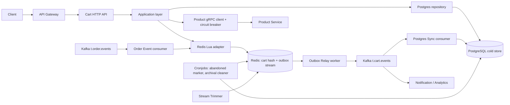

# Cart Service — Architecture

> File này trả lời: “Cart Service được chia thành những thành phần nào và chúng
> phối hợp ra sao?”

## 1. Architecture context

Cart nằm sau API Gateway. Gateway xác thực JWT và inject `X-User-Id`; Cart không
bao giờ nhận identity trực tiếp từ client. Cart đọc dữ liệu catalog từ Product
Service qua gRPC theo Pull Model, và nhận `ORDER_PAID` từ Order Service qua Kafka
để dọn giỏ sau thanh toán. Chiều ra, Cart chỉ phát event lên `t.cart.events`;
downstream tự sở hữu side effect của mình.

Trust boundary quan trọng: mọi request public đi qua Gateway. Redis, PostgreSQL
và Kafka nằm trong mạng nội bộ và chỉ Cart Service được truy cập kho dữ liệu của
Cart.

## 2. Trách nhiệm từng component

| Component | Làm gì | Không được làm | Dependencies | Evidence |
|---|---|---|---|---|
| HTTP adapter | Parse request, đọc `X-User-Id`, validate cú pháp, map domain error ra HTTP | Chứa business rule, gọi thẳng Redis/PG | Application layer | `internal/api/handler`, `internal/api/router` |
| Application/domain service | Build snapshot item, quyết định luồng cache hit / miss, gọi Lua, dựng response | Biết chi tiết Gin hay Kafka | Redis adapter, product client, repository | `internal/domain/service` |
| Redis Lua adapter | Thực thi ba script nguyên tử: add/update, batch delete, silent rehydrate | Ghi cart state bằng lệnh rời ngoài script | Redis | `internal/infrastructure/redis`, [`scripts/`](./scripts) |
| Product gRPC client | Multi-get SKU với timeout cứng và circuit breaker | Chặn request đọc giỏ khi Product lỗi | Product Service | `internal/infrastructure/grpc`, `internal/common/circuitbreaker` |
| Postgres repository | Đọc cold store khi rehydrate, ghi projection từ consumer | Là nguồn chân lý cho cart state | PostgreSQL | `internal/infrastructure/postgres` |
| Outbox Relay worker | Đọc Redis Stream shard, bổ sung header, produce Kafka, `XACK` | `XACK` trước khi Kafka xác nhận; sinh `event_id` ngẫu nhiên | Redis, Kafka | `internal/workers/outbox_relay` |
| Postgres Sync consumer | Chiếu event Kafka xuống `carts`/`cart_items` với guard `stream_id` | Update trạng thái mù theo `cart_id` | Kafka, PostgreSQL | `internal/workers/postgres_sync` |
| Order Event consumer | Nhận `ORDER_PAID`, chốt idempotency, gọi batch delete | Ghi thẳng PostgreSQL để dọn giỏ | Kafka, Redis | `internal/workers/order_consumer` |
| Cronjobs | Đánh dấu giỏ bỏ quên, dọn dữ liệu quá hạn | Chạy song song nhiều instance không lock | PostgreSQL, Redis | `internal/workers/cronjobs` |
| Stream Trimmer | Trim message đã xử lý khỏi stream shard | Trim khi consumer group chưa tồn tại | Redis | `internal/workers/cronjobs` |

Chiều phụ thuộc bắt buộc: adapter → application → port; infrastructure chỉ hiện
thực port của domain, domain không import package hạ tầng.

## 3. Processing model

**Luồng ghi đồng bộ.** Request ghi kết thúc ngay khi Lua script trên Redis chạy
xong. Trong một script, Redis vừa cập nhật hash giỏ hàng vừa `XADD` event vào
outbox stream, nên hai thao tác này hoặc cùng thành công hoặc cùng không xảy ra.
Đây là cách Cart giải bài toán dual-write mà không cần transaction phân tán
([ADR-002](./decisions/ADR-002-redis-streams-outbox.md)). Sau khi Lua trả về,
backend xóa negative cache rồi trả `200` cho client.

**Luồng bất đồng bộ.** Outbox Relay đọc stream shard bằng consumer group, bổ sung
header Kafka, produce lên `t.cart.events`, và chỉ `XACK` khi Kafka đã xác nhận.
Postgres Sync consumer đọc lại chính topic đó và chiếu xuống cold store. Downstream
(Notification, Analytics) tiêu thụ cùng topic một cách độc lập.

**Side effect ngoài transaction.** Gọi gRPC sang Product Service luôn nằm ngoài
Lua script: dữ liệu catalog được lấy trước để dựng payload khi ghi, hoặc lấy sau
khi đọc Redis để phủ lên response khi đọc. Không có side effect ngoài nào được
thực hiện bên trong script.

**Luồng phục hồi.** Cache-miss rehydrate đọc PostgreSQL, merge với dữ liệu Product
rồi nạp lại Redis bằng script `silent_rehydrate`. Đây là write-recovery, không
phải business write, nên script này không được `XADD` (`CART-INV-004`).

## 4. Consistency model

| Dữ liệu | Mô hình | Ghi chú |
|---|---|---|
| Cart state trong Redis | Strong trong phạm vi một key | Lua chạy đơn luồng nên không có read-modify-write race |
| Cold store PostgreSQL | Eventual | Trễ bằng thời gian relay cộng thời gian consumer; là bản chiếu, không phải nguồn đọc của API |
| Giá và trạng thái khả dụng | Stale by design | Chỉ được làm mới khi user đọc giỏ; giữa hai lần đọc dữ liệu có thể cũ |
| Trạng thái `carts` | Eventual, có guard | Chỉ đổi khi `stream_id` mới hơn `last_event_stream_id` |

Phát hiện và phục hồi khi đồng bộ thất bại:

- Event chưa relay nằm lại trong Redis Stream và được nhận biết qua `XPENDING`,
  độ dài stream và consumer lag.
- Event bị mất phía cold store thể hiện ở chênh lệch giữa Redis và PostgreSQL;
  đường phục hồi là replay từ Kafka offset, vì stream đã được trim sau khi ACK.
- Cronjob đánh dấu giỏ bỏ quên có bước reconcile publish bù khi crash giữa chừng
  (`abandoned_event_published_at IS NULL`).

## 5. Concurrency model

- **Nguyên tử hóa bằng Lua.** Redis thực thi script đơn luồng, nên các request
  cùng thao tác trên một giỏ không thể dẫm lên nhau. Cộng dồn quantity, chặn trần
  `max_qty`/`max_skus` và sinh event đều nằm trong một script.
- **Ordering downstream bằng Stream ID.** `stream_id` do `XADD` sinh ra là token
  thứ tự duy nhất; timestamp nghiệp vụ chỉ để hiển thị
  ([ADR-004](./decisions/ADR-004-stream-id-ordering.md)).
- **Chống lost update tại cold store.** Mọi upsert và delete đều có mệnh đề so
  sánh `stream_id`, nên event cũ đến muộn không ghi đè event mới.
- **Ordering trong Kafka.** Partition key là `cart_id`, nên mọi event của cùng một
  giỏ đi qua cùng partition và được xử lý tuần tự theo offset.
- **Chống xử lý trùng `ORDER_PAID`.** Consumer chốt khóa
  `cart:idemp:order_paid:{order_id}` ở tầng Go trước khi gọi Lua, và đánh dấu
  `DONE` sau khi phát thành công.
- **Race giữa rehydrate và write.** Script rehydrate chỉ ghi khi field chưa tồn
  tại hoặc bản đến có `updated_at` mới hơn, nên không đè lên thao tác thêm hàng
  đang chạy song song.
- **Race khi trim stream.** Trimmer bắt buộc bỏ qua shard nếu stream còn message
  nhưng chưa có consumer group, tránh xóa event chưa ai đọc.

## 6. Deployment topology

- **API process**: HTTP server, không giữ state, scale ngang theo request load.
  Outbox Relay và Stream Trimmer chạy như goroutine trong cùng process này theo
  thiết kế hiện tại; tách thành process riêng là lựa chọn mở khi cần scale độc lập.
- **Consumer process**: Postgres Sync và Order Event consumer. Số instance không
  vượt số partition của topic tương ứng.
- **Cronjob**: Abandoned Cart Marker và Data Archival Cleaner. Cả hai phải chạy
  singleton, dùng distributed lock hoặc scheduler bảo đảm một lượt chạy.
- Runtime dependency bắt buộc: Redis, PostgreSQL, Kafka, Product Service.
- Ràng buộc scale: Outbox Relay có tối đa số consumer hữu ích bằng số shard (4);
  thêm instance vượt mức đó không tăng throughput.

## 7. Architecture constraints

- Không service nào được đọc/ghi trực tiếp Redis key hoặc database của Cart.
- Mọi key đi vào cùng một Lua script phải dùng hash tag `{cart}` để không vi phạm
  ràng buộc slot của Redis Cluster.
- Không được ghi cart state bằng lệnh Redis rời nằm ngoài ba script chuẩn.
- Script rehydrate không được phát event.
- Không xây reverse index từ SKU sang cart; dữ liệu catalog chỉ lấy theo Pull Model
  ([ADR-005](./decisions/ADR-005-pull-model-product-data.md)).
- Relay không được `XACK` trước khi Kafka xác nhận, và không được sinh `event_id`
  ngẫu nhiên.
- Consumer không được cập nhật trạng thái `carts` mà thiếu guard `stream_id`.
- Business logic không nằm trong HTTP handler hoặc Kafka adapter.

## 8. Trade-offs và ADR liên quan

| Trade-off | ADR |
|---|---|
| Redis là nguồn chân lý, đổi độ bền lấy độ trễ | [ADR-001](./decisions/ADR-001-redis-first-source-of-truth.md) |
| Outbox bằng Redis Streams thay vì publish Kafka trực tiếp | [ADR-002](./decisions/ADR-002-redis-streams-outbox.md) |
| Global sharded stream thay vì stream theo từng giỏ | [ADR-003](./decisions/ADR-003-global-sharded-stream.md) |
| Thứ tự và idempotency dựa trên Stream ID thay vì timestamp | [ADR-004](./decisions/ADR-004-stream-id-ordering.md) |
| Pull Model cho dữ liệu Product thay vì đồng bộ đẩy | [ADR-005](./decisions/ADR-005-pull-model-product-data.md) |
| Chọn Go làm runtime | [ADR-006](./decisions/ADR-006-golang-runtime.md) |
| Redis Streams làm record outbox tạm thời thay vì Pub/Sub, List hoặc Sorted Set | [ADR-007](./decisions/ADR-007-redis-streams-temporary-outbox-records.md) |
