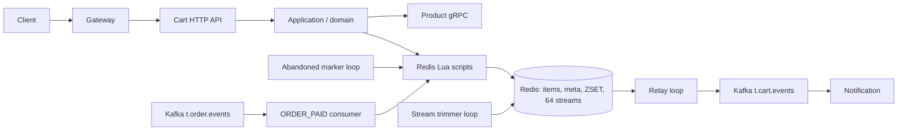

# Cart Service — Architecture

## 1. Architecture context

Cart nằm sau API Gateway; Gateway inject `X-User-Id`. Cart lấy dữ liệu Product theo
Pull Model, nhận `ORDER_PAID`, và chỉ phát `CART_ABANDONED` cho Notification qua
Kafka. Redis là source of truth duy nhất, không có PostgreSQL fallback.

## 2. Components

| Component | Trách nhiệm |
|---|---|
| HTTP adapter | Đọc trusted identity, validate syntax, map error |
| Application service | Quyết định add/update/read; gọi Product và Lua |
| Redis Lua adapter | Ghi duy nhất items/meta/ZSET/idempotency/outbox |
| Product gRPC client | Validate SKU mới và batch enrich response đọc cart |
| Order Event consumer | Gọi remove-items script idempotent cho `ORDER_PAID` |
| Abandoned marker | Quét ZSET, gọi mark-abandoned script |
| Relay | Đọc Redis Stream, produce Kafka, rồi `XACK` |
| Trimmer | `XTRIM MINID` an toàn cho từng stream |

## 3. Processing and consistency model

Cart state mạnh trong phạm vi một bucket: mọi key script dùng cùng `{bNN}`. Một
script hoặc thành công toàn bộ hoặc không đổi gì. Product gRPC luôn ở ngoài script;
Kafka cũng ở ngoài script nhưng Stream record được ghi nguyên tử trước relay.

Không có eventual projection. `GET` đọc Redis; nếu `items`/`meta` không tồn tại thì
trả cart rỗng. Kafka delivery là at-least-once; Notification phải dedupe `event_id`.

## 4. Routing, ordering and concurrency

- `bucket = xxh3_64(canonical_user_id) mod 64`; một cart không đổi bucket trong
  namespace `v2`.
- 64 stream không biểu thị 64 event type. Chúng colocate với 64 cart bucket để
  `ACTIVE -> ABANDONED` và `XADD` không vi phạm Redis Cluster `CROSSSLOT`.
- Mỗi stream có một active relay reader. Ở tải hiện tại một relay loop round-robin
  64 stream; không dùng `XREADGROUP` multi-stream khác slot.
- Relay xử lý pending bằng `XAUTOCLAIM` trước, rồi entry mới theo thứ tự stream.
- Một trimmer loop cũng round-robin 64 stream. Marker loop round-robin 64 ZSET.
- Khi scale, deployment chia ownership dải bucket; không có hai relay active cho
  cùng stream.

## 5. Deployment topology

Một worker deployment có thể chạy API, Order consumer và ba background loop ở tải
thấp. Redis là dependency bắt buộc của mọi HTTP read/write; Product là bắt buộc cho
write cần xác thực, còn Kafka chỉ ảnh hưởng relay. Vì `GET` suy giảm mềm khi Product
lỗi, `/health/ready` chỉ gate theo Redis; Product/Kafka được alert độc lập. Redis
production bắt buộc AOF, replica, TLS và `noeviction`; Cart không có cơ chế khôi phục
sau mất Redis toàn phần.

## 6. Architecture constraints

- Không ghi Redis cart bằng lệnh rời ngoài script chuẩn.
- Không thêm PostgreSQL/cold store vào request path hoặc worker path.
- Không đổi số bucket trong namespace đang chạy; đổi routing cần namespace mới.
- `CART_ABANDONED` là event Kafka duy nhất hiện tại.
- Relay không `XACK` trước Kafka acknowledgement; trimmer không trim entry pending.
- Không dùng Redis keyspace notification để phát abandoned: nó không đủ tin cậy.

## 7. Trade-offs và ADR liên quan

Redis-only giảm chi phí vận hành và loại Postgres Sync, đổi lại cart không thể
rehydrate. Giữ 64 outbox stream tuy event ít để bảo toàn atomicity với state routing.
Xem [ADR-010](./decisions/ADR-010-redis-only-cart-and-abandoned-outbox.md) và
[ADR-011](./decisions/ADR-011-current-pull-read-and-redis-outbox-scope.md).
