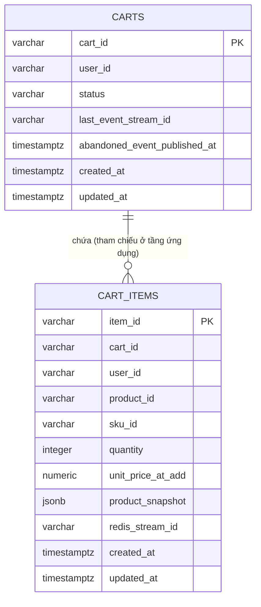

# Cart Service — Data Design

> File này trả lời: “Dữ liệu được sở hữu, lưu trữ và duy trì tính đúng đắn thế nào?”
> Nguồn chuẩn cho schema quan hệ là
> [`0001_initial_cart_schema.sql`](./schema/0001_initial_cart_schema.sql); nguồn
> chuẩn cho các thao tác nguyên tử trên Redis là [`scripts/`](./scripts).

## 1. Data ownership

| Kho lưu trữ | Dữ liệu | Nguồn chân lý | Ai được ghi |
|---|---|---|---|
| Redis hash `cart:v1:{bNN}:u:<user_token>:items` | Cart state: SKU, quantity, snapshot hiển thị, mốc thời gian | **Cart state** | Chỉ Cart Service, chỉ qua ba script chuẩn |
| Redis stream `cart:v1:{bNN}:outbox` | Outbox event chưa relay; có đúng 64 stream (`b00..b63`) | Transport nội bộ | Script add/update, script batch delete, cronjob đánh dấu bỏ quên |
| Redis key phụ trợ | Khóa idempotency `ORDER_PAID` | Trạng thái tạm, có TTL | Cart Service |
| PostgreSQL `carts`, `cart_items` | Bản chiếu bền vững của cart state | Không phải nguồn chân lý | Chỉ Postgres Sync consumer và cronjob |
| Kafka `t.cart.events` | Event đã phát ra ngoài | Transport | Outbox Relay |
| Product Service | Giá, trạng thái khả dụng, thông tin catalog | Product Service | Không phải Cart |

Dữ liệu external duy nhất mà Cart sao chép là snapshot hiển thị của sản phẩm. Bản
sao này cố tình cũ: nó ghi lại điều người dùng đã thấy khi thêm vào giỏ, không nhằm
phản ánh catalog thời gian thực.

Không service nào khác được đọc hoặc ghi trực tiếp Redis key hay bảng của Cart.
Checkout và Order lấy dữ liệu giỏ qua HTTP API, không qua database.

## 2. Logical data model

Một Cart có nhiều CartItem. Quan hệ này **không** được biểu diễn bằng foreign key
thật; xem [§4 Constraints](#4-constraints).

Lifecycle: dòng `carts` được tạo khi item đầu tiên được chiếu xuống, tồn tại qua
nhiều vòng `ACTIVE → CHECKED_OUT → ACTIVE`, và chỉ biến mất khi cronjob dọn dữ liệu
quá hạn. Dòng `cart_items` được tạo và xóa hẳn theo từng thao tác của người dùng.

## 3. Schema sources

- [`schema/0001_initial_cart_schema.sql`](./schema/0001_initial_cart_schema.sql) là
  định nghĩa chuẩn của schema quan hệ.
- [`scripts/add_or_update_item.lua`](./scripts/add_or_update_item.lua),
  [`scripts/batch_delete_items.lua`](./scripts/batch_delete_items.lua),
  [`scripts/silent_rehydrate.lua`](./scripts/silent_rehydrate.lua) là định nghĩa
  chuẩn của các thao tác nguyên tử trên Redis.
- Model và repository trong `go/services/cart-service/internal/infrastructure`.

Câu SQL rời rạc trích trong tài liệu chỉ để minh họa ngữ nghĩa; khi lệch với file
schema thì file schema đúng. Việc file schema có khớp với migration đang chạy ở
production hay không là hạng mục cần xác minh.

## 4. Constraints

| Constraint | Nội dung | Nơi enforcement |
|---|---|---|
| Khóa chính `carts.cart_id` | Một dòng cho mỗi giỏ; giá trị là logical ID `c1:<user_token>`, không phải Redis key | Database |
| Khóa chính `cart_items.item_id` | Định dạng `{cart_id}:{sku_id}`, đảm bảo một SKU một dòng | Database |
| `quantity > 0` | Không tồn tại dòng item với số lượng không dương | Database (check) và script Lua |
| `carts.status` thuộc tập hợp cố định | `ACTIVE`, `ABANDONED`, `DELETED`, `CHECKED_OUT` | Database (check) |
| Guard thứ tự | Chỉ ghi khi `stream_id` mới hơn giá trị đã lưu | Mệnh đề `WHERE` trong câu lệnh của consumer |
| Trần số lượng và số loại SKU | `max_qty`, `max_skus` | Script add/update, không phải database |
| `unit_price_at_add` bất biến | Chỉ được ghi khi tạo dòng | Nhánh merge của script add/update |

**Không có foreign key thật** giữa `cart_items` và `carts`. Quan hệ được duy trì ở
tầng ứng dụng vì consumer có thể nhận event item trước khi dòng master tồn tại, và
vì việc chèn khóa ngoại làm chậm đường ghi vốn chỉ là bản chiếu. Hệ quả bắt buộc
phải nhớ: **`CASCADE DELETE` không tồn tại**. Mọi thao tác xóa giỏ phải xóa
`cart_items` trước rồi mới xóa `carts`, trong cùng một transaction.

Ràng buộc nghiệp vụ không biểu diễn được bằng database: “một `sku_id` chỉ xuất hiện
một lần trong giỏ” được đảm bảo bởi cấu trúc hash của Redis chứ không phải bởi cold
store; “giỏ rỗng thì key bị xóa” cũng chỉ tồn tại ở Redis.

## 5. Indexes và query patterns

| Index | Query pattern phục vụ | Trade-off |
|---|---|---|
| `carts` theo `user_id` | Tra cứu vận hành và phân tích theo người dùng | Chi phí ghi nhỏ, ít thay đổi |
| `carts` theo `(status, updated_at)` | Cronjob quét giỏ bỏ quên và giỏ quá hạn dọn dẹp | Cập nhật trạng thái làm index thay đổi thường xuyên |
| `carts` theo mốc publish bù | Bước reconcile của cronjob đánh dấu bỏ quên | Index bộ phận, rất nhỏ |
| `cart_items` theo `cart_id` | Đọc toàn bộ item khi rehydrate và khi xóa giỏ | Đây là index nóng nhất của bảng |
| `cart_items` theo `sku_id` | Truy vấn phân tích theo sản phẩm | Chỉ phục vụ đọc offline |

Đường đọc của API không chạm cold store, trừ nhánh rehydrate. Vì vậy chỉ số ghi và
chỉ số quét theo lô của cronjob mới là yếu tố quyết định thiết kế index.

## 6. Transaction boundaries

**Trên Redis.** Một business write là một lần thực thi Lua script. Trong phạm vi đó,
thay đổi hash và việc sinh event là nguyên tử. Không có transaction nào trải rộng
hơn một cart key.

**Trên PostgreSQL.** Postgres Sync consumer mở một transaction cho mỗi `cart_id`
trong lô. Trong transaction đó, các thao tác upsert item, xóa item và cập nhật dòng
master đi cùng nhau. Nếu một giỏ lỗi, chỉ transaction của giỏ đó rollback, nhưng
offset của cả lô không được commit; nhờ guard `stream_id`, việc redeliver phần đã ghi
là vô hại.

Isolation mặc định `READ COMMITTED` là đủ vì mọi ghi đều điều kiện hóa theo
`stream_id`, tức là dùng compare-and-set thay vì khóa. Không có nguy cơ lost update
theo nghĩa cổ điển: một câu lệnh mang `stream_id` cũ đơn giản là không khớp dòng nào.

Side effect nằm ngoài mọi transaction: gọi gRPC sang Product Service và produce Kafka.

## 7. Redis keyspace

Redis là primary store, không phải cache ([ADR-001](./decisions/ADR-001-redis-first-source-of-truth.md)).
Không gian key chủ đích chỉ gồm cart state, outbox và idempotency; không có negative
cache hoặc distributed lease trong Redis.

### 7.1. Routing và logical identity

`user_token` là bản mã hóa canonical, URL-safe của `user_id`. Application tính
`bucket = xxh3_64(canonical_user_id) mod 64`, format thành `b00..b63`. Hàm hash,
số bucket và namespace `v1` là data contract; không thay đổi bằng runtime config.

`cart_id = c1:<user_token>` là logical identity được gửi trong event và lưu ở cold
store. Nó **không** bằng Redis key vật lý, nên thay đổi prefix hoặc layout key không
làm đổi identity nghiệp vụ.

### 7.2. Cart hash

| Thuộc tính | Giá trị |
|---|---|
| Key | `cart:v1:{bNN}:u:<user_token>:items` |
| Kiểu | Hash |
| Field | `sku_id` |
| Value | Chuỗi JSON snapshot của item |
| TTL | 7 ngày, gia hạn ở mỗi business write và rehydrate |
| Nguồn chân lý | Chính nó |

Ví dụ: `cart:v1:{b17}:u:NTUwZTg0MC...:items`. Hash tag `{b17}` buộc cart hash và
outbox cùng bucket vào một Redis Cluster slot; các bucket khác được cluster phân bố
độc lập. Đây là khác biệt quan trọng với tag cố định `{cart}`, vốn sẽ dồn mọi cart
vào một slot.

Value chứa: `product_id`, `quantity`, `unit_price_at_add`, `product_name`,
`variant_info`, `image_url`, `is_available`, `added_at`, `updated_at`.
`current_price` không được lưu; nó chỉ có ở response runtime. Mốc thời gian là epoch
milliseconds lưu dạng chuỗi để tránh mất chính xác JSON/JavaScript.

Đường đọc trúng cache không gia hạn TTL. Ngoại lệ duy nhất là rehydrate, vì đó là
write-recovery. Khi Product báo `is_available = false`, chỉ ghi lại field item cần
thiết và không thay đổi TTL.

Không có negative cache: khi hash không tồn tại, API đi thẳng vào nhánh rehydrate.
Nếu cold store không có cart còn hiệu lực, trả giỏ rỗng. Rehydrate hội tụ an toàn khi
chạy đồng thời nên không cần khóa chống dồn tải trong Redis.

### 7.3. Bucketed outbox streams

| Thuộc tính | Giá trị |
|---|---|
| Key | `cart:v1:{bNN}:outbox`, với `bNN` trong `b00..b63` |
| Số lượng | 64 stream cố định |
| Kiểu | Stream |
| Cách route | Cùng `bucket` đã tính cho cart của `user_id` |
| Entry fields | `event_version`, `event_type`, `cart_id`, `user_id`, `payload`, `occurred_at_ms` |
| Consumer group | Một instance group `cart-outbox-relay-v1` trên **mỗi** stream |
| Cắt bộ nhớ | `XTRIM MINID` định kỳ, không dùng `MAXLEN` khi `XADD` |

Một script ghi truyền cart hash và stream của cùng bucket qua `KEYS[]`, nên `HSET`/
`HDEL` và `XADD` là nguyên tử trên Redis Cluster. `XADD` trả `stream_id`. Mọi event
của cùng cart luôn đi một stream, vì route chỉ phụ thuộc `user_id`; do đó `stream_id`
vẫn là token thứ tự hợp lệ **trong phạm vi cart đó**. Nó không còn được coi là định
danh duy nhất trên toàn bộ 64 stream. Relay dựng Kafka `event_id` từ
`outbox_key + stream_id` và đưa cả `outbox_bucket`, `stream_id`, `cart_id` vào header.

Mỗi stream phải được tạo group bằng `XGROUP CREATE <stream> cart-outbox-relay-v1 0
MKSTREAM`; dùng `$` có thể bỏ sót entry được ghi trước lúc group khởi động.

Không dùng `MAXLEN` khi `XADD`: cắt theo độ dài có thể xóa message chưa được `XACK`
khi relay chậm, tức là mất event.

### 7.4. Khóa idempotency của `ORDER_PAID`

| Thuộc tính | Giá trị |
|---|---|
| Key | `cart:v1:idemp:order-paid:o:<order_token>` |
| Kiểu | String, giá trị `PROCESSING` hoặc `DONE` |
| Vòng đời | `SET NX EX` TTL processing ngắn; khi thành công ghi `DONE` với TTL ít nhất bằng Kafka retention cộng replay window |
| Tầng thực thi | Tầng Go của consumer, không truyền vào Lua |

Khóa không dùng hash tag vì không đi cùng key khác trong script. Đây là keyspace phụ
trợ duy nhất còn lại; thao tác batch delete tự idempotent là lớp bảo vệ thứ hai.

### 7.5. Hành vi khi Redis không khả dụng

Vì Redis là nguồn chân lý chứ không phải lớp tăng tốc, mất Redis đồng nghĩa với mất
khả năng đọc và ghi giỏ hàng. Không có fallback đọc thẳng cold store trong request
path: cold store có thể chậm và cũ hơn trạng thái Redis. Đây là đánh đổi tại
[ADR-001](./decisions/ADR-001-redis-first-source-of-truth.md).

## 8. Outbox/inbox và idempotency storage

### 8.1. Outbox

Outbox của Cart không phải một bảng SQL mà là Redis Stream
([ADR-002](./decisions/ADR-002-redis-streams-outbox.md)). Vòng đời một event:

1. Script Lua `XADD` event vào outbox stream của bucket, nhận `stream_id` do Redis sinh.
2. Relay đọc qua group `cart-outbox-relay-v1` của stream đó, produce sang Kafka, rồi `XACK`.
3. `XACK` chỉ đánh dấu đã xử lý trong group; nó **không** giải phóng bộ nhớ.
4. Stream Trimmer cắt các entry đã an toàn bằng `XTRIM MINID`.

Phân biệt cần nhớ: `XACK` chống redelivery, `XTRIM` giải phóng RAM. Thiếu bước trim
sẽ rò rỉ bộ nhớ dần dù mọi message đã được ACK.

Khôi phục khi worker chết: message đã đọc nhưng chưa ACK nằm ở trạng thái pending và
được nhặt lại bằng `XAUTOCLAIM` sau ngưỡng thời gian.

### 8.2. Khóa thứ tự và dedupe

`stream_id` là khóa thứ tự của một cart trong outbox stream bucket của nó
([ADR-009](./decisions/ADR-009-bucket-scoped-event-ordering.md)). Nó do Redis sinh, đơn điệu
tăng trong một stream, và không phụ thuộc đồng hồ của pod ứng dụng. `outbox_key +
stream_id` mới là định danh duy nhất giữa các bucket.

| Nơi lưu | Cột | Ý nghĩa |
|---|---|---|
| `cart_items` | `redis_stream_id` | `stream_id` mới nhất đã áp dụng cho dòng item |
| `carts` | `last_event_stream_id` | `stream_id` mới nhất đã áp dụng cho trạng thái giỏ |

Quy tắc so sánh: chỉ ghi khi `stream_id` của event **lớn hơn** giá trị đã lưu. Bằng
nhau được coi là duplicate và bỏ qua. Vì `stream_id` có dạng `<milliseconds>-<sequence>`,
việc so sánh phải cho ra thứ tự đúng cả ở phần sequence, không chỉ phần timestamp.

Định danh event ở Kafka được Relay sinh xác định từ `outbox_key` và `stream_id`,
không phải UUID ngẫu nhiên, để mọi lần retry cho ra cùng một định danh và downstream
có thể dedupe. `cart_id` và `outbox_bucket` luôn có trong header để truy vết.

### 8.3. Inbox

Cart không dùng bảng inbox. Chống trùng ở chiều tiêu thụ dựa vào hai cơ chế: khóa
idempotency trên Redis cho `ORDER_PAID`, và bản chất idempotent của thao tác xóa theo
`sku_id`.

### 8.4. Retention và cleanup

Entry stream được trim sau khi đã ACK và không còn pending. Khóa idempotency tự hết
hạn theo TTL. Không có negative-cache key hoặc Redis lease key cần dọn thủ công.

## 9. Data lifecycle

| Trạng thái | Điều kiện | Hành động | Người thực hiện |
|---|---|---|---|
| `ACTIVE` | Không tương tác quá 30 ngày | Chuyển sang `ABANDONED` và phát `CART_ABANDONED` | Abandoned Cart Marker |
| `DELETED` | Quá 3 tháng kể từ lần cập nhật cuối | Hard delete | Data Archival Cleaner |
| `CHECKED_OUT` | Quá 3 tháng kể từ lần cập nhật cuối | Hard delete | Data Archival Cleaner |
| `ABANDONED` | Quá 6 tháng kể từ lần cập nhật cuối | Hard delete | Data Archival Cleaner |

Giỏ bị bỏ quên được giữ lâu hơn vì nó còn giá trị phân tích và tiếp thị lại; giỏ đã
xóa hoặc đã mua thì không.

Thứ tự xóa bắt buộc, trong cùng một transaction: xóa `cart_items` theo `cart_id`
trước, rồi mới xóa `carts`. Không có `CASCADE` để dựa vào (xem §4).

Item bị xóa khỏi giỏ là hard delete, không có soft delete. Vì Redis là nguồn chân lý,
giữ lại bản ghi đã biến mất khỏi Redis chỉ tạo ra dữ liệu không ai đọc.

Migration và backfill: đổi định dạng Redis key không làm đổi `cart_id`, nhưng đổi
namespace, hàm routing hoặc số bucket vẫn là thay đổi dữ liệu. Không được đổi `64`
trực tiếp: tạo version routing mới, giữ relay/trimmer cho `v1`, drain toàn bộ stream
`v1`, rồi mới ngừng đọc namespace cũ.

Sao lưu và phục hồi: cold store là bản sao bền vững của cart state, nên khôi phục
sau sự cố Redis dựa vào rehydrate theo từng người dùng thay vì một lần khôi phục
toàn cục. Redis nên bật AOF để giảm thiệt hại khi node khởi động lại, đặc biệt với
các event trong stream chưa kịp relay.

## 10. Security và privacy

**Dữ liệu cá nhân.** Nội dung giỏ hàng là dữ liệu cá nhân: nó tiết lộ hành vi và ý
định mua sắm của một người dùng cụ thể. `user_id` xuất hiện trong khóa Redis, trong
cold store và trong mọi event payload.

**Không lưu ở đây.** Cart không lưu thông tin thanh toán, địa chỉ, hay bất kỳ thông
tin định danh trực tiếp nào ngoài `user_id`.

**Truy cập.** Chỉ Cart Service được truy cập kho dữ liệu của Cart. Đường đọc công
khai duy nhất là API đã xác thực, và mỗi người dùng chỉ đọc được giỏ của chính mình
(`CART-BR-013`).

**Log.** Không log toàn bộ payload snapshot ở mức thông tin thường. `user_id` và
`cart_id` chỉ được ghi theo chính sách quyền riêng tư chung của hệ thống và không
được dùng làm nhãn metric có lực lượng cao.

**Mã hóa.** Kết nối tới PostgreSQL, Redis và Kafka phải dùng TLS; mã hóa khi lưu trữ
theo hạ tầng. Không có trường nào cần mã hóa ở mức cột.

**Xóa dữ liệu theo yêu cầu.** Đây là khoảng trống đã biết: Cart chưa tiêu thụ
`USER_DELETED` từ Auth Service, nên khi một tài khoản bị xóa, giỏ hàng của người đó
vẫn tồn tại tới khi cronjob dọn dữ liệu quá hạn chạm tới. Cần bổ sung một consumer
xóa ngay cart key trên Redis và các dòng cold store tương ứng.
