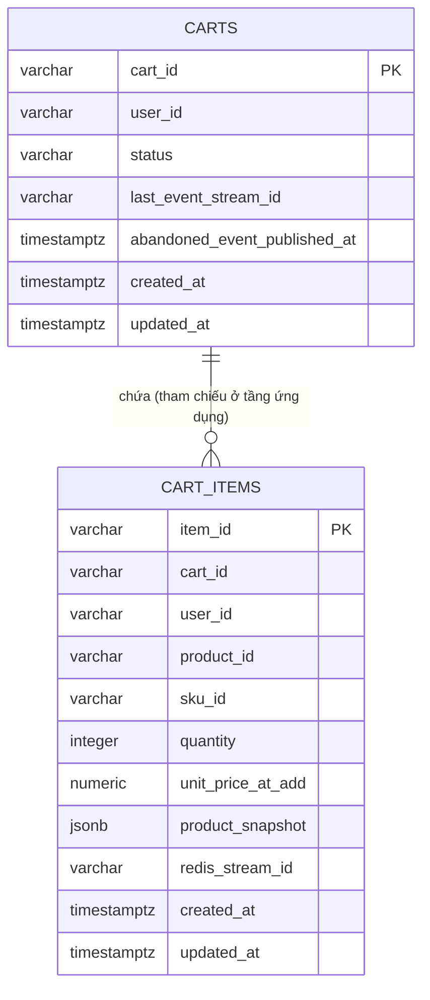

# Cart Service — Data Design

> File này trả lời: “Dữ liệu được sở hữu, lưu trữ và duy trì tính đúng đắn thế nào?”
> Nguồn chuẩn cho schema quan hệ là
> [`0001_initial_cart_schema.sql`](./schema/0001_initial_cart_schema.sql); nguồn
> chuẩn cho các thao tác nguyên tử trên Redis là [`scripts/`](./scripts).

## 1. Data ownership

| Kho lưu trữ | Dữ liệu | Nguồn chân lý | Ai được ghi |
|---|---|---|---|
| Redis hash `{cart}:{user_id}` | Cart state: SKU, quantity, snapshot hiển thị, mốc thời gian | **Cart state** | Chỉ Cart Service, chỉ qua ba script chuẩn |
| Redis stream `{cart}:events:{shard}` | Outbox event chưa relay | Transport nội bộ | Script add/update, script batch delete, cronjob đánh dấu bỏ quên |
| Redis key phụ trợ | Negative cache, khóa idempotency | Trạng thái tạm, có TTL | Cart Service |
| PostgreSQL `carts`, `cart_items` | Bản chiếu bền vững của cart state | Không phải nguồn chân lý | Chỉ Postgres Sync consumer và cronjob |
| Kafka `t.cart.events` | Event đã phát ra ngoài | Transport | Outbox Relay |
| Product Service | Giá, trạng thái khả dụng, thông tin catalog | Product Service | Không phải Cart |

Dữ liệu external duy nhất mà Cart sao chép là snapshot hiển thị của sản phẩm. Bản
sao này cố tình cũ: nó ghi lại điều người dùng đã thấy khi thêm vào giỏ, không nhằm
phản ánh catalog thời gian thực.

Không service nào khác được đọc hoặc ghi trực tiếp Redis key hay bảng của Cart.
Checkout và Order lấy dữ liệu giỏ qua HTTP API, không qua database.

## 2. Logical data model

Một Cart có nhiều CartItem. Quan hệ này **không** được biểu diễn bằng foreign key
thật; xem [§4 Constraints](#4-constraints).

Lifecycle: dòng `carts` được tạo khi item đầu tiên được chiếu xuống, tồn tại qua
nhiều vòng `ACTIVE → CHECKED_OUT → ACTIVE`, và chỉ biến mất khi cronjob dọn dữ liệu
quá hạn. Dòng `cart_items` được tạo và xóa hẳn theo từng thao tác của người dùng.

## 3. Schema sources

- [`schema/0001_initial_cart_schema.sql`](./schema/0001_initial_cart_schema.sql) là
  định nghĩa chuẩn của schema quan hệ.
- [`scripts/add_or_update_item.lua`](./scripts/add_or_update_item.lua),
  [`scripts/batch_delete_items.lua`](./scripts/batch_delete_items.lua),
  [`scripts/silent_rehydrate.lua`](./scripts/silent_rehydrate.lua) là định nghĩa
  chuẩn của các thao tác nguyên tử trên Redis.
- Model và repository trong `go/services/cart-service/internal/infrastructure`.

Câu SQL rời rạc trích trong tài liệu chỉ để minh họa ngữ nghĩa; khi lệch với file
schema thì file schema đúng. Việc file schema có khớp với migration đang chạy ở
production hay không là hạng mục cần xác minh.

## 4. Constraints

| Constraint | Nội dung | Nơi enforcement |
|---|---|---|
| Khóa chính `carts.cart_id` | Một dòng cho mỗi giỏ; giá trị bằng đúng Redis key | Database |
| Khóa chính `cart_items.item_id` | Định dạng `{cart_id}:{sku_id}`, đảm bảo một SKU một dòng | Database |
| `quantity > 0` | Không tồn tại dòng item với số lượng không dương | Database (check) và script Lua |
| `carts.status` thuộc tập hợp cố định | `ACTIVE`, `ABANDONED`, `DELETED`, `CHECKED_OUT` | Database (check) |
| Guard thứ tự | Chỉ ghi khi `stream_id` mới hơn giá trị đã lưu | Mệnh đề `WHERE` trong câu lệnh của consumer |
| Trần số lượng và số loại SKU | `max_qty`, `max_skus` | Script add/update, không phải database |
| `unit_price_at_add` bất biến | Chỉ được ghi khi tạo dòng | Nhánh merge của script add/update |

**Không có foreign key thật** giữa `cart_items` và `carts`. Quan hệ được duy trì ở
tầng ứng dụng vì consumer có thể nhận event item trước khi dòng master tồn tại, và
vì việc chèn khóa ngoại làm chậm đường ghi vốn chỉ là bản chiếu. Hệ quả bắt buộc
phải nhớ: **`CASCADE DELETE` không tồn tại**. Mọi thao tác xóa giỏ phải xóa
`cart_items` trước rồi mới xóa `carts`, trong cùng một transaction.

Ràng buộc nghiệp vụ không biểu diễn được bằng database: “một `sku_id` chỉ xuất hiện
một lần trong giỏ” được đảm bảo bởi cấu trúc hash của Redis chứ không phải bởi cold
store; “giỏ rỗng thì key bị xóa” cũng chỉ tồn tại ở Redis.

## 5. Indexes và query patterns

| Index | Query pattern phục vụ | Trade-off |
|---|---|---|
| `carts` theo `user_id` | Tra cứu vận hành và phân tích theo người dùng | Chi phí ghi nhỏ, ít thay đổi |
| `carts` theo `(status, updated_at)` | Cronjob quét giỏ bỏ quên và giỏ quá hạn dọn dẹp | Cập nhật trạng thái làm index thay đổi thường xuyên |
| `carts` theo mốc publish bù | Bước reconcile của cronjob đánh dấu bỏ quên | Index bộ phận, rất nhỏ |
| `cart_items` theo `cart_id` | Đọc toàn bộ item khi rehydrate và khi xóa giỏ | Đây là index nóng nhất của bảng |
| `cart_items` theo `sku_id` | Truy vấn phân tích theo sản phẩm | Chỉ phục vụ đọc offline |

Đường đọc của API không chạm cold store, trừ nhánh rehydrate. Vì vậy chỉ số ghi và
chỉ số quét theo lô của cronjob mới là yếu tố quyết định thiết kế index.

## 6. Transaction boundaries

**Trên Redis.** Một business write là một lần thực thi Lua script. Trong phạm vi đó,
thay đổi hash và việc sinh event là nguyên tử. Không có transaction nào trải rộng
hơn một cart key.

**Trên PostgreSQL.** Postgres Sync consumer mở một transaction cho mỗi `cart_id`
trong lô. Trong transaction đó, các thao tác upsert item, xóa item và cập nhật dòng
master đi cùng nhau. Nếu một giỏ lỗi, chỉ transaction của giỏ đó rollback, nhưng
offset của cả lô không được commit; nhờ guard `stream_id`, việc redeliver phần đã ghi
là vô hại.

Isolation mặc định `READ COMMITTED` là đủ vì mọi ghi đều điều kiện hóa theo
`stream_id`, tức là dùng compare-and-set thay vì khóa. Không có nguy cơ lost update
theo nghĩa cổ điển: một câu lệnh mang `stream_id` cũ đơn giản là không khớp dòng nào.

Side effect nằm ngoài mọi transaction: gọi gRPC sang Product Service, produce Kafka,
và xóa negative cache.

## 7. Caching

Redis ở đây không phải cache theo nghĩa thông thường mà là primary store
([ADR-001](./decisions/ADR-001-redis-first-source-of-truth.md)). Phần dưới mô tả toàn
bộ không gian key.

### 7.1. Cart hash

| Thuộc tính | Giá trị |
|---|---|
| Key | `{cart}:{user_id}` |
| Kiểu | Hash |
| Field | `sku_id` |
| Value | Chuỗi JSON snapshot của item |
| TTL | 7 ngày, gia hạn ở mỗi lần ghi |
| Nguồn chân lý | Chính nó |

Hash tag `{cart}` là bắt buộc: nó buộc cart key và stream shard rơi vào cùng hash
slot, điều kiện để một Lua script chạm cả hai key mà không gặp lỗi `CROSSSLOT` trên
Redis Cluster.

Value chứa: `product_id`, `quantity`, `unit_price_at_add`, `product_name`,
`variant_info`, `image_url`, `is_available`, `added_at`, `updated_at`.

Hai quy ước bắt buộc về value:

- `current_price` **không** nằm trong value. Đây là trường runtime chỉ xuất hiện ở
  response của API đọc giỏ.
- Mốc thời gian là epoch **milliseconds** lưu dưới dạng **chuỗi**. Dùng
  milliseconds vì giá trị nằm trong ngưỡng số nguyên an toàn của JavaScript, còn
  microseconds thì không. Lưu dạng chuỗi vì thư viện JSON của Redis chuyển số lớn
  sang ký hiệu khoa học và làm mất độ chính xác.

### 7.2. Quy tắc TTL chỉ-đọc

Đường đọc trúng cache **không** được gia hạn TTL. Nếu mỗi lần xem giỏ đều đẩy hạn
sống thêm 7 ngày, một người dùng chỉ xem mà không mua sẽ giữ giỏ sống vô hạn và
Redis không bao giờ giải phóng được bộ nhớ.

Có đúng hai ngoại lệ:

1. Ghi lại một field `is_available = false` khi Product Service báo sản phẩm không
   còn bán — chỉ ghi field đó, không đụng TTL và không đụng field khác.
2. Rehydrate được đặt lại TTL đúng một lần, vì đây là write-recovery chứ không phải
   thao tác đọc.

### 7.3. Outbox stream shard

| Thuộc tính | Giá trị |
|---|---|
| Key | `{cart}:events:{shard_id}` với `shard_id` trong `0..3` |
| Kiểu | Stream |
| Cách chọn shard | Băm ổn định `user_id` rồi chia dư cho số shard |
| Field của mỗi entry | `event_type` và `payload` |
| Consumer group | Một group riêng cho mỗi shard |
| Cắt bộ nhớ | `XTRIM MINID` định kỳ, không dùng `MAXLEN` khi `XADD` |

Payload được bổ sung `cart_id`, `sku_id` và `user_id` ngay trước khi `XADD`, dù hash
value không lưu ba trường này vì chúng đã ngầm định trong key và field. Consumer
downstream cần chúng tường minh để không phải tách chuỗi từ `cart_id`.

Không dùng `MAXLEN` khi `XADD` là quyết định có chủ đích: cắt theo độ dài có thể xóa
message chưa được `XACK` khi relay bị chậm, tức là mất event.

### 7.4. Negative cache

| Thuộc tính | Giá trị |
|---|---|
| Key | `{cart}:{user_id}:notfound` |
| TTL | 60 giây |
| Mục đích | Chặn quét cold store lặp lại cho user thực sự chưa có giỏ |
| Bắt buộc xóa khi | Mỗi lần ghi thành công (thêm, cập nhật, xóa) |

Quên xóa key này sau khi ghi sẽ khiến người dùng vừa thêm hàng vẫn thấy giỏ rỗng
trong tối đa 60 giây.

### 7.5. Khóa idempotency của `ORDER_PAID`

| Thuộc tính | Giá trị |
|---|---|
| Key | `cart:idemp:order_paid:{order_id}` |
| Vòng đời | Đặt-nếu-chưa-có với TTL ngắn khi bắt đầu xử lý; ghi đè trạng thái hoàn tất với TTL dài sau khi thành công |
| Tầng thực thi | Tầng Go của consumer, không truyền vào Lua |

Khóa này không dùng hash tag vì nó không bao giờ đi cùng key khác trong một script.

### 7.6. Hành vi khi Redis không khả dụng

Vì Redis là nguồn chân lý chứ không phải lớp tăng tốc, mất Redis đồng nghĩa với mất
khả năng đọc và ghi giỏ hàng. Không có fallback đọc thẳng cold store trong đường
request: cold store có thể chậm hơn Redis vài giây và trả về trạng thái đã cũ, việc
phục vụ dữ liệu đó như thể nó đúng sẽ nguy hiểm hơn là trả lỗi. Đây là đánh đổi đã
được ghi nhận tại [ADR-001](./decisions/ADR-001-redis-first-source-of-truth.md).

Chống dồn tải khi cache trống hàng loạt: negative cache chặn phần lớn truy vấn vô
ích, và script rehydrate an toàn khi chạy đồng thời nên không cần khóa chống dồn.

## 8. Outbox/inbox và idempotency storage

### 8.1. Outbox

Outbox của Cart không phải một bảng SQL mà là Redis Stream
([ADR-002](./decisions/ADR-002-redis-streams-outbox.md)). Vòng đời một event:

1. Script Lua `XADD` event vào shard, nhận `stream_id` do Redis sinh.
2. Relay đọc bằng consumer group, produce sang Kafka, rồi `XACK`.
3. `XACK` chỉ đánh dấu đã xử lý trong group; nó **không** giải phóng bộ nhớ.
4. Stream Trimmer cắt các entry đã an toàn bằng `XTRIM MINID`.

Phân biệt cần nhớ: `XACK` chống redelivery, `XTRIM` giải phóng RAM. Thiếu bước trim
sẽ rò rỉ bộ nhớ dần dù mọi message đã được ACK.

Khôi phục khi worker chết: message đã đọc nhưng chưa ACK nằm ở trạng thái pending và
được nhặt lại bằng `XAUTOCLAIM` sau ngưỡng thời gian.

### 8.2. Khóa thứ tự và dedupe

`stream_id` là khóa thứ tự duy nhất của toàn bộ hệ thống event Cart
([ADR-004](./decisions/ADR-004-stream-id-ordering.md)). Nó do Redis sinh, đơn điệu
tăng trong một stream, và không phụ thuộc đồng hồ của pod ứng dụng.

| Nơi lưu | Cột | Ý nghĩa |
|---|---|---|
| `cart_items` | `redis_stream_id` | `stream_id` mới nhất đã áp dụng cho dòng item |
| `carts` | `last_event_stream_id` | `stream_id` mới nhất đã áp dụng cho trạng thái giỏ |

Quy tắc so sánh: chỉ ghi khi `stream_id` của event **lớn hơn** giá trị đã lưu. Bằng
nhau được coi là duplicate và bỏ qua. Vì `stream_id` có dạng `<milliseconds>-<sequence>`,
việc so sánh phải cho ra thứ tự đúng cả ở phần sequence, không chỉ phần timestamp.

Định danh event ở Kafka được Relay sinh xác định từ `stream_id` và `cart_id`, không
phải UUID ngẫu nhiên, để mọi lần retry cho ra cùng một định danh và downstream có thể
dedupe.

### 8.3. Inbox

Cart không dùng bảng inbox. Chống trùng ở chiều tiêu thụ dựa vào hai cơ chế: khóa
idempotency trên Redis cho `ORDER_PAID`, và bản chất idempotent của thao tác xóa theo
`sku_id`.

### 8.4. Retention và cleanup

Entry stream được trim sau khi đã ACK và không còn pending. Khóa idempotency tự hết
hạn theo TTL. Không có bảng nào cần dọn thủ công ở phía outbox.

## 9. Data lifecycle

| Trạng thái | Điều kiện | Hành động | Người thực hiện |
|---|---|---|---|
| `ACTIVE` | Không tương tác quá 30 ngày | Chuyển sang `ABANDONED` và phát `CART_ABANDONED` | Abandoned Cart Marker |
| `DELETED` | Quá 3 tháng kể từ lần cập nhật cuối | Hard delete | Data Archival Cleaner |
| `CHECKED_OUT` | Quá 3 tháng kể từ lần cập nhật cuối | Hard delete | Data Archival Cleaner |
| `ABANDONED` | Quá 6 tháng kể từ lần cập nhật cuối | Hard delete | Data Archival Cleaner |

Giỏ bị bỏ quên được giữ lâu hơn vì nó còn giá trị phân tích và tiếp thị lại; giỏ đã
xóa hoặc đã mua thì không.

Thứ tự xóa bắt buộc, trong cùng một transaction: xóa `cart_items` theo `cart_id`
trước, rồi mới xóa `carts`. Không có `CASCADE` để dựa vào (xem §4).

Item bị xóa khỏi giỏ là hard delete, không có soft delete. Vì Redis là nguồn chân lý,
giữ lại bản ghi đã biến mất khỏi Redis chỉ tạo ra dữ liệu không ai đọc.

Migration và backfill: đổi định dạng Redis key hoặc số shard là thay đổi có ảnh
hưởng dữ liệu, vì `cart_id` đã nằm trong cold store và trong mọi event đã phát. Quy
trình an toàn cho việc đổi số shard chưa được thiết kế.

Sao lưu và phục hồi: cold store là bản sao bền vững của cart state, nên khôi phục
sau sự cố Redis dựa vào rehydrate theo từng người dùng thay vì một lần khôi phục
toàn cục. Redis nên bật AOF để giảm thiệt hại khi node khởi động lại, đặc biệt với
các event trong stream chưa kịp relay.

## 10. Security và privacy

**Dữ liệu cá nhân.** Nội dung giỏ hàng là dữ liệu cá nhân: nó tiết lộ hành vi và ý
định mua sắm của một người dùng cụ thể. `user_id` xuất hiện trong khóa Redis, trong
cold store và trong mọi event payload.

**Không lưu ở đây.** Cart không lưu thông tin thanh toán, địa chỉ, hay bất kỳ thông
tin định danh trực tiếp nào ngoài `user_id`.

**Truy cập.** Chỉ Cart Service được truy cập kho dữ liệu của Cart. Đường đọc công
khai duy nhất là API đã xác thực, và mỗi người dùng chỉ đọc được giỏ của chính mình
(`CART-BR-013`).

**Log.** Không log toàn bộ payload snapshot ở mức thông tin thường. `user_id` và
`cart_id` chỉ được ghi theo chính sách quyền riêng tư chung của hệ thống và không
được dùng làm nhãn metric có lực lượng cao.

**Mã hóa.** Kết nối tới PostgreSQL, Redis và Kafka phải dùng TLS; mã hóa khi lưu trữ
theo hạ tầng. Không có trường nào cần mã hóa ở mức cột.

**Xóa dữ liệu theo yêu cầu.** Đây là khoảng trống đã biết: Cart chưa tiêu thụ
`USER_DELETED` từ Auth Service, nên khi một tài khoản bị xóa, giỏ hàng của người đó
vẫn tồn tại tới khi cronjob dọn dữ liệu quá hạn chạm tới. Cần bổ sung một consumer
xóa ngay cart key trên Redis và các dòng cold store tương ứng.
