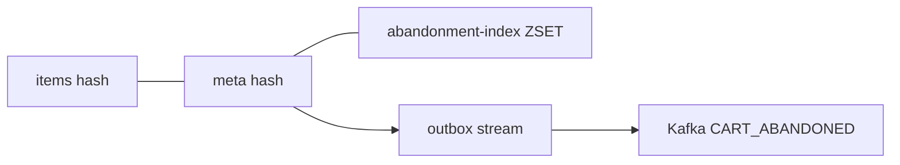

# Cart Service — Data Design

> Redis là source of truth, scheduler store, idempotency store và outbox của Cart.
> Cart không có relational schema hoặc cold store.

## 1. Data ownership

| Store | Dữ liệu | Ai ghi |
|---|---|---|
| Redis `items` hash | SKU, quantity, display snapshot, validation snapshot | Lua scripts Cart |
| Redis `meta` hash | Identity, lifecycle và inactivity metadata | Lua scripts Cart |
| Redis `abandonment-index` ZSET | Deadline đánh dấu abandoned | Lua scripts Cart |
| Redis `idemp` keys | Command fingerprint và kết quả đã xử lý | Lua scripts Cart |
| Redis `outbox` streams | Chỉ `CART_ABANDONED` chờ relay | `mark_abandoned.lua` |
| Kafka `t.cart.events` | Event đã relay | Relay |

Redis phải cấu hình AOF, replica, TLS và `noeviction`. Không có fallback PostgreSQL:
nếu cart state bị mất hoặc hết TTL, API trả cart rỗng. Chi tiết RPO/RTO, capacity
và phản ứng khi Kafka outage nằm ở [Operations](./operations.md).

## 2. Logical data model



Mọi key cùng một cart bucket mang hash tag `{bNN}`. ZSET chứa member `user_token`,
không cần tách `cart_id` để dựng Redis key.

## 3. Redis keyspace

| Key | Type | Nội dung / TTL |
|---|---|---|
| `cart:v2:{bNN}:u:<token>:items` | Hash | Field `sku_id`, value item JSON; TTL active/abandoned |
| `cart:v2:{bNN}:u:<token>:meta` | Hash | `cart_id`, `user_id`, `status`, `last_activity_at_ms`, `abandonment_cycle`; TTL khớp items |
| `cart:v2:{bNN}:abandonment-index` | ZSET | Score `last_activity + abandoned_after`; không có TTL |
| `cart:v2:{bNN}:outbox` | Stream | Record `CART_ABANDONED`; trim an toàn sau relay |
| `cart:v2:{bNN}:u:<token>:idemp:http:<operation>:<key_sha256>` | String | Payload hash + logical response, TTL 24h |

`bucket = xxh3_64(canonical_user_id) mod 64`, có đúng 64 giá trị `b00..b63`.
Số bucket là data contract của namespace `v2`; không đổi bằng runtime config.

### 3.1 Item JSON

```json
{
  "product_id": "PRODUCT-TSHIRT",
  "quantity": 3,
  "unit_price_at_add": { "amount_minor": 125000, "currency": "VND" },
  "product_name": "Áo thun đỏ",
  "variant_attributes": { "color": "red", "size": "M" },
  "image_url": "https://example.test/products/tshirt-red.png",
  "catalog_validated_at_ms": "1780000000000",
  "catalog_validation_expires_at_ms": "1780000060000",
  "added_at": "1780000000000",
  "updated_at": "1780000000000"
}
```

`unit_price_at_add` và `added_at` immutable. `current_price` không được lưu; nó chỉ
có trong response `GET`. `catalog_validated_at_ms` chỉ nói Product đã xác nhận
catalog saleability, không phải inventory reservation hay stock snapshot.

## 4. Constraints

| Constraint | Enforcement |
|---|---|
| Một user có một cart, một SKU một field | Key builder + Redis hash |
| `quantity` trong `1..max_qty` | Upsert Lua script |
| Không quá `max_skus` | Upsert Lua script dùng `HLEN(items)` |
| Mọi write dùng cùng slot | Key builder + script `KEYS[]` |
| `GET` không làm mới TTL | Application layer |
| Một command cùng idempotency key chỉ áp dụng một lần | Lua idempotency record |
| Một abandoned cycle chỉ sinh một outbox entry | `mark_abandoned.lua` |

## 5. Product validation cache

SKU mới luôn cần `GetSku`. SKU đã có không gọi Product khi
`catalog_validation_expires_at_ms` còn hiệu lực; script áp dụng quantity từ state
Redis. Khi metadata hết hạn, application refresh Product rồi gọi lại script.
Mỗi pod dùng bounded LRU + `singleflight` theo `sku_id` (TTL ngắn 30–60 giây) để
gộp request refresh đồng thời. Đây là cache tối ưu hóa, không phải source of truth.

`GET` không ghi lại snapshot vào Redis. Validation cho positive delta có thể cũ tối
đa bằng validation TTL; Checkout xác thực lại catalog/giá và Inventory reserve xác
nhận stock trước khi tạo giao dịch.

## 6. Transaction boundaries

Một Lua invocation là transaction boundary. `upsert_item.lua` cập nhật item, meta,
ZSET, TTL và idempotency record cùng lúc. `remove_items.lua` xóa SKU, cập nhật hoặc
xóa meta và `ZREM` index nếu cart rỗng. `mark_abandoned.lua` cập nhật meta, gỡ index,
đổi TTL và `XADD` event cùng lúc.

Product gRPC và Kafka produce là side effect ngoài transaction. Redis Stream là
record bền để Relay retry Kafka mà không tạo trạng thái "cart đã abandoned nhưng
không còn event".

## 7. Outbox, idempotency và cleanup

Outbox có 64 stream, một stream cho mỗi bucket. Stream chỉ được tạo khi có `XADD`.
`stream_id` chỉ có thứ tự trong stream đó; Relay sinh `event_id` xác định từ
`outbox_key + stream_id`, truyền `outbox_bucket` và `stream_id` trong Kafka header.

Record Redis mang `occurred_at_ms`; Relay chuyển nó thành RFC 3339 `occurred_at` khi
đóng CloudEvent Kafka, theo AsyncAPI.

Relay chỉ `XACK` sau Kafka acknowledgement. Trimmer chạy riêng, chỉ `XTRIM MINID`
qua entry an toàn sau khi consumer group tồn tại và không còn pending entry cũ hơn.
`XACK` không giải phóng RAM.

HTTP idempotency record chứa hash canonical của request và response. Record được
scope theo `user_token + HTTP operation + Idempotency-Key`, nên hai user cùng bucket
hoặc hai operation khác nhau không thể xung đột. Cùng key trong đúng scope nhưng khác
payload trả `409`; key đang xử lý trả conflict/retryable response theo OpenAPI.
Order-paid event không cần record riêng: `HDEL` theo SKU, không phát Cart event và không
gia hạn activity nên bản thân thao tác remove đã idempotent khi Kafka redeliver.

## 8. Lifecycle

| State | Điều kiện | Hành động |
|---|---|---|
| `ACTIVE` | Không tương tác 30 ngày | Marker chuyển `ABANDONED`, phát event |
| `ACTIVE` | User write | Gia hạn `items`/`meta` 37 ngày và dời ZSET deadline |
| `ABANDONED` | User write trong retention | Reactivate, dời deadline và TTL active |
| `ABANDONED` | 7 ngày sau marker | Redis tự expire |
| Cart rỗng | User remove hoặc `com.ecommerce.order.paid.v1` | Xóa `items`, `meta`, `ZSET` member ngay |

TTL 37 ngày tạo buffer 7 ngày cho scheduler sau ngưỡng abandoned 30 ngày. Nếu Redis
key hết hạn trước khi marker chạy, marker chỉ `ZREM` member stale và không phát event.

## 9. Security và privacy

Cart data là dữ liệu hành vi. Không log toàn bộ item JSON ở mức thường và không dùng
`user_id`/`cart_id` làm metric label. Redis/Kafka dùng TLS. Event chỉ có identifier
nội bộ cần thiết cho Notification, không chứa address, payment hay PII trực tiếp.
