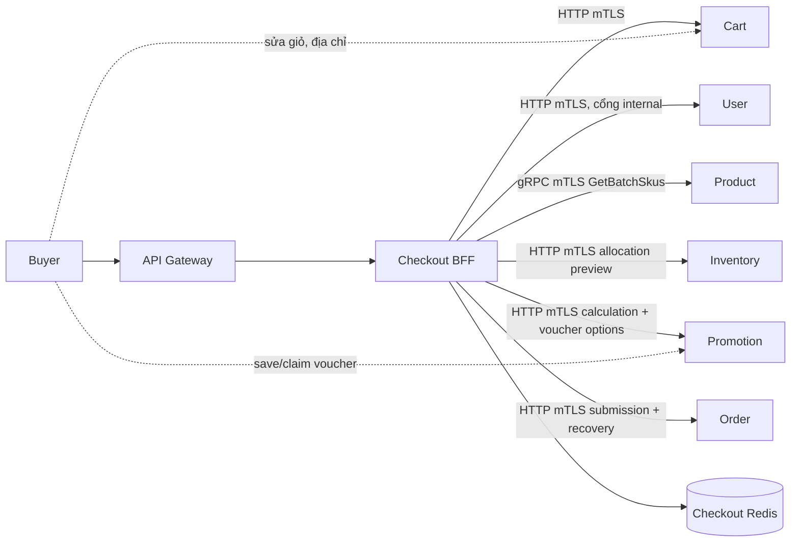

# Checkout Service — Architecture

## 1. Bối cảnh

Checkout là Backend for Frontend đồng bộ, stateless ngoài Redis. Nó kết hợp dữ liệu từ
các owner thành một snapshot có thời hạn; Order mới là owner của giao dịch lâu dài.



Đường nét đứt là thao tác frontend gọi thẳng owner qua Gateway, không qua Checkout
([README §3](./README.md#thao-tác-ngoài-checkout)).

## 2. Thành phần nội bộ

| Thành phần | Trách nhiệm |
|---|---|
| API handlers | Validate contract, trusted `X-User-Id`, `Idempotency-Key`, chuẩn hoá request ID, map lỗi sang `CheckoutProblem` |
| Preview orchestrator | Chạy các wave, kiểm tra chéo dữ liệu, tính tiền integer VND, dựng view model |
| Voucher options composer | Dựng trusted context từ snapshot, gọi Promotion, map sang view model |
| Submit orchestrator | Claim token, revalidate, gọi Order với payload bất biến, ghi kết quả |
| Recovery service | Đọc kết quả local; khi chưa rõ thì hỏi Order và re-POST trong cửa sổ cho phép |
| Session repository | Redis Hash + Lua/CAS cho state machine, TTL, con trỏ active |
| Crypto | HMAC token lookup key; envelope encryption cho PII/token trong value |
| Dependency clients | Một client riêng cho mỗi dependency với timeout, circuit breaker, bulkhead, header propagation |
| Media URL builder | Dựng URL CDN từ storage key Product; placeholder khi không có ảnh |

## 3. Preview: các wave

Mỗi wave chỉ chứa lời gọi đã đủ dữ liệu đầu vào. Promotion không cần kết quả Inventory nên
chạy song song với Inventory.

```text
Wave 1  Cart checkout snapshot                         (≤ 500 ms)
Wave 2  User address snapshot ∥ Product GetBatchSkus   (≤ 500 ms ∥ ≤ 1 000 ms)
        → kiểm tra chéo Cart/Product, sort theo UTF-8 sku_id, tính total_amount
Wave 3  Inventory allocation preview ∥ Promotion calculation (nếu có promotion_id)
                                                       (≤ 3 000 ms ∥ ≤ 2 000 ms)
        → kiểm tra plan phủ đủ dòng, final_amount ≥ 1 VND
Wave 4  Một Lua script: chặn submit đang chạy, CAS con trỏ active,
        ghi session + replay idempotency                (≤ 200 ms)
```

Deadline Preview là 5 000 ms tính từ lúc nhận request. Trước mỗi wave, nếu deadline còn
dưới 200 ms thì Checkout không gọi tiếp và trả `503 CHECKOUT_UNAVAILABLE`. Timeout từng lời
gọi là `min(budget của dependency, deadline còn lại − 100 ms)`.

Mọi dependency của Preview là bắt buộc và fail-closed. Promotion chỉ được coi là "không áp
dụng" khi Promotion trả kết quả nghiệp vụ hợp lệ (`eligible=false`); timeout hay lỗi hạ
tầng không bao giờ thành discount bằng 0.

Trước Wave 1, Checkout đọc nhanh con trỏ active (một lệnh Redis) để trả sớm
`409 SUBMISSION_IN_PROGRESS` khi user đang có submission chưa xong, tránh fan-out vô ích;
Wave 4 kiểm tra lại điều kiện đó trong cùng script.

## 4. Voucher options

```text
Redis: đọc session theo token (owner, state PREVIEWED, chưa hết hạn)   (≤ 200 ms)
Promotion POST /internal/v1/promotion-voucher-options                 (≤ 1 000 ms)
→ map sang view model, đánh dấu is_applied
```

Deadline 1 500 ms. Context gửi Promotion được dựng hoàn toàn từ snapshot của token, nên
khay voucher khớp với báo giá mà không cần gọi lại Cart hay Product. Endpoint chỉ đọc; lỗi
Promotion trả `503 VOUCHER_OPTIONS_UNAVAILABLE` và không ảnh hưởng Preview/Submit
([ADR-017](./decisions/ADR-017-voucher-options-read-composition.md)).

## 5. Submit

```text
Bước 0  Token PREVIEWED còn hạn: kiểm tra circuit Order; mở thì trả 503, chưa claim
Bước 1  Lua claim PREVIEWED → SUBMITTING, ghi payload Order bất biến (mã hoá) và attempt
Bước 2  Revalidate: Cart ∥ Product (≤ 500 ∥ ≤ 1 000 ms), rồi Promotion (≤ 2 000 ms)
Bước 3  Order POST /internal/v1/checkout-order-submissions (≤ 13 000 ms)
Bước 4  Lua ghi kết quả terminal hoặc RETRYABLE
```

Deadline Submit là 20 000 ms. Order chờ tối đa 12 giây tới checkpoint `PAYMENT_READY` và
mesh cắt ở 15 giây, nên timeout Checkout cho Order là `min(13 000 ms, deadline còn lại −
200 ms)`. Nếu trước Bước 3 deadline còn dưới 2 000 ms, Checkout không gọi Order, chuyển
token sang `RETRYABLE` và trả `202 RESULT_UNKNOWN`; luồng recovery sẽ gửi lại đúng payload.

**Hủy request.** Trước Bước 1, client ngắt kết nối thì Checkout hủy mọi lời gọi. Từ Bước 1
trở đi, phần việc còn lại chạy tách khỏi request context (vẫn trong deadline Submit) để
kết quả luôn được ghi vào Redis; client lấy kết quả qua endpoint status. Preview và voucher
options không có side effect ngoài Redis nên luôn hủy theo client.

## 6. Recovery

`GET /api/v1/checkout/submissions/{checkout_token}` đọc kết quả local; nếu token còn
`SUBMITTING` quá owner timeout hoặc `RETRYABLE`, nó hỏi Order
`GET /internal/v1/checkout-order-submissions/{checkout_token}` (≤ 2 000 ms) và chỉ re-POST
đúng payload/key khi Order xác nhận chưa nhận và còn trong cửa sổ retry 2 phút kể từ claim.
Không có worker nền: recovery chỉ chạy khi client hỏi status hoặc gửi lại Submit. Deadline
của endpoint này là 20 000 ms vì có thể re-POST. Chi tiết ở
[workflows.md WF-04](./workflows.md#wf-04-recovery-sau-kết-quả-không-rõ).

## 7. Phân vai với Gateway và mesh

Theo [ADR-014](./decisions/ADR-014-resilience-budget-and-mesh-gateway-split.md):

| Lớp | Trách nhiệm |
|---|---|
| Gateway | JWT, inject `X-User-Id`, rate limit theo user (`checkout-preview`, `checkout-submit`, `checkout-voucher-options`), response-header timeout 25 giây, không retry POST, redact token trong path log |
| Mesh | mTLS, `AuthorizationPolicy` theo principal, retry lỗi kết nối cho Cart/User/Product, timeout ngoài, outlier detection |
| Checkout | Deadline từng route, timeout từng dependency ngắn hơn mesh, circuit breaker và bulkhead, không retry trong request, quyết định lỗi công khai và recovery |

| Dependency | Timeout Checkout | Timeout mesh | Retry mesh |
|---|---:|---:|---|
| Cart checkout snapshot | 500 ms | 1 giây | 2 lần, lỗi kết nối |
| User address snapshot | 500 ms | 2 giây | 2 lần, lỗi kết nối |
| Product `GetBatchSkus` | 1 000 ms | 2 giây | 2 lần, lỗi kết nối/`unavailable` |
| Inventory allocation preview | 3 000 ms | 4 giây | 0 |
| Promotion calculation | 2 000 ms | 3 giây | 0 |
| Promotion voucher options | 1 000 ms | 2 giây | 0 |
| Order submission POST | 13 000 ms | 15 giây | 0 |
| Order submission GET | 2 000 ms | 15 giây | 0 |

Checkout không có rate limiter riêng; quota thuộc Gateway để mọi replica dùng chung state.

## 8. Nhất quán và cạnh tranh

- Mỗi token có record riêng; submit luôn dereference đúng token, không đọc con trỏ active để
  chọn phiên.
- Con trỏ active vừa là con trỏ UX vừa là hàng rào: mỗi user chỉ có một token chưa terminal
  ([ADR-016](./decisions/ADR-016-fresh-preview-and-in-flight-submission-guard.md)).
- Không giữ distributed lock qua network call. Lua/CAS chọn owner; Order idempotency chống
  side effect lặp.
- Cart, Product, Inventory, Promotion không có distributed transaction với Checkout: báo
  giá là các snapshot độc lập; Submit revalidate phần tiền và Order Reserve chốt tồn kho và
  budget.

## 9. Triển khai và mạng

- Public API chỉ qua Gateway; internal APIs yêu cầu service identity/mTLS.
- Tối thiểu hai replica, scale ngang; Redis riêng cho Checkout, hỗ trợ Lua (`EVALSHA`), có HA
  (standalone hoặc Sentinel, không Cluster) và `maxmemory-policy noeviction`.
- Khi nhận SIGTERM: readiness chuyển `false`, ngừng nhận request mới, chờ tối đa 25 giây
  cho request đang chạy (đủ cho deadline Submit 20 giây) rồi mới dừng.

## 10. Trade-off

- Fail-closed làm giảm availability khi một dependency lỗi nhưng giữ đúng bất biến Order cần
  allocation plan và giá có nguồn rõ ràng.
- Token-specific records tốn nhiều key hơn session-per-user nhưng tránh overwrite và hỗ trợ
  recovery rõ ràng.
- Không cache downstream tăng số lời gọi, đổi lại ownership và invalidation đơn giản. Thêm
  cache chỉ qua ADR riêng có version/invalidation contract.
- Chặn Preview khi submission đang chạy làm người dùng phải chờ tối đa vài giây, đổi lại
  không thể tạo hai đơn từ hai token.
