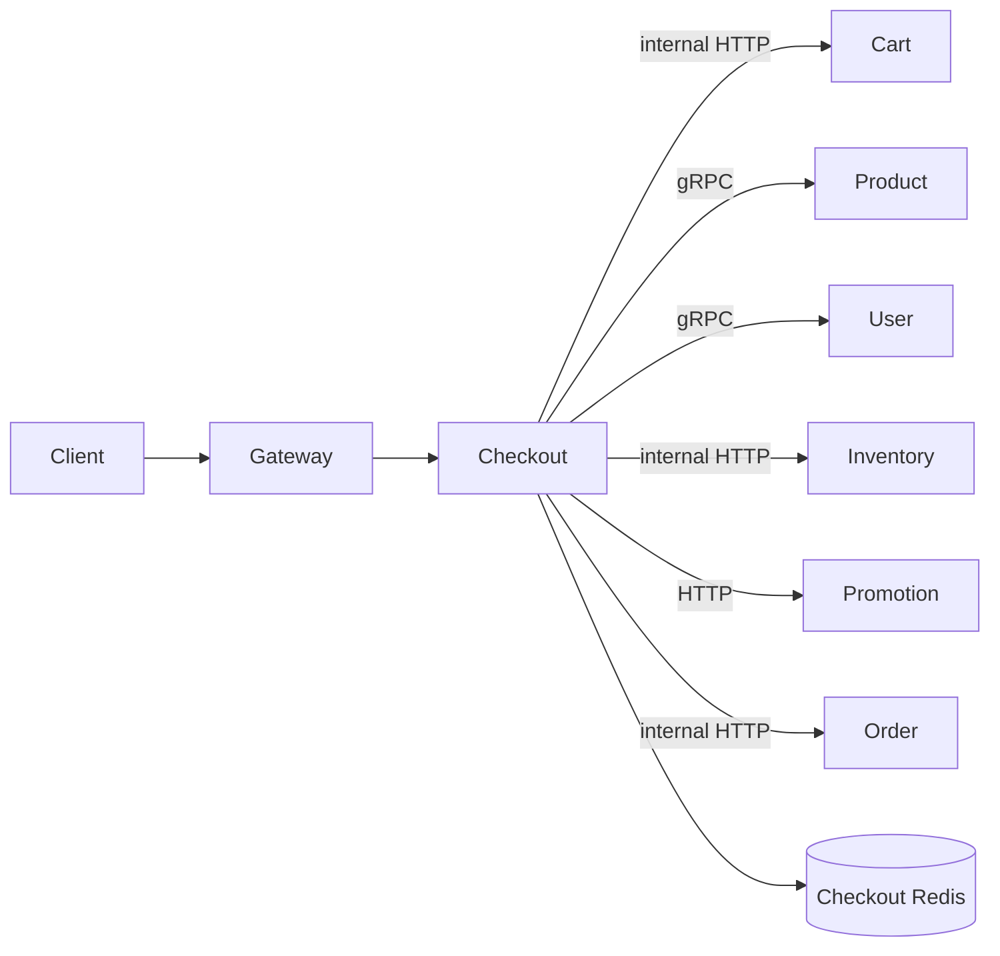

# Checkout Architecture

## Bối cảnh

Checkout là synchronous orchestration/BFF. Nó kết hợp dữ liệu từ các owner rồi phát sinh một snapshot có thời hạn; Order mới là owner của giao dịch lâu dài.

## Thành phần nội bộ

| Thành phần | Trách nhiệm |
|---|---|
| API handlers | Validate contract, auth context, idempotency header và RFC 9457 errors |
| Preview orchestrator | Lấy cart/address/product, allocation preview, promotion và dựng totals |
| Submit orchestrator | Claim token, revalidate, tạo payload Order bất biến và gọi Order |
| Session repository | Redis CAS/Lua cho state machine và TTL |
| Downstream clients | Deadline, mTLS/service identity, propagation `traceparent`/`x-request-id` |
| Recovery service | Đọc local result; nếu kết quả chưa rõ thì query Order bằng idempotency key |

## Luồng preview

Các bước phụ thuộc được chia thành wave để giảm latency nhưng không làm mờ ownership:

1. Đọc Cart checkout snapshot.
2. Song song lấy address authoritative và enrich toàn bộ SKU từ Product.
3. Gọi Inventory whole-order allocation preview với `lines[{line_reference, sku_id, quantity}]` đã chuẩn hóa.
4. Gọi Promotion với giá/category authoritative, `checkout_channel=CHECKOUT`, và omit/null tier trong v1.
5. Tính totals bằng integer VND, tạo token ngẫu nhiên, lưu snapshot bất biến và trả response `no-store`.

Mọi dependency bắt buộc đều fail-closed. Không tạo quote khi thiếu Cart, Product, User hoặc Inventory. Promotion có thể được xem là không áp dụng chỉ khi Promotion trả kết quả nghiệp vụ hợp lệ; timeout/hạ tầng không được âm thầm biến thành discount bằng 0.

## Luồng submit

1. Hash token, chạy CAS `PREVIEWED -> SUBMITTING`, đồng thời materialize `submit-payload` và Order idempotency key.
2. Nếu claim thuộc request khác, trả trạng thái hiện có; không tạo side effect thứ hai.
3. Revalidate Cart item hash, Product pricing/catalog và Promotion revision/expiry. Inventory plan được Order revalidate khi Reserve.
4. Gọi `POST /internal/v1/checkout-order-submissions` với payload bất biến, `Idempotency-Key` bằng token và `user_ack_degraded_pricing=false`.
5. Lưu atomically `SUCCEEDED` hoặc terminal problem. Nếu kết quả call không rõ, giữ trạng thái recoverable rồi query Order status.

## Nhất quán và cạnh tranh

- Không dùng một mutable record theo user làm nguồn submit.
- `checkout:active:{user_id}` là con trỏ UX và CAS fence khi tạo successor; submit vẫn luôn dereference token-specific state.
- Không giữ distributed lock qua network call. Redis CAS chọn owner, Order idempotency chống side effect lặp.
- Preview mới có thể supersede preview cũ chưa submit, nhưng không xóa payload/result của submit đang chạy.
- Redis key và logs/traces không chứa raw token. Submit payload cần token đúng theo Order contract nên token được mã hóa trong Redis value cho recovery.

## Biên cache

Redis chứa workflow state của Checkout, không cache Product/Cart/User/Inventory/Promotion như các domain object dùng chung. Nhờ đó Checkout không phải nhận invalidation events và không tạo thêm nguồn dữ liệu cũ.

## Triển khai và mạng

- Public API chỉ đi qua Gateway; internal APIs yêu cầu service identity/mTLS.
- Checkout là stateless ngoài Redis và có thể scale ngang.
- Redis phải hỗ trợ Lua/EVAL hoặc giao dịch CAS tương đương.
- Gateway route chỉ kích hoạt sau khi upstream Checkout sẵn sàng; contracts hiện vẫn `proposed`.

## Trade-off

- Fail-closed làm giảm availability khi Inventory lỗi nhưng giữ đúng bất biến Order cần allocation plan.
- Token-specific records tốn nhiều key hơn session-per-user nhưng tránh overwrite/race và hỗ trợ recovery rõ ràng.
- Không cache downstream tăng số call, đổi lại ownership và invalidation đơn giản hơn. Tối ưu cache chỉ được thêm bằng ADR riêng kèm version/invalidation contract.
