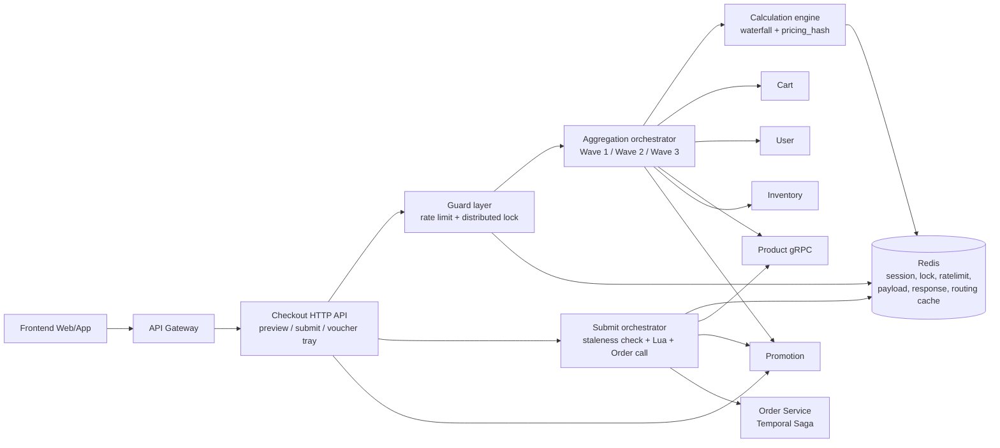

# Checkout Service — Kiến trúc

> File này trả lời: “Checkout được chia thành những thành phần nào và chúng phối
> hợp ra sao?” Toàn bộ cấu trúc được khôi phục từ thiết kế cũ; chưa có source
> path làm evidence.

## 1. Bối cảnh kiến trúc

Checkout Service hoạt động như một **Aggregator** (người gom dữ liệu) và
**Orchestrator cấp cao** cho phía Frontend (Web/App). Nó là Backend for Frontend
(BFF), **không sở hữu database bền vững** và chỉ dùng Redis để giữ session tạm
thời có TTL.

- **Upstream:** Frontend Web/App gọi qua API Gateway (Gateway xác thực JWT, áp
  rate-limit profile cho Promotion Discovery).
- **Downstream:** Cart (snapshot giỏ), User (địa chỉ), Product (giá và trạng thái
  SKU qua gRPC), Inventory (routing/allocation preview), Promotion (tính discount,
  voucher tray), Order (tạo đơn và kích hoạt Temporal Saga).
- **Trust boundary:** Checkout không tin bất kỳ số tiền nào client gửi lên
  (Zero-Trust Client). Các lời gọi nội bộ sang User/Promotion/Inventory/Product/Order đi
  qua service mesh: mTLS và quyền gọi theo principal `checkout-service` do
  `AuthorizationPolicy` thực thi ([mesh/runtime-contract.md §5.2](../mesh/runtime-contract.md#52-namespace-ecommerce-l7-waypoint));
  Checkout gửi `X-Service-Identity: checkout-service` cho attribution theo contract của
  service tương ứng.
- **Vị trí:** Checkout là “lá chắn giao tiếp” đứng trước Order Service; nó chặn
  99% traffic xem thử để hệ sinh thái microservices phía sau chuyên tâm xử lý
  tác vụ ghi/đọc lõi.

## 2. Sơ đồ thành phần



## 3. Trách nhiệm từng thành phần

| Thành phần | Làm gì | Không được làm gì | Dependency |
|---|---|---|---|
| Checkout HTTP API | Nhận `POST /v1/checkout/preview`, `POST /v1/checkout/submit`; proxy voucher tray sang Promotion | Không chứa business logic tính tiền; không tin amount client | Gateway (JWT), Guard layer |
| Guard layer | Rate limit (`checkout:ratelimit:*`) và distributed lock (`checkout:lock:preview`, `checkout:lock:submit`) bằng Redis `SETNX`/`INCR` | Không thay thế Lua one-time-use | Redis |
| Aggregation orchestrator | Gọi song song downstream theo dependency graph (Wave 1: User, Cart, Product, Inventory ×N; Wave 2: Promotion), join và dựng `cart_context`; áp Optimization Decision Tree cho lần Preview sau | Không mutate quantity; không khóa kho/budget | Cart, User, Product, Inventory, Promotion, routing cache |
| Calculation engine | Tính giá waterfall, dựng `pricing_summary`, `pricing_hash`, `items_hash`; sinh `checkout_token` UUID v4; ghi session Redis | Không tự trừ/cộng discount thay Promotion | Redis |
| Submit orchestrator | Lock → kiểm tra status/degraded ack → Lightweight Price Staleness Check → Lua check-and-mark → lưu payload → gọi Order → cache response → nhả lock; xử lý ba kịch bản success/conflict/timeout | Không rollback token; không auto-save voucher; không tính lại chi tiết hóa đơn | Redis, Product, Promotion, Order |
| Redis | Lưu session Hash, lock, rate-limit counter, payload/response cache, routing cache; chạy Lua script atomic | Không phải source of truth cho order/giá/ví | — |

Thiết kế cũ nêu việc gọi song song bằng `Goroutines` hoặc `CompletableFuture`
tùy runtime; runtime chưa chốt nên chưa có entry point làm evidence.

## 4. Mô hình xử lý

Toàn bộ xử lý là **synchronous request/response**. Checkout không có Kafka
producer/consumer, outbox, inbox hay background worker; mọi side effect bất đồng bộ
(Temporal Saga, reserve, payment) thuộc Order Service.

### 4.1 Preview: Parallel Orchestration Pattern

```
Request ─ Fork ─┬─ [A] User Service: GET address list            (Wave 1 — độc lập)
                ├─ [B] Cart Service: HGETALL {cart:user:{id}}    (Wave 1 — độc lập)
                ├─ [E] Product: GetBatchProductSkus (gRPC)        (Wave 1 — độc lập)
                │      (validate is_available + status cho tất cả SKU trong giỏ)
                │      (trả current_price để tính giá realtime)
                └─ [D×N] Per warehouse group (song song N kho):   (Wave 1 — độc lập)
                    └─ Inventory: /routing-options

            Join (A, B, D×N, E)
              → Build cart_context
              → [C] Promotion: POST /internal/v1/promotion-discount-calculations
                  (Wave 2 — validate only, không lock budget)
              → Validate Product Status → Calculation Engine → Sign Token → Response
```

- **Wave 1:** A + B + E + tất cả nhánh D (mỗi kho) chạy hoàn toàn song song.
  Inventory là owner của routing cho mỗi warehouse.
- **Wave 2:** join kết quả Wave 1 → gọi [C] Promotion với subtotal/items mới nhất
  và `payment_method=STRIPE`. Money trên wire dùng `{amount_minor, currency}`.
- **Wave 3:** waterfall price calculation → sinh session token → ghi Redis.

Preview nhanh (< 150ms) nhờ ba yếu tố: Phase 14 đã loại bỏ Shipping Service nên
không còn bảng giá shipping (Inventory chỉ chọn kho có stock đủ); routing response
của Inventory được cache theo `items_hash + address_hash` (TTL 20 phút) nên đổi
voucher không trigger gọi lại Inventory; Optimization Decision Tree chỉ gọi lại
service cần thiết theo loại thay đổi (xem `workflows.md`).

### 4.2 Submit: bốn giai đoạn

1. **Gatekeeping (rào chắn vòng ngoài):** xin distributed lock
   `checkout:lock:submit:{user_id}` TTL 30 giây; thất bại → `423 Locked`. Đọc
   session; nếu token đã `SUBMITTED` → rẽ nhánh Client Retry.
2. **Validation (thẩm định chớp nhoáng):** Lightweight Price Staleness Check —
   gRPC bốc giá mới nhất từ Product, lấy `promotion_campaign_revision` hiện hành,
   băm hash mới và so với `pricing_hash` trên session. Lệch → nhả lock, trả
   `409 PRICE_CHANGED`; session vẫn `PREVIEW_READY`.
3. **Point of No Return (chốt sổ):** Lua script check-and-mark chuyển
   `PREVIEW_READY → SUBMITTED`; từ đây token không thể lùi. Lưu payload cứu hộ
   `checkout:payload:{user_id}:{token}` TTL 20 phút.
4. **Execution & Response:** gọi Order Service với payload; Order kích hoạt
   Temporal Saga `CreateOrder → ReserveInventory → ReservePromotion →
   InitiatePayment → WaitPaymentSignal`. Ba kịch bản: (A) success → cache
   response, xóa payload, nhả lock; (B) business conflict → re-evaluate Promotion,
   cache 409, nhả lock, token vẫn `SUBMITTED`; (C) timeout → retry nội bộ tối đa
   3 lần, trả `503`, giữ payload cho client retry.

Side effect bên ngoài (gọi Order) được thực hiện **sau** khi token đã `SUBMITTED`
và payload đã lưu; đây là lý do cần payload cache để phục hồi (xem
[ADR-007](./decisions/ADR-007-payload-and-response-recovery-cache.md)).

## 5. Mô hình nhất quán

- **Session và token:** strong consistency trong phạm vi Redis; Lua script bảo
  đảm check + update atomic.
- **Bản báo giá:** là snapshot tại thời điểm Preview, có thể stale tối đa 20 phút
  (TTL session). Staleness được phát hiện ở Submit bằng `pricing_hash`, không
  phải bằng cách quét lại toàn bộ hóa đơn.
- **Tồn kho và ngân sách khuyến mãi:** Preview chỉ là soft allocation và
  validate-only; Reserve trong Saga là nguồn quyết định cuối cùng. Budget guard
  read-time ở Discovery (Option A) chỉ giảm stale hiển thị, không thay thế
  commit-time reserve.
- **Routing cache:** stale tối đa 20 phút; invalidate tự nhiên khi `items_hash`
  hoặc `address_hash` đổi.
- **Địa chỉ:** cache thuộc User Service (TTL 12 giờ, `DEL` khi commit); Checkout
  không duy trì cache riêng để tránh cache invalidation complexity.
- **Phục hồi khi lệch:** hash lệch → client gọi lại Preview; reserve fail → client
  nhận đề xuất mới và gọi lại Preview; rớt mạng → payload cache + Order
  idempotency theo `checkout_token`.

## 6. Mô hình đồng thời

Checkout dùng ba cơ chế trên Redis:

| Cơ chế | Key | TTL | Mục đích |
|---|---|---|---|
| Preview lock | `checkout:lock:preview:{user_id}` | 5 giây | Chỉ một luồng Preview/user tại một thời điểm; chặn bot mở 10 luồng với 10 mã voucher gây race ghi đè `pricing_hash` |
| Submit lock | `checkout:lock:submit:{user_id}` | 30 giây | Chặn double-click/tool bắn nhiều request; bao bọc cả Price Staleness Check |
| Lua check-and-mark | `checkout:session:{user_id}` | — | One-time-use token; check token + status và `HSET status SUBMITTED` atomic |

**Vì sao có cả lock lẫn Lua ở Submit (belt and suspenders):**

| Bảo vệ | Lua script (token SUBMITTED) | Distributed lock |
|---|---|---|
| Chống duplicate submit (bấm 2 lần) | ✅ Token đã SUBMITTED → reject | ✅ Lock active → reject |
| Chống concurrent submit (2 tab cùng lúc) | ✅ Atomic check | ✅ Chỉ 1 thread pass lock |
| Chống slow network retry | ✅ Token đã SUBMITTED | ✅ Lock chưa hết TTL |
| Bảo vệ khi Redis Lua fail | ❌ | ✅ Fallback layer |

**Vì sao tách lock khỏi trường `status` của session:** luồng Submit là xin lock →
gọi gRPC Product lấy giá → chạy Lua. Không có lock, nhiều request đồng thời sẽ
tốn tài nguyên chạy nhiều lần gRPC dù bước Lua đã chặn được. Tách rời lock và
session giúp quản lý trạng thái linh hoạt: nếu phát hiện giá đổi, hệ thống chỉ cần
nhả lock và báo lỗi, session vẫn `PREVIEW_READY`, không phải vội chuyển sang
`SUBMITTED` rồi rollback. Nhờ tách bạch Read Validator (hash check) và Write
Committer (Lua), hệ thống không bao giờ “treo phiên” kể cả khi mạng nội bộ chập
chờn.

**Thứ tự bắt buộc ở Submit:** lock → status/degraded check → hash check → Lua →
lưu payload → gọi Order → cache response → `DEL` lock. Ordering này là quyết định
trong [ADR-003](./decisions/ADR-003-distributed-lock-and-lua-one-time-token.md).

Race đáng chú ý: hai tab cùng token → tab submit trước thắng, tab sau nhận `409`;
retry sau timeout → Lua trả `-2` rồi đi nhánh response/payload cache; Preview
đồng thời nhiều voucher → lock 5 giây chặn.

## 7. Topology triển khai

- Một loại process duy nhất: HTTP API server stateless (không consumer, không
  scheduler). Có thể scale ngang tùy ý vì mọi state nằm trên Redis.
- Runtime dependency bắt buộc: Redis (session/lock/cache) và kết nối tới Cart,
  User, Product (gRPC), Inventory, Promotion, Order.
- Không có singleton; distributed lock trên Redis thay cho lock in-process nên
  nhiều instance vẫn an toàn.
- Cấu hình cụ thể (port, pool, Redis cluster/sentinel) chưa có evidence.

## 8. Ràng buộc kiến trúc

- Không có database quan hệ và không query trực tiếp database của service khác.
- Không tin `price`, `discount_amount`, `total_amount` hay bất kỳ số tiền nào từ
  client; client chỉ gửi identifier (`address_id`, opaque `promotion_id`, token).
- Không mutate `quantity` tại Checkout; mọi thay đổi số lượng đi qua Cart API.
- Không khóa tồn kho và không lock budget khuyến mãi ở Preview.
- Không ghi ví voucher trong Submit; không auto-save voucher.
- Không tự trừ/cộng discount cục bộ khi reserve fail; phải gọi lại Promotion
  evaluate.
- Không rollback token đã `SUBMITTED`, kể cả khi Order trả conflict hoặc timeout.
- Không dùng JWT làm checkout token; chỉ dùng UUID v4 tham chiếu session Redis.
- Không cache địa chỉ tại Checkout (User Service sở hữu cache).
- Price Staleness Check phải đứng trước Lua script và phải kiểm tra cả
  `promotion_campaign_revision`, không chỉ giá sản phẩm.

## 9. Trade-off và ADR liên quan

| Trade-off | ADR |
|---|---|
| Tách Checkout thành BFF stateless, Redis-only, không DB | [ADR-001](./decisions/ADR-001-stateless-bff-aggregator.md) |
| Token UUID v4 + Redis Hash thay vì JWT | [ADR-002](./decisions/ADR-002-server-side-token-and-redis-hash-session.md) |
| Distributed lock + Lua one-time-use, ordering lock → hash → Lua | [ADR-003](./decisions/ADR-003-distributed-lock-and-lua-one-time-token.md) |
| Lightweight Price Staleness Check bằng `pricing_hash` thay vì re-validate toàn bộ | [ADR-004](./decisions/ADR-004-lightweight-price-staleness-check.md) |
| Soft allocation và không lock budget ở Preview; Reserve trong Saga là quyết định cuối | [ADR-005](./decisions/ADR-005-soft-allocation-and-reserve-in-saga.md) |
| Explicit voucher write boundary và conflict recovery qua Promotion evaluate | [ADR-006](./decisions/ADR-006-explicit-voucher-write-boundary-and-recalculation.md) |
| Payload cache + idempotent response cache cho failed submit recovery | [ADR-007](./decisions/ADR-007-payload-and-response-recovery-cache.md) |
| Chỉ một payment provider (Stripe), bỏ `payment_method` | [ADR-008](./decisions/ADR-008-single-payment-provider-stripe.md) |
| Degraded pricing bắt buộc user ack | [ADR-009](./decisions/ADR-009-degraded-pricing-user-acknowledgement.md) |
