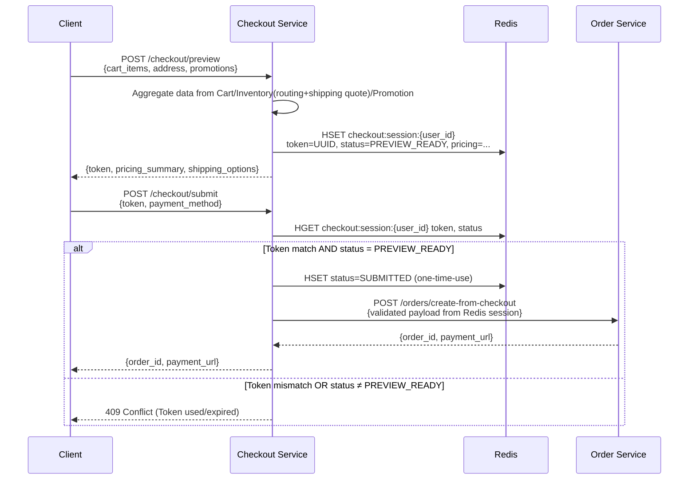

# Checkout Service - Idempotency & Anti-Tampering

**Liên kết nhanh (Related Documents):**
*   [Architecture Design](checkout_architecture_design.md)
*   [Workflows (API & Data Flow)](checkout_workflow.md)
*   [Caching Schema (Redis Session)](checkout_caching_schema.md)

**Cross-Service References:**
*   [Order Workflow](../order/order_workflow.md#4-workflow-nhận-checkout-submit-full-saga-flow) — Nhận validated checkout payload
*   [Cart Idempotency](../cart/cart_idempotency.md) — Pattern tương tự

---

Tài liệu này mô tả cơ chế **Idempotency** (chống duplicate submit) và **Anti-Tampering** (chống giả mạo dữ liệu) cho Checkout Service — lớp bảo vệ cuối cùng trước khi tạo Order.

---

## 1. Checkout Token One-Time-Use

### 1.1. Luồng Hoạt Động



### 1.2. One-Time-Use Enforcement

```lua
-- Lua Script: Atomic Check-and-Mark
local session_key = KEYS[1]
local expected_token = ARGV[1]

local stored_token = redis.call('HGET', session_key, 'token')
local stored_status = redis.call('HGET', session_key, 'status')

-- Check 1: Token phải khớp
if stored_token ~= expected_token then
    return -1  -- INVALID_TOKEN
end

-- Check 2: Status phải là PREVIEW_READY
if stored_status ~= 'PREVIEW_READY' then
    return -2  -- ALREADY_SUBMITTED
end

-- Mark as used (atomic)
redis.call('HSET', session_key, 'status', 'SUBMITTED')
return 1  -- OK
```

> **Tại sao Lua Script?** Đảm bảo check + update là atomic. Nếu dùng 2 lệnh riêng (`HGET` rồi `HSET`), 2 request cùng lúc có thể cùng thấy `PREVIEW_READY` → cùng pass → duplicate order.

---

## 2. Token Expiration & Renewal

| Hành động | Hệ quả |
|:---|:---|
| **User đổi voucher (platform/platform/freeship)** | Backend gọi Preview API lại theo nhánh tối ưu (Promotion evaluate) → **Tạo token MỚI** → Ghi đè session Redis |
| **User bấm "Lưu & Chọn" voucher platform chưa lưu** | Promotion xử lý `save-and-apply` để ghi ví, sau đó Checkout gọi lại Preview → **Tạo token MỚI** |
| **User chọn voucher sàn/freeship** | Chỉ được chọn các mã đã có trong ví và chưa quá `expired_at` (mặc định 30 ngày từ lúc sở hữu); Discovery có thể hạ mã thành `BUDGET_EXHAUSTED` bằng budget guard read-time; không có nhánh Save & Apply tại tray này |
| **User đổi địa chỉ nhận hàng** | Backend gọi Preview API lại, recompute Inventory (routing + shipping quote) + Promotion → **Tạo token MỚI** → Ghi đè session Redis |
| **User đổi quantity/add/remove SKU** | Frontend gọi Cart API trước (ngoài phạm vi Checkout), sau đó gọi Preview lại với snapshot Cart mới → **Tạo token MỚI** |
| **User không thao tác 20 phút** | Redis TTL hết → Session biến mất → Client gọi Submit → 404 Not Found |
| **User submit, rồi bấm Back + Submit lại** | Token cũ đã SUBMITTED → `409 Conflict` |
| **User mở 2 tab cùng checkout** | Cả 2 tab cùng token (1 session/user) → Tab submit trước thắng, tab sau nhận `409` |
| **Submit fail do reserve all-or-nothing** | Trả `409 PROMOTION_RECALCULATION_NEEDED`, token cũ vẫn `SUBMITTED`, bắt buộc gọi lại Preview để lấy token mới |

> `promotions.start_time/end_time` chỉ là claim/save window cho việc lấy mã mới; use window khi submit checkout luôn theo `user_coupon_wallets.expired_at`.

---

## 3. Anti-Tampering (Server-Side Validation)

### 3.1. Nguyên tắc Zero-Trust Client

Checkout Service **KHÔNG TIN bất kỳ số tiền nào** do client gửi lên:

| Client gửi | Server dùng |
|:---|:---|
| `address_id: 5` | ✅ Server tra DB lấy address chi tiết |
| `promotion_code: "HAPPY"` | ✅ Server gọi Promotion API validate + lấy `discount_amount` |
| ~~`total_amount: 450000`~~ | ❌ **IGNORE** — Server tự tính từ Redis session |
| ~~`shipping_fee: 0`~~ | ❌ **IGNORE** — Server dùng fee từ Inventory routing snapshot (Shipping quote đi gián tiếp qua Inventory) |
| `payment_method: "VNPAY"` | ✅ Server validate method hợp lệ |

### 3.2. Luồng Validation khi Submit (Zero-Trust Validation)

1. **Bóc Token** → Lấy session báo giá từ Redis (đã được tính ở Preview).
2. **Lightweight Price Staleness Check (Phát hiện hàng thiu):**
    - Checkout tự tính hash cấu hình mới nhất từ (Giá gốc Product + `promotion_rule_version` + `route_signature` + `shipping_rate_version`) từ cache nội bộ. So sánh với `pricing_hash` trên Session.
    - `promotion_budget_version` chỉ dùng để quan sát drift/read-time diagnostics, không tham gia hard hash gate.
   - Nếu hash lệch (giá thay đổi), văng lỗi từ chối ngay lập tức.
    - Các thao tác Re-validate nặng (chạm DB) như kiểm tra Address, Stock hoặc **Khóa ngân sách Khuyến mãi (Reserve)** được uỷ quyền hoàn toàn cho luồng **Temporal Saga của Order Service** chạy ngầm để phục vụ tốc độ siêu tốc và chống giam tiền.
    - Discovery budget guard chỉ là lớp giảm stale UX; quyết định exhausted budget cuối cùng vẫn do Reserve ở submit-time.
    - Nếu reserve fail ở Promotion (all-or-nothing), Checkout phải gọi lại Promotion evaluate để dựng `dropped_promotions[]`; tuyệt đối không làm phép trừ cục bộ ở Checkout.
    - Submit path không được phát sinh ghi ví voucher ngầm; dữ liệu ví chỉ thay đổi bởi luồng explicit (save-and-apply/claim/campaign worker).
3. **Sử dụng `pricing_summary` từ Redis session** — KHÔNG tính lại chi tiết. Đây là khung giá an toàn đã vượt qua Staleness Check.
4. **Gửi sang Order Service:** Toàn bộ payload từ Redis và `user_ack_degraded_pricing` (nếu có) — client không có cơ hội chèn số liệu giả mạo.

---

## 4. Concurrent Protection (Distributed Lock)

### 4.1. Lock khi Preview (Checkout Review)

**Key:** `checkout:lock:preview:{user_id}`
**TTL:** 5 giây
**Mechanism:** `SETNX` + `EXPIRE`

**Tại sao cần khóa Preview?** Kẻ tấn công hoặc bot có thể mở đồng thời nhiều luồng gọi API `POST /v1/checkout/preview` và truyền vào các mã giảm giá khác nhau. Vì lúc này Promotion Service chưa lock ngân sách thực tế, hệ thống sẽ chập nhận tính toán cho tất cả các luồng đó. Nếu cấu trúc dữ liệu trên Redis bị ghi đè chéo (Race Condition), phiên làm việc cuối cùng có thể bị vỡ `pricing_hash` hoặc dẫn đến các lỗi logic phát sinh gây kiệt quệ tài nguyên. Việc chỉ cho phép 1 user thực hiện 1 luồng Preview tại bất kỳ thời điểm nào giúp hệ thống an toàn và ổn định hơn.

### 4.2. Lock khi Submit

Ngoài Lua Script one-time-use ở trên, thêm 1 lớp Distributed Lock bảo vệ quá trình Submit:

**Key:** `checkout:lock:submit:{user_id}`
**TTL:** 30 giây
**Mechanism:** `SETNX` + `EXPIRE`

```
IF SETNX checkout:lock:submit:{user_id} = 1 THEN
    -- Xóa Lock cũ ở Preview nếu còn (hoặc tự hết)
    -- Thực hiện Price Staleness Check (Read-only từ Cache)
    -- Xử lý token Lua Script (Atomic mark SUBMITTED) và Submit
    -- Sau khi xong → DEL lock
ELSE
    -- 423 Locked: "Đang xử lý đơn hàng, vui lòng chờ"
END
```

### 4.3. Tại sao cả Lock lẫn Lua Script ở Submit?

| Bảo vệ | Lua Script (Token SUBMITTED) | Distributed Lock |
|:---|:---|:---|
| Chống **duplicate submit** (bấm 2 lần) | ✅ Token đã SUBMITTED → reject | ✅ Lock active → reject |
| Chống **concurrent submit** (2 tab cùng lúc) | ✅ Atomic check | ✅ Chỉ 1 thread pass lock |
| Chống **slow network retry** (request timeout → client retry) | ✅ Token đã SUBMITTED | ✅ Lock chưa hết TTL |
| Bảo vệ khi **Redis Lua fail** | ❌ | ✅ Fallback layer |

> **Belt and Suspenders:** 2 lớp bảo vệ đảm bảo tuyệt đối: mỗi user chỉ tạo đúng 1 Order cho 1 checkout session. Lớp Lock cũng bao bọc bên ngoài Price Staleness Check để đảm bảo session không bị hỏng nếu đang check giá thì có request chèn vào.

---

## 5. Idempotent Response

Khi submit hoàn tất (thành công hoặc conflict nghiệp vụ), backend cache response theo token:

**Key:** `checkout:response:{user_id}:{token}`
**TTL:** 20 phút
**Value:**
- Success: `{order_id, payment_url}`
- Conflict: `{error_code: "PROMOTION_RECALCULATION_NEEDED", action: "RECALL_PREVIEW", dropped_promotions: [...], proposal_checkout_data: {...}}`

Trong nhánh Conflict:
- `dropped_promotions[]` chỉ chứa mã bị loại (không chứa mã sống sót).
- `proposal_checkout_data.surviving_promotions[]` là input chuẩn để client gọi lại Preview lấy token mới.
- Token cũ vẫn `SUBMITTED`, không được tái sử dụng dù user chấp nhận phương án mới.

Nếu client nhận timeout và retry với cùng token:
1. Lua Script trả `-2` (ALREADY_SUBMITTED).
2. Backend check `checkout:response:{user_id}:{token}` → Trả lại response cũ (idempotent), bất kể là success hay conflict nghiệp vụ.

> Kết quả: Client nhận đúng `order_id` + `payment_url` dù gọi bao nhiêu lần.

---

## 5.1. Failed Submit Recovery

Xử lý trường hợp Lua Script đã mark session `SUBMITTED` nhưng lần gọi Order Service đầu tiên fail (timeout/down) — user bị stuck: session đã dùng nhưng order chưa tạo, response cache trống rỗng.

### Redis Key

**Key:** `checkout:payload:{user_id}:{token}`
**TTL:** 20 phút (bằng response cache TTL)
**Value:** Payload identical với request gửi sang Order Service.

### Lifecycle

| Sự kiện | Hành động |
|:---|:---|
| Submit bắt đầu (sau Lua Script OK) | `SET checkout:payload:{user_id}:{token}` TTL 20 phút |
| Submit thành công | `DEL checkout:payload:{...}` (không cần giữ) |
| Submit fail (Order Service lỗi) | Giữ nguyên, đợi client retry hoặc TTL expire |
| Client retry (token ALREADY_SUBMITTED) | Backend check `checkout:payload:{...}` còn? → Retry Order call |
| Payload TTL hết hạn | Trả `410 Gone` — buộc user gọi Preview lại |

### Flow Recovery Chi tiết

```
Client retry POST /checkout/submit {token, payment_method}
  │
  ├─ Lua Script trả -2 (ALREADY_SUBMITTED)
  │
  ├─ Check checkout:response:{user_id}:{token} ?
    │   ├─ CÓ → Trả lại response cũ (idempotent: success hoặc conflict nghiệp vụ)
  │   └─ KHÔNG → Lần đầu fail, chưa có response cache
  │
  └─ Check checkout:payload:{user_id}:{token} ?
      ├─ CÓ → Retry gọi Order Service (dùng payload từ Redis)
      │   ├─ Thành công → Cache response + DEL payload → Trả client
      │   └─ Thất bại → Trả 503 (client có thể retry tiếp)
      └─ KHÔNG (TTL hết) → Trả 410 Gone
          → Client hiển thị: "Phiên checkout đã hết hạn, vui lòng thử lại"
          → User quay lại Preview → Tạo session mới
```

### Chống Duplicate Order

Order Service nhận request với `idempotency_key = checkout_token`. Dù Checkout retry bao nhiêu lần, Order Service chỉ tạo đúng 1 Order cho mỗi token — đảm bảo bởi bảng `idempotency_keys` phía Order. Xem [Order DB Design - idempotency_keys](../order/order_db_design.md).
