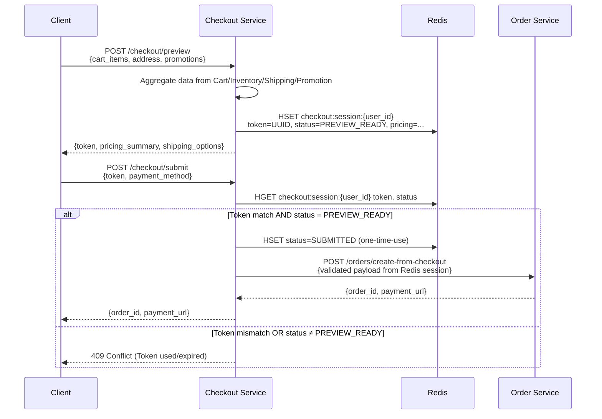

# Checkout Service - Idempotency & Anti-Tampering

**Liên kết nhanh (Related Documents):**
*   [Architecture Design](checkout_architecture_design.md)
*   [Workflows (API & Data Flow)](checkout_workflow.md)
*   [Caching Schema (Redis Session)](checkout_caching_schema.md)

**Cross-Service References:**
*   [Order Workflow](../order/order_workflow.md#4-workflow-nhận-checkout-submit-full-saga-flow) — Nhận validated checkout payload
*   [Cart Idempotency](../cart/cart_idempotency.md) — Pattern tương tự

---

Tài liệu này mô tả cơ chế **Idempotency** (chống duplicate submit) và **Anti-Tampering** (chống giả mạo dữ liệu) cho Checkout Service — lớp bảo vệ cuối cùng trước khi tạo Order.

---

## 1. Checkout Token One-Time-Use

### 1.1. Luồng Hoạt Động



### 1.2. One-Time-Use Enforcement

```lua
-- Lua Script: Atomic Check-and-Mark
local session_key = KEYS[1]
local expected_token = ARGV[1]

local stored_token = redis.call('HGET', session_key, 'token')
local stored_status = redis.call('HGET', session_key, 'status')

-- Check 1: Token phải khớp
if stored_token ~= expected_token then
    return -1  -- INVALID_TOKEN
end

-- Check 2: Status phải là PREVIEW_READY
if stored_status ~= 'PREVIEW_READY' then
    return -2  -- ALREADY_SUBMITTED
end

-- Mark as used (atomic)
redis.call('HSET', session_key, 'status', 'SUBMITTED')
return 1  -- OK
```

> **Tại sao Lua Script?** Đảm bảo check + update là atomic. Nếu dùng 2 lệnh riêng (`HGET` rồi `HSET`), 2 request cùng lúc có thể cùng thấy `PREVIEW_READY` → cùng pass → duplicate order.

---

## 2. Token Expiration & Renewal

| Hành động | Hệ quả |
|:---|:---|
| **User thay đổi gì trong checkout** (change address, apply coupon) | Backend gọi Preview API lại → Tính lại toàn bộ → **Tạo token MỚI** → Ghi đè session Redis |
| **User không thao tác 20 phút** | Redis TTL hết → Session biến mất → Client gọi Submit → 404 Not Found |
| **User submit, rồi bấm Back + Submit lại** | Token cũ đã SUBMITTED → `409 Conflict` |
| **User mở 2 tab cùng checkout** | Cả 2 tab cùng token (1 session/user) → Tab submit trước thắng, tab sau nhận `409` |

---

## 3. Anti-Tampering (Server-Side Validation)

### 3.1. Nguyên tắc Zero-Trust Client

Checkout Service **KHÔNG TIN bất kỳ số tiền nào** do client gửi lên:

| Client gửi | Server dùng |
|:---|:---|
| `address_id: 5` | ✅ Server tra DB lấy address chi tiết |
| `promotion_code: "HAPPY"` | ✅ Server gọi Promotion API validate + lấy `discount_amount` |
| ~~`total_amount: 450000`~~ | ❌ **IGNORE** — Server tự tính từ Redis session |
| ~~`shipping_fee: 0`~~ | ❌ **IGNORE** — Server dùng fee đã cache từ Shipping Service |
| `payment_method: "VNPAY"` | ✅ Server validate method hợp lệ |

### 3.2. Luồng Validation khi Submit

1. **Bóc Token** → Lấy session từ Redis (đã được tính ở Preview).
2. **Re-validate critical fields:**
   - `address_id` thuộc `user_id`? (gọi Address Service)
   - `promotion_code` vẫn valid? (check TTL Reservation trong Promotion Redis)
   - Stock vẫn còn? (Optional: có thể skip vì Temporal sẽ check lại)
3. **Sử dụng `pricing_summary` từ Redis session** — KHÔNG tính lại. Đây là giá đã được "đóng dấu" tại Preview.
4. **Gửi sang Order Service:** Toàn bộ payload từ Redis — client không có cơ hội chèn số liệu giả.

---

## 4. Concurrent Submit Protection (Distributed Lock)

### 4.1. Lock khi Submit

Ngoài Lua Script one-time-use ở trên, thêm 1 lớp Distributed Lock bảo vệ:

**Key:** `checkout:lock:submit:{user_id}`
**TTL:** 30 giây
**Mechanism:** `SETNX` + `EXPIRE`

```
IF SETNX checkout:lock:submit:{user_id} = 1 THEN
    -- Xử lý submit
    -- Sau khi xong → DEL lock
ELSE
    -- 423 Locked: "Đang xử lý đơn hàng, vui lòng chờ"
END
```

### 4.2. Tại sao cả Lock lẫn Lua Script?

| Bảo vệ | Lua Script (Token SUBMITTED) | Distributed Lock |
|:---|:---|:---|
| Chống **duplicate submit** (bấm 2 lần) | ✅ Token đã SUBMITTED → reject | ✅ Lock active → reject |
| Chống **concurrent submit** (2 tab cùng lúc) | ✅ Atomic check | ✅ Chỉ 1 thread pass lock |
| Chống **slow network retry** (request timeout → client retry) | ✅ Token đã SUBMITTED | ✅ Lock chưa hết TTL |
| Bảo vệ khi **Redis Lua fail** | ❌ | ✅ Fallback layer |

> **Belt and Suspenders:** 2 lớp bảo vệ đảm bảo tuyệt đối: mỗi user chỉ tạo đúng 1 Order cho 1 checkout session.

---

## 5. Idempotent Response

Khi submit thành công, backend cache response:

**Key:** `checkout:response:{user_id}:{token}`
**TTL:** 5 phút
**Value:** `{order_id, payment_url}`

Nếu client nhận timeout và retry với cùng token:
1. Lua Script trả `-2` (ALREADY_SUBMITTED).
2. Backend check `checkout:response:{user_id}:{token}` → Trả lại response cũ (idempotent).

> Kết quả: Client nhận đúng `order_id` + `payment_url` dù gọi bao nhiêu lần.

---

## 5.1. Failed Submit Recovery

Xử lý trường hợp Lua Script đã mark session `SUBMITTED` nhưng lần gọi Order Service đầu tiên fail (timeout/down) — user bị stuck: session đã dùng nhưng order chưa tạo, response cache trống rỗng.

### Redis Key

**Key:** `checkout:payload:{user_id}:{token}`
**TTL:** 5 phút (bằng response cache TTL)
**Value:** Payload identical với request gửi sang Order Service.

### Lifecycle

| Sự kiện | Hành động |
|:---|:---|
| Submit bắt đầu (sau Lua Script OK) | `SET checkout:payload:{user_id}:{token}` TTL 5 phút |
| Submit thành công | `DEL checkout:payload:{...}` (không cần giữ) |
| Submit fail (Order Service lỗi) | Giữ nguyên, đợi client retry hoặc TTL expire |
| Client retry (token ALREADY_SUBMITTED) | Backend check `checkout:payload:{...}` còn? → Retry Order call |
| Payload TTL hết hạn | Trả `410 Gone` — buộc user gọi Preview lại |

### Flow Recovery Chi tiết

```
Client retry POST /checkout/submit {token, payment_method}
  │
  ├─ Lua Script trả -2 (ALREADY_SUBMITTED)
  │
  ├─ Check checkout:response:{user_id}:{token} ?
  │   ├─ CÓ → Trả lại response cũ (idempotent) ← happy path
  │   └─ KHÔNG → Lần đầu fail, chưa có response cache
  │
  └─ Check checkout:payload:{user_id}:{token} ?
      ├─ CÓ → Retry gọi Order Service (dùng payload từ Redis)
      │   ├─ Thành công → Cache response + DEL payload → Trả client
      │   └─ Thất bại → Trả 503 (client có thể retry tiếp)
      └─ KHÔNG (TTL hết) → Trả 410 Gone
          → Client hiển thị: "Phiên checkout đã hết hạn, vui lòng thử lại"
          → User quay lại Preview → Tạo session mới
```

### Chống Duplicate Order

Order Service nhận request với `idempotency_key = checkout_token`. Dù Checkout retry bao nhiêu lần, Order Service chỉ tạo đúng 1 Order cho mỗi token — đảm bảo bởi bảng `idempotency_keys` phía Order. Xem [Order DB Design - idempotency_keys](../order/order_db_design.md).
