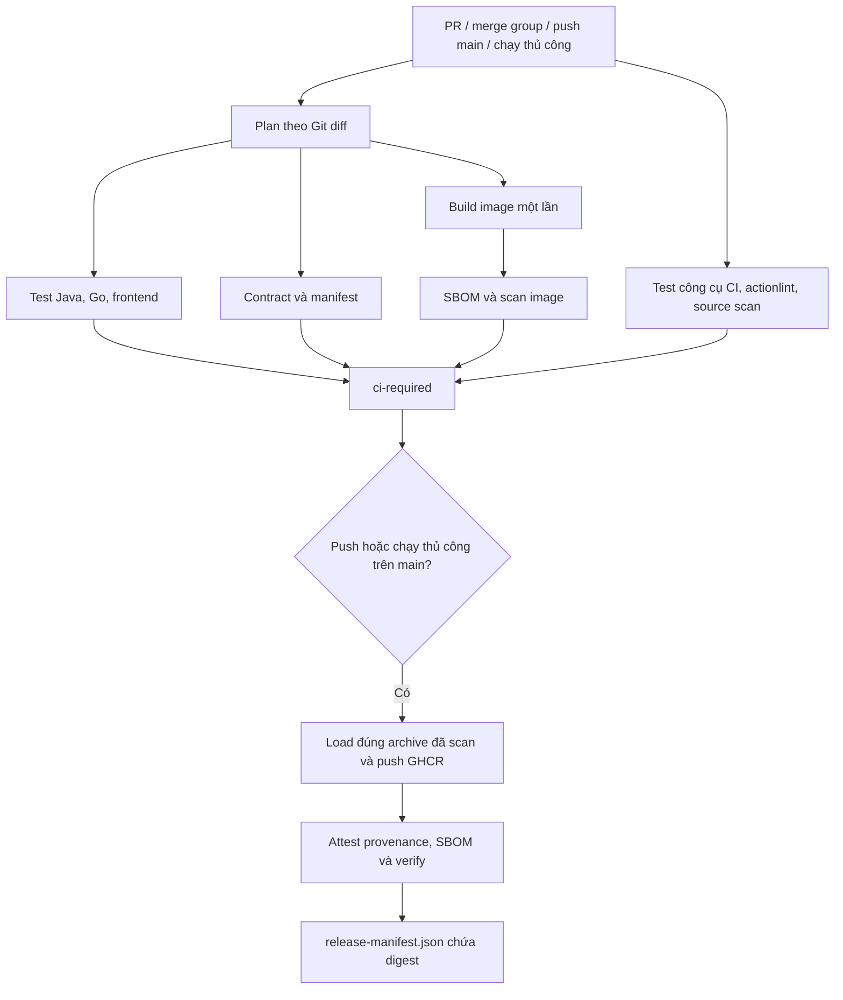

# CI/CD đợt 1: kiểm tra và phát hành container

Ngày triển khai: 2026-10-22. Phạm vi: CI và artifact; triển khai staging/production bằng GitOps thuộc đợt 2.

Cập nhật 23/10: [đợt 2](phase-2.md) thêm hai image công cụ và bật snapshot đầy đủ trên main
khi `CD_ENABLED=true`; mô tả 17 image dưới đây là inventory tại thời điểm đợt 1.

## Luồng thực thi



`.github/workflows/ci.yml` luôn tạo check `ci-required`, kể cả PR chỉ sửa tài liệu.
Job tổng hợp báo lỗi nếu job bắt buộc fail, bị hủy, mất kết quả hoặc bị skip ngoài kế hoạch.
Thiếu Git baseline cũng báo lỗi. Không dùng `continue-on-error` cho test hay scan.

PR và merge group có quyền đọc, build và scan nhưng không push registry, không nhận quyền OIDC.
Chỉ nhánh `main`, sự kiện `push` hoặc `workflow_dispatch`, sau khi gate đạt, mới được publish.
Các PR mới hủy lượt CI cũ cùng PR. Mỗi push main có nhóm concurrency riêng để không làm mất
release của commit trung gian khi nhiều push đến liên tiếp.

## Các file điều phối

| File | Trách nhiệm |
|---|---|
| `.github/workflows/ci.yml` | Trigger, plan, frontend, source scan, manifest local, required gate và gọi publisher |
| `.github/workflows/services.yml` | Reusable workflow: Maven, Go vet/format/race và integration test |
| `.github/workflows/contracts.yml` | Reusable workflow: semantic validation, HTTP rules, Protobuf/OpenAPI breaking gate |
| `.github/workflows/mesh.yml` | Reusable workflow: generator drift, mesh tests, kubeconform, istioctl, Helm |
| `.github/workflows/images.yml` | Build, SBOM, image scan và chuyển archive cho publisher |
| `.github/workflows/publish.yml` | Push GHCR, attestation, verify và tổng hợp manifest |
| `scripts/ci/plan.py` | Tách matrix test và matrix image theo committed diff |
| `scripts/ci/required_gate.py` | Kiểm tra trạng thái đầy đủ của các job cần chạy |
| `scripts/ci/test_reports.py` | Kiểm tra có test thực sự chạy, phát hiện lỗi, liệt kê test skip |
| `scripts/ci/scan.sh` | Trivy được khóa version/digest, source/image scan và SBOM |
| `scripts/ci/release_manifest.py` | Record và kiểm tra tập hợp image đã publish |

Workflow provider verification vẫn chạy thủ công/hằng tuần. Full-stack E2E, canary,
migration job và rollback runtime sẽ trở thành gate triển khai trong đợt 2.

## Phạm vi kiểm tra

Inventory tự phát hiện `java/services/*/pom.xml`, `go/services/*/go.mod` và module chung
`go/*/go.mod`. Hiện có 9 service Java, 5 service Go và module `go/observability`.
Image matrix gồm các service có Dockerfile cùng frontend, API gateway và MinIO: 17 image.

| Thay đổi | Chạy gì |
|---|---|
| Một service | Test service đó; build image nếu có Dockerfile |
| `go/observability/**` | Test module chung và tất cả Go consumer; build lại image Go, gồm gateway theo lựa chọn bảo thủ |
| `go/.dockerignore`, `go/go.work*` | Toàn bộ thành phần Go |
| `frontend/**` | Frontend CI và image frontend |
| `contracts/http/order/v1/openapi.yaml` | Order tests, frontend, contract và mesh/Kubernetes checks. Build Order, Gateway, frontend và deployment checks. |
| Contract dùng chung, contract chưa có phạm vi hoặc đường dẫn chưa được ánh xạ | Toàn bộ test và image để tránh bỏ sót phụ thuộc |
| `.github/**`, `scripts/ci/**`, root Compose, init DB hoặc quy tắc checkout | Toàn bộ kiểm tra và image |
| `infra/**` | Toàn bộ service/image và kiểm tra manifest Kubernetes |
| `deploy/mesh/**`, `docs/mesh/**` | Mesh và manifest Kubernetes |
| `deploy/k8s/**` | Kiểm tra generator và render ba lớp Kustomize |
| Tài liệu tại `docs/`, `note/`, README hoặc LICENSE ở gốc | Tooling, source security scan và required gate. Tài liệu mesh vẫn chạy kiểm tra mesh/Kubernetes. |

PR dùng diff từ merge base; push main so sánh trực tiếp `before..HEAD` để không bỏ sót
thay đổi khi một push có nhiều commit. Rename được tách thành xóa/thêm để test cả hai bên.
`workflow_dispatch` chọn toàn bộ; đối chiếu breaking contract với commit cha của HEAD.
Lần push đầu có SHA `before` toàn số 0 cũng chọn toàn bộ và dùng commit cha làm baseline.
Repository phải có lịch sử và ít nhất hai commit khi dùng chế độ này.

Khi bật CD, push chỉ sửa tài liệu trong phạm vi trên vẫn chạy gate, đồng thời bỏ qua publish
và tạo candidate staging. Push có thay đổi runtime tiếp tục tạo snapshot đầy đủ.

Job `plan` ghi phạm vi và lý do chọn job vào Step Summary. Khi test service, frontend,
contract hoặc scan lỗi, xem Step Summary của job để lấy bước lỗi và lệnh chạy lại.
Workflow **CI Measurements** dùng API read-only để ghi JSON cho từng lượt chạy, kể cả rerun
và lần chạy bị hủy. Báo cáo đo từ khi GitHub tạo CI run, bao gồm thời gian tới lỗi đầu tiên,
thời gian tới gate xanh, queue theo job, runner-phút và số lần rerun.

```bash
python scripts/ci/metrics.py --repo OWNER/REPO --run-id RUN_ID [RUN_ID ...] --output ci-artifacts/ci-metrics.json
```

Lệnh trên sử dụng `GH_TOKEN` hoặc `GITHUB_TOKEN` với quyền đọc Actions. Lượt CI cũ hoặc
không còn artifact `ci-plan` vẫn có số đo, với phạm vi hiển thị là `unavailable`.

Lệnh local:

```bash
python scripts/ci/plan.py --base origin/main
python scripts/ci/plan.py --base ALL
python scripts/ci/plan.py --base <before-sha> --direct
bash scripts/ci/changed-services.sh origin/main
```

Plan đọc committed diff; thay đổi chưa commit không thuộc diff. Inventory đọc working tree.

## Test và frontend

- Java: JDK 21, `mvn -B -ntp verify`, giữ cấu hình Surefire/Failsafe của từng service.
  Đọc JUnit XML để chặn suite không chạy test; service có package `integration` phải có
  test integration thực sự chạy. Tên test skip được ghi ra log; không coi tất cả skip là pass.
- Go: dùng version trong `go.mod`, `go vet`, kiểm tra gofmt và `go test -race -count=1 -json ./...`.
  Auth/User/Notification chạy thêm tag `integration` với PostgreSQL/Redis/Kafka qua Testcontainers.
  Cart chạy suite Lua thêm một lượt với Redis thật, trong container riêng trên runner.
- Frontend: Node 24, `npm ci`, generated API drift check, ESLint, typecheck, Vitest và production build.
  Dockerfile dùng cùng major Node. `.env*` bị loại khỏi Docker build context.
- `npm run gen:api:check` chỉ đọc và so sánh, không viết generated file. Lệch type phải chạy
  `npm run gen:api` rồi commit kết quả. So sánh chuẩn hóa CRLF/LF để hỗ trợ Windows.
- JUnit/XML/JSONL được upload dưới tên `tests-<module>` và `frontend-tests`, lưu 14 ngày.

Docker phải hoạt động trên runner; lỗi khởi tạo dependency làm test thất bại.
Các test tùy chọn/benchmark có cơ chế skip riêng vẫn được hiển thị; báo cáo này chưa thay thế
việc duyệt từng skip nghiệp vụ. Docker integration test cần runner Linux, đủ RAM và truy cập registry.

Frontend giữ cùng-origin `/media` mặc định để phục vụ việc dùng cùng image qua môi trường.
Đợt 1 chưa bổ sung runtime configuration API. Không đưa giá trị theo môi trường vào
`NEXT_PUBLIC_*` rồi kỳ vọng đổi bằng biến môi trường sau build; xem [Next.js environment variables](https://nextjs.org/docs/app/guides/environment-variables).

## Chính sách bảo mật

Trivy `0.76.1` được khóa bằng digest trong `scan.sh`. Source scan chạy dependency và secret;
image scan chạy trên Docker archive của image cuối. Cả hai chặn HIGH/CRITICAL, kể cả lỗ hổng
chưa có bản sửa. Lỗi tải vulnerability database hoặc lỗi scanner cũng làm CI fail.
Không có baseline bỏ qua lỗ hổng, `ignore-unfixed` hoặc cơ chế báo warning thay cho fail.

Secret scan đọc cả POM. Source vulnerability scan đọc lockfile/module, loại `pom.xml` khỏi
việc resolve dependency online lần thứ hai: Java được quét bằng các JAR thực tế trong final image,
và image scan là điều kiện bắt buộc của gate. Cách này tránh Maven Central rate limit do đồng thời
resolve toàn bộ graph một lần nữa trong job security không có Maven cache.
Hai báo cáo source là `source-secrets.json` và `source-dependencies.json`; luôn thử chạy cả hai.
Source scan bao gồm dependency dev và dùng `--offline-scan` để không gọi API resolve dependency;
vulnerability database vẫn phải được tải/cập nhật. Secret scan vẫn đọc source và POM bình thường.
Breaking-change gate tự động hiện bao phủ Protobuf/OpenAPI; event schema được validate cấu trúc,
ví dụ và qua test service. Chưa có bộ so sánh tương thích semantic tự động cho mọi event schema.

Các cache, `.git`, `.tmp`, `.tools`, `frontend/node_modules` và output CI bị loại khỏi source scan.
Lockfile và source vẫn được scan. Runner checkout sạch không có `.env` local; không chạy source
scan trên máy có dữ liệu bí mật ngoài phạm vi repo nếu chưa chuẩn bị checkout sạch.
Report security nằm trong workflow artifact, không in raw secret lên terminal.
Cache database dùng Docker volume riêng cho source và image, để database nằm trên filesystem Linux
khi chạy Docker Desktop. CI nhắm GitHub-hosted runner với Docker daemon riêng mỗi job;
không chạy đồng thời nhiều lượt scan cùng loại trên cùng daemon tự quản.

GitHub Actions được khóa theo commit SHA, checkout không lưu credential. Toàn workflow chỉ có
`contents: read`; publisher mới được cấp `packages: write`, `id-token: write`, `attestations: write`.
Không dùng PAT hay credential cloud tĩnh. Cần review bắt buộc cho thay đổi workflow/CI vì
người có quyền thay đổi pipeline cũng có thể thay đổi policy của nó.

Khi scan phát hiện lỗi có sẵn, gate sẽ đỏ cho tới khi dependency/base image được sửa.
Đây là điều kiện phát hành thực tế, không phải lỗi để bỏ qua bằng `continue-on-error`.

## Image, attestation và manifest

Build và scan chạy trên Linux amd64; đây là kiến trúc hiện hỗ trợ. Dockerfile Go nhận context
`go/` để có module observability; các Dockerfile Java nhận context service tương ứng.

1. Buildx xuất `image.tar`, gắn label source/revision; không push.
2. Trivy sinh `sbom.cdx.json` và scan chính archive đó.
3. Với main: nén archive, tạo SHA-256 cho archive/SBOM/report, upload artifact `image-<name>`.
4. Sau `ci-required`: publisher download artifact cùng workflow run, kiểm checksum và `docker load`.
5. Tag và push image đã load; không chạy Docker build trong publisher.
6. Resolve registry digest, attest build provenance và SBOM, verify provenance theo repo, Git SHA và main.
7. Chỉ khi toàn bộ publisher thành công mới tạo `release-manifest`.

Tên image:

```text
ghcr.io/<owner>/<repository>/<component>:sha-<git-sha>-run-<run-id>-<attempt>
ghcr.io/<owner>/<repository>/<component>@sha256:<digest>
```

Tên owner/repository được chuyển thành chữ thường cho GHCR. Không phát hành alias `latest`.
Tag chứa run/attempt để không ghi đè kết quả giữa các lượt build. Khi triển khai phải dùng digest.
GitHub attestation là chữ ký kiểm chứng nguồn gốc và gắn với digest, không dùng khóa ký riêng.

`release-manifest.json` có schema version, source revision, workflow run và danh sách image:

```json
{
  "schema_version": 1,
  "scope": "selected-components",
  "repository": "owner/repository",
  "revision": "<git-sha>",
  "run_id": "<run-id>",
  "run_attempt": "1",
  "images": [
    {
      "name": "cart-service",
      "image": "ghcr.io/owner/repository/cart-service",
      "tag": "sha-<git-sha>-run-<run-id>-1",
      "digest": "sha256:<64-hex>",
      "reference": "ghcr.io/owner/repository/cart-service@sha256:<64-hex>",
      "revision": "<git-sha>",
      "run_id": "<run-id>",
      "run_attempt": "1",
      "sbom_sha256": "<64-hex>",
      "scan_sha256": "<64-hex>"
    }
  ]
}
```

Đây là manifest cho **các component được chọn**, không tự bao gồm phiên bản của component không đổi.
Đợt 2 phải cập nhật theo tên component trên bộ phiên bản đã triển khai. Bootstrap toàn bộ bằng
`workflow_dispatch` trên main. Aggregate từ chối component thiếu/trùng, revision/run khác hoặc digest sai.
Rerun publisher có thể dùng lại artifact đã kiểm tra cùng run/source; từng image lưu attempt riêng.

Image archive chỉ upload cho main và lưu 3 ngày; PR/merge group chỉ lưu report/SBOM 14 ngày.
Release manifest cùng report/SBOM đã publish lưu 90 ngày. GHCR có vòng đời riêng; chưa có job tự xóa image.
Storage artifact và runner minutes cần đủ cho lần bootstrap 17 image; `max-parallel: 4` cho mỗi matrix.
Nếu một publisher fail, có thể đã có một số image trên GHCR nhưng không có release manifest hoàn chỉnh;
không promotion các package đó bằng tay. Rerun job lỗi trong thời gian còn archive hoặc rerun toàn workflow.

## Kích hoạt trên GitHub

Thay đổi repository local không tự cấu hình ruleset/quyền tài khoản trên GitHub.

1. Đưa thay đổi lên PR và quan sát `CI / ci-required`. Workflow mới phải xuất hiện trong check list.
2. Trong ruleset của main: yêu cầu PR, review và check tên **`ci-required`** do GitHub Actions cung cấp;
   giao diện có thể hiện thêm tiền tố `CI /`. Chọn check đã thực sự xuất hiện, không đặt tên dự đoán.
   Giữ nhánh cập nhật với main hoặc dùng merge queue; workflow hỗ trợ `merge_group`.
3. Chuyển các required check cũ của workflow service/contract/mesh sang gate mới trong cùng đợt
   vì ba workflow này nay chỉ được gọi bằng `workflow_call`.
4. Cho phép Actions, action SHA đang dùng, GHCR package creation và quyền ghi package/attestation/OIDC
   của publisher theo policy tổ chức. Không cấp quyền write mặc định cho mọi job.
5. Nếu package GHCR đã tồn tại, cấp repository quyền Actions access cho package đó.
6. Bật artifact attestations theo gói GitHub: repo public được hỗ trợ trên các gói hiện hành;
   repo private/internal yêu cầu Enterprise Cloud. Không hỗ trợ thì publisher fail, không bỏ qua chữ ký.
7. Merge main rồi chạy `CI` thủ công trên main để bootstrap toàn bộ image nếu cần. Kiểm tra artifact
   `release-manifest` và verify một digest bằng lệnh dưới đây.

```bash
gh attestation verify oci://ghcr.io/<owner>/<repository>/<component>@sha256:<digest> \
  --repo <owner>/<repository> --source-digest <git-sha> --source-ref refs/heads/main
```

Không có bước triển khai cluster, migration production hay chỉnh secret production trong đợt 1.

## Kiểm tra local và giới hạn xác minh

```bash
python -m unittest discover -s scripts/ci/tests -p 'test_*.py' -v
bash scripts/ci/tests/test_changed_services.sh
docker run --rm -v "$PWD:/repo:ro" -w /repo rhysd/actionlint:1.7.7 -color
cd frontend
npm run gen:api:check
npm run lint
npm run typecheck
npm test
npm run build
```

Kiểm tra workflow local không xác nhận quyền GHCR, OIDC, attestation hay ruleset phía GitHub.
Chỉ lượt chạy thật trên GitHub mới xác nhận toàn bộ đường publish. Các kết quả kiểm chứng local
và blocker thực tế được ghi ở [verification.md](./verification.md).

Nguồn: [GitHub security](https://docs.github.com/en/actions/reference/security/secure-use),
[artifact attestations và điều kiện gói](https://docs.github.com/en/actions/how-tos/secure-your-work/use-artifact-attestations/use-artifact-attestations),
[gh attestation verify](https://cli.github.com/manual/gh_attestation_verify),
[Trivy](https://trivy.dev/docs/), [Docker Buildx action](https://github.com/docker/build-push-action).
