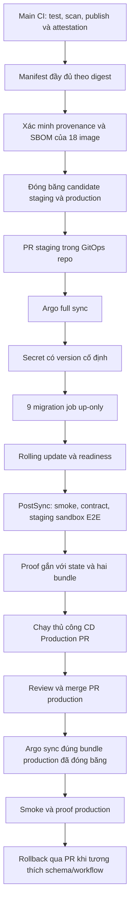

# CI/CD đợt 2: GitOps, staging và promotion production

Ngày triển khai mã nguồn: 23/10/2026. Theo xác nhận của chủ dự án, chưa có hạ tầng đích.
Đợt này cung cấp bộ bootstrap và công cụ triển khai có thể kiểm thử; chưa tạo cluster,
GitOps repo, DNS, secret thật hoặc chạy giao dịch Stripe thực tế. Kết quả local xem
[phase-2-verification.md](phase-2-verification.md).

## Luồng phát hành



Hai môi trường dùng namespace, cluster, domain và secret prefix riêng. Cùng một bộ
image đi qua staging rồi production; không build lại khi promote. MinIO, PostgreSQL,
Redis, Kafka, Elasticsearch và Temporal thuộc tầng hạ tầng, không bị app CD tự nâng cấp.

Khi repository variable `CD_ENABLED=true`, mọi push `main` chạy toàn bộ test và build
19 image (16 workload, 2 công cụ và MinIO của CI cũ). CD chỉ dùng 18 image ứng dụng/công cụ.
PR vẫn chọn theo diff. Việc tạo snapshot đầy đủ giúp một lượt CD sau không bỏ mất thay đổi
khi GitHub thay thế lượt pending trong nhóm concurrency. CD staging tuần tự, không hủy lượt đang chạy.

## Thành phần đã thêm

| Đường dẫn | Trách nhiệm |
|---|---|
| `.github/workflows/cd-staging.yml` | Nhận CI main thành công, verify image, PR staging, đợi Argo và xuất proof |
| `.github/workflows/cd-production.yml` | Manual promote/rollback, xác minh proof và mở PR production để review |
| `deploy/gitops/environments.example.json` | Các thông số cần cung cấp sau khi có hạ tầng |
| `deploy/gitops/catalog.json` | Port, probe, env production, secret property, tài nguyên và chủ sở hữu migration |
| `deploy/gitops/rollback-policy.json` | Danh sách source SHA mà release hiện tại cho phép rollback |
| `deploy/gitops/templates/` | Workflow validation và production health xuất sang GitOps repo |
| `scripts/cd/delivery.py` | Bootstrap, kiểm tra candidate/proof, tạo PR; không gọi kubectl apply |
| `scripts/cd/render.py` | Bundle Kustomize độc lập cho staging/production |
| `scripts/cd/validate_gitops.py` | Gate GitOps: bundle bất biến, pointer chính xác, CAS, security/availability |
| `scripts/cd/observe.py` | Đọc Argo, kiểm tra đúng revision, hook, image và rollout đủ replica |
| `scripts/cd/checks.py`, `e2e.py` | Health, strict provider contract và E2E sandbox riêng staging |
| `deploy/migrations/` | Image chứa SQL của 9 service và runner chỉ chạy up |
| `deploy/checks/` | Image chứa contract và checker đã được scan, ký cùng release |
| `scripts/cd/test_migrations.py` | Chạy toàn bộ migration hai lần trên PostgreSQL Docker tạm |

## Điều kiện trước khi kích hoạt

`CD_ENABLED` mặc định chưa bật. Preflight cũng yêu cầu các xác nhận trong `readiness`;
không đổi chúng thành `true` cho tới khi có bằng chứng tương ứng:

- Payment hiện chỉ có adapter cipher local cho dev/test. Phải triển khai adapter production
  cho `SecretCipherPort`, quản lý key/rotation/khôi phục rồi kiểm thử trên staging.
  Không dùng profile dev hoặc `PAYMENT_CRYPTO_LOCAL_KEY` để cho deployment lên xanh.
- Cấu hình platform Istio ambient và điền hồ sơ transport của từng môi trường.
  CD Staging đợi ứng dụng Argo quản lý mesh và waypoint sẵn sàng. Promotion yêu cầu
  bằng chứng runtime trên staging được review trong GitOps theo [quy trình transport](#nghiệm-thu-transport).
- Bundle GitOps cấu hình Traefik dùng Redis TLS để chia sẻ quota theo user cho checkout và
  promotion discovery. Nghiệm thu với nhiều replica trước khi xác nhận
  `gateway_shared_rate_limits_verified`.
- Hoàn thành bài khôi phục backup dữ liệu, secret/key và Temporal; ghi RPO/RTO, người thực hiện và evidence.

Các HIGH/CRITICAL của gate đợt 1 vẫn chặn phát hành. Hai image công cụ mới cũng đi qua cùng gate;
không có ignore-file hoặc `continue-on-error` để bỏ qua. Xem kết quả scan local trong tài liệu verification.

Tầng platform cần cung cấp hai cluster đã đăng ký với Argo CD; CNI thực thi NetworkPolicy;
ít nhất hai worker node và dung lượng surge; External Secrets Operator có API
`external-secrets.io/v1`; ClusterSecretStore giới hạn quyền vào prefix từng môi trường;
ingress controller có TLS/HTTP redirect, certificate và DNS; collector/metrics/log;
GHCR pull credential; data services HA cùng schema/database và topic/ACL phù hợp.

Argo CD và các controller phải được quản lý bằng version/digest đã kiểm tra trong platform repo.
`cluster_server` là server đã đăng ký với Argo, không phải tên context local. Địa chỉ Argo và
cluster dùng HTTPS có CA tin cậy; công cụ không có cờ bỏ kiểm tra TLS.
Runner GitHub phải kết nối được Argo API. Nếu Argo private, cung cấp runner/network phù hợp;
không mở Argo admin ra Internet để chạy pipeline.

## Điền cấu hình và xuất bootstrap

Từ thư mục gốc repo, dùng Python 3.12:

```powershell
python -m pip install -r deploy/checks/requirements.txt
Copy-Item deploy/gitops/environments.example.json deploy/gitops/environments.json
# Điền thông số thật trong environments.json trước lệnh tiếp theo.
python scripts/cd/delivery.py bootstrap --config deploy/gitops/environments.json --output ci-artifacts/gitops-bootstrap
python ci-artifacts/gitops-bootstrap/tools/cd/validate_gitops.py --root ci-artifacts/gitops-bootstrap
```

Output phải là thư mục mới. Công cụ từ chối placeholder, repo trùng nhau, cluster dùng chung,
CIDR tin cậy toàn Internet, secret thiếu version, hoặc replica < 2. `bootstrap` cho phép
readiness chưa hoàn tất; lệnh stage/promote/rollback và quan sát runtime sẽ chặn activation.

Các đầu vào chính:

| Trường | Giá trị cần cung cấp |
|---|---|
| `gitops_repository`, `gitops_bot_login` | Repo riêng và login GitHub App có hậu tố `[bot]` |
| `production_owners` | GitHub user/team có quyền review: `@user` hoặc `@org/team` |
| `argocd_url` | URL HTTPS Argo API, không chứa token |
| `cluster_server`, `namespace`, `domain` | Đích riêng của staging/production |
| `media_origin` | Origin HTTPS của bucket/CDN; gateway bỏ prefix `/media/` khi proxy |
| `database_ca_pem` | CA PostgreSQL dạng PEM; mount tại `/etc/platform-ca/ca.crt` |
| `ingress_*`, `trusted_proxy_cidrs` | Controller/class/namespace/label và đúng CIDR proxy được tin cậy |
| `transport` | Revision platform, danh tính ingress/monitoring, Temporal và ma trận endpoint theo workload |
| `secret_store`, `secret_prefix`, `secret_versions` | Store, prefix và ID version bất biến của từng JSON secret |
| `service_account_annotations` | Workload identity cho service cần cloud API, như Notification SES/SQS |
| `observability_namespace`, `otlp_endpoint`, `sampling` | Collector và tỷ lệ sampling đã chọn |

Output gồm `bootstrap/<environment>/namespace.yaml`, AppProject/Application ứng dụng và mesh,
policy Strict cùng hai waypoint dưới `bootstrap/<environment>/mesh/`, hai environment rỗng,
config, catalog, `secrets-contract.json`, CODEOWNERS, validator và hai workflow GitOps.
Không tạo image digest giả. Đưa output vào GitOps repo riêng qua quy trình review của tổ chức.
Giữ `config.json` bên GitOps bằng đúng `deploy/gitops/environments.json` bên source; CLI chặn khi khác nhau.
Khi cập nhật catalog/tool/template sau này, review và đồng bộ bản export trước khi release.

Platform operator cài CRD/controller, áp dụng namespace vào đúng context mỗi cluster và
AppProject/Application vào cluster quản lý Argo. Argo quản lý mesh namespaced bằng Application riêng
`ecommerce-<environment>-mesh`, từ thư mục `bootstrap/<environment>/mesh`. Merge riêng phần
`deploy/gitops/argocd-health.patch.yaml` vào `argocd-cm` hiện có để Argo đợi ESO Ready;
không thay toàn bộ ConfigMap đang sử dụng. Cấp Argo repo credential chỉ đọc và quyền cluster
trong đúng namespace; AppProject không cho phép cluster resource hay data StatefulSet.

## Secret và quyền truy cập

Không commit credential vào config. `secrets-contract.json` xuất ra đường dẫn remote,
version và property bắt buộc. Với mỗi service có `runtime_properties`, tạo JSON secret
`<secret_prefix>/<service>` chứa đúng các tên env được liệt kê trong catalog. Endpoint,
database name và cờ runtime cũng được cung cấp rõ ràng ở đây; không lấy giá trị local Compose.

| Remote key sau prefix | Nội dung |
|---|---|
| `registry` | Property `dockerconfigjson`: cấu hình auth GHCR chỉ có quyền pull |
| `api-gateway` | `GATEWAY_RATE_LIMIT_REDIS_USERNAME`, `GATEWAY_RATE_LIMIT_REDIS_PASSWORD` cho ACL Redis của gateway |
| `migration-<java-service>` | `FLYWAY_URL`, `FLYWAY_USER`, `FLYWAY_PASSWORD` |
| `migration-<go-service>` | `MIGRATE_DATABASE_URL` |
| `checks-e2e` (staging) | Buyer/admin email/password, address/SKU fixture, Stripe test key và webhook signing secret |

Java JDBC URL cần `sslmode=verify-full&sslrootcert=/etc/platform-ca/ca.crt`.
Review phải giữ `currentSchema=review,public`. Go migration DSN cũng chỉ rõ `sslmode=verify-full`
và `sslrootcert` cùng đường dẫn. Go runtime nhận `PGSSLROOTCERT`; tài khoản migration có quyền DDL
trên database/schema riêng, runtime chỉ có quyền nghiệp vụ cần thiết. Thiết lập default privileges
để runtime truy cập được object mới. Không dùng superuser runtime; pre-provision extension khi nhà cung cấp yêu cầu.

Version là ID bất biến thật của secret manager (Vault version hoặc Secrets Manager VersionId),
không phải nhãn `latest`/`AWSCURRENT`. ExternalSecret và Secret đích có tên chứa hash của
key/version để tránh dùng trạng thái Ready cũ. ConfigMap cũng đổi tên theo state/CA.
Giữ các version và key giải mã cũ trong thời hạn rollback; prune-last chỉ xóa resource sau rollout thành công.

Ingress phải xóa/ghi lại forwarding header từ client trước khi gửi gateway. API và webhook
đi trực tiếp ingress → gateway; trang web đi frontend. Không công khai dashboard hoặc cổng actuator.
Default-deny đi cùng policy L4/L7 và egress theo từng workload. CNI mở HBONE, DNS và các
đích data private khai báo trong profile. Provider Internet đi qua egress waypoint theo hostname
và principal. Nếu dùng NodeLocal DNS hoặc private STS, khai báo đúng resolver và endpoint tương ứng.

Tạo GitHub App cài **chỉ vào GitOps repo** với Contents write, Pull requests write, Actions read.
Lưu `GITOPS_APP_ID` và `GITOPS_APP_PRIVATE_KEY` trong GitHub environments `staging`/`delivery`
của source repo. Token App được tạo ngắn hạn; `GITHUB_TOKEN` source chỉ đọc artifact/package/attestation.
Grant source repository quyền đọc các package GHCR cần dùng.

Argo account CI chỉ được `applications, get` cho đúng `ecommerce-staging/ecommerce-staging`
hoặc `ecommerce-production/ecommerce-production`, cùng Application mesh tương ứng
`ecommerce-<environment>-mesh/ecommerce-<environment>-mesh`. Quyền chỉ đọc gồm application
và managed resources phục vụ xác minh. Lưu token
staging ở source environment staging; token production ở GitOps environment production.
Hạn chế deployment branch của các GitHub environment về `main`. Environment `delivery` chỉ chuẩn bị
PR, còn `production` của GitOps chỉ đọc health; không đặt approval trước hai công việc này.
Quyết định triển khai production nằm ở review/merge PR với bundle cụ thể đã chuẩn bị.
GitOps main yêu cầu `gitops-required`, branch up-to-date/merge queue,
CODEOWNER review, dismiss stale review, chặn direct push/force push và App bypass.
Source main tiếp tục yêu cầu `ci-required`. Bảo vệ workflow/tool/config bằng CODEOWNER tương ứng.

GitOps repo cần bật Allow auto-merge. Repo dùng required review cho mọi PR có thể khiến staging chờ review; staging workflow đợi tối đa
20 phút cho PR merge và Argo hội tụ. Auto-merge chỉ có tác dụng sau khi mọi rule đạt.
Nếu hết thời gian, merge PR được review rồi chạy lại manual CD Staging với CI run ID đó.
Không hạ rule production để làm auto-merge staging nhanh hơn.

## Nghiệm thu transport

1. Cài Gateway API, Istio base, istiod, Istio CNI và ztunnel theo version/digest đã review.
   Dùng [phiên bản và Helm values local](../../deploy/mesh/versions.yaml) làm baseline. Khai báo
   trust domain, DNS suffix, collector và phạm vi trust phù hợp với cluster đích. Đảm bảo
   CNI thực thi NetworkPolicy và có metrics-server cho HPA waypoint. Tầng platform enroll
   ingress controller, Prometheus và collector vào ambient. Xác nhận các hop chỉ nhận traffic
   từ đúng workload và collector dùng Service HTTP 4318 trong mesh.
2. Điền `transport.endpoints`. Mỗi dòng có `name`, `kind`, hostname DNS `host`, `port`,
   `clients` và `cidrs`. CIDR private phải trỏ tới địa chỉ/subnet thật của đích.
   Danh sách `cidrs` rỗng đưa endpoint qua egress waypoint. Dùng DNS thực của đủ Kafka broker,
   endpoint Redis, database, Temporal, Elasticsearch, object storage, SES/SQS, Stripe và media.
   Lượt E2E staging còn cần `deployment-checks` gọi Stripe và HTTPS storefront.
   Với PostgreSQL, khai báo cả caller runtime và từng `migration-<service>` có quyền tới database.
   Nếu platform lấy credential qua STS, khai báo đường `cloud-identity`.
   Cấp một hostname Redis private ghi được và có failover cho `api-gateway`. Mọi replica
   dùng chung endpoint này. Nếu endpoint dùng CA riêng, khai báo CA trong `data_ca_pem`.
3. Chọn `transport.temporal.mode` là `tls` cho TLS + API key hoặc `mtls` cho client cert.
   Điền namespace Temporal tường minh. ExternalSecret `temporal-client` lấy `api_key` hoặc
   `client_certificate` và `client_key` theo secret version đã review. Với CA riêng, cấu hình
   `data_ca_pem` và `temporal.use_data_ca` nếu Temporal dùng CA đó. Kiểm tra server
   yêu cầu TLS và xác thực đúng danh tính. Self-hosted Temporal còn cần quyền API theo
   namespace và danh tính client. Xác nhận runtime và migration PostgreSQL dùng `verify-full`,
   Kafka broker dùng `SASL_SSL`, Redis áp ACL từng service và Search dùng HTTPS.
4. Sau khi CD Staging xuất `staging-proof.json`, kiểm tra từ workload thật trên staging.
   Đối chiếu ztunnel, waypoint policy và kết nối xuyên node. Kiểm caller đúng/sai, listener
   plaintext, Pod IP nghiệp vụ, truy cập trực tiếp Internet, trạng thái mất/khôi phục waypoint,
   gRPC Product nhiều replica và đủ ba task queue của Order. Với từng cặp endpoint/client,
   ghi lại TLS đã xác minh, danh tính tại đích và kết quả ca âm phù hợp. Dùng nguồn quan sát
   đã lọc secret để phân biệt policy deny, lỗi xác thực và timeout. Diễn tập xoay credential
   rồi kiểm kết nối mới. Dùng Stripe sandbox cho luồng mua hàng, thanh toán và hoàn tiền.
   Kiểm quota của cùng user qua ít nhất hai replica gateway cho preview, submit, voucher
   options và promotion discovery. Ghi trạng thái `429` khi cạn quota, kiểm user khác vẫn
   có quota riêng và kiểm các route được bảo vệ ngừng phục vụ khi mất Redis.
5. Dùng công cụ sau để liệt kê các check ID bắt buộc. Truyền thêm `--checks checks.json` để
   tạo báo cáo từ kết quả đã quan sát. File checks là object theo check ID, mỗi dòng có
   `result` và `evidence`. `evidence` là liên kết HTTPS tới bằng chứng đã lọc secret.

       python tools/cd/transport_evidence.py --gitops . --staging-proof staging-proof.json

   PR báo cáo dưới `transport-evidence/staging/<release-id>/` để CODEOWNERS review. Promotion
   tìm báo cáo trên GitOps main và đối chiếu phiên bản platform, hai bundle hash, state, source
   revision, GitOps revision, run ID và tuổi proof. Báo cáo cũ được lưu bất biến. Nếu staging,
   profile hoặc platform revision đổi, chuẩn bị lại candidate và kiểm chứng lại.
6. Sau full sync production, workflow health đối chiếu policy, Service và waypoint đang được
   Argo theo dõi với release. Xác minh TLS và danh tính trên đích production bằng kiểm tra chỉ
   đọc trước khi nghiệm thu. Chỉ rollback tới bundle có mesh tương thích platform hiện tại và
   proof production hợp lệ, đồng thời đáp ứng hợp đồng schema/workflow.

## Migration, kiểm tra và promotion

ExternalSecrets wave `-30`; ConfigMap, ServiceAccount, Service, NetworkPolicy wave `-20`;
migration **Sync hook** wave `-10`; Deployment wave `0`; verification PostSync.
Migration không dùng PreSync vì các secret trong cùng lần sync phải sẵn sàng trước.
Phải full sync: selective sync không chạy hook, nên không tạo proof hợp lệ.
Thứ tự phase/wave và hành vi hook dựa trên [tài liệu Argo CD](https://argo-cd.readthedocs.io/en/stable/user-guide/sync-waves/).
ESO dùng [OnChange với version cố định](https://external-secrets.io/latest/api/externalsecret/).

Migration runner dùng Flyway 13.10.0 và golang-migrate 4.20.1, khóa image theo digest.
Các version cũ kèm ứng dụng vẫn được giữ; Flyway startup đã tắt. Cần kiểm chứng migration history
khi nâng engine bằng `test_migrations.py --previous-image <old-runner>` và trên bản sao dữ liệu thật.
Migration image chứa SQL theo source SHA, chạy non-root, chỉ up,
clean bị tắt và không chạy lại ở application startup. Thay đổi schema phải expand-contract;
giữ API, event và Temporal workflow tương thích với code cũ đang chạy trong rolling update.
Drop/rename cột hay thay đổi workflow không tương thích cần đợt riêng sau cửa sổ rollback.

PostSync kiểm tra health của 16 workload và 15 probe provider đọc/preview thuần túy theo OpenAPI.
Capture thiếu dữ liệu, probe bị skip, sai schema hoặc prerequisite lỗi đều làm thất bại.
Cần catalog có ít nhất một product/category/SKU hợp lệ để probe có dữ liệu.
Staging chạy tiếp buyer auth → cart → checkout → hủy đơn chưa trả → thanh toán Stripe test →
replay cùng webhook hai lần → refund admin với cùng idempotency key hai lần → đợi hội tụ.

Chuẩn bị buyer/admin riêng, cart rỗng, địa chỉ thuộc buyer, SKU có stock/giá/đủ điều kiện và
shipping fixture. Stripe account, key, webhook secret và backend phải cùng sandbox;
cấu hình webhook public staging qua TLS. Production secret không được chứa fixture E2E;
checker production chỉ đọc. Không seed fixture giả vào production chỉ để test mua hàng.
Nếu E2E thất bại sau khi tạo order, operator đối soát các đơn của tài khoản fixture và refund/cancel
theo trạng thái; script không xóa order hoặc dọn cart chung. Lượt tiếp theo từ chối cart còn dữ liệu.

Argo quan sát phải đồng thời Synced, Healthy, full operation Succeeded ở đúng GitOps revision,
PostSync của đúng state thành công, toàn bộ Deployment dùng đúng digest/namespace/state hash,
đủ updated/ready replica và observedGeneration. Proof staging gắn hash cả bundle production
đã đóng băng, mặc định hết hạn sau 24 giờ. Image provenance và CycloneDX SBOM được xác minh
với source SHA, main và đúng reusable publisher theo [GitHub CLI](https://cli.github.com/manual/gh_attestation_verify).

Sau khi cấu hình platform, secret, ruleset và các readiness flag đạt, bật `CD_ENABLED=true`
ở source repo và GitOps repo. Chạy CI manual trên main lần đầu để có manifest đầy đủ.
CD Staging tự mở PR và xuất artifact `staging-proof`. Trong GitHub Actions, chạy
**CD Production PR**, chọn `promote`, nhập ID lượt **CD Staging** thành công. Review diff
production rồi merge. Workflow **Production Health** ở GitOps repo xuất `production-proof`.

Candidate lịch sử bất biến. Production bundle copy nguyên byte từ candidate, không render lại.
Nếu staging đổi, proof hết hạn, production đã đổi hoặc PR dựa trên state cũ, tạo candidate/proof mới.
Không sửa file/hash candidate bằng tay. Các manifest production có 2 replica, rolling update
`maxUnavailable=0`, PDB và topology spread; chưa có canary controller/traffic splitting tự động.

## Rollback và diễn tập

Trước khi phát hành N, review `compatible_source_revisions` trong `rollback-policy.json` tại
source SHA N: chỉ liệt kê commit đã chứng minh tương thích schema, event và workflow với N.
Danh sách mặc định rỗng, nên rollback bị chặn cho tới khi có review này.

Khi cần rollback, chạy **CD Production PR**, chọn `rollback`, nhập run ID **Production Health**
của bản tốt trước đó trong GitOps repo (artifact còn trong retention 90 ngày). Công cụ verify
lại image, yêu cầu target có trong allowlist của bản hiện tại và mở PR. Reviewer kiểm tra
incident/khả năng tương thích rồi merge. Argo phục hồi bundle ứng dụng cũ, bỏ migration hook,
giữ Flyway startup tắt và tuyệt đối không chạy SQL down/restore tự động.
Không cho chained rollback; phát hành candidate mới với compatibility policy được review nếu cần bước tiếp.

Diễn tập khi có staging: phát hành N, xác nhận proof; phát hành N+1 có migration additive;
tạo lỗi readiness hoặc contract có kiểm soát, xác nhận không có staging proof/promotion;
khôi phục N bằng PR rollback có allowlist trên môi trường diễn tập; xác minh digest, migration
history không lùi, đơn cũ/refund/event/Temporal workflow vẫn hội tụ. Ghi thời gian khôi phục,
state/run ID, schema history, probe và người duyệt vào evidence của lần diễn tập.
Local test hiện chỉ kiểm tra logic và SQL; chưa thay thế bài diễn tập trên cluster.

Đợt 3 bổ sung canary/SLO tùy chọn, hiệu năng định kỳ và phục hồi fixture:
[hướng dẫn vận hành](phase-3.md). Khi không bật `operations`, chiến lược đợt 2 được giữ.
