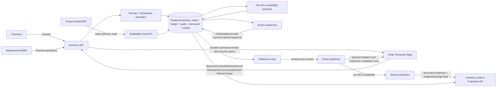

# Inventory Service — Target Architecture

> **Status:** Target design accepted for Release 1.

## 1. Architecture decision

Inventory uses one relational primary database as the only write source for stock correctness. The service atomically persists authoritative state, immutable movement/audit, idempotency state, and transactional outbox. Redis/cache, broker order, Search, and any worker are excluded from the correctness decision path. The concrete stack is Java 21 + Spring Boot 3.x on PostgreSQL 16 with Flyway and a Debezium relay ([ADR-023](decisions/ADR-023-java-spring-boot-postgresql-runtime.md)).

This choice follows the priority order: no oversell, auditability, and operational simplicity outrank latency/throughput optimizations until evidence requires a change.

## 2. Logical components

| Component | Responsibility | Must not do |
|---|---|---|
| Inventory API/domain | Authenticate/authorize callers, enforce domain guards, execute one atomic command. | Call Product, Payment, Order, broker, cache, or evidence repository synchronously inside a write transaction. |
| Relational primary | Durable source of current state and append-only evidence. | Be bypassed by direct table writes. |
| Export sequencer | Single fenced leader that assigns the commit-ordered export sequence and finalizes `PublishedEvent` ([ADR-022](decisions/ADR-022-commit-ordered-export-sequence.md)). | Run as more than one active writer, or let a fact reach Kafka/change feed unsequenced. |
| Outbox relay (Debezium) | Publish sequenced durable facts at least once. | Reapply business movement or treat broker publish as transaction success condition. |
| Availability projector | Serialize affected work per SKU and derive the global boolean from warehouse/position truth; update `SkuAvailabilityState` and create a Search outbox fact only when readiness exists. | Delay or participate in Reserve/ADMIN command commits; publish before readiness; expose raw warehouse quantities. |
| Cache | Optional read acceleration. | Decide availability, Reserve, Commit, Release, or correction. |
| Availability Read API | Serve Product Detail BFF one bounded, advisory result per SKU from Inventory-owned state. | Create a hold, expose quantity/warehouse/reservation, call Product, or return a state whose pending work exceeds the 30-second freshness budget. |
| Search Projection API | Record Search document readiness and serve per-SKU snapshot/change feed. | Serve checkout correctness or raw stock exposure. |

## 3. Trust and service boundaries

- Only Order's authenticated Temporal Saga invokes reservation, atomic pre-dispatch
  release, and Refund Scope workflow mutations. Payment sends its result to Order,
  not Inventory.
- Reservation command results use durable HTTP receipts and command query/replay.
  The relay sends Order only physical dispatch and selected-scope inspection completion;
  Order never waits for a reservation acknowledgment event. State, command identity,
  movement/audit, required public outbox records and availability dirty work retain their
  atomic transaction boundary ([ADR-020](decisions/ADR-020-command-receipts-and-minimal-order-events.md)).
- A late captured payment can use only Inventory's fenced recovery command. Inventory
  reuses neither allocation preview nor normal Reserve: it commits the original released
  root only when all original physical guards still hold; otherwise Order owns the
  financial-reconciliation/manual path.
- Only ADMIN invokes warehouse and physical commands, through the gateway at `/api/v1/admin/inventory` with role `ADMIN`; all commands are attributed. MFA is mandatory before production and is verified once Auth/gateway forward an MFA assertion ([ADR-024](decisions/ADR-024-admin-surface-and-error-catalog.md)).
- Inventory accepts opaque `sku_id` and has no synchronous Product dependency. Product/Checkout prevent inactive SKU from entering checkout.
- Search registers readiness only after its Product-owned SKU document exists. Inventory
  may compute and retain availability before registration, but the projector cannot
  publish or export it until the readiness guard exists.
- Product Detail BFF has no Search readiness role and no broker/export credential. It
  reads Inventory's state synchronously through a separate mTLS batch API; a missing
  state, or one whose pending work exceeds the 30-second freshness budget, is returned
  as `UNKNOWN` ([ADR-025](decisions/ADR-025-pdp-availability-staleness-budget.md)).
- Inventory publishes physical dispatch facts; Order converts them to its shipment/delivery state.
- Warehouse `inactive`/`OUTAGE` filters only new allocation. It does not rewrite existing reservation/commitment or prevent ADMIN from recording a real physical fact.

## 4. Concurrency model

The `StockPosition` row is the stock contention unit. Every mutation has a defined transaction boundary and lock order in [data.md](data.md). Reservation commands take the position lock last, through one guarded update per position after their other writes, so a hot SKU is held only for the end of each transaction ([ADR-033](decisions/ADR-033-stock-position-lock-taken-last.md)); Reserve still accepts the exact preview plan as a whole or rejects every unavailable line. A conflicting command is serialised by row locks/guards; after two bounded internal retries it returns `503 INVENTORY_BUSY`, never an invented stock outcome.

No distributed lock is required or accepted as correctness authority. Multi-item/multi-warehouse atomicity is provided by the relational transaction, not a compensating partial workflow.

## 5. Availability and deployment constraints

| Dependency condition | Behavior |
|---|---|
| Primary database / atomic transaction unavailable | Fail closed: mutations reject technically; Preview returns `503 INVENTORY_UNAVAILABLE`. |
| Broker/relay unavailable after durable commit | Continue commands while primary capacity is safe; relay later replays outbox. |
| Search/cache unavailable | Checkout and authoritative commands continue against primary state; Search can be stale/rebuilt. |
| Search readiness absent | Inventory commands continue; the current per-SKU availability state remains pending and is published when readiness is registered. |
| Availability Read API/read model unavailable or lagging beyond 30 s | Authoritative commands continue; BFF receives `503` for a dependency outage or `UNKNOWN` per affected SKU. |
| Order timeout worker unavailable | Reservation remains; only Order decides later commit/release. |

The production topology must demonstrate zero loss for a committed command and recover writes safely within 60 minutes. The runtime, database and relay are fixed by [ADR-023](decisions/ADR-023-java-spring-boot-postgresql-runtime.md); replication and deployment mechanics remain implementation choices provided they satisfy [operations.md](operations.md) recovery gates.

## 6. Explicitly rejected Release 1 designs

- Redis as hot-path commit source or a second stock truth.
- Event sourcing as the authoritative command model.
- Direct event publication after a business commit without transactional outbox.
- Broker retention as Search bootstrap/recovery source.
- Publishing warehouse or stock-position facts and requiring Search to reconstruct
  Inventory's per-SKU availability rule.
- Shared database/table integration or manual database edits as correction/recovery.
- Automatic reroute, automatic reserve expiry, partial reservation, or partial line allocation.

Current target ADRs and superseded historical ADRs are indexed in [decisions/README.md](decisions/README.md).
