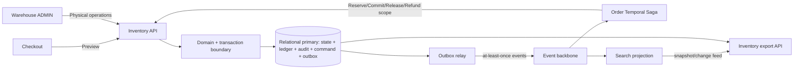

# Inventory Service — Target Architecture

> **Status:** Target design accepted for Release 1.

## 1. Architecture decision

Inventory uses one relational primary database as the only write source for stock correctness. The service atomically persists authoritative state, immutable movement/audit, idempotency state, and transactional outbox. Redis/cache, broker order, Search, and any worker are excluded from the correctness decision path.

This choice follows the priority order: no oversell, auditability, and operational simplicity outrank latency/throughput optimizations until evidence requires a change.

## 2. Logical components

| Component | Responsibility | Must not do |
|---|---|---|
| Inventory API/domain | Authenticate/authorize callers, enforce domain guards, execute one atomic command. | Call Product, Payment, Order, broker, cache, or evidence repository synchronously inside a write transaction. |
| Relational primary | Durable source of current state and append-only evidence. | Be bypassed by direct table writes. |
| Outbox relay | Publish durable facts at least once. | Reapply business movement or treat broker publish as transaction success condition. |
| Cache | Optional read acceleration. | Decide availability, Reserve, Commit, Release, or correction. |
| Export API | Snapshot/change feed for Search. | Serve checkout correctness or raw stock exposure. |

## 3. Trust and service boundaries

- Only Order's authenticated Temporal Saga invokes reservation and Refund Scope workflow mutations. Payment sends its result to Order, not Inventory.
- Only ADMIN invokes warehouse and physical commands. Interactive ADMIN requires MFA; all commands are attributed.
- Inventory accepts opaque `sku_id` and has no synchronous Product dependency. Product/Checkout prevent inactive SKU from entering checkout.
- Inventory publishes physical dispatch facts; Order converts them to its shipment/delivery state.
- Warehouse `inactive`/`OUTAGE` filters only new allocation. It does not rewrite existing reservation/commitment or prevent ADMIN from recording a real physical fact.

## 4. Concurrency model

The `StockPosition` row is the stock contention unit. Every mutation has a defined transaction boundary and lock order in [data.md](data.md). Reserve locks the exact preview plan and validates all lines before any bucket changes. A conflicting command is serialised by row locks/guards; after two bounded internal retries it returns `503 BUSY`, never an invented stock outcome.

No distributed lock is required or accepted as correctness authority. Multi-item/multi-warehouse atomicity is provided by the relational transaction, not a compensating partial workflow.

## 5. Availability and deployment constraints

| Dependency condition | Behavior |
|---|---|
| Primary database / atomic transaction unavailable | Fail closed: mutations reject technically; Preview returns `503 INVENTORY_UNAVAILABLE`. |
| Broker/relay unavailable after durable commit | Continue commands while primary capacity is safe; relay later replays outbox. |
| Search/cache unavailable | Checkout and authoritative commands continue against primary state; Search can be stale/rebuilt. |
| Order timeout worker unavailable | Reservation remains; only Order decides later commit/release. |

The production topology must demonstrate zero loss for a committed command and recover writes safely within 60 minutes. Exact vendor, replication, runtime, and deployment mechanics remain implementation choices provided they satisfy [operations.md](operations.md) recovery gates.

## 6. Explicitly rejected Release 1 designs

- Redis as hot-path commit source or a second stock truth.
- Event sourcing as the authoritative command model.
- Direct event publication after a business commit without transactional outbox.
- Broker retention as Search bootstrap/recovery source.
- Shared database/table integration or manual database edits as correction/recovery.
- Automatic reroute, automatic reserve expiry, partial reservation, or partial line allocation.

Current target ADRs and superseded historical ADRs are indexed in [decisions/README.md](decisions/README.md).
