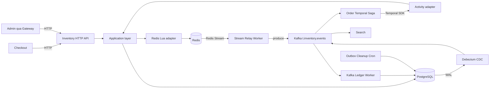

# Inventory Service — Architecture

> File này trả lời: “Service được chia thành những thành phần nào và chúng phối hợp
> ra sao?” Điểm đặc thù cần nắm trước tiên: **Redis là nơi commit của đường nóng,
> PostgreSQL là sổ cái durable nằm phía sau một hàng đợi.**

## 1. Architecture context

Inventory nằm giữa ba nhóm caller khác nhau về mức độ nhạy cảm với độ trễ:

- **Đường nóng đặt hàng** — Order Temporal Saga gọi Reserve/Deduct/Release qua Temporal
  SDK. Đây là đường phải atomic và nhanh; nó không được chờ PostgreSQL.
- **Đường quản trị** — Admin và Checkout gọi HTTP. Đường này chấp nhận độ trễ
  transaction PostgreSQL bình thường.
- **Đường công bố** — Search consume Kafka để dựng projection tồn kho. Thiết kế đích
  bổ sung một internal export API cho bootstrap/recovery, nhưng endpoint đó chưa được
  implement — xem [Data §5](./data.md#5-khoảng-cách-giữa-thiết-kế-đích-và-schema-hiện-tại).

Trust boundary: HTTP public đi qua API Gateway (identity đã được verify và inject
thành header tin cậy); endpoint internal chỉ nhận service identity và không expose ra
Gateway; Temporal Activity chỉ chạy trong worker của cụm nội bộ.

## 2. Trách nhiệm từng component

| Component | Làm gì | Không được làm | Dependencies |
|---|---|---|---|
| HTTP API adapter | Nhận request admin/checkout, validate transport, map domain error sang Problem Details | Chứa business rule; gọi thẳng Redis Lua bỏ qua application layer | Application layer |
| Temporal Activity adapter | Nhận lời gọi Reserve/Deduct/Release, trả kết quả có phân loại lỗi | Điều phối saga hoặc quyết định compensation | Application layer |
| Warehouse Selection Engine | Sinh route plan từ tồn kho khả dụng và vị trí khách | Giữ chỗ tồn kho; đảm bảo plan còn hiệu lực lúc reserve | PostgreSQL, Redis |
| Redis Lua adapter | Thực thi ba script atomic ([`lua/`](../../java/services/inventory-service/src/main/resources/lua)), dịch mã trả về thành domain result | Ghi từng lệnh Redis rời rạc ngoài script; ghi key khác hash slot | Redis |
| Stream Relay Worker | Đọc Redis Stream, gắn CloudEvents header, produce Kafka | `XACK` trước khi Kafka xác nhận; sinh thêm event cho idempotent hit | Redis, Kafka |
| Kafka Ledger Worker | Materialize mutation thành ledger, reservation, `physical_inventory` và outbox trong một transaction | Xử lý event không phải `INVENTORY_STOCK_MUTATION`; mutate Redis | Kafka, PostgreSQL |
| Debezium CDC connector | Đọc WAL bảng outbox, dùng cột `partition_key` làm Kafka key | Bóc JSON payload ở tầng Connect | PostgreSQL WAL, Kafka |
| Outbox Cleanup Cron | Xóa outbox row đã quá watermark | Xóa row chưa chắc đã được CDC đọc | PostgreSQL |

## 3. Processing model

Service có hai đường ghi khác nhau về bản chất.

**Đường nóng (Reserve / Deduct / Release) — commit ở Redis.** Một Lua script thực hiện
trong một lần chạy: kiểm tra cờ suspension, kiểm tra idempotency key, kiểm tra ràng
buộc số lượng, mutate stock hash, và `XADD` event vào Redis Stream cùng hash slot.
Vì Redis chạy script đơn luồng, mutation và event được ghi cùng lúc hoặc không có gì
được ghi. Không có transaction PostgreSQL nào trong đường này. Kết quả trả về caller
ngay sau khi script trả mã.

Sau đó là chuỗi bất đồng bộ: Relay Worker forward stream sang Kafka; Ledger Worker
consume và mở **một** transaction PostgreSQL ghi ledger, reservation,
`physical_inventory` và outbox row; Debezium đọc WAL và publish.
Lý do chọn kiến trúc này và cái giá phải trả nằm ở
[ADR-001](./decisions/ADR-001-redis-hot-path-commit-source.md) và
[ADR-002](./decisions/ADR-002-redis-stream-outbox.md).

**Đường quản trị (Restock / Return restock / Ship-to-customer) — commit ở PostgreSQL.**
Một transaction ghi `physical_inventory`, `inventory_ledger` và insert outbox row.
Redis hash được đồng bộ **sau** commit; đây là
side effect ngoài transaction và là điểm yếu đã biết: nếu cập nhật Redis thất bại sau
khi commit, hai bên lệch nhau cho tới khi có can thiệp.

Nguyên tắc chung cho cả hai đường: **outbox row luôn nằm trong cùng transaction với
thay đổi dữ liệu sinh ra nó.** Không có nơi nào phát Kafka trực tiếp từ application.

## 4. Consistency model

| Phạm vi | Mức nhất quán | Ghi chú |
|---|---|---|
| Một `(sku_id, warehouse_id)` trong Redis | Strong, tuần tự hóa bởi Lua | Không có race trong phạm vi một key |
| Một request nhiều item | All-or-nothing ở tầng application | Không phải transaction thật; xem [Workflows WF-INV-002](./workflows.md#wf-inv-002--reserve-inventory) |
| `physical_inventory` so với Redis | Eventual, trễ theo relay + ledger lag | Stale trong khoảng vài trăm ms ở trạng thái ổn định |
| Search projection | Eventual, **không có ordering guard** | Event `INVENTORY_STOCK_CHANGED` không mang revision; thiết kế đích thêm `stock_revision` nhưng chưa implement |
| Route plan so với tồn kho thực | Không nhất quán theo thiết kế | Plan chỉ là gợi ý; reserve vẫn có thể `OUT_OF_STOCK` |

**Phát hiện sai lệch:** Lua script kiểm tra `available == total - reserved` trước và
sau khi mutate ở script Deduct. Sai lệch trả mã `-1` và kích hoạt đóng băng SKU.

**Phục hồi:** không tự động. Vận hành đối soát Redis với `physical_inventory`, sửa
bằng tay, rồi gọi API unlock. Xem [ADR-005](./decisions/ADR-005-fail-safe-suspension.md).

## 5. Concurrency model

- **Tuần tự hóa:** Redis Lua đơn luồng thay cho lock database. Không có `SELECT FOR
  UPDATE` trên đường nóng.
- **Đồng vị trí key:** stock hash, idempotency key, stream và cờ suspension của cùng
  một `(SKU, kho)` dùng chung hash tag `{sku_id:warehouse_id}` để rơi vào cùng slot
  Redis Cluster. Script truy cập key khác slot sẽ bị từ chối bởi Redis, không phải bởi
  application — xem [ADR-004](./decisions/ADR-004-per-warehouse-hash-tag-layout.md).
- **Chống lặp:** `SETNX` idempotency key trong script chặn replay ở đường nóng
  (TTL 30 ngày). `inventory_ledger.event_id UNIQUE` chặn ở đường ghi sổ. Partial
  unique index trên reservation chặn hai reservation `RESERVED` cùng
  `(order, sku, kho)`.
- **Ordering:** Kafka key là `sku_id` cho event tồn kho và `order_id` cho signal đơn
  hàng, nên thứ tự chỉ được cam kết trong phạm vi một SKU hoặc một đơn hàng.
- **Race đáng chú ý:** hai lần restock hàng hoàn cuối cùng của cùng một
  `refund_request_id` có thể cùng thấy `pending = 0`; partial unique index trên
  `inventory_outbox` là thứ thực sự chặn double-emit, không phải câu `IF`.

## 6. Deployment topology

| Process | Scale theo | Ràng buộc |
|---|---|---|
| API server (public + internal) | Request rate, latency | Stateless |
| Temporal Activity worker | Task queue backlog | Có thể chung process với API |
| Stream Relay Worker | Số slot/stream đang hoạt động | Consumer group `inventory-stream-relay`; nhiều instance chia stream |
| Kafka Ledger Worker | Consumer lag, số partition | Không vượt số partition của `t.inventory.events` |
| Debezium connector | Kafka Connect | Một replication slot; không chạy hai connector trên cùng slot |
| Outbox Cleanup Cron | Không scale | Phải singleton |

Runtime dependency bắt buộc: Redis (đường nóng chết nếu thiếu), PostgreSQL, Kafka,
Kafka Connect.

## 7. Architecture constraints

- Không service nào truy cập database Inventory trực tiếp; và Inventory không đọc
  database service khác.
- Không phát Kafka trực tiếp từ application code — mọi event đi qua Redis Stream hoặc
  bảng outbox.
- Không đặt business rule trong HTTP controller, Temporal Activity adapter hay Kafka
  consumer adapter.
- Mọi key Redis mà một Lua script chạm tới phải cùng hash tag.
- Ledger Worker phải lọc theo `event_type` trước khi xử lý, nếu không sẽ tự tiêu thụ
  event do chính nó sinh ra và tạo vòng lặp.
- Không ghi ledger cho hành động không làm đổi `actual_quantity`.

## 8. Trade-offs và ADR liên quan

Kiến trúc này đánh đổi tính nhất quán tức thời giữa Redis và PostgreSQL để lấy độ trễ
thấp và không lock database trên đường nóng. Cái giá là một cửa sổ phân kỳ có thật khi
worker tụt lại, và không có cơ chế tự sửa. Mọi quyết định gốc được ghi tại
[Decision index](./decisions/README.md):

| Chủ đề | ADR |
|---|---|
| Redis là commit source, PostgreSQL là ledger | [ADR-001](./decisions/ADR-001-redis-hot-path-commit-source.md) |
| Redis Stream outbox thay vì publish trực tiếp | [ADR-002](./decisions/ADR-002-redis-stream-outbox.md) |
| Transactional outbox + Debezium CDC | [ADR-003](./decisions/ADR-003-transactional-outbox-cdc.md) |
| Mô hình per-warehouse và hash tag | [ADR-004](./decisions/ADR-004-per-warehouse-hash-tag-layout.md) |
| Đóng băng khi drift, mở khóa thủ công | [ADR-005](./decisions/ADR-005-fail-safe-suspension.md) |
| Timer hết hạn giữ chỗ thuộc Order | [ADR-006](./decisions/ADR-006-reservation-expiry-owned-by-order.md) |
| Stock snapshot v1 cho Search | [ADR-007](./decisions/ADR-007-stock-snapshot-v1-for-search.md) |
| Thuật toán chọn kho đơn giản hóa | [ADR-008](./decisions/ADR-008-simplified-warehouse-selection.md) |
| Ship-to-customer là signal, không phải biến động kho | [ADR-009](./decisions/ADR-009-ship-signal-without-ledger.md) |
| Refund expectation registry đặt tại Inventory | [ADR-010](./decisions/ADR-010-refund-expectation-registry.md) |
