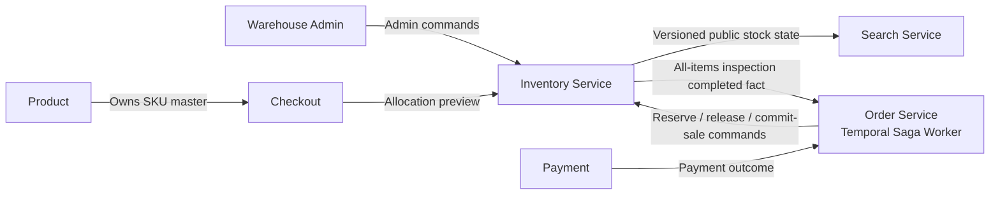

# Inventory Service — Context Map và Ownership Matrix (Phase 1)

> Tài liệu này xác định ranh giới giữa Inventory và các bounded context khác cho
> thiết kế đích. Nó mô tả ownership, luồng thông tin và những điều bị cấm; không mô
> tả schema, API payload, database hay implementation.

## 1. Boundary statement

Inventory là system of record cho warehouse master, operational availability của kho,
tồn kho theo kho, reservation/allocation liên quan đến stock, hàng hoàn đang inspection/
quarantine, stock adjustment và audit trail của mọi stock mutation.

Inventory enforce các invariant tồn kho khi nhận command hợp lệ, nhưng không sở hữu
vòng đời order, payment, delivery, SKU master, refund decision hoặc Search index. Mọi
tích hợp đi qua contract; không service nào đọc hoặc ghi trực tiếp persistent store của
Inventory.

## 2. System context

Các mũi tên biểu diễn business interaction, không áp đặt protocol. Payment không gọi
trực tiếp Inventory. Product cũng không bị Inventory gọi đồng bộ để validate SKU.

## 3. Ownership matrix

| Khái niệm / state | System of record | Quyết định nghiệp vụ thuộc về | Vai trò của Inventory |
|---|---|---|---|
| SKU, product lifecycle, sell/unsellable catalog | Product | Product | Chỉ nhận `sku_id` trong command; không lookup/validate đồng bộ Product. Product/Checkout chịu trách nhiệm không đưa SKU inactive/retired vào flow bán hàng. |
| Warehouse master, địa chỉ, active/inactive/outage | **Inventory** | **Inventory**, qua admin command | Tạo/cập nhật kho và công bố availability cho allocation. Outage/maintenance phải khiến kho không được chọn. |
| Stock theo warehouse, sellable và quarantine | **Inventory** | **Inventory** | Enforce no-oversell, giữ stock bucket và audit mọi mutation. |
| Allocation/reservation record | **Inventory** | Inventory enforce; **Order** quyết định khi yêu cầu create/release/commit | Inventory chỉ nhận command từ Order Temporal Saga Worker; không tự hết hạn hay tự release. |
| Order lifecycle, cancellation, payment timeout | Order | **Order** | Order chạy timer 15 phút, retry và gửi release command idempotent. |
| Payment outcome, refund disbursement | Payment | Payment / Order | Không có command trực tiếp Payment → Inventory. Payment outcome đi qua Order. |
| Shipment/delivery state | **Order** | **Order** | Không sở hữu `picked`, `shipped`, `delivered` hay delivery status; không dùng shipment event để thay đổi stock trừ khi Phase 2 định nghĩa movement độc lập. |
| Refund request scope và quyết định refund | **Order** | **Order** / Payment | Một order có tối đa một refund request `PROCESSING` tại một thời điểm. Scope là toàn bộ order line, không partial quantity; Inventory chỉ theo dõi inspection completion của scope đã đăng ký. |
| Return receipt, inspection/quarantine result | **Inventory** | **Inventory/Warehouse Operations** | Hàng hoàn không về sellable ngay; Inventory phát fact khi toàn bộ item trong scope đã inspection completed. |
| Search index và trải nghiệm tìm kiếm | Search | Search | Inventory publish public stock state versioned; Search tự dựng và phục hồi projection. |
| Hạ tầng, HA/backup/observability | Platform | Platform + Inventory | Không sở hữu business state; bảo đảm các NFR/RPO/RTO trong charter. |

### 3.1 Warehouse operational state

Inventory là owner duy nhất của warehouse master và trạng thái khả dụng vận hành. Admin
chỉ tác động thông qua Admin API của Inventory khi tạo kho, đổi địa chỉ, bật/tắt kho,
hoặc đánh dấu sự cố/bảo trì.

Phase 2 sẽ chọn biểu diễn cuối cùng (`is_active` kèm reason hay state enum), nhưng
semantics đã chốt: kho `inactive` hoặc `outage` không được Allocation Engine chọn. Nếu
còn kho khả dụng khác thỏa toàn bộ quantity của line item, allocation có thể chọn kho
đó; đây không phải auto-reroute sau reserve failure.

## 4. Interaction matrix

| Caller / producer | Consumer | Business interaction | Ownership & rule | Điều bị cấm |
|---|---|---|---|---|
| Warehouse Admin | Inventory | Tạo/cập nhật warehouse, `fulfillment_priority`, thay đổi active/outage; ghi nhận physical dispatch, receipt, inspection, adjustment | Một role `ADMIN` duy nhất cho release đầu; physical dispatch là fact kho xác nhận hàng đã rời kho; mọi mutation có actor, command ID, timestamp và audit. | Sửa database trực tiếp hoặc bypass audit. |
| Checkout | Inventory | Allocation preview | Read-only preview từ authoritative state; primary store unavailable trả `503 INVENTORY_UNAVAILABLE` | Checkout tự reserve/release hoặc dùng Search/cache để quyết định availability. |
| Order Temporal Saga Worker | Inventory | Reserve, release, commit sale | Là con đường bắt buộc. Order owns order decision/timer; Inventory enforce stock invariant và idempotency | HTTP/public caller, Payment hoặc Checkout gọi stock mutation trực tiếp. |
| Payment | Order | Payment success/failure | Payment outcome chỉ làm Order tiến lifecycle và phát command phù hợp | Payment gọi Inventory để commit/release stock. |
| Product | Checkout / catalog consumers | SKU lifecycle/catalog availability | Product là SKU authority; Product/Checkout chặn SKU inactive/retired trước flow bán hàng. Inventory chấp nhận `sku_id` từ command, không synchronous validate Product | Inventory query Product DB/API ở hot path hoặc Product ghi Inventory store. |
| Order | Inventory | Register immutable refund scope **trước bất kỳ return receipt nào** | Mỗi order chỉ có một refund request `PROCESSING` tại một thời điểm; scope là toàn bộ order line và immutable. Inventory lưu projection tối thiểu để biết tập item cần inspection | Inventory tự suy diễn scope từ order database, nhận receipt trước registration, hoặc tự đổi refund decision. |
| Inventory | Order | `AllItemsInspectionCompleted` fact theo refund request | Chỉ phát khi mọi item trong scope đã inspection completed; Order/Payment quyết định refund | Inventory tự refund hoặc phát event sau receipt đầu tiên. |
| Inventory | Search | Versioned public stock state | Event/state phải ordering, dedupe, bootstrap/recovery; freshness target ≤ 60 giây | Search quyết định sellable stock hoặc Inventory phụ thuộc đồng bộ vào Search. |
| Product Detail BFF | Inventory | Bounded advisory availability read | Sau Product buyer-read, BFF query batch SKU và nhận `IN_STOCK`/`OUT_OF_STOCK`/`UNKNOWN`; trạng thái không phải reservation | BFF consume Search event/export, đọc quantity/warehouse, hoặc gửi stock command. |

## 5. Boundary rules

### 5.1 Inventory must

- Enforce stock/reservation invariants, idempotency và full audit trail cho mọi mutation.
- Chỉ dùng authoritative inventory state để accept/reject stock mutation và allocation preview.
- Ghi business mutation cùng transactional outbox record trong một durable transaction.
- Loại warehouse inactive/outage ngay ở allocation ban đầu.
- Xử lý item return qua inspection/quarantine trước khi stock có thể sellable trở lại.

### 5.2 Inventory must not

- Đọc hoặc ghi database của Product, Checkout, Order, Payment hay Search.
- Gọi đồng bộ Product Service để xác nhận `sku_id`; malformed command vẫn bị validate ở boundary,
  nhưng Inventory không xác minh SKU có tồn tại/đang active trong catalog.
- Ra quyết định order cancellation, payment timeout, refund payout hay delivery status.
- Tự release reservation khi `expires_at` qua 15 phút hoặc orphan alert vượt 60 phút.
- Publish state thay cho Search, hay dựa vào Search/cache để quyết định correctness.
- Nhận stock mutation từ bất kỳ caller nào ngoài Order Temporal Saga Worker hoặc authorized admin flow.

## 6. Derived contract requirements

Các requirement này phát sinh tất yếu từ ownership trên; chúng sẽ được thiết kế chi tiết
ở Phase 3 và Phase 7.

| Requirement | Lý do |
|---|---|
| Mọi command từ Order phải mang idempotency/command ID và causation/correlation metadata. | Order/Temporal retry được phép nhưng mutation chỉ được áp dụng một lần. |
| Order phải đăng ký immutable refund scope **trước khi thủ kho tiếp nhận bất kỳ kiện hàng nào**. | Inventory không thể biết “all items inspection completed” nếu không có tập item chuẩn từ owner Order. Receipt không có scope đã đăng ký phải bị từ chối. |
| Refund scope registration phải idempotent và từ chối thay tập item sau khi đã bắt đầu inspection. | Ngăn điều kiện completion thay đổi giữa chừng. |
| Mỗi order chỉ có tối đa một refund request `PROCESSING`; scope gồm toàn bộ order line, không hỗ trợ partial quantity ở release đầu. | Giảm phức tạp phân bổ/refund và ngăn nhiều scope cạnh tranh trên cùng item. Refund request tiếp theo chỉ được mở khi request trước không còn `PROCESSING`. |
| Inspection completion không đồng nghĩa refund request đã kết thúc. Order Saga phải gửi lệnh đóng scope idempotent sau khi refund request đạt trạng thái cuối tại Order; chỉ scope `CLOSED`, `CANCELLED` hoặc `CLOSED_INCOMPLETE` mới giải phóng quyền đăng ký scope tiếp theo. | Inventory không sở hữu payout/refund decision nhưng vẫn cần giữ lock scope để không nhận request mới khi Order còn `PROCESSING`. |
| Inventory event tới Order chỉ là fact completion, không phải refund command. | Refund payout thuộc Payment/Order. |
| Stock state tới Search phải mang version/revision và có bootstrap/replay protocol. | Thứ tự broker hoặc topic retention không đủ để phục hồi projection chính xác. |
| Warehouse status phải là phần input authoritative của allocation. | Không được allocate một line item cho kho không thể fulfil. |

## 7. Decisions recorded in Phase 1

| ID | Decision |
|---|---|
| `INV-CTX-001` | Inventory là owner duy nhất của warehouse master và active/inactive/outage state. |
| `INV-CTX-002` | Inventory chấp nhận `sku_id` từ command và không gọi Product đồng bộ để validate. |
| `INV-CTX-003` | Shipment/delivery state hoàn toàn thuộc Order; Inventory không sở hữu delivery state. |
| `INV-CTX-004` | Inventory chỉ phát completion fact khi toàn bộ item trong refund request đã inspection completed. |
| `INV-CTX-005` | Reserve/release/commit sale bắt buộc đi qua Order Temporal Saga Worker/orchestration layer. |
| `INV-CTX-006` | Order bắt buộc đăng ký immutable refund scope tại Inventory trước bất kỳ return receipt nào; Inventory từ chối receipt không có scope hợp lệ. |
| `INV-CTX-007` | Product/Checkout chịu trách nhiệm không đưa SKU inactive/retired vào flow bán hàng; Inventory không synchronous validate catalog. |
| `INV-CTX-008` | Mỗi order chỉ có tối đa một refund request `PROCESSING`; request scope gồm toàn bộ order line, không partial quantity ở release đầu. |
| `INV-CTX-009` | Release đầu dùng một role `ADMIN` duy nhất cho warehouse master, receipt/inspection/quarantine và stock adjustment; mọi hành động đều audited. |
| `INV-CTX-010` | `AllItemsInspectionCompleted` không đóng refund scope. Chỉ Order Saga được gửi `CloseRefundScope` khi refund request đạt trạng thái cuối; scope mới chỉ được đăng ký sau `CLOSED`, `CANCELLED` hoặc `CLOSED_INCOMPLETE`. |
| `INV-CTX-011` | Warehouse Admin là authority ghi `RecordPhysicalDispatch` khi hàng thực sự rời kho. Inventory phát physical-dispatch fact cho Order; Order vẫn sở hữu shipment/delivery state. |
| `INV-CTX-012` | Sau khi order đã partial physical dispatch, chỉ Order Saga có thể cho phép release line `COMMITTED` còn lại qua `POST_DISPATCH_EXCEPTION` kèm `order_exception_id`; Inventory không tự quyết định partial fulfillment hay refund. |
| `INV-CTX-013` | Chỉ Order Saga được đóng RefundScope dở dang bằng `CloseIncompleteRefundScope` khi hàng đã nhận đều inspection xong nhưng `received < expected`; scope thành `CLOSED_INCOMPLETE`, không phát completion fact. |
| `INV-CTX-014` | Allocation release đầu chỉ dùng Inventory-authoritative eligibility (`active`, không `outage`, đủ `available_to_sell`), rồi static `fulfillment_priority ASC`, `warehouse_id ASC`. Preview advisory được reserve revalidate theo exact plan; stale plan bị `REJECT_ALL`, không auto-reroute. |
| `INV-CTX-015` | Warehouse `inactive`/`outage` chỉ bị loại khỏi allocation mới. Existing reservation/committed allocation không auto-release/reroute; physical dispatch do Admin ghi vẫn là fact hợp lệ. `fulfillment_priority` do Admin audited quản lý và chỉ ảnh hưởng preview mới. |

## 8. Open items cho Phase 1 review

- Xác nhận cách biểu diễn protocol giữa Order Temporal Saga Worker và Inventory. Semantics command
  đã chốt ở đây; protocol, error contract và versioning thuộc Phase 7.
- Xác nhận actor/role `ADMIN` được Gateway/identity layer xác thực và truyền sang Inventory thế nào.

## 9. Definition of done cho Phase 1

- [x] Mỗi business concept liên service có đúng một system of record và decision owner.
- [x] Không có Payment → Inventory mutation path hoặc cross-service database access.
- [x] Order orchestration là con đường duy nhất cho stock mutation của đơn hàng.
- [x] Refund completion fact được tách khỏi refund payout decision.
- [x] Order đăng ký immutable refund scope trước return receipt; Inventory từ chối receipt không có scope hợp lệ.
- [x] Warehouse ownership và behavior khi inactive/outage rõ ràng.
- [x] Product/Checkout chịu trách nhiệm SKU active; refund request và admin-role policy release đầu rõ ràng.
- [ ] Owner của Product, Order, Payment, Search và Warehouse Operations review context map.
- [ ] Các open item ở §8 được xác nhận hoặc chuyển thành ADR/contract decision có owner.
