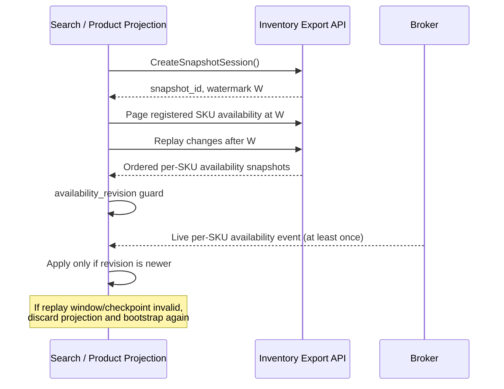

# Inventory Service — Contract Catalogue (Phase 7)

> Target contract semantics trước implementation. Đây là nguồn quyết định cho OpenAPI/AsyncAPI
> ở Phase 9; field naming/schema artifact cụ thể phải tuân theo catalogue này, không được làm
> ngược lại từ code.

## 1. Decision trace bắt buộc

| Input đã chốt | Hệ quả contract |
|---|---|
| `INV-CTX-001` đến `INV-CTX-005` | Inventory là owner stock/warehouse/refund inspection; Checkout chỉ preview, Order Temporal Saga là caller duy nhất của reservation/refund command, Payment không gọi Inventory. |
| `INV-CTX-010` đến `INV-CTX-015`, `INV-WF-001` đến `INV-WF-004` | Contract không được tạo shipment state, auto-release, auto-reroute hay Admin quyền đóng refund scope. Physical dispatch và all-items-inspection-completed là fact cho Order. |
| `INV-CH-001` đến `INV-CH-005`, `INV-ALLOC-001` đến `INV-ALLOC-004` | Preview advisory, Reserve revalidate exact plan; `REJECT_ALL` là domain outcome, `503 INVENTORY_UNAVAILABLE` là technical outcome; Search không tham gia checkout. |
| `INV-DOM-001` đến `INV-DOM-024`, `INV-OPS-004` đến `INV-OPS-013` | Mọi mutation cần command ID, trace/actor/reason khi applicable, idempotency semantic và audit; return/quarantine/disposition có guard riêng. |
| `INV-CON-001` đến `INV-CON-012` | Synchronous result chỉ sau durable commit; outbox at-least-once, consumer dedupe/revision bắt buộc; cache/projection không authoritative; snapshot + replay không phụ thuộc broker retention. |
| `INV-CH-016`, `ASM-003` | Search cần public stock state có ordering, dedupe, bootstrap/recovery; freshness mục tiêu tối đa 60 giây. |

## 2. Contract topology và common rule

### `INV-API-001` — Ba surface, không có public customer write API

Release 1 công bố contract HTTP/JSON versioned, dùng OpenAPI làm schema artifact ở Phase 9:

| Surface | Base path | Caller được phép | Mục đích |
|---|---|---|---|
| Workflow internal | `/internal/inventory/v1` | `CHECKOUT`, `ORDER_SAGA` service principal theo capability. | Preview và các command do Saga điều phối. |
| Warehouse Admin | `/admin/inventory/v1` | Người dùng/service principal có role `ADMIN`. | Warehouse master và physical stock operation. |
| Projection export | `/exports/inventory/v1` | `SEARCH_PROJECTION` service principal đã đăng ký. | Snapshot + replay cho Search/Product read projection. |

Không có Payment, Product, Search hay client/customer nào được gọi mutation API của Inventory.
Product không được Inventory synchronous lookup; `sku_id` là opaque identifier trong contract.
Authentication provider/mTLS topology thuộc Phase 8, nhưng caller identity/role ở bảng trên là
authorization rule bắt buộc của contract.

### `INV-API-002` — Common command envelope

Mọi `POST` mutation phải có:

| Thành phần | Rule |
|---|---|
| `Idempotency-Key` header | Bắt buộc; là `command_id`. Caller namespace lấy từ authenticated principal, không do caller tự khai. |
| `X-Correlation-ID` | Bắt buộc; giữ nguyên theo whole business workflow. |
| `X-Causation-ID` | Bắt buộc với command do event/workflow kích hoạt; initial Admin command dùng chính `command_id`. |
| Actor | Lấy từ authentication context; không nhận actor ID tùy ý trong body. |
| Reason/evidence/operation identity | Body bắt buộc theo command catalogue Phase 5. |
| Response | Echo `command_id`, correlation ID, durable domain outcome và, khi có, aggregate/movement identity. |

`GET` query không mutation và không cần idempotency key. Command result/query chỉ trả cho caller
namespace có quyền đọc nó. Không caller nào retry bằng command ID mới chỉ vì network timeout.

## 3. Synchronous workflow contract

### `INV-API-003` — Checkout allocation preview

| Operation | Contract |
|---|---|
| `POST /internal/inventory/v1/allocation-previews` | Chỉ `CHECKOUT`. Input là danh sách `{line_reference, sku_id, quantity}`; `line_reference` là opaque ref do Checkout tạo và được Order map sang immutable `order_line_id` khi tạo order. Không giữ stock. |
| Successful preview | `200` với `outcome = ALLOCATABLE`, opaque `allocation_plan_id`, `generated_at` và mỗi line `{line_reference, sku_id, quantity, warehouse_id, fulfillment_priority, selection_reason}`. Không hứa availability đến Reserve. |
| Không allocatable | `200` với `outcome = REJECT_ALL`, danh sách line không eligible và reason chuẩn `NO_ELIGIBLE_WAREHOUSE`; không có partial plan. |
| Primary state unavailable | `503 INVENTORY_UNAVAILABLE`; không dùng cache/stale plan, không biến thành out-of-stock. |

`allocation_plan_id` là reference/audit handle advisory, không phải hold hoặc authorization token.
`ReserveOrder` phải gửi exact selected warehouse/quantity từ plan, sau khi Order đã map line
reference sang `order_line_id`; Inventory luôn revalidate lại state authoritative dưới lock.

### `INV-API-004` — Order Temporal Saga command catalogue

| Operation | Endpoint | Required semantic input | Terminal outcome chính |
|---|---|---|---|
| Reserve toàn order | `POST /internal/inventory/v1/reservations:reserve` | `order_id`, `allocation_plan_id`, exact lines `{order_line_id, sku_id, quantity, warehouse_id}`, command envelope. | `RESERVED` với `expires_at`/allocation lines, hoặc `REJECT_ALL`; không partial. |
| Commit payment | `POST /internal/inventory/v1/reservations/{order_id}:commit-payment` | `payment_reference` chỉ để trace, command envelope. | `COMMITTED`, hoặc lifecycle reject như `RESERVATION_EXPIRED`. Payment không là caller. |
| Release reserved root | `POST /internal/inventory/v1/reservations/{order_id}:release` | Reason `PAYMENT_FAILED`, `RESERVATION_EXPIRED`, hoặc `STOCK_DISCREPANCY`; reason cuối bắt buộc `order_exception_id`. | `RELEASED` toàn root hoặc state/reason reject. |
| Release committed allocation | `POST /internal/inventory/v1/reservation-lines/{order_id}/{order_line_id}:release-committed` | Reason `ORDER_CANCELLED`, `REFUND_BEFORE_DISPATCH`, hoặc `POST_DISPATCH_EXCEPTION`; reason cuối bắt buộc `order_exception_id`. | Target line released hoặc state/dispatch guard reject; không đảo physical dispatch. |
| Register full-order refund scope | `POST /internal/inventory/v1/refund-scopes` | `order_id`, toàn bộ immutable lines `{order_line_id, sku_id, expected_quantity}`, Order refund reference, command envelope. | `REGISTERED` + `refund_scope_id`, hoặc active-scope conflict. |
| Cancel scope trước receipt | `POST /internal/inventory/v1/refund-scopes/{refund_scope_id}:cancel` | Command envelope. | `CANCELLED` hoặc state guard reject. |
| Close completed scope | `POST /internal/inventory/v1/refund-scopes/{refund_scope_id}:close` | Terminal reason của Order: `REFUNDED`, `REJECTED` hoặc `CANCELLED`; command envelope. | `CLOSED` hoặc state guard reject. |
| Close incomplete scope | `POST /internal/inventory/v1/refund-scopes/{refund_scope_id}:close-incomplete` | Reason `RETURN_WINDOW_EXPIRED`, `PACKAGE_LOST` hoặc `CUSTOMER_WITHDREW`; command envelope. | `CLOSED_INCOMPLETE` hoặc state/counter guard reject. |

Order owns every customer/payment/shipment/refund decision. Inventory accepts/rejects only the
stock/refund-scope transition. `RESERVED`, `COMMITTED`, `RELEASED`, `CLOSED` and
`CLOSED_INCOMPLETE` are fact outcomes, not commands for another service to overwrite.

### `INV-API-005` — Workflow query

`GET /internal/inventory/v1/command-outcomes/{command_id}` trả terminal command outcome cho
authenticated caller namespace; dùng sau timeout thay vì gửi command mới. Order cũng có thể đọc
reservation/refund scope của chính order/scope qua internal query endpoint được scope bằng
`order_id`/`refund_scope_id`; query chỉ trả Inventory fact, không suy luận Order shipment, payment
hay customer-refund decision.

## 4. Warehouse Admin contract

### `INV-API-006` — Admin command catalogue

| Operation | Endpoint | Required semantic input / guard |
|---|---|---|
| Warehouse master | `POST /admin/inventory/v1/warehouses`; `PATCH /admin/inventory/v1/warehouses/{warehouse_id}` | Create/address, `is_active`, operational state, `fulfillment_priority`; old/new/reason audit. Status chỉ ảnh hưởng allocation mới. |
| Sellable receipt | `POST /admin/inventory/v1/stock-receipts` | `INITIAL_STOCK_LOAD` + `baseline_batch_id`, hoặc `SUPPLIER_RECEIPT` + GRN/delivery reference; receipt operation identity. |
| Adjustment | `POST /admin/inventory/v1/stock-adjustments` | Direction, allowed reason code, adjustment case/line, evidence. `-q` chỉ từ `available_to_sell`. |
| Reverse sellable movement | `POST /admin/inventory/v1/stock-movements/{movement_id}:reverse` | Original receipt/adjustment, reversal sequence/reason, correction evidence; không target Order/Refund transitions. |
| Physical dispatch | `POST /admin/inventory/v1/physical-dispatches` | `order_id`, `order_line_id`, allocated warehouse, quantity, physical handover reference. Chỉ committed line thực sự rời kho. |
| Return receipt | `POST /admin/inventory/v1/return-receipts` | `refund_scope_id`, scope line, **actual** SKU, receiving warehouse, quantity, package/tracking, return receipt operation identity. Wrong/extra receipt reject toàn line. |
| Inspection | `POST /admin/inventory/v1/inspections` | Return receipt line, `PASS`/`FAIL`, quantity, checklist/evidence; final at receiving warehouse. |
| Quarantine disposition | `POST /admin/inventory/v1/quarantine-dispositions` | Failed inspection, `HOLD`/`DISPOSE`/`RETURN_TO_SUPPLIER`, reason/evidence, disposition identity. |
| Reverse disposition | `POST /admin/inventory/v1/quarantine-dispositions/{disposition_id}:reverse` | Physical verification at same warehouse, reversal sequence, allowed reason. Returns only to quarantine. |

Admin query API có thể đọc stock position, warehouse, reservation/refund fact liên quan vận hành,
movement/audit và command outcome; access phải tuân thủ `ADMIN` authorization/audit policy của
Phase 8. Không có admin endpoint để sửa ledger, bucket, reservation state hoặc RefundScope bằng
update tùy ý.

## 5. Outcome và error taxonomy

### `INV-API-007` — HTTP transport status tách khỏi domain outcome

Expected terminal domain outcome được trả bằng `200`, kể cả khi kết quả không tạo stock mutation:
ví dụ `REJECT_ALL`, `RESERVATION_EXPIRED` result của CommitPayment, hoặc original outcome từ retry.
State/identity/quantity guard reject ngoài expected workflow trả `409` nhưng vẫn là durable command
result. Điều này cho phép caller nhận đúng outcome thay vì suy luận từ HTTP retry.

| HTTP / code | Ý nghĩa | Retry rule |
|---|---|---|
| `400 INVALID_REQUEST` | Field thiếu/sai format, reason code không hợp lệ, quantity không dương. Command chưa có durable business outcome. | Sửa request, dùng command ID mới. |
| `403 FORBIDDEN` | Caller không có capability/role cho operation. | Không retry trừ khi authorization được sửa; command ID mới. |
| `404 NOT_FOUND` | Query resource không tồn tại hoặc không thuộc caller namespace. | Không retry mù; caller reconcile identity. |
| `409 IDEMPOTENCY_KEY_REUSED` | Cùng command ID nhưng payload fingerprint khác. | Không retry/sửa payload dưới key cũ; dùng key mới sau khi điều tra. |
| `409 OPERATION_IDENTITY_CONFLICT` | Một physical operation đã accepted với payload khác. | Không retry; dùng correction/reversal workflow nếu appropriate. |
| `409 INVALID_STATE` family | State/reason/quantity guard từ command catalogue: `ALREADY_DISPATCHED`, `RETURN_ITEM_MISMATCH`, `RETURN_QUANTITY_EXCEEDS_SCOPE`, `REFUND_SCOPE_NOT_RECEIVABLE`, v.v. | Command result đã durable; Order/Admin reconcile, không tự compensation. |
| `503 INVENTORY_UNAVAILABLE` | Không đọc/commit authoritative primary state. Bắt buộc cho AllocationPreview khi primary unavailable. | Retry cùng command ID sau recovery; không treat as out-of-stock. |
| `503 INVENTORY_BUSY` | Lock/deadlock/transient concurrency exhausted retry budget trước authoritative result. | Retry cùng command ID; không đổi route/plan hoặc tạo pending write. |

Error body luôn có `{code, retryable, correlation_id}` và `command_id` nếu request là mutation.
`REJECT_ALL` khác `OUT_OF_STOCK`: nó là durable outcome của toàn order reserve/preview, còn
`INVENTORY_UNAVAILABLE`/`INVENTORY_BUSY` là technical error chưa có authoritative decision.

## 6. Public event catalogue

### `INV-API-008` — Common public event envelope

Mọi event public dùng envelope versioned:

```text
event_id                 stable UUID, dedupe key
event_type               namespaced type, ví dụ inventory.reservation.reserved.v1
schema_version           1
export_sequence          strictly increasing committed export sequence; gaps allowed
occurred_at              durable business commit time, không phải broker publish time
correlation_id, causation_id
aggregate { type, id, revision }
data                     event-specific immutable fact/snapshot
```

`export_sequence` hỗ trợ snapshot/replay transfer; không đồng nghĩa global business ordering.
Order dedupe theo `event_id`; Search dùng `aggregate.revision`/state revision per-SKU
để duplicate và snapshot cũ thành no-op mà không cần inbox.

Chỉ event có consumer đã biết mới là **public event**. Outbox/audit fact nội bộ không mặc nhiên
trở thành broker contract.

### `INV-API-009` — Public event types và known consumers

| Event type | Consumer đã biết | `data` tối thiểu | Contract semantic |
|---|---|---|---|
| `com.ecommerce.inventory.sku-availability.changed.v1` | Search projection | `sku_id`, `is_in_stock`, `availability_revision`, `observed_at`. | Inventory-owned full snapshot per-SKU; chỉ publish/export sau Search document readiness. Không lộ warehouse/position/quantity. |
| `inventory.reservation.reserved.v1` | Order Service | `order_id`, `expires_at`, allocation lines `{order_line_id, sku_id, quantity, warehouse_id}`. | Recovery/reconciliation fact cho Reservation đã toàn order reserve; không thay command response. |
| `inventory.reservation.committed.v1` | Order Service | `order_id`, committed allocation lines. | Fact payment-result Inventory đã chuyển full root sang committed; không là payment instruction. |
| `inventory.reservation.released.v1` | Order Service | `order_id`, release reason, released allocation lines, `order_exception_id` when applicable. | Fact inventory release; không quyết định refund/customer outcome. |
| `inventory.reservation.line-dispatched.v1` | Order Service | `order_id`, `order_line_id`, `sku_id`, `quantity`, `warehouse_id`, physical handover reference/time. | Fact physical departure; Order mới sở hữu shipment/delivery transition. |
| `inventory.refund.all-items-inspection-completed.v1` | Order Service | `refund_scope_id`, `order_id`, per-line `{order_line_id, sku_id, expected, received, passed, failed}`. | Tạo đúng một lần khi toàn scope final inspected; không đồng nghĩa refund approved/paid/closed. |

Inventory công bố cho Search derived boolean `is_in_stock`, không raw quantity hay warehouse
detail. Boolean là `true` khi tồn tại ít nhất một `StockPosition` có `available_to_sell > 0` tại
warehouse `is_active = true` và `operational_state != OUTAGE`; không có locality/capacity/SLA
ngầm trong projection Release 1.

Order event consumer dùng các fact trên cho reconciliation, không dùng broker retention như nguồn
truth duy nhất. Nếu checkpoint event của Order không còn trong replay window, Order dùng `order_id`
và `refund_scope_id` đã sở hữu để query Inventory state/fact rồi reconcile workflow của chính nó;
Inventory không phát lại hay tự chạy command lifecycle vì consumer đã bỏ lỡ event.

## 7. Search bootstrap, replay và read model

### `INV-API-010` — Snapshot + change feed, không phụ thuộc broker retention

Search dùng readiness handshake và ba nhóm export operation:

| Operation | Contract |
|---|---|
| `PUT/DELETE /exports/inventory/v1/search-projection-readiness/{sku_id}` | Search register sau khi Product document tồn tại và revoke sau tombstone, trước purge. Inventory không publish/export availability trước registration; registration phát current snapshot. |
| `POST /exports/inventory/v1/snapshot-sessions` | Tạo snapshot session point-in-time, trả `{snapshot_id, export_watermark, expires_at}`. Snapshot content phải phản ánh chính xác committed state tại watermark; session giữ tối đa 24 giờ. |
| `GET /exports/inventory/v1/snapshot-sessions/{snapshot_id}/sku-availabilities?cursor=…` | Trang hóa registered per-SKU availability tại fixed watermark. Mỗi row có `availability_revision`. |
| `GET /exports/inventory/v1/changes?after_sequence=…` | Trả ordered `inventory.sku-availability.changed.v1` sau watermark/sequence. Không trả Order fact stream. |

Export change feed retained **30 ngày** kể từ durable creation; không cleanup event chưa broker-delivered.
Nếu `after_sequence` cũ hơn `minimum_retained_sequence`, Inventory trả
`410 REPLAY_WINDOW_EXPIRED`; consumer phải rebuild availability fields từ snapshot session mới, không
đoán missing event từ broker retention.

Bootstrap/recovery protocol của Search/Product projection:

1. Tạo snapshot session, ghi `export_watermark = W`.
2. Load toàn bộ per-SKU availability pages vào Product documents đã tồn tại; reindex
   defer SKU tạo sau Product snapshot tới Product catch-up, không upsert hay tạo index phụ.
3. Read/replay mọi export event có `export_sequence > W`; apply bằng strict
   `availability_revision` guard.
4. Duy trì broker subscription/change-feed polling. Nếu phát hiện gap vượt retention hoặc không
   thể chứng minh checkpoint, quay lại bước 1.



Search có thể stale tối đa 60 giây từ durable Inventory commit theo SLO baseline, nhưng checkout
không được gọi Search hoặc đọc projection để reserve. Export/event contract cho phép Search recover
độc lập dù broker đã hết retention.

## 8. Schema versioning, compatibility và consumer registry

### `INV-API-011` — Contract evolution policy

- HTTP path `/v1` và event type `.v1` chỉ cho phép additive backward-compatible fields; client
  phải tolerate unknown field. Không đổi meaning, requiredness, unit, enum semantic hoặc ownership
  trong v1.
- Breaking change cần path/event major mới (`/v2`, `.v2`), parallel publish/support. Producer
  không ngừng v1 sớm hơn **90 ngày** sau khi mọi consumer đã đăng ký xác nhận migration.
- Mỗi public event/API có schema owner, schema version, known consumer registry, test fixture và
  compatibility contract test. Không registry hoặc không có owner/consumer thì không public event.
- Consumer registry lưu consumer owner/contact, version đang dùng, bootstrap checkpoint strategy,
  acknowledgment migration và retention dependency. Broker/export access chỉ cấp cho consumer đã
  đăng ký.
- Deprecation cần changelog, migration guide, compatibility test pass và owner sign-off; trường
  hợp consumer không xác nhận giữ version cũ hoặc chặn deprecation.

OpenAPI/AsyncAPI artifacts là generated/validated representation của quyết định này ở Phase 9.
Không đổi schema public trực tiếp trong implementation mà không cập nhật catalogue, registry và
compatibility test.

## 9. Definition of done cho Phase 7

- [x] Synchronous command/query surfaces và caller authority đã chốt.
- [x] Domain outcome, technical error, retryability và command-result lookup đã chốt.
- [x] Public event catalogue có owner, known consumer, envelope/revision/dedupe rule.
- [x] Search stock projection có tối thiểu state exposure, ordering, snapshot bootstrap và replay
  path độc lập với broker retention.
- [x] Schema versioning, consumer registry, compatibility và deprecation policy đã chốt.

**Phase 7 complete — 2026-09-07.** Phase 8 phải dùng error/replay/recovery semantics này cho
failure-mode matrix, observability và runbook. Phase 9 chuyển catalogue thành OpenAPI/AsyncAPI
artifact và target documentation thống nhất.
