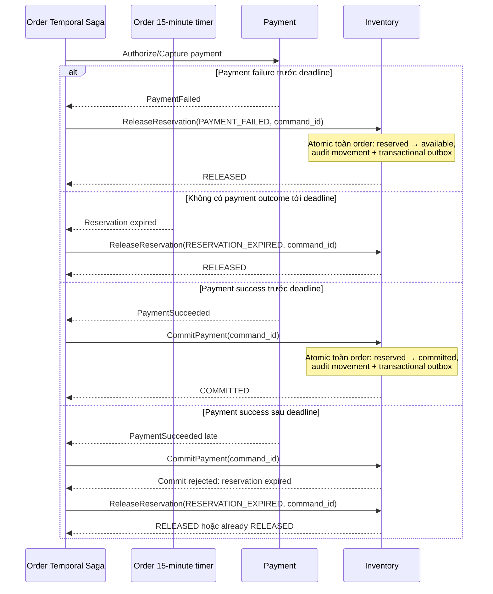

# Inventory Service — Lifecycle Workflows (Phase 3)

> Working document cho workflow liên service và transition authority. Không chọn API
> payload, database hay protocol implementation; các nội dung đó thuộc phase sau.

## 1. Decision trace bắt buộc

| Input đã chốt | Ảnh hưởng đến Phase 3 |
|---|---|
| `INV-CH-001`, `INV-CH-010`, `INV-DOM-003` | Workflow reserve phải atomic toàn order hoặc `REJECT_ALL`; không có compensating partial reservation visible. |
| `INV-CH-008`, `INV-DOM-010` | Order Saga sở hữu timer/retry/release; Inventory không auto-release sau 15 phút hoặc orphan alert. |
| `INV-CTX-003`, `INV-DOM-008` | Inventory chỉ ghi physical movement; Order sở hữu shipment/delivery state. Line có thể dispatch độc lập theo warehouse. |
| `INV-CTX-005` | Reserve, release và commit sale chỉ do Order Temporal Saga Worker gọi. |
| `INV-CTX-009`, `INV-CTX-011`, `INV-DOM-015` | Warehouse Admin là authority của `RecordPhysicalDispatch`, return receipt, inspection, quarantine disposition và adjustment; mọi action audited/idempotent. |
| `INV-CTX-010`, `INV-DOM-014` | `INSPECTION_COMPLETED` vẫn giữ refund lock; chỉ Order Saga đóng scope sau terminal refund decision. |
| `INV-CTX-012`, `INV-DOM-017` | Release target line sau khi order đã partial dispatch phải là post-dispatch exception do Order Saga quyết định; release/dispatch cùng line áp dụng first-atomic-transition-wins. |
| `INV-CTX-013`, `INV-DOM-018` | RefundScope thiếu hàng chỉ được Order Saga đóng bằng `CLOSED_INCOMPLETE` sau khi mọi hàng đã nhận final inspected; không có completion fact. |
| `INV-CH-007` | Mọi fact/event phát từ workflow phải có transactional outbox record cùng business mutation. |

## 2. Quyết định Phase 3 đã chốt

### `INV-WF-001` — Physical dispatch authority

Warehouse Admin là source of truth duy nhất để xác nhận một ReservationLine đã thực sự
rời kho. Admin gửi `RecordPhysicalDispatch` trực tiếp tới Inventory khi bàn giao hàng;
Inventory chỉ chấp nhận khi line đang `COMMITTED` tại đúng warehouse đã allocation.

```text
Order Saga: payment success → CommitPayment
Warehouse Admin: hàng thực sự rời kho → RecordPhysicalDispatch
Inventory: committed -q, on_hand -q, audit movement + outbox fact
Order: nhận physical-dispatch fact và tự quản lý shipment/delivery state
```

`RecordPhysicalDispatch` không được suy diễn từ payment, tạo nhãn vận đơn hay Order
shipment state. Order/Payment không có quyền gọi command này. WMS tương lai có thể thay
Warehouse Admin làm authenticated physical-fact source, nhưng vẫn không chuyển authority
cho Order.

## 3. Happy path đã chốt — Preview đến physical dispatch

```mermaid
sequenceDiagram
    autonumber
    actor Customer
    participant Checkout
    participant Order as Order Service / Temporal Saga
    participant Payment
    participant Inventory
    actor Admin as Warehouse Admin

    Customer->>Checkout: Xem / đặt hàng
    Checkout->>Inventory: AllocationPreview(lines)
    Inventory-->>Checkout: Advisory allocation preview
    Note over Checkout,Inventory: Preview chỉ là gợi ý; không giữ hàng<br/>và không phải lời hứa thành công

    Checkout->>Order: Create order intent(lines)
    Order->>Inventory: ReserveOrder(order, all lines, command_id)
    Note over Inventory: Atomic: revalidate exact preview plan, tạo OrderReservation + ReservationLine,<br/>available → reserved, audit movement + transactional outbox
    Inventory-->>Order: RESERVED(allocations, expires_at = now + 15m)

    Order->>Payment: Authorize/Capture payment
    Payment-->>Order: PaymentSucceeded
    Order->>Inventory: CommitPayment(order, command_id)
    Note over Inventory: Atomic toàn order: reserved → committed,<br/>audit movement + transactional outbox
    Inventory-->>Order: COMMITTED

    loop Một hoặc nhiều ReservationLine tại các warehouse đã allocation
        Admin->>Inventory: RecordPhysicalDispatch(line, command_id)
        Note over Inventory: Kiểm tra COMMITTED + đúng warehouse;<br/>committed -q, on_hand -q, audit movement + transactional outbox
        Inventory-->>Order: Physical-dispatch fact
    end

    Note over Order: Order tự cập nhật shipment/delivery state;<br/>Inventory không sở hữu các state này
```

### 3.1 Trace stock bucket cho một line quantity 2

| Thời điểm | `on_hand` | `available_to_sell` | `reserved` | `committed` | Diễn giải |
|---|---:|---:|---:|---:|---|
| Ban đầu | 10 | 10 | 0 | 0 | Hàng có thể bán. |
| `ReserveOrder` | 10 | 8 | 2 | 0 | Preview trước đó không quyết định kết quả reserve. |
| `CommitPayment` | 10 | 8 | 0 | 2 | Payment không làm hàng vật lý rời kho. |
| `RecordPhysicalDispatch` | 8 | 8 | 0 | 0 | Warehouse Admin xác nhận hàng rời kho. |

### 3.2 Guard thể hiện trong happy path

- `AllocationPreview` chỉ đọc authoritative state và không tạo commitment.
- Payment chỉ thông báo Order; Payment không gọi Inventory trực tiếp.
- `ReserveOrder` và `CommitPayment` chỉ từ Order Temporal Saga Worker; `RecordPhysicalDispatch`
  chỉ từ Warehouse Admin.
- Mỗi mutation bao gồm business state, stock movement/audit và transactional outbox record
  trong cùng durable transaction.
- Các line khác nhau có thể physical dispatch độc lập theo warehouse; một line vẫn có đúng
  một warehouse allocation.
- Tên/payload chính thức của physical-dispatch fact thuộc Phase 7; diagram chỉ chốt semantic.

## 4. Việc phải thiết kế tiếp trong Phase 3

### 4.1 F1 — Reserve reject và primary-store unavailable

```mermaid
sequenceDiagram
    participant Order as Order Temporal Saga
    participant Inventory

    Order->>Inventory: ReserveOrder(all lines, command_id)

    alt Primary inventory store unavailable
        Inventory-->>Order: 503 INVENTORY_UNAVAILABLE
        Note over Order: Không coi là OUT_OF_STOCK;<br/>retry/check lại cùng command_id sau recovery
    else Một line không có warehouse đủ quantity
        Note over Inventory: Abort atomic operation;<br/>không ReservationLine, không stock bucket mutation
        Inventory-->>Order: REJECT_ALL(out-of-stock line details)
        Note over Order: Kết thúc stock attempt;<br/>không auto-reroute hoặc partial fulfillment
    else Reserve thành công
        Inventory-->>Order: RESERVED(allocations, expires_at)
    end
```

| Outcome | Ý nghĩa | Hành vi bắt buộc của Order/Checkout |
|---|---|---|
| `503 INVENTORY_UNAVAILABLE` | Không thể đọc/commit authoritative inventory state một cách an toàn. Không phải phán quyết hết hàng. | Retry hoặc kiểm tra lại bằng cùng command ID sau recovery; không tạo pending order và không chuyển thành `OUT_OF_STOCK`. |
| `REJECT_ALL` | Inventory đã authoritative evaluate request và có ít nhất một line không được một warehouse khả dụng đáp ứng đủ quantity. | Từ chối toàn bộ stock attempt; không allocation/reservation còn sót, không partial fulfillment và không auto-reroute. |
| `RESERVED` | Toàn bộ order đã reserve atomic. | Order tiếp tục payment workflow với `expires_at` đã nhận. |

### 4.2 F2 — Payment outcome, timeout, late payment và retry

#### `INV-WF-002` — Reservation resolution guard

```text
ReleaseReservation(reason = PAYMENT_FAILED | RESERVATION_EXPIRED | STOCK_DISCREPANCY)
  chỉ hợp lệ khi OrderReservation = RESERVED
  STOCK_DISCREPANCY bắt buộc có order_exception_id và release toàn root

ReleaseCommittedAllocation(reason = ORDER_CANCELLED | REFUND_BEFORE_DISPATCH)
  chỉ hợp lệ khi ReservationLine = COMMITTED và chưa physical dispatch
```

Timer 15 phút thuộc Order Saga. Inventory dùng `expires_at` chỉ để từ chối một
`CommitPayment` mới đến sau deadline; Inventory không tự chuyển `RESERVED → RELEASED`.
Sự phân tách command reason/state ngăn timer bị trễ giải phóng stock đã payment-success.

Amendment từ Phase 5: khi Admin phát hiện physical discrepancy nhưng adjustment/reversal giảm
bị chặn vì stock đã reserved, Inventory không được lấy từ bucket đã hứa hoặc tự release. Order
phải quyết định từ chối/hủy toàn order chưa payment, rồi chỉ Order Saga gửi
`ReleaseReservation(STOCK_DISCREPANCY, order_exception_id)`. Transition vẫn là atomic toàn
root `reserved → available`; sau đó Admin mới ghi correction. Đây không phải reroute hay partial
fulfillment. Với stock đã committed/partial dispatch, Order dùng cancellation hoặc
`POST_DISPATCH_EXCEPTION` theo guard F3 hiện hữu.



| Race / retry | Authoritative rule | Kết quả bắt buộc |
|---|---|---|
| `CommitPayment` thắng atomic trước deadline, timer release đến sau | Root đã `COMMITTED`; `ReleaseReservation(RESERVATION_EXPIRED)` không hợp lệ ở state này. | Không đổi stock; Order hủy stale timer/reconciles response. |
| Timeout release thắng trước | Root đã `RELEASED`. | Commit đến sau bị từ chối; Inventory không commit lại. Order/Payment xử lý payment outcome ngoài Inventory. |
| Commit response bị mất | Cùng `command_id` đã mutation thành công. | Retry trả kết quả `COMMITTED` gốc, kể cả retry xảy ra sau `expires_at`; không mutation lần hai. |
| Release response bị mất | Cùng `command_id` đã release thành công. | Retry trả kết quả `RELEASED` gốc; không trả stock lần hai. |
| Commit mới sau deadline khi root vẫn `RESERVED` | `expires_at` guard chặn commit mới; expiry không tự mutation. | Saga explicit release; nếu payment đã thành công, payout/compensation do Order/Payment quyết định. |

### 4.3 F3 — Release/cancel và physical-dispatch race

#### `INV-WF-003` — First atomic transition wins

`ReleaseCommittedAllocation` và `RecordPhysicalDispatch` là hai command cạnh tranh trên
cùng ReservationLine `COMMITTED`. Inventory áp dụng duy nhất transition atomic đến trước;
command còn lại chỉ nhận outcome theo state sau transition, không có compensation ngầm.

```mermaid
sequenceDiagram
    participant Order as Order Temporal Saga
    participant Inventory
    participant Admin as Warehouse Admin

    par Order hủy allocation trước dispatch
        Order->>Inventory: ReleaseCommittedAllocation(line, ORDER_CANCELLED)
    and Kho bàn giao hàng
        Admin->>Inventory: RecordPhysicalDispatch(line, command_id)
    end

    alt Dispatch commit atomic thắng trước
        Inventory-->>Admin: DISPATCHED
        Inventory-->>Order: Release rejected: already dispatched
        Note over Order: Không đảo dispatch; nếu hàng quay lại,<br/>phải dùng RefundScope / return flow
    else Release commit atomic thắng trước
        Inventory-->>Order: RELEASED
        Inventory-->>Admin: Dispatch rejected: allocation released
        Note over Admin: Không được bàn giao kiện hàng
    end
```

Warehouse Admin chỉ xác nhận dispatch ngay tại thời điểm bàn giao vật lý. Nếu Inventory từ
chối command, kho không được bàn giao kiện. Nếu hàng đã rời kho nhưng xác nhận bị mất do sự
cố vận hành, đó là incident cần workflow exception có audit; không được sửa data store trực tiếp.

#### Cancellation sau khi order đã partial dispatch

Khi một line khác của cùng order đã `DISPATCHED`, release một line còn `COMMITTED` không
được xem là normal cancellation: nó có thể làm khách chỉ nhận một phần order. Order/Payment
là owner của quyết định khách hàng, refund và exception này.

Inventory chỉ nhận command sau khi Order đã tạo quyết định exception rõ ràng:

```text
ReleaseCommittedAllocation(
  reason = POST_DISPATCH_EXCEPTION,
  order_exception_id,
  command_id
)
```

Precondition: target line vẫn `COMMITTED` và chưa physical dispatch. Command không đụng tới
line đã `DISPATCHED`; Order tự quyết định khách giữ hàng, refund phần thiếu, hay policy khác.
Transition có audit reason/correlation bắt buộc. Timeout và cancellation thông thường không
được dùng để tạo partial fulfillment ngầm.

### 4.4 F4a — Incomplete RefundScope

#### `INV-WF-004` — Explicit incomplete-return closure

```mermaid
sequenceDiagram
    participant Order as Order Temporal Saga
    participant Inventory
    participant Admin as Warehouse Admin

    Order->>Inventory: RegisterRefundScope(full order lines)
    Admin->>Inventory: RecordReturnReceipt(một phần hàng)
    Admin->>Inventory: RecordInspectionPass/Fail(toàn bộ hàng đã nhận)
    Note over Inventory: received < expected; scope IN_PROGRESS;<br/>không auto-close và không completion fact

    Order->>Inventory: CloseIncompleteRefundScope(reason, command_id)
    Note over Inventory: Guard: mọi received quantity đã final inspected;<br/>không stock mutation mới
    Inventory-->>Order: CLOSED_INCOMPLETE
```

| Rule | Quyết định đã chốt |
|---|---|
| Caller | Chỉ Order Saga. |
| Preconditions | Scope `IN_PROGRESS`; `received < expected`; toàn bộ quantity đã nhận đều `PASS` hoặc `FAIL`. |
| Terminal state | `CLOSED_INCOMPLETE`, có reason như `RETURN_WINDOW_EXPIRED`, `PACKAGE_LOST`, `CUSTOMER_WITHDREW`. |
| Stock và event | Không có stock mutation mới, không phát `AllItemsInspectionCompleted`; hàng pass/fail vẫn giữ outcome stock đã có. |
| Lock | `CLOSED_INCOMPLETE` giải phóng refund lock. |

### 4.5 F4b — Event backbone unavailable sau business mutation

```mermaid
sequenceDiagram
    participant Caller
    participant Inventory
    participant Outbox as Outbox relay
    participant Broker as Event backbone
    participant Consumer

    Caller->>Inventory: State-changing command(command_id)
    Note over Inventory: Atomic durable transaction:<br/>business state + audit movement + outbox record

    alt Transaction commit thất bại
        Inventory-->>Caller: Infrastructure error; không có mutation nào tồn tại
        Note over Caller: Retry cùng command_id sau recovery
    else Transaction commit thành công
        Inventory-->>Caller: Success
        Outbox->>Broker: Publish fact
        alt Broker unavailable
            Broker-->>Outbox: Delivery failure
            Note over Outbox: Giữ durable record, retry publish;<br/>không chạy lại stock mutation
        else Broker available hoặc recovery xong
            Broker-->>Consumer: Fact (có thể duplicate)
            Note over Consumer: Dedupe theo event identity; contract chi tiết ở Phase 7
        end
    end
```

Broker outage sau durable commit không biến command thành thất bại và không buộc caller
gọi lại business mutation. Exact relay retry/backoff, alert và recovery runbook thuộc Phase 8;
semantic Phase 3 là outbox record phải durable cùng mutation, relay chỉ replay fact.

### 4.6 Responsibility matrix đã chốt

Matrix này chốt caller authority, state guard, retry semantic và outbox fact ở mức
business. Tên event/payload, endpoint và protocol cụ thể thuộc Phase 7.

| Transition / command | Caller duy nhất | Precondition chính | Retry / race | Fact / outbox semantic |
|---|---|---|---|---|
| `AllocationPreview` | Checkout | Authoritative store sẵn sàng. | Không giữ hàng; `503` nếu store unavailable. | Không có outbox. |
| `ReserveOrder` | Order Saga | Toàn bộ line có warehouse active đủ hàng. | Cùng `command_id` trả kết quả cũ; thiếu một line là `REJECT_ALL`. | Stock-availability changed và reservation-lifecycle fact. |
| `CommitPayment` | Order Saga | Root `RESERVED`, trước `expires_at`. | Retry idempotent; sau deadline từ chối commit mới. | Allocation-committed fact; outbox cùng mutation. |
| `ReleaseReservation` | Order Saga | Root `RESERVED`; reason `PAYMENT_FAILED`, `RESERVATION_EXPIRED`, hoặc `STOCK_DISCREPANCY` kèm `order_exception_id`. | Luôn release toàn root; không thể release root đã `COMMITTED`. | Stock-availability changed và release fact. |
| `ReleaseCommittedAllocation` | Order Saga | Target line `COMMITTED`, chưa dispatch; `POST_DISPATCH_EXCEPTION` cần `order_exception_id`. | Dispatch/release cùng line: first atomic transition wins. | Stock-availability changed và release/exception fact. |
| `RecordPhysicalDispatch` | Warehouse Admin | Line `COMMITTED`, đúng warehouse allocation. | Retry idempotent; release thắng trước thì từ chối dispatch. | Physical-dispatch fact cho Order. |
| `RegisterRefundScope` | Order Saga | Không có RefundScope historical cho `order_id`; selected lines use full quantity. | Idempotent; scope immutable. | Refund-scope lifecycle fact. |
| `CancelRefundScope` | Order Saga | `REGISTERED`, chưa receipt. | Idempotent. | Audit/lifecycle fact; retains lifetime identity. |
| `RecordReturnReceipt` | Warehouse Admin | Scope `REGISTERED`/`IN_PROGRESS`, actual SKU/line khớp scope, quantity không vượt expected chưa receipt. | Idempotent theo receipt operation identity; wrong/extra receipt từ chối toàn command. | Return-received/quarantine fact; rejected intake chỉ tạo admin audit, không outbox public. |
| `RecordInspectionPass` / `RecordInspectionFail` | Warehouse Admin | Quantity thuộc receipt line chưa final inspected tại đúng warehouse nhận. | Idempotent; kết quả final, không `FAIL → PASS` re-inspection ở Release 1. | Pass tạo stock-availability fact; fail tạo inspection-result fact và giữ quarantine. |
| `CompleteInspection` | **Inventory nội bộ** | Inspection vừa final-inspect quantity cuối của scope. | Không phải external command. | Trong cùng transaction inspection cuối, tạo đúng một `AllItemsInspectionCompleted` outbox fact. |
| `CloseRefundScope` | Order Saga | `INSPECTION_COMPLETED`; refund request đã terminal ở Order. | Idempotent. | Audit/lifecycle fact; giải phóng lock. |
| `CloseIncompleteRefundScope` | Order Saga | `IN_PROGRESS`, thiếu receipt, mọi received quantity đã final inspected. | Idempotent. | Audit/lifecycle fact; không có completion fact. |
| `RecordQuarantineDisposition` | Warehouse Admin | Quantity `FAIL` chưa disposition tại warehouse nhận; reason/evidence bắt buộc. | Idempotent; `HOLD` không terminal, `DISPOSE`/`RETURN_TO_SUPPLIER` chỉ khi hàng thật sự rời kho. | `HOLD` tạo audit fact; physical disposition tạo physical-disposition/audit fact. |
| `ReverseQuarantineDisposition` | Warehouse Admin | Original physical disposition chưa reverse; item physically verified ở cùng warehouse. | Idempotent; không dùng generic adjustment/reversal. | Compensating physical fact, đưa item về quarantine; không public completion fact mới. |

**Cross-cutting rule:** mọi state-changing command có `command_id`, actor hoặc system
actor, correlation/causation ID và reason khi applicable. Business state, stock
movement/audit và outbox record phải durable commit cùng transaction. Payment không gọi
Inventory; `CompleteInspection` không được tách thành command riêng vì có thể làm mất
completion fact sau inspection cuối.

## 5. Definition of done cho Phase 3

- [x] Physical dispatch authority và boundary với Order shipment state đã chốt.
- [x] Happy-path sequence diagram cho order lifecycle đã được owner chốt.
- [x] F1 reserve reject/primary-store-unavailable workflow và outcome semantics đã chốt.
- [x] F2 payment/timeout/late-payment/retry workflow và release guard đã chốt.
- [x] F3 release/physical-dispatch race và post-dispatch exception guard đã chốt.
- [x] F4 incomplete-return/outbox failure workflow và outcome semantics đã chốt.
- [x] Exception sau incomplete return scope đã có command owner/guard rõ.
- [x] Responsibility, timeout/retry và outbox facts được map cho mọi transition.

**Phase 3 complete — 2026-09-07.** Các workflow ở đây là input bắt buộc cho Phase 4–7;
phase sau không được thay đổi caller authority, lifecycle state hoặc timeout/retry semantic
trừ khi tạo decision thay thế có owner review.
