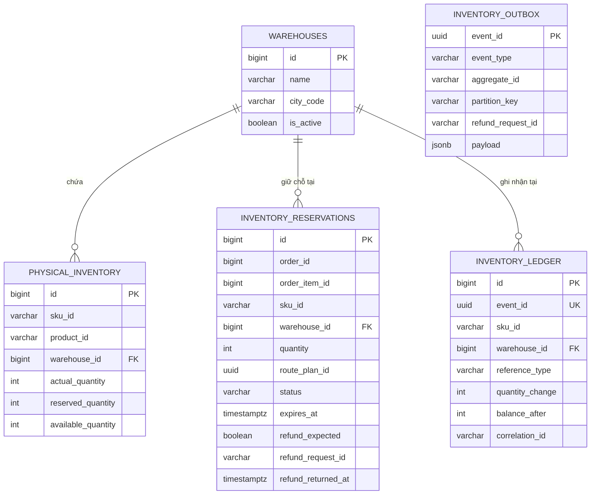

# Inventory Service — Data Design

> File này trả lời: “Dữ liệu được sở hữu, lưu trữ và duy trì tính đúng đắn thế nào?”
> **Nguồn chuẩn cho schema là các migration Flyway trong service**, không phải bảng
> Markdown ở đây. File này giải thích ownership, mục đích và ràng buộc của schema đó.

## 1. Data ownership

| Đối tượng | Nơi lưu | Nguồn chân lý | Ai được đọc |
|---|---|---|---|
| `warehouses` | PostgreSQL | Inventory | Nội bộ Inventory |
| `physical_inventory` | PostgreSQL | Inventory (durable) | Nội bộ Inventory |
| Stock hash Redis | Redis | Inventory (hot path) | Nội bộ Inventory |
| `inventory_reservations` | PostgreSQL | Inventory | Nội bộ; Order biết gián tiếp qua event |
| `inventory_ledger` | PostgreSQL | Inventory | Nội bộ, audit |
| `inventory_outbox` | PostgreSQL | Inventory | Debezium |
| `sku_id`, `product_id` | Denormalized | **Product Service** | — |
| `order_id`, `order_item_id`, `refund_request_id` | Denormalized | **Order Service** | — |

Không service nào được ghi trực tiếp vào database Inventory, và Inventory không đọc
database service khác. Không có khóa ngoại logic sang Product hay Order; Inventory
không kiểm tra sự tồn tại của các identifier ngoại lai.

**`physical_inventory` và stock hash Redis là hai bản của cùng một aggregate.** Redis
là bản được commit trước ở đường nóng; PostgreSQL là bản durable được materialize sau.
Xem [ADR-001](./decisions/ADR-001-redis-hot-path-commit-source.md).

## 2. Logical data model

`inventory_outbox` không có quan hệ khóa ngoại với bảng nào: nó chỉ là hàng đợi phát
event, gắn với dữ liệu nghiệp vụ qua `aggregate_id` và `payload`.

## 3. Schema sources

| Nguồn | Vai trò |
|---|---|
| [`V1__init_schema.sql`](../../java/services/inventory-service/src/main/resources/db/migration/V1__init_schema.sql) | Schema gốc: 5 bảng, toàn bộ constraint và index |
| [`V3__partial_unique_outbox_return_received.sql`](../../java/services/inventory-service/src/main/resources/db/migration/V3__partial_unique_outbox_return_received.sql) | Partial unique index chống double-emit signal hoàn hàng |
| [`V2__seed_dev_warehouse.sql`](../../java/services/inventory-service/src/main/resources/db/dev-migration/V2__seed_dev_warehouse.sql) | Seed kho cho môi trường dev; nằm ở `dev-migration`, không chạy ở production |
| [Lua scripts](../../java/services/inventory-service/src/main/resources/lua) | Logic mutate Redis; là "schema" thật của stock hash |

Migration chạy bằng Flyway. Đánh số nhảy từ V1 sang V3 vì V2 thuộc nhánh dev-migration
riêng — khi thêm migration mới cần kiểm tra cả hai thư mục để không trùng version.

Không có bảng Markdown nào trong tài liệu này là schema chuẩn. Khi Markdown và
migration lệch nhau, migration thắng.

## 4. Constraints

| Constraint | Bảng | Bảo vệ điều gì |
|---|---|---|
| `uq_physical_inventory_sku_warehouse` | `physical_inventory` | Một SKU tại một kho chỉ có một dòng; cũng là khóa upsert của restock |
| `ck_physical_inventory_actual_non_negative` | `physical_inventory` | `actual_quantity >= 0` |
| `ck_physical_inventory_reserved_non_negative` | `physical_inventory` | `reserved_quantity >= 0` |
| `ck_physical_inventory_actual_gte_reserved` | `physical_inventory` | `INV-INV-002` — không giữ chỗ nhiều hơn hàng thật có |
| `available_quantity` GENERATED ALWAYS STORED | `physical_inventory` | Không thể ghi giá trị available lệch với công thức; **không được INSERT/UPDATE cột này** |
| `fk_physical_inventory_warehouse` | `physical_inventory` | Không có tồn kho ở kho không tồn tại |
| `ck_inventory_reservations_quantity_positive` | `inventory_reservations` | Không giữ chỗ số lượng 0 hoặc âm |
| `ck_inventory_reservations_status_enum` | `inventory_reservations` | Chỉ ba trạng thái `RESERVED`/`DEDUCTED`/`CANCELLED` |
| `uq_inventory_reservations_active` (partial) | `inventory_reservations` | `INV-INV-003` cold path — không hai reservation `RESERVED` cùng `(order, sku, kho)` |
| `uq_inventory_ledger_event_id` | `inventory_ledger` | `INV-INV-004` — chống ghi sổ trùng khi Kafka redeliver |
| `ck_inventory_ledger_reference_type_enum` | `inventory_ledger` | Enum đóng 6 giá trị; loại nghiệp vụ mới phải sửa schema có chủ đích |
| `ck_inventory_outbox_event_type_enum` | `inventory_outbox` | Enum đóng 3 event type; **đây là lý do stock snapshot v1 chưa phát được** (xem §5) |
| `ck_inventory_outbox_aggregate_type` | `inventory_outbox` | `aggregate_type` luôn là `Inventory` |
| `ck_inventory_outbox_schema_version_positive` | `inventory_outbox` | Version hợp lệ |
| `uq_inventory_outbox_return_received` (partial) | `inventory_outbox` | `INV-INV-006` — chống double-emit khi hai transaction cùng thấy pending = 0 |

**Ràng buộc nghiệp vụ không biểu diễn được bằng database:**

- `available + reserved == total` trong Redis — chỉ Lua script kiểm tra được, và chỉ
  script Deduct thực sự kiểm tra.
- All-or-nothing của request nhiều item — do application layer bù trừ, không phải transaction.
- Một `(order_id, refund_request_id)` chỉ ứng với một tập item — kiểm tra bằng query
  so sánh tập trước khi ghi.
- Reservation `refund_expected = true` phải có `refund_request_id` — **không có CHECK
  constraint**; chỉ application đảm bảo.

## 5. Khoảng cách giữa thiết kế đích và schema hiện tại

Bộ tài liệu thiết kế đích mô tả một bảng `sku_stock_state` (aggregate per-SKU với
`stock_revision`) và một event `com.ecommerce.inventory.stock-snapshot.v1` phát trên
`t.inventory.stock.events.v1` cho Search và Product Detail BFF. **Không thứ nào trong số đó tồn tại trong
schema hoặc code hiện tại:**

- Không có migration nào tạo `sku_stock_state`.
- `ck_inventory_outbox_event_type_enum` chỉ cho phép ba giá trị
  `INVENTORY_STOCK_CHANGED`, `INVENTORY_RETURN_RECEIVED_ALL`,
  `INVENTORY_SHIP_TO_CUSTOMER` — nghĩa là insert event snapshot v1 sẽ bị database từ chối.
- Không có endpoint export `/internal/v1/inventory/stock-snapshots` trong controller.

Vì vậy [AsyncAPI stock v1](../../contracts/events/inventory/v1/asyncapi.yaml) và
[internal export OpenAPI](../../contracts/http/inventory/internal/v1/openapi.yaml) là
**contract đích chưa có implementation**. Cơ chế đang thực sự chạy để báo tồn kho ra
ngoài là `INVENTORY_STOCK_CHANGED` trên `t.inventory.events`.

Việc triển khai contract đích cần tối thiểu: một migration tạo `sku_stock_state` với
`sku_id`, `product_id`, `available_quantity`, `stock_revision`, `observed_at`; một
migration nới `ck_inventory_outbox_event_type_enum`; backfill state cho mọi SKU đã có
`physical_inventory`; và endpoint export cho cả hai consumer. Mọi transaction
materialize mutation phải tăng revision và ghi full snapshot cùng transaction. Xem
[ADR-007](./decisions/ADR-007-stock-snapshot-v1-for-search.md).

## 6. Indexes và query patterns

| Index | Query pattern | Trade-off khi ghi |
|---|---|---|
| `uq_physical_inventory_sku_warehouse` | Upsert restock; lookup tồn kho theo `(sku, kho)` | Bắt buộc, chi phí thấp |
| `idx_physical_inventory_sku_available` (partial) | Candidate generation khi chọn kho: lọc theo `sku_id` và còn hàng | Chỉ index dòng còn hàng; kho rỗng không tốn chi phí |
| `idx_physical_inventory_warehouse` | Truy vấn debug và quản trị theo kho | Thêm một index trên bảng ghi nhiều |
| `idx_warehouses_city_active` (partial) | Rule same-province khi chọn kho | Bảng nhỏ, không đáng kể |
| `idx_inventory_reservations_order` | Tra cứu toàn bộ item của một đơn | Ghi thêm index mỗi reservation |
| `idx_inventory_reservations_order_item` | Restock hàng hoàn tìm đúng reservation | như trên |
| `idx_inventory_reservations_status_expiry` (partial `RESERVED`) | Dashboard xem giữ chỗ quá hạn — **không** dùng để tự hủy | Chỉ index dòng `RESERVED` |
| `idx_inventory_reservations_refund_completion` (partial) | Đếm item còn thiếu của một refund scope | Chỉ index dòng `refund_expected` |
| `uq_inventory_reservations_active` (partial) | Vừa là constraint vừa là index tra cứu giữ chỗ đang hoạt động | Chỉ index dòng `RESERVED` |
| `idx_inventory_ledger_sku_created` (`created_at DESC`) | Lịch sử biến động của một SKU, mới nhất trước | Bảng append-only, chi phí ổn định |
| `idx_inventory_ledger_warehouse_created` (`created_at DESC`) | Lịch sử biến động của một kho | như trên |
| `idx_inventory_outbox_created_at` | Cleanup job xóa theo watermark | Bảng ghi rất nhiều |
| `idx_inventory_outbox_event_type_created` | Lọc outbox theo loại event khi điều tra | Thêm chi phí ghi trên bảng nóng |

## 7. Transaction boundaries

**Transaction của Kafka Ledger Worker** (đường nóng, chạy sau khi Redis đã commit):

1. `INSERT inventory_ledger` theo batch, dedupe bằng `event_id`.
2. Upsert hoặc `UPDATE inventory_reservations` theo `change_type`.
3. `UPDATE physical_inventory` — chỉ `actual_quantity` và `reserved_quantity`;
   `available_quantity` tự dẫn xuất.
4. `INSERT inventory_outbox` với `INVENTORY_STOCK_CHANGED`.
5. COMMIT.

Hoặc cả năm bước cùng thành công, hoặc không bước nào có hiệu lực. Isolation
`READ COMMITTED` là đủ vì mọi cập nhật nhắm vào dòng xác định bằng khóa duy nhất và
không có phép đọc-rồi-ghi phụ thuộc snapshot.

**Transaction của restock và restock hàng hoàn:** upsert `physical_inventory`, cập
nhật reservation nếu là hàng hoàn, ghi ledger, insert outbox `INVENTORY_STOCK_CHANGED`,
và insert outbox `INVENTORY_RETURN_RECEIVED_ALL` nếu refund scope đã đủ — tất cả trong
một transaction.

**Transaction của ship-to-customer:** chỉ một `INSERT inventory_outbox`.

**Side effect nằm ngoài transaction:**

- Cập nhật Redis hash sau khi restock commit. Thất bại ở bước này để lại Redis stale
  so với PostgreSQL — chiều ngược lại với cửa sổ phân kỳ thông thường, và không có cơ
  chế tự sửa.
- Debezium đọc WAL sau commit, nên không event nào bị phát khi transaction rollback.

**Chống lost update:** không dùng lock database. Đường nóng dựa vào tuần tự hóa của
Lua; đường quản trị dùng phép cộng tương đối trong `ON CONFLICT DO UPDATE` chứ không
ghi đè giá trị đọc trước đó.

## 8. Caching

Mọi key của cùng một `(SKU, kho)` dùng chung hash tag `{sku_id:warehouse_id}` để nằm
cùng slot Redis Cluster. Bốn key mà Lua script chạm tới đều tuân theo quy tắc này —
xem [ADR-004](./decisions/ADR-004-per-warehouse-hash-tag-layout.md).

| Nhóm | Key | Kiểu | Nội dung | TTL | Nguồn chân lý | Ghi/đọc | Invalidation |
|---|---|---|---|---|---|---|---|
| Stock hot path | `inventory:physic:{sku_id:warehouse_id}:stock` | Hash | `total`, `reserved`, `available`, `updated_at_ms` | Không hết hạn | **Chính nó** ở đường nóng | Chỉ ghi qua Lua script | Đồng bộ lại sau restock; không invalidation định kỳ |
| Idempotency | `inventory:idemp:{op}:{sku_id:warehouse_id}:order:{order_id}` | String | Cờ đã áp dụng; `op` ∈ `reserve`/`release`/`deduct` | 30 ngày (2.592.000 s) | Chính nó | `SETNX` rồi `EXPIRE` trong Lua | Tự hết hạn |
| Stream outbox | `inventory:stream:{sku_id:warehouse_id}:events` | Stream | Event mutation chờ forward | Theo `XACK` và trimming | Chính nó | `XADD` trong Lua, `XACK` bởi Relay Worker | Ack sau khi Kafka xác nhận |
| Suspension | `inventory:suspended:{sku_id:warehouse_id}` | Hash | `lock_reason`, `locked_at`, `status` | 24 giờ | Chính nó | Ghi bởi application khi gặp drift; xóa bởi API unlock | TTL là dọn rác, **không phải** quy trình phục hồi |
| Route plan | `route_plan:{route_plan_id}` | String (JSON) | Kế hoạch chọn kho | 20 phút (mặc định) | Chính nó | `SET ... EX` khi tạo plan | Hết hạn là hết hiệu lực; không gia hạn |

Lưu ý: key route plan **không** có hash tag `{sku_id:warehouse_id}` vì nó không thuộc
về một stock item nào và không bao giờ được Lua script chạm tới.

**Cache stampede:** không áp dụng. Không key nào ở đây là cache read-through, nên
không có kịch bản nhiều request cùng rebuild một key.

**Stale-data policy:** stock hash không được coi là stale — nó là bản đang chạy. Ngược
lại `physical_inventory` mới là bản có thể stale so với Redis. Route plan cố ý được
phép stale: nó là gợi ý, và reserve vẫn có thể thất bại vì hết hàng.

**Khi Redis không khả dụng:** đường nóng dừng hoàn toàn — reserve, deduct, release đều
lỗi. Route plan cũng không tạo và không tra cứu được. Không có fallback sang
PostgreSQL: đọc `physical_inventory` để quyết định reserve sẽ bỏ qua mọi mutation chưa
materialize và dẫn tới bán vượt. Đây là fail-closed có chủ đích.

## 9. Outbox/inbox và idempotency storage

**Outbox** — `inventory_outbox`, append-only, ghi trong cùng transaction với dữ liệu
sinh ra event. `partition_key` là cột riêng (không trích từ JSONB) để Debezium lấy
thẳng làm Kafka message key mà không phải bóc payload. `refund_request_id` cũng là cột
riêng vì partial unique index cần nó — index trên biểu thức JSONB sẽ chậm và khó bảo trì.

| `event_type` | `aggregate_id` / `partition_key` | Consumer |
|---|---|---|
| `INVENTORY_STOCK_CHANGED` | `sku_id` | Search (qua compatibility), Analytics |
| `INVENTORY_RETURN_RECEIVED_ALL` | `order_id` | Order |
| `INVENTORY_SHIP_TO_CUSTOMER` | `order_id` | Order |

**Inbox:** không có. Inventory không consume event nghiệp vụ từ service khác. Việc
Ledger Worker consume `INVENTORY_STOCK_MUTATION` là transport nội bộ của chính service,
dedupe bằng `inventory_ledger.event_id` chứ không phải bảng inbox.

**Idempotency storage** có ba lớp, mỗi lớp bảo vệ một đường khác nhau:

| Lớp | Cơ chế | Bảo vệ |
|---|---|---|
| Hot path | Redis `SETNX` + `EXPIRE`, TTL 30 ngày | Temporal retry cùng Activity |
| Ghi sổ | `uq_inventory_ledger_event_id` | Kafka redeliver tới Ledger Worker |
| Vòng đời reservation | `uq_inventory_reservations_active` | Hai reservation `RESERVED` trùng khóa |

TTL 30 ngày phải dài hơn mọi khả năng retry của Temporal workflow; nếu workflow sống
lâu hơn thế, replay sẽ được coi là mutation mới.

Một chi tiết của Lua script đáng lưu ý: khi kiểm tra nghiệp vụ thất bại
(hết hàng, thiếu giữ chỗ, drift), script **xóa** idempotency key vừa đặt trước khi trả
lỗi. Nhờ vậy một lần thất bại không khóa vĩnh viễn thao tác đó trong 30 ngày.

## 10. Data lifecycle

| Dữ liệu | Chính sách | Cơ chế |
|---|---|---|
| `inventory_ledger` | Giữ vĩnh viễn | Append-only, không xóa, không update |
| `inventory_outbox` | Xóa sau watermark 24 giờ | Cron 02:00 UTC, xóa theo lô 10.000 dòng |
| `inventory_reservations` | Archive 90 ngày sau khi vào `CANCELLED`/`DEDUCTED` | Job archive sang cold storage |
| `physical_inventory` | Không xóa | Dòng tồn tại vĩnh viễn kể cả khi về 0 |
| `warehouses` | Không xóa | Vô hiệu hóa bằng `is_active` |
| Redis idempotency key | 30 ngày | TTL |
| Redis suspension flag | 24 giờ | TTL |
| Redis route plan | 20 phút | TTL |
| Redis stream | Ack rồi trim | Chính sách trim **chưa được ghi nhận** — cần chốt để stream không phình vô hạn |

**Migration và backfill:** chuyển sang snapshot v1 cần backfill `sku_stock_state` cho
mọi SKU đã có `physical_inventory` và nới enum `event_type` của outbox — xem §5.

**Reconciliation:** không có job tự động. Đối soát Redis với `physical_inventory` là
quy trình vận hành thủ công, mô tả ở [Operations §10.1](./operations.md#101-drift-và-stock-item-bị-đóng-băng).

**Backup/restore:** theo chính sách hạ tầng. Restore PostgreSQL về mốc cũ **không**
khôi phục Redis về cùng mốc; sau mọi lần restore phải dựng lại stock hash từ
`physical_inventory` trước khi mở traffic.

## 11. Security và privacy

Inventory không lưu PII. Dữ liệu nhạy cảm nhất là `order_id` và `correlation_id`, đủ
để liên kết tới một khách hàng nếu ghép với dữ liệu Order, nên chúng là dữ liệu nội bộ
và không xuất hiện trong log ở mức public.

`customerLocation` trong request lập route plan chỉ gồm mã tỉnh và mã quận; nó **không
được persist** — chỉ dùng trong bộ nhớ để chọn kho, và bản thân route plan lưu trong
Redis cũng không chứa địa chỉ khách.

Kết nối tới PostgreSQL, Redis và Kafka phải dùng TLS theo chính sách hạ tầng. Không có
column encryption vì không có trường nhạy cảm. `correlation_id` được ghi vào ledger để
truy vết end-to-end và là dữ liệu audit lâu dài — nó không được chứa thông tin định
danh khách hàng.

Audit trail nghiệp vụ là `inventory_ledger`: mọi biến động `actual_quantity` đều có
dòng tương ứng với ai, khi nào và vì sao. Các thao tác không đổi tồn kho — mở khóa SKU,
xác nhận xuất kho — **không** vào ledger mà chỉ vào log ứng dụng. Đây là khoảng trống
audit đã biết; nếu yêu cầu tuân thủ tăng lên, cần một bảng audit riêng thay vì nới enum
`reference_type` của ledger.
