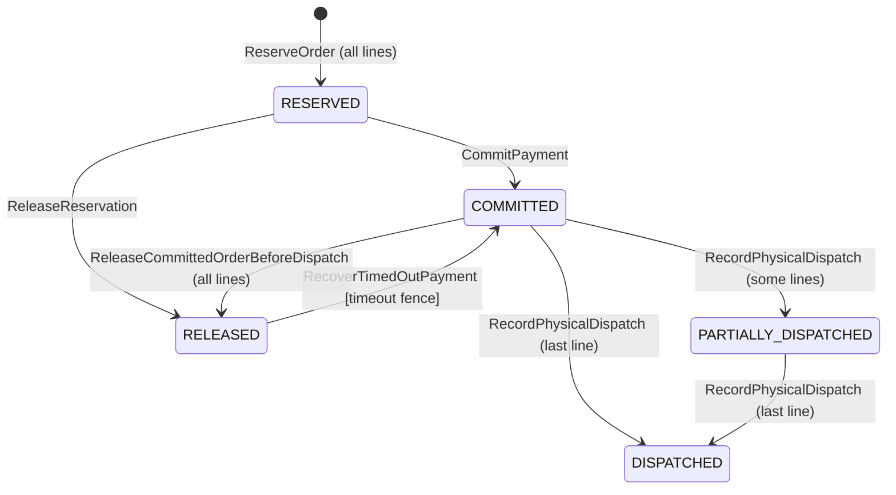
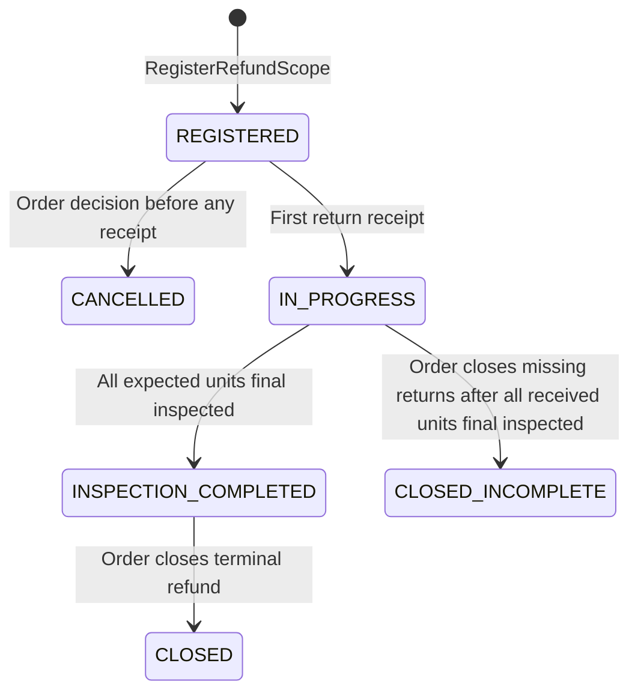

# Inventory Service — Domain Design

> **Status:** Target design accepted for Release 1.

## Ubiquitous language

| Term | Definition |
|---|---|
| Warehouse | Inventory-owned master record with generated `warehouse_id`, display `name`, address, `is_active`, `operational_state` (`NORMAL`/`OUTAGE`), fulfillment priority and revision. |
| StockPosition | Authoritative stock for one `(warehouse_id, sku_id)`; the unit of stock contention. |
| On hand | Physical units currently at a warehouse, including sellable, reserved, committed, and quarantined units. |
| Available to sell | Units eligible for a new reservation; it is not total physical stock. |
| SKU availability | Inventory-owned derived boolean: at least one active, non-OUTAGE warehouse has `available_to_sell > 0` for the SKU. Search receives its event/export copy; Product Detail BFF reads it through the internal batch API. It is not a reservation promise. |
| Reservation | Whole-order pre-payment hold rooted at `order_id`. |
| Committed allocation | Paid order stock physically still at the warehouse while awaiting dispatch. |
| Quarantine | Physically received returned units forbidden from sale until final inspection passes. |
| Physical dispatch | ADMIN-recorded fact that stock left the allocated warehouse; it is not shipment/delivery state. |
| Refund Scope | Immutable selected `order_line_id`/full-quantity registry for the one Order refund case. |
| Stock movement | Append-only evidence for a bucket transition; it does not replace authoritative current state. |

## Stock bucket model

For every `StockPosition`, all buckets are non-negative integers and this invariant is mandatory:

```text
available_to_sell + reserved + committed + quarantine = on_hand
```

`on_hand` is physical stock only. Payment does not decrease it; physical dispatch or verified final disposition does. A unit exists in at most one of the four buckets.

| Command/fact | `on_hand` | `available_to_sell` | `reserved` | `committed` | `quarantine` |
|---|---:|---:|---:|---:|---:|
| Sellable receipt / positive adjustment | +q | +q | 0 | 0 | 0 |
| Reserve | 0 | -q | +q | 0 | 0 |
| Release reservation | 0 | +q | -q | 0 | 0 |
| Commit payment | 0 | 0 | -q | +q | 0 |
| Release committed allocation before dispatch | 0 | +q | 0 | -q | 0 |
| Physical dispatch | -q | 0 | 0 | -q | 0 |
| Return receipt | +q | 0 | 0 | 0 | +q |
| Inspection pass | 0 | +q | 0 | 0 | -q |
| Inspection fail / hold | 0 | 0 | 0 | 0 | 0 |
| Dispose / return-to-supplier after fail | -q | 0 | 0 | 0 | -q |
| Negative adjustment | -q | -q | 0 | 0 | 0 |

Negative adjustment is permitted only when `q <= available_to_sell`; it never takes from a promise already reserved/committed or from quarantine.

## Aggregates and boundaries

| Object | Identity | Responsibility |
|---|---|---|
| Warehouse | `warehouse_id` | Master data, activity/outage state, and deterministic fulfillment priority. |
| StockPosition | `(warehouse_id, sku_id)` | Bucket invariant and local availability. |
| SkuAvailabilityState | `sku_id` | Monotonic per-SKU boolean/revision and latest evaluation state, derived asynchronously from all Warehouse and StockPosition truth; source for Search publication and BFF advisory reads. |
| OrderReservation | `order_id` | Atomic whole-order reservation root, expiry observation, and line lifecycle. |
| ReservationLine | `(order_id, order_line_id)` | Immutable SKU, quantity, one warehouse, and allocation lifecycle. |
| RefundScope | `order_id` lifetime unique, `refund_request_id` unique | Immutable selected expected return lines and receipt/inspection progress. |
| ReturnReceiptLine / InspectionResult / QuarantineDisposition | Source operation identities | Physical provenance and exactly-once final inspection/disposition. |
| StockMovement / AuditEntry | Immutable IDs | Durable explanation of an accepted mutation; never overwritten. |

`ReserveOrder` is one business operation across its reservation root, every line, and every selected `StockPosition`. Either all lines reserve or none does. One line's quantity never spans warehouses; distinct lines can allocate to distinct warehouses.

## Reservation lifecycle



Line states are `RESERVED`, `COMMITTED`, `DISPATCHED` and `RELEASED`; the root state is
derived from them. Because every release is whole-root, a root never mixes released
lines with committed or dispatched lines ([ADR-021](decisions/ADR-021-order-integration-lifecycle-corrections.md)).

| State | Meaning | Valid transition |
|---|---|---|
| `RESERVED` | Entire order waits for payment. | Whole-root `CommitPayment` or whole-root `ReleaseReservation`. |
| `COMMITTED` | Payment succeeded for all lines; units remain physically at their warehouses. | Per-line physical dispatch or whole-root `ReleaseCommittedOrderBeforeDispatch`. |
| `PARTIALLY_DISPATCHED` | Derived root state: some, not all, lines dispatched. | Remaining lines dispatch only; no Inventory release exists for this state. |
| `DISPATCHED` | Every line physically dispatched. | Terminal for allocation; return uses Refund Scope. |
| `RELEASED` | Every line released before dispatch. | Terminal except the fenced whole-root `RecoverTimedOutPayment` after `RESERVATION_EXPIRED`. |

`CommitPayment` moves every line `RESERVED → COMMITTED` together and is accepted
whenever the root is `RESERVED`; it is not gated by wall-clock time. `expires_at`
(`accepted_at + 15 minutes`) is an advisory payment-window reference used only for
aging observation, never an Inventory transition or rejection. Commit on a root that is
not `RESERVED` is a durable `409` with no movement; a retry of a previously successful
command returns its original result. Order is the sole owner of the timeout and issues
whole-root release with exactly one immutable reason: `PAYMENT_FAILED`,
`RESERVATION_EXPIRED`, `BUYER_CANCELLED`, `ADMIN_CANCELLED` or
`PRE_PAYMENT_SAGA_FAILED`. A reservation still `RESERVED` 60 minutes after
`accepted_at` alerts; it never cleans up automatically.

`RecoverTimedOutPayment` is deliberately narrower than Reserve (Order Release 1 never
invokes it, Order ADR-014/ADR-020): it is callable only by
Order with a verified payment reference after the same root was released for
`RESERVATION_EXPIRED`. It locks the complete root and original stock positions, then
requires no physical dispatch and full original quantity at every original warehouse.
It either moves every line `RELEASED → COMMITTED` in one transaction or records a
durable rejection with no stock movement. It never reroutes, creates a new root, or
recovers any other release reason.

There is no single-line committed release in Release 1. The only committed-stock
release is `ReleaseCommittedOrderBeforeDispatch`, used by Order's automatic admin
refund and Admin discrepancy handling: it locks the root, every line and affected
stock positions and releases all lines only when every line is `COMMITTED` and no
line has dispatched. Any other state produces no movement. When release and dispatch
race, the first atomic transition wins and the other receives its guarded/idempotent
outcome.

## Refund Scope and return lifecycle

Order Temporal Saga registers an immutable Refund Scope before the warehouse accepts
any package. A scope may select a proper subset of order lines, but each selected
line must use its entire immutable `ReservationLine.quantity` and must already be in
line state `DISPATCHED`; SKU identity and partial quantity are prohibited. A selected
line that has not physically left the warehouse is rejected with no scope created
([ADR-021](decisions/ADR-021-order-integration-lifecycle-corrections.md)). `order_id` is lifetime unique, so an old terminal
scope never frees the order for another `refund_request_id`.



For every immutable scope line:

```text
0 <= passed_quantity + failed_quantity <= received_quantity <= expected_quantity
```

- `RecordReturnReceipt` accepts only an exact registered SKU/order line and remaining quantity. It places units in `quarantine` at the physical receiving warehouse. Multiple packages are permitted; partial scope is not.
- `RecordInspectionPass` and `RecordInspectionFail` are final, exactly-once results for quantity on a receipt line at that warehouse. `PASS` moves stock to sellable. `FAIL` remains quarantined and cannot become `PASS` through re-inspection in Release 1.
- When every expected unit has a final result, Inventory sets `INSPECTION_COMPLETED` and emits exactly one `AllItemsInspectionCompleted` fact. This is neither refund payout nor final Order decision.
- Only Order changes `INSPECTION_COMPLETED → CLOSED` after its terminal refund
  outcome, including financial failure. The per-order lifetime uniqueness remains;
  closure never permits another refund request/scope. It may change `IN_PROGRESS →
  CLOSED_INCOMPLETE` only when every received unit is final inspected and some expected
  quantity is missing; this emits no completion fact and does not authorize payout.
  With zero receipt, `REGISTERED → CANCELLED` is the valid terminal path.
- Close/cancel serialize with receipt/inspection and atomically persist their command
  outcome/audit. They do not change stock buckets or failed-unit disposition duties.
  Order's 30-day timer is only a manual-review trigger, never Inventory auto-close.
  Payment reversal cannot reopen a terminal scope; it is resolved on the existing
  Order financial case. Order's durable orchestration is defined by
  [Order ADR-013](../order/decisions/ADR-013-durable-refund-scope-finalization.md).

Failed inspection may be `HOLD`, `DISPOSE`, or `RETURN_TO_SUPPLIER`. `HOLD` is a non-terminal annotation: it moves no bucket and the quantity stays eligible for a later outbound disposition. Only `DISPOSE` and `RETURN_TO_SUPPLIER` consume failed, undisposed quantity, and physical departure is required before they reduce `on_hand`/`quarantine`. Their specialized reversal (`WRONG_RECORD`, `DISPOSAL_ABORTED` or `SUPPLIER_RETURNED`) requires evidence that the unit is physically back at the same warehouse and returns it to quarantine, never directly to sellable stock ([ADR-024](decisions/ADR-024-admin-surface-and-error-catalog.md)).

Physical dispatch always records an entire `ReservationLine`: its quantity equals the immutable line quantity at the allocated warehouse and SKU. A sellable reversal compensates a successful receipt or adjustment in contiguously numbered steps whose cumulative quantity never exceeds the original; reversing an increase requires enough `available_to_sell`, and a reversal is never itself reversed. A disposition reversal follows the same numbering per disposition line and never exceeds the disposed quantity ([ADR-027](decisions/ADR-027-pre-implementation-contract-corrections.md)).

Final inspection failure reason is exactly one of `DAMAGED`, `USED_OR_ALTERED`, `MISSING_COMPONENTS`, `SAFETY_OR_HYGIENE`, `COUNTERFEIT_OR_UNVERIFIABLE`, or `NOT_RESELLABLE_BY_POLICY`; there is no `OTHER`. `HOLD` requires `AWAITING_DISPOSITION`, `SUPPLIER_CLAIM`, `SAFETY_REVIEW`, or `EVIDENCE_PRESERVATION`. `DISPOSE` requires `UNSAFE`, `UNREPAIRABLE`, `EXPIRED`, or `POLICY_REQUIRED`; `RETURN_TO_SUPPLIER` requires `SUPPLIER_RETURN_AUTHORIZED`. Every final inspection/disposition carries the required checklist or physical-evidence reference.

## Allocation policy

For each line, Inventory considers only warehouses that are active, not in outage, and have `available_to_sell >= requested_quantity`. It chooses the smallest tuple:

```text
(fulfillment_priority ASC, warehouse_id ASC)
```

No locality, cost, capacity, stock-age, transfer, or consolidation heuristic exists in Release 1. Preview is advisory and stateless: it persists no plan, and its `allocation_plan_id` is an opaque correlation identifier with no expiry that Reserve stores for audit but never looks up. Reserve locks and revalidates exactly the submitted per-line warehouse plan. If it is stale or unavailable, the whole request is `REJECT_ALL`; Reserve never tries the next ranked warehouse. Warehouse status changes affect new allocation only, not existing commitments or physical facts.

## Domain invariants

1. Bucket equation and non-negative buckets always hold.
2. Inventory is the only writer; every accepted mutation has command ID, actor/system actor, reason, timestamp and immutable movement/audit. Required public facts and availability dirty work commit atomically with the transition that creates them; reservation command results are durable receipts, not public events ([ADR-020](decisions/ADR-020-command-receipts-and-minimal-order-events.md)).
3. Reserve is all-or-nothing for the complete order; no backorder, partial reservation, or split line quantity exists.
4. Every ReservationLine has one immutable warehouse and its configured SKU/quantity cannot change.
5. Payment never changes physical stock; dispatch is the only sale flow that reduces `on_hand`.
6. A release, dispatch, inspection, or disposition transition is guarded, idempotent, and cannot occur twice for the same business identity.
7. A Refund Scope selects only dispatched lines at full quantity. Refund receipt is permitted only for an active immutable scope; wrong item, over-receipt, receipt after close, and duplicated final inspection cannot mutate stock.
8. Quarantine is never saleable without final `PASS`; failed stock remains traceable through disposition/reversal.
9. Administrative correction is append-only and cannot conceal a systemic ledger/state mismatch.
10. Inventory alone derives per-SKU availability. It never publishes/exports a SKU
    before Search registers that its Product document exists; that readiness does not
    constrain the separate BFF batch-read API and never blocks authoritative commands.

See [workflows.md](workflows.md) for transition ownership and [data.md](data.md) for enforcement and evidence.
