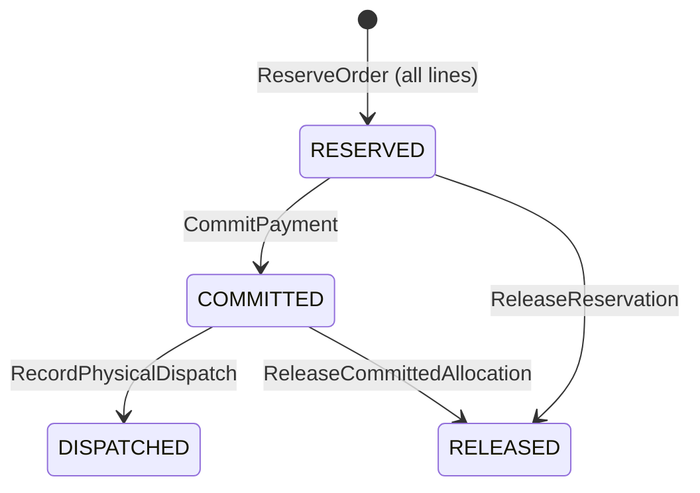
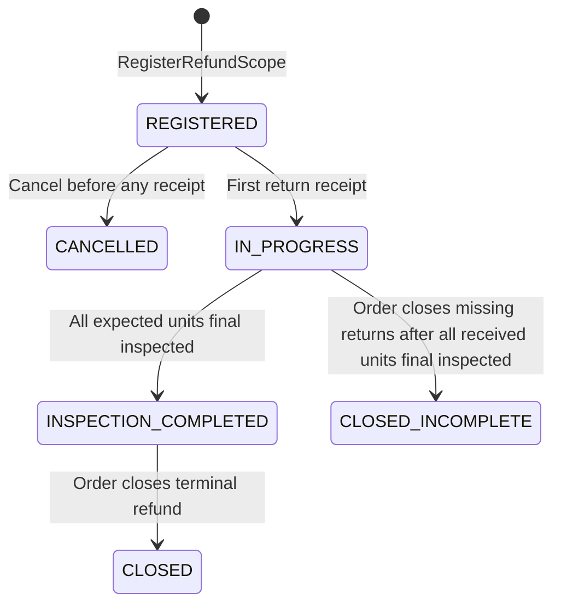

# Inventory Service — Domain Design

> **Status:** Target design accepted for Release 1.

## Ubiquitous language

| Term | Definition |
|---|---|
| Warehouse | Inventory-owned master record with address, `is_active`, `operational_state` (`NORMAL`/`OUTAGE`) and fulfillment priority. |
| StockPosition | Authoritative stock for one `(warehouse_id, sku_id)`; the unit of stock contention. |
| On hand | Physical units currently at a warehouse, including sellable, reserved, committed, and quarantined units. |
| Available to sell | Units eligible for a new reservation; it is not total physical stock. |
| Reservation | Whole-order pre-payment hold rooted at `order_id`. |
| Committed allocation | Paid order stock physically still at the warehouse while awaiting dispatch. |
| Quarantine | Physically received returned units forbidden from sale until final inspection passes. |
| Physical dispatch | ADMIN-recorded fact that stock left the allocated warehouse; it is not shipment/delivery state. |
| Refund Scope | Immutable whole-order line/quantity registry for exactly one Order refund request. |
| Stock movement | Append-only evidence for a bucket transition; it does not replace authoritative current state. |

## Stock bucket model

For every `StockPosition`, all buckets are non-negative integers and this invariant is mandatory:

```text
available_to_sell + reserved + committed + quarantine = on_hand
```

`on_hand` is physical stock only. Payment does not decrease it; physical dispatch or verified final disposition does. A unit exists in at most one of the four buckets.

| Command/fact | `on_hand` | `available_to_sell` | `reserved` | `committed` | `quarantine` |
|---|---:|---:|---:|---:|---:|
| Sellable receipt / positive adjustment | +q | +q | 0 | 0 | 0 |
| Reserve | 0 | -q | +q | 0 | 0 |
| Release reservation | 0 | +q | -q | 0 | 0 |
| Commit payment | 0 | 0 | -q | +q | 0 |
| Release committed allocation before dispatch | 0 | +q | 0 | -q | 0 |
| Physical dispatch | -q | 0 | 0 | -q | 0 |
| Return receipt | +q | 0 | 0 | 0 | +q |
| Inspection pass | 0 | +q | 0 | 0 | -q |
| Inspection fail / hold | 0 | 0 | 0 | 0 | 0 |
| Dispose / return-to-supplier after fail | -q | 0 | 0 | 0 | -q |
| Negative adjustment | -q | -q | 0 | 0 | 0 |

Negative adjustment is permitted only when `q <= available_to_sell`; it never takes from a promise already reserved/committed or from quarantine.

## Aggregates and boundaries

| Object | Identity | Responsibility |
|---|---|---|
| Warehouse | `warehouse_id` | Master data, activity/outage state, and deterministic fulfillment priority. |
| StockPosition | `(warehouse_id, sku_id)` | Bucket invariant and local availability. |
| OrderReservation | `order_id` | Atomic whole-order reservation root, expiry observation, and line lifecycle. |
| ReservationLine | `(order_id, order_line_id)` | Immutable SKU, quantity, one warehouse, and allocation lifecycle. |
| RefundScope | `(order_id, refund_request_id)` | Immutable expected return lines and receipt/inspection progress. |
| ReturnReceiptLine / InspectionResult / QuarantineDisposition | Source operation identities | Physical provenance and exactly-once final inspection/disposition. |
| StockMovement / AuditEntry | Immutable IDs | Durable explanation of an accepted mutation; never overwritten. |

`ReserveOrder` is one business operation across its reservation root, every line, and every selected `StockPosition`. Either all lines reserve or none does. One line's quantity never spans warehouses; distinct lines can allocate to distinct warehouses.

## Reservation lifecycle



| State | Meaning | Valid transition |
|---|---|---|
| `RESERVED` | Entire order waits for payment. | Whole-root `CommitPayment` or whole-root `ReleaseReservation`. |
| `COMMITTED` | Payment succeeded for all lines; units remain physically at their warehouses. | Per-line physical dispatch or eligible pre-dispatch release. |
| `PARTIALLY_DISPATCHED` | Derived root state: some, not all, lines dispatched. | Remaining lines dispatch; Order exception is required for pre-dispatch release. |
| `DISPATCHED` | Every line physically dispatched. | Terminal for allocation; return uses Refund Scope. |
| `RELEASED` | Every line released before dispatch. | Terminal. |

`CommitPayment` moves every line `RESERVED → COMMITTED` together. `expires_at` is a 15-minute deadline, not an Inventory auto-transition: a new Commit after it is rejected while a retry of a previously successful command returns its original result. Only Order Temporal Saga issues release with `PAYMENT_FAILED`, `RESERVATION_EXPIRED`, or whole-root `STOCK_DISCREPANCY` plus `order_exception_id`. A reservation over 60 minutes alerts; it never cleans up automatically.

`ReleaseCommittedAllocation` targets only an undispatched committed line. It uses `ORDER_CANCELLED` or `REFUND_BEFORE_DISPATCH`; after any line dispatches it requires `POST_DISPATCH_EXCEPTION` and an Order exception ID. When release and dispatch race, the first atomic transition wins and the other receives its guarded/idempotent outcome.

## Refund Scope and return lifecycle

Order Temporal Saga registers an immutable Refund Scope before the warehouse accepts any package. Release 1 scopes contain every order line and its whole quantity. At most one scope per order may hold the refund lock in `REGISTERED`, `IN_PROGRESS`, or `INSPECTION_COMPLETED`.



For every immutable scope line:

```text
0 <= passed_quantity + failed_quantity <= received_quantity <= expected_quantity
```

- `RecordReturnReceipt` accepts only an exact registered SKU/order line and remaining quantity. It places units in `quarantine` at the physical receiving warehouse. Multiple packages are permitted; partial scope is not.
- `RecordInspectionPass` and `RecordInspectionFail` are final, exactly-once results for quantity on a receipt line at that warehouse. `PASS` moves stock to sellable. `FAIL` remains quarantined and cannot become `PASS` through re-inspection in Release 1.
- When every expected unit has a final result, Inventory sets `INSPECTION_COMPLETED` and emits exactly one `AllItemsInspectionCompleted` fact. This is neither refund payout nor final Order decision.
- Only Order changes `INSPECTION_COMPLETED → CLOSED`, releasing the lock. It may close incomplete returns only when every received unit is final inspected; this becomes `CLOSED_INCOMPLETE` and emits no completion fact.

Failed inspection may be `HOLD`, `DISPOSE`, or `RETURN_TO_SUPPLIER`. Physical departure is required before the latter two reduce `on_hand`/`quarantine`. Their specialized reversal requires evidence that the unit is physically back at the same warehouse and returns it to quarantine, never directly to sellable stock.

Final inspection failure reason is exactly one of `DAMAGED`, `USED_OR_ALTERED`, `MISSING_COMPONENTS`, `SAFETY_OR_HYGIENE`, `COUNTERFEIT_OR_UNVERIFIABLE`, or `NOT_RESELLABLE_BY_POLICY`; there is no `OTHER`. `HOLD` requires `AWAITING_DISPOSITION`, `SUPPLIER_CLAIM`, `SAFETY_REVIEW`, or `EVIDENCE_PRESERVATION`. `DISPOSE` requires `UNSAFE`, `UNREPAIRABLE`, `EXPIRED`, or `POLICY_REQUIRED`; `RETURN_TO_SUPPLIER` requires `SUPPLIER_RETURN_AUTHORIZED`. Every final inspection/disposition carries the required checklist or physical-evidence reference.

## Allocation policy

For each line, Inventory considers only warehouses that are active, not in outage, and have `available_to_sell >= requested_quantity`. It chooses the smallest tuple:

```text
(fulfillment_priority ASC, warehouse_id ASC)
```

No locality, cost, capacity, stock-age, transfer, or consolidation heuristic exists in Release 1. Preview is advisory: Reserve locks and revalidates exactly the previewed warehouse plan. If it is stale or unavailable, the whole request is `REJECT_ALL`; Reserve never tries the next ranked warehouse. Warehouse status changes affect new allocation only, not existing commitments or physical facts.

## Domain invariants

1. Bucket equation and non-negative buckets always hold.
2. Inventory is the only writer; every accepted mutation has command ID, actor/system actor, reason, timestamp, immutable movement/audit, and transactional outbox evidence.
3. Reserve is all-or-nothing for the complete order; no backorder, partial reservation, or split line quantity exists.
4. Every ReservationLine has one immutable warehouse and its configured SKU/quantity cannot change.
5. Payment never changes physical stock; dispatch is the only sale flow that reduces `on_hand`.
6. A release, dispatch, inspection, or disposition transition is guarded, idempotent, and cannot occur twice for the same business identity.
7. Refund receipt is permitted only for an active immutable scope; wrong item, over-receipt, receipt after close, and duplicated final inspection cannot mutate stock.
8. Quarantine is never saleable without final `PASS`; failed stock remains traceable through disposition/reversal.
9. Administrative correction is append-only and cannot conceal a systemic ledger/state mismatch.

See [workflows.md](workflows.md) for transition ownership and [data.md](data.md) for enforcement and evidence.
