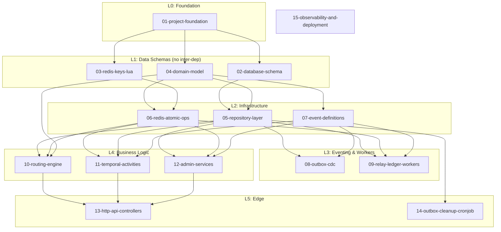

# Inventory Service — Implementation Plan Overview

> **Document Version:** 1.0
> **Date:** June 20, 2026
> **Service:** `inventory-service` (Java 21 / Spring Boot 3.x)
> **Status:** Implementation Master Plan

---

## 1. Scope & Overview

Inventory Service là **nguồn chân lý duy nhất** (single source of truth) cho tồn kho vật lý trong hệ thống e-commerce. Service này quản lý toàn bộ vòng đời biến động tồn kho: nhập hàng (restock), giữ chỗ (reserve), xác nhận bán (deduct), giải phóng (release), và nhận hàng hoàn (return restock), đồng thời tạo **route plan fulfillment** cho checkout.

### 1.1 Service Responsibilities

| Trách nhiệm | Mô tả |
|:---|:---|
| **Quản lý kho** | CRUD warehouse (admin), lookup kho active theo `city_code` cho routing |
| **Commit nóng tồn kho** | Reserve / Deduct / Release qua Redis Lua scripts (atomic per `(sku, warehouse)`) |
| **Ghi sổ cái** | Append-only `inventory_ledger` + cập nhật `physical_inventory`, `inventory_reservations` |
| **Routing Plan** | Sinh route plan fulfillment cho Checkout Preview (TTL 20 phút) |
| **Admin operations** | Restock (admin + return), ship-to-customer, unlock-sku manual recovery |
| **Refund signal** | Theo dõi `refund_expected` & `refund_returned_at`, emit `INVENTORY_RETURN_RECEIVED_ALL` |
| **Ship signal** | Emit `INVENTORY_SHIP_TO_CUSTOMER` để Order Service chuyển `order_items` PROCESSING → DELIVERED |
| **Event broadcast** | Outbox pattern (PostgreSQL) + Redis Stream Relay → Kafka topic `t.inventory.events` |
| **Manual recovery** | Suspend SKU khi invariant drift; admin unlock qua endpoint riêng |

### 1.2 Không thuộc scope (Phase 14 đã lược bỏ)

- ❌ Không consume event từ service ngoài (không còn Shipping Service).
- ❌ Không implement gRPC `InventoryGrpcService` — Product Service đọc tồn kho qua event `INVENTORY_STOCK_CHANGED` + cache local. Proto trong `product-service/proto/inventory_service.proto` được giữ như dead-code cho tương thích ngược.
- ❌ Không có background reconciliation / hot-SKU scanner / cache warm-up — drift xử lý qua alert + manual intervention.
- ❌ Không có worker scan reservation expiry — Temporal Saga timer 30 phút trong Order Service tự gọi `RollbackInventoryActivity` với `change_type='RESERVATION_EXPIRED'`.

---

## 2. Technology Stack

| Component | Technology | Version |
|:---|:---|:---|
| Runtime | JDK | 21 |
| Framework | Spring Boot | 3.x |
| Build Tool | Maven | 3.9+ |
| Database | PostgreSQL | 16+ |
| Cache / Stream | Redis (Lettuce, Cluster) | 7.x |
| Message Broker | Apache Kafka | 3.x |
| CDC | Debezium (Kafka Connect) | 2.x |
| Orchestration | Temporal Java SDK | 1.x |
| Resilience | Resilience4j | 2.x |
| Migration | Flyway | 10.x |
| Observability | Micrometer + Prometheus + OpenTelemetry | — |
| Testing | JUnit 5 + Mockito + TestContainers | — |

> Stack đồng nhất với `product-service` (Java) và `promotion-service` để cùng repo dễ bảo trì.

---

## 3. Module Dependency Graph



### 3.1 Build Order Summary

| Order | Module | Description |
|:---:|:---|:---|
| 1 | `01-project-foundation` | Maven scaffold, dependencies, base config, Docker base |
| 2 | `02-database-schema` | Flyway V1: 5 bảng + indexes + partial unique index |
| 3 | `03-redis-keys-lua` | Key patterns + Lua scripts 1/2/3 với invariant check |
| 4 | `04-domain-model` | Enums, value objects, pure domain entities, exceptions |
| 5 | `05-repository-layer` | JPA entities + Spring Data + custom queries |
| 6 | `06-redis-atomic-ops` | Lua executor + idempotency-key builder + suspension + route-plan cache |
| 7 | `07-event-definitions` | CloudEvents envelope + 4 event payload classes |
| 8 | `08-outbox-cdc` | Outbox writer + Debezium connector config |
| 9 | `09-relay-ledger-workers` | Redis Stream Relay + Kafka Ledger Worker |
| 10 | `10-routing-engine` | Candidate generation + same-province priority + route-plan builder |
| 11 | `11-temporal-activities` | Reserve / Deduct / Rollback Activities |
| 12 | `12-admin-services` | Restock / Ship / Refund-expectations / Unlock services |
| 13 | `13-http-api-controllers` | Spring REST + JWT + error mapping |
| 14 | `14-outbox-cleanup-cronjob` | Spring `@Scheduled` daily cleanup |
| 15 | `15-observability-and-deployment` | Metrics, tracing, alerting, Docker, k8s, TestContainers |

> Modules L1 (M02, M03, M04) có thể phát triển song song vì zero inter-dependency.
> Modules L4 (M10, M11, M12) cũng có thể phát triển song song.

---

## 4. Key Architecture Decisions

### 4.1 Two-Track Eventing

| Track | Trigger | Mechanism | Latency | Use case |
|:---|:---|:---|:---|:---|
| **Hot track** (Redis Stream) | Lua script trong reserve/deduct/release | `XADD` atomic với mutation → Relay Worker → Kafka | < 10ms | `INVENTORY_STOCK_MUTATION` (internal ledger feed) |
| **Cold track** (Postgres Outbox) | Admin API + Ledger Worker ghi xong DB | Outbox INSERT trong cùng TX → Debezium CDC → Kafka | < 100ms | `INVENTORY_STOCK_CHANGED` (public per-SKU), `INVENTORY_RETURN_RECEIVED_ALL`, `INVENTORY_SHIP_TO_CUSTOMER` |

### 4.2 Atomicity & Idempotency Guarantees

| Layer | Mechanism | Guarantee |
|:---|:---|:---|
| Redis hot path | Lua script single-thread + `SETNX` idempotency key | Exactly-once-per-idempotency-key |
| Postgres cold path | Outbox INSERT trong cùng TX với ledger | All-or-nothing |
| Kafka | Debezium offset commit + consumer idempotent theo `event_id` | At-least-once delivery, exactly-once-effect |
| Temporal compensation | Reserve → Deduct mapping; idempotency_key `{op}:{sku}:{wh}:{order}` | Replay-safe |

### 4.3 Redis Cluster Hash-Tag Invariant

Tất cả Redis key trong 1 Lua execution **phải cùng hash slot** (xem `inventory_redis_design.md §5`). Quy ước:

```
{sku_id:warehouse_id}
```

Áp dụng cho: stock hash, idempotency key, stream outbox, suspension flag. Hash-tag được build tập trung tại `RedisKeyBuilder.java` (M06).

### 4.4 SKU Suspension as Fail-Safe

Khi Lua script phát hiện `INVARIANT_DRIFT` (trả `{-1, 'INVARIANT_DRIFT'}`):
1. API Layer dừng request hiện tại (không rollback mù quáng).
2. Set `inventory:suspended:{sku:wh}` với TTL 24h.
3. Phát alert.
4. Chỉ mở khoá qua `POST /v1/inventory/admin/unlock-sku` sau khi admin đối soát.

### 4.5 Order Saga Ownership of Reservation TTL

Reservation timeout **không do Inventory quản lý** — Order Temporal Saga tạo timer 30 phút sau `ReserveInventoryActivity`. Hết timer mà workflow vẫn pre-payment → Temporal tự gọi `RollbackInventoryActivity` với `change_type='RESERVATION_EXPIRED'`. Inventory chỉ giữ index `(status, expires_at)` cho debug query, không có background scan.

### 4.6 All-or-Nothing Multi-Item Semantics

Khi Temporal Activity nhận N items (Lua gọi N lần):
- Nếu item i trả `{0, 'OUT_OF_STOCK'}` → rollback tất cả item đã apply (gọi Release Lua cho từng item trước đó).
- Nếu item i trả `{-1, 'INVARIANT_DRIFT'}` → KHÔNG rollback, set suspend flag, fail toàn bộ activity.
- Nếu item i trả `{2, ''}` (idempotent hit) → coi như success, KHÔNG phát event mới.

### 4.7 Outbox First cho Public Events

Mọi event `INVENTORY_STOCK_CHANGED` / `INVENTORY_RETURN_RECEIVED_ALL` / `INVENTORY_SHIP_TO_CUSTOMER` đều INSERT vào `inventory_outbox` trong **cùng transaction** với mutation DB tương ứng. Debezium CDC đọc WAL tự động → zero load lên application CPU.

### 4.8 Lock Order trong Admin Service

Khi Restock/Ship cần lock row, **luôn theo thứ tự**:
1. `warehouses` (lookup `is_active`)
2. `physical_inventory` (nếu cần update `actual_quantity`)
3. `inventory_reservations` (nếu cần mark `refund_returned_at`)
4. `inventory_ledger` (insert, không lock)
5. `inventory_outbox` (insert, không lock)

---

## 5. Package Structure (Java / Hexagonal)

```
com.platform.inventoryservice/
├── InventoryServiceApplication.java
│
├── config/                          # Spring configs (Redis, Kafka, Temporal, Scheduling)
│
├── controller/                      # REST controllers (M13)
│
├── dto/                             # Request/Response DTOs + Mappers
│
├── service/                         # Admin services (M12)
│   ├── RestockService.java
│   ├── ShipToCustomerService.java
│   ├── RefundExpectationsService.java
│   └── UnlockSkuService.java
│
├── routing/                         # Warehouse routing engine (M10)
│   ├── WarehouseCandidateGenerator.java
│   ├── WarehouseSelector.java
│   ├── RoutePlanBuilder.java
│   └── RoutePlanCache.java
│
├── temporal/                        # Temporal Activities + Worker (M11)
│   ├── ReserveInventoryActivity.java
│   ├── DeductInventoryActivity.java
│   ├── RollbackInventoryActivity.java
│   └── TemporalWorkerBootstrap.java
│
├── worker/                          # Background workers (M09)
│   ├── relay/
│   │   ├── RedisStreamRelayWorker.java
│   │   └── StreamMessageParser.java
│   └── ledger/
│       ├── KafkaLedgerWorker.java
│       ├── MutationEventProcessor.java
│       └── LedgerWriter.java
│
├── domain/                          # Pure domain — NO infrastructure deps (M04)
│   ├── entity/
│   │   ├── PhysicalInventory.java
│   │   ├── InventoryReservation.java
│   │   ├── InventoryLedgerEntry.java
│   │   ├── OutboxEvent.java
│   │   └── Warehouse.java
│   ├── vo/
│   │   ├── SkuWarehouseKey.java
│   │   ├── RoutePlan.java
│   │   ├── AvailableStock.java
│   │   ├── StockHash.java
│   │   └── CustomerLocation.java
│   ├── enums/
│   │   ├── ReferenceType.java
│   │   ├── ReservationStatus.java
│   │   ├── LuaReturnCode.java
│   │   └── OutboxEventType.java
│   ├── event/                       # CloudEvents envelope + payloads (M07)
│   │   ├── CloudEvent.java
│   │   ├── StockMutationPayload.java
│   │   ├── StockChangedPayload.java
│   │   ├── ReturnReceivedAllPayload.java
│   │   └── ShipToCustomerPayload.java
│   └── exception/
│       ├── InsufficientStockException.java
│       ├── SkuSuspendedException.java
│       ├── WarehouseNotFoundException.java
│       ├── ReservationNotFoundException.java
│       └── RefundScopeMismatchException.java
│
├── port/                            # Hexagonal ports (interfaces only)
│   ├── inbound/                     # Use-case interfaces (called by controllers/temporal)
│   │   ├── RoutingPort.java
│   │   ├── ReservePort.java
│   │   ├── DeductPort.java
│   │   ├── RollbackPort.java
│   │   ├── RestockPort.java
│   │   ├── ShipToCustomerPort.java
│   │   ├── RefundExpectationsPort.java
│   │   └── UnlockSkuPort.java
│   └── outbound/
│       ├── database/                # Repository interfaces (M05)
│       │   ├── WarehouseRepository.java
│       │   ├── PhysicalInventoryRepository.java
│       │   ├── InventoryReservationRepository.java
│       │   ├── InventoryLedgerRepository.java
│       │   └── OutboxRepository.java
│       └── cache/                   # Redis port interfaces (M06)
│           ├── StockAtomicOps.java
│           ├── SuspensionFlagManager.java
│           ├── RoutePlanCache.java
│           └── IdempotencyKeyBuilder.java
│
├── infrastructure/
│   ├── persistence/
│   │   ├── jpa/                     # Layer 1: JPA infrastructure (M05)
│   │   │   ├── entity/              # JPA entities (mirror DB tables)
│   │   │   │   ├── WarehouseJpaEntity.java
│   │   │   │   ├── PhysicalInventoryJpaEntity.java
│   │   │   │   ├── InventoryReservationJpaEntity.java
│   │   │   │   ├── InventoryLedgerJpaEntity.java
│   │   │   │   └── OutboxJpaEntity.java
│   │   │   └── spring/              # Spring Data interfaces
│   │   │       ├── WarehouseJpaRepository.java
│   │   │       ├── PhysicalInventoryJpaRepository.java
│   │   │       ├── InventoryReservationJpaRepository.java
│   │   │       ├── InventoryLedgerJpaRepository.java
│   │   │       └── OutboxJpaRepository.java
│   │   └── outbound/                # Layer 3: outbound adapters (impl port)
│   │       ├── mapper/              # Domain ↔ JPA mappers
│   │       └── repository/          # Impl of port/outbound/database
│   │           ├── WarehouseRepositoryImpl.java
│   │           ├── PhysicalInventoryRepositoryImpl.java
│   │           ├── InventoryReservationRepositoryImpl.java
│   │           ├── InventoryLedgerRepositoryImpl.java
│   │           └── OutboxRepositoryImpl.java
│   │
│   ├── redis/                       # Redis adapter layer (M06)
│   │   ├── config/RedisConfig.java
│   │   ├── script/
│   │   │   ├── LuaScriptLoader.java
│   │   │   └── LuaScriptRegistry.java
│   │   ├── key/RedisKeyBuilder.java
│   │   ├── adapter/
│   │   │   ├── StockAtomicOpsImpl.java
│   │   │   ├── SuspensionFlagManagerImpl.java
│   │   │   └── RoutePlanCacheImpl.java
│   │   └── IdempotencyKeyBuilderImpl.java
│   │
│   ├── kafka/                       # Kafka producer/consumer (M08, M09)
│   │   ├── producer/KafkaProducer.java
│   │   └── consumer/KafkaLedgerConsumer.java
│   │
│   └── outbox/                      # Outbox writer (M08)
│       └── TransactionalOutboxWriter.java
│
├── scheduled/                       # Cron jobs (M14)
│   └── OutboxCleanupJob.java
│
└── common/                          # Shared utils
    ├── CorrelationIdContext.java
    ├── IdempotencyInterceptor.java
    └── ErrorCode.java
```

### Layer Separation Rule

- `domain/` — pure POJO, **không** import Spring, JPA, Lettuce, Kafka, Flyway, hay bất kỳ infrastructure nào.
- `port/` — interfaces only, **không** chứa implementation.
- `infrastructure/` — toàn bộ adapter implementation, JPA entities, Redis client, Kafka client.

---

## 6. Module Files

| # | File | Description |
|:---:|:---|:---|
| 0 | `00-overview-plan.md` | This file |
| 1 | `01-project-foundation.md` | Maven scaffold, dependencies, base configs |
| 2 | `02-database-schema-and-migrations.md` | Flyway V1: 5 bảng + indexes |
| 3 | `03-redis-keys-and-lua-scripts.md` | Redis key patterns + Lua scripts 1/2/3 |
| 4 | `04-domain-model.md` | Pure domain (entities, VOs, enums, events, exceptions) |
| 5 | `05-repository-layer.md` | JPA entities + Spring Data + custom queries |
| 6 | `06-redis-atomic-ops.md` | Lua executor + idempotency builder + cache adapter |
| 7 | `07-event-definitions-and-payloads.md` | CloudEvents + 4 event payloads |
| 8 | `08-outbox-cdc.md` | Outbox writer + Debezium connector |
| 9 | `09-relay-and-ledger-workers.md` | Redis Stream Relay + Kafka Ledger Worker |
| 10 | `10-routing-engine.md` | Warehouse routing algorithm + cache |
| 11 | `11-temporal-activities.md` | Reserve / Deduct / Rollback Activities |
| 12 | `12-admin-services.md` | Restock / Ship / Refund-expectations / Unlock |
| 13 | `13-http-api-controllers.md` | REST controllers + JWT + error mapping |
| 14 | `14-outbox-cleanup-cronjob.md` | Daily outbox cleanup |
| 15 | `15-observability-and-deployment.md` | Metrics, tracing, Docker, k8s, TestContainers |

---

## 7. Key Design Principles

1. **Domain First:** Business logic ở `domain/`, độc lập hoàn toàn với Spring/JPA/Redis/Kafka.
2. **Hexagonal Boundaries:** Mọi infrastructure phụ thuộc vào `port/`, không phụ thuộc ngược.
3. **Two-Track Eventing:** Hot path (Redis Stream) cho atomicity, cold path (Postgres Outbox + Debezium) cho public event broadcast.
4. **Lua-First Mutations:** Mọi thay đổi `available_quantity` / `reserved_quantity` / `actual_quantity` đều phải đi qua Lua script với invariant check. Không bao giờ `HINCRBY` trực tiếp từ application code.
5. **Idempotency Everywhere:** Mỗi mutation có idempotency key `{op}:{sku}:{wh}:{order}`. Mỗi event có `event_id` UNIQUE.
6. **Outbox First:** Public event INSERT vào `inventory_outbox` trong cùng transaction với mutation DB.
7. **No Cross-Service Direct Call:** Internal service-to-service duy nhất là `POST /v1/inventory/returns/refund-expectations` (Order → Inventory, OIDC m2m token).
8. **Manual Recovery Over Auto-Recon:** Drift & inconsistency → suspend flag + alert + manual unlock. Không có background reconciliation.
9. **Schema Versioning:** Tất cả Kafka events có `schema_version = 1`. Additive changes only.
10. **Cluster Hash-Tag Discipline:** Mọi Redis key cùng Lua execution phải dùng `{sku_id:warehouse_id}`.

---

## 8. Cross-Reference to Design Docs

| Plan Module | Design Doc Reference |
|:---|:---|
| M02 | `inventory_db_design.md` §1 |
| M03 | `inventory_redis_design.md` §2-3 |
| M04 | `inventory_db_design.md` §1 (column semantics) |
| M05 | `inventory_db_design.md` §1 (indexes, constraints) |
| M06 | `inventory_redis_design.md` §3-4 |
| M07 | `inventory_events.md` §3-4 |
| M08 | `inventory_events.md` §4.2.1, §4.3.1, §4.4.1 |
| M09 | `inventory_workers.md` §1-2 |
| M10 | `smart_routing_engine.md` §4 |
| M11 | `inventory_workflow.md` Luồng 1-3; `inventory_endpoints.md` Appendix |
| M12 | `inventory_endpoints.md` §2-5; `inventory_workflow.md` Luồng 5-7 |
| M13 | `inventory_endpoints.md` §1-5 |
| M14 | `inventory_workers.md` §4 |
| M15 | — (operational concerns) |