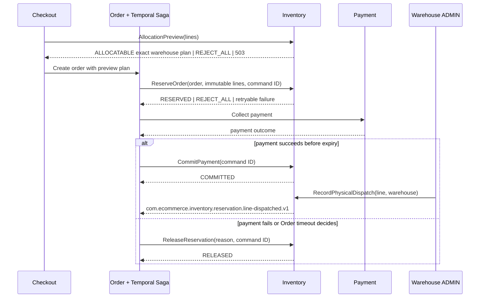

# Inventory Service — Workflows

> **Status:** Target design accepted for Release 1.
>
> **Rule:** A workflow command may retry; a state transition may not be applied twice.

## 1. Whole-order checkout and fulfillment



### Allocation and Reserve

1. Checkout requests an advisory Preview. Inventory excludes inactive/outage warehouses and selects a single eligible warehouse per line by `(fulfillment_priority, warehouse_id)`.
2. Preview success never promises stock. Checkout records the proposed plan in Order; Inventory does not create a hold.
3. Only Order Temporal Saga calls `ReserveOrder`. Inventory locks/revalidates the **exact** planned warehouse/line quantities.
4. If any line is unavailable or its plan became invalid, the entire command returns durable domain outcome `REJECT_ALL`. No reservation, no partial allocation, and no silent attempt of another warehouse remains.
5. A successful command creates one root and all lines in `RESERVED`, sets `expires_at = accepted_at + 15 minutes`, writes audit/movements/outbox atomically, and returns the exact durable result.

### Payment, release, and dispatch

- Payment never calls Inventory. Order Saga decides and sends `CommitPayment` exactly once in business effect; same command ID safely replays the outcome.
- Commit is accepted only for the entire `RESERVED` root before the deadline. It moves every line to `COMMITTED` atomically. A late *new* commit is rejected; a late retry of an already accepted commit returns success.
- On payment failure or timeout, Order calls `ReleaseReservation(PAYMENT_FAILED | RESERVATION_EXPIRED)`. Inventory does not run an expiry worker.
- Warehouse ADMIN records physical dispatch only for the committed allocation at its assigned warehouse. Individual lines can dispatch independently after payment, so a root can become `PARTIALLY_DISPATCHED`; Order remains sole owner of shipment/delivery state.

### Failure F1 — store unavailable or stock unavailable

| Condition | Result | Caller action |
|---|---|---|
| Primary Inventory store unavailable | Preview/mutation returns `503 INVENTORY_UNAVAILABLE`; no cache plan or pending hold. | Retry using the same command ID after recovery. |
| Lock/deadlock/serialization remains after two internal retries | `503 BUSY`, never `OUT_OF_STOCK`. | Saga retries safely. |
| Exact plan cannot reserve a complete order | `200` terminal domain outcome `REJECT_ALL`. | End this checkout attempt or start a new customer interaction; do not reroute silently. |

### Failure F2 — timeout, retry, and explicit release

Order owns all timeout/retry decisions. At 15 minutes it issues `ReleaseReservation(RESERVATION_EXPIRED)` if no payment commit has succeeded. Inventory stores the deadline only to reject a new late commit and to observe aging. A root still `RESERVED` beyond 60 minutes produces an orphan alert to Order/operations; Inventory must neither delete nor release it.

`ReleaseReservation` is valid only while the whole root is `RESERVED`. `STOCK_DISCREPANCY` is allowed only with an `order_exception_id` and releases the entire root. No single-line reserved release exists.

### Failure F3 — release/cancel versus dispatch

The two contenders lock the same reservation line and its stock position. Whichever commits first changes the line; the second command revalidates and returns its already-applied/invalid-state outcome. There is no compensating hidden stock movement.

For a committed but undispatched allocation, Order may call `ReleaseCommittedAllocation(ORDER_CANCELLED | REFUND_BEFORE_DISPATCH)`. If any line is already dispatched, a target committed line requires `POST_DISPATCH_EXCEPTION` and `order_exception_id`. Dispatched stock is never restored through this command.

### Failure F4 — outbox unavailable after business decision

Business state, command result, audit/movement, and outbox record share one database transaction. If that transaction succeeds but relay/broker fails, Inventory returns the accepted command result and later publishes the durable event at least once. If the outbox record cannot commit, the business command aborts. The relay never reruns a movement to recreate an event.

## 2. Refund, receipt, inspection, and closure

```mermaid
sequenceDiagram
  participant O as Order + Temporal Saga
  participant I as Inventory
  participant A as Warehouse ADMIN

  O->>I: RegisterRefundScope(whole order lines)
  I-->>O: REGISTERED
  loop one or more packages
    A->>I: RecordReturnReceipt(exact scope line)
    I-->>A: IN_PROGRESS; on_hand +q, quarantine +q
    A->>I: RecordInspectionPass or RecordInspectionFail
  end
  alt all expected units final inspected
    I-->>O: com.ecommerce.inventory.refund.all-items-inspection-completed.v1
    O->>I: CloseRefundScope(terminal Order reason)
    I-->>O: CLOSED
  else returns incomplete after Order decision
    O->>I: CloseIncompleteRefundScope(reason)
    I-->>O: CLOSED_INCOMPLETE
  end
```

- Before a warehouse receives any item, Order registers an immutable whole-order scope. At most one active scope holds the per-order refund lock.
- ADMIN may accept many package receipts, but only exact scoped SKU/order-line residual quantity. Wrong/extra/over-receipt rejects the whole command with no stock mutation.
- Receipt is physical inbound to quarantine. Final `PASS` moves only that receipt-line quantity to `available_to_sell`; final `FAIL` stays quarantined.
- All expected units final inspected (pass **or** fail) creates one completion fact. Inventory cannot decide payout and cannot close the scope.
- `CloseIncompleteRefundScope` requires that all received units already have final inspection while some expected quantity is missing. It emits no completion event.

## 3. Warehouse discrepancy and correction

1. ADMIN records a verified count discrepancy with reason and evidence; it cannot negative-adjust stock that is reserved, committed, or quarantined.
2. If the affected order is `RESERVED`, Order records an exception and releases the complete root using `STOCK_DISCREPANCY`.
3. If it is committed or dispatched, Order makes its cancellation/post-dispatch exception decision first.
4. ADMIN submits the appropriate append-only adjustment or permitted reversal. Inventory writes its normal audit/movement/outbox transaction.
5. Reconciliation is rerun. A ledger/state mismatch is an incident, not an adjustment case.

## 4. Transition ownership

| Transition / fact | Sole actor | Inventory responsibility |
|---|---|---|
| Preview / Reserve / Commit / release | Order Temporal Saga (Preview read by Checkout) | Validate, transition atomically, retain command result. |
| Payment decision and timeout | Order | Never infer payment or auto-expire. |
| Physical dispatch, receipt, inspection, disposition, adjustment | `ADMIN` | Validate authority, physical guards, stock movement, audit. |
| Warehouse active/outage/priority | `ADMIN` | Own master state; use it only for new allocation. |
| Refund registration/close/incomplete close | Order Temporal Saga | Enforce immutable scope and state guards. |
| Shipment/delivery | Order | Consume Inventory dispatch fact; not stored as Inventory lifecycle. |

The exact transport contract is in [interfaces.md](interfaces.md); state and bucket semantics are in [domain.md](domain.md).
