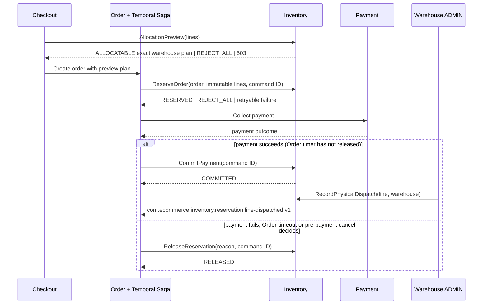

# Inventory Service — Workflows

> **Status:** Target design accepted for Release 1.
>
> **Rule:** A workflow command may retry; a state transition may not be applied twice.

## 1. Whole-order checkout and fulfillment



### Allocation and Reserve

1. Checkout requests an advisory Preview. Inventory excludes inactive/outage warehouses and selects a single eligible warehouse per line by `(fulfillment_priority, warehouse_id)`.
2. Preview success never promises stock. Checkout records the proposed plan in Order; Inventory persists no plan and creates no hold. `allocation_plan_id` is an opaque correlation identifier with no expiry ([ADR-021](decisions/ADR-021-order-integration-lifecycle-corrections.md)).
3. Only Order Temporal Saga calls `ReserveOrder`. Inventory stores `allocation_plan_id` for audit without looking it up, then revalidates the **exact** submitted warehouse/line quantities; each position's quantity is checked and reserved by one guarded update at the end of the transaction ([ADR-033](decisions/ADR-033-stock-position-lock-taken-last.md)).
4. If any line is unavailable or its plan became invalid, the entire command returns durable domain outcome `REJECT_ALL`. No reservation, no partial allocation, and no silent attempt of another warehouse remains.
5. A successful command creates one root and all lines in `RESERVED`, records the advisory `expires_at = accepted_at + 15 minutes`, writes command result, audit/movements and affected-SKU dirty markers atomically, and returns the exact durable result. It emits no reservation-result event to Order.

### Payment, release, and dispatch

- Payment never calls Inventory. Order Saga decides and sends `CommitPayment` exactly once in business effect; same command ID safely replays the outcome.
- Reserve, Commit, Release and late-payment recovery complete from their durable HTTP
  result. Order persists stable command identity/request before each call and checkpoints
  the matching result. Unknown outcomes use command query/same-ID replay, not a Kafka
  acknowledgment; retry exhaustion leaves durable repair work and alerting. Current
  reservation state is reconciled separately from the original command result.
- Commit is accepted for the entire root whenever it is still `RESERVED`, including after the advisory `expires_at`: Order's timer is the only payment window, and Order commits only after its financial watermark. It moves every line to `COMMITTED` atomically. Commit on a root that is no longer `RESERVED` is a durable `409 RESERVATION_NOT_RESERVED`; a retry of an already accepted commit returns success ([ADR-021](decisions/ADR-021-order-integration-lifecycle-corrections.md)).
- On payment failure, timeout or a pre-payment cancellation/compensation, Order calls `ReleaseReservation` with `PAYMENT_FAILED`, `RESERVATION_EXPIRED`, `BUYER_CANCELLED`, `ADMIN_CANCELLED` or `PRE_PAYMENT_SAGA_FAILED`. Inventory does not run an expiry worker.
- If Payment later proves success after the timeout release, Order may call only
  `RecoverTimedOutPayment` with that payment reference. Order Release 1 does not call it
  at all (Order ADR-014/ADR-020): a late capture becomes an Order financial-reconciliation
  obligation; the command stays available with unchanged guards. Inventory locks the original
  root/plan and atomically commits all lines only when the release reason was
  `RESERVATION_EXPIRED`, none dispatched, and all exact original stock is still
  available. It otherwise returns durable `409` without movement; Order must reconcile
  the financial fact rather than issue a new Reserve or a partial recovery.
- Warehouse ADMIN records physical dispatch only for the committed allocation at its assigned warehouse. Individual lines can dispatch independently after payment, so a root can become `PARTIALLY_DISPATCHED`; Order remains sole owner of shipment/delivery state.

### Failure F1 — store unavailable or stock unavailable

| Condition | Result | Caller action |
|---|---|---|
| Primary Inventory store unavailable | Preview/mutation returns `503 INVENTORY_UNAVAILABLE`; no cache plan or pending hold. | Retry using the same command ID after recovery. |
| Lock/deadlock/serialization remains after two internal retries | `503 INVENTORY_BUSY`, never `OUT_OF_STOCK`. | Saga retries safely. |
| Exact plan cannot reserve a complete order | `200` terminal domain outcome `REJECT_ALL`. | End this checkout attempt or start a new customer interaction; do not reroute silently. |

### Failure F2 — timeout, retry, and explicit release

Order owns all timeout/retry decisions. When its 15-minute payment timer wins and Payment proves non-capture, it issues `ReleaseReservation(RESERVATION_EXPIRED)`. Inventory stores `expires_at` only to observe aging and never rejects a Commit by time. A root still `RESERVED` 60 minutes after `accepted_at` produces an orphan alert to Order/operations; Inventory must neither delete nor release it.

`ReleaseReservation` is valid only while the whole root is `RESERVED` and always releases the entire root. The reason is immutable on the root; only `RESERVATION_EXPIRED` can later be recovered. No single-line release exists.

### Failure F2.1 — verified late payment after timeout release

Order first verifies that the Payment success belongs to the original transaction, then
uses a stable recovery command ID. Inventory returns the stored command result after an
unknown transport outcome. A new recovery is accepted only under the narrow whole-root
guards above. `409` is final for this allocation and does not authorize re-reserve,
rerouting, automatic refund, or an inventory-side stock correction; Order persists a
financial-reconciliation/manual-review case.

### Failure F3 — release/cancel versus dispatch

The two contenders lock the same reservation line and its stock position. Whichever commits first changes the line; the second command revalidates and returns its already-applied/invalid-state outcome. There is no compensating hidden stock movement.

There is no single-line committed release in Release 1. Automatic admin refund calls
`ReleaseCommittedOrderBeforeDispatch`: one transaction locks all reservation lines
and affected positions, releases all only if every line is committed/undispatched,
or rejects with no movement. If any line is dispatched, automatic refund has no
partial-release fallback. Dispatched stock is never restored through this command.

### Failure F4 — outbox unavailable after business decision

Business state, command result, audit/movement, required public outbox records and
availability dirty markers share one database transaction. An accepted command returns
its durable result without waiting for the broker. Reserve/Release/recovery mark affected
SKUs when sellable quantity changes; normal Commit creates no Order-facing event or
availability dirty marker. The projector later creates Search facts. Physical dispatch
and inspection completion create their Order-facing outbox facts atomically with the
corresponding transition. If a required outbox/work record cannot commit, the entire
transaction aborts. The relay later publishes original public facts at least once and
never reruns a movement to recreate an event. See
[ADR-020](decisions/ADR-020-command-receipts-and-minimal-order-events.md).

## 2. Refund, receipt, inspection, and closure

```mermaid
sequenceDiagram
  participant O as Order + Temporal Saga
  participant I as Inventory
  participant A as Warehouse ADMIN
  participant P as Payment

  O->>I: RegisterRefundScope(selected full-quantity lines)
  I-->>O: REGISTERED
  loop one or more packages
    A->>I: RecordReturnReceipt(exact scope line)
    I-->>A: IN_PROGRESS; on_hand +q, quarantine +q
    A->>I: RecordInspectionPass or RecordInspectionFail
  end
  alt all expected units final inspected
    I-->>O: com.ecommerce.inventory.refund.all-items-inspection-completed.v1
    O->>P: InitiateRefund (existing single refund identity)
    P-->>O: validated terminal success/failure
    Note over O: Persist financial result + frozen close intent/dispatch atomically
    O->>I: CloseRefundScope(stable command ID, REFUNDED or REJECTED)
    I-->>O: CLOSED
    Note over O: Persist matching command receipt; recover if response is lost
  else some received, some expected missing, all received final-inspected
    Note over O: 30 days only alerts/manual lane; audited no-payout Ops decision required
    O->>I: CloseIncompleteRefundScope(stable command ID, decision reason)
    I-->>O: CLOSED_INCOMPLETE
  else no receipt, REGISTERED
    Note over O: Audited no-payout Ops decision
    O->>I: CancelRefundScope(stable command ID)
    I-->>O: CANCELLED
  else received units await final inspection
    Note over O,I: Cannot close; continue inspection/manual review
  end
```

- Before a warehouse receives any item, Order registers an immutable selected-line
  scope. Each selected line equals its original order quantity and must already be
  `DISPATCHED`, and `order_id` has one scope for its full retained lifetime, not
  merely while active.
- ADMIN may accept many package receipts, but only exact scoped SKU/order-line residual quantity. Wrong/extra/over-receipt rejects the whole command with no stock mutation.
- Receipt is physical inbound to quarantine. Final `PASS` moves only that receipt-line quantity to `available_to_sell`; final `FAIL` stays quarantined.
- All expected units final inspected (pass **or** fail) creates one completion fact. Inventory cannot decide payout and cannot close the scope.
- `CloseIncompleteRefundScope` requires that all received units already have final inspection while some expected quantity is missing. It emits no completion event.
- `CloseRefundScope` accepts only `INSPECTION_COMPLETED`, whether Payment settled
  successfully or ended in failure. Order maps success to `REFUNDED` and terminal
  failure/reversal without an earlier intent to `REJECTED`; this does not describe
  inspection PASS/FAIL. Inventory never queries Payment or decides payout.
- An entirely missing return is still `REGISTERED` and uses `CancelRefundScope`,
  not incomplete close. Receipt/inspection and closure lock/revalidate the same scope;
  the first accepted transition wins. A close conflict does not permit endpoint fallback.
- Order persists a frozen close/cancel command before calling Inventory and recovers
  an uncertain result by command query/replay. Retry exhaustion requires durable
  recovery and alerting even if Order is already financially `REFUNDED`.
- Closure retains the lifetime scope identity and does not reopen return entitlement,
  reverse inspection movements, or dispose failed quarantine. A later Payment reversal
  is an Order financial exception and never reopens Inventory's terminal scope. There
  is no new public closure event; the matching command receipt proves finalization.
  See [Order ADR-013](../order/decisions/ADR-013-durable-refund-scope-finalization.md).

## 3. Warehouse discrepancy and correction

1. ADMIN records a verified count discrepancy with reason and evidence; it cannot negative-adjust stock that is reserved, committed, or quarantined.
2. If the shortage affects a `RESERVED` order, Order resolves it through its existing Admin pre-payment cancellation, which releases the complete root with `ADMIN_CANCELLED`.
3. If it affects a `COMMITTED`, undispatched order, Order resolves it through its existing Admin pre-dispatch refund, which calls `ReleaseCommittedOrderBeforeDispatch`. A dispatched, partially dispatched or otherwise unresolvable case is an operations incident handled manually in Order; Inventory has no exception release ([ADR-021](decisions/ADR-021-order-integration-lifecycle-corrections.md)).
4. Once the units are back in `available_to_sell`, ADMIN submits the appropriate append-only adjustment or permitted reversal. Inventory writes its normal audit/movement/outbox transaction.
5. Reconciliation is rerun. A ledger/state mismatch is an incident, not an adjustment case.

## 4. Per-SKU availability derivation for Search and PDP BFF

Stock commands remain warehouse-specific: each receipt, adjustment, Reserve/Release,
inspection pass, and other transition that changes `available_to_sell` identifies the
affected `(warehouse_id, sku_id)`. The command transaction durably coalesces affected SKU
IDs but does not calculate or publish Search state synchronously.

The availability projector performs this workflow:

1. Claim dirty work serialized by `sku_id`.
2. Query all current positions for the SKU and their Inventory-owned warehouse state.
3. Calculate `is_in_stock = true` iff at least one active, non-`OUTAGE` warehouse has
   `available_to_sell > 0`.
4. If the state is new or the boolean changed, increment the per-SKU
    `availability_revision` and prepare a full snapshot fact.
5. Publish/export the fact only if Search has registered that its Product-owned SKU
   document exists. Without readiness, retain the latest state as pending; never fail or
   delay the authoritative command.

A warehouse active/outage change durably scans distinct SKU IDs at that warehouse with
checkpoint, backpressure, and idempotent retry. Each SKU is recomputed against all
warehouses; Inventory never assumes that one warehouse outage makes the SKU globally
unavailable. Only boolean transitions produce normal public events.

Product Detail BFF does not participate in this event workflow. It calls the
Availability Read API with a bounded SKU batch after Product resolves catalog-active
SKUs. The API reads `SkuAvailabilityState` without a write: a completed state maps to
`IN_STOCK` or `OUT_OF_STOCK` while the SKU's oldest pending work (dirty mark or
unfinished warehouse fan-out) is at most 30 seconds old; a missing state or older
pending work maps to `UNKNOWN` ([ADR-025](decisions/ADR-025-pdp-availability-staleness-budget.md)). Search
readiness does not gate this API, and a BFF read never creates a publication task.

After Search successfully creates a catalog SKU document, it registers readiness with
`catalog_revision`. Registration is idempotent and atomically persists a publication task
for the current availability snapshot before returning success, including when earlier
stock changes happened before readiness.
Search revokes readiness after tombstone and before physical purge.

## 5. Transition ownership

| Transition / fact | Sole actor | Inventory responsibility |
|---|---|---|
| Preview / Reserve / Commit / release | Order Temporal Saga (Preview read by Checkout) | Validate, transition atomically, retain command result. |
| Payment decision and timeout | Order | Never infer payment or auto-expire. |
| Physical dispatch, receipt, inspection, disposition, adjustment | `ADMIN` | Validate authority, physical guards, stock movement, audit. |
| Warehouse active/outage/priority | `ADMIN` | Own master state; use it only for new allocation. |
| Derive per-SKU `is_in_stock` | Inventory availability projector | Recompute asynchronously and publish only after Search document readiness. |
| Serve PDP advisory availability | Inventory Availability Read API | Return a bounded per-SKU state to Product Detail BFF; return `UNKNOWN` when state is missing or pending work exceeds the 30-second budget; never reserve or expose quantity. |
| Register/revoke SKU document readiness | Search | Register only after catalog write succeeds; revoke after tombstone and before purge. |
| Refund registration/close/incomplete close | Order Temporal Saga | Enforce immutable scope and state guards. |
| Shipment/delivery | Order | Consume Inventory dispatch fact; not stored as Inventory lifecycle. |

The exact transport contract is in [interfaces.md](interfaces.md); state and bucket semantics are in [domain.md](domain.md).
