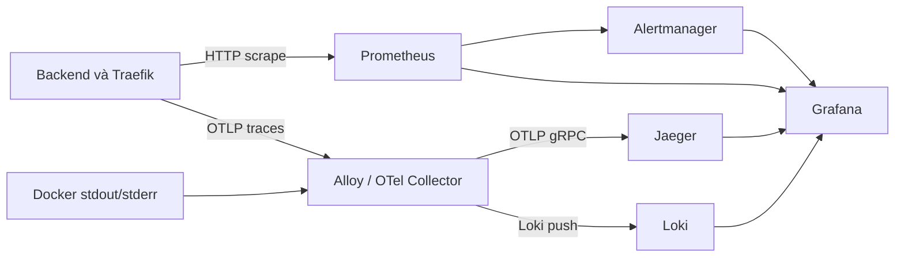

# Observability local

Compose chính là cấu hình dùng cho toàn bộ backend. Các file Compose gateway riêng phục vụ môi trường legacy, không phải entrypoint của stack observability này.

## Khởi động và truy cập

```powershell
# Khi chạy cả Payment và Notification, đặt dòng này vào .env để giữ lựa chọn qua các lần chạy:
# OBSERVABILITY_OPTIONAL_SERVICES=payment,notification
$env:OBSERVABILITY_OPTIONAL_SERVICES = 'payment,notification'
docker compose --profile payment --profile notification up -d
```

Để trống `OBSERVABILITY_OPTIONAL_SERVICES` nếu không bật hai profile. Giá trị này xác định các target mong đợi: service đã bật nhưng dừng/crash vẫn phải báo mất scrape; không tự xóa target chỉ vì container ngừng chạy. Tránh dùng Docker discovery để quyết định service nào cần được cảnh báo.

| Giao diện | Địa chỉ local |
|---|---|
| Grafana | http://localhost:3001/d/backend-observability |
| Prometheus targets | http://localhost:9090/targets |
| Prometheus alerts | http://localhost:9090/alerts |
| Alertmanager | http://localhost:9093 |
| Jaeger | http://localhost:16686 |

Grafana mặc định dùng `admin` / `local-observability`; có thể đặt `GRAFANA_ADMIN_USER`, `GRAFANA_ADMIN_PASSWORD` trước lần tạo volume đầu tiên. Cổng 3001 tránh trùng frontend 3000. UIs chỉ bind loopback. Backend metrics, exporter và OTLP ở mạng nội bộ; không tạo router metrics trên gateway.

## Luồng dữ liệu



Alloy ở service `otel-collector` nhận traces và đọc log backend qua Docker API, gắn `service_name` từ Compose metadata. Không cần truy cập đường dẫn log nội bộ của Docker Desktop. Log ứng dụng là JSON; request/trace ID nằm trong log, không là label metric hoặc label index Loki. Các stream thuộc backend, gateway và stack observability được thu thập; log database/Kafka không nằm trong danh sách thu log mặc định, nhưng có exporter hạ tầng.

Prometheus scrape 9 Java service tại `/actuator/prometheus`, 5 Go service tại `/metrics`, Traefik 8090, hai Redis exporter, PostgreSQL exporter, Kafka exporter và chính các thành phần observability. Target Payment/Notification được init từ cấu hình profile mong đợi. Optional targets dùng file discovery; các target bắt buộc dùng cấu hình static.

Prometheus, Loki và Jaeger lưu dữ liệu 7 ngày trên named volume. Jaeger dùng Badger cho local một node. Collector lưu read positions trên volume; log Docker cũ hơn retention bị loại trước khi gửi Loki. Init service cấp quyền volume cho UID Jaeger 10001. Không dùng `docker compose down -v` nếu muốn giữ evidence.

Jaeger được ghim ở 2.20.0. Bản 2.21 bỏ các endpoint HTTP v1 mà UI Jaeger không còn gọi (`/api/services`, `/api/operations`, tìm trace bằng `/api/traces?service=…`), nhưng datasource Jaeger của Grafana vẫn gọi chúng: health check, ô chọn service/operation và search đều trả 404, và chưa có cấu hình datasource nào thay được ([grafana-jaeger-datasource#87](https://github.com/grafana/grafana-jaeger-datasource/issues/87)). `/api/traces/<id>` vẫn còn ở 2.21+, nên `verify-observability.py` không phụ thuộc vào việc ghim này. Chỉ nâng Jaeger khi datasource đã chuyển sang `/api/v3`. Hạ từ 2.22 xuống 2.20 đọc được dữ liệu Badger sẵn có (kiểm tra 2026-10-21 trên volume `jaeger-data`).

Datasource Alertmanager là plugin core chỉ chạy ở frontend, không có health check phía backend: `GET /api/datasources/uid/alertmanager/health` luôn trả 500 `plugin.unavailable`, kể cả khi datasource hoạt động. Kiểm tra bằng `GET /api/alertmanager/alertmanager/api/v2/status` (API alerting của Grafana) hoặc nút Save & test trên UI; cả hai phải 200.

Trong Compose, sampling trace mặc định 1.0 để tái hiện được các case local; `TRACING_SAMPLING_PROBABILITY` điều chỉnh nó. Cấu hình application Java ngoài Compose mặc định 0.1. Go chỉ bật export khi có endpoint OTLP và dùng parent-based sampling. Trace cha có quyết định sampling vẫn được tôn trọng. Collector loại URL đầy đủ, path/query thô khỏi trace attributes, giữ route template, method, status và dependency; access log Traefik cũng bỏ path/query và header ngoài request ID.

HTTP Java sử dụng Micrometer bridge + OTLP exporter. Các HTTP client custom của Order/Search/Promotion được gắn ObservationRegistry; các WebClient BFF dùng instrumentation của Spring. Checkout và Cart có gRPC client instrumentation, Product có gRPC server instrumentation. Request ID không bị thay qua hop đồng bộ; error response cũng echo ID. Tracing không thay thế business correlation/idempotency của outbox, Kafka hay Temporal.

## Kiểm tra sau thay đổi

```powershell
docker compose --profile payment --profile notification config --quiet

# Kiểm tra backend health, metrics, header và luồng đọc.
docker run --rm --network ecommerce-network -v "${PWD}:/repo" python:3.12-alpine `
  python /repo/scripts/observability-audit.py `
  --output /repo/docs/observability/fix-evidence-2026-10-18

# Kiểm tra ingestion Prometheus/Loki/Jaeger và provisioning Grafana. Grafana chỉ ở network
# observability (mesh ADR-004), gateway chỉ ở ecommerce-network: verifier cần cả hai.
docker create --name verify-observability --network ecommerce-network -v "${PWD}:/repo" python:3.12-alpine `
  python /repo/scripts/verify-observability.py `
  --evidence /repo/docs/observability/fix-evidence-2026-10-18
docker network connect observability verify-observability
docker start -a verify-observability; docker rm verify-observability
```

Các smoke read dùng fixture local `camera-luma-home`. Với bộ dữ liệu khác, đổi fixture trong hai script. Probe không tạo giao dịch hoặc gọi Stripe. Pipeline verifier chờ bounded để exporter flush, Prometheus scrape và log agent chuyển dữ liệu; nó kiểm tra trace thực tế gồm gateway, PDP, Product, Inventory và Review, không chỉ cổng OTLP mở.

Catalog cache PDP tải Product bằng subscription riêng để request khởi tạo bị hủy không làm hỏng các request chờ chung. Subscription này giữ observation của request khởi tạo. Cache hit không gọi Product nên không có Product span mới; verifier chờ hết TTL mặc định 10 giây trước khi kiểm tra đủ topology. Nếu đổi TTL, truyền `--catalog-cache-ttl` tương ứng.

Để kiểm tra alert delivery nội bộ mà không dừng backend:

```powershell
docker run --rm --network ecommerce-network -v "${PWD}:/repo" `
  -v e-commerce-microservices_prometheus-targets:/targets python:3.12-alpine `
  python /repo/scripts/verify-observability-alert.py `
  --output /repo/docs/observability/fix-evidence-2026-10-18/alert-pipeline.json
```

Script thêm một target thử ở cổng không tồn tại, chờ rule `for: 2m` firing và xác nhận Alertmanager nhận alert, rồi khôi phục file trong `finally`. Không chạy đồng thời với việc recreate `observability-init`. Nếu đổi Compose project name, đổi tên volume ở lệnh trên và giá trị `project` trong LogQL verifier.

Alertmanager local đã có route nhận và lưu alert để xem trong UI/Grafana; chưa cấu hình gửi email/Slack ra bên ngoài. Thêm receiver và thông tin đích khi cần kênh thông báo của môi trường triển khai.

## Build

Dockerfile của các service Go dùng context `go/` để bao gồm module chung `go/observability`:

```powershell
docker build -f go/services/auth-service/Dockerfile -t auth-service:local go
docker compose --profile payment --profile notification build
```

Trên máy đã có Maven cache volumes, có thể dùng `scripts/rebuild-java-observability.ps1` để package từ source trong Maven container rồi dựng image bằng chính runtime stage của Dockerfile. Script không chép JAR cũ: Maven phải package thành công, chỉ chấp nhận một application JAR, rồi mới build/tag image theo Compose project. Build Java mặc định bằng Compose vẫn được hỗ trợ.

## Xử lý alert

### TelemetryTargetDown

Owner: platform. Mở Prometheus Targets, đọc `lastError`, kiểm tra container liveness/readiness, port/path, DNS và exporter. `up=1` chỉ xác nhận scrape thành công; với Redis/Postgres cũng xem `redis_up`/`pg_up`. Nếu Payment/Notification được tắt có chủ đích, cập nhật `OBSERVABILITY_OPTIONAL_SERVICES` và chạy lại init. Không xóa target đang lỗi để làm alert biến mất.

### HighBackendErrorRate

Owner: backend. Dashboard so sánh tỷ lệ 5xx với request rate, rồi lọc route/status ở metrics và tìm log/trace tương ứng. Kiểm tra dependency 5xx/timeout, DB và business degradation. URL không tồn tại phải là 404; không gom lỗi routing vào 500. Ngưỡng local hiện là 5%, có tối thiểu 0.1 request/s trong 5 phút, kéo dài 5 phút.

### HighBackendLatency

Owner: backend. Xem p95 từ histogram và dependency timings, queue, CPU/heap. So sánh cùng route; không dùng thời gian startup có build/test song song làm latency baseline. Ngưỡng local là p95 > 2 giây trong 10 phút; thay bằng SLO của môi trường trước khi vận hành thực tế.

### DependencyFailures

Owner: backend. Xem outcome timeout, connect error, circuit open, bulkhead rejected. Với PDP, HTTP 200 vẫn có thể là degraded; xem `pdp_sku_unknown_total`, `pdp_review_unavailable_total` và dependency outcomes. Với Checkout, xác định preview/submit/recovery từ span use case trước khi quyết định retry.

### KafkaConsumerLag

Owner: backend. Kiểm tra consumer group, partition assignment, DLQ, handler errors và tốc độ xử lý. Kafka exporter cung cấp lag cho các group; Notification có thêm metrics lane/topic/partition của ứng dụng. Ngưỡng local 1000 message trong 10 phút cần được điều chỉnh theo SLA từng topic.

### TelemetryExportFailure

Owner: platform. Kiểm tra Collector, kết nối Loki/Jaeger, dung lượng volume, các counter exporter send-failed/dropped và queue. Kiểm tra read positions sau restart. Drop log nằm ngoài retention là chủ động và có counter reason riêng; không mở rộng retention chỉ để che lỗi delivery.

### InventoryReserveLatencySloBreach

Owner: backend (Inventory + Platform). Reserve vượt SLO (p95 > 200 ms hoặc p99 > 500 ms) trên đúng route
`POST /internal/inventory/v1/reservations`. Chỉ số này không bị lệnh đọc availability của PDP pha loãng
([Inventory ADR-032](../inventory/decisions/ADR-032-reserve-saturation-alerts.md)). Kiểm tra theo thứ tự:

1. Xem `InventoryDbPoolSaturated` có đang kêu không, và CPU của Inventory/PostgreSQL. Nếu pool đầy mà CPU còn dư thì
   nhiều khả năng là hàng khoá nóng. Nếu CPU chạm trần thì là thiếu năng lực chung.
2. Đếm số backend đang chờ khoá trên DB của Inventory:

   ```sql
   SELECT count(*) FILTER (WHERE wait_event_type = 'Lock') AS lock_waiters, count(*) AS backends
   FROM pg_stat_activity WHERE datname = 'inventory_service' AND backend_type = 'client backend';
   ```

3. Tìm SKU/kho đang nhận nhiều Reserve nhất trong 5 phút gần đây:

   ```sql
   SELECT l.sku_id, l.warehouse_id, count(*) AS reserves
   FROM reservation_line l JOIN order_reservation r USING (order_id)
   WHERE r.accepted_at > now() - interval '5 minutes'
   GROUP BY 1, 2 ORDER BY 3 DESC LIMIT 10;
   ```

Latency đo phía Inventory là cận dưới. Khi bão hoà, request còn chờ thread Tomcat trước khi bộ đếm bắt đầu tính giờ:
lượt kiểm chứng có p99 phía server 1,9 s trong khi client thấy p50 7 s. Muốn biết độ trễ thật thì xem metric phía Order.

Nếu số backend chờ khoá gần bằng kích thước pool (24), và một SKU chiếm phần lớn số Reserve, thì đó là hàng nóng. Thêm
replica Inventory **không** giúp, vì mọi replica cùng chờ một hàng. Không bỏ qua bước kiểm tra tồn kho, không sửa tay
`stock_position`. Báo Order/Product nếu đây là một đợt bán có chủ đích. Năng lực đo được của một hàng nóng nằm trong
[benchmark baseline](../performance/inventory-reserve-hot-sku-baseline-2026-10-19.md). Nếu không thấy hàng nóng thì
xem latency của primary, bloat/vacuum, và các worker (projector, sequencer) có giữ transaction lâu không.

### InventoryDbPoolSaturated

Owner: backend. Trung bình trên 10 request chờ connection Hikari kéo dài khoảng 5 phút trên một instance Inventory.
Đây là tín hiệu sớm, thường xuất hiện trước `InventoryReserveLatencySloBreach`. Chẩn đoán giống mục trên. Thêm một
khả năng nữa: primary chậm hoặc failover làm mọi câu lệnh chậm, khi đó số backend chờ `Lock` thấp. Không tăng
`DB_POOL_SIZE` để alert biến mất. Pool lớn hơn chỉ cho thêm transaction đứng chờ cùng một hàng khoá.

### InventoryCommandBusy

Owner: backend. Trên 1% command của Inventory kết thúc `503 INVENTORY_BUSY`, nghĩa là lock timeout, deadlock hoặc
serialization failure vẫn còn sau hai lần retry nội bộ. Kiểm tra `deadlocks` trong `pg_stat_database` của
`inventory_service` và log `INVENTORY_BUSY` theo operation. Deadlock thật nghĩa là thứ tự khoá bị vi phạm
([data.md](../inventory/data.md#required-lock-order)): đó là bug, không phải chuyện năng lực. Alert này ít khi kêu với
một replica, vì hàng đợi nằm ở pool (xem hai mục trên).

## Tài liệu nền

Spring Boot 3.3 cần bridge và exporter riêng cho OTLP; custom HTTP client phải dùng builder/registry được instrument: [Spring tracing](https://docs.spring.io/spring-boot/3.3/reference/actuator/tracing.html). Collector Docker log source dùng metadata và persisted positions: [Alloy Docker logs](https://grafana.com/docs/alloy/latest/reference/components/loki/loki.source.docker/). Badger phù hợp cấu hình Jaeger local một node có persistence: [Jaeger Badger](https://www.jaegertracing.io/docs/2.20/storage/badger/).
