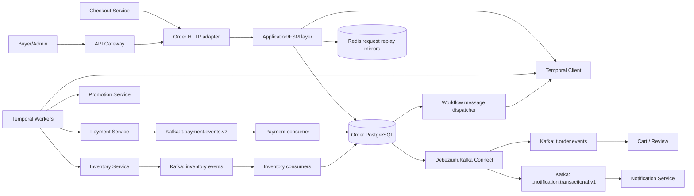

# Order Service — Kiến trúc

> File này mô tả kiến trúc mục tiêu được chuyển từ thiết kế cũ. Chưa có source
> path hoặc deployment config để đánh dấu `implemented`/`verified`.

## 1. Bối cảnh kiến trúc

Order nằm sau API Gateway cho Buyer/Admin và nhận submit nội bộ từ Checkout.
Service điều phối Inventory, Promotion và Payment bằng Temporal activities; nhận
payment/refund signal và Inventory dispatch/inspection completion qua Kafka; công bố thay đổi Order qua
transactional outbox và WAL CDC.

PostgreSQL vừa là source of truth vừa là read path cho detail và search/filter.
Redis chỉ giữ request replay mirror tạm thời. Thiết kế đã chủ đích loại bỏ Shipping Service,
Elasticsearch order read model, search projector, retry/DLQ topic cho CQRS, cold
archive và order product metrics.

Trust boundary chính: Gateway cung cấp identity/role cho public HTTP; internal
activity cần service credential; Kafka và Temporal signal phải được coi là dữ
liệu không tin cậy cho đến khi validate event, workflow identity và FSM guard.

## 2. Thành phần và trách nhiệm

| Thành phần | Trách nhiệm | Không được làm |
|---|---|---|
| HTTP adapter | Validate input, identity, ownership; commit operation/workflow intent; trả `202` cho command async | Gọi Temporal như correctness boundary, tự commit terminal refund state hoặc chứa business FSM |
| Application/FSM layer | Transaction, row lock/CAS, rule, snapshot, outbox insert | Gọi remote side effect trước khi local precondition được chốt |
| Query layer | Detail và hai lớp search trực tiếp PostgreSQL | Phụ thuộc Elasticsearch/projector đã bị loại bỏ |
| Temporal workflows | Serialize saga, timer, signal, retry, compensation, recovery | Thực hiện I/O nondeterministic trực tiếp trong workflow code |
| Temporal activities | Local transaction hoặc remote call có timeout/idempotency | Giữ workflow state ngoài Temporal history một cách không kiểm soát |
| Kafka consumers | Validate financial/aggregate identity; atomically persist durable inbox/evidence and workflow message; ACK only after commit | Gọi Temporal trực tiếp trước ACK; treat dispute as refund/payment transition; treat Redis/partition order/aggregate ID as correctness proof |
| Workflow dispatcher/convergence workers | `SignalWithStart` từ durable message, dedupe `message_id`; replay prerequisite proofs và `TryCompleteOrder` | Tạo business fact mới hoặc bỏ message chỉ vì Temporal RPC timeout |
| PostgreSQL | Order source of truth, operation/refund/reconciliation envelope + obligations, durable inbox/workflow messages/dispatches/checkpoints, notification command ledger, outbox, search read path | Trở thành shared database cho service khác |
| Redis | Request replay fast path cho bốn command public | Không là source of truth cho order/refund state, event dedup hoặc FSM lock |
| Debezium/Kafka Connect | Đọc WAL outbox và publish `t.order.events` | Dùng mutable status/retry counter trong outbox row |
| Trimmer CronJob | Xóa outbox cũ chỉ sau exact destination receipt + safety delay | Coi connector watermark là proof delivery của từng row |

## 3. Mô hình xử lý

### 3.1. Đồng bộ

- `GET /api/v1/orders`, `GET /api/v1/orders/{order_id}` và các Admin counterpart
  đọc PostgreSQL theo [public OpenAPI v1](../../contracts/http/order/v1/openapi.yaml).
- Cancellation/return/Admin pre-dispatch refund validate đồng bộ nhưng chỉ accept
  command; saga hoàn tất bất đồng bộ và API trả `202 Accepted` kèm operation resource.
- Checkout submission là synchronous-to-checkpoint: HTTP chỉ đợi đến khi Payment client
  data được durable checkpoint, không đợi capture. Payment-attempt POST atomically ghi
  operation + durable workflow message; client data được đọc từ operation khi attempt
  mới thực sự được tạo.
- Temporal activity gọi Inventory/Promotion/Payment đồng bộ theo timeout/retry.
- Inventory reservation commands complete from durable HTTP receipts and checkpointed
  command query/replay; they have no Kafka acknowledgment consumer. Only physical
  dispatch and selected-scope inspection completion enter the Inventory event path
  ([Inventory ADR-020](../inventory/decisions/ADR-020-command-receipts-and-minimal-order-events.md)).

### 3.2. Bất đồng bộ và transaction boundary

- `CreateOrderActivity` tạo master, item, line (kèm category ancestry) và promotion snapshot trong local
  transaction; không phát created event vì chưa có consumer.
- Chỉ transition `PAID` và `COMPLETED` có registered integration **fact**. State update,
  fact outbox insert và tăng `orders.last_event_sequence_id` phải cùng transaction.
  Notification request là command ở cùng multi-destination outbox, tăng notification
  sequence riêng trong cùng transaction và không tăng Order integration sequence. Durable
  command ledger giữ dedup key/sequence/event identity sau khi outbox đã được trim.
- Debezium relay outbox sau commit với delivery at-least-once.
- Kafka consumer ACK sau transaction chứa inbox/evidence và
  `order_workflow_messages`; dispatcher `SignalWithStart` sau commit với `message_id`
  ổn định. Crash ở hai phía Temporal RPC không làm mất hoặc nhân đôi business action.
- Temporal history giữ timer/signal/progress. Remote side effect chỉ chạy trong
  activity có idempotency key ổn định.

Checkout has pre-payment compensation only. After the Payment financial watermark it
uses stable-command forward repair/financial reconciliation, never business rollback.
Pre-payment Inventory và Promotion cleanup là hai obligation độc lập, đều phải được thử
và chứng minh; lỗi thứ nhất không được ngăn lỗi thứ hai. Refund saga không cho API đi
đường tắt. Payment success sau terminal non-capture là contract anomaly được giữ trong
reconciliation, không hồi sinh order đã hủy.

### 3.3. Danh mục activity được bảo toàn

| Nhóm | Activity | Trách nhiệm |
|---|---|---|
| Checkout local | `CreateOrderActivity` | Tạo master/items/lines/promotions; không phát event |
| Order checkout workflow | `ReserveInventoryActivity` | Reserve stock theo immutable allocation plan |
| Order checkout workflow | `ReservePromotionActivity` | `POST /internal/v1/promotion-allocation/reservations`; reserve budget all-or-nothing sau submit |
| Checkout remote | `InitiatePaymentActivity` | Tạo Stripe PaymentIntent qua Payment |
| Post-payment | `CommitInventoryActivity` | Inventory `CommitPayment` whole root; recover uncertain result by command query |
| Post-payment | `ConfirmPromotionActivity` | `POST /internal/v1/promotion-allocation/confirmations`; fence rồi commit durable receipt/wallet/budget (không outbox, Promotion ADR-016) |
| FSM local | `UpdateOrderStatusActivity` | Row lock/CAS; ghi hai registered Order facts và user-facing Notification commands qua durable ledger/outbox đúng milestone |
| Refund local | `MarkRefundRequestedActivity` | Verify source/guard, chuyển `RETURN_REQUESTED` |
| Refund local | `LockRefundScopeActivity` | Khóa selected `order_line_id` full quantity và immutable per-line net amount; tổng scope không vượt `final_amount_minor` |
| Refund remote | `RegisterRefundScopeActivity` | Đăng ký selected scope với Inventory |
| Refund remote | `ReleaseCommittedOrderBeforeDispatchActivity` | Admin path: Inventory release tất cả committed lines atomically hoặc conflict no-op |
| Refund local/recovery | `RecordAdminRefundAttemptActivity` | Persist attempt/command ID; create lifetime case only after accepted all-line release proof |
| Refund wait | `WaitInventoryReturnScopeInspectionCompletedSignal` | Chờ toàn bộ selected quantity final-inspect, PASS/FAIL đều completion |
| Refund remote | `InitiateRefundActivity` | Gọi Payment refund với key ổn định |
| Refund local | `FinalizeRefundResultActivity` | Commit success/fail/reverse and freeze Buyer close intent/checkpoint/dispatch in the same transaction |
| Refund remote | `CloseRefundScopeActivity` | Buyer `INSPECTION_COMPLETED -> CLOSED` after terminal Payment outcome; stable frozen reason/key |
| Refund remote | `CloseIncompleteRefundScopeActivity` | Approved no-payout Ops decision; only missing expected quantity with every received unit final-inspected |
| Refund remote | `CancelRefundScopeActivity` | Approved no-payout Ops decision; only `REGISTERED` with no receipt; decision reason retained in Order audit |
| Refund local | `RecordRefundScopeFinalizationActivity` | Validate/persist matching command receipt and revision; resolve finalization, then complete no-payout case/operation |
| Pre-payment compensation | `CancelPaymentActivity` | Resolve Payment cancel/capture fact before any resource release |
| Pre-payment compensation | `RollbackPromotionActivity` | `POST /internal/v1/promotion-allocation/cancellations`; nhả reservation runtime |
| Pre-payment compensation | `RollbackInventoryActivity` | Nhả stock reservation only after proven non-capture |
| Pre-payment compensation | `CancelOrderActivity` | Commit cancel sau cleanup |
| Post-capture repair | `QueryOrReplayRemoteCommandActivity` | Resolve unknown Inventory/Promotion outcome by stable command ID/receipt |
| Post-capture repair | `EscalateFinancialReconciliationActivity` | Preserve paid fact and checkpoints when a required proof cannot be recovered |
| Convergence | `TryCompleteOrderActivity` | Sau financial/delivery proof, hoàn tất order chỉ khi mọi line delivered và mọi required obligation đã đóng |

Workflow dùng Temporal `Selector`/signal-versus-timer semantics ở payment wait;
implementation cụ thể có thể dùng API SDK tương đương nhưng phải giữ quyết định đơn
trong history và tính deterministic.

Buyer financial finalization and scope-finalization intent/dispatch commit together before
the remote close; only `OrderRefundScopeFinalizationWorkflow` calls Inventory close/cancel. Scope retry exhaustion is `RECOVERY_REQUIRED`, not financial
rollback. Durable dispatch/reconciliation starts
`OrderRefundScopeFinalizationWorkflow` on the existing refund queue for the frozen
command/generation, including financially terminal cases. It only calls Inventory;
Admin pre-dispatch has no scope and uses `NOT_REQUIRED`. See
[ADR-013](./decisions/ADR-013-durable-refund-scope-finalization.md).

## 4. Mô hình nhất quán

| Phạm vi | Mô hình | Cơ chế |
|---|---|---|
| Dữ liệu Order trong một transition | Strong/local ACID | PostgreSQL transaction + row lock/CAS |
| State và event do Order phát | Atomic local, eventual publish | Transactional outbox + CDC |
| Saga liên service | Eventual consistency | Temporal retry, durable command checkpoints and pre-payment compensation / post-capture forward repair |
| DB commit -> Temporal signal | Atomic accept, eventual dispatch | Inbox/API transaction + `order_workflow_messages`; scoped message ID + dedup state carried across Continue-As-New + DB-idempotent activity |
| Search/list order | Strong theo PostgreSQL commit | Query trực tiếp source of truth |
| Redis request mirrors | Tạm thời, có thể mất | Replay fast-path only; durable inbox/checkpoints/FSM remain safe |
| Consumer downstream | At-least-once, có ordering theo order | Durable inbox + semantic financial/aggregate revision guard; Kafka partition is optimization |

Không có stale window do search projection vì read path dùng PostgreSQL. Event
downstream có thể trễ theo CDC/consumer lag; chưa có SLO tối đa cho độ trễ này.

## 5. Mô hình đồng thời và ordering

- Public cancel khóa row PostgreSQL trong cùng transaction bằng
  `SELECT ... FOR UPDATE`/conditional `UPDATE`; không dùng Redis lock. Các command
  khác cũng phải giữ row lock/CAS ở boundary sở hữu FSM.
- Buyer return dùng first-write-wins CAS trên `orders.buyer_return_locked_at`.
- Refund result/approved return closure and its frozen Inventory intent/dispatch share
  one transaction. Receipt/inspection versus close is guarded by Inventory; a pending
  no-payout decision blocks Order Payment initiation. Reversal never reopens Inventory.
- Bốn request Redis mirrors không thay thế durable workflow dispatch/checkpoint rows.
- Consumed events dùng durable inbox, semantic revision/proof guard; không có Redis
  event fast-path.
- WorkflowID fixed + dispatch rows chặn workflow song song/lost-start trên cùng checkout/order lane.
- Payment signal/timer are serialized only after Payment identity/version validation;
  cancellation waits provider non-capture/capture fact. Chỉ attempt `FAILED` mới được
  retry trước immutable order deadline khi Inventory/Promotion holds còn hiệu lực;
  `EXPIRED`/`CANCELED` là terminal non-capture và không được retry.
- Delivery proof contract v1 is target-owned by Delivery; Inventory physical dispatch only
  updates a line `DISPATCHED` and cannot complete master. Proof tới trước dispatch được
  park/replay; Order may complete only after every line has verified proof và financial
  obligations đã converge.
- Event Order partition theo `order_id`; counter `last_event_sequence_id` tăng đơn
  điệu theo order. Line consumer guard thêm `order_line_id`.
- Không dùng UUID event theo thứ tự từ điển và không còn optimistic `version`.

## 6. Mô hình triển khai

Thiết kế yêu cầu các process/runtime logic sau, nhưng chưa chốt chạy chung hay tách pod:

- Order HTTP/query server.
- Payment Kafka consumer group `order-payment-consumer`.
- Inventory Kafka consumer groups `order-inventory-ship-consumer` và
  `order-inventory-return-consumer`.
- Delivery Kafka consumer group `order-delivery-consumer`.
- Temporal worker đăng ký ba task queue: `order-checkout-queue`,
  `order-refund-queue`, `order-financial-reconciliation-queue`.
- Runtime đã chốt: Java 21 + Spring Boot 3.3 + Temporal Java SDK tại
  `java/services/order-service`; mặc định một process chạy HTTP, consumers, workers và
  Temporal worker, mỗi nhóm có cờ bật/tắt riêng để tách pod
  ([ADR-020](./decisions/ADR-020-release-1-implementation-clarifications.md)).
- Workflow-message dispatcher, prerequisite-proof replayer và completion convergence
  worker; mọi worker claim row bằng `FOR UPDATE SKIP LOCKED` và lease/attempt metrics.
- Refund scope finalization recovery uses `order-refund-queue`; the finalization
  reconciler finds pending/recovery/conflict work independently of financial case status.
- PostgreSQL và tùy chọn Redis request-replay cache.
- Debezium/Kafka Connect outbox connector.
- Outbox receipt observer theo dõi cả Order fact topic và Notification command topic;
  CronJob dọn outbox hàng ngày, ví dụ 04:00, chỉ xóa row đã có exact receipt.

HTTP/query có thể scale ngang. Kafka consumer scale bị giới hạn bởi partition.
Temporal worker scale ngang theo task queue nhưng activity phải idempotent. Trimmer
phải chỉ có một execution logic trên mỗi kỳ hoặc dùng distributed scheduling.

## 7. Ràng buộc kiến trúc

- Không service nào ghi trực tiếp vào database Order; Order không query trực tiếp
  database của service khác.
- Không phát event trước khi transaction state commit; `outbox_events` append-only.
- Không đặt business rule/FSM trong controller, Kafka adapter hoặc Debezium.
- Payment/Refund Kafka consumer atomically persists validated inbox/checkpoint + workflow
  message rồi ACK; dispatcher mới signal workflow, và
  workflow là owner của master financial/refund transition.
- Không gọi Payment refund trước Buyer Inventory scope-inspection completion hoặc
  Admin Inventory all-line pre-dispatch release evidence.
- A Buyer refund operation completes only after a matching Inventory close/cancel
  receipt; workflow termination without it requires a durable recovery dispatch.
  Closing return scope cannot change Payment facts or free a lifetime refund entitlement.
- Không reserve promotion tại Preview; reserve chỉ xảy ra sau submit và sau khi
  `order_id` tồn tại.
- Customer refund không gọi Promotion: không restore voucher, không hoàn budget và không
  phát allocation theo SKU. Promotion `cancel-confirmed` is deprecated legacy cleanup and
  prohibited after the Payment financial watermark.
- Không khôi phục Elasticsearch/CQRS hoặc cold archive nếu chưa có ADR thay thế.

## 8. Đánh đổi và ADR liên quan

- [ADR-001](./decisions/ADR-001-temporal-saga-orchestration.md): Temporal giảm
  boilerplate timeout/recovery nhưng tăng dependency và yêu cầu deterministic code.
- [ADR-002](./decisions/ADR-002-master-sub-order-and-snapshots.md): master/sub-order
  hỗ trợ đa kho, đổi lại query/aggregate phức tạp hơn.
- [ADR-003](./decisions/ADR-003-transactional-outbox-cdc.md): quyết định outbox lịch sử;
  retention/multi-destination hiện được refine bởi ADR-016.
- [ADR-004](./decisions/ADR-004-postgresql-direct-order-search.md): PostgreSQL search
  đơn giản vận hành nhưng bỏ fuzzy/scoring/highlight/autocomplete.
- [ADR-005](./decisions/ADR-005-redis-and-fsm-idempotency.md): quyết định lịch sử về
  Redis request/event dedup và FSM lock; các phần event/FSM/create đã được refine bởi
  ADR-012 và ADR-015.
- [ADR-010](./decisions/ADR-010-selected-line-refund-policy.md): one lifetime case,
  selected full-quantity lines and atomic pre-dispatch admin path; Buyer may wait up
  to 30 days for physical inspection evidence.
- [ADR-008](./decisions/ADR-008-late-payment-recovery.md): historical, superseded bởi
  ADR-014; terminal non-capture không được chuyển thành capture, anomaly đi reconciliation.
- [ADR-011](./decisions/ADR-011-financial-saga-recovery-and-durable-dispatch.md):
  durable inbox/dispatch/checkpoints and financial watermark replace Redis/LIFO
  assumptions; payment terminal semantics are refined by ADR-014.
- [ADR-012](./decisions/ADR-012-redis-request-mirror-scope.md): giữ Redis chỉ cho
  replay request của bốn command; loại bỏ create mirror, event fast-path và FSM lock.
- [ADR-013](./decisions/ADR-013-durable-refund-scope-finalization.md): durable scope
  close/cancel, no-payout Ops decision, recovery and financial/physical outcome separation.
- [ADR-014](./decisions/ADR-014-payment-attempt-deadline-and-terminal-semantics.md):
  immutable payment deadline, FAILED-only retry và capture/cancel race semantics.
- [ADR-015](./decisions/ADR-015-durable-workflow-messages-and-convergence.md): đóng
  DB-to-Temporal gap, stream-scoped inbox và convergence cho proof out-of-order.
- [ADR-016](./decisions/ADR-016-multi-destination-outbox-and-receipts.md): facts và
  notification commands dùng cùng outbox, cleanup dựa exact delivery receipt.
- [ADR-017](./decisions/ADR-017-deterministic-line-net-refund-and-search.md): line-net
  refund allocation, scoped idempotency và deterministic order-card search.
- [ADR-018](./decisions/ADR-018-reconciliation-obligations.md): một case envelope chứa
  nhiều obligation độc lập, evidence/decision append-only.
- [ADR-019](./decisions/ADR-019-external-remediation-refund-convergence.md): full external
  customer payout closes the open refund lane transparently without inventing Payment fact.
