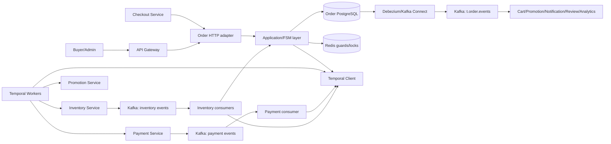

# Order Service — Kiến trúc

> File này mô tả kiến trúc mục tiêu được chuyển từ thiết kế cũ. Chưa có source
> path hoặc deployment config để đánh dấu `implemented`/`verified`.

## 1. Bối cảnh kiến trúc

Order nằm sau API Gateway cho Buyer/Admin và nhận submit nội bộ từ Checkout.
Service điều phối Inventory, Promotion và Payment bằng Temporal activities; nhận
payment/refund signal và inventory lifecycle qua Kafka; công bố thay đổi Order qua
transactional outbox và WAL CDC.

PostgreSQL vừa là source of truth vừa là read path cho detail và search/filter.
Redis chỉ giữ dedup/lock tạm thời. Thiết kế đã chủ đích loại bỏ Shipping Service,
Elasticsearch order read model, search projector, retry/DLQ topic cho CQRS, cold
archive và order product metrics.

Trust boundary chính: Gateway cung cấp identity/role cho public HTTP; internal
activity cần service credential; Kafka và Temporal signal phải được coi là dữ
liệu không tin cậy cho đến khi validate event, workflow identity và FSM guard.

## 2. Thành phần và trách nhiệm

| Thành phần | Trách nhiệm | Không được làm |
|---|---|---|
| HTTP adapter | Validate input, identity, ownership; start/signal workflow; trả `202` cho command async | Tự commit terminal refund state hoặc chứa business FSM |
| Application/FSM layer | Transaction, row lock/CAS, rule, snapshot, outbox insert | Gọi remote side effect trước khi local precondition được chốt |
| Query layer | Detail và hai lớp search trực tiếp PostgreSQL | Phụ thuộc Elasticsearch/projector đã bị loại bỏ |
| Temporal workflows | Serialize saga, timer, signal, retry, compensation, recovery | Thực hiện I/O nondeterministic trực tiếp trong workflow code |
| Temporal activities | Local transaction hoặc remote call có timeout/idempotency | Giữ workflow state ngoài Temporal history một cách không kiểm soát |
| Kafka consumers | Dedup, validate, route signal; Inventory Ship cập nhật item FSM | Payment consumer ghi trực tiếp master payment/refund FSM |
| PostgreSQL | Order source of truth, refund case, outbox, search read path | Trở thành shared database cho service khác |
| Redis | Request/event dedup và FSM distributed lock fast path | Là source of truth cho order/refund state |
| Debezium/Kafka Connect | Đọc WAL outbox và publish `t.order.events` | Dùng mutable status/retry counter trong outbox row |
| Trimmer CronJob | Xóa outbox cũ sau watermark an toàn | Xóa dữ liệu CDC chưa relay |

## 3. Mô hình xử lý

### 3.1. Đồng bộ

- `GET /v1/orders/{orderId}` và `GET /v1/orders/search` đọc PostgreSQL.
- Cancel/return validate đồng bộ nhưng chỉ accept command; saga hoàn tất bất đồng
  bộ và API trả `202 Accepted`.
- Temporal activity gọi Inventory/Promotion/Payment đồng bộ theo timeout/retry.

### 3.2. Bất đồng bộ và transaction boundary

- `CreateOrderActivity` tạo master, item, line, promotion snapshot và event
  `ORDER_CREATED` trong local transaction.
- Mỗi FSM transition cần công bố được update cùng outbox insert và tăng
  `orders.last_event_sequence_id` trong một transaction.
- Debezium relay outbox sau commit với delivery at-least-once.
- Kafka consumer ack sau khi dedup/routing hoặc state change đã hoàn tất theo
  chính sách consumer; duplicate phải vô hại.
- Temporal history giữ timer/signal/progress. Remote side effect chỉ chạy trong
  activity có idempotency key ổn định.

Checkout saga có hai compensation stack độc lập: pre-payment và post-payment.
Refund saga không cho API đi đường tắt; late-payment recovery là lane riêng sau
checkout timeout.

### 3.3. Danh mục activity được bảo toàn

| Nhóm | Activity | Trách nhiệm |
|---|---|---|
| Checkout local | `CreateOrderActivity` | Tạo master/items/lines/promotions và `ORDER_CREATED` |
| Checkout remote | `ReserveInventoryActivity` | Reserve stock theo routing plan |
| Checkout remote | `ReservePromotionActivity` | `POST /internal/v1/promotion-allocation/reservations`; reserve budget all-or-nothing sau submit |
| Checkout remote | `InitiatePaymentActivity` | Tạo Stripe PaymentIntent qua Payment |
| Post-payment | `DeductInventoryActivity` | Deduct stock đã reserve |
| Post-payment | `ConfirmPromotionActivity` | `POST /internal/v1/promotion-allocation/confirmations`; fence rồi commit durable receipt/wallet/budget (không outbox, Promotion ADR-016) |
| FSM local | `UpdateOrderStatusActivity` | Row lock/CAS, update master và outbox |
| Refund local | `MarkRefundRequestedActivity` | Verify source/guard, chuyển `RETURN_REQUESTED` |
| Refund local | `LockRefundScopeActivity` | Khóa selected `order_line_id` full quantity và gross amount cap `final_amount` |
| Refund remote | `RegisterRefundScopeActivity` | Đăng ký selected scope với Inventory |
| Refund remote | `ReleaseCommittedOrderBeforeDispatchActivity` | Admin path: Inventory release tất cả committed lines atomically hoặc conflict no-op |
| Refund wait | `WaitInventoryReturnScopeInspectionCompletedSignal` | Chờ toàn bộ selected quantity final-inspect, PASS/FAIL đều completion |
| Refund remote | `InitiateRefundActivity` | Gọi Payment refund với key ổn định |
| Refund local | `FinalizeRefundResultActivity` | Commit success/fail/reverse và outbox |
| Recovery | `RecoverPaidOrderFromTimeoutActivity` | Verify payment muộn, tái lập paid lane/evidence |
| Pre-payment compensation | `CancelPaymentActivity` | Hủy pending payment |
| Pre-payment compensation | `RollbackPromotionActivity` | `POST /internal/v1/promotion-allocation/cancellations`; nhả reservation runtime |
| Pre-payment compensation | `RollbackInventoryActivity` | Nhả stock reservation |
| Pre-payment compensation | `CancelOrderActivity` | Commit cancel sau cleanup |
| Post-payment compensation | `RollbackDeductedInventoryActivity` | Bù stock đã deduct |
| Post-payment compensation | `CancelConfirmedPromotionActivity` | `POST /internal/v1/promotion-allocation/technical-cancellations`; PostgreSQL-first undo, Redis repair sau |
| Post-payment compensation | `RevertOrderStatusToPaidActivity` | `PROCESSING -> PAID` khi rollback |

Workflow dùng Temporal `Selector`/signal-versus-timer semantics ở payment wait;
implementation cụ thể có thể dùng API SDK tương đương nhưng phải giữ quyết định đơn
trong history và tính deterministic.

## 4. Mô hình nhất quán

| Phạm vi | Mô hình | Cơ chế |
|---|---|---|
| Dữ liệu Order trong một transition | Strong/local ACID | PostgreSQL transaction + row lock/CAS |
| State và event do Order phát | Atomic local, eventual publish | Transactional outbox + CDC |
| Saga liên service | Eventual consistency | Temporal retry, signal và compensation |
| Search/list order | Strong theo PostgreSQL commit | Query trực tiếp source of truth |
| Redis dedup/lock | Tạm thời, có thể mất | TTL; FSM/WorkflowID giữ safety khi Redis mất key |
| Consumer downstream | At-least-once, có ordering theo order | Kafka partition key + sequence guard |

Không có stale window do search projection vì read path dùng PostgreSQL. Event
downstream có thể trễ theo CDC/consumer lag; chưa có SLO tối đa cho độ trễ này.

## 5. Mô hình đồng thời và ordering

- Public cancel dùng Redis lock `order:lock:fsm:{orderId}` TTL 10 giây rồi khóa
  row PostgreSQL; correctness cuối dựa trên `SELECT ... FOR UPDATE`/conditional
  `UPDATE`, không dựa riêng vào Redis.
- Buyer return dùng first-write-wins CAS trên `orders.buyer_return_locked_at`.
- Request dedup dùng Redis `SETNX` TTL 7 ngày; consumed event dedup TTL 30 ngày.
- WorkflowID cố định chặn workflow song song trên cùng checkout/order lane.
- Payment signal và timer cùng lúc được Temporal serialize vào workflow history;
  signal sau timeout đi late-payment recovery.
- Auto-complete chỉ phát event khi `UPDATE orders ... WHERE status='PROCESSING'`
  ảnh hưởng đúng một row; cửa sổ coalescing 5 giây giảm rung khi nhiều kiện giao sát nhau.
- Event Order partition theo `order_id`; counter `last_event_sequence_id` tăng đơn
  điệu theo order. Item consumer guard thêm `order_item_id`.
- Không dùng UUID event theo thứ tự từ điển và không còn optimistic `version`.

## 6. Mô hình triển khai

Thiết kế yêu cầu các process/runtime logic sau, nhưng chưa chốt chạy chung hay tách pod:

- Order HTTP/query server.
- Payment Kafka consumer group `order-payment-consumer`.
- Inventory Kafka consumer groups `order-inventory-ship-consumer` và
  `order-inventory-return-consumer`.
- Temporal worker đăng ký ba task queue: `order-checkout-queue`,
  `order-refund-queue`, `order-late-payment-recovery-queue`.
- PostgreSQL và Redis.
- Debezium/Kafka Connect outbox connector.
- CronJob dọn outbox hàng ngày, ví dụ 04:00.

HTTP/query có thể scale ngang. Kafka consumer scale bị giới hạn bởi partition.
Temporal worker scale ngang theo task queue nhưng activity phải idempotent. Trimmer
phải chỉ có một execution logic trên mỗi kỳ hoặc dùng distributed scheduling.

## 7. Ràng buộc kiến trúc

- Không service nào ghi trực tiếp vào database Order; Order không query trực tiếp
  database của service khác.
- Không phát event trước khi transaction state commit; `outbox_events` append-only.
- Không đặt business rule/FSM trong controller, Kafka adapter hoặc Debezium.
- Payment/Refund Kafka consumer chỉ signal workflow; workflow là owner của master
  financial/refund transition.
- Không gọi Payment refund trước Buyer Inventory scope-inspection completion hoặc
  Admin Inventory all-line pre-dispatch release evidence.
- Không reserve promotion tại Preview; reserve chỉ xảy ra sau submit và sau khi
  `order_id` tồn tại.
- Customer refund không gọi Promotion: không restore voucher, không hoàn budget và không
  phát allocation theo SKU. Technical `cancel-confirmed` chỉ thuộc checkout saga failure.
- Không khôi phục Elasticsearch/CQRS hoặc cold archive nếu chưa có ADR thay thế.

## 8. Đánh đổi và ADR liên quan

- [ADR-001](./decisions/ADR-001-temporal-saga-orchestration.md): Temporal giảm
  boilerplate timeout/recovery nhưng tăng dependency và yêu cầu deterministic code.
- [ADR-002](./decisions/ADR-002-master-sub-order-and-snapshots.md): master/sub-order
  hỗ trợ đa kho, đổi lại query/aggregate phức tạp hơn.
- [ADR-003](./decisions/ADR-003-transactional-outbox-cdc.md): outbox CDC giữ atomicity,
  đổi lại phụ thuộc WAL/Kafka Connect và cleanup watermark.
- [ADR-004](./decisions/ADR-004-postgresql-direct-order-search.md): PostgreSQL search
  đơn giản vận hành nhưng bỏ fuzzy/scoring/highlight/autocomplete.
- [ADR-005](./decisions/ADR-005-redis-and-fsm-idempotency.md): Redis TTL giảm schema
  durable dedup, đổi lại replay ngoài TTL dựa vào FSM/WorkflowID.
- [ADR-010](./decisions/ADR-010-selected-line-refund-policy.md): one lifetime case,
  selected full-quantity lines and atomic pre-dispatch admin path; Buyer may wait up
  to 30 days for physical inspection evidence.
- [ADR-008](./decisions/ADR-008-late-payment-recovery.md): không drop payment muộn;
  ADR-010 supersedes its automatic-refund branch, so unsafe recovery now enters
  manual verification in Release 1.
