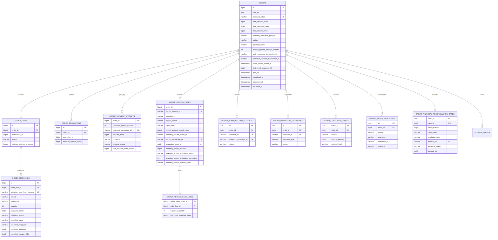

# Order Service — Thiết kế dữ liệu

> Đây là logical/physical design được chuyển từ tài liệu cũ. Các câu SQL minh
> họa không phải migration chuẩn; hiện chưa có migration Order để xác minh.

## 1. Quyền sở hữu dữ liệu

| Store/đối tượng | Dữ liệu | Nguồn chân lý |
|---|---|---|
| PostgreSQL `orders` | Master order, số tiền, FSM, checkout identity, buyer return guard, event sequence | Order Service |
| PostgreSQL `order_items` | Delivery unit theo order/warehouse | Order Service |
| PostgreSQL `order_item_lines` | Snapshot SKU/sản phẩm lúc mua | Order Service |
| PostgreSQL `order_promotions` | Promotion allocation đã áp trên order | Order Service cho snapshot; Promotion sở hữu budget/wallet |
| PostgreSQL `order_refund_cases` | Refund process control plane | Order Service |
| PostgreSQL `order_admin_refund_attempts` | Durable pre-dispatch release attempt; separate from lifetime refund entitlement | Order Service |
| PostgreSQL `order_payment_attempts` | Immutable mapping payment attempt ↔ Payment transaction and financial version | Order Service |
| PostgreSQL `order_financial_reconciliation_cases` | Audited post-capture exception/evidence and its permitted resolution | Order Service |
| PostgreSQL `order_workflow_dispatches` | Transactional intent to start/attach a fixed Temporal workflow after local commit | Order Service |
| PostgreSQL `order_consumed_events` | Durable inbox and validation receipt for Payment/Inventory at-least-once events | Order Service |
| PostgreSQL `order_saga_checkpoints` | Remote command IDs/outcomes for checkout, cancellation and post-capture repair | Order Service |
| PostgreSQL `outbox_events` | Integration event chưa/đã được CDC quan sát | Order Service |
| View `v_orders_buyer_tab` | Tab dẫn xuất từ Order data | Dẫn xuất, không là source of truth |
| Redis | Request replay mirror có TTL cho bốn command | Dữ liệu tạm; không là source of truth |
| Temporal history | Tiến độ/timer/signal saga | Temporal cho orchestration, không thay Order FSM |

Service khác không ghi database này. Order không sở hữu current Product, User
address book, Inventory reservation/stock, Promotion budget/wallet hay Payment
transaction; chỉ lưu snapshot/identifier cần cho lịch sử và điều phối.

## 2. Mô hình dữ liệu logic



Checkout sends an Inventory-owned allocation plan whose line identity is
`line_reference`, not an Order ID. When it accepts the snapshot, Order assigns each
`order_line_id`, persists the immutable unique bridge
`allocation_plan_line_reference -> order_item_lines.id`, then creates a delivery unit
for each planned warehouse and stores every line's immutable planned warehouse. One
delivery unit can contain many lines only when they share that warehouse. Dispatch and
delivery state are nevertheless owned per line, never inferred for sibling lines.
Refund case tối đa một record **trọn đời** trên mỗi order. Với Buyer return, các
line scope thuộc case và dùng identity `order_item_lines.id`, không phải `sku_id`;
mỗi line được chọn có quantity đúng bằng quantity đã mua. Snapshot address ở item
cho phép các kiện trong cùng master order gắn với đơn vị thực hiện theo kho mà
không phụ thuộc address book bị sửa/xóa về sau.

## 3. Schema logic và field

### 3.1. `orders`

| Field | Kiểu | Quy tắc/ý nghĩa |
|---|---|---|
| `id` | `BIGSERIAL` PK | Master order ID |
| `user_id` | `UUID` | Buyer canonical ID |
| `total_amount_minor` | `BIGINT` | Integer VND, tổng tiền hàng |
| `total_discount_minor` | `BIGINT` | Integer VND, tổng PLATFORM discount |
| `final_amount_minor` | `BIGINT` | `total_amount_minor - total_discount_minor` |
| `inventory_allocation_plan_id` | `VARCHAR(128)` | Plan ID từ Inventory Preview, immutable snapshot dùng cho Reserve/reconciliation |
| `payment_status` | `VARCHAR(50)` | `PENDING/PAID/FAILED/REFUNDING/REFUNDED/REFUND_FAILED`; read/UI denormalized |
| `active_payment_attempt_number` | `INT` nullable | Attempt Payment hiện tại. Chỉ tăng sau financial fact terminal non-capture của attempt trước; không bao giờ tái dùng. |
| `active_payment_transaction_id` | `VARCHAR(120)` nullable | Transaction của active attempt. Pre-capture cancel/fail/expired và event active phải match field này. |
| `captured_payment_transaction_id` | `VARCHAR(120)` nullable, unique when set | First/only successful transaction của order; immutable sau khi set. Refund phải dùng identity này, không dùng một attempt thất bại hoặc active ID đã stale. |
| `status` | `VARCHAR(50)` | Master FSM state |
| `checkout_token` | `VARCHAR(255)` unique, not null | Route workflow `order-checkout-{checkout_token}` |
| `cancel_reason` | `TEXT` nullable | `PAYMENT_TIMEOUT`, `USER_CANCEL`, `ADMIN_FORCE_CANCEL`, `PRE_PAYMENT_SAGA_FAILED`, `PAYMENT_FAILED`; workflow sở hữu enum, không DB CHECK |
| `return_reason` | `VARCHAR(100)` nullable | Summary reason ở master; chi tiết per-item ở metadata/scope |
| `buyer_return_locked_at` | `TIMESTAMPTZ` nullable | Permanent first-write-wins guard cho Buyer return |
| `saga_phase` | `VARCHAR(50)` | Durable checkpoint summary: pre-payment, cancelling, post-capture repair or financial reconciliation; not reconstructed from Redis/Temporal alone. |
| `last_event_sequence_id` | `BIGINT NOT NULL DEFAULT 0` | Counter đơn điệu per order cho event Order tự phát |
| `paid_at` | `TIMESTAMPTZ` nullable | Thời điểm first/only captured payment được Order commit |
| `completed_at` | `TIMESTAMPTZ` nullable | Thời điểm verified final-line delivery hoàn tất master |
| `cancelled_at` | `TIMESTAMPTZ` nullable | Thời điểm pre-payment cancellation và cleanup hoàn tất |
| `refunded_at` | `TIMESTAMPTZ` nullable | Thời điểm existing lifetime refund transaction success được commit |
| `created_at`, `updated_at` | `TIMESTAMPTZ` | Audit timestamps |

Các nguồn field được tham chiếu trực tiếp trong read model gồm `orders.id`,
`orders.status`, `orders.payment_status`, `orders.created_at`,
`orders.total_amount_minor`, `order_items.id`, `order_item_lines.snapshot_name` và
`order_item_lines.snapshot_image_url`.

### 3.2. `order_items`

| Field | Kiểu | Quy tắc/ý nghĩa |
|---|---|---|
| `id` | `BIGSERIAL` PK | Delivery unit ID |
| `order_id` | `BIGINT` FK | Master owner |
| `warehouse_id` | `BIGINT` | Kho xuất hàng |
| `status` | `VARCHAR(50)` | Derived only from child line state: `PROCESSING/PARTIALLY_DISPATCHED/DISPATCHED/PARTIALLY_DELIVERED/DELIVERED`; không phải source cho mutation line |
| `delivery_address_snapshot` | `JSONB NOT NULL` | `recipient_name`, `recipient_phone`, `address_line`, `province_code`, `district_code`, `ward_code` |

Ward bắt buộc được giữ trong snapshot để thay đổi address/địa giới sau này không
viết lại lịch sử đơn.

### 3.3. `order_item_lines`

| Field | Kiểu | Quy tắc/ý nghĩa |
|---|---|---|
| `id` | `BIGSERIAL` PK | Line identity |
| `order_item_id` | `BIGINT` FK | Delivery unit owner |
| `allocation_plan_line_reference` | `VARCHAR(64) UNIQUE NOT NULL` | Immutable `line_reference=sku_id` from the accepted Checkout v1 Inventory Preview; is the only bridge from Checkout plan to generated Order line identity. |
| `allocated_warehouse_id` | `BIGINT NOT NULL` | Warehouse immutable từ Inventory allocation plan; phải khớp parent `order_items.warehouse_id` |
| `sku_id`, `product_id` | `VARCHAR(255)` | External identifiers dạng snapshot/reference |
| `quantity` | `INT` | Phải lớn hơn 0 |
| `unit_price_minor` | `BIGINT` | Integer VND snapshot; không dùng floating point |
| `fulfillment_status` | `VARCHAR(50)` | Authoritative line FSM `PROCESSING/DISPATCHED/DELIVERED` |
| `dispatch_event_id`, `delivery_proof_id`, `delivery_proof_sha256`, `delivered_at` | `UUID/VARCHAR/VARCHAR(64)/TIMESTAMPTZ` nullable | Immutable fact identity/proof receipt sau mỗi transition; raw proof/PII không lưu ở Order; duplicate phải replay/no-op |
| `snapshot_name` | `VARCHAR(255)` | Tên sản phẩm lúc mua và trường text search duy nhất |
| `snapshot_image_url` | `VARCHAR(255)` | Ảnh lúc mua |
| `snapshot_attributes` | `JSONB` | Ví dụ color/size; nguồn cho variant snapshot khi có |
| `snapshot_category_ids` | `JSONB` | Tối đa 20 Product-owned category ID; immutable input để Promotion Reserve re-evaluate đúng context Preview |

### 3.4. `order_promotions`

| Field | Kiểu | Quy tắc/ý nghĩa |
|---|---|---|
| `id` | `BIGSERIAL` PK | Row ID |
| `order_id` | `BIGINT` FK | Master owner |
| `promotion_id` | `BIGINT` | Promotion đã áp |
| `discount_amount_minor` | `BIGINT` | PLATFORM allocation integer VND duy nhất |

Bảng này là snapshot voucher toàn đơn đã áp dụng, dùng cho lịch sử/đối soát và
checkout compensation. Nó không phải allocation theo SKU, không dùng để hoàn Promotion
budget khi customer refund và không cho phép suy diễn/ghi lại wallet state. Cột
`admin_funding` cũ đã bị loại ở Phase 21.

### 3.5. `order_payment_attempts`

| Field | Kiểu | Quy tắc/ý nghĩa |
|---|---|---|
| `order_id`, `payment_attempt_number` | `BIGINT`, `INT` | Primary key; attempt bắt đầu ở 1 và tăng đơn điệu trong cùng order. |
| `payment_transaction_id` | `VARCHAR(120) UNIQUE` | Identity bất biến do Payment trả. |
| `amount_minor`, `currency` | `BIGINT`, `VARCHAR(3)` | Snapshot canonical `VND`; phải khớp order pricing snapshot và Payment event. |
| `terminal_status` | `VARCHAR(32)` nullable | `FAILED/EXPIRED/CANCELED/SUCCESS`; một non-capture terminal fact mới cho phép tạo attempt sau. |
| `last_financial_state_version` | `BIGINT NOT NULL DEFAULT 0` | Monotonic per **payment transaction**, không so sánh version giữa hai attempt khác nhau. |

Order **không lưu** Stripe client data (`client_secret`, `publishable_key`,
`client_expires_at`). Payment là nơi lưu duy nhất (mã hóa, xem
[Payment data.md §3.1](../payment/data.md)); khi buyer hoặc Checkout recovery cần
client data cho active `PENDING` attempt, Order gọi
`GET /v1/payments/{transactionId}/client-data` của Payment và trả tiếp với
`Cache-Control: private, no-store`. Payment chỉ trả secret khi attempt còn `PENDING`
và chưa quá hạn dùng; ngoài cửa sổ đó Order trả `client_secret = null`.

`UNIQUE(order_id, payment_attempt_number)` và `UNIQUE(payment_transaction_id)` là bắt
buộc. Khi initiate thành công, Order insert attempt row cùng checkpoint rồi set hai field
active trên `orders`. Matching `PAYMENT_SUCCESS` atomically sets
`captured_payment_transaction_id` if still null. A success for a different attempt, or a
second capture, is parked into financial reconciliation; it never silently replaces the
captured identity.

### 3.6. `order_refund_cases` và `order_refund_case_lines`

```sql
CREATE TABLE order_refund_cases (
    order_id BIGINT PRIMARY KEY,
    refund_request_id VARCHAR(128) NOT NULL UNIQUE,
    workflow_id VARCHAR(255) NOT NULL,
    trigger_source VARCHAR(40) NOT NULL,
    case_status VARCHAR(40) NOT NULL
        CHECK (case_status IN ('INITIATED',
          'WAITING_INVENTORY_SCOPE_INSPECTION',
          'WAITING_INVENTORY_RELEASE',
          'WAITING_PAYMENT_REFUND_RESULT',
          'MANUAL_VERIFICATION_REQUIRED', 'SUCCEEDED', 'FAILED',
          'CLOSED_INCOMPLETE')),
    refund_mode VARCHAR(40) NOT NULL
        CHECK (refund_mode IN ('BUYER_RETURN_SELECTED_LINES',
          'ADMIN_PRE_DISPATCH_FULL_ORDER')),
    refund_amount_locked_minor BIGINT NOT NULL CHECK (refund_amount_locked_minor >= 0),
    inventory_refund_scope_id VARCHAR(128) NULL UNIQUE,
    inventory_scope_inspection_completed_at TIMESTAMPTZ NULL,
    inventory_inspection_event_id UUID NULL UNIQUE,
    inventory_inspection_payload_hash VARCHAR(128) NULL,
    inventory_scope_revision BIGINT NULL,
    inventory_inspection_lines JSONB NULL,
    inventory_scope_finalization_status VARCHAR(32) NOT NULL DEFAULT 'NOT_REQUESTED'
        CHECK (inventory_scope_finalization_status IN ('NOT_REQUIRED',
          'NOT_REQUESTED', 'PENDING', 'RECOVERY_REQUIRED', 'CONFLICT', 'COMPLETED')),
    inventory_scope_finalization_generation INT NOT NULL DEFAULT 0
        CHECK (inventory_scope_finalization_generation >= 0),
    inventory_scope_finalization_command_id VARCHAR(128) NULL UNIQUE,
    inventory_scope_finalization_decision_id UUID NULL,
    inventory_scope_terminal_state VARCHAR(32) NULL
        CHECK (inventory_scope_terminal_state IN ('CLOSED', 'CLOSED_INCOMPLETE', 'CANCELLED')),
    inventory_scope_finalization_response_revision BIGINT NULL,
    inventory_scope_finalization_response_hash VARCHAR(128) NULL,
    inventory_scope_finalized_at TIMESTAMPTZ NULL,
    inventory_committed_release_at TIMESTAMPTZ NULL,
    inventory_release_command_id VARCHAR(128) NULL UNIQUE,
    inventory_release_correlation_id VARCHAR(128) NULL,
    inventory_release_reservation_revision BIGINT NULL,
    inventory_released_order_line_ids JSONB NULL,
    inventory_release_response_hash VARCHAR(128) NULL,
    refund_transaction_id VARCHAR(120) NULL UNIQUE,
    started_at TIMESTAMPTZ NOT NULL DEFAULT NOW(),
    scope_locked_at TIMESTAMPTZ NULL,
    resolved_at TIMESTAMPTZ NULL,
    updated_at TIMESTAMPTZ NOT NULL DEFAULT NOW()
);

CREATE TABLE order_refund_case_lines (
    refund_case_order_id BIGINT NOT NULL REFERENCES order_refund_cases(order_id),
    order_line_id BIGINT NOT NULL REFERENCES order_item_lines(id),
    expected_quantity INT NOT NULL CHECK (expected_quantity > 0),
    unit_price_snapshot_minor BIGINT NOT NULL CHECK (unit_price_snapshot_minor >= 0),
    PRIMARY KEY (refund_case_order_id, order_line_id)
);
```

`order_id` PK là lifetime guard chung cho Buyer/Admin; không xóa/reuse case terminal
để mở request khác. `API_RETURN` chỉ có mode `BUYER_RETURN_SELECTED_LINES`; child
lines không rỗng, cùng order và `expected_quantity = order_item_lines.quantity`.
`ADMIN_FORCE_REFUND` chỉ có mode `ADMIN_PRE_DISPATCH_FULL_ORDER`; không có child
return lines/scope và phải lưu receipt của Inventory atomic committed-release.

Amount được khóa cùng lúc với case: với Buyer là
`min(sum(order_refund_case_lines.expected_quantity * unit_price_snapshot_minor),
orders.final_amount_minor)`; với Admin pre-dispatch là `orders.final_amount_minor`. Không có
discount re-proration hay Promotion mutation. `refund_transaction_id` chỉ được
tạo sau Inventory scope-inspection evidence (Buyer) hoặc committed-release evidence
(Admin). Financial outcomes are `SUCCEEDED|FAILED`; a later provider reversal enters
`MANUAL_VERIFICATION_REQUIRED` on the same case. An approved no-payout return ends
as `CLOSED_INCOMPLETE` only after an Inventory close-incomplete/cancel receipt.
None of these outcomes opens another case/refund transaction.

Inspection evidence is authoritative only when Order persists the Inventory event ID,
payload digest, scope revision and every selected line's expected/received/passed/failed
counter after matching them to immutable case lines. Admin evidence is authoritative only
when it persists the durable Inventory command ID, correlation ID, reservation revision,
released full-line set and response digest. These fields are written before the Payment
refund command and are never reconstructed from Redis/Kafka retention.

A provider `REVERSED` after case `SUCCEEDED` changes that same case to
`MANUAL_VERIFICATION_REQUIRED` and reopens the master refund lane; it never opens a
new case/refund transaction.

Scope finalization fields summarize an independent control state. Admin mode requires
`NOT_REQUIRED` and no scope/finalization command. Buyer starts `NOT_REQUESTED`.
The financial-result or approved no-payout-decision transaction sets `PENDING`,
advances the generation, freezes its command/decision references, and writes the
canonical operation/reason/request and recovery dispatch in the Saga checkpoint.
Financial `SUCCEEDED`/`FAILED` does not imply finalization `COMPLETED`.

Only a matching accepted Inventory command receipt may set `COMPLETED`, terminal
scope state, positive response revision, digest and `inventory_scope_finalized_at`.
Keep inspection revision/evidence separate from the closure response revision.
Remote query state alone does not establish our command/reason receipt; recover the
original command outcome. `503`/transport loss replays that command; retry exhaustion
sets `RECOVERY_REQUIRED`; durable rejection or mismatched evidence sets `CONFLICT`.
An audited corrected generation is allowed only after proven rejection. Earlier
command results remain immutable in checkpoints/audit; never replace an unknown or
accepted intent, including when a reversal changes the financial case.

`CLOSED_INCOMPLETE` case requires Buyer mode, null `refund_transaction_id`, no
accepted/unknown Payment-initiation checkpoint, a no-payout decision, and confirmed
scope `CLOSED_INCOMPLETE` or zero-receipt `CANCELLED`. Set case `resolved_at` and
close reconciliation only in the receipt transaction. Master remains `RETURN_REQUESTED`,
payment `PAID`, and no refunded notification/event is written. Implement these
cross-field guards transactionally and expose sanitized progress through the optional
`scope_finalization` API projection. See
[ADR-013](./decisions/ADR-013-durable-refund-scope-finalization.md).

### 3.7. `order_admin_refund_attempts`

An Admin pre-dispatch action is an attempt, not a refund case. It has `attempt_id`,
`order_id`, fixed `workflow_id`, stable `inventory_command_id`, canonical request hash,
`status` (`PENDING`, `ACCEPTED`, `REJECTED`, `RECOVERY_REQUIRED`), provider outcome
digest, timestamps and audit actor/reason. `(order_id, active_attempt)` is unique while
an attempt is running. A rejected attempt is retained for audit but never inserts
`order_refund_cases` or changes `buyer_return_locked_at`; an accepted/recovered command
atomically creates the case and evidence described above.

### 3.8. Financial reconciliation cases

`order_financial_reconciliation_cases` is a one-to-one durable case per order. It stores
UUID `case_id`, monotonic `case_revision`, the triggering checkpoint/event IDs,
`evidence_digest`, owner queue, timestamps and a mandatory named decision. `case_status` is `OPEN`, `EVIDENCE_PENDING`, `DECIDED` or
`CLOSED`; `resolution_type` is only `RESUME_FORWARD_REPAIR`,
`CLOSE_AS_MANUAL_FULFILLMENT`, `ESCALATE_TO_ACCOUNTING`, or
`CLOSE_RETURN_WITHOUT_REFUND`. The last stores the bound refund request/scope and
enumerated reason, plus a matching Inventory query checkpoint containing every
expected/received/passed/failed counter. The case stays `DECIDED` until scope closure
is proven; Inventory guard conflict returns it to `EVIDENCE_PENDING` for a new decision.
Scope retry exhaustion/conflict creates or attaches a scope-repair obligation here even
when the refund financial status is `SUCCEEDED`/`FAILED`; it does not change the master
or payment fact. Resolving return closure cannot close other unresolved dispute/financial
obligations. An audited resume after proven no-payout rejection and full inspection
evidence clears the active finalization summary to `NOT_REQUESTED`, retaining the rejected
generation/decision/checkpoints before the original case's first Payment initiation.
Manual fulfillment cannot close a Buyer case with an unfinalized scope. Every decision has a UUID
`decision_id`, authenticated Finance/Ops actor, reason and immutable evidence references.
It never writes a Payment/Inventory/Promotion state directly and cannot authorize an
unproven refund.

### 3.9. Workflow dispatch, inbox and Saga checkpoints

`order_workflow_dispatches` is a transactional outbox for Temporal start/attach. It stores
`dispatch_id`, `order_id`, fixed workflow ID/type, input digest, `PENDING|STARTED|FAILED`
status, retry metadata and timestamps. Every API/CAS action that needs checkout, cancel,
refund, late-payment recovery or financial reconciliation inserts this row in the same
local transaction before returning `202`; a dispatcher starts/attaches idempotently.
For the four request-mirror commands, the corresponding durable dispatch, attempt or
refund-case record must also retain the idempotency key, canonical request digest and
operation/result reference before Redis loss can provide exact replay semantics.

`order_consumed_events` has `event_id` primary key plus source, order ID, source aggregate
revision/financial version, payload SHA-256, validation outcome and timestamps. The inbox
insert and the durable routing/checkpoint update commit together. Request replay mirrors
may reduce retry latency, but Redis cannot decide a duplicate, late or malformed
financial/inventory event.

`order_saga_checkpoints` stores one stable remote command identity per `(order_id, phase,
operation)`, extended with `scope_finalization_generation` for return close/cancel:
command ID/key, request digest, canonical remote resource reference and
sanitized response payload/digest, outcome and timestamps. Reserve checkpoint must persist
`inventory_allocation_plan_id` and the complete `(checkout_line_reference, order_line_id,
allocated_warehouse_id, quantity)` mapping; it is the local proof used by
dispatch/delivery consumers. An ambiguous
Inventory/Payment/Promotion response is resolved by its command query/replay and then updates
this checkpoint; compensation/recovery may never infer that an unknown remote mutation failed.

Reserve/Commit/Release and fenced Inventory recovery produce no public acknowledgment
event. Persist the stable command identity and canonical request before calling, then
record the matching receipt. A missing command-query result alone does not prove failure
of an in-flight call; replay the same ID/body and retain durable recovery after retry
exhaustion. Current reservation state is separate evidence from an original command
receipt. These checkpoints, not an Inventory acknowledgment inbox, support reservation
reconciliation ([Inventory ADR-020](../inventory/decisions/ADR-020-command-receipts-and-minimal-order-events.md)).

Scope-finalization checkpoints freeze `CLOSE|CLOSE_INCOMPLETE|CANCEL`, reason,
scope/order/request IDs, generation, decision reference, command ID, canonical request
and accepted/rejected outcome. A finalization dispatch uses
`order-refund-scope-finalization-{order_id}-{generation}`. The dispatcher/reconciler
also scans financially terminal refund cases with pending/recovery work, and suppresses
stale dispatches after confirmed completion. Duplicate immediate/recovery execution
uses the same remote key and the receipt update locks the same case/generation.

### 3.10. `outbox_events`

| Field | Kiểu | Quy tắc |
|---|---|---|
| `event_id` | `UUID` PK | Event identity |
| `schema_version` | `INT NOT NULL DEFAULT 1` | Version envelope |
| `aggregate_type` | `VARCHAR(50)` | `Order` |
| `aggregate_id` | `VARCHAR(255)` | ID theo aggregate |
| `event_type` | `VARCHAR(100)` | `com.ecommerce.order.paid.v1` hoặc `com.ecommerce.order.completed.v1` |
| `partition_key` | `VARCHAR(255) NOT NULL` | `order_id` cho `t.order.events` |
| `payload` | `JSONB NOT NULL` | Full CloudEvents structured envelope theo JSON Schema provider-owned |
| `created_at` | `TIMESTAMPTZ NOT NULL` | CDC/retention ordering |

Không có `status`/`retry_count`; connector chịu retry, DLQ và backoff. Mỗi insert
outbox cấp order phải tăng `orders.last_event_sequence_id` và ghi CloudEvents
`sequence` trong cùng transaction. Sequence chỉ đếm hai integration event đã đăng ký,
không đếm mọi FSM transition và được phép có gap sau migration. Identity chuẩn của row
là `outbox_events.event_id`, đồng thời là CloudEvents `id` ổn định xuyên relay retry.

## 4. Ràng buộc và chỉ mục

- PK/FK theo mô hình §2; `orders.checkout_token` unique; refund case PK theo
  `order_id` là lifetime uniqueness, `refund_request_id`, `inventory_refund_scope_id`
  và `refund_transaction_id` unique nullable. `order_refund_case_lines` PK theo
  `(refund_case_order_id, order_line_id)`.
- `quantity > 0`; mọi field `*_amount_minor`/`*_price_minor` không âm; và
  `final_amount_minor = total_amount_minor - total_discount_minor` cần CHECK/domain
  guard trong cùng transaction. Không tồn tại `DECIMAL`, float hay `*_vnd` thứ hai.
- Index `idx_outbox_created_at(created_at DESC)` phục vụ retention.
- Index `idx_order_refund_cases_status_updated(case_status, updated_at DESC)` phục
  vụ worker/Ops tìm case treo.
- Index `(inventory_scope_finalization_status, updated_at)` finds unresolved scope work
  independently of case financial status; generation-specific checkpoint identity must
  be unique and retain previous rejected attempts.
- Unique `order_consumed_events(event_id)` plus `(source, order_id, source_revision)`;
  index `order_workflow_dispatches(status, created_at)` and
  `order_saga_checkpoints(order_id, phase, operation)` are recovery-critical.
- Search indexes:

```sql
CREATE EXTENSION IF NOT EXISTS pg_trgm;
CREATE EXTENSION IF NOT EXISTS unaccent;

CREATE INDEX idx_orders_buyer_created_id
  ON orders (user_id, created_at DESC, id DESC);
CREATE INDEX idx_orders_created_id
  ON orders (created_at DESC, id DESC);
CREATE INDEX idx_orders_status_payment_created
  ON orders (status, payment_status, created_at DESC, id DESC);
CREATE INDEX idx_orders_final_amount_minor_created
  ON orders (final_amount_minor, created_at DESC, id DESC)
  WHERE final_amount_minor IS NOT NULL;
CREATE INDEX idx_oil_snapshot_name_search
  ON order_item_lines USING gin
  (lower(unaccent(snapshot_name)) gin_trgm_ops);
```

GIN trigram dự kiến tốn khoảng 3–5 lần kích thước cột gốc; cần theo dõi disk.

## 5. Ranh giới transaction và xử lý đồng thời

- `CreateOrderActivity`: master + items + lines + promotions; không insert outbox.
- Mỗi transition: lock/check old state rồi update. Chỉ `PAID` và `COMPLETED` tăng
  integration sequence, insert outbox và commit tất cả cùng nhau.
- Any command that requires Temporal start/attach also inserts
  `order_workflow_dispatches` in that same transaction. The dispatcher can retry after
  process crash; API acceptance never relies on a successful in-process start.
- Payment/Inventory consumer transaction validates identity/version, inserts durable
  inbox evidence, updates the relevant saga checkpoint/financial state and only then
  signals Temporal. A signal-start failure leaves a recoverable dispatch row.
- Admin pre-dispatch release writes/recovers an attempt first. Only a proven accepted
  Inventory response atomically creates the lifetime refund case and all evidence.
- Buyer terminal Payment result and scope-finalization intent/checkpoint/dispatch commit
  together. Ops no-payout decision likewise locks the refund/reconciliation rows, rechecks
  no accepted/unknown Payment initiation or full completion, and freezes intent/dispatch
  atomically. A pending no-payout intent blocks Payment initiation; incoming inspection
  completion still persists evidence without dispatching payout. Receipt recording locks
  the matching generation and atomically resolves finalization/case/operation/reconciliation.
- Delivery consumer persists its proof/inbox and CASes a single line
  `DISPATCHED -> DELIVERED`; it recomputes `order_items.status`. Only when no line of the
  order remains non-`DELIVERED` may it CAS `PROCESSING -> COMPLETED` and insert
  `com.ecommerce.order.completed.v1`. Inventory physical dispatch cannot satisfy either guard.
- Buyer return guard dùng:

```sql
UPDATE orders
SET buyer_return_locked_at = NOW()
WHERE id = :order_id AND buyer_return_locked_at IS NULL
RETURNING id;
```

- Isolation level chưa được chốt. Row-level lock/CAS là yêu cầu thiết kế để chống
  lost update; không còn `version`/optimistic locking.
- Remote activity nằm ngoài transaction. Its stable command ID and request/result
  checkpoint are durable before/after the call; unknown transport outcome must be
  queried/replayed before compensation or status transition.

## 6. Query patterns và read model PostgreSQL

### 6.1. Detail

Detail eager-load `orders -> order_items -> order_item_lines` và left join
`order_promotions`, sau đó authorization theo `user_id` hoặc Admin. Response v1
denormalize `items[].lines[]`, `promotions[]`, payment/refund summary và available
actions.

### 6.2. Buyer tab view

```sql
CREATE OR REPLACE VIEW v_orders_buyer_tab AS
SELECT o.id AS order_id, o.user_id, o.status AS order_status,
       o.payment_status, o.created_at, o.final_amount_minor,
       CASE
         WHEN o.status IN ('PENDING_PAYMENT','CANCELLING') THEN 'TO_PAY'
         WHEN o.status IN ('PAID','PROCESSING')
          AND NOT EXISTS (SELECT 1 FROM order_items oi
                          JOIN order_item_lines oil ON oil.order_item_id=oi.id
                          WHERE oi.order_id=o.id AND oil.fulfillment_status='DELIVERED')
          THEN 'TO_SHIP'
         WHEN o.status IN ('PAID','PROCESSING')
          AND EXISTS (SELECT 1 FROM order_items oi
                      JOIN order_item_lines oil ON oil.order_item_id=oi.id
                      WHERE oi.order_id=o.id AND oil.fulfillment_status='DELIVERED')
          THEN 'TO_RECEIVE'
         WHEN o.status = 'COMPLETED' THEN 'COMPLETED'
         WHEN o.status = 'CANCELLED' THEN 'CANCELLED'
         ELSE 'RETURN_REFUND'
       END AS buyer_tab
FROM orders o;
```

### 6.3. Search class A và B

- Class A lọc buyer/admin, time range, tab, order/payment statuses, min/max amount
  trực tiếp trên `orders`; card field derive bằng `COUNT(order_items)`,
  `MIN(snapshot_name)`, `MIN(snapshot_image_url)` và constant `'PLATFORM'`.
- Class B trước hết lấy `DISTINCT order_id` từ line có
  `lower(unaccent(snapshot_name)) LIKE '%' || lower(unaccent(:q)) || '%'`, rồi áp
  cùng filter class A. Chỉ tìm theo snapshot product name.
- Mỗi class chạy total count riêng với cùng filter nhưng bỏ cursor/limit.
- Visibility: Buyer bắt buộc filter `user_id`; Admin bỏ filter này.
- Default time window là 90 ngày nếu client không truyền `from/to`.
- Keyset cursor base64 của `(created_at_iso, order_id)`; predicate tuple `<`, sort
  `created_at DESC, id DESC`, lấy `limit+1` để tạo `next_cursor`.
- Kết quả là một card trên mỗi order, không trả matched line context.

Tên field card đầy đủ cần giữ gồm `item_count`, `remaining_item_count`,
`primary_item_name`, `primary_item_image_url`, `primary_store_name`,
`ui_primary_status` và `ui_status_rank`. `visibility_scope` được dựng từ role chứ
không nhận trực tiếp từ public client.

Không có tokenization, fuzzy/Levenshtein, autocomplete, highlight hoặc relevance
ranking. Kết quả luôn theo thời gian/ID giảm dần. View inline và subquery card có
thể cần materialized view chỉ sau benchmark/ADR mới.

## 7. Redis, outbox và idempotency storage

| Mục đích | Key | TTL/hành vi |
|---|---|---|
| Cancel request | `order:req:cancel:{idempotency_key}` | 7 ngày; canonical digest + durable operation reference; conflict/replay mirror |
| Admin pre-dispatch refund request | `order:req:admin-refund:{idempotency_key}` | 7 ngày; canonical digest + durable attempt reference; admin attempt là authority |
| Return request | `order:req:return:{idempotency_key}` | 7 ngày; canonical digest + durable case/operation reference; không thay one-shot guard |
| Payment-attempt request | `order:req:payment-attempt:{idempotency_key}` | 7 ngày; canonical digest + durable attempt reference; numbered attempt row là authority |

These are request replay mirrors only. They store a canonical request digest and a
sanitized durable result reference; they do not own an FSM transition, workflow start,
remote command or event-consumption decision. The `checkout_token` request mirror is
not needed because the unique database token, fixed WorkflowID and durable workflow
dispatch already provide create deduplication. FSM serialization uses PostgreSQL row
locks/CAS, and all inbound event deduplication uses `order_consumed_events` plus the
semantic revision/proof guards. No Redis event fast-path or Redis FSM lock is part of
the current Order design.

Redis request mirrors improve hot-path replay only. `order_consumed_events`, workflow
dispatches, saga checkpoints and domain FSM guards remain durable; a request after TTL
or Redis loss falls back to those records. Historical idempotency-table retirement must
not remove this new durable inbox. If the implementation cannot persist the request
digest/result reference in the corresponding durable record, it must keep the relevant
Redis request mirror until that persistence exists.

Public `order-operations/{operation_id}` là projection có authorization từ
`order_workflow_dispatches`, admin refund attempt và refund/payment checkpoint liên quan;
nó không tạo một FSM nghiệp vụ thứ hai. Operation status map về
`ACCEPTED/RUNNING/SUCCEEDED/REJECTED/FAILED/MANUAL_REVIEW_REQUIRED` và chỉ chứa
sanitized result reference/problem, không chứa raw provider response hay PII.
Buyer return stays `RUNNING` while scope finalization is pending, or
`MANUAL_REVIEW_REQUIRED` on recovery/conflict. After the receipt, financial success
maps to `SUCCEEDED`, terminal failure to `FAILED`, a reversal remains manual review,
and approved no-payout closure maps to `SUCCEEDED` with case `CLOSED_INCOMPLETE`.
The latter means the close-return operation completed; it does not mean money was paid.

Thiết kế trước Phase 21 từng có `order_product_metrics`, counter per-product và
event `ORDER_PRODUCT_METRICS_UPDATED`; toàn bộ đã bị loại cùng worker
`order-metrics-projector` và topic `t.search.metrics.events` vì Search không còn
cần `product_sold_count`.

## 8. Vòng đời dữ liệu, migration và reconciliation

- Outbox trimmer chạy hàng ngày (ví dụ 04:00), xóa row cũ hơn 15 ngày chỉ khi CDC
  watermark đã vượt xa dữ liệu sắp xóa.
- Thiết kế Phase 16 giữ toàn bộ order trong OLTP; không còn cold archive/cutoff.
- Trước khi drop bảng idempotency cũ, backfill Buyer guard:

```sql
UPDATE orders o
SET buyer_return_locked_at = ori.locked_at
FROM order_request_idempotency ori
WHERE ori.resource_id = o.id::varchar
  AND ori.action_type = 'REQUEST_RETURN_GUARD'
  AND ori.status = 'COMPLETED'
  AND o.buyer_return_locked_at IS NULL;
```

- Before dropping historical idempotency tables, create/backfill the durable inbox,
  workflow dispatch and command-checkpoint schema; then migrate active workflow/event
  identities without reapplying a remote command. The old tables may be dropped only
  after the new recovery paths are verified.
- Finance/Ops only resolve a post-capture case through the authenticated reconciliation
  decision contract. They first attach immutable provider/Inventory/Promotion evidence,
  then select exactly one permitted resolution; the command creates audit/outbox and may
  resume only existing forward-repair checkpoint IDs. Direct SQL state repair and a manual
  “refund succeeded” assertion are forbidden.
- Backup/restore, schema version rollout, online index strategy, order retention and
  reconciliation outbox-với-Kafka vẫn cần deployment runbook.
- Add/backfill finalization metadata and generation checkpoints before enabling the
  new workflow. Admin becomes `NOT_REQUIRED`; historical Buyer terminal/manual cases
  require Inventory command/state reconciliation before preparing a close intent.
  A terminal query cannot invent a missing command receipt. Never backfill by repeating
  Payment or by replacing the lifetime scope; unresolved evidence stays manual review.

## 9. Bảo mật và quyền riêng tư

`user_id`, recipient name/phone và full delivery address là PII. Không log raw
`delivery_address_snapshot`, payment client secret, phone hoặc refund reason detail.
Payment client secret phải được mã hóa ở application/KMS khi cần giữ cho HTTP replay,
chỉ trả cho Buyer owner/Checkout principal, gắn `private, no-store`, và retire khi
attempt terminal hoặc hết hạn.
DB/Redis/Kafka/Temporal cần encryption in transit và access control theo service
identity; encryption at rest, masking, audit retention và GDPR handling chưa được
chốt. Order snapshot là lịch sử giao dịch nên không được tự động sửa theo User
address book; chính sách xóa/anonymize phải được quyết định riêng.
