# Order Service — Thiết kế dữ liệu

> Đây là logical/physical design. Migration chuẩn là
> `java/services/order-service/src/main/resources/db/migration/` (`V1__order_baseline.sql`,
> `V2__admin_delivery_confirmation.sql`); các câu
> SQL dưới đây chỉ minh họa và migration là nguồn chân lý khi có khác biệt cú pháp.

## 1. Quyền sở hữu dữ liệu

| Store/đối tượng | Dữ liệu | Nguồn chân lý |
|---|---|---|
| PostgreSQL `orders` | Master order, số tiền, FSM, checkout identity, buyer return guard, event sequence | Order Service |
| PostgreSQL `order_items` | Delivery unit theo order/warehouse | Order Service |
| PostgreSQL `order_item_lines` | Snapshot SKU/sản phẩm lúc mua | Order Service |
| PostgreSQL `order_promotions` | Promotion allocation đã áp trên order | Order Service cho snapshot; Promotion sở hữu budget/wallet |
| PostgreSQL `order_refund_cases` | Refund process control plane | Order Service |
| PostgreSQL `order_admin_refund_attempts` | Durable pre-dispatch release attempt; separate from lifetime refund entitlement | Order Service |
| PostgreSQL `order_payment_attempts` | Immutable mapping payment attempt ↔ Payment transaction and financial version | Order Service |
| PostgreSQL `order_financial_reconciliation_cases` + obligation/evidence/decision children | Audited envelope cho nhiều post-capture/dispute/scope obligations độc lập | Order Service |
| PostgreSQL `order_checkout_submissions` | Canonical Checkout submission, digest và trạng thái chuẩn bị (`PREPARING/PAYMENT_READY/RECALCULATION_REQUIRED/FAILED`) cho recovery read | Order Service |
| PostgreSQL `order_operations` | Buyer/Admin async operation, scoped idempotency identity và authorization owner | Order Service |
| PostgreSQL `order_workflow_dispatches` | Transactional intent to start/attach a fixed Temporal workflow after local commit | Order Service |
| PostgreSQL `order_workflow_messages` | Transactional outbox cho Temporal signal/message sau Kafka/API acceptance | Order Service |
| PostgreSQL `order_consumed_events` | Durable inbox and validation receipt for Payment/Inventory at-least-once events | Order Service |
| PostgreSQL `order_saga_checkpoints` | Remote command IDs/outcomes for checkout, cancellation and post-capture repair | Order Service |
| PostgreSQL `order_notification_commands` | Durable identity/sequence ledger cho từng notification business dedup key | Order Service |
| PostgreSQL `outbox_events` / `outbox_delivery_receipts` | Multi-destination Order facts/Notification commands và receipt an toàn cho retention | Order Service |
| View `v_orders_buyer_tab` | Tab dẫn xuất từ Order data | Dẫn xuất, không là source of truth |
| Redis | Request replay mirror có TTL cho bốn command | Dữ liệu tạm; không là source of truth |
| Temporal history | Tiến độ/timer/signal saga | Temporal cho orchestration, không thay Order FSM |

Service khác không ghi database này. Order không sở hữu current Product, User
address book, Inventory reservation/stock, Promotion budget/wallet hay Payment
transaction; chỉ lưu snapshot/identifier cần cho lịch sử và điều phối.

## 2. Mô hình dữ liệu logic

```mermaid
erDiagram
    ORDERS ||--|{ ORDER_ITEMS : contains
    ORDER_ITEMS ||--|{ ORDER_ITEM_LINES : snapshots
    ORDERS ||--o{ ORDER_PROMOTIONS : applies
    ORDERS ||--o{ ORDER_PAYMENT_ATTEMPTS : pays_by
    ORDERS ||--o| ORDER_REFUND_CASES : controls
    ORDER_REFUND_CASES ||--|{ ORDER_REFUND_CASE_LINES : locks
    ORDERS ||--o{ ORDER_ADMIN_REFUND_ATTEMPTS : records
    ORDERS ||--o{ ORDER_OPERATIONS : exposes
    ORDERS ||--o{ ORDER_WORKFLOW_DISPATCHES : dispatches
    ORDERS ||--o{ ORDER_WORKFLOW_MESSAGES : signals
    ORDERS ||--o{ ORDER_CONSUMED_EVENTS : receives
    ORDERS ||--o{ ORDER_SAGA_CHECKPOINTS : checkpoints
    ORDERS ||--o| ORDER_FINANCIAL_RECONCILIATION_CASES : escalates
    ORDER_FINANCIAL_RECONCILIATION_CASES ||--o{ ORDER_RECONCILIATION_OBLIGATIONS : contains
    ORDER_RECONCILIATION_OBLIGATIONS ||--o{ ORDER_RECONCILIATION_EVIDENCE : proves
    ORDER_RECONCILIATION_OBLIGATIONS ||--o{ ORDER_RECONCILIATION_DECISIONS : resolves
    ORDERS ||--o{ ORDER_NOTIFICATION_COMMANDS : notifies
    ORDERS ||--o{ OUTBOX_EVENTS : emits
    OUTBOX_EVENTS ||--o| OUTBOX_DELIVERY_RECEIPTS : observed_by

    ORDERS {
      bigint id PK
      uuid user_id
      varchar checkout_token UK
      bigint total_amount_minor
      bigint total_discount_minor
      bigint final_amount_minor
      varchar inventory_allocation_plan_id
      varchar status
      varchar payment_status
      int active_payment_attempt_number
      varchar active_payment_transaction_id
      varchar captured_payment_transaction_id
      timestamptz inventory_reservation_expires_at
      timestamptz payment_deadline_at
      timestamptz payment_deadline_locked_at
      timestamptz buyer_return_locked_at
      bigint last_notification_sequence_id
      bigint last_event_sequence_id
      timestamptz paid_at
      timestamptz completed_at
      timestamptz cancelled_at
      timestamptz refunded_at
    }
    ORDER_ITEMS {
      bigint id PK
      bigint order_id FK
      varchar warehouse_id
      varchar status
      jsonb delivery_address_snapshot
    }
    ORDER_ITEM_LINES {
      bigint id PK
      bigint order_item_id FK
      varchar inventory_allocation_plan_id
      varchar allocation_plan_line_reference
      varchar allocated_warehouse_id
      varchar sku_id
      varchar product_id
      int quantity
      bigint unit_price_minor
      bigint discount_share_minor
      bigint net_amount_minor
      varchar fulfillment_status
      varchar snapshot_name
      varchar snapshot_variant_name
      varchar snapshot_image_url
      jsonb snapshot_attributes
      jsonb snapshot_category_ids
    }
    ORDER_PROMOTIONS {
      bigint id PK
      bigint order_id FK
      varchar promotion_id
      bigint discount_amount_minor
      timestamptz reservation_expires_at
    }
    ORDER_PAYMENT_ATTEMPTS {
      bigint order_id FK
      int payment_attempt_number
      varchar payment_transaction_id UK
      bigint amount_minor
      varchar currency
      varchar terminal_status
      bigint last_financial_state_version
    }
    ORDER_REFUND_CASES {
      bigint order_id PK
      varchar refund_request_id UK
      varchar workflow_id
      varchar trigger_source
      varchar case_status
      bigint refund_amount_locked_minor
      varchar inventory_refund_scope_id
      varchar refund_transaction_id UK
      uuid inventory_inspection_event_id UK
      bigint inventory_scope_revision
      varchar inventory_scope_finalization_status
      int inventory_scope_finalization_generation
      varchar inventory_scope_terminal_state
    }
    ORDER_ADMIN_REFUND_ATTEMPTS {
      uuid attempt_id PK
      bigint order_id FK
      varchar workflow_id UK
      varchar inventory_command_id UK
      varchar status
    }
    ORDER_WORKFLOW_DISPATCHES {
      uuid dispatch_id PK
      bigint order_id FK
      varchar workflow_id UK
      varchar workflow_type
      varchar status
    }
    ORDER_CONSUMED_EVENTS {
      varchar source PK
      varchar event_id PK
      bigint order_id
      varchar stream_id
      bigint source_revision
      varchar payload_sha256
      varchar status
    }
    ORDER_SAGA_CHECKPOINTS {
      uuid id PK
      bigint order_id FK
      varchar phase
      varchar operation
      varchar command_id
      varchar outcome
    }
    ORDER_FINANCIAL_RECONCILIATION_CASES {
      bigint order_id PK
      uuid case_id UK
      bigint case_revision
      varchar case_status
      varchar owner_queue
    }
    ORDER_RECONCILIATION_OBLIGATIONS {
      uuid obligation_id PK
      uuid case_id FK
      varchar obligation_type
      varchar resource_id
      varchar status
      bigint revision
      varchar resolution_type
    }
    ORDER_REFUND_CASE_LINES {
      bigint refund_case_order_id FK
      bigint order_line_id FK
      int expected_quantity
      bigint unit_price_snapshot_minor
      bigint discount_share_snapshot_minor
      bigint net_amount_snapshot_minor
    }
    ORDER_NOTIFICATION_COMMANDS {
      bigint order_id FK
      varchar dedup_key PK
      bigint notification_sequence
      uuid event_id UK
      varchar template_id
      jsonb payload
      varchar payload_sha256
    }
```



Checkout sends an Inventory-owned allocation plan whose line identity is
`line_reference`, not an Order ID. When it accepts the snapshot, Order assigns each
`order_line_id`, persists the immutable unique bridge
`allocation_plan_line_reference -> order_item_lines.id`, then creates a delivery unit
for each planned warehouse and stores every line's immutable planned warehouse. One
delivery unit can contain many lines only when they share that warehouse. Dispatch and
delivery state are nevertheless owned per line, never inferred for sibling lines.
Refund case tối đa một record **trọn đời** trên mỗi order. Với Buyer return, các
line scope thuộc case và dùng identity `order_item_lines.id`, không phải `sku_id`;
mỗi line được chọn có quantity đúng bằng quantity đã mua. Snapshot address ở item
cho phép các kiện trong cùng master order gắn với đơn vị thực hiện theo kho mà
không phụ thuộc address book bị sửa/xóa về sau.

## 3. Schema logic và field

### 3.1. `orders`

| Field | Kiểu | Quy tắc/ý nghĩa |
|---|---|---|
| `id` | `BIGSERIAL` PK | Master order ID |
| `order_code` | `VARCHAR(32) UNIQUE NOT NULL` | Display code deterministic, Release 1 dùng `ORD-{id}`; không phải aggregate identity |
| `user_id` | `UUID` | Buyer canonical ID |
| `total_amount_minor` | `BIGINT` | Integer VND, tổng tiền hàng |
| `total_discount_minor` | `BIGINT` | Integer VND, tổng PLATFORM discount |
| `final_amount_minor` | `BIGINT` | `total_amount_minor - total_discount_minor` |
| `inventory_allocation_plan_id` | `VARCHAR(128)` | Opaque plan ID từ Inventory Preview, immutable snapshot gửi kèm Reserve để audit/reconciliation; Inventory không lưu plan và ID không hết hạn ([Inventory ADR-021](../inventory/decisions/ADR-021-order-integration-lifecycle-corrections.md)) |
| `payment_status` | `VARCHAR(50)` | `PENDING/PAID/FAILED/REFUNDING/REFUNDED/REFUND_FAILED`; read/UI denormalized |
| `active_payment_attempt_number` | `INT` nullable | Attempt Payment hiện tại. Chỉ tăng sau durable `FAILED` fact và đủ deadline/hold guards; không bao giờ tái dùng. |
| `active_payment_transaction_id` | `VARCHAR(120)` nullable | Transaction của active attempt. Pre-capture cancel/fail/expired và event active phải match field này. |
| `captured_payment_transaction_id` | `VARCHAR(120)` nullable, unique when set | First/only successful transaction của order; immutable sau khi set. Refund phải dùng identity này, không dùng một attempt thất bại hoặc active ID đã stale. |
| `inventory_reservation_expires_at` | `TIMESTAMPTZ` nullable | Exact advisory `expires_at` từ accepted Inventory Reserve receipt; bắt buộc trước `PAYMENT_READY`, dùng để cap Order-owned deadline và retry eligibility |
| `payment_deadline_at` | `TIMESTAMPTZ NOT NULL` | Khi tạo order ghi business ceiling `created_at + 15 phút`; tại `PAYMENT_READY` khoá một lần = min(ceiling hiện tại, `PAYMENT_READY + 15 phút`, mọi resource-hold expiry trừ clock-skew safety mặc định 30 giây) — chỉ có thể giảm. Sau khi khoá là immutable; next attempt không gia hạn |
| `payment_deadline_locked_at` | `TIMESTAMPTZ` nullable | Thời điểm deadline được khoá tại `PAYMENT_READY` ([ADR-020](./decisions/ADR-020-release-1-implementation-clarifications.md)) |
| `last_notification_sequence_id` | `BIGINT NOT NULL DEFAULT 0` | Monotonic sequence riêng cho Order-owned Notification commands; không dùng/chạm integration fact sequence |
| `status` | `VARCHAR(50)` | Master FSM state |
| `checkout_token` | `VARCHAR(255)` unique, not null | Route workflow `order-checkout-{checkout_token}` |
| `cancel_reason` | `TEXT` nullable | `PAYMENT_TIMEOUT`, `USER_CANCEL`, `ADMIN_FORCE_CANCEL`, `PRE_PAYMENT_SAGA_FAILED`, `PAYMENT_FAILED`; workflow sở hữu enum, không DB CHECK |
| `return_reason` | `VARCHAR(100)` nullable | Summary reason ở master; chi tiết per-item ở metadata/scope |
| `buyer_return_locked_at` | `TIMESTAMPTZ` nullable | Permanent first-write-wins guard cho Buyer return |
| `saga_phase` | `VARCHAR(50)` | Durable checkpoint summary: pre-payment, cancelling, post-capture repair or financial reconciliation; not reconstructed from Redis/Temporal alone. |
| `last_event_sequence_id` | `BIGINT NOT NULL DEFAULT 0` | Counter đơn điệu per order cho event Order tự phát |
| `paid_at` | `TIMESTAMPTZ` nullable | Thời điểm first/only captured payment được Order commit |
| `completed_at` | `TIMESTAMPTZ` nullable | Thời điểm Admin xác nhận giao line cuối và master hoàn tất |
| `cancelled_at` | `TIMESTAMPTZ` nullable | Thời điểm pre-payment cancellation và cleanup hoàn tất |
| `refunded_at` | `TIMESTAMPTZ` nullable | Economic-resolution time khi master vào `REFUNDED`: provider success hoặc external full-payout settlement; phân biệt bằng refund case status |
| `created_at`, `updated_at` | `TIMESTAMPTZ` | Audit timestamps |

Các nguồn field được tham chiếu trực tiếp trong read model gồm `orders.id`,
`orders.status`, `orders.payment_status`, `orders.created_at`,
`orders.total_amount_minor`, `order_items.id`, `order_item_lines.snapshot_name` và
`order_item_lines.snapshot_image_url`.

### 3.2. `order_items`

| Field | Kiểu | Quy tắc/ý nghĩa |
|---|---|---|
| `id` | `BIGSERIAL` PK | Delivery unit ID |
| `order_id` | `BIGINT` FK | Master owner |
| `warehouse_id` | `VARCHAR(128)` | Kho xuất hàng; opaque Inventory `warehouse_id` |
| `status` | `VARCHAR(50)` | Derived only from child line state: `PROCESSING/PARTIALLY_DISPATCHED/DISPATCHED/PARTIALLY_DELIVERED/DELIVERED`; không phải source cho mutation line |
| `delivery_address_snapshot` | `JSONB NOT NULL` | `recipient_name`, `recipient_phone`, `address_line`, `province_code`, `district_code`, `ward_code` |

Ward bắt buộc được giữ trong snapshot để thay đổi address/địa giới sau này không
viết lại lịch sử đơn.

### 3.3. `order_item_lines`

| Field | Kiểu | Quy tắc/ý nghĩa |
|---|---|---|
| `id` | `BIGSERIAL` PK | Line identity |
| `order_item_id` | `BIGINT` FK | Delivery unit owner |
| `inventory_allocation_plan_id` | `VARCHAR(128) NOT NULL` | Denormalized immutable plan identity, phải khớp master; cho phép enforce bridge unique không cần global line reference |
| `allocation_plan_line_reference` | `VARCHAR(64) NOT NULL` | Immutable `line_reference=sku_id` from accepted Checkout v1 Inventory Preview; unique `(order_id, allocation_plan_line_reference)`, không global và không theo plan vì Inventory không lưu plan và cùng plan có thể được gửi lại với token mới ([ADR-020 §18](./decisions/ADR-020-release-1-implementation-clarifications.md)). |
| `allocated_warehouse_id` | `VARCHAR(128) NOT NULL` | Opaque warehouse ID immutable từ Inventory allocation plan; phải khớp parent `order_items.warehouse_id` |
| `sku_id`, `product_id` | `VARCHAR(255)` | External identifiers dạng snapshot/reference |
| `quantity` | `INT` | Phải lớn hơn 0 |
| `unit_price_minor` | `BIGINT` | Integer VND snapshot; không dùng floating point |
| `discount_share_minor` | `BIGINT` | Immutable share của `orders.total_discount_minor`, phân bổ proportional largest-remainder; tổng mọi line share đúng bằng order discount |
| `net_amount_minor` | `BIGINT` | `quantity * unit_price_minor - discount_share_minor`, không âm; Buyer selected-line refund cộng field này |
| `fulfillment_status` | `VARCHAR(50)` | Authoritative line FSM `PROCESSING/DISPATCHED/DELIVERED` |
| `dispatch_event_id`, `dispatch_reservation_revision`, `dispatched_at` | `UUID/BIGINT/TIMESTAMPTZ` nullable | Identity, revision và `handed_over_at` của Inventory dispatch fact đã áp (I1); duplicate là no-op |
| `delivery_reference`, `delivery_confirmed_by`, `delivered_at` | `VARCHAR(128)/UUID/TIMESTAMPTZ` nullable | Bản ghi Admin xác nhận giao (I2, [ADR-021](./decisions/ADR-021-admin-delivery-confirmation.md)): mã vận đơn/biên nhận (không unique), UUID Admin và thời điểm khách nhận. Delivery mới bắt buộc đủ ba trường; line chưa giao có cả ba NULL. Delivery lịch sử giữ timestamp/reference cũ, có thể thiếu reference và không có Admin |
| `delivery_confirmation_legacy` | `BOOLEAN NOT NULL DEFAULT FALSE` | Chỉ V2 đánh dấu các line đã DELIVERED trước migration. Trigger cấm insert legacy mới hoặc đổi cờ; CHECK vẫn yêu cầu timestamp lịch sử. Không dùng cờ này trong API xác nhận mới |
| `snapshot_name` | `VARCHAR(255)` | Tên sản phẩm lúc mua và trường text search duy nhất; cũng là nguồn của `product_name` trong `order.completed.v1` |
| `snapshot_variant_name` | `VARCHAR(255)` nullable | Nhãn biến thể từ Checkout `items[].variant_name`; nguồn duy nhất của `variant_name` trong `order.completed.v1` và notification |
| `snapshot_image_url` | `VARCHAR(2048)` nullable | Ảnh lúc mua; khớp public/internal OpenAPI URI limit; cũng là nguồn của `product_image_url` trong `order.completed.v1` |
| `snapshot_name_search` | `TEXT NOT NULL` | Unicode NFKD, remove combining marks, fold `đ/Đ -> d` và lowercase (`Locale.ROOT`) bằng pinned application normalizer; immutable search input |
| `snapshot_attributes` | `JSONB` | Ví dụ color/size; nguồn cho variant snapshot khi có |
| `snapshot_category_ids` | `JSONB` | Tối đa 20 Product-owned category ID; immutable input để Promotion Reserve re-evaluate đúng context Preview |

### 3.4. `order_promotions`

| Field | Kiểu | Quy tắc/ý nghĩa |
|---|---|---|
| `id` | `BIGSERIAL` PK | Row ID |
| `order_id` | `BIGINT` FK | Master owner |
| `promotion_id` | `VARCHAR(128)` | Opaque Promotion ID; không parse/cast sang số |
| `discount_amount_minor` | `BIGINT` | PLATFORM allocation integer VND duy nhất |
| `reservation_expires_at` | `TIMESTAMPTZ` nullable | Exact `expires_at` từ Promotion Reserve response; bắt buộc khi promotion được reserve và dùng để cap immutable payment deadline |

Bảng này là snapshot voucher toàn đơn đã áp dụng, dùng cho lịch sử/đối soát và
checkout compensation. Nó không phải allocation theo SKU, không dùng để hoàn Promotion
budget khi customer refund và không cho phép suy diễn/ghi lại wallet state. Cột
`admin_funding` cũ đã bị loại ở Phase 21.

### 3.5. `order_payment_attempts`

| Field | Kiểu | Quy tắc/ý nghĩa |
|---|---|---|
| `order_id`, `payment_attempt_number` | `BIGINT`, `INT` | Primary key; attempt bắt đầu ở 1 và tăng đơn điệu trong cùng order. |
| `payment_transaction_id` | `VARCHAR(120) UNIQUE` | Identity bất biến do Payment trả. |
| `amount_minor`, `currency` | `BIGINT`, `VARCHAR(3)` | Snapshot canonical `VND`; phải khớp order pricing snapshot và Payment event. |
| `terminal_status` | `VARCHAR(32)` nullable | `NULL` maps to public `PENDING` after transaction identity is bound; otherwise `FAILED/EXPIRED/CANCELED/SUCCESS`. Initiation/unknown-create progress lives on `order_operations`, not an invented attempt state. Chỉ `FAILED` có thể mở attempt sau dưới deadline/hold guards. |
| `last_financial_state_version` | `BIGINT NOT NULL DEFAULT 0` | Monotonic per **payment transaction**, không so sánh version giữa hai attempt khác nhau. |
| `operation_id` | `UUID` nullable | Operation `PAYMENT_ATTEMPT` đã tạo attempt; durable replay scope (principal/type/key + digest) nằm trên `order_operations`, không dựa Redis TTL ([ADR-020 §19](./decisions/ADR-020-release-1-implementation-clarifications.md)) |
| `terminal_reason_code` | `VARCHAR(64)` nullable | `error_code`/`reason_code` của fact terminal |
| `created_at`, `resolved_at` | `TIMESTAMPTZ` | Bắt buộc để phục vụ PaymentAttempt API và audit deadline/race |

Order **không lưu** Stripe client data (`client_secret`, `publishable_key`,
`client_expires_at`). Payment là nơi lưu duy nhất (mã hóa, xem
[Payment data.md §3.1](../payment/data.md)); khi buyer hoặc Checkout recovery cần
client data cho active `PENDING` attempt, Order gọi
`GET /v1/payments/{transactionId}/client-data` của Payment và trả tiếp với
`Cache-Control: private, no-store`. Payment chỉ trả secret khi attempt còn `PENDING`
và chưa quá hạn dùng; ngoài cửa sổ đó Order trả `client_secret = null`.

`UNIQUE(order_id, payment_attempt_number)`, `UNIQUE(payment_transaction_id)` và scoped
request uniqueness là bắt
buộc. Khi initiate thành công, Order insert attempt row cùng checkpoint rồi set hai field
active trên `orders`. Matching `PAYMENT_SUCCESS` atomically sets
`captured_payment_transaction_id` if still null. A success for a different attempt, or a
second capture, is parked into financial reconciliation; it never silently replaces the
captured identity. Chỉ `FAILED` trước `orders.payment_deadline_at` và khi resource holds
chưa cleanup mới cho next attempt; `EXPIRED/CANCELED` không mở retry ở Order Release 1.

### 3.6. `order_refund_cases` và `order_refund_case_lines`

```sql
CREATE TABLE order_refund_cases (
    order_id BIGINT PRIMARY KEY,
    refund_request_id VARCHAR(128) NOT NULL UNIQUE,
    workflow_id VARCHAR(255) NOT NULL,
    trigger_source VARCHAR(40) NOT NULL,
    reason_code VARCHAR(100) NOT NULL,
    reason_details TEXT NULL,
    request_principal_id UUID NOT NULL,
    request_idempotency_key VARCHAR(255) NOT NULL,
    request_digest VARCHAR(64) NOT NULL,
    case_status VARCHAR(40) NOT NULL
        CHECK (case_status IN ('INITIATED',
          'WAITING_INVENTORY_SCOPE_INSPECTION',
          'WAITING_INVENTORY_RELEASE',
          'WAITING_PAYMENT_REFUND_RESULT',
          'MANUAL_VERIFICATION_REQUIRED', 'SUCCEEDED', 'FAILED',
          'EXTERNALLY_REMEDIATED',
          'CLOSED_INCOMPLETE')),
    refund_mode VARCHAR(40) NOT NULL
        CHECK (refund_mode IN ('BUYER_RETURN_SELECTED_LINES',
          'ADMIN_PRE_DISPATCH_FULL_ORDER')),
    refund_amount_locked_minor BIGINT NOT NULL CHECK (refund_amount_locked_minor >= 0),
    inventory_refund_scope_id VARCHAR(128) NULL UNIQUE,
    inventory_scope_inspection_completed_at TIMESTAMPTZ NULL,
    inventory_inspection_event_id UUID NULL UNIQUE,
    inventory_inspection_payload_hash VARCHAR(128) NULL,
    inventory_scope_revision BIGINT NULL,
    inventory_inspection_lines JSONB NULL,
    inventory_scope_finalization_status VARCHAR(32) NOT NULL DEFAULT 'NOT_REQUESTED'
        CHECK (inventory_scope_finalization_status IN ('NOT_REQUIRED',
          'NOT_REQUESTED', 'PENDING', 'RECOVERY_REQUIRED', 'CONFLICT', 'COMPLETED')),
    inventory_scope_finalization_generation INT NOT NULL DEFAULT 0
        CHECK (inventory_scope_finalization_generation >= 0),
    inventory_scope_finalization_command_id VARCHAR(128) NULL UNIQUE,
    inventory_scope_finalization_decision_id UUID NULL,
    inventory_scope_terminal_state VARCHAR(32) NULL
        CHECK (inventory_scope_terminal_state IN ('CLOSED', 'CLOSED_INCOMPLETE', 'CANCELLED')),
    inventory_scope_finalization_response_revision BIGINT NULL,
    inventory_scope_finalization_response_hash VARCHAR(128) NULL,
    inventory_scope_finalized_at TIMESTAMPTZ NULL,
    inventory_committed_release_at TIMESTAMPTZ NULL,
    inventory_release_command_id VARCHAR(128) NULL UNIQUE,
    inventory_release_correlation_id VARCHAR(128) NULL,
    inventory_release_reservation_revision BIGINT NULL,
    inventory_released_order_line_ids JSONB NULL,
    inventory_release_response_hash VARCHAR(128) NULL,
    refund_transaction_id VARCHAR(120) NULL UNIQUE,
    started_at TIMESTAMPTZ NOT NULL DEFAULT NOW(),
    scope_locked_at TIMESTAMPTZ NULL,
    resolved_at TIMESTAMPTZ NULL,
    updated_at TIMESTAMPTZ NOT NULL DEFAULT NOW()
);

CREATE TABLE order_refund_case_lines (
    refund_case_order_id BIGINT NOT NULL REFERENCES order_refund_cases(order_id),
    order_line_id BIGINT NOT NULL REFERENCES order_item_lines(id),
    expected_quantity INT NOT NULL CHECK (expected_quantity > 0),
    unit_price_snapshot_minor BIGINT NOT NULL CHECK (unit_price_snapshot_minor >= 0),
    discount_share_snapshot_minor BIGINT NOT NULL CHECK (discount_share_snapshot_minor >= 0),
    net_amount_snapshot_minor BIGINT NOT NULL CHECK (net_amount_snapshot_minor >= 0),
    CHECK (net_amount_snapshot_minor =
      expected_quantity::BIGINT * unit_price_snapshot_minor - discount_share_snapshot_minor),
    PRIMARY KEY (refund_case_order_id, order_line_id)
);
```

`order_id` PK là lifetime guard chung cho Buyer/Admin; không xóa/reuse case terminal
để mở request khác. `API_RETURN` chỉ có mode `BUYER_RETURN_SELECTED_LINES`; child
lines không rỗng, cùng order và `expected_quantity = order_item_lines.quantity`.
`ADMIN_FORCE_REFUND` chỉ có mode `ADMIN_PRE_DISPATCH_FULL_ORDER`; không có child
return lines/scope và phải lưu receipt của Inventory atomic committed-release.

Amount được khóa cùng lúc với case: với Buyer là
`sum(order_refund_case_lines.net_amount_snapshot_minor)`; với Admin pre-dispatch là
`orders.final_amount_minor`. Order phân bổ `total_discount_minor` đúng một lần khi tạo
order bằng proportional largest-remainder trên line gross, tie-break `order_line_id`; tổng
share đúng bằng total discount và mỗi net không âm. Refund không re-evaluate Promotion và
không mutate wallet/budget. `refund_transaction_id` chỉ được
tạo sau Inventory scope-inspection evidence (Buyer) hoặc committed-release evidence
(Admin). Financial outcomes are `SUCCEEDED|FAILED`; a later provider reversal enters
`MANUAL_VERIFICATION_REQUIRED` on the same case. An approved no-payout return ends
as `CLOSED_INCOMPLETE` only after an Inventory close-incomplete/cancel receipt.
None of these outcomes opens another case/refund transaction.

An evidence-backed external payout for the full locked VND amount changes an existing
`FAILED|MANUAL_VERIFICATION_REQUIRED` case to `EXTERNALLY_REMEDIATED`; it does not invent
a Payment refund success. The same transaction may converge master `RETURN_REQUESTED ->
REFUNDED`, while `payment_status=REFUND_FAILED` remains provider truth. No
`ORDER_REFUNDED` notification or Order integration fact is emitted from this path.
`resolved_at` is non-null exactly for `SUCCEEDED`, `FAILED`, `EXTERNALLY_REMEDIATED` and
`CLOSED_INCOMPLETE`; a reversal clears it when the case re-enters manual verification.

Inspection evidence is authoritative only when Order persists the Inventory event ID,
payload digest, scope revision and every selected line's expected/received/passed/failed
counter after matching them to immutable case lines. Admin evidence is authoritative only
when it persists the durable Inventory command ID, correlation ID, reservation revision,
released full-line set and response digest. These fields are written before the Payment
refund command and are never reconstructed from Redis/Kafka retention.
Order chỉ bind `refund_transaction_id` do Payment trả; nếu result event đến trước HTTP
response, inbox giữ `PENDING_IDENTITY_BIND` và command replay/query hoàn tất binding.

A provider `REVERSED` after case `SUCCEEDED` changes that same case to
`MANUAL_VERIFICATION_REQUIRED` and reopens the master refund lane; it never opens a
new case/refund transaction.

Scope finalization fields summarize an independent control state. Admin mode requires
`NOT_REQUIRED` and no scope/finalization command. Buyer starts `NOT_REQUESTED`.
The financial-result or approved no-payout-decision transaction sets `PENDING`,
advances the generation, freezes its command/decision references, and writes the
canonical operation/reason/request and recovery dispatch in the Saga checkpoint.
Financial `SUCCEEDED`/`FAILED` does not imply finalization `COMPLETED`.

Only a matching accepted Inventory command receipt may set `COMPLETED`, terminal
scope state, positive response revision, digest and `inventory_scope_finalized_at`.
Keep inspection revision/evidence separate from the closure response revision.
Remote query state alone does not establish our command/reason receipt; recover the
original command outcome. `503`/transport loss replays that command; retry exhaustion
sets `RECOVERY_REQUIRED`; durable rejection or mismatched evidence sets `CONFLICT`.
An audited corrected generation is allowed only after proven rejection. Earlier
command results remain immutable in checkpoints/audit; never replace an unknown or
accepted intent, including when a reversal changes the financial case.

`CLOSED_INCOMPLETE` case requires Buyer mode, null `refund_transaction_id`, no
accepted/unknown Payment-initiation checkpoint, a no-payout decision, and confirmed
scope `CLOSED_INCOMPLETE` or zero-receipt `CANCELLED`. Set case `resolved_at` and
close reconciliation only in the receipt transaction. Master remains `RETURN_REQUESTED`,
payment `PAID`, and no refunded notification/event is written. Implement these
cross-field guards transactionally and expose sanitized progress through the optional
`scope_finalization` API projection. See
[ADR-013](./decisions/ADR-013-durable-refund-scope-finalization.md).

### 3.7. `order_admin_refund_attempts`

An Admin pre-dispatch action is an attempt, not a refund case. While the attempt is
`PENDING` it plays the role of `WAITING_INVENTORY_RELEASE`; the Admin case is created only
with the `RELEASED` receipt, starts at `INITIATED` and never stores
`WAITING_INVENTORY_RELEASE` (ADR-020 §20). It has `attempt_id`,
`order_id`, fixed `workflow_id`, stable `inventory_command_id`, canonical request hash,
`status` (`PENDING`, `ACCEPTED`, `REJECTED`, `RECOVERY_REQUIRED`), provider outcome
digest, timestamps and audit actor/reason. `(order_id, active_attempt)` is unique while
an attempt is running. A rejected attempt is retained for audit but never inserts
`order_refund_cases` or changes `buyer_return_locked_at`; an accepted/recovered command
atomically creates the case and evidence described above.

### 3.8. Financial reconciliation cases

`order_financial_reconciliation_cases` is a one-to-one **envelope** per order, not a
single mutable problem. It stores UUID `case_id`, monotonic aggregate `case_revision`,
owner queue and timestamps. Child `order_reconciliation_obligations` is 1:N and stores
`obligation_id`, typed resource identity, `OPEN|EVIDENCE_PENDING|DECIDED|CLOSED` and
revision. Types include `POST_CAPTURE_INVENTORY_REPAIR`, `POST_CAPTURE_PROMOTION_REPAIR`,
`CAPTURE_AFTER_TERMINAL_NON_CAPTURE`, `REFUND_REVERSAL`, `CUSTOMER_PAYOUT_REMEDIATION`,
`REFUND_SCOPE_FINALIZATION`, `RETURN_MANUAL_VERIFICATION` (30-day inspection timeout or
durable scope-registration rejection; resource = `refund_request_id`) and `PAYMENT_DISPUTE`;
unique active key is `(order_id, obligation_type, resource_id)`.

`order_reconciliation_evidence` and `order_reconciliation_decisions` are append-only
children of one obligation. Evidence stores provider/checkpoint/event reference, digest,
financial/scope version and timestamp. Decision stores UUID `decision_id`, expected case
and obligation revision, authenticated actor (`X-Actor-Id`) plus mesh workload principal,
named resolution, reason and evidence set. External payout remediation also needs the
request's `external_settlement` (amount, customer, `settled_at`, reference) and a Payment
state read appended as evidence (ADR-020 §16/§21).
This preserves corrected decisions and concurrent dispute/scope/repair work instead of
overwriting one row. The case envelope becomes `CLOSED` only when every obligation is
closed; resolving return closure cannot close an unrelated dispute or accounting duty.

Allowed resolutions are `RESUME_FORWARD_REPAIR`, `CLOSE_AS_MANUAL_FULFILLMENT`,
`ESCALATE_TO_ACCOUNTING`, `CLOSE_WITH_EXTERNAL_FINANCIAL_REMEDIATION`, or
`CLOSE_RETURN_WITHOUT_REFUND`. External remediation requires accounting reference plus
immutable Payment/provider settlement evidence and is limited to financial obligation
types. It never rewrites Payment facts or revives a terminal `CANCELLED` order. For
`CUSTOMER_PAYOUT_REMEDIATION`/`REFUND_REVERSAL` tied to the lifetime case, evidence must
also prove the exact locked VND amount reached the customer; only then may the decision
bind/recheck the latest Payment transaction/version under the order/case lock, atomically
close the obligation, set case `EXTERNALLY_REMEDIATED` and converge the open
master refund lane to `REFUNDED` without emitting a provider-refund fact/notification.
Provider success that wins the lock/version race rejects the external decision; a
contradictory success arriving after commit opens a new financial anomaly instead of
silently rewriting the externally remediated outcome.
The last binds the existing
refund request/scope and matching Inventory counter checkpoint. Manual fulfillment cannot
close an unfinalized Buyer scope. Decisions never write remote service state directly or
assert unproven money movement. Payment dispute updates append evidence to their typed
obligation and never mutate Order `payment_status`/refund case.

### 3.9. Workflow dispatch, inbox and Saga checkpoints

`order_operations` stores `operation_id`, `order_id`, owner principal/role, operation type,
scoped idempotency key, canonical request digest, status/result/problem and timestamps.
Unique `(owner_principal_id, operation_type, idempotency_key)` prevents cross-tenant key
collision; authorization is checked before replay. It is a projection/control resource,
not a second business FSM.

`order_workflow_dispatches` is a transactional outbox for Temporal start/attach. It stores
`dispatch_id`, `order_id`, fixed workflow ID/type, input digest,
`PENDING|IN_FLIGHT|RETRY|STARTED|QUARANTINED` status, lease/retry metadata and timestamps.
Temporal unavailability is `RETRY`, never terminal loss. Every API/CAS action that needs checkout, cancel,
refund or financial reconciliation inserts this row in the same
local transaction before returning `202`; a dispatcher starts/attaches idempotently.
For the four request-mirror commands, the corresponding durable dispatch, attempt or
refund-case record must also retain the idempotency key, canonical request digest and
operation/result reference before Redis loss can provide exact replay semantics.

`order_workflow_messages` closes the DB-to-Temporal signal gap. It stores stable
`message_id` scoped from `(source,event_id,target_workflow_id,message_type)` for inbound
facts, or the public command operation ID for API work; raw event ID alone is not a
cross-source identity. It also stores target workflow ID/type,
message type, canonical payload/digest,
`PENDING|IN_FLIGHT|RETRY|DELIVERED|QUARANTINED`, lease/attempt metadata and timestamps.
Inbox/routing state and this row commit together; dispatcher uses
`SignalWithStart`. Workflow current-run state dedups `message_id`, so crash before/after RPC
or Kafka redelivery cannot lose or double-apply a signal. Temporal outage always returns
the row to `RETRY`; `QUARANTINED` is only for invariant/payload corruption, requires
alert/manual resolution, and is never treated as delivered.

Workflow state carries per-source/stream revision high-watermarks and a bounded recent
`message_id` set through `Continue-As-New`; run history alone is insufficient because a
dispatcher may resend after the old run accepted the signal but before its DB row was
marked delivered. Provider revisions compact the set; API messages use stable operation
identity. Local activities remain idempotent via inbox/checkpoint/row CAS as final guard.

Message row also records `delivery_outcome = SIGNALLED|ALREADY_APPLIED|STALE_NOOP|REROUTED`
and optional replacement message/dispatch ID. Fixed business Workflow IDs use Temporal
reuse policy `REJECT_DUPLICATE`. If target chain is closed, dispatcher/reconciler locks
Order/inbox/checkpoint: only proven applied or superseded evidence may end as no-op; an
open obligation is transactionally rerouted to its named recovery/convergence workflow.
Ambiguous state remains `RETRY` or `QUARANTINED` with alert, never starts the old saga anew.

`order_consumed_events` has primary key `(source,event_id)` plus event type, order ID,
`stream_id`, source aggregate revision/financial version, payload SHA-256, validation and
routing status (`RECEIVED`, `PENDING_IDENTITY_BIND`, `ROUTED`,
`APPLIED`, `REJECTED`) and timestamps. Semantic uniqueness is
`(source,event_type,stream_id,source_revision)`, never `(source,order_id,revision)`.
The inbox insert, routing checkpoint and workflow message commit together. Request replay mirrors
may reduce retry latency, but Redis cannot decide a duplicate, late or malformed
financial/inventory event.

`order_saga_checkpoints` stores one stable remote command identity per
`(order_id, workflow_lane, phase, operation, resource_id, generation)`; `resource_id`
distinguishes numbered payment attempts/promotions and generation distinguishes corrected
scope finalization. It stores:
command ID/key, request digest, canonical remote resource reference and
sanitized response payload/digest, outcome and timestamps. Reserve checkpoint must persist
`inventory_allocation_plan_id` and the complete `(checkout_line_reference, order_line_id,
allocated_warehouse_id, quantity)` mapping; it is the local proof used by
the dispatch consumer. An ambiguous
Inventory/Payment/Promotion response is resolved by its command query/replay and then updates
this checkpoint; compensation/recovery may never infer that an unknown remote mutation failed.
Accepted Inventory Reserve additionally copies its exact `expires_at` to
`orders.inventory_reservation_expires_at` in the same local receipt transaction; a replay
must match it. Promotion expiry remains per `order_promotions` row.

Reserve/Commit/Release and fenced Inventory recovery produce no public acknowledgment
event. Persist the stable command identity and canonical request before calling, then
record the matching receipt. A missing command-query result alone does not prove failure
of an in-flight call; replay the same ID/body and retain durable recovery after retry
exhaustion. Current reservation state is separate evidence from an original command
receipt. These checkpoints, not an Inventory acknowledgment inbox, support reservation
reconciliation ([Inventory ADR-020](../inventory/decisions/ADR-020-command-receipts-and-minimal-order-events.md)).

Scope-finalization checkpoints freeze `CLOSE|CLOSE_INCOMPLETE|CANCEL`, reason,
scope/order/request IDs, generation, decision reference, command ID, canonical request
and accepted/rejected outcome. A finalization dispatch uses
`order-refund-scope-finalization-{order_id}-{generation}`. The dispatcher/reconciler
also scans financially terminal refund cases with pending/recovery work, and suppresses
stale dispatches after confirmed completion. Duplicate immediate/recovery execution
uses the same remote key and the receipt update locks the same case/generation.

### 3.9a. `order_checkout_submissions`

| Field | Kiểu | Quy tắc |
|---|---|---|
| `checkout_token` | `UUID` PK | Idempotency-Key của Checkout; một token chỉ một submission |
| `request_digest` | `CHAR(64)` | SHA-256 canonical request; cùng token khác digest → `409 IDEMPOTENCY_KEY_REUSED` |
| `request` | `JSONB NOT NULL` | Snapshot đầy đủ (có PII địa chỉ); chỉ `CreateOrderActivity` đọc, không đưa vào Temporal history |
| `state` | `VARCHAR(32)` | `PREPARING`, `PAYMENT_READY`, `RECALCULATION_REQUIRED`, `FAILED` |
| `order_id` | `BIGINT` nullable | Gán khi `CreateOrderActivity` commit |
| `failure` | `JSONB` nullable | RFC 9457 problem đã sanitize cho `RECALCULATION_REQUIRED/FAILED` |
| `created_at`, `updated_at` | `TIMESTAMPTZ` | Audit |

API insert row này cùng `order_workflow_dispatches` của `order-checkout-{checkout_token}`
trong một transaction; workflow chỉ nhận `checkout_token`. Response `201/200` và recovery
read đọc row này rồi relay Payment client data tươi ([ADR-020](./decisions/ADR-020-release-1-implementation-clarifications.md)).

### 3.10. `order_notification_commands`

| Field | Kiểu | Quy tắc |
|---|---|---|
| `order_id` | `BIGINT FK` | Aggregate owner |
| `dedup_key` | `VARCHAR(255)` | Exact formula của template; PK cùng `order_id` |
| `notification_sequence` | `BIGINT` | Unique `(order_id, notification_sequence)`, bắt đầu từ 1 |
| `event_id` | `UUID UNIQUE` | Stable CloudEvents/outbox identity xuyên relay/replay |
| `template_id` | `VARCHAR(80)` | Một trong năm allowlisted `ORDER_*` |
| `payload` | `JSONB NOT NULL` | Canonical full CloudEvents command để audit/repair không cần tái tạo dữ liệu đã đổi |
| `payload_sha256` | `CHAR(64)` | Digest canonical `payload` sau khi cấp sequence/event ID |
| `created_at` | `TIMESTAMPTZ` | Audit/retention |

Khi phát command, transaction lock `orders` trước, tra `(order_id,dedup_key)`. Nếu đã có
và canonical payload khớp, trả identity cũ và không tăng counter/insert outbox mới. Nếu
dedup key trùng nhưng digest khác, quarantine như invariant violation. Chỉ row mới mới
tăng `last_notification_sequence_id`, insert ledger và `outbox_events` atomically. Ledger
không bị trimmer outbox xoá; retention đi cùng order hoặc lâu hơn mọi replay horizon.

### 3.11. `outbox_events`

| Field | Kiểu | Quy tắc |
|---|---|---|
| `event_id` | `UUID` PK | Event identity |
| `schema_version` | `INT NOT NULL DEFAULT 1` | Version envelope |
| `aggregate_type` | `VARCHAR(50)` | `Order` |
| `aggregate_id` | `VARCHAR(255)` | ID theo aggregate |
| `message_class` | `VARCHAR(32)` | `INTEGRATION_FACT` hoặc `NOTIFICATION_COMMAND` |
| `destination_topic` | `VARCHAR(255) NOT NULL` | `t.order.events` hoặc `t.notification.transactional.v1` theo allowlist |
| `event_type` | `VARCHAR(160)` | Hai Order facts hoặc `com.ecommerce.notification.requested.v1` |
| `partition_key` | `VARCHAR(255) NOT NULL` | Canonical `order_id`/subject cho destination |
| `dedup_key` | `VARCHAR(255)` nullable | Bắt buộc cho `NOTIFICATION_COMMAND`, null cho facts; exact template business dedup key |
| `payload` | `JSONB NOT NULL` | Full CloudEvents structured envelope theo JSON Schema provider-owned |
| `created_at` | `TIMESTAMPTZ NOT NULL` | CDC/retention ordering |

Không có mutable `status`/`retry_count`; connector chịu retry, DLQ và backoff. Chỉ
`INTEGRATION_FACT` tăng `orders.last_event_sequence_id` và ghi CloudEvents `sequence`
trong cùng transaction. Notification command mới commit cùng milestone nhưng dùng `dedup_key`
riêng, atomically insert durable command ledger, tăng
`orders.last_notification_sequence_id` và dùng giá trị đó làm
CloudEvents `sequence`; nó không tiêu thụ Order integration sequence. Fact sequence chỉ đếm hai Order facts,
không đếm mọi FSM transition và được phép có gap sau migration. Identity chuẩn của row
là `outbox_events.event_id`, đồng thời là CloudEvents `id` ổn định xuyên relay retry.
`outbox_delivery_receipts(event_id,destination_topic,partition,offset,observed_at)` được
một receipt observer insert idempotently sau khi nhìn thấy message trên Kafka. Trimmer chỉ
xóa row cũ đã có receipt; observer outage gây retention leak an toàn, không gây mất event.

### 3.12. Cột triển khai bổ sung

Các cột dưới đây có trong migration nhưng không thuộc mô tả logic ở các mục trên; chúng phục vụ
vận hành/idempotency và không đổi hợp đồng nghiệp vụ.

| Bảng | Cột | Ý nghĩa |
|---|---|---|
| `orders` | `pricing_hash`, `items_hash`, `promotion_campaign_revision` | Hash và revision của checkout snapshot đã chấp nhận (`CheckoutRules`), dùng so khớp khi attach/replay submission |
| `orders` | `cancel_reason_detail` | Mã chi tiết cho `PRE_PAYMENT_SAGA_FAILED` (ví dụ `INVENTORY_RESERVATION_REJECTED`), nguồn của hiển thị `out_of_stock`/`checkout_failed` trong notification |
| `order_promotions` | `reserved_at` | Thời điểm Promotion Reserve được accept |
| `order_operations` | `owner_role`, `result_reference` | `BUYER`/`ADMIN` của người tạo (quyết định ai đọc được operation); tham chiếu kết quả (refund request ID, attempt number…) |
| `order_workflow_dispatches` | `task_queue`, `input_digest`, `lease_owner`, `lease_until`, `last_error` | Queue Temporal, digest input chống start khác payload, lease của dispatcher (`FOR UPDATE SKIP LOCKED`) và lỗi cuối |
| `order_workflow_messages` | `task_queue`, `start_input`, `payload_digest`, `replacement_message_id`, `lease_owner`, `lease_until`, `last_error` | Cùng vai trò như trên cho `SignalWithStart`, cộng input để start-if-absent, digest payload và message thay thế khi `REROUTED` |
| `order_consumed_events` | `reject_reason`, `received_at` | Lý do quarantine (`REJECTED`) và thời điểm nhận (replay theo thứ tự đến) |
| `order_saga_checkpoints` | `response_digest` | Digest response đã sanitize của remote command |
| `order_refund_cases` | `inventory_scope_registered_revision` | `scope_revision` Inventory trả khi đăng ký scope |
| `order_refund_cases` | `inventory_scope_finalization_operation`, `inventory_scope_finalization_reason` | `CLOSE`/`CLOSE_INCOMPLETE`/`CANCEL` và reason đã đóng băng của intent |
| `order_refund_cases` | `refund_command_id`, `refund_failure_code`, `refund_reversal_reason_code` | Command ID Payment refund ổn định; `error_code` của `refund.failed`; `reason_code` của `refund.reversed` |
| `order_refund_cases` | `manual_verification_reason` | Lý do vào `MANUAL_VERIFICATION_REQUIRED` (timeout 30 ngày, scope bị Inventory từ chối…) |
| `order_admin_refund_attempts` | `actor_id`, `outcome_digest` | Admin tạo attempt; digest outcome Inventory đã chứng minh |
| `order_financial_reconciliation_cases` | `owner_queue`, `opened_at`, `closed_at` | Hàng đợi sở hữu (mặc định `FINANCE_OPS`) và mốc mở/đóng envelope |
| `order_reconciliation_obligations` | `accounting_case_reference`, `opened_at`, `closed_at` | Mã vụ kế toán của decision đóng obligation; mốc mở/đóng |
| `order_reconciliation_evidence` | `evidence_id`, `recorded_at` | Khóa và thời điểm append evidence bất biến |
| `order_reconciliation_decisions` | `expected_case_revision`, `actor_id`, `workload_principal`, `accounting_case_reference` | Optimistic-concurrency revision đã gửi, người ra quyết định (`X-Actor-Id`), workload mesh và mã vụ kế toán |
| `outbox_delivery_receipts` | `kafka_partition`, `kafka_offset` | Vị trí message mà receipt observer đã thấy |

## 4. Ràng buộc và chỉ mục

- PK/FK theo mô hình §2; `orders.checkout_token` unique; refund case PK theo
  `order_id` là lifetime uniqueness, `refund_request_id`, `inventory_refund_scope_id`
  và `refund_transaction_id` unique nullable. `order_refund_case_lines` PK theo
  `(refund_case_order_id, order_line_id)`.
- `quantity > 0`; mọi field `*_amount_minor`/`*_price_minor` không âm; và
  `final_amount_minor = total_amount_minor - total_discount_minor` cần CHECK/domain
  guard trong cùng transaction. Không tồn tại `DECIMAL`, float hay `*_vnd` thứ hai.
- Mỗi refund-case line phải được copy dưới cùng order lock từ đúng
  `order_item_lines` của `refund_case_order_id`: full original quantity, unit price,
  discount share và net amount phải khớp source line. Row-level CHECK giữ phép tính net;
  ownership/copy equality là cross-table transaction invariant và bị reject nếu mismatch.
- Index `idx_outbox_created_at(created_at DESC)` phục vụ retention.
- Partial unique `(destination_topic,dedup_key) WHERE message_class='NOTIFICATION_COMMAND'`
  là guard cục bộ khi outbox còn sống; durable uniqueness nằm ở
  `order_notification_commands(order_id,dedup_key)` nên vẫn đúng sau khi trim outbox.
- Index `idx_order_refund_cases_status_updated(case_status, updated_at DESC)` phục
  vụ worker/Ops tìm case treo.
- Index `(inventory_scope_finalization_status, updated_at)` finds unresolved scope work
  independently of case financial status; generation-specific checkpoint identity must
  be unique and retain previous rejected attempts.
- `order_item_lines` có CHECK `ck_order_item_lines_delivery_record` (delivery mới có đầy đủ timestamp,
  reference và Admin; delivery lịch sử có cờ legacy bất biến và timestamp) và partial index `idx_oil_dispatched_unconfirmed(dispatched_at)
  WHERE fulfillment_status='DISPATCHED'` cho gauge quá hạn xác nhận giao (V2, ADR-021).
- Unique `order_item_lines(order_id, allocation_plan_line_reference)`; không đặt unique
  toàn cục hay theo plan lên line reference (ADR-020 §18).
- `order_consumed_events` dùng PK `(source,event_id)` và semantic unique
  `(source,event_type,stream_id,source_revision)`; cùng revision của hai aggregate hoặc
  hai event type khác nhau không được đụng nhau.
- Index `order_workflow_dispatches(status, available_at, created_at)` (cộng partial unique live `workflow_id`),
  `order_workflow_messages(status, available_at, created_at)`,
  `order_saga_checkpoints(order_id, workflow_lane, phase, operation, resource_id,
  generation)`, `order_reconciliation_obligations(case_id,status,updated_at)` và
  `outbox_delivery_receipts(event_id,destination_topic)` là recovery-critical.
- Với mỗi order, tổng `order_item_lines.discount_share_minor` phải đúng bằng
  `orders.total_discount_minor`, và từng `net_amount_minor = quantity *
  unit_price_minor - discount_share_minor`. Đây là deferred transaction invariant được
  application kiểm tra dưới order lock; CHECK row-level vẫn bắt buộc các số không âm.
- Search indexes:

```sql
CREATE EXTENSION IF NOT EXISTS pg_trgm;

CREATE INDEX idx_orders_buyer_created_id
  ON orders (user_id, created_at DESC, id DESC);
CREATE INDEX idx_orders_created_id
  ON orders (created_at DESC, id DESC);
CREATE INDEX idx_orders_status_payment_created
  ON orders (status, payment_status, created_at DESC, id DESC);
CREATE INDEX idx_orders_final_amount_minor_created
  ON orders (final_amount_minor, created_at DESC, id DESC);
CREATE INDEX idx_oil_snapshot_name_search
  ON order_item_lines USING gin
  (snapshot_name_search gin_trgm_ops);
```

GIN trigram dự kiến tốn khoảng 3–5 lần kích thước cột gốc; cần theo dõi disk.

## 5. Ranh giới transaction và xử lý đồng thời

- `CreateOrderActivity`: master + items + lines + promotions; không insert outbox.
- Mỗi transition: lock/check old state rồi update. Chỉ `PAID` và `COMPLETED` tăng
  integration sequence và insert `INTEGRATION_FACT`. Năm user-facing milestone có thể
  atomically tăng notification sequence và insert `NOTIFICATION_COMMAND` trong cùng
  transaction nhưng không tăng integration sequence; một milestone như `PAID` ghi fact
  và command thành hai row/destination độc lập.
- Notification publisher check/insert `order_notification_commands` dưới cùng order lock
  trước khi cấp sequence. Duplicate sau outbox retention không republish; recovery cần
  phát lại phải dùng event ID/payload đã lưu theo audited relay-repair path, không cấp
  sequence mới.
- Any command that requires Temporal start/attach also inserts
  `order_workflow_dispatches` in that same transaction. The dispatcher can retry after
  process crash; API acceptance never relies on a successful in-process start.
- Payment/Inventory consumer transaction validates identity/version, inserts
  durable inbox evidence and an `order_workflow_messages` row in the same commit, then
  ACKs Kafka. A separate dispatcher uses Temporal `SignalWithStart` with stable
  scoped `message_id`; a crash before/after the RPC is harmless because workflow state
  carries dedup across Continue-As-New, activities are DB-idempotent, and the row remains
  retryable until acknowledged. Consumer không gọi Temporal
  trực tiếp trong transaction.
- Admin pre-dispatch release writes/recovers an attempt first. Only a proven accepted
  Inventory response atomically creates the lifetime refund case and all evidence.
- Buyer terminal Payment result and scope-finalization intent/checkpoint/dispatch commit
  together. Ops no-payout decision likewise locks the refund/reconciliation rows, rechecks
  no accepted/unknown Payment initiation or full completion, and freezes intent/dispatch
  atomically. A pending no-payout intent blocks Payment initiation; incoming inspection
  completion still persists evidence without dispatching payout. Receipt recording locks
  the matching generation and atomically resolves finalization/case/operation/reconciliation.
- Admin delivery confirmation (ADR-021) khóa order rồi các line, CAS từng line
  `DISPATCHED -> DELIVERED` kèm `delivery_reference`/`delivery_confirmed_by`/`delivered_at`, tất cả hoặc không
  line nào, rồi chạy `TryCompleteOrder` trong cùng transaction. Sau mỗi thay đổi delivery
  hoặc financial repair, cùng một `TryCompleteOrder` convergence routine recomputes item
  state. Chỉ khi master là `PROCESSING`, mọi line `DELIVERED` và mọi post-capture
  obligation bắt buộc đã đóng thì routine mới CAS sang `COMPLETED` và insert
  `com.ecommerce.order.completed.v1`. Inventory physical dispatch không tự thỏa guard.
- Buyer return guard dùng:

```sql
UPDATE orders
SET buyer_return_locked_at = NOW()
WHERE id = :order_id AND buyer_return_locked_at IS NULL
RETURNING id;
```

- Transaction mặc định `READ COMMITTED`; mọi write path khóa theo thứ tự bắt buộc:
  `orders` -> reconciliation/refund/operation row -> `order_items`/line theo ID tăng dần
  -> checkpoint/message/notification-command-ledger/outbox. Không được đảo thứ tự giữa consumer, workflow activity và
  Ops command. SQLSTATE `40P01`/`40001` retry với bounded exponential backoff và cùng
  command/message identity; row-level lock/CAS chống lost update, không còn optimistic
  `version` trên order.
- Remote activity nằm ngoài transaction. Its stable command ID and request/result
  checkpoint are durable before/after the call; unknown transport outcome must be
  queried/replayed before compensation or status transition.

## 6. Query patterns và read model PostgreSQL

### 6.1. Detail

Detail eager-load `orders -> order_items -> order_item_lines` và left join
`order_promotions`, sau đó authorization theo `user_id` hoặc Admin. Response v1
denormalize `items[].lines[]`, `promotions[]`, payment/refund summary và available
actions.

### 6.2. Buyer tab view

```sql
CREATE OR REPLACE VIEW v_orders_buyer_tab AS
SELECT o.id AS order_id, o.user_id, o.status AS order_status,
       o.payment_status, o.created_at, o.final_amount_minor,
       CASE
         WHEN o.status IN ('PENDING_PAYMENT','CANCELLING') THEN 'TO_PAY'
         WHEN o.status IN ('PAID','PROCESSING')
          AND NOT EXISTS (SELECT 1 FROM order_items oi
                          JOIN order_item_lines oil ON oil.order_item_id=oi.id
                          WHERE oi.order_id=o.id
                            AND oil.fulfillment_status IN ('DISPATCHED','DELIVERED'))
          THEN 'TO_SHIP'
         WHEN o.status IN ('PAID','PROCESSING')
          AND EXISTS (SELECT 1 FROM order_items oi
                      JOIN order_item_lines oil ON oil.order_item_id=oi.id
                      WHERE oi.order_id=o.id
                        AND oil.fulfillment_status IN ('DISPATCHED','DELIVERED'))
          THEN 'TO_RECEIVE'
         WHEN o.status = 'COMPLETED' THEN 'COMPLETED'
         WHEN o.status = 'CANCELLED' THEN 'CANCELLED'
         ELSE 'RETURN_REFUND'
       END AS buyer_tab
FROM orders o;
```

### 6.3. Search class A và B

- Class A lọc buyer/admin, time range, tab, order/payment statuses, min/max amount
  trực tiếp trên `orders`. Card chọn **cùng một primary line** bằng lateral subquery
  `ORDER BY order_items.id, order_item_lines.id LIMIT 1`; name và image đều lấy từ row
  đó, không dùng hai `MIN(...)` độc lập. `item_count` là `COUNT(DISTINCT
  order_item_lines.id)`, `remaining_item_count = GREATEST(item_count-1,0)` và
  `primary_store_name='PLATFORM'` trong Release 1.
- Class B trước hết lấy `DISTINCT order_id` từ line có
  `snapshot_name_search LIKE '%' || :normalized_q || '%'`, rồi áp cùng filter class A.
  `:normalized_q` được tạo bằng đúng pinned NFKD/remove-combining-marks/`đ->d`/lowercase
  application normalizer dùng lúc ghi snapshot. Chỉ tìm theo snapshot product name.
- Mỗi class chạy total count riêng với cùng filter nhưng bỏ cursor/limit.
- Visibility: Buyer bắt buộc filter `user_id`; Admin bỏ filter này.
- Default time window là 90 ngày nếu client không truyền `created_from/created_to`.
- Keyset cursor base64 của `(created_at_iso, order_id)`; predicate tuple `<`, sort
  `created_at DESC, id DESC`, lấy `limit+1` để tạo `next_cursor`.
- Kết quả là một card trên mỗi order, không trả matched line context.

Tên field card đầy đủ cần giữ gồm `item_count`, `remaining_item_count`,
`primary_item_name`, `primary_item_image_url`, `primary_store_name`,
`ui_primary_status` và `ui_status_rank`. `visibility_scope` được dựng từ role chứ
không nhận trực tiếp từ public client.

Không có tokenization, fuzzy/Levenshtein, autocomplete, highlight hoặc relevance
ranking. Kết quả luôn theo thời gian/ID giảm dần. View inline và subquery card có
thể cần materialized view chỉ sau benchmark/ADR mới.

## 7. Redis, outbox và idempotency storage

| Mục đích | Key | TTL/hành vi |
|---|---|---|
| Cancel request | `order:req:{principal_id}:cancel:{sha256(idempotency_key)}` | 7 ngày; canonical digest + durable operation reference; conflict/replay mirror |
| Admin pre-dispatch refund request | `order:req:{principal_id}:admin-refund:{sha256(idempotency_key)}` | 7 ngày; canonical digest + durable attempt reference; admin attempt là authority |
| Return request | `order:req:{principal_id}:return:{sha256(idempotency_key)}` | 7 ngày; canonical digest + durable case/operation reference; không thay one-shot guard |
| Payment-attempt request | `order:req:{principal_id}:payment-attempt:{sha256(idempotency_key)}` | 7 ngày; canonical digest + durable attempt reference; numbered attempt row là authority |

These are request replay mirrors only. They store a canonical request digest and a
sanitized durable result reference; they do not own an FSM transition, workflow start,
remote command or event-consumption decision. The `checkout_token` request mirror is
not needed because the unique database token, fixed WorkflowID and durable workflow
dispatch already provide create deduplication. FSM serialization uses PostgreSQL row
locks/CAS, and all inbound event deduplication uses `order_consumed_events` plus the
semantic revision/proof guards. No Redis event fast-path or Redis FSM lock is part of
the current Order design.

Redis request mirrors improve hot-path replay only. `order_consumed_events`, workflow
dispatches, saga checkpoints and domain FSM guards remain durable; a request after TTL
or Redis loss falls back to those records. Historical idempotency-table retirement must
not remove this new durable inbox. If the implementation cannot persist the request
digest/result reference in the corresponding durable record, it must keep the relevant
Redis request mirror until that persistence exists.

Public `order-operations/{operation_id}` là projection có authorization từ
`order_workflow_dispatches`, admin refund attempt và refund/payment checkpoint liên quan;
nó không tạo một FSM nghiệp vụ thứ hai. Operation status map về
`ACCEPTED/RUNNING/SUCCEEDED/REJECTED/FAILED/MANUAL_REVIEW_REQUIRED` và chỉ chứa
sanitized result reference/problem, không chứa raw provider response hay PII.
Buyer return stays `RUNNING` while scope finalization is pending, or
`MANUAL_REVIEW_REQUIRED` on recovery/conflict. After the receipt, financial success
maps to `SUCCEEDED`. Refund terminal failure opens a `CUSTOMER_PAYOUT_REMEDIATION`
obligation and maps to `MANUAL_REVIEW_REQUIRED`, không phải một trạng thái `FAILED`
không còn work; a reversal remains manual review until provider recovery or
evidence-backed external remediation. The latter maps the operation to `SUCCEEDED` with
case `EXTERNALLY_REMEDIATED`. Approved no-payout closure maps to `SUCCEEDED` with case
`CLOSED_INCOMPLETE`.
The latter means the close-return operation completed; it does not mean money was paid.

Thiết kế trước Phase 21 từng có `order_product_metrics`, counter per-product và
event `ORDER_PRODUCT_METRICS_UPDATED`; toàn bộ đã bị loại cùng worker
`order-metrics-projector` và topic `t.search.metrics.events` vì Search không còn
cần `product_sold_count`.

## 8. Vòng đời dữ liệu, migration và reconciliation

- Outbox trimmer chạy hàng ngày (ví dụ 04:00), chỉ xóa row cũ hơn 15 ngày khi có
  `outbox_delivery_receipts` khớp chính xác `(event_id,destination_topic)` và receipt đã
  qua safety delay. CDC connector watermark/health chỉ là điều kiện vận hành bổ sung,
  không đủ để chứng minh từng message đã xuất hiện trên đúng destination.
- `order_notification_commands` không thuộc outbox trimmer. Không purge ledger trước
  order hoặc trước mọi Kafka/backup replay horizon; nếu archive order sau này phải archive
  ledger cùng aggregate và giữ uniqueness khi restore.
- Thiết kế Phase 16 giữ toàn bộ order trong OLTP; không còn cold archive/cutoff.
- Trước khi drop bảng idempotency cũ, backfill Buyer guard:

```sql
UPDATE orders o
SET buyer_return_locked_at = ori.locked_at
FROM order_request_idempotency ori
WHERE ori.resource_id = o.id::varchar
  AND ori.action_type = 'REQUEST_RETURN_GUARD'
  AND ori.status = 'COMPLETED'
  AND o.buyer_return_locked_at IS NULL;
```

- Before dropping historical idempotency tables, create/backfill the durable inbox,
  workflow dispatch and command-checkpoint schema; then migrate active workflow/event
  identities without reapplying a remote command. The old tables may be dropped only
  after the new recovery paths are verified.
- Finance/Ops only resolve a post-capture case through the authenticated reconciliation
  decision contract. They first attach immutable provider/Inventory/Promotion evidence,
  then select exactly one permitted resolution; the command creates audit/outbox and may
  resume only existing forward-repair checkpoint IDs. Direct SQL state repair and a manual
  “refund succeeded” assertion are forbidden.
- Backup/restore, schema version rollout, online index strategy, order retention and
  reconciliation outbox-với-Kafka vẫn cần deployment runbook.
- Add/backfill finalization metadata and generation checkpoints before enabling the
  new workflow. Admin becomes `NOT_REQUIRED`; historical Buyer terminal/manual cases
  require Inventory command/state reconciliation before preparing a close intent.
  A terminal query cannot invent a missing command receipt. Never backfill by repeating
  Payment or by replacing the lifetime scope; unresolved evidence stays manual review.

## 9. Bảo mật và quyền riêng tư

`user_id`, recipient name/phone và full delivery address là PII. Không log raw
`delivery_address_snapshot`, Payment client secret, phone hoặc refund reason detail.
Order **không lưu** Payment client secret trong PostgreSQL, Redis, Temporal history,
notification command ledger, outbox hay log. Payment là owner duy nhất; Order chỉ chuyển tiếp secret một lần trong
HTTPS response được gắn `Cache-Control: private, no-store`. Replay sau khi response bị
mất phải gọi Payment read/recovery contract được ủy quyền hoặc tạo attempt hợp lệ mới;
không thể khôi phục secret từ Order storage.
DB/Redis/Kafka/Temporal cần encryption in transit và access control theo service
identity; encryption at rest, masking, audit retention và GDPR handling chưa được
chốt. Order snapshot là lịch sử giao dịch nên không được tự động sửa theo User
address book; chính sách xóa/anonymize phải được quyết định riêng.
