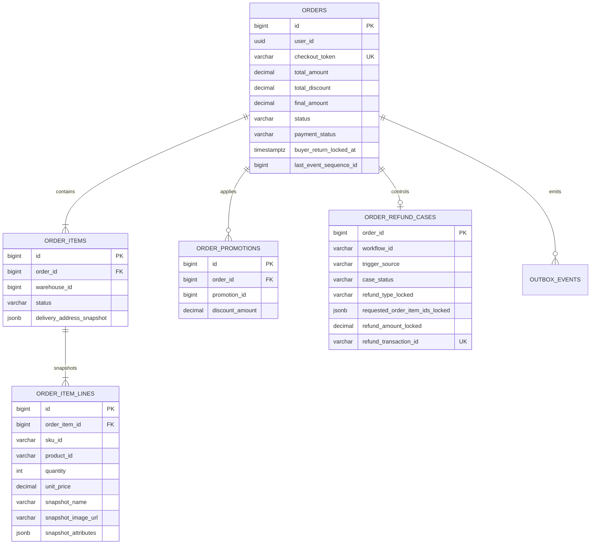

# Order Service — Thiết kế dữ liệu

> Đây là logical/physical design được chuyển từ tài liệu cũ. Các câu SQL minh
> họa không phải migration chuẩn; hiện chưa có migration Order để xác minh.

## 1. Quyền sở hữu dữ liệu

| Store/đối tượng | Dữ liệu | Nguồn chân lý |
|---|---|---|
| PostgreSQL `orders` | Master order, số tiền, FSM, checkout identity, buyer return guard, event sequence | Order Service |
| PostgreSQL `order_items` | Delivery unit theo order/warehouse | Order Service |
| PostgreSQL `order_item_lines` | Snapshot SKU/sản phẩm lúc mua | Order Service |
| PostgreSQL `order_promotions` | Promotion allocation đã áp trên order | Order Service cho snapshot; Promotion sở hữu budget/wallet |
| PostgreSQL `order_refund_cases` | Refund process control plane | Order Service |
| PostgreSQL `outbox_events` | Integration event chưa/đã được CDC quan sát | Order Service |
| View `v_orders_buyer_tab` | Tab dẫn xuất từ Order data | Dẫn xuất, không là source of truth |
| Redis | Request/event dedup và FSM lock có TTL | Dữ liệu tạm; không là source of truth |
| Temporal history | Tiến độ/timer/signal saga | Temporal cho orchestration, không thay Order FSM |

Service khác không ghi database này. Order không sở hữu current Product, User
address book, Inventory reservation/stock, Promotion budget/wallet hay Payment
transaction; chỉ lưu snapshot/identifier cần cho lịch sử và điều phối.

## 2. Mô hình dữ liệu logic



Một order có ít nhất một delivery unit; một delivery unit có ít nhất một line.
Refund case tối đa một record trên mỗi order. Snapshot address ở item cho phép các
kiện trong cùng master order gắn với đơn vị thực hiện theo kho mà không phụ thuộc
address book bị sửa/xóa về sau.

## 3. Schema logic và field

### 3.1. `orders`

| Field | Kiểu | Quy tắc/ý nghĩa |
|---|---|---|
| `id` | `BIGSERIAL` PK | Master order ID |
| `user_id` | `UUID` | Buyer canonical ID |
| `total_amount` | `DECIMAL` | Tổng tiền hàng |
| `total_discount` | `DECIMAL` | Tổng PLATFORM discount |
| `final_amount` | `DECIMAL` | `total_amount - total_discount` |
| `payment_status` | `VARCHAR(50)` | `PENDING/PAID/FAILED/REFUNDING/REFUNDED/REFUND_FAILED`; read/UI denormalized |
| `status` | `VARCHAR(50)` | Master FSM state |
| `checkout_token` | `VARCHAR(255)` unique, not null | Route workflow `order-checkout-{checkout_token}` |
| `cancel_reason` | `TEXT` nullable | `PAYMENT_TIMEOUT`, `USER_CANCEL`, `ADMIN_FORCE_CANCEL`, `PRE_PAYMENT_SAGA_FAILED`, `PAYMENT_FAILED`; workflow sở hữu enum, không DB CHECK |
| `return_reason` | `VARCHAR(100)` nullable | Summary reason ở master; chi tiết per-item ở metadata/scope |
| `buyer_return_locked_at` | `TIMESTAMPTZ` nullable | Permanent first-write-wins guard cho Buyer return |
| `last_event_sequence_id` | `BIGINT NOT NULL DEFAULT 0` | Counter đơn điệu per order cho event Order tự phát |
| `created_at`, `updated_at` | `TIMESTAMPTZ` | Audit timestamps |

Thiết kế search cũ còn đọc `paid_at`, `completed_at`, `cancelled_at`, `refunded_at`
nhưng định nghĩa bảng cũ chưa khai báo. Chúng phải được chốt trong migration trước
khi coi query ở §6 là executable.

Các nguồn field được tham chiếu trực tiếp trong read model gồm `orders.id`,
`orders.status`, `orders.payment_status`, `orders.created_at`,
`orders.total_amount`, `order_items.id`, `order_item_lines.snapshot_name` và
`order_item_lines.snapshot_image_url`.

### 3.2. `order_items`

| Field | Kiểu | Quy tắc/ý nghĩa |
|---|---|---|
| `id` | `BIGSERIAL` PK | Delivery unit ID |
| `order_id` | `BIGINT` FK | Master owner |
| `warehouse_id` | `BIGINT` | Kho xuất hàng |
| `status` | `VARCHAR(50)` | `PROCESSING/DELIVERED/RETURNED` |
| `delivery_address_snapshot` | `JSONB NOT NULL` | `recipient_name`, `recipient_phone`, `address_line`, `province_code`, `district_code`, `ward_code` |

Ward bắt buộc được giữ trong snapshot để thay đổi address/địa giới sau này không
viết lại lịch sử đơn.

### 3.3. `order_item_lines`

| Field | Kiểu | Quy tắc/ý nghĩa |
|---|---|---|
| `id` | `BIGSERIAL` PK | Line identity |
| `order_item_id` | `BIGINT` FK | Delivery unit owner |
| `sku_id`, `product_id` | `VARCHAR(255)` | External identifiers dạng snapshot/reference |
| `quantity` | `INT` | Phải lớn hơn 0 |
| `unit_price` | `DECIMAL` | Giá tại thời điểm mua |
| `snapshot_name` | `VARCHAR(255)` | Tên sản phẩm lúc mua và trường text search duy nhất |
| `snapshot_image_url` | `VARCHAR(255)` | Ảnh lúc mua |
| `snapshot_attributes` | `JSONB` | Ví dụ color/size; nguồn cho variant snapshot khi có |

### 3.4. `order_promotions`

| Field | Kiểu | Quy tắc/ý nghĩa |
|---|---|---|
| `id` | `BIGSERIAL` PK | Row ID |
| `order_id` | `BIGINT` FK | Master owner |
| `promotion_id` | `BIGINT` | Promotion đã áp |
| `discount_amount` | `DECIMAL` | PLATFORM allocation duy nhất |

Bảng này dùng đối soát, release reservation ở pre-payment cancel và compute
refund allocation. Nó không cho phép suy diễn/ghi lại wallet state; cột
`admin_funding` cũ đã bị loại ở Phase 21.

### 3.5. `order_refund_cases`

```sql
CREATE TABLE order_refund_cases (
    order_id BIGINT PRIMARY KEY,
    workflow_id VARCHAR(255) NOT NULL,
    trigger_source VARCHAR(40) NOT NULL,
    case_status VARCHAR(30) NOT NULL
        CHECK (case_status IN ('INITIATED',
          'WAITING_INVENTORY_RETURN_CONFIRMATION',
          'WAITING_PAYMENT_REFUND_RESULT', 'SUCCEEDED', 'FAILED')),
    refund_type_locked VARCHAR(20) NULL
        CHECK (refund_type_locked IN ('FULL', 'PARTIAL')),
    requested_order_item_ids_locked JSONB NOT NULL DEFAULT '[]'::jsonb,
    refund_amount_locked DECIMAL(18,2) NULL,
    refund_transaction_id VARCHAR(120) NULL UNIQUE,
    started_at TIMESTAMPTZ NOT NULL DEFAULT NOW(),
    scope_locked_at TIMESTAMPTZ NULL,
    inventory_return_confirmed_at TIMESTAMPTZ NULL,
    resolved_at TIMESTAMPTZ NULL,
    updated_at TIMESTAMPTZ NOT NULL DEFAULT NOW()
);
```

Trigger hợp lệ: `API_RETURN` hoặc `REQUEST_ADMIN_REFUND`. Scope/amount được khóa
một lần. Chỉ tạo `refund_transaction_id` sau `inventory_return_confirmed_at`.
Terminal state là `SUCCEEDED|FAILED`; `REVERSED` cũ đã gộp vào `FAILED`.

### 3.6. `outbox_events`

| Field | Kiểu | Quy tắc |
|---|---|---|
| `event_id` | `UUID` PK | Event identity |
| `schema_version` | `INT NOT NULL DEFAULT 1` | Version envelope |
| `aggregate_type` | `VARCHAR(50)` | `Order` hoặc `OrderItem` |
| `aggregate_id` | `VARCHAR(255)` | ID theo aggregate |
| `event_type` | `VARCHAR(100)` | Event business type |
| `partition_key` | `VARCHAR(255) NOT NULL` | `order_id` cho `t.order.events` |
| `payload` | `JSONB NOT NULL` | Payload tối thiểu có version theo thiết kế |
| `created_at` | `TIMESTAMPTZ NOT NULL` | CDC/retention ordering |

Không có `status`/`retry_count`; connector chịu retry, DLQ và backoff. Mỗi insert
outbox cấp order phải tăng `orders.last_event_sequence_id` và ghi sequence vào
payload trong cùng transaction. `ORDER_COMPLETED` v1 dùng CloudEvents `sequence`.
Identity chuẩn của row là `outbox_events.event_id`; payload lifecycle thông thường
ghi `payload.last_event_sequence_id`.

## 4. Ràng buộc và chỉ mục

- PK/FK theo mô hình §2; `orders.checkout_token` unique; refund case PK theo
  `order_id`; `refund_transaction_id` unique nullable.
- `quantity > 0`, số tiền không âm và công thức final amount cần DB/domain
  constraint nhưng thiết kế cũ chưa cung cấp DDL cụ thể.
- Index `idx_outbox_created_at(created_at DESC)` phục vụ retention.
- Index `idx_order_refund_cases_status_updated(case_status, updated_at DESC)` phục
  vụ worker/Ops tìm case treo.
- Search indexes:

```sql
CREATE EXTENSION IF NOT EXISTS pg_trgm;
CREATE EXTENSION IF NOT EXISTS unaccent;

CREATE INDEX idx_orders_buyer_created_id
  ON orders (user_id, created_at DESC, id DESC);
CREATE INDEX idx_orders_created_id
  ON orders (created_at DESC, id DESC);
CREATE INDEX idx_orders_status_payment_created
  ON orders (status, payment_status, created_at DESC, id DESC);
CREATE INDEX idx_orders_final_amount_created
  ON orders (final_amount, created_at DESC, id DESC)
  WHERE final_amount IS NOT NULL;
CREATE INDEX idx_oil_snapshot_name_search
  ON order_item_lines USING gin
  (lower(unaccent(snapshot_name)) gin_trgm_ops);
```

GIN trigram dự kiến tốn khoảng 3–5 lần kích thước cột gốc; cần theo dõi disk.

## 5. Ranh giới transaction và xử lý đồng thời

- `CreateOrderActivity`: master + items + lines + promotions + `ORDER_CREATED`.
- Mỗi master/item transition: lock/check old state, update, tăng sequence nếu cần,
  insert outbox và commit cùng nhau.
- Auto-complete: khóa/check tất cả item, CAS master `PROCESSING -> COMPLETED`, chỉ
  insert event khi affected row bằng 1.
- Buyer return guard dùng:

```sql
UPDATE orders
SET buyer_return_locked_at = NOW()
WHERE id = :order_id AND buyer_return_locked_at IS NULL
RETURNING id;
```

- Isolation level chưa được chốt. Row-level lock/CAS là yêu cầu thiết kế để chống
  lost update; không còn `version`/optimistic locking.
- Remote activity nằm ngoài transaction. Temporal retry/compensation và stable
  idempotency key duy trì eventual consistency.

## 6. Query patterns và read model PostgreSQL

### 6.1. Detail

Detail eager-load `orders -> order_items -> order_item_lines` và left join
`order_promotions`, sau đó authorization theo `user_id` hoặc Admin. Response dự
kiến denormalize `items[].lines[]`, `promotions[]`, `status_history[]`; nguồn dữ
liệu cho `status_history[]` chưa được thiết kế.

### 6.2. Buyer tab view

```sql
CREATE OR REPLACE VIEW v_orders_buyer_tab AS
SELECT o.id AS order_id, o.user_id, o.status AS order_status,
       o.payment_status, o.created_at, o.final_amount,
       CASE
         WHEN o.status = 'PENDING_PAYMENT' THEN 'TO_PAY'
         WHEN o.status IN ('PAID','PROCESSING')
          AND NOT EXISTS (SELECT 1 FROM order_items oi
                          WHERE oi.order_id=o.id AND oi.status='DELIVERED')
          THEN 'TO_SHIP'
         WHEN o.status IN ('PAID','PROCESSING')
          AND EXISTS (SELECT 1 FROM order_items oi
                      WHERE oi.order_id=o.id AND oi.status='DELIVERED')
          THEN 'TO_RECEIVE'
         WHEN o.status = 'COMPLETED' THEN 'COMPLETED'
         WHEN o.status = 'CANCELLED' THEN 'CANCELLED'
         ELSE 'RETURN_REFUND'
       END AS buyer_tab
FROM orders o;
```

### 6.3. Search class A và B

- Class A lọc buyer/admin, time range, tab, order/payment statuses, min/max amount
  trực tiếp trên `orders`; card field derive bằng `COUNT(order_items)`,
  `MIN(snapshot_name)`, `MIN(snapshot_image_url)` và constant `'PLATFORM'`.
- Class B trước hết lấy `DISTINCT order_id` từ line có
  `lower(unaccent(snapshot_name)) LIKE '%' || lower(unaccent(:q)) || '%'`, rồi áp
  cùng filter class A. Chỉ tìm theo snapshot product name.
- Mỗi class chạy total count riêng với cùng filter nhưng bỏ cursor/limit.
- Visibility: Buyer bắt buộc filter `user_id`; Admin bỏ filter này.
- Default time window là 90 ngày nếu client không truyền `from/to`.
- Keyset cursor base64 của `(created_at_iso, order_id)`; predicate tuple `<`, sort
  `created_at DESC, id DESC`, lấy `limit+1` để tạo `next_cursor`.
- Kết quả là một card trên mỗi order, không trả matched line context.

Tên field card đầy đủ cần giữ gồm `item_count`, `remaining_item_count`,
`primary_item_name`, `primary_item_image_url`, `primary_store_name`,
`ui_primary_status` và `ui_status_rank`. `visibility_scope` được dựng từ role chứ
không nhận trực tiếp từ public client.

Không có tokenization, fuzzy/Levenshtein, autocomplete, highlight hoặc relevance
ranking. Kết quả luôn theo thời gian/ID giảm dần. View inline và subquery card có
thể cần materialized view chỉ sau benchmark/ADR mới.

## 7. Redis, outbox và idempotency storage

| Mục đích | Key | TTL/hành vi |
|---|---|---|
| Create request mirror | `order:req:create:{checkout_token}` | 7 ngày; WorkflowID là dedup chính |
| Cancel request | `order:req:cancel:{idempotency_key}` | 7 ngày; conflict hoặc replay payload nếu lưu |
| Return request | `order:req:return:{idempotency_key}` | 7 ngày; không thay one-shot guard |
| FSM lock | `order:lock:fsm:{orderId}` | 10 giây; correctness vẫn dựa DB |
| Payment signal | `payment:signal:{order_id}:{payment_transaction_id}:{event_type}` | 30 ngày |
| Inventory ship | `inventory:ship:applied:{order_id}:{warehouse_id}:{shipped_at}` | 30 ngày |
| Inventory return | `inventory:return:confirm:{order_id}:{refund_request_id}` | 30 ngày |

Hai bảng cũ `order_request_idempotency` và `order_event_idempotency` đã bị loại ở
Phase 22. Không có durable inbox. Duplicate ngoài TTL/mất Redis phải vô hại nhờ
WorkflowID, refund case uniqueness và FSM CAS.

Thiết kế trước Phase 21 từng có `order_product_metrics`, counter per-product và
event `ORDER_PRODUCT_METRICS_UPDATED`; toàn bộ đã bị loại cùng worker
`order-metrics-projector` và topic `t.search.metrics.events` vì Search không còn
cần `product_sold_count`.

## 8. Vòng đời dữ liệu, migration và reconciliation

- Outbox trimmer chạy hàng ngày (ví dụ 04:00), xóa row cũ hơn 15 ngày chỉ khi CDC
  watermark đã vượt xa dữ liệu sắp xóa.
- Thiết kế Phase 16 giữ toàn bộ order trong OLTP; không còn cold archive/cutoff.
- Trước khi drop bảng idempotency cũ, backfill Buyer guard:

```sql
UPDATE orders o
SET buyer_return_locked_at = ori.locked_at
FROM order_request_idempotency ori
WHERE ori.resource_id = o.id::varchar
  AND ori.action_type = 'REQUEST_RETURN_GUARD'
  AND ori.status = 'COMPLETED'
  AND o.buyer_return_locked_at IS NULL;
```

- Sau backfill mới drop `order_request_idempotency` và
  `order_event_idempotency`.
- Backup/restore, schema version rollout, online index strategy, order retention,
  reconciliation outbox-với-Kafka và repair refund case chưa được thiết kế.

## 9. Bảo mật và quyền riêng tư

`user_id`, recipient name/phone và full delivery address là PII. Không log raw
`delivery_address_snapshot`, payment client secret, phone hoặc refund reason detail.
DB/Redis/Kafka/Temporal cần encryption in transit và access control theo service
identity; encryption at rest, masking, audit retention và GDPR handling chưa được
chốt. Order snapshot là lịch sử giao dịch nên không được tự động sửa theo User
address book; chính sách xóa/anonymize phải được quyết định riêng.
