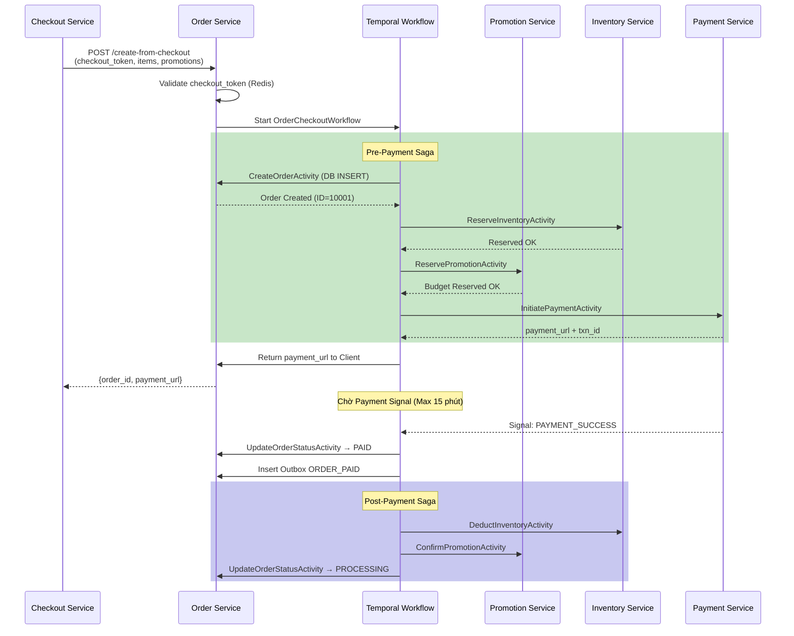

# Order Service - Quy Trình Hoạt Động (Workflows & API Data Flow)

**Liên kết nhanh (Related Documents):**
*   [Database Schema](order_db_design.md)
*   [Temporal Saga Design](temporal_saga_design.md)
*   [CQRS & Elasticsearch](cqrs_elasticsearch_design.md)
*   [Cold Data Archiving](cold_data_archiving_design.md)
*   [State Machine & Lifecycle](order_state_machine.md)
*   [Background Workers & Jobs](order_workers.md)
*   [Events Structure & Kafka Topics](order_events.md)

**Cross-Service References:**
*   [Checkout Workflow](../checkout/checkout_workflow.md) — Nguồn gọi tạo Order
*   [Promotion Workflow](../promotion/promotion_workflow.md) — Luồng 4 (Saga TCC)
*   [Inventory Workflow](../inventory/inventory_workflow.md) — Reserve/Deduct/Release
*   [Payment Workflow](../payment/payment_workflow.md) — Initiate/Verify/Refund

---

Tài liệu này mô tả toàn bộ Workflows (luồng xử lý) của Order Service, bao gồm API requests, data flows bên trong, và sự tương tác với các service khác. Mỗi flow ghi rõ tương tác: `[PostgreSQL]`, `[Redis]`, `[Temporal]`, `[Kafka]`, `[FSM]`, `[Elasticsearch]`.

---

## 1. API: Get Order Detail (`GET /v1/orders/{orderId}`)

**Ngữ cảnh:** Buyer hoặc admin xem chi tiết một đơn hàng cụ thể. Luồng đọc chuẩn là hot-first (`PostgreSQL`) rồi fallback cold qua metadata lookup.

1. **[API Gateway]** Xác thực JWT Token. Extract `user_id`.
2. **[Backend]** Query PostgreSQL nóng bằng Eager Loading:
   ```sql
   SELECT o.*, oi.*, oil.*, opr.*
   FROM orders o
   JOIN order_items oi ON oi.order_id = o.id
   JOIN order_item_lines oil ON oil.order_item_id = oi.id
   LEFT JOIN order_promotions opr ON opr.order_id = o.id
   WHERE o.id = :orderId;
   ```
   Đồng thời query `order_status_history` theo `order_id` để hydrate timeline trạng thái trong response.
3. **[Hot-hit Path]** Nếu tìm thấy bản ghi ở DB nóng, thực hiện **Authorization Check**:
   - Buyer: `o.user_id = :current_user_id` → Cho phép.
   - Admin: Full access.
4. **[Hot-miss Path]** Nếu DB nóng không có dữ liệu:
   - Tra `archived_orders_lookup` theo `order_id` để lấy `s3_file_key`.
   - Nếu miss tiếp -> trả `404`.
   - Nếu hit -> gọi cold-read adapter (S3/Parquet/JSON) để hydrate payload chi tiết.
5. **[Authorization Check - Cold Path]** Áp cùng rule phân quyền buyer/admin/admin trên snapshot trả về.
6. **[Response]** Trả JSON denormalized thống nhất schema giữa hot và cold (`items[] > lines[]`, `promotions[]`, `status_history[]`).

---

## 2. API: Search/Filter Orders (`GET /v1/orders/search`)

**Ngữ cảnh:** Buyer xem danh sách đơn hàng (history), admin xem đơn hàng cần xử lý, Admin Dashboard.

1. **[API Gateway]** Xác thực JWT và dựng `visibility_scope`:
    - Buyer -> filter theo `buyer_id`.
    - Admin -> full scope theo tenant.
2. **[Backend]** Chuẩn hóa query params thành 2 query classes (xem [CQRS Design](cqrs_elasticsearch_design.md#1-mục-tiêu-nghiệp-vụ-và-query-classes)) và áp chuẩn product contract:
   - Tab buyer cố định: `TO_PAY`, `TO_SHIP`, `TO_RECEIVE`, `COMPLETED`, `CANCELLED`, `RETURN_REFUND`.
   - Nếu thiếu `from/to` thì mặc định `created_at` trong `90 ngày` gần nhất.
   - Nếu có `q`, semantics là **ANY field** (`product name` hoặc `store name`).

### 2.1. Query Class A - Lọc đa chiều chính xác

3. **[Backend -> Elasticsearch `orders_read`]** Nếu request không có text query (`q` rỗng), gọi thẳng index order-level:
    ```json
    {
       "query": {
          "bool": {
             "filter": [
                {"term": {"buyer_id": "999"}},
                {"term": {"buyer_tab": "TO_RECEIVE"}},
                {"terms": {"order_status": ["PAID", "PROCESSING"]}},
                {"terms": {"payment_status": ["PAID"]}},
                {"range": {"created_at": {"gte": "now-90d/d", "lte": "now"}}},
                {"range": {"final_amount": {"gte": 100000, "lte": 3000000}}}
             ]
          }
       },
       "sort": [
          {"created_at": "desc"},
          {"order_id": "desc"}
       ],
       "size": 20,
       "search_after": ["2026-02-28T10:00:00Z", "10001"]
    }
    ```
   4. **[Elasticsearch]** Trả `hits.total` chính là tổng đơn.
   5. **[Response]** Trả `total_orders`, `items[]`, `next_cursor`; mỗi phần tử `items[]` là **order-level card** (không phải line-level).

### 2.2. Query Class B - Text search + Filter

6. **[Backend -> Elasticsearch `order_search_lines`]** Nếu có `q`, chạy chiến lược exact-first:
    - Ưu tiên exact/prefix cho `store_name_normalized`.
    - Match/match_phrase cho `snapshot_product_name`.
      - Chỉ cần khớp một trường là đủ (`minimum_should_match = 1`).
    - Kết hợp toàn bộ filter của Query Class A trong `filter` context.

7. **[Elasticsearch]** Query line-level có `collapse` theo `order_id`:
    - `hits.total`: tổng line match.
    - `aggs.total_orders` (cardinality): tổng đơn match.
    - `inner_hits.matched_lines`: line match + highlight.

8. **[Backend -> Elasticsearch `orders_read`]** Hydrate order summary theo danh sách `order_id` vừa match.
9. **[Response]** Trả:
    - `total_orders`
    - `matched_lines_count`
    - `items[]` (order summary + highlights + `match_reason`)
    - `next_cursor`
      - `items[]` phải dùng card semantics: item đại diện + số lượng item còn lại + trạng thái hiển thị chính

10. **[Fallback]** Nếu exact-first hit thấp hơn ngưỡng cấu hình, backend tự chạy thêm fuzzy query (`multi_match`) rồi merge kết quả theo score/rule.

### 2.3. Request/Response contract (chuẩn hóa UI)

- Query params bắt buộc theo ngữ cảnh buyer: `tab`, `q`, `from`, `to`, `cursor`, `limit`.
- `tab` mặc định `ALL` nếu client không truyền, nhưng trong UI mobile buyer tab luôn là một trong 6 tab chuẩn.
- Response mỗi order card cần có tối thiểu:
   - `order_id`, `buyer_tab`, `ui_primary_status`, `created_at`
   - `primary_item_name`, `primary_item_image_url`, `remaining_item_count`
   - `primary_store_name`
   - `item_count`, `final_amount`
- Khi có `q`, trả thêm `match_reason` và `matched_context[]` để frontend highlight đúng vị trí match.
- Nếu `from/to` vượt quá hot window 90 ngày, backend phải chuyển sang nhánh cold-data query theo [Cold Data Archiving](cold_data_archiving_design.md) thay vì ép query sâu trên index nóng.

> **Tại sao Elasticsearch?** Xem [CQRS Design](cqrs_elasticsearch_design.md). PostgreSQL JOIN 4 bảng với LIMIT/OFFSET trên triệu rows sẽ cực kỳ chậm.

---

## 3. API: Cancel Order (`POST /v1/orders/{orderId}/cancel`)

**Ngữ cảnh:** Buyer hủy đơn chưa thanh toán, hoặc Admin force refund khi đơn đã thu tiền.

1. **[API Gateway]** Xác thực JWT + Rate Limiting.
2. **[Request Idempotency]** Nếu client gửi `Idempotency-Key`:
   - Fast path: Redis `SETNX order:req:cancel:{idempotency_key}`.
   - Durable path: upsert/check `order_request_idempotency` với:
     - `action_type = CANCEL_ORDER` cho lane pre-payment.
     - `action_type = REQUEST_ADMIN_REFUND` cho lane admin force refund.
   - Nếu request đã `COMPLETED` thì replay response cũ.
   - Nếu request đang `IN_PROGRESS` thì replay `202` kèm `workflow_id` hiện tại.
3. **[Backend → Redis]** Acquire Distributed Lock: `order:lock:fsm:{orderId}` TTL 10s.
4. **[Backend → PostgreSQL]** Load order + verify FSM:
   ```sql
   SELECT status, version FROM orders WHERE id = :orderId FOR UPDATE;
   ```
   - Buyer cancel: chỉ hợp lệ khi `status = PENDING_PAYMENT`.
   - Admin:
     - `status = PENDING_PAYMENT` -> **Branch A (Cancel pre-payment)**.
     - `status IN (PAID, PROCESSING)` -> **Branch B (Force refund lane)**.
   - Nếu không hợp lệ -> `409 Conflict`.
5. **[Branch A - Pre-payment Cancel]** Signal checkout workflow hiện tại: `workflowStub.signal("CancelOrder", reason)`.
6. **[Temporal - Branch A]** Checkout workflow tự thực thi compensation pre-payment (`CancelPayment` -> `RollbackPromotion` -> `RollbackInventory` -> `CancelOrder`), sau đó mới commit `orders.status = CANCELLED` và insert outbox `ORDER_CANCELLED`.
7. **[Branch B - Paid/Processing]** **Không** signal `CancelOrder` vào checkout workflow cũ. API start `OrderRefundWorkflow` với `reason = ADMIN_FORCE_REFUND_REQUESTED`.
8. **[Temporal - Branch B]** Refund workflow mới là nơi commit FSM `PAID/PROCESSING -> RETURN_REQUESTED`, insert outbox `ORDER_STATUS_CHANGED` (`reason = ADMIN_FORCE_REFUND_REQUESTED`), lock refund scope, đăng ký refund-return scope với Inventory và chờ Inventory xác nhận nhận đủ hàng trước khi gọi Payment refund API.
9. **[Idempotency Persist]** Lưu kết quả command accepted dưới dạng `status = IN_PROGRESS` kèm `workflow_id` để replay response ổn định.
10. **[Response]** `202 Accepted` (asynchronous command accepted), không trả `200` kiểu đã hoàn tất nghiệp vụ.

---

## 3.1. API: Return Order (`POST /v1/orders/{orderId}/return`)

**Ngữ cảnh:** Buyer gửi yêu cầu đổi/trả sau giao hàng. API này dùng chính sách **one-shot theo customer**: mỗi order chỉ chấp nhận đúng 1 lần submit từ Buyer API.

1. **[API Gateway]** Xác thực JWT, bắt buộc vai trò Buyer, áp Rate Limiting.
2. **[Request Contract]** Header `Idempotency-Key` là bắt buộc. Body chuẩn:
   - `refund_type`: `FULL` hoặc `PARTIAL`.
   - `items_to_return[]`: bắt buộc khi `refund_type = PARTIAL`.
   - `reason`, `reason_details`.
3. **[Request Idempotency]**
   - Fast path: Redis `SETNX order:req:return:{idempotency_key}`.
   - Durable path: `order_request_idempotency` với `action_type = REQUEST_RETURN`.
   - Nếu cùng key đã `COMPLETED` thì replay response cũ.
   - Nếu cùng key đang `IN_PROGRESS` thì replay `202` kèm `workflow_id` hiện tại.
4. **[Backend → PostgreSQL]** Load order với lock và verify policy/FSM:
   - Buyer phải là chủ order (`orders.user_id = current_user_id`).
   - Order phải thuộc lane cho phép return theo policy hiện hành.
   - Tất cả `order_items` của order phải đang ở trạng thái `DELIVERED`; nếu chưa đủ thì trả `409 REFUND_REQUIRES_ALL_ITEMS_DELIVERED`.
   - Nếu `refund_type = PARTIAL`, `items_to_return[]` phải là tập con hợp lệ của item thuộc order và không chứa item ngoài tập đã `DELIVERED`.
5. **[One-shot Business Guard - bắt buộc]** Kiểm tra `order_customer_return_guard` theo `order_id`:
   - Nếu chưa có bản ghi: insert first request, cho phép tiếp tục.
   - Nếu đã có bản ghi cho order này: từ chối request mới với `409 REFUND_CUSTOMER_REQUEST_ALREADY_USED`.
   - Guard này độc lập với `Idempotency-Key`; key khác không được bypass one-shot.
6. **[Temporal]** Start `OrderRefundWorkflow` với `reason = RETURN_API_ACCEPTED`, `trigger_source = API_RETURN`, kèm refund scope lấy từ request (`FULL` hoặc `PARTIAL + items_to_return[]`).
7. **[Response]** `202 Accepted` + `refund_request_id` + `workflow_id`.

> [!IMPORTANT]
> **Scope policy:** One-shot chỉ áp cho trigger Buyer API (`POST /v1/orders/{orderId}/return`). Trigger admin (`ADMIN_FORCE_REFUND_REQUESTED`) không bị khóa bởi guard này nhưng vẫn phải đi qua `OrderRefundWorkflow` và FSM guard.

---

## 4. Workflow: Nhận Checkout Submit (Full Saga Flow)

**Ngữ cảnh:** Checkout Service gọi `POST /v1/orders/create-from-checkout`. Đây là luồng phức tạp nhất — Temporal orchestrate toàn bộ. Xem chi tiết Saga tại [Temporal Saga Design](temporal_saga_design.md).



### Bước Chi tiết:

**4.1. Nhận Request từ Checkout:**
1. **[Backend]** Validate `checkout_token` từ Redis: kiểm tra chưa dùng, chưa hết TTL, anti-tamper.
2. **[Request Idempotency]** Dùng `checkout_token` (hoặc header `Idempotency-Key`) làm khóa cho `order_request_idempotency` với `action_type = CREATE_ORDER`.
3. **[Temporal]** Start/Attach `OrderCheckoutWorkflow` với WorkflowID = `order-checkout-{checkout_token}`.
   - Nếu workflow đã tồn tại cùng WorkflowID, replay response từ workflow hiện có thay vì tạo mới.
4. **[Backend]** Chỉ sau khi start/attach thành công mới mark `checkout_token` as USED (SETNX) và persist idempotency `IN_PROGRESS` với `workflow_id`.
    - `order_id` được sinh ngay ở bước `CreateOrderActivity` đầu tiên (4.2 step 1), trước mọi bước reserve liên service.
    - `CreateOrderActivity` bắt buộc persist `checkout_token` vào bảng `orders` cùng transaction tạo đơn để worker có thể route signal theo `order_id`.
   - Payment worker signal workflow qua lookup `checkout_token` theo `order_id` trong DB.

### 4.1.1. Contract Payload `create-from-checkout` (Bắt buộc, versioned)

Order Service nhận payload đã khóa từ Checkout theo schema chuẩn dưới đây. Checkout chỉ gửi identifiers + snapshot đã tính server-side; Order không tin bất kỳ amount do client tự gửi.

```json
{
   "schema_version": 1,
   "checkout_token": "uuid-v4",
   "user_id": "550e8400-e29b-41d4-a716-446655440000",
   "payment_method": "VNPAY",
   "user_ack_degraded_pricing": false,
"delivery_address_snapshot": {
      "name": "Nguyen Van A",
      "phone": "0901234567",
      "address": "123 Nguyen Hue, Q1, HCM",
      "province_code": "HCM",
      "district_code": "Q1",
      "ward_code": "Ben Nghe"
   },
   "items": [
      {
         "order_item_client_ref": "admin-001:line-01",
         "platform_id": 501,
         "warehouse_id": 5,
         "lines": [
           {
              "sku_id": "sku-001",
              "product_id": "prod-001",
              "quantity": 2,
              "unit_price": 250000
           }
        ]
     }
  ],
   "promotions": {
      "selected_platform_voucher_id": 55
   },
   "pricing_summary": {
      "total_product_amount": 500000,
      "total_voucher_discount": 50000,
      "final_amount": 450000
   },
   "pricing_hash": "sha256-...",
   "promotion_rule_version": "2026-03-14T09:00:00Z",
   "promotion_budget_version": "2026-03-14T09:00:02Z"
 }
 ```

  > **Canonical schema source**: [Service Contract Matrix §3.1](../_contracts/CONTRACT_MATRIX.md#31-order--checkout).
  > **Cross-check rule**: Checkout Service phải chuyển `pricing_hash` = SHA-256(`sorted sku_id:unit_price` + `total_voucher_discount` + `promotion_rule_version`).
  > `promotion_budget_version` chỉ mang tính chất telemetry/diagnostics cho Submit staleness check, không tham gia hash gate.
  > `delivery_address_snapshot` lưu trực tiếp từ `checkout:session:{user_id}.delivery_address` tại thời điểm Submit — KHÔNG tham chiếu `address_id` (đã được resolve sẵn ở Preview).
  > `pricing_summary` đã loại bỏ field trùng `total_platform_discount`/`platform_discount` (cũ). Canonical: `total_voucher_discount` cho tổng giảm giá từ voucher.
  > `final_amount = total_product_amount - total_voucher_discount` được sinh tại Preview.

**Validation tối thiểu:**
- `checkout_token`, `user_id`, `payment_method`, `delivery_address_snapshot`, `items[]` là bắt buộc.
- Mọi `items[].lines[]` bắt buộc có `sku_id`, `product_id`, `quantity > 0`, `unit_price`.
- `warehouse_id` là bắt buộc cho từng item.
- `promotions` cho phép rỗng khi `user_ack_degraded_pricing = true`; trong trường hợp này `ReservePromotionActivity` chạy no-op có kiểm soát.

**4.2. Pre-Payment Saga (Temporal Orchestrate):**

| Bước | Activity | Service | Thành công | Compensation (Rollback) |
|:--|:---|:---|:---|:---|
| 1 | `CreateOrderActivity` | Order (self) | INSERT `orders`, `order_items`, `order_item_lines`, `order_promotions` với trạng thái `PENDING_PAYMENT` | `CancelOrderActivity` (mark `CANCELLED`, reason=`PRE_PAYMENT_SAGA_FAILED`) |
| 2 | `ReserveInventoryActivity` | Inventory | Redis Lua Reserve → Kafka Event | `RollbackInventoryActivity` (Release) |
| 3 | `ReservePromotionActivity` | Promotion | Redis Lua Batch Reserve all-or-nothing (Lua Script 2B) | `RollbackPromotionActivity` (Release Budget) |
| 4 | `InitiatePaymentActivity` | Payment | Tạo `payment_transaction`, trả `payment_url` | `CancelPaymentActivity` |

> **Compensation registration order (Pre-Payment):** `CancelOrder` → `RollbackInventory` → `RollbackPromotion` → `CancelPayment`.
> Khi rollback, Temporal chạy theo LIFO: `CancelPayment` → `RollbackPromotion` → `RollbackInventory` → `CancelOrder`.

> [!NOTE]
> **Tại sao Promotion `/reserve` nằm trong Saga chứ không khóa ở Checkout Preview?** Khóa tại Preview tạo lỗ hổng lạm dụng nghiêm trọng: kẻ xấu có thể dùng bot mở hàng loạt checkout session, áp voucher Flash Sale và bỏ trống, làm cạn kiệt budget mà không phát sinh đơn hàng thực sự. `ReservePromotionActivity` chạy ngay tại đây — sau khi user đã commit Submit và `order_id` đã tồn tại — đảm bảo mỗi lần lock budget đều gắn với một giao dịch thực sự. Xem [Promotion Workflow Section 4](../promotion/promotion_workflow.md#4-luồng-thanh-toán-saga-checkout-flow).

> [!IMPORTANT]
> Nếu `ReservePromotionActivity` fail (ví dụ `BUDGET_EXHAUSTED` ở một mã trong batch), Order phải propagate lỗi có cấu trúc (`failed_promotion_id`, `failed_reason`, `reserve_mode=ALL_OR_NOTHING`) về Checkout. Không collapse thành lỗi hạ tầng 500. Order **không** tự tính lại discount; Checkout mới là nơi gọi lại Promotion evaluate để dựng `dropped_promotions[]`, trả `409 PROMOTION_RECALCULATION_NEEDED`, rồi dẫn user đi lại Preview với token mới.

**4.3. Chờ Payment Signal:**
- Temporal Workflow enters `await()` state — chờ Signal từ [Payment Status Consumer](order_workers.md#4-payment-status-consumer-kafka-consumer).
- **Timeout Timer:** 15 phút. Nếu hết → Compensation Stack theo LIFO (`CancelPayment` -> `RollbackPromotion` -> `RollbackInventory` -> `CancelOrder`).
- **Payment Success Signal:** Resume workflow → commit mốc tài chính (`PENDING_PAYMENT` -> `PAID`) và phát `ORDER_PAID` → rồi mới vào Post-Payment Saga.
- **Signal acceptance window (checkout workflow):** Chỉ nhận Payment signal khi workflow còn ở trạng thái `WAITING_PAYMENT`.
- Nếu signal `PAYMENT_SUCCESS` đến sau khi checkout workflow đã timeout/close, worker **không được drop**; thay vào đó phải route qua lane khôi phục thanh toán muộn (`OrderLatePaymentRecoveryWorkflow`).

**4.3.1. Mốc tài chính (`PENDING_PAYMENT` -> `PAID`):**
1. **[Temporal Activity]** `UpdateOrderStatusActivity` thực hiện transition FSM `PENDING_PAYMENT` -> `PAID` với optimistic locking.
2. **[Outbox - cùng transaction DB]** Insert `ORDER_PAID` vào `outbox_events` (`partition_key = order_id`) để CDC publish.
3. Chỉ khi commit thành công cả status + outbox thì workflow mới đi tiếp sang mốc vận hành ở Bước 4.4.

**4.4. Post-Payment Saga (Sau khi nhận Payment Success):**

| Bước | Activity | Service | Mô tả | Compensation |
|:--|:---|:---|:---|:---|
| 1 | `DeductInventoryActivity` | Inventory | Chuyển Reserved → Deducted (commit stock movement) | `RollbackDeductedInventoryActivity` |
| 2 | `ConfirmPromotionActivity` | Promotion | Commit reservation trong Redis + ghi ledger `coupon_usages.status = REDEEMED` (bắt buộc truyền `idempotency_key` theo từng `promotion_id`) | `CancelConfirmedPromotionActivity` |
| 3 | `UpdateOrderStatusActivity` | Order (self) | FSM `PAID` → `PROCESSING` | `RevertOrderStatusToPaidActivity` |

> **Compensation registration order (Post-Payment):** `RollbackDeductedInventory` → `CancelConfirmedPromotion` → `RevertOrderStatusToPaid`.
> Khi rollback, Temporal chạy LIFO: `RevertOrderStatusToPaid` → `CancelConfirmedPromotion` → `RollbackDeductedInventory`.

> **Tách semantics bắt buộc:**
> - `RollbackPromotionActivity`: chỉ dùng lane pre-payment (release reservation runtime).
> - `CancelConfirmedPromotionActivity`: chỉ dùng lane post-payment khi promotion đã `REDEEMED`; phải gọi Promotion API hủy commit với idempotency key theo từng `promotion_id`.

> [!IMPORTANT]
> **Contract Idempotency-Key khi gọi Promotion (sync path):**
> 1. `ConfirmPromotionActivity` phải truyền `idempotency_key` theo từng `promotion_id` (không dùng 1 key chung cho nhiều promotion).
> 2. `RollbackPromotionActivity` phải truyền `idempotency_key` theo từng `promotion_id`.
> 3. Nếu bật nhánh sync `/refund` trong Refund workflow, cũng phải truyền `idempotency_key` theo từng `promotion_id`.
> 4. Các key này do Order sinh và giữ ổn định xuyên retry; Promotion dùng trực tiếp làm `promotion_event_idempotency.event_id`.

**4.5. Produce Events sau Saga:**
- `ORDER_CREATED` (sau bước 4.2 step 1 — sau khi `CreateOrderActivity` insert thành công `orders`, `order_items`, `order_item_lines`, `order_promotions`)
- `ORDER_PAID` (sau bước 4.3.1 commit thành công transition `PENDING_PAYMENT` -> `PAID` — **mốc tài chính:** trigger Cart cleanup, Notification, CQRS/Analytics)
- `ORDER_STATUS_CHANGED` với `old_status = PAID`, `new_status = PROCESSING`, `reason = POST_PAYMENT_SAGA_COMPLETE` (sau bước 4.4 step 4)

---

## 5. Workflow: Xử Lý Payment Signal & Late Payment Recovery

**Ngữ cảnh:** Kafka Consumer nhận `PAYMENT_SUCCESS` / `PAYMENT_FAILED` từ Payment Service.

1. **[Kafka Consumer]** Nhận event từ `t.payment.events`. Xem [Payment Status Consumer](order_workers.md#4-payment-status-consumer-kafka-consumer).
2. **[Idempotency Check]**
   - Fast path: Redis `SETNX payment:signal:{order_id}:{payment_transaction_id}:{event_type}` TTL 30 phút.
   - Durable path: upsert/check `order_event_idempotency` theo `event_id + action_type + action_scope_key`.
3. **[Temporal Signal Routing]**
   - `PAYMENT_SUCCESS|PAYMENT_FAILED|PAYMENT_EXPIRED`: lookup `checkout_token` theo `order_id` rồi signal `workflowClient.newSignalStub("order-checkout-{checkout_token}").paymentResult(signalPayload)`.
   - Nếu `PAYMENT_SUCCESS` không thể signal vào checkout workflow (workflow đã close) và order đang `CANCELLED` với `reason = PAYMENT_TIMEOUT`, worker phải start `OrderLatePaymentRecoveryWorkflow` theo `order_id`.
   - `REFUND_SUCCESS|REFUND_FAILED|REFUND_REVERSED`: signal `workflowClient.newSignalStub("order-refund-{order_id}").refundResult(signalPayload)`.
4. **[Temporal Workflow Resume]:**
   - SUCCESS (checkout workflow đang active) → Commit mốc tài chính (`PENDING_PAYMENT` -> `PAID`) + produce `ORDER_PAID`, sau đó chạy Post-Payment Saga (Bước 4.4 ở trên).
   - SUCCESS đến muộn (checkout timeout trước đó) → chạy `OrderLatePaymentRecoveryWorkflow`:
     - khôi phục order từ `CANCELLED(PAYMENT_TIMEOUT)` về lane đã thu tiền,
     - phát lại mốc tài chính (`ORDER_PAID`, gắn cờ recovery),
       - re-reserve inventory trước khi deduct (hoặc đảm bảo `RecoverPaidOrderFromTimeoutActivity` đã khôi phục reservation hợp lệ),
       - chạy lại Post-Payment Saga để đưa order về `PROCESSING`.
     - nếu recovery lane thất bại ở bước bắt buộc, chuyển sang lane refund tự động để hoàn tiền.
   - FAILED/EXPIRED → Chạy Compensation Stack pre-payment, sau đó checkout workflow mới commit `CANCELLED` và produce `ORDER_CANCELLED`.
   - REFUND_SUCCESS/REFUND_FAILED/REFUND_REVERSED → worker route theo `order_id` để signal `OrderRefundWorkflow`; refund workflow commit FSM/payment_status và produce `ORDER_REFUNDED` hoặc `ORDER_REFUND_FAILED`.

> [!WARNING]
> **Race Condition:** Payment Signal có thể đến **cùng lúc** với Temporal Timer timeout 15 phút. Temporal Framework giải quyết bằng cơ chế quyết định đơn: chỉ 1 nhánh (signal hoặc timer) được commit vào workflow history.
>
> - Nếu Signal đến trước → Timer bị cancel, checkout workflow đi success path bình thường.
> - Nếu Timer fire trước → checkout workflow đóng nhánh timeout; signal `PAYMENT_SUCCESS` đến sau phải đi qua lane `OrderLatePaymentRecoveryWorkflow` thay vì bị bỏ qua.

> **Race Mitigation Contract:** Trước khi commit khuyến mãi, `ConfirmPromotionActivity` phải gia hạn reservation key thêm 60 giây grace-window rồi mới xác nhận `REDEEMED`. Mục tiêu là tránh va chạm biên giữa Payment success, Timer timeout, và Promotion sweep.

---

## 6. Workflow: Xử Lý Inventory Ship-To-Customer Signal

**Ngữ cảnh:** Admin xác nhận kho đã xuất hàng cho khách → Inventory phát `INVENTORY_SHIP_TO_CUSTOMER` → Order Service consumer cập nhật Order Item FSM `PROCESSING` → `DELIVERED`.

1. **[Kafka Consumer]** Nhận `INVENTORY_SHIP_TO_CUSTOMER` từ `t.inventory.events`. Xem [Inventory Ship Consumer](order_workers.md#5-inventory-ship-consumer-kafka-consumer).
2. **[FSM Validation]** Kiểm tra transition hợp lệ theo [Order Item Delivery FSM](order_state_machine.md#2-order-item-delivery-fsm).
3. **[PostgreSQL]** Update `order_items.status = DELIVERED` + increment `version`.
4. **[Auto-Complete Check]** Nếu tất cả items `DELIVERED` ổn định trong cửa sổ coalescing 5 giây → Master Order FSM `PROCESSING` → `COMPLETED`.
5. **[Outbox]** Insert append-only `outbox_events` cho `ORDER_ITEM_STATUS_CHANGED` và/hoặc `ORDER_COMPLETED` (`partition_key = order_id`) để CDC publish.

---

## 7. Workflow: Timeout & Auto-Cancel (Temporal Timer)

**Ngữ cảnh:** User không thanh toán trong 15 phút.

1. **[Temporal Timer]** `workflow.newTimer(Duration.ofMinutes(15))` chạy song song với `await(paymentSignal)`.
2. **[Timer Fires]** Temporal trigger Compensation Stack theo thứ tự LIFO:
   - `CancelPaymentActivity` → Hủy pending payment.
   - `RollbackPromotionActivity` → Nhả reservation budget của voucher (gọi sync sang Promotion với `idempotency_key` theo từng `promotion_id`, không đổi trạng thái ví DB ở nhánh pre-payment cancel).
   - `RollbackInventoryActivity` → Nhả reserved stock.
   - `CancelOrderActivity` → Đánh dấu đơn `CANCELLED` với reason `PAYMENT_TIMEOUT`.
3. **[FSM]** Update `orders.status = 'CANCELLED'`, `reason = 'PAYMENT_TIMEOUT'`.
4. **[Outbox]** Insert append-only `outbox_events` cho `ORDER_CANCELLED` (`partition_key = order_id`) để CDC publish.
5. **[Late Payment Contract]** Nếu Payment Service xác nhận `PAYMENT_SUCCESS` sau khi timeout cancel đã commit, worker phải kích hoạt lane khôi phục thanh toán muộn để đưa đơn quay lại đường thành công hoặc auto-refund nếu không thể phục hồi vận hành.

---

## 8. Workflow: Refund/Return Flow

**Ngữ cảnh:** Luồng hoàn tiền thống nhất cho cả `return` sau giao hàng và `admin force refund` khi đơn đã thu tiền.

1. **[Trigger]** Có 2 nguồn trigger hợp lệ để mở refund workflow:
   - User API: `POST /v1/orders/{orderId}/return` (bắt buộc `Idempotency-Key`, `action_type = REQUEST_RETURN`, áp one-shot customer guard).
   - Admin lane từ `POST /v1/orders/{orderId}/cancel`: với `status IN (PAID, PROCESSING)` tạo command `REQUEST_ADMIN_REFUND`.
- `SHIPMENT_RETURNED` **không** còn tồn tại (Phase 14 đã loại bỏ Shipping Service). Trigger restock vật lý là admin API `/v1/inventory/restock` hoặc `/v1/inventory/returns/refund-expectations`.
    - **Policy B (đã chốt):** Mỗi order chỉ có **một** refund transaction do Order khởi tạo.

2. **[Temporal - bắt buộc]** Start `OrderRefundWorkflow` (không có inline path):
   - Validate FSM + policy + `trigger_source`.
   - Nếu `trigger_source = API_RETURN`: bắt buộc pass one-shot guard ở DB trước khi start workflow và phải thỏa precondition tất cả item đã `DELIVERED`.
   - Transition master order sang `RETURN_REQUESTED` với reason phù hợp (`RETURN_API_ACCEPTED` hoặc `ADMIN_FORCE_REFUND_REQUESTED`).
   - Ghi `order_refund_cases.case_status = WAITING_INVENTORY_RETURN_CONFIRMATION` và lock refund scope theo request đầu vào (`FULL` hoặc `PARTIAL + items_to_return[]`).
   - Produce `ORDER_STATUS_CHANGED` cho transition vào lane refund (kèm metadata `refund_waiting_inventory_confirmation = true`).

3. **[Refund Activities]** Trong `OrderRefundWorkflow`:
- `LockRefundScopeActivity`: chốt `refund_type` + tập item refund từ request customer/admin.
    - `RegisterRefundReturnExpectationActivity`: gửi expected return scope sang Inventory để theo dõi đủ/thiếu hàng hoàn.
    - `WaitInventoryReturnReceivedAllSignal`: chờ signal từ Inventory khi đã nhận đủ toàn bộ item trong refund scope (timeout chuẩn: 30 ngày).
   - Nếu timeout 30 ngày: workflow chuyển `MANUAL_VERIFICATION_REQUIRED`, notify ops, và chỉ tiếp tục khi nhận admin override signal hợp lệ.
   - Nhánh delivery failure tự nhiên: trigger qua admin lane `REQUEST_ADMIN_REFUND` với policy riêng (có thể bypass wait signal sau xác minh thủ công).
   - Chỉ sau khi nhận signal trên mới tính `refund_amount` và gọi Payment Service: `POST /v1/payments/{txn_id}/refund` đúng **1 lần** cho mỗi order.
   - Tại thời điểm gọi Payment refund, chuyển `orders.payment_status` sang `REFUNDING`.
- Rule allocation voucher:
      - `FULL`: hoàn toàn bộ PLATFORM allocation đã redeem.
      - `PARTIAL`: chỉ hoàn PLATFORM allocation khi refund scope bao phủ toàn bộ item của platform đó.
   - Nếu bật sync Promotion `/refund`, bắt buộc truyền `idempotency_key` theo từng `promotion_id`.

4. **[Chờ refund result signal]** Payment consumer nhận `REFUND_PROCESSING|REFUND_SUCCESS|REFUND_FAILED|REFUND_REVERSED` rồi signal `OrderRefundWorkflow` theo `order_id`.

4.1. **[`REFUND_PROCESSING`]** Refund workflow đánh dấu trạng thái chờ:
   - Ghi nhận `orders.payment_status = REFUNDING` (nếu chưa set) để phản ánh lệnh hoàn đã được Gateway tiếp nhận.

5. **[`REFUND_SUCCESS`]** Refund workflow commit:
   - `orders.payment_status = REFUNDED`.
   - FSM `RETURN_REQUESTED` -> `REFUNDED`.
   - Produce `ORDER_REFUNDED` (bắt buộc có `refund_transaction_id` + `promotion_refund_allocations[]` + policy metadata cho partial scope + voucher restore policy).

6. **[`REFUND_FAILED` hoặc `REFUND_REVERSED`]** Refund workflow commit:
   - Update `orders.payment_status = REFUND_FAILED` hoặc `REFUND_REVERSED`.
   - Giữ FSM ở `RETURN_REQUESTED`.
   - Produce `ORDER_REFUND_FAILED` (critical lane) cho Notification/Ops escalation.
   - Nếu lane bắt đầu từ Buyer API, one-shot guard vẫn giữ nguyên (không mở lại quyền submit request mới).

7. **[Voucher không còn khả dụng khi hoàn budget]**
   - Promotion chỉ restore `USED -> SAVED` khi voucher còn hạn (`expired_at > NOW()`) và policy cho phép tái sử dụng.
   - Nếu đã quá hạn tại thời điểm restore, Promotion chuyển `EXPIRED` (hoặc giữ `USED` nếu không có row ví để cập nhật).
   - Nếu voucher unavailable, Promotion ghi nhận failure metadata + cảnh báo vận hành theo chế độ non-blocking.
   - Không rollback giao dịch hoàn tiền đã thành công ở Payment chỉ vì voucher restore fail/unavailable.

8. **[Downstream consume `ORDER_REFUNDED`]**
   - **Promotion:** [Hoàn budget](../promotion/promotion_workflow.md#5-luồng-đổi-trả-hàng--hoàn-tiền-refund-flow) theo `promotion_refund_allocations[]` và rule scope (xem canonical [ADR Refund Voucher Policy](refund_voucher_policy.md)).
   - **Inventory:** Không restock trực tiếp từ `ORDER_REFUNDED`. Restock vật lý đi theo admin API `/v1/inventory/restock` hoặc `/v1/inventory/returns/refund-expectations` sau khi hàng thực tế về kho.

9. **[Policy Matrix]**
   - **Áp dụng one-shot:** `trigger_source = API_RETURN` (Buyer).
   - **Không áp dụng one-shot:** `trigger_source = ADMIN_FORCE_REFUND_REQUESTED`.
   - **Trigger refund:** chỉ từ API_RETURN hoặc ADMIN_FORCE_REFUND_REQUESTED; không có event nào tự động mở refund.
   - **Mục tiêu:** chặn spam submit từ client, tránh multi-refund transaction, và đảm bảo chỉ hoàn tiền sau khi Inventory xác nhận đã nhận đủ hàng hoàn.

---

## TỔNG KẾT

Order Service Workflow kết hợp 3 mô hình kiến trúc:
1.  **Temporal Saga** cho luồng phân tán đa service (Pre-Payment + Post-Payment). Đảm bảo Compensation tự động.
2.  **Event-Driven (Kafka)** cho luồng phản hứng (Payment webhook, Inventory ship-to-customer). Loose coupling giữa services.
3.  **FSM Database Layer** làm chốt chặn cuối cùng (Guard), bảo vệ data integrity dù request đến từ API, Kafka, hay Temporal.
4.  **Recovery Lane cho late payment** để khôi phục đơn khi đã timeout nhưng Payment xác nhận thu tiền thành công.
