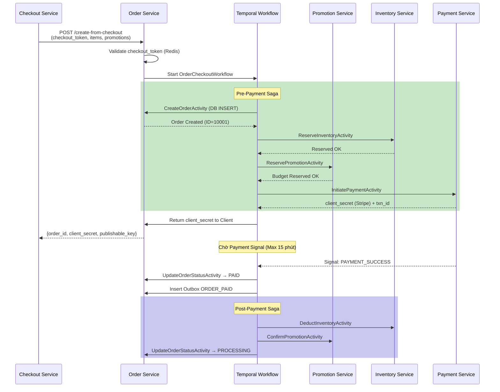

# Order Service - Quy Trình Hoạt Động (Workflows & API Data Flow)

> **Phase 22 (Simplify Idempotency Schema):** Bỏ `order_request_idempotency`. One-shot guard Buyer return giờ là cột `orders.buyer_return_locked_at` (CAS row-level lock). API replay response cho `CREATE_ORDER` rely vào Temporal WorkflowID `order-checkout-{checkout_token}`; các action khác (`CANCEL_ORDER`, `REQUEST_RETURN`, `REQUEST_ADMIN_REFUND`) chỉ dùng Redis SETNX TTL 7 ngày. Xem [CHANGELOG Phase 22](../_contracts/CHANGELOG.md#phase-22--simplify-idempotency-schema-order).

**Liên kết nhanh (Related Documents):**
*   [Database Schema](order_db_design.md)
*   [Temporal Saga Design](temporal_saga_design.md)
*   [Search/Filter Design (PostgreSQL direct)](order_search_design.md)
*   [State Machine & Lifecycle](order_state_machine.md)
*   [Background Workers & Jobs](order_workers.md)
*   [Events Structure & Kafka Topics](order_events.md)

**Cross-Service References:**
*   [Checkout Workflow](../checkout/checkout_workflow.md) — Nguồn gọi tạo Order
*   [Promotion Workflows](../promotion/workflows.md) — Saga TRY/CONFIRM/CANCEL
*   [Inventory Workflows](../inventory/workflows.md) — Reserve/Deduct/Release
*   [Payment Workflow](../payment/payment_workflow.md) — Initiate/Verify/Refund

---

Tài liệu này mô tả toàn bộ Workflows (luồng xử lý) của Order Service, bao gồm API requests, data flows bên trong, và sự tương tác với các service khác. Mỗi flow ghi rõ tương tác: `[PostgreSQL]`, `[Redis]`, `[Temporal]`, `[Kafka]`, `[FSM]`.

> **Phase 20 (Event Payload Simplification):** Event Order produce (ở §4.5) và consume từ Payment/Inventory (ở §5-7) đã được tinh giản theo nguyên tắc "minimum viable" — workflow activity chỉ chốt các field cốt lõi vào outbox payload, không nhúng snapshot/subsidiary data. Ngoại lệ duy nhất là `ORDER_COMPLETED`: contract này phải mang immutable `items[]` snapshot để Review cấp entitlement mà không gọi đồng bộ Order/Product. Xem [CHANGELOG Phase 20](../_contracts/CHANGELOG.md#phase-20--event-payload-simplification-order--payment--inventory--promotion--cart) và [Order Events](order_events.md#3-chi-tiết-các-loại-event-phát-đi-produced-events) cho schema chi tiết.

---

## 1. API: Get Order Detail (`GET /v1/orders/{orderId}`)

**Ngữ cảnh:** Buyer hoặc admin xem chi tiết một đơn hàng cụ thể. Luồng đọc chuẩn là hot-only (PostgreSQL).

1. **[API Gateway]** Xác thực JWT Token. Extract `user_id`.
2. **[Backend]** Query PostgreSQL nóng bằng Eager Loading:
   ```sql
   SELECT o.*, oi.*, oil.*, opr.*
   FROM orders o
   JOIN order_items oi ON oi.order_id = o.id
   JOIN order_item_lines oil ON oil.order_item_id = oi.id
   LEFT JOIN order_promotions opr ON opr.order_id = o.id
   WHERE o.id = :orderId;
   ```
3. **[Authorization Check]** Nếu tìm thấy bản ghi ở DB nóng, thực hiện **Authorization Check**:
   - Buyer: `o.user_id = :current_user_id` → Cho phép.
   - Admin: Full access.
4. **[Response]** Trả JSON denormalized thống nhất schema (`items[] > lines[]`, `promotions[]`, `status_history[]`). Nếu không tìm thấy bản ghi, trả `404 NOT_FOUND`.

---

## 2. API: Search/Filter Orders (`GET /v1/orders/search`)

**Ngữ cảnh:** Buyer xem danh sách đơn hàng (history), admin xem đơn hàng cần xử lý, Admin Dashboard.

1. **[API Gateway]** Xác thực JWT và dựng `visibility_scope`:
   - Buyer → filter theo `user_id` (UUID).
   - Admin → full scope (không filter `user_id`).
2. **[Backend]** Chuẩn hóa query params:
   - Tab buyer cố định: `TO_PAY`, `TO_SHIP`, `TO_RECEIVE`, `COMPLETED`, `CANCELLED`, `RETURN_REFUND`. `tab` mặc định `ALL` nếu client không truyền.
   - Nếu thiếu `from/to` thì mặc định `created_at` trong `90 ngày` gần nhất.
   - `q` (optional): chỉ chạy theo `snapshot_product_name` của order items, substring accent-insensitive.

### 2.1. Query Class A — Multi-dimensional filter (không có `q`)

3. **[Backend -> PostgreSQL]** Query thẳng bảng `orders` với B-tree composite index. **SQL đầy đủ xem [Search/Filter Design §3.1](order_search_design.md#3-query-class-a--multi-dimensional-filter)** (canonical, gồm CTE `filtered`, subquery card fields, view `v_orders_buyer_tab`).

4. **[Backend]** `total_orders` chạy riêng với cùng WHERE (không áp cursor + LIMIT). **SQL xem [Search/Filter Design §3.2](order_search_design.md#32-total-count-chạy-riêng)**.

5. **[Response]** Trả `total_orders`, `items[]`, `next_cursor`; mỗi phần tử `items[]` là **order-level card**.

### 2.2. Query Class B — Text search + Filter

6. **[Backend -> PostgreSQL]** CTE 2 tầng: `matched` (lọc order_id theo `q`) → `filtered` (áp filter + cursor + limit). **SQL đầy đủ xem [Search/Filter Design §4.1](order_search_design.md#4-query-class-b--text-search-chỉ-trên-snapshot_product_name)** (canonical, gồm CTE 2 tầng với `pg_trgm` + `unaccent` substring match trên `order_item_lines.snapshot_name`).

7. **[Backend]** `total_orders` = `SELECT count(DISTINCT m.order_id)` với cùng logic filter. **SQL xem [Search/Filter Design §4.2](order_search_design.md#42-total-count-chạy-riêng)**.

8. **[Response]** Trả `total_orders`, `items[]`, `next_cursor`. Kết quả là order-level card, không trả line-level.

### 2.3. Request/Response contract (chuẩn hóa UI)

- Query params: `tab` (mặc định `ALL`), `q` (optional), `from`, `to`, `cursor`, `limit`.
- Response mỗi order card cần có tối thiểu:
  - `order_id`, `buyer_tab`, `ui_primary_status`, `ui_status_rank`, `created_at`
  - `primary_item_name`, `primary_item_image_url`, `remaining_item_count`
  - `primary_store_name` (hardcode constant `"PLATFORM"` theo [Database Schema §1.2](order_db_design.md#12-order_items-sub-order--kiện-hàng)).
  - `item_count`, `final_amount`
- Default `from/to` = `90 ngày` gần nhất (performance bound cho `idx_orders_buyer_created_id`; không còn ràng buộc bởi cold cutoff từ Phase 16). Client có thể override.

### 2.4. Pagination (keyset cursor)

- Cursor base64 encode `(created_at_iso, order_id)`.
- Client gửi `cursor` trong request; backend decode → bind vào `:cursor_created_at`, `:cursor_order_id`.
- Query áp `WHERE (created_at, id) < (cursor_created_at, cursor_order_id) ORDER BY created_at DESC, id DESC LIMIT :limit + 1`.
- Lấy `limit + 1` để detect next page; build `next_cursor` từ row cuối (nếu có) hoặc `null`.

### 2.5. Response Shape

```json
{
  "total_orders": 42,
  "items": [
    {
      "order_id": 10001,
      "buyer_tab": "TO_RECEIVE",
      "ui_primary_status": "DELIVERED",
      "ui_status_rank": 30,
      "primary_item_name": "Ao thun nam cotton premium",
      "primary_item_image_url": "https://cdn.../item-001.jpg",
      "primary_store_name": "PLATFORM",
      "item_count": 2,
      "remaining_item_count": 1,
      "created_at": "2026-02-28T10:00:00Z",
      "final_amount": 950000
    }
  ],
  "next_cursor": "base64(2026-02-28T10:00:00Z:10001)"
}
```

**Bỏ hẳn** so với Phase 14: `matched_lines_count`, `matched_context[]`, `match_reason`, `matched_lines`.

> **Phase 15 trade-off (tại sao PostgreSQL):** Chấp nhận giảm chất lượng FTS (bỏ fuzzy/autocomplete/highlight/scoring) để đơn giản hoá kiến trúc: bỏ toàn bộ read-model ES, projector workers, Kafka retry/DLQ topics, reindex runbook. Index `pg_trgm` + `unaccent` substring đủ phục vụ buyer list + text search cơ bản. Chi tiết tại [Search/Filter Design](order_search_design.md).

---

## 3. API: Cancel Order (`POST /v1/orders/{orderId}/cancel`)

**Ngữ cảnh:** Buyer hủy đơn chưa thanh toán, hoặc Admin force refund khi đơn đã thu tiền.

1. **[API Gateway]** Xác thực JWT + Rate Limiting.
2. **[Request Idempotency]** Nếu client gửi `Idempotency-Key`:
   - Fast path (Phase 22): Redis `SETNX order:req:cancel:{idempotency_key}` TTL 7 ngày. Nếu đã tồn tại key → trả `409 IDEMPOTENCY_KEY_REUSED` (hoặc replay response cũ nếu đã có response_payload trong Redis).
   - Workflow-level dedup: WorkflowID `order-refund-{order_id}` cho branch admin force refund; Temporal serialize mọi retry cho cùng workflow.
   - Không còn durable DB layer (bảng `order_request_idempotency` đã bỏ tại Phase 22).
3. **[Backend → Redis]** Acquire Distributed Lock: `order:lock:fsm:{orderId}` TTL 10s.
4. **[Backend → PostgreSQL]** Load order + verify FSM:
    ```sql
    SELECT status FROM orders WHERE id = :orderId FOR UPDATE;
    ```
   - Buyer cancel: chỉ hợp lệ khi `status = PENDING_PAYMENT`.
   - Admin:
     - `status = PENDING_PAYMENT` -> **Branch A (Cancel pre-payment)**.
     - `status IN (PAID, PROCESSING)` -> **Branch B (Force refund lane)**.
   - Nếu không hợp lệ -> `409 Conflict`.
5. **[Branch A - Pre-payment Cancel]** Signal checkout workflow hiện tại: `workflowStub.signal("CancelOrder", reason)`.
6. **[Temporal - Branch A]** Checkout workflow tự thực thi compensation pre-payment (`CancelPayment` -> `RollbackPromotion` -> `RollbackInventory` -> `CancelOrder`), sau đó mới commit `orders.status = CANCELLED` và insert outbox `ORDER_CANCELLED`.
7. **[Branch B - Paid/Processing]** **Không** signal `CancelOrder` vào checkout workflow cũ. API start `OrderRefundWorkflow` với `reason = ADMIN_FORCE_REFUND_REQUESTED`.
8. **[Temporal - Branch B]** Refund workflow mới là nơi commit FSM `PAID/PROCESSING -> RETURN_REQUESTED`, insert outbox `ORDER_STATUS_CHANGED` (`reason = ADMIN_FORCE_REFUND_REQUESTED`), lock refund scope, đăng ký refund-return scope với Inventory và chờ Inventory xác nhận nhận đủ hàng trước khi gọi Payment refund API.
9. **[Idempotency Persist]** Lưu kết quả command accepted dưới dạng `status = IN_PROGRESS` kèm `workflow_id` để replay response ổn định.
10. **[Response]** `202 Accepted` (asynchronous command accepted), không trả `200` kiểu đã hoàn tất nghiệp vụ.

---

## 3.1. API: Return Order (`POST /v1/orders/{orderId}/return`)

**Ngữ cảnh:** Buyer gửi yêu cầu đổi/trả sau giao hàng. API này dùng chính sách **one-shot theo customer**: mỗi order chỉ chấp nhận đúng 1 lần submit từ Buyer API.

1. **[API Gateway]** Xác thực JWT, bắt buộc vai trò Buyer, áp Rate Limiting.
2. **[Request Contract]** Header `Idempotency-Key` là bắt buộc. Body chuẩn:
   - `refund_type`: `FULL` hoặc `PARTIAL`.
   - `items_to_return[]`: bắt buộc khi `refund_type = PARTIAL`.
   - `reason`, `reason_details`.
3. **[Request Idempotency]**
   - Fast path (Phase 22): Redis `SETNX order:req:return:{idempotency_key}` TTL 7 ngày. Nếu đã tồn tại key → trả `409 IDEMPOTENCY_KEY_REUSED`.
   - Workflow-level dedup: WorkflowID `order-refund-{order_id}` đã chặn duplicate refund transaction.
   - Không còn durable DB layer cho action `REQUEST_RETURN`.
4. **[Backend → PostgreSQL]** Load order với lock và verify policy/FSM:
   - Buyer phải là chủ order (`orders.user_id = current_user_id`).
   - Order phải thuộc lane cho phép return theo policy hiện hành.
   - Tất cả `order_items` của order phải đang ở trạng thái `DELIVERED`; nếu chưa đủ thì trả `409 REFUND_REQUIRES_ALL_ITEMS_DELIVERED`.
   - Nếu `refund_type = PARTIAL`, `items_to_return[]` phải là tập con hợp lệ của item thuộc order và không chứa item ngoài tập đã `DELIVERED`.
5. **[One-shot Business Guard - bắt buộc]** (Phase 22 — chuyển từ bảng `order_request_idempotency` sang cột `orders.buyer_return_locked_at`):
   - API layer chạy CAS trên bảng `orders`:
     ```sql
     UPDATE orders
     SET buyer_return_locked_at = NOW()
     WHERE id = :order_id
       AND buyer_return_locked_at IS NULL
     RETURNING id;
     ```
   - Nếu `RETURNING` không trả row → guard đã được sử dụng → trả `409 REFUND_CUSTOMER_REQUEST_ALREADY_USED`.
   - Nếu `RETURNING` trả row → first-write-wins thành công → tiếp tục start workflow.
   - Guard này độc lập với `Idempotency-Key`; key khác không được bypass one-shot.
   - Guard không bị reset khi refund kết thúc ở `REFUND_FAILED` hoặc `REFUND_REVERSED` (giá trị `buyer_return_locked_at` đã set giữ nguyên vĩnh viễn cùng vòng đời order).
6. **[Temporal]** Start `OrderRefundWorkflow` với `reason = RETURN_API_ACCEPTED`, `trigger_source = API_RETURN`, kèm refund scope lấy từ request (`FULL` hoặc `PARTIAL + items_to_return[]`).
7. **[Response]** `202 Accepted` + `refund_request_id` + `workflow_id`.

> [!IMPORTANT]
> **Scope policy:** One-shot chỉ áp cho trigger Buyer API (`POST /v1/orders/{orderId}/return`). Trigger admin (`ADMIN_FORCE_REFUND_REQUESTED`) không bị khóa bởi guard này nhưng vẫn phải đi qua `OrderRefundWorkflow` và FSM guard.

---

## 4. Workflow: Nhận Checkout Submit (Full Saga Flow)

**Ngữ cảnh:** Checkout Service gọi `POST /v1/orders/create-from-checkout`. Đây là luồng phức tạp nhất — Temporal orchestrate toàn bộ. Xem chi tiết Saga tại [Temporal Saga Design](temporal_saga_design.md).



### Bước Chi tiết:

**4.1. Nhận Request từ Checkout:**
1. **[Backend]** Validate `checkout_token` từ Redis: kiểm tra chưa dùng, chưa hết TTL, anti-tamper.
2. **[Request Idempotency]** (Phase 22 — bỏ DB layer):
   - Workflow-level dedup: Temporal WorkflowID `order-checkout-{checkout_token}` đảm bảo 1 submit chỉ tạo 1 workflow instance. Nếu workflow đã tồn tại → Temporal tự attach vào instance hiện có thay vì tạo mới.
   - Fast path: Redis `SETNX order:req:create:{checkout_token}` TTL 7 ngày (mirror của WorkflowID).
   - Không còn durable DB layer (bảng `order_request_idempotency` đã bỏ tại Phase 22).
3. **[Temporal]** Start/Attach `OrderCheckoutWorkflow` với WorkflowID = `order-checkout-{checkout_token}`.
   - Nếu workflow đã tồn tại cùng WorkflowID, replay response từ workflow hiện có thay vì tạo mới.
4. **[Backend]** Chỉ sau khi start/attach thành công mới mark `checkout_token` as USED (SETNX) và persist idempotency `IN_PROGRESS` với `workflow_id`.
    - `order_id` được sinh ngay ở bước `CreateOrderActivity` đầu tiên (4.2 step 1), trước mọi bước reserve liên service.
    - `CreateOrderActivity` bắt buộc persist `checkout_token` vào bảng `orders` cùng transaction tạo đơn để worker có thể route signal theo `order_id`.
   - Payment worker signal workflow qua lookup `checkout_token` theo `order_id` trong DB.

### 4.1.1. Contract Payload `create-from-checkout` (Bắt buộc, versioned)

> **Canonical schema (JSON example đầy đủ, cross-check rule, validation, Phase 18 note) xem [Service Contract Matrix §3.1](../_contracts/CONTRACT_MATRIX.md#31-order--checkout)** — file đó là SSOT cho contract liên service.

**Tóm tắt tối thiểu cho Order Service:**
- Checkout gửi identifiers + snapshot đã tính server-side; Order **không** tin bất kỳ amount do client tự gửi.
- `checkout_token`, `user_id`, `delivery_address_snapshot`, `items[]` là bắt buộc. (`payment_method` đã bỏ tại Phase 18 — hệ thống chỉ dùng Stripe.)
- Mọi `items[].lines[]` bắt buộc có `sku_id`, `product_id`, `quantity > 0`, `unit_price`; `warehouse_id` bắt buộc cho từng item.
- `promotions` cho phép rỗng khi `user_ack_degraded_pricing = true`; trong trường hợp này `ReservePromotionActivity` chạy no-op có kiểm soát.
- `pricing_hash` cross-check rule (SHA-256 input canonical) — xem chi tiết trong CONTRACT_MATRIX.

**4.2. Pre-Payment Saga (Temporal Orchestrate):**

> **Canonical order & compensation table xem [Temporal Saga Design §2.4](../order/temporal_saga_design.md#24-activities) và [§3 step 1-5](../order/temporal_saga_design.md#3-luồng-thực-thi-workflow-execution)** (gồm 4 activity `CreateOrder` → `ReserveInventory` → `ReservePromotion` → `InitiatePayment` với compensation LIFO tương ứng).

> [!NOTE]
> **Tại sao Promotion `/reserve` nằm trong Saga chứ không khóa ở Checkout Preview?** Khóa tại Preview tạo lỗ hổng lạm dụng nghiêm trọng: kẻ xấu có thể dùng bot mở hàng loạt checkout session, áp voucher Flash Sale và bỏ trống, làm cạn kiệt budget mà không phát sinh đơn hàng thực sự. `ReservePromotionActivity` chạy ngay tại đây — sau khi user đã commit Submit và `order_id` đã tồn tại — đảm bảo mỗi lần lock budget đều gắn với một giao dịch thực sự. Xem [Promotion Workflows](../promotion/workflows.md).

> [!IMPORTANT]
> Nếu `ReservePromotionActivity` fail (ví dụ `BUDGET_EXHAUSTED` ở một mã trong batch), Order phải propagate lỗi có cấu trúc (`failed_promotion_id`, `failed_reason`, `reserve_mode=ALL_OR_NOTHING`) về Checkout. Không collapse thành lỗi hạ tầng 500. Order **không** tự tính lại discount; Checkout mới là nơi gọi lại Promotion evaluate để dựng `dropped_promotions[]`, trả `409 PROMOTION_RECALCULATION_NEEDED`, rồi dẫn user đi lại Preview với token mới.

**4.3. Chờ Payment Signal:**
- Temporal Workflow enters `await()` state — chờ Signal từ [Payment Status Consumer](order_workers.md#4-payment-status-consumer-kafka-consumer).
- **Timeout Timer:** 15 phút. Nếu hết → Compensation Stack theo LIFO (`CancelPayment` -> `RollbackPromotion` -> `RollbackInventory` -> `CancelOrder`).
- **Payment Success Signal:** Resume workflow → commit mốc tài chính (`PENDING_PAYMENT` -> `PAID`) và phát `ORDER_PAID` → rồi mới vào Post-Payment Saga.
- **Signal acceptance window (checkout workflow):** Chỉ nhận Payment signal khi workflow còn ở trạng thái `WAITING_PAYMENT`.
- Nếu signal `PAYMENT_SUCCESS` đến sau khi checkout workflow đã timeout/close, worker **không được drop**; thay vào đó phải route qua lane khôi phục thanh toán muộn (`OrderLatePaymentRecoveryWorkflow`).

**4.3.1. Mốc tài chính (`PENDING_PAYMENT` -> `PAID`):**
1. **[Temporal Activity]** `UpdateOrderStatusActivity` thực hiện transition FSM `PENDING_PAYMENT` -> `PAID` với row-level lock (`SELECT ... FOR UPDATE`).
2. **[Outbox - cùng transaction DB]** Insert `ORDER_PAID` vào `outbox_events` (`partition_key = order_id`) để CDC publish.
3. Chỉ khi commit thành công cả status + outbox thì workflow mới đi tiếp sang mốc vận hành ở Bước 4.4.

**4.4. Post-Payment Saga (Sau khi nhận Payment Success):**

> **Canonical order & compensation table xem [Temporal Saga Design §2.4](../order/temporal_saga_design.md#24-activities) và [§3 step 6](../order/temporal_saga_design.md#3-luồng-thực-thi-workflow-execution)** (gồm 3 activity `DeductInventory` → `ConfirmPromotion` → `UpdateOrderStatus` với compensation LIFO tương ứng).

> **Tách semantics bắt buộc:**
> - `RollbackPromotionActivity`: chỉ dùng lane pre-payment (release reservation runtime).
> - `CancelConfirmedPromotionActivity`: chỉ dùng lane post-payment khi promotion đã `REDEEMED`; phải gọi Promotion API hủy commit với idempotency key theo từng `promotion_id`.

> [!IMPORTANT]
> **Contract Idempotency-Key khi gọi Promotion (sync path):**
> 1. `ConfirmPromotionActivity` phải truyền `idempotency_key` theo từng `promotion_id` (không dùng 1 key chung cho nhiều promotion).
> 2. `RollbackPromotionActivity` phải truyền `idempotency_key` theo từng `promotion_id`.
> 3. Nếu bật nhánh sync `/refund` trong Refund workflow, cũng phải truyền `idempotency_key` theo từng `promotion_id`.
> 4. Các key này do Order sinh và giữ ổn định xuyên retry; Promotion dùng trực tiếp làm `promotion_event_idempotency.event_id`.

**4.5. Produce Events sau Saga:**
- `ORDER_CREATED` (sau bước 4.2 step 1 — sau khi `CreateOrderActivity` insert thành công `orders`, `order_items`, `order_item_lines`, `order_promotions`; payload tối giản — xem [Order Events §3.1](order_events.md#31-order_created))
- `ORDER_PAID` (sau bước 4.3.1 commit thành công transition `PENDING_PAYMENT` -> `PAID` — **mốc tài chính:** trigger Cart cleanup, Notification, Analytics; payload tối giản — xem [Order Events §3.2](order_events.md#32-order_paid))
- `ORDER_STATUS_CHANGED` với `old_status = PAID`, `new_status = PROCESSING`, `reason = POST_PAYMENT_SAGA_COMPLETE` (sau bước 4.4 step 3 — `UpdateOrderStatusActivity` commit xong; payload tối giản — xem [Order Events §3.4](order_events.md#34-order_status_changed))

> **Phase 20:** Event produce tuân theo payload tối thiểu ([Order Events §3](order_events.md#3-chi-tiết-các-loại-event-phát-đi-produced-events)). Workflow activity KHÔNG đính kèm `delivery_address_snapshot` hay `promotions_applied[]`. `ORDER_COMPLETED` là ngoại lệ được chốt: nó phải mang `data.items[]` gồm product/SKU/variant snapshot/quantity theo [Order AsyncAPI v1](../../contracts/events/order/v1/asyncapi.yaml), vì Review không được fetch dữ liệu đó qua API riêng.

---

## 5. Workflow: Xử Lý Payment Signal & Late Payment Recovery

**Ngữ cảnh:** Kafka Consumer nhận `PAYMENT_SUCCESS` / `PAYMENT_FAILED` / `REFUND_*` từ Payment Service.

> **Chi tiết từng bước (idempotency, signal routing, idempotency keys, race condition với Temporal Timer) xem [Payment Status Consumer](order_workers.md#4-payment-status-consumer-kafka-consumer)** — file đó là canonical cho mọi xử lý event từ `t.payment.events`. Dưới đây chỉ tóm tắt workflow-level outcomes:

**Workflow-level outcomes (sau khi consumer signal Temporal):**
- **SUCCESS (checkout workflow đang active):** Commit mốc tài chính (`PENDING_PAYMENT` -> `PAID`) + produce `ORDER_PAID`, sau đó chạy Post-Payment Saga (Bước 4.4 ở trên).
- **SUCCESS đến muộn (checkout timeout trước đó):** Khởi `OrderLatePaymentRecoveryWorkflow` theo `order_id`:
  - khôi phục order từ `CANCELLED(PAYMENT_TIMEOUT)` về lane đã thu tiền,
  - phát lại mốc tài chính (`ORDER_PAID`, gắn cờ recovery),
  - re-reserve inventory trước khi deduct (hoặc đảm bảo `RecoverPaidOrderFromTimeoutActivity` đã khôi phục reservation hợp lệ),
  - chạy lại Post-Payment Saga để đưa order về `PROCESSING`.
  - nếu recovery lane thất bại ở bước bắt buộc, chuyển sang lane refund tự động để hoàn tiền.
- **FAILED/EXPIRED:** Chạy Compensation Stack pre-payment, sau đó checkout workflow mới commit `CANCELLED` và produce `ORDER_CANCELLED`.
- **REFUND_SUCCESS/REFUND_FAILED/REFUND_REVERSED:** Worker route theo `order_id` để signal `OrderRefundWorkflow`; refund workflow commit FSM/payment_status và produce `ORDER_REFUNDED` hoặc `ORDER_REFUND_FAILED`.

> [!WARNING]
> **Race Condition:** Payment Signal có thể đến **cùng lúc** với Temporal Timer timeout 15 phút. Temporal Framework giải quyết bằng cơ chế quyết định đơn: chỉ 1 nhánh (signal hoặc timer) được commit vào workflow history.
>
> - Nếu Signal đến trước → Timer bị cancel, checkout workflow đi success path bình thường.
> - Nếu Timer fire trước → checkout workflow đóng nhánh timeout; signal `PAYMENT_SUCCESS` đến sau phải đi qua lane `OrderLatePaymentRecoveryWorkflow` thay vì bị bỏ qua.

> **Race Mitigation Contract:** Trước khi commit khuyến mãi, `ConfirmPromotionActivity` phải gia hạn reservation key thêm 60 giây grace-window rồi mới xác nhận `REDEEMED`. Mục tiêu là tránh va chạm biên giữa Payment success, Timer timeout, và Promotion sweep.

---

## 6. Workflow: Xử Lý Inventory Ship-To-Customer Signal

**Ngữ cảnh:** Admin xác nhận kho đã xuất hàng cho khách → Inventory phát `INVENTORY_SHIP_TO_CUSTOMER` → Order Service consumer cập nhật Order Item FSM `PROCESSING` → `DELIVERED`.

1. **[Kafka Consumer]** Nhận `INVENTORY_SHIP_TO_CUSTOMER` từ `t.inventory.events`. Xem [Inventory Ship Consumer](order_workers.md#5-inventory-ship-consumer-kafka-consumer).
2. **[FSM Validation]** Kiểm tra transition hợp lệ theo [Order Item Delivery FSM](order_state_machine.md#2-order-item-delivery-fsm).
3. **[PostgreSQL]** Update `order_items.status = DELIVERED` (idempotent nhờ CAS + row-level lock: `WHERE id = :id AND status = 'PROCESSING'`. Nếu row đã `DELIVERED` thì `affected_rows = 0`, skip. Bỏ `version`/optimistic locking từ Phase 19 — Temporal serialization + Redis SETNX dedup đã chặn duplicate processing.)
4. **[Auto-Complete Check]** Nếu tất cả items `DELIVERED` ổn định trong cửa sổ coalescing 5 giây → Master Order FSM `PROCESSING` → `COMPLETED`.
5. **[Outbox]** Insert append-only `outbox_events` cho `ORDER_ITEM_STATUS_CHANGED` và/hoặc `ORDER_COMPLETED` (`partition_key = order_id`) để CDC publish.

---

## 7. Workflow: Timeout & Auto-Cancel (Temporal Timer)

**Ngữ cảnh:** User không thanh toán trong 15 phút.

1. **[Temporal Timer]** `workflow.newTimer(Duration.ofMinutes(15))` chạy song song với `await(paymentSignal)`.
2. **[Timer Fires]** Temporal trigger Compensation Stack theo thứ tự LIFO:
   - `CancelPaymentActivity` → Hủy pending payment.
   - `RollbackPromotionActivity` → Nhả reservation budget của voucher (gọi sync sang Promotion với `idempotency_key` theo từng `promotion_id`, không đổi trạng thái ví DB ở nhánh pre-payment cancel).
   - `RollbackInventoryActivity` → Nhả reserved stock.
   - `CancelOrderActivity` → Đánh dấu đơn `CANCELLED` với reason `PAYMENT_TIMEOUT`.
3. **[FSM]** Update `orders.status = 'CANCELLED'`, `reason = 'PAYMENT_TIMEOUT'`.
4. **[Outbox]** Insert append-only `outbox_events` cho `ORDER_CANCELLED` (`partition_key = order_id`) để CDC publish.
5. **[Late Payment Contract]** Nếu Payment Service xác nhận `PAYMENT_SUCCESS` sau khi timeout cancel đã commit, worker phải kích hoạt lane khôi phục thanh toán muộn để đưa đơn quay lại đường thành công hoặc auto-refund nếu không thể phục hồi vận hành.

---

## 8. Workflow: Refund/Return Flow

**Ngữ cảnh:** Luồng hoàn tiền thống nhất cho cả `return` sau giao hàng và `admin force refund` khi đơn đã thu tiền.

1. **[Trigger]** Có 2 nguồn trigger hợp lệ để mở refund workflow:
   - User API: `POST /v1/orders/{orderId}/return` (bắt buộc `Idempotency-Key`, `action_type = REQUEST_RETURN`, áp one-shot customer guard).
   - Admin lane từ `POST /v1/orders/{orderId}/cancel`: với `status IN (PAID, PROCESSING)` tạo command `REQUEST_ADMIN_REFUND`.
- `SHIPMENT_RETURNED` **không** còn tồn tại (Phase 14 đã loại bỏ Shipping Service). Trigger restock vật lý là admin API `/v1/inventory/restock` hoặc `/v1/inventory/returns/refund-expectations`.
    - **Policy B (đã chốt):** Mỗi order chỉ có **một** refund transaction do Order khởi tạo.

2. **[Temporal - bắt buộc]** Start `OrderRefundWorkflow` (không có inline path):
   - Validate FSM + policy + `trigger_source`.
   - Nếu `trigger_source = API_RETURN`: bắt buộc pass one-shot guard ở DB trước khi start workflow và phải thỏa precondition tất cả item đã `DELIVERED`.
   - Transition master order sang `RETURN_REQUESTED` với reason phù hợp (`RETURN_API_ACCEPTED` hoặc `ADMIN_FORCE_REFUND_REQUESTED`).
   - Ghi `order_refund_cases.case_status = WAITING_INVENTORY_RETURN_CONFIRMATION` và lock refund scope theo request đầu vào (`FULL` hoặc `PARTIAL + items_to_return[]`).
   - Produce `ORDER_STATUS_CHANGED` cho transition vào lane refund (kèm metadata `refund_waiting_inventory_confirmation = true`).

3. **[Refund Activities]** Trong `OrderRefundWorkflow`:
- `LockRefundScopeActivity`: chốt `refund_type` + tập item refund từ request customer/admin.
    - `RegisterRefundReturnExpectationActivity`: gửi expected return scope sang Inventory để theo dõi đủ/thiếu hàng hoàn.
    - `WaitInventoryReturnReceivedAllSignal`: chờ signal từ Inventory khi đã nhận đủ toàn bộ item trong refund scope (timeout chuẩn: 30 ngày).
   - Nếu timeout 30 ngày: workflow chuyển `MANUAL_VERIFICATION_REQUIRED`, notify ops, và chỉ tiếp tục khi nhận admin override signal hợp lệ.
   - Nhánh delivery failure tự nhiên: trigger qua admin lane `REQUEST_ADMIN_REFUND` với policy riêng (có thể bypass wait signal sau xác minh thủ công).
   - Chỉ sau khi nhận signal trên mới tính `refund_amount` và gọi Payment Service: `POST /v1/payments/{txn_id}/refund` đúng **1 lần** cho mỗi order.
   - Tại thời điểm gọi Payment refund, chuyển `orders.payment_status` sang `REFUNDING`.
- **Rule allocation voucher:** xem canonical [ADR Refund Voucher Policy](refund_voucher_policy.md) (FULL vs PARTIAL, non-blocking invariant — Phase 23: không restore voucher).
- Nếu bật sync Promotion `/refund`, bắt buộc truyền `idempotency_key` theo từng `promotion_id`.

4. **[Chờ refund result signal]** Payment consumer nhận `REFUND_PROCESSING|REFUND_SUCCESS|REFUND_FAILED|REFUND_REVERSED` rồi signal `OrderRefundWorkflow` theo `order_id`.

4.1. **[`REFUND_PROCESSING`]** Refund workflow đánh dấu trạng thái chờ:
   - Ghi nhận `orders.payment_status = REFUNDING` (nếu chưa set) để phản ánh lệnh hoàn đã được Gateway tiếp nhận.

5. **[`REFUND_SUCCESS`]** Refund workflow commit:
   - `orders.payment_status = REFUNDED`.
   - FSM `RETURN_REQUESTED` -> `REFUNDED`.
   - Produce `ORDER_REFUNDED` (bắt buộc có `refund_transaction_id` + `promotion_refund_allocations[]` với **2 field** (`promotion_id`, `refunded_discount_amount`).

6. **[`REFUND_FAILED` hoặc `REFUND_REVERSED`]** Refund workflow commit:
   - Update `orders.payment_status = REFUND_FAILED` (cả `REFUND_REVERSED` đã map về cùng status, lý do gốc lưu trong `ORDER_REFUND_FAILED` event payload `error_code` (Phase 20) hoặc `reason_code` cho `REFUND_REVERSED`).
   - Giữ FSM ở `RETURN_REQUESTED`.
   - Produce `ORDER_REFUND_FAILED` (critical lane) cho Notification/Ops escalation.
   - Nếu lane bắt đầu từ Buyer API, one-shot guard vẫn giữ nguyên (không mở lại quyền submit request mới).

7. **[Voucher không còn khả dụng khi hoàn budget]** — chi tiết xem [ADR §1.2 Wallet Validity](refund_voucher_policy.md#12-wallet-validity-voucher-restore-policy) và [ADR §1.3 Non-Blocking Invariant](refund_voucher_policy.md#13-non-blocking-invariant). Tóm tắt (Phase 23): Promotion **không** restore voucher `USED -> SAVED` — giữ nguyên `USED`. Unavailable → `VOUCHER_UNAVAILABLE` (non-blocking, không rollback tiền refund đã success).

8. **[Downstream consume `ORDER_REFUNDED`]**
   - **Promotion:** [Hoàn budget](../promotion/workflows.md) theo `promotion_refund_allocations[]` và rule scope (xem canonical [ADR Refund Voucher Policy](refund_voucher_policy.md)).
   - **Inventory:** Không restock trực tiếp từ `ORDER_REFUNDED`. Restock vật lý đi theo admin API `/v1/inventory/restock` hoặc `/v1/inventory/returns/refund-expectations` sau khi hàng thực tế về kho.

9. **[Policy Matrix]**
   - **Áp dụng one-shot:** `trigger_source = API_RETURN` (Buyer).
   - **Không áp dụng one-shot:** `trigger_source = ADMIN_FORCE_REFUND_REQUESTED`.
   - **Trigger refund:** chỉ từ API_RETURN hoặc ADMIN_FORCE_REFUND_REQUESTED; không có event nào tự động mở refund.
   - **Mục tiêu:** chặn spam submit từ client, tránh multi-refund transaction, và đảm bảo chỉ hoàn tiền sau khi Inventory xác nhận đã nhận đủ hàng hoàn.

---

## TỔNG KẾT

Order Service Workflow kết hợp 3 mô hình kiến trúc:
1.  **Temporal Saga** cho luồng phân tán đa service (Pre-Payment + Post-Payment). Đảm bảo Compensation tự động.
2.  **Event-Driven (Kafka)** cho luồng phản hứng (Payment webhook, Inventory ship-to-customer). Loose coupling giữa services.
3.  **FSM Database Layer** làm chốt chặn cuối cùng (Guard), bảo vệ data integrity dù request đến từ API, Kafka, hay Temporal.
4.  **Recovery Lane cho late payment** để khôi phục đơn khi đã timeout nhưng Payment xác nhận thu tiền thành công.
