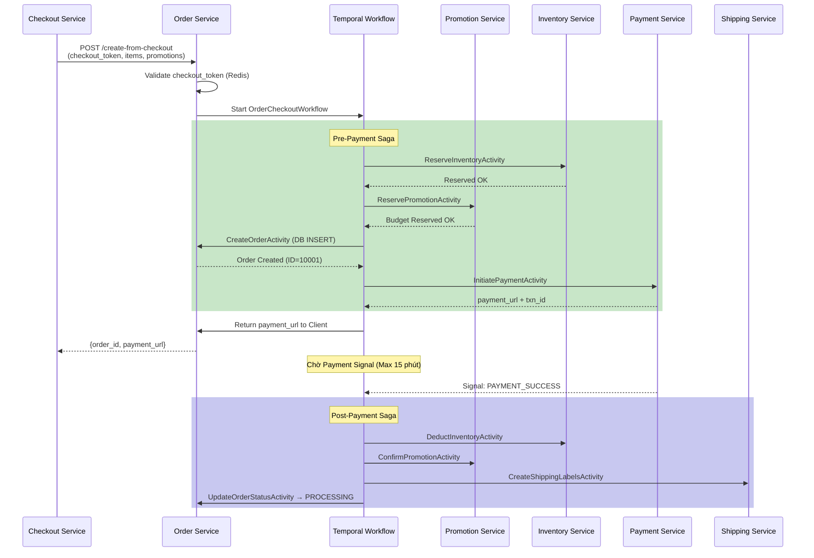

# Order Service - Quy Trình Hoạt Động (Workflows & API Data Flow)

**Liên kết nhanh (Related Documents):**
*   [Database Schema](order_db_design.md)
*   [Temporal Saga Design](temporal_saga_design.md)
*   [CQRS & Elasticsearch](cqrs_elasticsearch_design.md)
*   [Cold Data Archiving](cold_data_archiving_design.md)
*   [State Machine & Lifecycle](order_state_machine.md)
*   [Background Workers & Jobs](order_workers.md)
*   [Events Structure & Kafka Topics](order_events.md)

**Cross-Service References:**
*   [Checkout Workflow](../checkout/checkout_workflow.md) — Nguồn gọi tạo Order
*   [Promotion Workflow](../promotion/promotion_workflow.md) — Luồng 4 (Saga TCC)
*   [Inventory Workflow](../inventory/inventory_workflow.md) — Reserve/Deduct/Release
*   [Payment Workflow](../payment/payment_workflow.md) — Initiate/Verify/Refund
*   [Shipping Workflow](../shipping/shipping_workflow.md) — Create Shipment, Webhook

---

Tài liệu này mô tả toàn bộ Workflows (luồng xử lý) của Order Service, bao gồm API requests, data flows bên trong, và sự tương tác với các service khác. Mỗi flow ghi rõ tương tác: `[PostgreSQL]`, `[Redis]`, `[Temporal]`, `[Kafka]`, `[FSM]`, `[Elasticsearch]`.

---

## 1. API: Get Order Detail (`GET /v1/orders/{orderId}`)

**Ngữ cảnh:** Buyer hoặc Seller xem chi tiết một đơn hàng cụ thể. Read trực tiếp PostgreSQL (không qua Elasticsearch).

1. **[API Gateway]** Xác thực JWT Token. Extract `user_id`.
2. **[Backend]** Query PostgreSQL bằng Eager Loading:
   ```sql
   SELECT o.*, op.*, oi.*, opr.* 
   FROM orders o
   JOIN order_parcels op ON op.order_id = o.id
   JOIN order_items oi ON oi.parcel_id = op.id
   LEFT JOIN order_promotions opr ON opr.order_id = o.id
   WHERE o.id = :orderId;
   ```
3. **[Authorization Check]** 
   - Buyer: `o.user_id = :current_user_id` → Cho phép.
   - Seller: `op.seller_id = :current_seller_id` → Chỉ trả về parcels thuộc seller đó.
   - Admin: Full access.
4. **[Response]** Trả về JSON denormalized bao gồm `parcels[] > items[]`, `promotions[]`, `status_history[]`.

---

## 2. API: Search/Filter Orders (`GET /v1/orders/search`)

**Ngữ cảnh:** Buyer xem danh sách đơn hàng (history), Seller xem đơn hàng cần xử lý, Admin Dashboard.

1. **[API Gateway]** Xác thực JWT.
2. **[Backend → Elasticsearch]** Redirect sang CQRS Read Model. Query ES:
   ```json
   {
     "query": {
       "bool": {
         "must": [
           {"term": {"buyer_id": 999}},
           {"term": {"status": "PROCESSING"}}
         ],
         "filter": [
           {"range": {"created_at": {"gte": "2026-02-01"}}}
         ]
       }
     },
     "sort": [{"created_at": "desc"}],
     "from": 0, "size": 20
   }
   ```
3. **[Elasticsearch]** Trả về Top-N results (denormalized documents).
4. **[Response]** Paginated list với `total_count`, `items[]`, `next_cursor`.

> **Tại sao Elasticsearch?** Xem [CQRS Design](cqrs_elasticsearch_design.md). PostgreSQL JOIN 4 bảng với LIMIT/OFFSET trên triệu rows sẽ cực kỳ chậm.

---

## 3. API: Cancel Order (`POST /v1/orders/{orderId}/cancel`)

**Ngữ cảnh:** Buyer hủy đơn trước khi thanh toán, hoặc Admin force cancel.

1. **[API Gateway]** Xác thực JWT + Rate Limiting.
2. **[Backend → Redis]** Acquire Distributed Lock: `order:lock:fsm:{orderId}` TTL 10s.
3. **[Backend → PostgreSQL]** Load order + verify FSM:
   ```sql
   SELECT status, version FROM orders WHERE id = :orderId FOR UPDATE;
   ```
   - Guard: `status` phải là `PENDING_PAYMENT` (Buyer cancel) hoặc `PROCESSING` (Admin force cancel).
   - Nếu không hợp lệ → `409 Conflict`.
4. **[Temporal]** Signal Temporal Workflow: `workflowStub.signal("CancelOrder", reason)`.
5. **[Temporal Compensation Stack]** Tự động chạy:
   - `RollbackInventoryActivity` → Nhả reserved stock.
   - `RollbackPromotionActivity` → Hoàn voucher budget.
   - `CancelPaymentActivity` → Hủy pending payment (nếu có).
6. **[FSM + PostgreSQL]** Update: `status = 'CANCELLED'`, `version = version + 1`. Insert `order_status_history`.
7. **[Outbox]** Insert `outbox_events` với `ORDER_CANCELLED`.
8. **[Response]** `200 OK`.

---

## 4. Workflow: Nhận Checkout Submit (Full Saga Flow)

**Ngữ cảnh:** Checkout Service gọi `POST /v1/orders/create-from-checkout`. Đây là luồng phức tạp nhất — Temporal orchestrate toàn bộ. Xem chi tiết Saga tại [Temporal Saga Design](temporal_saga_design.md).



### Bước Chi tiết:

**4.1. Nhận Request từ Checkout:**
1. **[Backend]** Validate `checkout_token` từ Redis: kiểm tra chưa dùng, chưa hết TTL, anti-tamper.
2. **[Backend]** Mark `checkout_token` as USED (SETNX chống đúp submit).
3. **[Temporal]** Start `OrderCheckoutWorkflow` với WorkflowID = `order-checkout-{order_id}`.

**4.2. Pre-Payment Saga (Temporal Orchestrate):**

| Bước | Activity | Service | Thành công | Compensation (Rollback) |
|:--|:---|:---|:---|:---|
| 1 | `ReserveInventoryActivity` | Inventory | Redis Lua Reserve → Kafka Event | `RollbackInventoryActivity` (Release) |
| 2 | `ReservePromotionActivity` | Promotion | Redis Lua Lock budget (Lua Script 2) → Kafka Event | `RollbackPromotionActivity` (Release Budget) |
| 3 | `CreateOrderActivity` | Order (self) | INSERT `orders`, `order_parcels`, `order_items`, `order_promotions` | *(Không cần — chỉ mark CANCELLED)* |
| 4 | `InitiatePaymentActivity` | Payment | Tạo `payment_transaction`, trả `payment_url` | `CancelPaymentActivity` |

> [!NOTE]
> **Tại sao Promotion `/reserve` nằm trong Saga chứ không khóa ở Checkout Preview?** Khóa tại Preview tạo lỗ hổng lạm dụng nghiêm trọng: kẻ xấu có thể dùng bot mở hàng loạt checkout session, áp voucher Flash Sale và bỏ trống, làm cạn kiệt budget mà không phát sinh đơn hàng thực sự. `ReservePromotionActivity` chạy ngay tại đây — sau khi user đã commit Submit và `order_id` đã tồn tại — đảm bảo mỗi lần lock budget đều gắn với một giao dịch thực sự. Xem [Promotion Workflow Section 4](../promotion/promotion_workflow.md#4-luồng-thanh-toán-saga-checkout-flow).

**4.3. Chờ Payment Signal:**
- Temporal Workflow enters `await()` state — chờ Signal từ [Payment Status Consumer](order_workers.md#3-payment-status-consumer).
- **Timeout Timer:** 15 phút. Nếu hết → Compensation Stack (Release Inventory + Release Promotion Budget + Cancel Payment).
- **Payment Success Signal:** Resume workflow → Post-Payment Saga.

**4.4. Post-Payment Saga (Sau khi nhận Payment Success):**

| Bước | Activity | Service | Mô tả | Compensation |
|:--|:---|:---|:---|:---|
| 1 | `DeductInventoryActivity` | Inventory | Chuyển Reserved → Deducted (không quay lại available) | *(Đã deduct — cần Refund flow riêng)* |
| 2 | `ConfirmPromotionActivity` | Promotion | Chuyển `coupon_usages.status` RESERVED → REDEEMED | `RollbackPromotionActivity` |
| 3 | `CreateShippingLabelsActivity` | Shipping | Tạo vận đơn cho từng parcel. Nhận `tracking_number` | `CancelShippingActivity` |
| 4 | `UpdateOrderStatusActivity` | Order (self) | FSM `PAID` → `PROCESSING` + Produce `ORDER_PAID` | — |

**4.5. Produce Events sau Saga:**
- `ORDER_CREATED` (sau bước 4.2 step 3 — sau khi `CreateOrderActivity` insert thành công `orders`, `order_parcels`, `order_items`, `order_promotions`)
- `ORDER_PAID` (sau bước 4.4 step 4 — **Event thông báo trạng thái đã thanh toán:** trigger Cart delete, Notification, CQRS/Analytics. Các bước Promotion confirm và Inventory deduct đã được xử lý đồng bộ ở bước 4.4)

---

## 5. Workflow: Xử Lý Payment Signal

**Ngữ cảnh:** Kafka Consumer nhận `PAYMENT_SUCCESS` / `PAYMENT_FAILED` từ Payment Service.

1. **[Kafka Consumer]** Nhận event từ `t.payment.events`. Xem [Payment Status Consumer](order_workers.md#3-payment-status-consumer).
2. **[Idempotency Check]** Redis `SETNX payment:signal:{order_id}:{event_type}` TTL 24h.
3. **[Temporal Signal]** `workflowClient.newSignalStub("order-checkout-{order_id}").paymentResult(signalPayload)`.
4. **[Temporal Workflow Resume]:**
   - SUCCESS → Chạy Post-Payment Saga (Bước 4.4 ở trên).
   - FAILED/EXPIRED → Chạy Compensation Stack → `ORDER_CANCELLED`.

> [!WARNING]
> **Race Condition:** Payment Signal có thể đến **cùng lúc** với Temporal Timer timeout 15 phút. Temporal Framework giải quyết bằng: chỉ 1 signal/timer thắng race. Nếu Timer fire trước → Signal bị ignore (workflow đã complete). Nếu Signal đến trước → Timer bị cancel.

> **Race Mitigation Contract:** Trước khi commit khuyến mãi, `ConfirmPromotionActivity` phải gia hạn reservation key thêm 60 giây grace-window rồi mới xác nhận `REDEEMED`. Mục tiêu là tránh va chạm biên giữa Payment success, Timer timeout, và Promotion sweep.

---

## 6. Workflow: Xử Lý Shipping Status Update

**Ngữ cảnh:** Shipping Service webhook → Shipping Service → Kafka → Order Service consumer.

1. **[Kafka Consumer]** Nhận `SHIPMENT_STATUS_UPDATED` từ `t.shipping.events`. Xem [Shipping Status Consumer](order_workers.md#4-shipping-status-consumer).
2. **[Mapping]** Áp dụng [Status Mapping Table](order_state_machine.md#23-mapping-với-shipping-service-standardized_status).
3. **[FSM Validation]** Kiểm tra transition hợp lệ theo [Parcel FSM](order_state_machine.md#22-bảng-chi-tiết-transitions).
4. **[PostgreSQL]** Update `order_parcels.status` + increment `version`.
5. **[Auto-Complete Check]** Nếu tất cả parcels `DELIVERED` → Master Order FSM `PROCESSING` → `COMPLETED`.
6. **[Outbox]** Produce `PARCEL_STATUS_CHANGED` và/hoặc `ORDER_COMPLETED`.

---

## 7. Workflow: Timeout & Auto-Cancel (Temporal Timer)

**Ngữ cảnh:** User không thanh toán trong 15 phút.

1. **[Temporal Timer]** `workflow.newTimer(Duration.ofMinutes(15))` chạy song song với `await(paymentSignal)`.
2. **[Timer Fires]** Temporal trigger Compensation Stack theo thứ tự LIFO:
   - `CancelPaymentActivity` → Hủy pending payment.
   - `RollbackInventoryActivity` → Nhả reserved stock.
   - `RollbackPromotionActivity` → Nhả reservation budget của voucher.
3. **[FSM]** Update `orders.status = 'CANCELLED'`, `reason = 'PAYMENT_TIMEOUT'`.
4. **[Outbox]** Produce `ORDER_CANCELLED`.

---

## 8. Workflow: Refund/Return Flow

**Ngữ cảnh:** Đơn hàng đã giao thành công (COMPLETED) nhưng khách đổi trả.

1. **[Trigger]** Có 2 nguồn trigger:
   - User API: `POST /v1/orders/{orderId}/return` → Master Order FSM `COMPLETED` → `RETURN_REQUESTED`.
   - Shipping Event: `SHIPMENT_RETURNED` → Parcel FSM `DELIVERED` → `RETURNED` → Master Order check.

2. **[Backend / Temporal]** Start Refund Temporal Workflow (hoặc xử lý inline):
   - Tính `refund_amount` dựa trên returned parcels.
   - Gọi Payment Service: `POST /v1/payments/{txn_id}/refund`.

3. **[Chờ Payment Refund]** Payment Service xử lý refund với 3PL → produce `REFUND_SUCCESS`.

4. **[Order Consumer nhận `REFUND_SUCCESS`]:**
   - Update `orders.payment_status = 'REFUNDED'`.
   - FSM `RETURN_REQUESTED` → `REFUNDED`.
   - Produce `ORDER_REFUNDED`.

5. **[Downstream consume `ORDER_REFUNDED`]:**
   - **Promotion:** [Hoàn budget](../promotion/promotion_workflow.md#5-luồng-đổi-trả-hàng--hoàn-tiền-refund-flow).
   - **Inventory:** Release deducted stock (nếu hàng trả về kho).

---

## TỔNG KẾT

Order Service Workflow kết hợp 3 mô hình kiến trúc:
1.  **Temporal Saga** cho luồng phân tán đa service (Pre-Payment + Post-Payment). Đảm bảo Compensation tự động.
2.  **Event-Driven (Kafka)** cho luồng phản ứng (Payment webhook, Shipping tracking). Loose coupling giữa services.
3.  **FSM Database Layer** làm chốt chặn cuối cùng (Guard), bảo vệ data integrity dù request đến từ API, Kafka, hay Temporal.
