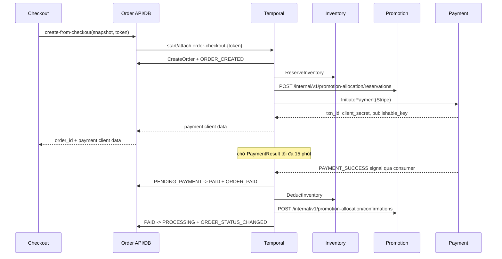
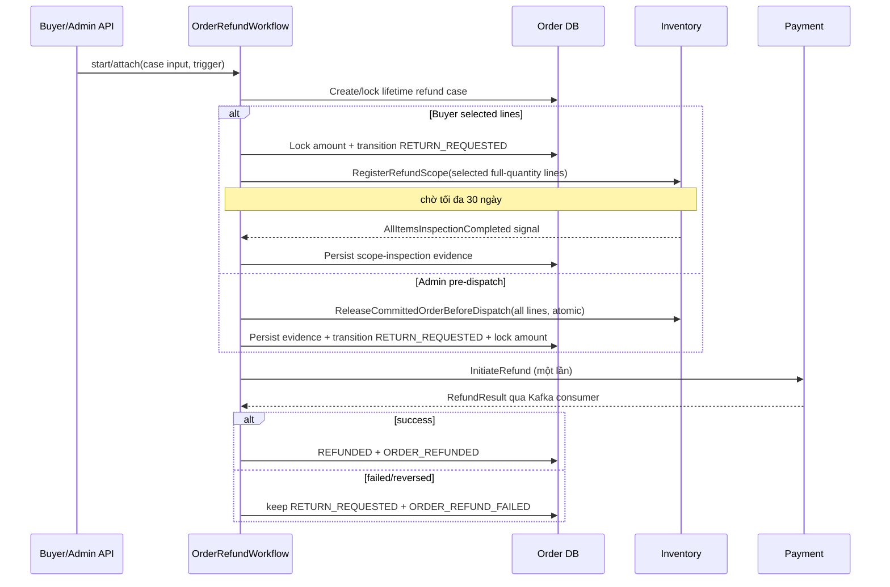

# Order Service — Luồng nghiệp vụ

> Các luồng dưới đây bảo toàn happy path, timeout, retry, race, compensation và
> recovery của thiết kế cũ. Contract payload chi tiết chưa được chuẩn hóa trong
> lần refactor này.

## Danh mục luồng nghiệp vụ

| ID | Workflow | Trigger | Tác nhân | Trạng thái |
|---|---|---|---|---|
| `WF-ORDER-001` | Xem chi tiết order | HTTP | Buyer/Admin | proposed |
| `WF-ORDER-002` | Search/filter order | HTTP | Buyer/Admin | proposed |
| `WF-ORDER-003` | Cancel hoặc admin force-refund | HTTP | Buyer/Admin | proposed |
| `WF-ORDER-004` | Checkout submit saga | HTTP + Temporal | Checkout | proposed |
| `WF-ORDER-005` | Xử lý payment signal và late recovery | Kafka + Temporal | Payment consumer | proposed |
| `WF-ORDER-006` | Giao delivery unit và auto-complete | Kafka | Inventory consumer | proposed |
| `WF-ORDER-007` | Buyer yêu cầu return one-shot | HTTP | Buyer | proposed |
| `WF-ORDER-008` | Refund/return saga | Temporal + Kafka | Buyer/Admin/Inventory/Payment | proposed |
| `WF-ORDER-009` | Payment timeout và auto-cancel | Temporal timer | Checkout workflow | proposed |

## WF-ORDER-001 — Xem chi tiết order

**Mục tiêu:** trả lịch sử order denormalized từ PostgreSQL nóng mà không phụ thuộc
service khác. **Trigger:** `GET /v1/orders/{orderId}` sau Gateway authentication.

**Điều kiện trước và phân quyền:** order tồn tại; Buyer phải có
`orders.user_id=current_user_id`, Admin có full access. Backend eager-load master,
items, lines và promotions. Response dự kiến có `items[].lines[]`, `promotions[]`
và `status_history[]`; nguồn status history chưa được thiết kế.

**Happy path:** query dữ liệu bằng một read flow, kiểm tra ownership sau khi tìm
row, map snapshot sang response và trả 200. Không tìm thấy hoặc không visible trả
404/403 theo policy API được chốt sau. Read-only nên không phát event.

**Lỗi/timeout/retry:** DB timeout là lỗi hạ tầng; caller có thể retry GET. Không có
cache/fallback được thiết kế. Test phải bao phủ buyer owner/non-owner, admin,
multi-warehouse, promotion rỗng, snapshot nullable và order không tồn tại.

## WF-ORDER-002 — Search/filter order

**Mục tiêu:** trả một order-level card trên mỗi order cho buyer history/admin
dashboard, trực tiếp từ PostgreSQL. **Trigger:** `GET /v1/orders/search`.

**Input:** `tab` mặc định `ALL`; optional `q,from,to,cursor,limit`, order/payment
statuses và min/max amount theo query layer. Nếu thiếu range, dùng 90 ngày gần nhất.

**Happy path:** Gateway dựng scope Buyer/Admin. Không có `q` thì chạy class A trên
`orders`; có `q` thì class B tìm substring accent-insensitive trên
`order_item_lines.snapshot_name`, collapse về order rồi áp filter. Chạy count riêng
với cùng filter, derive buyer tab/card fields, lấy `limit+1`, trả `total_orders`,
`items[]`, `next_cursor`.

Tên khái niệm `snapshot_product_name` trong API/search description ánh xạ tới cột
`order_item_lines.snapshot_name`; CTE SQL cũ đặt alias `filtered` cho tập order sau
filter/cursor/limit.

**Pagination/idempotency:** cursor base64 chứa `(created_at_iso,order_id)`; tuple
predicate `<` với sort giảm dần giữ page ổn định tương đối. Đây là read-only.

**Lỗi và giới hạn:** query không fuzzy/tokenize/score/highlight/autocomplete. Input
cursor sai trả validation error; DB/extension lỗi không fallback ES. Test cần buyer
isolation, mọi tab precedence, boundaries time/amount, dấu tiếng Việt, duplicate
line collapse, equal timestamp ordering, last page và total count không bị cursor.

## WF-ORDER-003 — Cancel hoặc admin force-refund

**Mục tiêu:** Buyer/Admin hủy order chưa thanh toán; với order đã thu tiền, Admin
được chuyển sang refund lane thay vì hủy tài chính sai cách.

**Trigger/input:** `POST /v1/orders/{orderId}/cancel`, JWT/role, reason và optional
`Idempotency-Key`. Redis `SETNX order:req:cancel:{key}` TTL 7 ngày có thể replay
response đã lưu hoặc trả `409 IDEMPOTENCY_KEY_REUSED`. API lấy distributed lock
`order:lock:fsm:{orderId}` TTL 10 giây, sau đó `SELECT ... FOR UPDATE`.

**Nhánh A — pre-payment:** Buyer hoặc Admin với `PENDING_PAYMENT` signal
`CancelOrder` vào checkout workflow. Workflow chạy LIFO
`CancelPayment -> RollbackPromotion -> RollbackInventory -> CancelOrder`, rồi mới
commit `CANCELLED` và outbox `ORDER_CANCELLED`.

**Nhánh B — đã thu tiền:** Admin với `PAID/PROCESSING` creates/attaches the one
lifetime refund case and calls Inventory
`ReleaseCommittedOrderBeforeDispatch(order_id)`. Inventory locks every line and
either releases all committed undispatched lines in one transaction or rejects with
no stock movement. Only the all-line success transitions to `RETURN_REQUESTED`, locks
`orders.final_amount`, and calls Payment; no Refund Scope/receipt is registered.
If any line has dispatched or the root is mixed, return
`ADMIN_REFUND_REQUIRES_ALL_UNDISPATCHED` for manual exception rather than attempting
a partial release. Không signal CancelOrder vào checkout workflow cũ.

**Output/state:** trả `202 Accepted` và workflow/result reference; lưu trạng thái
command `IN_PROGRESS` trong Redis nếu cần replay. Invalid role/state trả 403/409.
WorkflowID serialize retry nhánh B; DB FSM giữ invariant nếu Redis mất key.

**Race/recovery:** concurrent Buyer/Admin cancel chỉ một CAS transition thắng.
Payment success cạnh cancel/timer được Temporal serialize; nếu timeout-cancel thắng
trước thì success muộn phải đi recovery. Test phải bao phủ duplicate key, key khác
cùng order, lock expiry, payment race, compensation partial failure và admin lane.

## WF-ORDER-004 — Checkout submit saga

**Mục tiêu:** biến checkout snapshot hợp lệ thành order, reserve tài nguyên, tạo
Stripe PaymentIntent và sau success đưa order tới `PROCESSING`.

**Actor/participants:** Checkout, Order API, Temporal, PostgreSQL, Redis,
Inventory, Promotion, Payment và outbox CDC. **Trigger:**
`POST /v1/orders/create-from-checkout`.

**Preconditions:** checkout token hợp lệ/chưa dùng/chưa hết TTL/chống tamper; input
server-side có address, route theo warehouse, SKU lines, amount và promotion
snapshot hợp lệ. WorkflowID là `order-checkout-{checkout_token}`; Redis mirror
`order:req:create:{checkout_token}` TTL 7 ngày.

### Pre-payment happy path và compensation

1. `CreateOrderActivity` tạo order/items/lines/promotions, address/product snapshot,
   `checkout_token`, trạng thái `PENDING_PAYMENT` và outbox `ORDER_CREATED`. Chỉ
   sau bước này mới có `order_id`; lỗi DB dừng trước mọi remote call.
2. `ReserveInventoryActivity`; thành công đăng ký `RollbackInventoryActivity`.
3. `ReservePromotionActivity` gọi
   `POST /internal/v1/promotion-allocation/reservations` all-or-nothing; thành công đăng ký
   `RollbackPromotionActivity` gọi `/internal/v1/promotion-allocation/cancellations`.
   Reserve chỉ ở submit, không ở Preview.
4. `InitiatePaymentActivity` tạo PaymentIntent, trả `client_secret`,
   `publishable_key`, transaction ID; thành công đăng ký `CancelPaymentActivity`.
5. Workflow suspend chờ payment signal 15 phút, không giữ thread/CPU.

Failure chạy compensation đảo ngược các bước đã thành công. Promotion failure
phải bubble structured error cho Checkout dựng `409 PROMOTION_RECALCULATION_NEEDED`;
Order không tự evaluate lại discount. `RollbackPromotionActivity` chỉ release
runtime reservation, không thay wallet `USED/SAVED`.
Ví dụ lỗi nghiệp vụ upstream là `BUDGET_EXHAUSTED`; workflow giữ đúng promotion
thất bại và không collapse thành HTTP 500.

### Mốc tài chính và post-payment

Payment success trước timer làm `UpdateOrderStatusActivity` lock row, commit
`PENDING_PAYMENT -> PAID`, tăng sequence và insert `ORDER_PAID` cùng transaction.
Sau đó reset stack sang post-payment:

1. `DeductInventoryActivity`, compensation `RollbackDeductedInventoryActivity`.
2. `ConfirmPromotionActivity` gọi
   `POST /internal/v1/promotion-allocation/confirmations` với `REDEEM_FINAL` key riêng mỗi
   promotion; compensation `CancelConfirmedPromotionActivity` gọi
   `POST /internal/v1/promotion-allocation/technical-cancellations` với `CANCEL_FINAL` key.
3. `UpdateOrderStatusActivity` chuyển `PAID -> PROCESSING`, phát
   `ORDER_STATUS_CHANGED`, compensation `RevertOrderStatusToPaidActivity`.

Post-payment failure rollback LIFO
`RevertOrderStatusToPaid -> CancelConfirmedPromotion -> RollbackDeductedInventory`.
Pre/post promotion compensation có semantics khác nhau và không dùng lẫn.

Promotion trước hết replay durable `CONFIRM` receipt nếu đã có; command mới dùng
Confirm-Prepare chỉ để fence reservation Redis. Activity thành công khi receipt +
wallet/budget/outbox commit PostgreSQL, còn Redis finalizer có thể hội tụ sau. Vì vậy retry
sau khi reservation đã được dọn vẫn trả stored response. `CancelConfirmedPromotionActivity`
dùng `CANCEL_FINAL` receipt và PostgreSQL-first compensation; Redis unavailable không biến
durable success thành failure. Cùng key khác canonical payload là lỗi không retry mù.

**Timeout/retry/output:** activity timeout 30 giây, retry tối đa 3; workflow timeout
30 phút gồm payment window 15 phút và rollback buffer. Start/attach replay kết quả
workflow hiện có. Mark checkout token used chỉ sau start/attach thành công và cần
persist workflow reference. Test phải inject failure tại từng activity, crash/resume,
duplicate submit, stale token, all-or-nothing promotion failure, signal/timer race,
stored-response replay/payload mismatch và từng compensation failure.

## WF-ORDER-005 — Payment signal và late-payment recovery

**Mục tiêu:** route payment/refund event đúng workflow; không drop khoản thanh toán
thành công đến sau checkout timeout.

**Trigger:** `order-payment-consumer` nhận `t.payment.events`. Consumer dedup Redis
30 ngày theo order/transaction/type. Nó lookup `checkout_token` bằng `order_id`,
không route theo aggregate transaction ID.

**Active checkout:** `PAYMENT_SUCCESS` signal `PaymentResult.SUCCESS`; workflow
commit `PAID`, phát `ORDER_PAID`, chạy post-payment. `PAYMENT_FAILED/EXPIRED` signal
failed; workflow compensation rồi commit cancel. Consumer không ghi master FSM.

**Late success:** nếu checkout đã close và order là
`CANCELLED(cancel_reason=PAYMENT_TIMEOUT)`, start/attach
`order-late-payment-recovery-{order_id}`. Recovery verify payment evidence, đưa
order về lane đã thu tiền và phát `ORDER_PAID(payment_recovery=true)`. Trước deduct,
phải reserve Inventory lại theo route hợp lệ hoặc có evidence reservation tương
đương. Sau đó chạy post-payment. Nếu bước bắt buộc không phục hồi được, dừng ở
`MANUAL_VERIFICATION_REQUIRED`; Release 1 không có system auto-refund bypassing the
Buyer-scope/Admin-pre-dispatch Inventory gates.

**Refund events:** processing/success/fail/reverse route
`order-refund-{order_id}` và signal `RefundResult`; refund workflow mới commit
payment/master state và outbox.

**Race/idempotency:** Temporal history quyết định signal hay timer thắng. Duplicate
signal bị Redis chặn; nếu key mất, workflow state và FSM CAS phải làm no-op an toàn.
Test cần event duplicate/out-of-order, workflow not found, timeout-before/signal-
before, cancellation reason khác timeout, reservation đã hết hạn, recovery success,
recovery failure -> manual verification without a Payment refund command và refund
event đến sai workflow phase.

## WF-ORDER-006 — Giao delivery unit và auto-complete

**Mục tiêu:** phản ánh kho đã xuất hàng, chuyển đúng delivery unit và hoàn tất
master chỉ khi mọi kiện đã giao.

**Trigger/input:** `order-inventory-ship-consumer` nhận
`INVENTORY_SHIP_TO_CUSTOMER(order_id,warehouse_id,shipped_at)`. Dedup key chứa đủ
ba giá trị, TTL 30 ngày.

**Happy path:** resolve danh sách item từ inventory reservation đã `DEDUCTED` theo
cả order và warehouse; cách truy cập dữ liệu này chưa được chốt. Với từng item,
CAS `PROCESSING -> DELIVERED`; chỉ row đổi thành công mới insert
`ORDER_ITEM_STATUS_CHANGED`. Sau lô update, count total/delivered; nếu bằng nhau,
đợi/coalesce 5 giây rồi CAS master `PROCESSING -> COMPLETED`. Chỉ CAS thắng mới
insert `ORDER_COMPLETED` với immutable review item snapshot.

**Failure/race:** không dùng `warehouse_id` có thể giao nhầm kiện multi-warehouse
và bị cấm. Duplicate affected row 0 là no-op. Nhiều warehouse event gần nhau có
thể cùng check completion nhưng master CAS bảo đảm một event completion. DB lỗi
không ack để retry; outbox atomic cùng state. Test cần partial delivery, nhiều kho,
duplicate, out-of-order, zero item anomaly, coalescing và concurrent final events.

## WF-ORDER-007 — Buyer yêu cầu return one-shot

**Mục tiêu:** Buyer gửi đúng một return request sau khi toàn bộ delivery unit đã
giao; request khóa một selected-line scope trước khi start refund saga.

**Trigger/input:** `POST /v1/orders/{orderId}/return`, JWT Buyer, header
`Idempotency-Key`, `lines[] {order_line_id, quantity}`, `reason`, `reason_details`.
Không có `refund_type`. Redis request key TTL 7 ngày không thay thế business guard.

**Preconditions:** Buyer sở hữu order; state thuộc lane cho phép return; mọi
`order_items.status=DELIVERED`; `lines[]` không rỗng, không duplicate, thuộc order,
và từng `quantity` bằng đúng `order_item_lines.quantity`. Scope có thể là tập con
các line nhưng không có partial quantity. Trong locked transaction, CAS
`buyer_return_locked_at IS NULL` và create refund case lifetime-unique.

**Happy path:** CAS thắng; start `order-refund-{order_id}` với
`trigger_source=API_RETURN`, reason `RETURN_API_ACCEPTED` và scope; trả `202` cùng
`refund_request_id`, `workflow_id`.

**Duplicate/failure:** cùng key trả conflict/replay theo Redis policy; key mới vẫn
không bypass one-shot. CAS thua trả `REFUND_CUSTOMER_REQUEST_ALREADY_USED`. Guard
không reset khi workflow/refund fail hoặc reverse. Nếu CAS đã commit nhưng start
Temporal lỗi, cần retry/reconciliation bằng workflow ID ổn định; thiết kế cũ chưa
chốt worker sửa trạng thái này. Test bắt buộc race hai key, invalid scope, item chưa
giao, non-owner, Temporal unavailable sau CAS và permanent guard sau failure.

## WF-ORDER-008 — Refund/return saga

**Mục tiêu:** khóa một refund case/amount, chờ evidence Inventory phù hợp rồi gọi
Payment đúng một lần. Buyer return và Admin pre-dispatch force refund có gate
Inventory khác nhau.

**Preconditions:** trigger là `API_RETURN` hoặc `ADMIN_FORCE_REFUND`. Buyer đã pass
guard; Admin automatic path chỉ được thử tại `PAID/PROCESSING`. WorkflowID
`order-refund-{order_id}` và refund case PK chặn cả case song song lẫn case lịch sử
thứ hai.

**Happy path:** `CreateRefundCaseActivity` first verifies source/policy and creates
the lifetime case without exposing an automatic admin refund as accepted. Buyer then
transitions `COMPLETED -> RETURN_REQUESTED`, locks selected `order_line_id` and each
line's full quantity, snapshots price and locks
`min(sum(quantity * unit_price), final_amount)`, then calls `RegisterRefundScope`.
Consumer receives
`com.ecommerce.inventory.refund.all-items-inspection-completed.v1`, dedups and
signals only when `refund_scope_id`, request and every line/counter match the case.
Mixed/all inspection `FAIL` is still a valid completion fact and therefore calls
Payment. Admin does not register a scope and retains `PAID/PROCESSING` while calling
`ReleaseCommittedOrderBeforeDispatch`; only its all-line atomic success transitions
to `RETURN_REQUESTED`, locks `orders.final_amount`, and continues. Any
dispatched/mixed result rejects with no stock movement. Only after the applicable
evidence creates the unique `refund_transaction_id`, set `REFUNDING` and call Payment.
Success commit `payment_status=REFUNDED`, master `REFUNDED`, case `SUCCEEDED` và
`ORDER_REFUNDED`.

**Promotion and amount boundary:** Buyer selected-line refund does not call Promotion
and `ORDER_REFUNDED` has no promotion allocation. Voucher remains a whole-order
benefit; wallet stays `USED` and budget stays consumed. The only amount calculation is
the gross selected-line snapshot value capped at `orders.final_amount`; discounts are
not re-prorated. Admin pre-dispatch amount is `orders.final_amount`.

**Timeout/manual recovery:** chờ Inventory tối đa 30 ngày. Quá hạn alert Ops và
vào lane `MANUAL_VERIFICATION_REQUIRED`. This is not a Payment bypass: the case can
resume only with the matching Inventory evidence, or be resolved as a documented
manual exception outside Release 1. It cannot create another scope/refund transaction.

**Payment failure/reverse:** giữ master `RETURN_REQUESTED`, set
`payment_status=REFUND_FAILED`, case `FAILED`, phát `ORDER_REFUND_FAILED`; Buyer
guard không reset. `REFUND_PROCESSING` giữ/set `REFUNDING`. Không mở refund
transaction thứ hai.

**Test:** selected full-quantity boundaries (A×1 rejects when line is A×2), two
workflow starts, duplicate/mismatched Inventory completion, multi-package mixed
PASS/FAIL, 30-day timeout, refund exactly once, provider fail/reverse, no Promotion,
crash between remote refund/local commit, permanent one-shot, and atomic admin
all-undispatched versus any-dispatched conflict.

## WF-ORDER-009 — Payment timeout và auto-cancel

**Mục tiêu:** giải phóng tài nguyên và cancel order nếu không thanh toán trong 15
phút, đồng thời vẫn xử lý an toàn payment success đến muộn.

**Trigger:** Temporal timer chạy song song với `PaymentResult`. Khi timer thắng,
workflow chạy LIFO `CancelPayment -> RollbackPromotion -> RollbackInventory ->
CancelOrderActivity`; chỉ sau compensation mới commit `CANCELLED`,
`cancel_reason=PAYMENT_TIMEOUT` và outbox `ORDER_CANCELLED`.

**Race:** nếu payment signal thắng, cancel timer và đi success path. Nếu timer đã
commit vào history, checkout workflow đóng; success đến sau được Payment consumer
route sang `WF-ORDER-005` late recovery. Promotion reservation grace 60 giây trước
confirm giảm race ở biên.

**Recovery/metrics:** compensation activity retry theo policy; failure cần alert và
workflow visibility để resume/manual action, không được đánh dấu cancel hoàn tất
khi resource cleanup còn chưa được xử lý theo thiết kế. Test gồm timer chính xác,
crash/resume, từng compensation lỗi, duplicate timer/signal và late recovery.

## Tình huống kiểm thử xuyên suốt

- State/outbox atomicity và sequence đơn điệu trên cùng order.
- Request/event duplicate khi Redis còn key, mất key và quá TTL.
- Workflow replay/determinism sau restart hoặc deploy mixed version.
- Concurrent cancel, return, payment success, Inventory ship và refund result.
- Multi-warehouse isolation; tất cả buyer-tab precedence và search cursor.
- Không log PII/client secret; Buyer/Admin/service identity authorization.
- CDC at-least-once duplicate, connector lag và outbox cleanup watermark.
