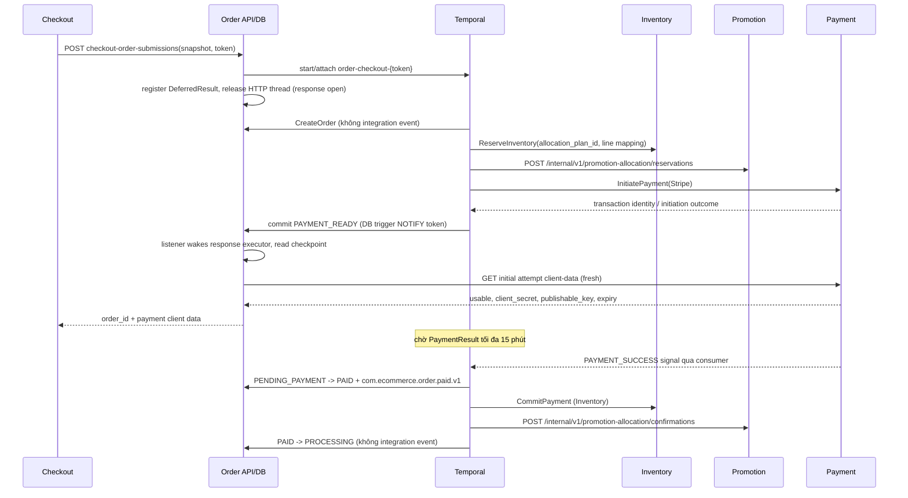

# Order Service — Luồng nghiệp vụ

> Các luồng dưới đây bảo toàn happy path, timeout, retry, race, compensation và
> recovery. Payload cross-service được chuẩn hóa tại Payment HTTP/events v1/v2,
> và Inventory workflow v1; Markdown không được ghi đè các contract đó.

## Danh mục luồng nghiệp vụ

| ID | Workflow | Trigger | Tác nhân | Trạng thái |
|---|---|---|---|---|
| `WF-ORDER-001` | Xem chi tiết order | HTTP | Buyer/Admin | implemented |
| `WF-ORDER-002` | Search/filter order | HTTP | Buyer/Admin | implemented |
| `WF-ORDER-003` | Cancel hoặc admin force-refund | HTTP | Buyer/Admin | implemented |
| `WF-ORDER-004` | Checkout submit saga | HTTP + Temporal | Checkout | implemented |
| `WF-ORDER-005` | Xử lý payment signal và capture/cancel race | Kafka + durable Temporal message | Payment consumer | implemented |
| `WF-ORDER-006` | Nhận physical-dispatch fact | Kafka | Inventory consumer | implemented |
| `WF-ORDER-006a` | Admin xác nhận đã giao | HTTP | Admin | implemented |
| `WF-ORDER-007` | Buyer yêu cầu return one-shot | HTTP | Buyer | implemented |
| `WF-ORDER-008` | Refund/return saga | Temporal + Kafka | Buyer/Admin/Inventory/Payment | implemented |
| `WF-ORDER-008a` | Đóng/recover Inventory Refund Scope | Temporal + durable dispatch | Order worker/Finance/Ops | implemented |
| `WF-ORDER-009` | Payment timeout và auto-cancel | Temporal timer | Checkout workflow | implemented |
| `WF-ORDER-010` | Financial reconciliation decision | Internal HTTP + Temporal | Finance/Ops | implemented |
| `WF-ORDER-011` | Buyer tạo payment attempt kế tiếp | HTTP + Temporal activity | Buyer | implemented |

## WF-ORDER-001 — Xem chi tiết order

**Mục tiêu:** trả lịch sử order denormalized từ PostgreSQL nóng mà không phụ thuộc
service khác. **Trigger:** `GET /api/v1/orders/{order_id}` hoặc Admin counterpart
sau Gateway authentication.

**Điều kiện trước và phân quyền:** order tồn tại; Buyer phải có
`orders.user_id=current_user_id`, Admin có full access. Backend eager-load master,
items, lines, promotions và payment/refund summary.

**Happy path:** query dữ liệu bằng một read flow, kiểm tra ownership sau khi tìm
row, map snapshot sang response và trả 200. Buyer không thấy order hoặc không sở hữu
đều nhận 404; Admin thiếu capability nhận 403. Read-only nên không phát event.

**Lỗi/timeout/retry:** DB timeout là lỗi hạ tầng; caller có thể retry GET. Không có
cache/fallback được thiết kế. Test phải bao phủ buyer owner/non-owner, admin,
multi-warehouse, promotion rỗng, snapshot nullable và order không tồn tại.

## WF-ORDER-002 — Search/filter order

**Mục tiêu:** trả một order-level card trên mỗi order cho buyer history/admin
dashboard, trực tiếp từ PostgreSQL. **Trigger:** `GET /api/v1/orders` hoặc
`GET /api/v1/admin/orders`.

**Input:** `tab` optional; bỏ qua `tab` nghĩa là lấy tất cả (không có enum `ALL`). Các
filter optional khác là `q,created_from,created_to,cursor,limit`, `order_status`,
`payment_status`, `min_amount_minor` và `max_amount_minor`. Nếu thiếu cả hai mốc thời
gian, dùng 90 ngày gần nhất.

**Happy path:** Gateway dựng scope Buyer/Admin. Không có `q` thì chạy class A trên
`orders`; có `q` thì application normalize input bằng cùng pinned normalizer và class B
tìm substring trên `order_item_lines.snapshot_name_search`, collapse về order rồi áp filter. Chạy count riêng
với cùng filter, derive buyer tab/card fields, lấy `limit+1`, trả `total_orders`,
`items[]`, `next_cursor`.

Tên khái niệm `snapshot_product_name` trong API/search description ánh xạ display tới
`order_item_lines.snapshot_name` và filter tới `snapshot_name_search`; CTE SQL cũ đặt alias `filtered` cho tập order sau
filter/cursor/limit.

**Pagination/idempotency:** cursor base64 chứa `(created_at_iso,order_id)`; tuple
predicate `<` với sort giảm dần giữ page ổn định tương đối. Đây là read-only.

**Lỗi và giới hạn:** query không fuzzy/tokenize/score/highlight/autocomplete. Input
cursor sai trả validation error; DB/extension lỗi không fallback ES. Test cần buyer
isolation, mọi tab precedence, boundaries time/amount, dấu tiếng Việt, duplicate
line collapse, equal timestamp ordering, last page và total count không bị cursor.

## WF-ORDER-003 — Cancel hoặc admin force-refund

**Mục tiêu:** Buyer/Admin hủy order chưa thanh toán; với order đã thu tiền, Admin
được chuyển sang refund lane thay vì hủy tài chính sai cách.

**Trigger/input:** Buyer gọi
`POST /api/v1/orders/{order_id}/cancellation-requests`; Admin pre-payment gọi
`POST /api/v1/admin/orders/{order_id}/cancellation-requests`; Admin paid lane gọi
`POST /api/v1/admin/orders/{order_id}/pre-dispatch-refund-requests`. Mọi command có
`Idempotency-Key` bắt buộc. Redis mirror dùng
`order:req:{principal_id}:cancel:{sha256(key)}` hoặc
`order:req:{principal_id}:admin-refund:{sha256(key)}` TTL 7 ngày; cùng key/payload có thể replay, khác payload
trả `409 IDEMPOTENCY_KEY_REUSED`. API khóa row bằng `SELECT ... FOR UPDATE` trong
transaction; request mirror chỉ phục vụ replay nhanh.

**Nhánh A — pre-payment:** Buyer hoặc Admin với `PENDING_PAYMENT` first commits
`PENDING_PAYMENT -> CANCELLING` plus a durable cancellation command/dispatch record.
The workflow calls Payment cancel using the active-attempt `payment_transaction_id` and stable
key. Only a matching `CANCELED`/`ALREADY_NON_CAPTURED` fact permits
`RollbackPromotion -> RollbackInventory -> CANCELLED`; không phát cancellation event vì
chưa có implemented consumer. If Payment
returns `ALREADY_SUCCEEDED` or a matching `PAYMENT_SUCCESS` arrives, Order abandons the
cancel lane and enters paid forward-repair/reconciliation; `CANCEL_PENDING` is retried or
queried with the same key and does not release resources.

**Nhánh B — đã thu tiền:** Admin với `PAID/PROCESSING` creates/attaches a durable
pre-dispatch release **attempt**, then calls Inventory
`ReleaseCommittedOrderBeforeDispatch(order_id)`. Inventory locks every line and either
releases all committed undispatched lines in one transaction or rejects with no stock
movement. Only the all-line success creates/attaches the lifetime case, transitions to
`RETURN_REQUESTED`, locks `orders.final_amount_minor`, and calls Payment; no Refund
Scope/receipt is registered. A rejection records the attempt only and does not burn a
future Buyer case.
If any line has dispatched or the root is mixed, operation becomes `REJECTED` with
`ADMIN_REFUND_REQUIRES_ALL_UNDISPATCHED` rather than attempting a partial release.
Không signal CancelOrder vào checkout workflow cũ.

**Output/state:** trả `202 Accepted`, `operation_id` và `Location` tới operation
resource; durable dispatch/attempt là authority, Redis chỉ mirror replay. Invalid
role/state trả 403/409. Cancel endpoint không đổi nghĩa thành refund theo state.
Nhánh B chạy trong `order-admin-refund-{attempt_id}`; unique active attempt serialize retry
nhánh B và một attempt bị từ chối không chiếm Workflow ID `order-refund-{order_id}` của
Buyer. DB FSM giữ invariant nếu Redis mất key.

**Race/recovery:** concurrent Buyer/Admin cancel chỉ một CAS transition thắng.
Payment success cạnh cancel/timer được resolved by Payment's cancel/capture fact, then
serialized in Temporal. A start failure after the local command commit is recovered by the
workflow dispatcher; it cannot leave a terminal state inferred from Redis. Test phải bao
phủ duplicate key, key khác cùng order, DB row-lock race, cancel/capture race, uncertain
remote outcome, durable dispatch recovery và admin lane.

## WF-ORDER-004 — Checkout submit saga

**Mục tiêu:** biến checkout snapshot hợp lệ thành order, reserve tài nguyên, tạo
Stripe PaymentIntent và sau success đưa order tới `PROCESSING`.

**Actor/participants:** Checkout, Order API, Temporal, PostgreSQL, Inventory, Promotion,
Payment và outbox CDC. **Trigger:**
`POST /internal/v1/checkout-order-submissions` theo
[Order internal OpenAPI v1](../../contracts/http/order/internal/v1/openapi.yaml).

**Preconditions:** checkout token hợp lệ/chưa dùng/chưa hết TTL/chống tamper; input
server-side có address, SKU lines cùng Product-owned `category_ids`, canonical VND money và promotion snapshot hợp lệ.
Compatibility field `user_ack_degraded_pricing` phải bằng `false`; Inventory hoặc
Promotion dependency outage không tạo quotation được phép Submit.
Checkout phải lấy một Inventory allocation plan immutable trước submit; chính Checkout
không được chọn warehouse cho từng item. Mỗi planned line dùng `line_reference` của
Checkout, vì `order_line_id` chỉ tồn tại sau `CreateOrder`; Order phải tạo và persist
bridge bất biến `line_reference -> order_line_id` trước Reserve. WorkflowID là
`order-checkout-{checkout_token}`; create dedup dựa trên unique `checkout_token`,
fixed WorkflowID và durable workflow dispatch, không dùng Redis create mirror.



HTTP wait dùng registry local theo token và `DeferredResult`, không giữ request thread. Listener
nhận tất cả terminal transitions (ready/failure/recalculation/cancel), đọc lại DB và hoàn tất đúng
một lần; register-before-read và shared batch recovery chống missed notification. Hết checkpoint
budget trả `503 SUBMISSION_IN_PROGRESS`; đầy waiter/executor trả `503 ORDER_UNAVAILABLE`; workflow
vẫn chạy. Mất instance/kết nối HTTP thì Checkout recovery bằng cùng token. Không đưa secret vào
notification hay Temporal history. Xem [ADR-027](./decisions/ADR-027-async-submission-checkpoint-waiters.md).

### Pre-payment happy path và compensation

1. `CreateOrderActivity` persist Inventory `allocation_plan_id`, từng immutable
   `(checkout_line_reference, order_line_id, warehouse_id, SKU, quantity)` bridge và
   complete `(order_line_id, warehouse_id, quantity)` reserve mapping cùng
   order/items/lines/promotions, address/product snapshot, `checkout_token`, trạng thái
   `PENDING_PAYMENT`; không tạo outbox vì chưa có consumer cho created fact. Chỉ sau bước này mới có `order_id` và
   `order_line_id`; lỗi DB dừng trước mọi remote call.
2. `ReserveInventoryActivity` truyền đúng plan/mapping đã persist. Inventory Preview là
   stateless: `allocation_plan_id` không hết hạn và Inventory chỉ revalidate các line đã gửi,
   nên plan cũ biểu hiện bằng `REJECT_ALL` chứ không có kết quả "plan expired". Mapping
   mismatch hoặc unknown outcome đều được query/replay theo command ID, không reroute.
   Thành công đăng ký `RollbackInventoryActivity`.
   Reserve/Commit/Release/recovery use durable HTTP receipts and Saga checkpoints;
   the workflow never waits for a reservation-result Kafka event. Persist command
   identity/request before each remote call, retain durable recovery after retry
   exhaustion, and distinguish the original command result from current reservation
   state ([Inventory ADR-020](../inventory/decisions/ADR-020-command-receipts-and-minimal-order-events.md)).
3. `ReservePromotionActivity` gọi
   `POST /internal/v1/promotion-allocation/reservations` all-or-nothing; thành công đăng ký
   `RollbackPromotionActivity` gọi `/internal/v1/promotion-allocation/cancellations`.
   Context được dựng từ line/category snapshot đã persist; `user_tier` omit/null ở v1.
   Reserve chỉ ở submit, không ở Preview. Workflow persist exact response `expires_at`;
   một replay chỉ hợp lệ khi provider vẫn trả matching live reservation.
4. `InitiatePaymentActivity` persists the returned `payment_attempt_number` and
   transaction ID in `order_payment_attempts`, then marks that identity active. An
   uncertain Payment create is recovered by replay/query of the same Payment key until
   one provider intent is proven; Order never continues with a blank/unknown payment.
   It returns `client_secret`, `publishable_key`, transaction ID; pre-capture cancel is
   registered only as a fact-based cancellation activity.
5. Khi initial attempt đạt `PAYMENT_READY`, workflow khóa
   `payment_deadline_at = min(PAYMENT_READY + 15 phút,
   orders.inventory_reservation_expires_at - clock-skew safety,
   min(order_promotions.reservation_expires_at) - clock-skew safety)`, với safety mặc định
   30 giây. Nếu cap không còn ở tương lai,
   không trả client data mà đi cleanup/recalculation. Workflow suspend đến deadline này,
   không giữ thread/CPU.
   `PAYMENT_FAILED` kết thúc đúng attempt nhưng không nhả Inventory/Promotion; Buyer có
   thể gửi một durable next-attempt message trước deadline. `EXPIRED/CANCELED`, explicit
   cancel hoặc deadline chuyển sang cancellation cleanup và không cho attempt mới.

Failure trước khi Payment client data sẵn sàng tạo durable cleanup obligations cho mọi
side effect đã thành công. Sau khi Payment create được chứng minh absent/non-captured,
Promotion và Inventory cleanup chạy độc lập (không block lẫn nhau); Order chỉ terminal
`CANCELLED` khi cả hai receipt đã proven. Promotion failure
phải bubble structured error cho Checkout dựng `409 PROMOTION_RECALCULATION_NEEDED`;
Order không tự evaluate lại discount. `RollbackPromotionActivity` chỉ release
runtime reservation, không thay wallet `USED/SAVED`.
Ví dụ lỗi nghiệp vụ upstream là `BUDGET_EXHAUSTED`; workflow giữ đúng promotion
thất bại và không collapse thành HTTP 500.

### Mốc tài chính và post-payment

Payment success before the timer must match the persisted active attempt transaction, VND
amount, currency and monotonic financial version **for that transaction**. It makes
`UpdateOrderStatusActivity` lock row, freezes the captured transaction identity,
commit `PENDING_PAYMENT -> PAID`, tăng integration sequence và insert
`com.ecommerce.order.paid.v1` cùng transaction.
This is the financial watermark. Post-payment is **forward repair**, not a compensation
stack:

1. `CommitInventoryActivity` calls Inventory `CommitPayment` with stable command ID;
   every ambiguous response is recovered through `GET /commands/{command_id}` before a
   decision. Inventory accepts Commit whenever the root is still `RESERVED`; its
   `expires_at` is advisory and never rejects a post-watermark Commit. Because Order never
   releases after the watermark, a durable `409 RESERVATION_NOT_RESERVED` here is an
   integrity anomaly that enters `FINANCIAL_RECONCILIATION_REQUIRED`, never a rollback
   ([Inventory ADR-021](../inventory/decisions/ADR-021-order-integration-lifecycle-corrections.md)).
2. `ConfirmPromotionActivity` calls confirmations with `REDEEM_FINAL` key riêng mỗi
   promotion and replays the durable receipt after timeout/crash.
3. Hai forward-repair obligation được checkpoint/retry độc lập sau watermark; lỗi của
   một obligation không ngăn obligation còn lại được thử. Khi cả hai proven,
   `UpdateOrderStatusActivity` chuyển
   `PAID/FINANCIAL_RECONCILIATION_REQUIRED -> PROCESSING`, gọi `TryCompleteOrder`; không
   phát generic status event khi chưa có consumer.

After the watermark no active checkout may call Inventory rollback or Promotion
`technical-cancellations`. A failed/unknown step retains the order in `PAID` or
`FINANCIAL_RECONCILIATION_REQUIRED`, retries the same command or opens manual repair;
it never returns a captured order to a pre-payment business state.

Promotion first replays durable `CONFIRM` receipt nếu đã có; command mới dùng
Confirm-Prepare chỉ để fence reservation Redis. Activity thành công khi receipt +
wallet/budget commit PostgreSQL, còn Redis finalizer có thể hội tụ sau. Vì vậy retry
sau khi reservation đã được dọn vẫn trả stored response. `CANCEL_FINAL` is deprecated
legacy cleanup and prohibited here. Cùng key khác canonical payload là lỗi không retry mù.

**HTTP result:** lần tạo đầu trả `201`, replay trả `200` chỉ khi Payment client data
đã được durable checkpoint; response gồm order ID, numbered attempt/transaction và
client data relay từ Payment (`usable`, `client_secret`, `publishable_key`, `expires_at`;
`null` khi không còn dùng được). Recovery read `GET …/{checkout_token}` cũng relay tươi
ở mỗi lần gọi. Promotion conflict trả structured
RFC 9457 `409 PROMOTION_RECALCULATION_NEEDED`; Inventory `REJECT_ALL` trả
`409 INVENTORY_RESERVATION_REJECTED` và Payment initiation bị từ chối bền vững trả
`409 PAYMENT_INITIATION_REJECTED` (recovery read `state=FAILED`, order đi pre-payment
cleanup với `cancel_reason=PRE_PAYMENT_SAGA_FAILED`); HTTP deadline trước checkpoint trả `503 retryable=true`, và Checkout
retry cùng token/key/body hoặc đọc recovery resource. Đây là synchronous-to-checkpoint,
không chờ Payment capture hay order terminal state.

**Timeout/retry:** activity attempt timeout 30 giây, retry tối đa 3 trước khi chuyển
sang durable recovery/reconciliation; remote technical
timeout is never treated as a negative business outcome: query/replay the exact command
ID first. Không dùng Workflow Execution Timeout 30 phút làm correctness boundary:
payment window vẫn là 15 phút, còn cleanup/repair tiếp tục bằng checkpoint, reconciler
và `Continue-As-New` khi history đạt ngưỡng. Trước rollover, workflow carry per-stream
revision high-watermarks và bounded recent `message_id` set trong new-run input; API
message không có provider revision dùng stable operation/message identity. Không dựa vào
run history cũ để dedup. A committed workflow
dispatch record is written before API reports accepted; its dispatcher start/attaches the
fixed workflow ID after crash. Test phải inject failure tại từng activity, crash/resume,
duplicate submit, stale token, all-or-nothing promotion failure, signal/timer race,
stored-response replay/payload mismatch và từng post-capture forward-repair outcome.

## WF-ORDER-005 — Payment signal và capture/cancel race

**Mục tiêu:** route payment/refund event đúng workflow, resolve capture/cancel race khi
order còn active và quarantine mọi success mâu thuẫn với terminal non-capture.

**Trigger:** `order-payment-consumer` nhận `t.payment.events.v2`, dispatch theo exact
namespaced CloudEvents `type` trong Payment AsyncAPI v2. Before accepting/routing it validates
full structured CloudEvent, `dataschema`, `(source,id)`, `order_id`, a persisted
`payment_attempt_number`/transaction mapping, VND amount, currency and monotonic
`financial_state_version` **per transaction**; then inserts a durable inbox record và
durable workflow message trong cùng local transaction với routing checkpoint. Kafka ACK
sau commit này; dispatcher dùng `SignalWithStart`, workflow dedup theo
`message_id=scope(source,event_id,target_workflow_id,message_type)`. Raw event ID alone
is not a cross-source/target identity. Redis is only an optional accelerator. It routes by persisted
order/payment identity, not aggregate ID.

**Active checkout:** matching active-attempt `PAYMENT_SUCCESS` sends durable
`PaymentResult.SUCCESS`; workflow commits `PAID`, phát `com.ecommerce.order.paid.v1`,
runs forward repair. `PAYMENT_FAILED` marks only that attempt terminal and keeps the order
`PENDING_PAYMENT`/holds intact until next attempt or deadline. `PAYMENT_EXPIRED/CANCELED`
enters cancellation cleanup. Consumer does not directly commit master financial FSM.

**Capture/cancel race:** trong `CANCELLING`, matching `PAYMENT_SUCCESS` hoặc synchronous
`ALREADY_SUCCEEDED` thắng race và chuyển sang paid forward repair; không chạy cleanup
chưa thực hiện. Sau durable terminal non-capture và `CANCELLED`, Payment v2 không cho
intent capture lại. Bất kỳ provider evidence trái invariant này được persist vào
`CAPTURE_AFTER_TERMINAL_NON_CAPTURE` reconciliation obligation và không tự chuyển master,
re-reserve Inventory hay tạo refund.

**Refund events:** processing/success/fail/reverse route the existing
`order-refund-{order_id}` case. `REFUND_REVERSED` may reopen a previously `REFUNDED`
master into `RETURN_REQUESTED` with `payment_status=REFUND_FAILED` and case
`MANUAL_VERIFICATION_REQUIRED`; it never publishes an unconsumed failure event or creates another
refund transaction.

**Dispute events:** all five `DISPUTE_*` types attach/update a typed `PAYMENT_DISPUTE`
obligation dưới durable reconciliation case envelope, với dispute identity,
funds/outcome và version evidence. They do not signal checkout/refund FSM, do not rewrite
`payment_status`/master fulfillment, do not release resource and never create a
refund. `DISPUTE_LOST` requires Accounting escalation; won/reinstated may resolve the
financial case only when all evidence/checkpoints agree.

**Race/idempotency:** Temporal history serializes a dispatcher-delivered signal/timer only
after the consumer has validated and durably recorded the fact/message. Duplicate/stale events are no-ops by inbox
and financial version, not request replay TTL. Test cần event duplicate/out-of-order, wrong
transaction/amount/currency, workflow not found, timeout-before/message-before,
cancellation reason khác timeout, anomalous success-after-terminal quarantine, Promotion
repair failure -> financial reconciliation without a Payment refund command, and refund
reverse after Order already marked `REFUNDED`, and every dispute/funds ordering without
changing Order/payment/refund FSM.

Dispatcher redelivery còn được dedup bằng stable `message_id` trước activity. Workflow
carry stream high-watermarks + bounded recent IDs qua `Continue-As-New`; local activity
vẫn row-lock/CAS/check checkpoint nên duplicate không thể double-apply dù crash xảy ra
sau Temporal accept nhưng trước dispatcher acknowledgement.

Nếu `SignalWithStart` gặp closed target chain, Workflow ID reuse policy cấm start lại
saga. Dispatcher không tự coi là thành công: reconciler phải chứng minh message đã
`APPLIED`/bị state mới supersede rồi ghi `ALREADY_APPLIED|STALE_NOOP`, hoặc atomically
tạo replacement message/dispatch tới named recovery/convergence workflow và ghi
`REROUTED`. Không đủ proof thì giữ retry/quarantine + alert.

## WF-ORDER-006 — Nhận physical-dispatch fact

**Mục tiêu:** phản ánh đúng fact kho đã xuất hàng. Physical dispatch is not customer
delivery, therefore it must not complete the master order.

**Trigger/input:** `order-inventory-ship-consumer` nhận canonical
`com.ecommerce.inventory.reservation.line-dispatched.v1` from `t.inventory.order.events.v1`.
It uses durable inbox event ID/revision, not a synthesized shipment/delivery event.

**Happy path:** resolve the owning line from the immutable order-to-Inventory allocation
recorded at reserve/commit. For the matching line, CAS
`PROCESSING -> DISPATCHED` and recompute the derived item status without an outbound
line event. There is no automatic `DELIVERED` or `COMPLETED`
transition from this fact.

**Failure/race:** a line/warehouse mismatch is rejected to parking lot; it may not mark
another item. Duplicate/stale revision is no-op. DB lỗi không ack để retry; inbox and
outbox atomic cùng state. Test cần partial dispatch, nhiều kho, duplicate, out-of-order,
zero-line anomaly, and proof that no physical-dispatch event creates `DELIVERED` or
`ORDER_COMPLETED` (`CheckoutFlowIT`: dispatch alone leaves the order `PROCESSING`).

## WF-ORDER-006a — Admin xác nhận đã giao

**Mục tiêu:** đưa đúng các line đã `DISPATCHED` sang `DELIVERED` bằng lời xác nhận có dấu vết của Admin,
và hoàn tất master khi mọi line đã giao. Không có Delivery service ([ADR-021](./decisions/ADR-021-admin-delivery-confirmation.md)).

**Trigger/input:** `POST /api/v1/admin/orders/{order_id}/delivery-confirmations`, JWT Admin qua Gateway,
body `lines[] {order_line_id, delivered_at, delivery_reference}` (1–100 line duy nhất; `delivery_reference`
là mã vận đơn/biên nhận, tối đa 128 ký tự, các line cùng kiện có thể dùng chung). Không có `Idempotency-Key`.

**Happy path:** trong một transaction đồng bộ: khóa `orders` rồi các line theo ID tăng dần; kiểm tra mọi
line (thuộc order, không trùng, `delivered_at` không trước `dispatched_at` và không quá
`order.fulfillment.delivered-at-future-skew` sau giờ máy chủ); CAS `DISPATCHED -> DELIVERED` từng line và
lưu `delivery_reference`, `delivered_at`, `delivery_confirmed_by` (Admin `X-User-Id`); tính lại
`order_items.status`; chạy `TryCompleteOrder`. Nếu đây là line cuối, master CAS `PROCESSING -> COMPLETED`,
ghi `order.completed.v1` và `ORDER_COMPLETED` cùng transaction. Trả `200` với `order_status`,
`order_completed` và các line đã xác nhận. Order phải ở `PAID`, `PROCESSING` hoặc
`FINANCIAL_RECONCILIATION_REQUIRED` (line `DISPATCHED` có thể tồn tại khi financial repair chưa xong; khi
về `PROCESSING` convergence hoàn tất đơn).

**Failure/race:** all-or-nothing — một line sai thì không line nào đổi. Line còn `PROCESSING` trả
`409 DELIVERY_REQUIRES_DISPATCH`; dữ liệu sai `422 INVALID_DELIVERY_CONFIRMATION`; order không ở trạng
thái cho phép `409 INVALID_ORDER_TRANSITION`. Lặp lại cùng line với cùng `delivery_reference` và
`delivered_at` là `200` no-op và không phát lại fact; khác thì `409 DELIVERY_ALREADY_CONFIRMED`. Hai Admin
đồng thời được tuần tự hóa bởi khóa order, line cuối chỉ hoàn tất đơn một lần. Đơn đã dispatch nhưng chưa
xác nhận sau `order.fulfillment.delivery-confirmation-overdue` (7 ngày) làm tăng gauge
`order.fulfillment.delivery_confirmation_overdue`; hệ thống không tự đặt `DELIVERED`. Tests: dispatch trước
khi xác nhận, authorization, validation, all-or-nothing, replay/conflict, line cuối hoàn tất đúng một lần,
gauge quá hạn và invariant Buyer return chỉ mở sau khi mọi line `DELIVERED`.

## WF-ORDER-007 — Buyer yêu cầu return one-shot

**Mục tiêu:** Buyer gửi đúng một return request sau khi toàn bộ delivery unit đã
giao; request khóa một selected-line scope trước khi start refund saga.

**Trigger/input:** `POST /api/v1/orders/{order_id}/return-requests`, JWT Buyer, header
`Idempotency-Key`, `lines[] {order_line_id, quantity}`, `reason_code`, `reason_details`.
Không có `refund_type`. Redis mirror `order:req:{principal_id}:return:{sha256(key)}` TTL 7 ngày không thay
thế business guard.

**Preconditions:** Buyer sở hữu order; state thuộc lane cho phép return; mọi
`order_item_lines.fulfillment_status=DELIVERED`; `lines[]` không rỗng, không duplicate, thuộc order,
và từng `quantity` bằng đúng `order_item_lines.quantity`. Scope có thể là tập con
các line nhưng không có partial quantity. Trong locked transaction, CAS
`buyer_return_locked_at IS NULL` và create refund case lifetime-unique.

**Happy path:** CAS thắng; start `order-refund-{order_id}` với
`trigger_source=API_RETURN`, reason `RETURN_API_ACCEPTED` và scope; trả `202` cùng
`refund_request_id`, `operation_id` và operation `Location`.

**Duplicate/failure:** cùng key trả conflict/replay theo request mirror hoặc durable
request record; key mới vẫn
không bypass one-shot. CAS thua trả `REFUND_CUSTOMER_REQUEST_ALREADY_USED`. Guard
không reset khi workflow/refund fail hoặc reverse. Nếu CAS đã commit nhưng start
Temporal lỗi, durable workflow dispatch retries/attaches bằng workflow ID ổn định.
Test bắt buộc race hai key, invalid scope, item chưa
giao, non-owner, Temporal unavailable sau CAS và permanent guard sau failure.

## WF-ORDER-008 — Refund/return saga

**Mục tiêu:** khóa một refund case/amount, chờ evidence Inventory phù hợp rồi gọi
Payment đúng một lần và hoàn tất Inventory scope của Buyer bằng durable Activity.
Buyer return và Admin pre-dispatch force refund có gate Inventory khác nhau.

**Preconditions:** trigger là `API_RETURN` hoặc `ADMIN_FORCE_REFUND`. Buyer đã pass
guard; Admin automatic path chỉ được thử tại `PAID/PROCESSING`. WorkflowID
`order-refund-{order_id}` và refund case PK chặn cả case song song lẫn case lịch sử
thứ hai.

```mermaid
sequenceDiagram
  participant A as Buyer/Admin API
  participant T as OrderRefundWorkflow
  participant O as Order DB
  participant I as Inventory
  participant P as Payment
  A->>T: start/attach(case input, trigger)
  T->>O: Create/lock buyer case OR admin attempt record
  alt Buyer selected lines
    T->>O: Lock amount + transition RETURN_REQUESTED
    T->>I: RegisterRefundScope(selected full-quantity lines)
    Note over T,I: chờ tối đa 30 ngày
    alt matching full inspection evidence
      I-->>T: AllItemsInspectionCompleted signal
      T->>O: Persist scope-inspection evidence
    else 30-day deadline without completion
      T->>O: MANUAL_VERIFICATION_REQUIRED + reconciliation case
      Note over T,P: No automatic close or Payment bypass; await audited Ops decision
    end
  else Admin pre-dispatch
    T->>I: ReleaseCommittedOrderBeforeDispatch(all lines, atomic)
    T->>O: Persist accepted release evidence, then create case + transition RETURN_REQUESTED + lock amount
  end
  opt gate proven and no unresolved no-payout decision
    T->>P: InitiateRefund (một lần)
    P-->>T: validated terminal RefundResult qua Kafka consumer
    alt success
      T->>O: REFUNDED + SUCCEEDED + Buyer close intent/dispatch (atomic)
    else failed/reversed
      T->>O: RETURN_REQUESTED + failure/manual evidence + Buyer close intent/dispatch (atomic)
    end
    opt Buyer has RefundScope
      T->>I: CloseRefundScopeActivity(frozen command ID + reason)
      I-->>T: CLOSED + scope revision
      T->>O: Persist matching closure receipt; complete operation
    end
  end
  opt approved CLOSE_RETURN_WITHOUT_REFUND instead of payout
    T->>I: Query scope; persist matching counters as checkpoint
    T->>O: Freeze Ops decision + finalization intent/dispatch
    alt IN_PROGRESS, missing expected units, all received final-inspected
      T->>I: CloseIncompleteRefundScopeActivity(decision reason)
      I-->>T: CLOSED_INCOMPLETE
    else REGISTERED with no receipt
      T->>I: CancelRefundScopeActivity()
      I-->>T: CANCELLED
    end
    T->>O: Case CLOSED_INCOMPLETE after matching receipt; no Payment command
  end
```

**Happy path:** Buyer `CreateRefundCaseActivity` first verifies source/policy and creates
the lifetime case. Admin instead first creates/attaches a durable
`order_admin_refund_attempt` with fixed Inventory command/workflow IDs; it does **not**
create the lifetime case or consume the Buyer guard. Only an accepted all-line Inventory
release (including recovery of an uncertain command through its command outcome) causes
Order to atomically persist the response evidence, create the lifetime case and transition
to `RETURN_REQUESTED`. A rejected/mixed/dispatched release is a terminal attempt with no
Order case, no scope and no Buyer one-shot guard burned. Buyer then
  transitions `COMPLETED -> RETURN_REQUESTED`, locks selected `order_line_id` and each
  line's full quantity, snapshots gross/discount-share/net amounts and locks
  `sum(selected_line.net_amount_minor)`. Discount share was allocated once at checkout by
  proportional largest-remainder over immutable line gross values, so a proper subset
  cannot consume the full-order payment merely because its gross value is large. It then
  calls `RegisterRefundScope`.
Consumer receives
`com.ecommerce.inventory.refund.all-items-inspection-completed.v1`, dedups and
signals only when `refund_scope_id`, request and every line/counter match the case. In
the same transaction it persists `event_id`, payload hash, aggregate/scope revision,
completion time and the complete expected/received/passed/failed counters before any
Payment command. Admin persists Inventory command ID, correlation ID, reservation
revision, exact released line IDs and response digest before Payment.
Mixed/all inspection `FAIL` is still a valid completion fact and therefore calls
  Payment. A durable RegisterRefundScope rejection or identity mismatch moves the existing
  case/operation to manual review; it never deletes the case, resets the Buyer guard or
  initiates Payment. Admin does not register a scope and retains `PAID/PROCESSING` while calling
`ReleaseCommittedOrderBeforeDispatch`; only its all-line atomic success transitions
to `RETURN_REQUESTED`, locks `orders.final_amount_minor`, and continues. Any
  dispatched/mixed result rejects with no stock movement. Only after applicable evidence
  Order persists a stable Payment-refund command/checkpoint and sets `REFUNDING`, then
  calls Payment. Payment owns creation of `refund_transaction_id`; Order binds the returned
  ID before processing its result. Nếu Kafka result wins the HTTP-response race, inbox giữ
  event ở `PENDING_IDENTITY_BIND`, replay/query cùng refund command để bind ID, rồi mới
  phát durable workflow message—không reject nhầm và không tạo command thứ hai.
Success commits `payment_status=REFUNDED`, master `REFUNDED`, case `SUCCEEDED` and,
for Buyer, the frozen `CLOSE` intent/checkpoint/durable dispatch in one transaction.
The dispatcher then starts `OrderRefundScopeFinalizationWorkflow`, whose
`CloseRefundScopeActivity` calls Inventory outside that transaction and persists the
matching `CLOSED` receipt; the refund saga never calls Inventory close inline (ADR-020). Admin finalization is `NOT_REQUIRED`. No Order refunded
integration fact is emitted; the existing `ORDER_REFUNDED` notification request remains
in the financial-success transaction and is not emitted again on scope closure.

**Promotion and amount boundary:** Buyer selected-line refund does not call Promotion
or publish a Promotion-facing event. Voucher remains a whole-order benefit; wallet stays
`USED` and budget stays consumed. Order allocates `orders.total_discount_minor` exactly
once across immutable lines at checkout, proportional to gross value with deterministic
largest-remainder tie-break by `order_line_id`; shares sum exactly to the order discount.
Buyer amount is the sum of selected line net amounts and therefore never exceeds
`orders.final_amount_minor`. Refund time never recalculates Promotion. Admin pre-dispatch
amount is `orders.final_amount_minor`.

**Timeout/manual recovery:** chờ Inventory tối đa 30 ngày. Quá hạn alert Ops và
vào lane `MANUAL_VERIFICATION_REQUIRED` and creates/attaches the durable reconciliation
case with a `RETURN_MANUAL_VERIFICATION` obligation (the same obligation is opened when
Inventory durably rejects `RegisterRefundScope`). This is not an automatic closure or Payment bypass. Finance/Ops may resume only
with matching full Inventory evidence, or approve `CLOSE_RETURN_WITHOUT_REFUND` through
WF-ORDER-010/008a when no Payment initiation is accepted/unknown. That decision ends
the existing return by incomplete close or zero-receipt cancellation. Received units
still awaiting final inspection prevent the decision. Manual fulfillment/accounting
resolutions cannot substitute for these scope guards or fabricate a payout.

**Payment failure/reverse:** a normal failure keeps master `RETURN_REQUESTED`, sets
`payment_status=REFUND_FAILED` and case `FAILED`; it also opens a typed
`CUSTOMER_PAYOUT_REMEDIATION` obligation, so the public operation remains
`MANUAL_REVIEW_REQUIRED` until Finance/Accounting records a permitted resolution. Buyer
also freezes `CLOSE` with
reason `REJECTED` and completes/recovers that Inventory command. `REJECTED` is a
terminal payout outcome, not inspection `FAIL`. Buyer guard không reset.
`REFUND_PROCESSING` giữ/set `REFUNDING` and does not trigger closure. A `REFUND_REVERSED` after
previous `REFUNDED` reopens the same case to `MANUAL_VERIFICATION_REQUIRED`, transitions
master `REFUNDED -> RETURN_REQUESTED` and persists the reversal event proof. Không phát
failure event chưa có consumer và không mở refund transaction thứ hai. Reversal never
reopens Inventory. If a close intent already exists, retain its exact ID/reason/body;
otherwise a verified reversal freezes `CLOSE/REJECTED` for the completed Buyer scope.

**Test:** selected full-quantity boundaries (A×1 rejects when line is A×2), two
workflow starts, duplicate/mismatched Inventory completion, multi-package mixed
PASS/FAIL, 30-day timeout, refund exactly once, provider fail/reverse, no Promotion,
crash between remote refund/local commit, permanent one-shot, atomic admin
all-undispatched versus any-dispatched conflict, and every WF-ORDER-008a case below.

## WF-ORDER-008a — Durable Refund Scope finalization

**Trigger/identity:** Buyer terminal Payment result or approved no-payout Ops decision
creates the intent in the same Order transaction as its result/decision, together with the
dispatch row. The dispatcher (and, for unfinished work, the reconciler) starts/attaches
`order-refund-scope-finalization-{order_id}-{generation}` on `order-refund-queue` for
unfinished work, including cases already `SUCCEEDED`/`FAILED` financially. It never
calls Payment. See [ADR-013](./decisions/ADR-013-durable-refund-scope-finalization.md).

| Frozen operation | Inventory guard | Activity / reason | Accepted outcome |
|---|---|---|---|
| `CLOSE` after success | `INSPECTION_COMPLETED` | `CloseRefundScopeActivity`, `REFUNDED` | `CLOSED` |
| `CLOSE` after terminal failure/reversal without prior intent | `INSPECTION_COMPLETED` | `CloseRefundScopeActivity`, `REJECTED` | `CLOSED` |
| `CLOSE_INCOMPLETE` after approved no-payout decision | `IN_PROGRESS`; every received unit final-inspected; some expected units missing | `CloseIncompleteRefundScopeActivity`, decision reason | `CLOSED_INCOMPLETE` |
| `CANCEL` after approved no-payout decision | `REGISTERED`; zero receipt | `CancelRefundScopeActivity`; reason retained in Order audit | `CANCELLED` |

**Persistence/recovery:** Freeze scope/order/request IDs, generation, command ID,
operation, reason and canonical request digest before HTTP. Require a response matching
all IDs, command and target outcome; persist response digest/revision before marking
finalization `COMPLETED`. Unknown transport/503 queries or replays the same command.
After three attempts set `RECOVERY_REQUIRED`, retain durable dispatch and alert Order
on-call; create/attach an audited scope-repair reconciliation obligation without changing
master/payment financial facts. A durable `409` sets `CONFLICT`; it cannot switch endpoint
or bypass a guard.
Only an audited corrected decision after proven rejection may create a new generation
and command. Preserve old checkpoints; unknown/accepted commands are never replaced.

**Completion boundary:** Financial `SUCCEEDED`/`FAILED` may precede scope completion;
never roll back `REFUNDED` or reissue Payment because close failed. Buyer operation
stays `RUNNING`, or `MANUAL_REVIEW_REQUIRED` on recovery/conflict, until the receipt is
durable; then maps the financial outcome. An approved no-payout decision sets case
`CLOSED_INCOMPLETE`/`resolved_at` only after Inventory confirms `CLOSED_INCOMPLETE`
or zero-receipt `CANCELLED`; master stays `RETURN_REQUESTED`, payment `PAID`, refund
transaction null. Resolve the return-closure obligation then; close reconciliation only
when no other financial/dispute obligation remains unresolved, not at decision acceptance.
Saga termination requires a closure receipt or a durable recovery dispatch. Scope
closure does not change buckets, disposition duties, or lifetime case/scope guards.

**Race/test:** Receipt/final inspection and close serialize inside Inventory. Full
completion arriving during a pending no-payout decision is stored as evidence but
cannot initiate Payment. A rejected incomplete close requires a new audited decision;
never fall back automatically to complete close/refund. Test local commit before call,
accepted close with response loss, duplicate dispatch/Activity, wrong resource/revision
receipt, retry exhaustion/restart, final receipt/inspection race, no-receipt cancel,
uninspected rejection, corrected generation after durable 409, and reversal before/after
closure with no second Payment refund or Inventory scope.

## WF-ORDER-009 — Payment timeout và auto-cancel

**Mục tiêu:** giải phóng tài nguyên và cancel order nếu không thanh toán trong 15
phút, đồng thời vẫn xử lý an toàn payment success đến muộn.

**Trigger:** immutable order payment-deadline timer chạy song song với durable
`PaymentResult`/next-attempt messages. Khi timer wins,
workflow first commits `CANCELLING` and its durable cancellation dispatch, then calls
Payment cancel with the stable key. Only matching `CANCELED`/`ALREADY_NON_CAPTURED`
permits independent durable Promotion/Inventory cleanup obligations. Both are attempted
even when one dependency is unavailable; only after both receipts are proven does
`CancelOrderActivity` commit `CANCELLED`, `cancel_reason=PAYMENT_TIMEOUT` (hoặc
`PAYMENT_FAILED` khi attempt cuối là `FAILED`, theo `INV-ORD-034`) without an
Order fact event (the cancellation Notification command is still transactional).

**Race:** if payment signal/cancel response says `ALREADY_SUCCEEDED`, the timer must
not release inventory/promotion or publish cancellation; it enters paid forward repair.
After confirmed terminal non-capture and `CANCELLED`, a later success assertion is a
Payment-contract anomaly routed to reconciliation, never fenced re-reservation. Promotion
reservation grace 60 giây trước confirm giảm race ở biên but does not authorize
post-capture rollback.

**Recovery/metrics:** every uncertain Payment/Inventory/Promotion response is
query/replayed with its stable command identity before any compensating decision.
Failure cần alert và workflow visibility để resume/manual action, không được đánh dấu
cancel hoàn tất khi Payment non-capture or resource cleanup chưa được chứng minh. Test
gồm timer chính xác, crash/resume, từng uncertain outcome, cancel/capture race,
duplicate timer/signal và anomalous success sau terminal non-capture.

## WF-ORDER-010 — Financial reconciliation decision

**Mục tiêu:** kết thúc một exception sau mốc tài chính bằng procedure có evidence/audit,
không “sửa thẳng” trạng thái Order hoặc suy đoán payment/refund outcome.

**Trigger/input:** Finance/Ops workload gọi
[`POST /internal/v1/orders/{order_id}/financial-reconciliation-decisions`](../../contracts/http/order/internal/v1/openapi.yaml)
với `case_id`, `obligation_id`, `expected_case_revision`, `decision_id`, evidence references/digest và một
`resolution_type`: `RESUME_FORWARD_REPAIR`, `CLOSE_AS_MANUAL_FULFILLMENT`,
`ESCALATE_TO_ACCOUNTING`, `CLOSE_WITH_EXTERNAL_FINANCIAL_REMEDIATION`, or
`CLOSE_RETURN_WITHOUT_REFUND`. The last requires
`return_closure {refund_request_id, refund_scope_id, reason}`.

**Guards:** order phải có `FINANCIAL_RECONCILIATION_REQUIRED`, refund case
`MANUAL_VERIFICATION_REQUIRED`, or unresolved scope finalization
`RECOVERY_REQUIRED/CONFLICT`; caller must have Finance/Ops capability. A scope-only
repair may preserve financially `SUCCEEDED`/`FAILED` cases and master `REFUNDED`.
`decision_id` is
idempotent with a canonical payload hash. The server locks case revision, verifies every
evidence reference comes from a persisted Payment/Inventory/Promotion checkpoint or
provider reconciliation result, appends the decision against exactly one typed obligation,
advances the case-envelope revision atomically and starts/attaches
only its stable repair workflow. No-payout closure additionally requires the same Buyer
case in `MANUAL_VERIFICATION_REQUIRED`, no refund transaction or accepted/unknown
Payment initiation checkpoint, no full completion evidence, and a durable matching
Inventory scope query with all received units final-inspected and expected units missing
(or `REGISTERED` with zero receipt). Query outside the transaction, then recheck locked
local guards. Freeze the intent/dispatch atomically with the decision and block Payment
initiation/resume while it is unresolved; Inventory revalidates at command commit.

**Outcomes:** `RESUME_FORWARD_REPAIR` replays the original command IDs and keeps financial
facts unchanged. `CLOSE_AS_MANUAL_FULFILLMENT` closes the case with accountability but does
not emit an Order integration event or change Payment. `ESCALATE_TO_ACCOUNTING` creates an external
accounting work reference and leaves the Order financial state pending.
`CLOSE_WITH_EXTERNAL_FINANCIAL_REMEDIATION` requires that accounting reference plus
immutable Payment/provider reconciliation evidence that the unexpected charge, reversed
refund, payout duty or dispute balance was actually settled. It is permitted only for
`CAPTURE_AFTER_TERMINAL_NON_CAPTURE`, `REFUND_REVERSAL`,
`CUSTOMER_PAYOUT_REMEDIATION` or `PAYMENT_DISPUTE`; it closes that obligation without
changing Payment/provider facts, reviving `CANCELLED` or emitting a false Order fact.
For `CUSTOMER_PAYOUT_REMEDIATION`/`REFUND_REVERSAL` on the lifetime case, exact evidence
that the customer received the full locked VND amount plus latest Payment terminal/version
proof is rechecked under the order/case lock, then atomically sets case
`EXTERNALLY_REMEDIATED` and may converge master `RETURN_REQUESTED -> REFUNDED`, while
keeping `payment_status=REFUND_FAILED`; it emits no `ORDER_REFUNDED` notification/fact.
Provider success that wins the lock/version race rejects this decision. Contradictory
success after commit becomes a new financial anomaly; it never silently overwrites the
external-settlement audit trail.
`CLOSE_RETURN_WITHOUT_REFUND` dispatches only the bound scope finalization in WF-ORDER-008a;
it cannot pay a partial return. `CLOSE_AS_MANUAL_FULFILLMENT` cannot close a Buyer case
with an unfinalized scope; use the explicit return decision instead. A prior no-payout
intent in `CONFLICT` may be superseded by an audited resume only after proven remote
rejection and matching full inspection evidence; that resumes the existing case's
original gate, not a new refund entitlement. This clears the rejected no-payout intent
from the active summary to `NOT_REQUESTED` while retaining its generation/checkpoint
and decision history; the first validated Payment result later freezes a fresh `CLOSE`
generation. Unknown or accepted no-payout commands cannot be cleared this way.
Scope-only repair replays the existing close/cancel command; a corrected generation
after proven rejection must revalidate the applicable Inventory guard and retain the
prior command evidence. None of these resolutions may call
Inventory rollback, Promotion technical cancellation or mint a second Payment refund.

**Failure/race:** same `decision_id` replays stored response; different payload or stale
case revision is `409`; missing evidence is `422`; outage leaves no decision and is retried.
Tests cover unauthorized caller, evidence from another order, duplicate/conflicting
decision, manual fulfillment without financial mutation, and resume of an unknown remote
outcome via its original checkpoint only, no-payout decision conditional payload/identity,
received-but-uninspected rejection, concurrent completion versus manual close, and
reconciliation remaining open until a matching Inventory closure receipt. External
remediation tests must reject partial/wrong-currency/wrong-customer evidence, preserve
Payment reversal facts, keep `CANCELLED` terminal, and converge a full customer payout
exactly once without publishing `ORDER_REFUNDED`.

## WF-ORDER-011 — Buyer tạo payment attempt kế tiếp

**Mục tiêu:** cho Buyer tiếp tục thanh toán mà không tái sử dụng transaction identity
cũ. **Trigger:** `POST /api/v1/orders/{order_id}/payment-attempts` với mandatory
`Idempotency-Key`; Redis mirror được scope theo principal/action/key TTL 7 ngày;
`GET .../payment-attempts/{attempt_number}` đọc lại attempt.

**Guards:** Buyer sở hữu order; order là `PENDING_PAYMENT`; immutable
`payment_deadline_at` chưa qua; không có captured transaction; Inventory/Promotion hold
checkpoints vẫn accepted và chưa cleanup; attempt trước phải có durable `FAILED` fact.
`EXPIRED/CANCELED`, `CANCELLING/CANCELLED` và unknown Payment create đều không đủ điều
kiện. API không nhận amount/provider; Order dùng immutable `orders.final_amount_minor`,
currency `VND` và next monotonic attempt number.

**Happy path:** trong local transaction Order persist scoped request identity/digest,
operation reference và durable `RequestNextPaymentAttempt` workflow message. Checkout
workflow rechecks deadline/holds dưới order lock, rồi persist stable Payment
command/checkpoint cho attempt number kế tiếp. Activity gọi Payment với idempotency key ổn định; ambiguous
outcome được query/replay, không tạo attempt khác. API trả `202` cùng operation ngay sau
local commit; replay cùng key/body trả đúng operation đó. Khi operation đã `SUCCEEDED`,
client đọc numbered attempt. `client_secret` không được Order lưu; mỗi lần đọc
(`GET payment-attempts`, Checkout recovery) Order gọi Payment
`GET /v1/payments/{transactionId}/client-data`, chỉ nhận được secret khi attempt còn
active `PENDING`, và mọi response dùng `Cache-Control: private, no-store`.

**Failure/race:** state/deadline/hold/idempotency conflict trước acceptance trả 409; DB
acceptance failure trả 503 và caller dùng cùng key. Unknown downstream outcome sau
acceptance giữ operation `RUNNING`/`MANUAL_REVIEW_REQUIRED`, không đổi thành HTTP failure.
Concurrent retry requests chỉ một numbered
attempt thắng. PAYMENT_SUCCESS đồng thời freeze captured identity như WF-ORDER-005;
request retry sau capture bị reject và không thể mint transaction thứ hai. Deadline thắng
message thì workflow enters `CANCELLING`; message maps to a rejected operation and cannot
run after cleanup. Nếu message thắng ngay trước deadline nhưng Payment create chưa hoàn
tất khi timer fire, deadline vẫn không được gia hạn: workflow resolve/cancel đúng same
transaction ID; operation không được `SUCCEEDED` với usable client data, unknown cancel
đi `MANUAL_REVIEW_REQUIRED` thay vì tạo attempt khác.

## Tình huống kiểm thử xuyên suốt

- State/outbox atomicity và sequence đơn điệu trên cùng order.
- Request duplicate khi Redis còn key, mất key và quá TTL; event duplicate phải an toàn
  không cần Redis event key.
- Workflow replay/determinism sau restart hoặc deploy mixed version.
- Concurrent cancel, failed-attempt retry, payment success, return, Inventory ship và refund result.
- Crash tại DB-inbox commit trước Temporal RPC, signal accepted trước Kafka ACK, và
  workflow-message duplicate; mọi trường hợp phải hội tụ đúng một business transition.
- Multi-warehouse isolation; tất cả buyer-tab precedence và search cursor.
- Không log PII/client secret; Buyer/Admin/service identity authorization.
- CDC at-least-once duplicate, connector/receipt-observer lag và trimmer chỉ xóa khi
  exact `(event_id,destination_topic)` receipt đã qua safety delay.
