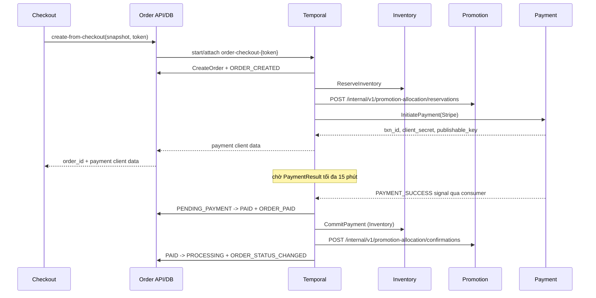
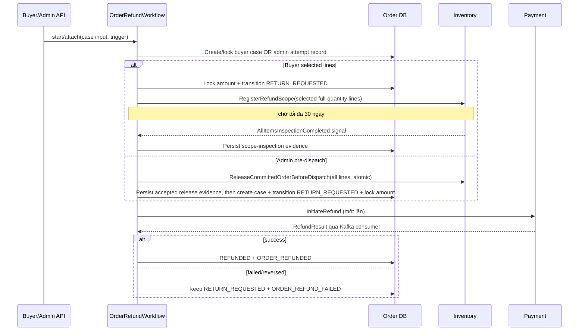

# Order Service — Luồng nghiệp vụ

> Các luồng dưới đây bảo toàn happy path, timeout, retry, race, compensation và
> recovery của thiết kế cũ. Contract payload chi tiết chưa được chuẩn hóa trong
> lần refactor này.

## Danh mục luồng nghiệp vụ

| ID | Workflow | Trigger | Tác nhân | Trạng thái |
|---|---|---|---|---|
| `WF-ORDER-001` | Xem chi tiết order | HTTP | Buyer/Admin | proposed |
| `WF-ORDER-002` | Search/filter order | HTTP | Buyer/Admin | proposed |
| `WF-ORDER-003` | Cancel hoặc admin force-refund | HTTP | Buyer/Admin | proposed |
| `WF-ORDER-004` | Checkout submit saga | HTTP + Temporal | Checkout | proposed |
| `WF-ORDER-005` | Xử lý payment signal và late recovery | Kafka + Temporal | Payment consumer | proposed |
| `WF-ORDER-006` | Nhận physical-dispatch fact | Kafka | Inventory consumer | proposed; delivery proof out of scope |
| `WF-ORDER-007` | Buyer yêu cầu return one-shot | HTTP | Buyer | proposed |
| `WF-ORDER-008` | Refund/return saga | Temporal + Kafka | Buyer/Admin/Inventory/Payment | proposed |
| `WF-ORDER-009` | Payment timeout và auto-cancel | Temporal timer | Checkout workflow | proposed |

## WF-ORDER-001 — Xem chi tiết order

**Mục tiêu:** trả lịch sử order denormalized từ PostgreSQL nóng mà không phụ thuộc
service khác. **Trigger:** `GET /v1/orders/{orderId}` sau Gateway authentication.

**Điều kiện trước và phân quyền:** order tồn tại; Buyer phải có
`orders.user_id=current_user_id`, Admin có full access. Backend eager-load master,
items, lines và promotions. Response dự kiến có `items[].lines[]`, `promotions[]`
và `status_history[]`; nguồn status history chưa được thiết kế.

**Happy path:** query dữ liệu bằng một read flow, kiểm tra ownership sau khi tìm
row, map snapshot sang response và trả 200. Không tìm thấy hoặc không visible trả
404/403 theo policy API được chốt sau. Read-only nên không phát event.

**Lỗi/timeout/retry:** DB timeout là lỗi hạ tầng; caller có thể retry GET. Không có
cache/fallback được thiết kế. Test phải bao phủ buyer owner/non-owner, admin,
multi-warehouse, promotion rỗng, snapshot nullable và order không tồn tại.

## WF-ORDER-002 — Search/filter order

**Mục tiêu:** trả một order-level card trên mỗi order cho buyer history/admin
dashboard, trực tiếp từ PostgreSQL. **Trigger:** `GET /v1/orders/search`.

**Input:** `tab` mặc định `ALL`; optional `q,from,to,cursor,limit`, order/payment
statuses và min/max amount theo query layer. Nếu thiếu range, dùng 90 ngày gần nhất.

**Happy path:** Gateway dựng scope Buyer/Admin. Không có `q` thì chạy class A trên
`orders`; có `q` thì class B tìm substring accent-insensitive trên
`order_item_lines.snapshot_name`, collapse về order rồi áp filter. Chạy count riêng
với cùng filter, derive buyer tab/card fields, lấy `limit+1`, trả `total_orders`,
`items[]`, `next_cursor`.

Tên khái niệm `snapshot_product_name` trong API/search description ánh xạ tới cột
`order_item_lines.snapshot_name`; CTE SQL cũ đặt alias `filtered` cho tập order sau
filter/cursor/limit.

**Pagination/idempotency:** cursor base64 chứa `(created_at_iso,order_id)`; tuple
predicate `<` với sort giảm dần giữ page ổn định tương đối. Đây là read-only.

**Lỗi và giới hạn:** query không fuzzy/tokenize/score/highlight/autocomplete. Input
cursor sai trả validation error; DB/extension lỗi không fallback ES. Test cần buyer
isolation, mọi tab precedence, boundaries time/amount, dấu tiếng Việt, duplicate
line collapse, equal timestamp ordering, last page và total count không bị cursor.

## WF-ORDER-003 — Cancel hoặc admin force-refund

**Mục tiêu:** Buyer/Admin hủy order chưa thanh toán; với order đã thu tiền, Admin
được chuyển sang refund lane thay vì hủy tài chính sai cách.

**Trigger/input:** `POST /v1/orders/{orderId}/cancel`, JWT/role, reason và optional
`Idempotency-Key`. Redis `SETNX order:req:cancel:{key}` TTL 7 ngày có thể replay
response đã lưu hoặc trả `409 IDEMPOTENCY_KEY_REUSED`. API lấy distributed lock
`order:lock:fsm:{orderId}` TTL 10 giây, sau đó `SELECT ... FOR UPDATE`.

**Nhánh A — pre-payment:** Buyer hoặc Admin với `PENDING_PAYMENT` first commits
`PENDING_PAYMENT -> CANCELLING` plus a durable cancellation command/dispatch record.
The workflow calls Payment cancel using the original `payment_transaction_id` and stable
key. Only a matching `CANCELED`/`ALREADY_NON_CAPTURED` fact permits
`RollbackPromotion -> RollbackInventory -> CANCELLED` and `ORDER_CANCELLED`. If Payment
returns `ALREADY_SUCCEEDED` or a matching `PAYMENT_SUCCESS` arrives, Order abandons the
cancel lane and enters paid forward-repair/reconciliation; `CANCEL_PENDING` is retried or
queried with the same key and does not release resources.

**Nhánh B — đã thu tiền:** Admin với `PAID/PROCESSING` creates/attaches a durable
pre-dispatch release **attempt**, then calls Inventory
`ReleaseCommittedOrderBeforeDispatch(order_id)`. Inventory locks every line and either
releases all committed undispatched lines in one transaction or rejects with no stock
movement. Only the all-line success creates/attaches the lifetime case, transitions to
`RETURN_REQUESTED`, locks `orders.final_amount`, and calls Payment; no Refund
Scope/receipt is registered. A rejection records the attempt only and does not burn a
future Buyer case.
If any line has dispatched or the root is mixed, return
`ADMIN_REFUND_REQUIRES_ALL_UNDISPATCHED` for manual exception rather than attempting
a partial release. Không signal CancelOrder vào checkout workflow cũ.

**Output/state:** trả `202 Accepted` và workflow/result reference; lưu trạng thái
command `IN_PROGRESS` trong Redis nếu cần replay. Invalid role/state trả 403/409.
WorkflowID serialize retry nhánh B; DB FSM giữ invariant nếu Redis mất key.

**Race/recovery:** concurrent Buyer/Admin cancel chỉ một CAS transition thắng.
Payment success cạnh cancel/timer được resolved by Payment's cancel/capture fact, then
serialized in Temporal. A start failure after the local command commit is recovered by the
workflow dispatcher; it cannot leave a terminal state inferred from Redis. Test phải bao
phủ duplicate key, key khác cùng order, lock expiry, cancel/capture race, uncertain
remote outcome, durable dispatch recovery và admin lane.

## WF-ORDER-004 — Checkout submit saga

**Mục tiêu:** biến checkout snapshot hợp lệ thành order, reserve tài nguyên, tạo
Stripe PaymentIntent và sau success đưa order tới `PROCESSING`.

**Actor/participants:** Checkout, Order API, Temporal, PostgreSQL, Redis,
Inventory, Promotion, Payment và outbox CDC. **Trigger:**
`POST /v1/orders/create-from-checkout`.

**Preconditions:** checkout token hợp lệ/chưa dùng/chưa hết TTL/chống tamper; input
server-side có address, route theo warehouse, SKU lines, amount và promotion
snapshot hợp lệ. WorkflowID là `order-checkout-{checkout_token}`; Redis mirror
`order:req:create:{checkout_token}` TTL 7 ngày.

### Pre-payment happy path và compensation

1. `CreateOrderActivity` tạo order/items/lines/promotions, address/product snapshot,
   `checkout_token`, trạng thái `PENDING_PAYMENT` và outbox `ORDER_CREATED`. Chỉ
   sau bước này mới có `order_id`; lỗi DB dừng trước mọi remote call.
2. `ReserveInventoryActivity`; thành công đăng ký `RollbackInventoryActivity`.
3. `ReservePromotionActivity` gọi
   `POST /internal/v1/promotion-allocation/reservations` all-or-nothing; thành công đăng ký
   `RollbackPromotionActivity` gọi `/internal/v1/promotion-allocation/cancellations`.
   Reserve chỉ ở submit, không ở Preview.
4. `InitiatePaymentActivity` persists the returned original transaction ID. An
   uncertain Payment create is recovered by replay/query of the same Payment key until
   one provider intent is proven; Order never continues with a blank/unknown payment.
   It returns `client_secret`, `publishable_key`, transaction ID; pre-capture cancel is
   registered only as a fact-based cancellation activity.
5. Workflow suspend chờ payment signal 15 phút, không giữ thread/CPU.

Failure chạy compensation đảo ngược các bước đã thành công. Promotion failure
phải bubble structured error cho Checkout dựng `409 PROMOTION_RECALCULATION_NEEDED`;
Order không tự evaluate lại discount. `RollbackPromotionActivity` chỉ release
runtime reservation, không thay wallet `USED/SAVED`.
Ví dụ lỗi nghiệp vụ upstream là `BUDGET_EXHAUSTED`; workflow giữ đúng promotion
thất bại và không collapse thành HTTP 500.

### Mốc tài chính và post-payment

Payment success before the timer must match the persisted original transaction, amount,
currency and monotonic financial version. It makes `UpdateOrderStatusActivity` lock row,
commit `PENDING_PAYMENT -> PAID`, tăng sequence và insert `ORDER_PAID` cùng transaction.
This is the financial watermark. Post-payment is **forward repair**, not a compensation
stack:

1. `CommitInventoryActivity` calls Inventory `CommitPayment` with stable command ID;
   every ambiguous response is recovered through `GET /commands/{command_id}` before a
   decision.
2. `ConfirmPromotionActivity` calls confirmations with `REDEEM_FINAL` key riêng mỗi
   promotion and replays the durable receipt after timeout/crash.
3. `UpdateOrderStatusActivity` chuyển `PAID -> PROCESSING`, phát
   `ORDER_STATUS_CHANGED`.

After the watermark no active checkout may call Inventory rollback or Promotion
`technical-cancellations`. A failed/unknown step retains the order in `PAID` or
`FINANCIAL_RECONCILIATION_REQUIRED`, retries the same command or opens manual repair;
it never returns a captured order to a pre-payment business state.

Promotion first replays durable `CONFIRM` receipt nếu đã có; command mới dùng
Confirm-Prepare chỉ để fence reservation Redis. Activity thành công khi receipt +
wallet/budget commit PostgreSQL, còn Redis finalizer có thể hội tụ sau. Vì vậy retry
sau khi reservation đã được dọn vẫn trả stored response. `CANCEL_FINAL` is deprecated
legacy cleanup and prohibited here. Cùng key khác canonical payload là lỗi không retry mù.

**Timeout/retry/output:** activity timeout 30 giây, retry tối đa 3; remote technical
timeout is never treated as a negative business outcome: query/replay the exact command
ID first. Workflow timeout 30 phút gồm payment window 15 phút và pre-payment rollback
buffer; post-capture repair has its own durable recovery lane. A committed workflow
dispatch record is written before API reports accepted; its dispatcher start/attaches the
fixed workflow ID after crash. Test phải inject failure tại từng activity, crash/resume,
duplicate submit, stale token, all-or-nothing promotion failure, signal/timer race,
stored-response replay/payload mismatch và từng post-capture forward-repair outcome.

## WF-ORDER-005 — Payment signal và late-payment recovery

**Mục tiêu:** route payment/refund event đúng workflow; không drop khoản thanh toán
thành công đến sau checkout timeout.

**Trigger:** `order-payment-consumer` nhận `t.payment.events`. Before signaling it
validates source/schema, event ID, `order_id`, persisted original payment transaction,
amount, currency and monotonic `financial_state_version`; then inserts a durable inbox
record in the same local transaction as any financial-routing state. Redis is only an
optional accelerator. It routes by persisted order/payment identity, not aggregate ID.

**Active checkout:** matching `PAYMENT_SUCCESS` signals `PaymentResult.SUCCESS`; workflow
commits `PAID`, phát `ORDER_PAID`, runs forward repair. `PAYMENT_FAILED/EXPIRED` signals
pre-payment failure; cancellation still requires the Payment non-capture fact. Consumer
does not directly commit master financial FSM.

**Late success:** only a matching success after a timeout cancellation starts/attaches
`order-late-payment-recovery-{order_id}` via durable dispatch. Recovery calls Inventory
`RecoverTimedOutPayment` with a stable command ID: it may commit only the original root
released for `RESERVATION_EXPIRED`, with full original stock still available and no
dispatch. It never performs a new Reserve/reroute. On success Order enters paid forward
repair, re-reserves and confirms Promotion only if its pre-payment reservation was
released. If Inventory recovery or subsequent Promotion repair cannot prove completion,
Order enters `FINANCIAL_RECONCILIATION_REQUIRED`; no automatic refund or business rollback
is allowed.

**Refund events:** processing/success/fail/reverse route the existing
`order-refund-{order_id}` case. `REFUND_REVERSED` may reopen a previously `REFUNDED`
master into `RETURN_REQUESTED` with `payment_status=REFUND_FAILED`, case
`MANUAL_VERIFICATION_REQUIRED`, and `ORDER_REFUND_FAILED`; it never creates another
refund transaction.

**Race/idempotency:** Temporal history serializes a signal/timer only after the consumer
has validated and durably recorded the fact. Duplicate/stale events are no-ops by inbox
and financial version, not Redis TTL. Test cần event duplicate/out-of-order, wrong
transaction/amount/currency, workflow not found, timeout-before/signal-before,
cancellation reason khác timeout, Inventory fenced recovery success/rejection, Promotion
repair failure -> financial reconciliation without a Payment refund command, and refund
reverse after Order already marked `REFUNDED`.

## WF-ORDER-006 — Nhận physical-dispatch fact

**Mục tiêu:** phản ánh đúng fact kho đã xuất hàng. Physical dispatch is not customer
delivery, therefore it must not complete the master order.

**Trigger/input:** `order-inventory-ship-consumer` nhận canonical
`com.ecommerce.inventory.reservation.line-dispatched.v1` from `t.inventory.order.events.v1`.
It uses durable inbox event ID/revision, not a synthesized shipment/delivery event.

**Happy path:** resolve the owning item/line from the immutable order-to-Inventory
allocation recorded at reserve/commit. For the matching line, CAS
`PROCESSING -> DISPATCHED`; only a changed row inserts `ORDER_ITEM_STATUS_CHANGED`.
There is no automatic `DELIVERED` or `COMPLETED` transition from this fact. A separate
Delivery proof contract is required before those transitions and buyer-return delivery
eligibility can be automated.

**Failure/race:** a line/warehouse mismatch is rejected to parking lot; it may not mark
another item. Duplicate/stale revision is no-op. DB lỗi không ack để retry; inbox and
outbox atomic cùng state. Test cần partial dispatch, nhiều kho, duplicate, out-of-order,
zero-line anomaly, and proof that no physical-dispatch event creates `DELIVERED` or
`ORDER_COMPLETED`.

## WF-ORDER-007 — Buyer yêu cầu return one-shot

**Mục tiêu:** Buyer gửi đúng một return request sau khi toàn bộ delivery unit đã
giao; request khóa một selected-line scope trước khi start refund saga.

**Trigger/input:** `POST /v1/orders/{orderId}/return`, JWT Buyer, header
`Idempotency-Key`, `lines[] {order_line_id, quantity}`, `reason`, `reason_details`.
Không có `refund_type`. Redis request key TTL 7 ngày không thay thế business guard.

**Preconditions:** Buyer sở hữu order; state thuộc lane cho phép return; mọi
`order_items.status=DELIVERED`; `lines[]` không rỗng, không duplicate, thuộc order,
và từng `quantity` bằng đúng `order_item_lines.quantity`. Scope có thể là tập con
các line nhưng không có partial quantity. Trong locked transaction, CAS
`buyer_return_locked_at IS NULL` và create refund case lifetime-unique.

**Happy path:** CAS thắng; start `order-refund-{order_id}` với
`trigger_source=API_RETURN`, reason `RETURN_API_ACCEPTED` và scope; trả `202` cùng
`refund_request_id`, `workflow_id`.

**Duplicate/failure:** cùng key trả conflict/replay theo Redis policy; key mới vẫn
không bypass one-shot. CAS thua trả `REFUND_CUSTOMER_REQUEST_ALREADY_USED`. Guard
không reset khi workflow/refund fail hoặc reverse. Nếu CAS đã commit nhưng start
Temporal lỗi, durable workflow dispatch retries/attaches bằng workflow ID ổn định.
Test bắt buộc race hai key, invalid scope, item chưa
giao, non-owner, Temporal unavailable sau CAS và permanent guard sau failure.

## WF-ORDER-008 — Refund/return saga

**Mục tiêu:** khóa một refund case/amount, chờ evidence Inventory phù hợp rồi gọi
Payment đúng một lần. Buyer return và Admin pre-dispatch force refund có gate
Inventory khác nhau.

**Preconditions:** trigger là `API_RETURN` hoặc `ADMIN_FORCE_REFUND`. Buyer đã pass
guard; Admin automatic path chỉ được thử tại `PAID/PROCESSING`. WorkflowID
`order-refund-{order_id}` và refund case PK chặn cả case song song lẫn case lịch sử
thứ hai.

**Happy path:** Buyer `CreateRefundCaseActivity` first verifies source/policy and creates
the lifetime case. Admin instead first creates/attaches a durable
`order_admin_refund_attempt` with fixed Inventory command/workflow IDs; it does **not**
create the lifetime case or consume the Buyer guard. Only an accepted all-line Inventory
release (including recovery of an uncertain command through its command outcome) causes
Order to atomically persist the response evidence, create the lifetime case and transition
to `RETURN_REQUESTED`. A rejected/mixed/dispatched release is a terminal attempt with no
Order case, no scope and no Buyer one-shot guard burned. Buyer then
transitions `COMPLETED -> RETURN_REQUESTED`, locks selected `order_line_id` and each
line's full quantity, snapshots price and locks
`min(sum(quantity * unit_price), final_amount)`, then calls `RegisterRefundScope`.
Consumer receives
`com.ecommerce.inventory.refund.all-items-inspection-completed.v1`, dedups and
signals only when `refund_scope_id`, request and every line/counter match the case. In
the same transaction it persists `event_id`, payload hash, aggregate/scope revision,
completion time and the complete expected/received/passed/failed counters before any
Payment command. Admin persists Inventory command ID, correlation ID, reservation
revision, exact released line IDs and response digest before Payment.
Mixed/all inspection `FAIL` is still a valid completion fact and therefore calls
Payment. Admin does not register a scope and retains `PAID/PROCESSING` while calling
`ReleaseCommittedOrderBeforeDispatch`; only its all-line atomic success transitions
to `RETURN_REQUESTED`, locks `orders.final_amount`, and continues. Any
dispatched/mixed result rejects with no stock movement. Only after the applicable
evidence creates the unique `refund_transaction_id`, set `REFUNDING` and call Payment.
Success commit `payment_status=REFUNDED`, master `REFUNDED`, case `SUCCEEDED` và
`ORDER_REFUNDED`.

**Promotion and amount boundary:** Buyer selected-line refund does not call Promotion
and `ORDER_REFUNDED` has no promotion allocation. Voucher remains a whole-order
benefit; wallet stays `USED` and budget stays consumed. The only amount calculation is
the gross selected-line snapshot value capped at `orders.final_amount`; discounts are
not re-prorated. Admin pre-dispatch amount is `orders.final_amount`.

**Timeout/manual recovery:** chờ Inventory tối đa 30 ngày. Quá hạn alert Ops và
vào lane `MANUAL_VERIFICATION_REQUIRED`. This is not a Payment bypass: the case can
resume only with the matching Inventory evidence, or be resolved as a documented
manual exception outside Release 1. It cannot create another scope/refund transaction.

**Payment failure/reverse:** a normal failure keeps master `RETURN_REQUESTED`, sets
`payment_status=REFUND_FAILED`, case `FAILED`, and emits `ORDER_REFUND_FAILED`; Buyer
guard không reset. `REFUND_PROCESSING` giữ/set `REFUNDING`. A `REFUND_REVERSED` after
previous `REFUNDED` reopens the same case to `MANUAL_VERIFICATION_REQUIRED`, transitions
master `REFUNDED -> RETURN_REQUESTED`, persists the reversal event proof and emits
`ORDER_REFUND_FAILED`. Không mở refund transaction thứ hai.

**Test:** selected full-quantity boundaries (A×1 rejects when line is A×2), two
workflow starts, duplicate/mismatched Inventory completion, multi-package mixed
PASS/FAIL, 30-day timeout, refund exactly once, provider fail/reverse, no Promotion,
crash between remote refund/local commit, permanent one-shot, and atomic admin
all-undispatched versus any-dispatched conflict.

## WF-ORDER-009 — Payment timeout và auto-cancel

**Mục tiêu:** giải phóng tài nguyên và cancel order nếu không thanh toán trong 15
phút, đồng thời vẫn xử lý an toàn payment success đến muộn.

**Trigger:** Temporal timer chạy song song với `PaymentResult`. Khi timer wins,
workflow first commits `CANCELLING` and its durable cancellation dispatch, then calls
Payment cancel with the stable key. Only matching `CANCELED`/`ALREADY_NON_CAPTURED`
permits `RollbackPromotion -> RollbackInventory -> CancelOrderActivity`, then commit
`CANCELLED`, `cancel_reason=PAYMENT_TIMEOUT` and outbox `ORDER_CANCELLED`.

**Race:** if payment signal/cancel response says `ALREADY_SUCCEEDED`, the timer must
not release inventory/promotion or publish cancellation; it enters paid forward repair.
If a confirmed non-capture timeout cancellation closes the workflow, a later matching
success is routed to `WF-ORDER-005` fenced late recovery. Promotion reservation grace
60 giây trước confirm giảm race ở biên but does not authorize post-capture rollback.

**Recovery/metrics:** every uncertain Payment/Inventory/Promotion response is
query/replayed with its stable command identity before any compensating decision.
Failure cần alert và workflow visibility để resume/manual action, không được đánh dấu
cancel hoàn tất khi Payment non-capture or resource cleanup chưa được chứng minh. Test
gồm timer chính xác, crash/resume, từng uncertain outcome, cancel/capture race,
duplicate timer/signal và late recovery.

## Tình huống kiểm thử xuyên suốt

- State/outbox atomicity và sequence đơn điệu trên cùng order.
- Request/event duplicate khi Redis còn key, mất key và quá TTL.
- Workflow replay/determinism sau restart hoặc deploy mixed version.
- Concurrent cancel, return, payment success, Inventory ship và refund result.
- Multi-warehouse isolation; tất cả buyer-tab precedence và search cursor.
- Không log PII/client secret; Buyer/Admin/service identity authorization.
- CDC at-least-once duplicate, connector lag và outbox cleanup watermark.
