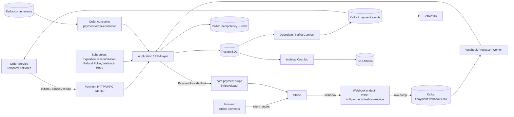

# Payment Service — Kiến trúc

> File này mô tả kiến trúc mục tiêu được chuyển từ thiết kế cũ (PostgreSQL-first,
> Stripe SDK direct, webhook async qua Kafka, Outbox CDC). Chưa có source path hoặc
> deployment config để đánh dấu `implemented`/`verified`.

## 1. Bối cảnh kiến trúc

Payment nằm giữa Order Service và Stripe. Order (Temporal Activity) gọi Payment để
tạo PaymentIntent và để hoàn tiền; Stripe gọi ngược Payment qua webhook; Payment
phát kết quả lên Kafka để Order signal workflow. Payment không nhận request trực
tiếp từ Buyer cho command tài chính — frontend chỉ dùng `client_secret` với Stripe
Elements/Checkout SDK và Stripe là bên thông báo kết quả.

Từ Phase 18 hệ thống chỉ dùng Stripe: bỏ VNPay/MoMo/ZaloPay, bỏ COD, bỏ Provider
Adapter/Factory Pattern. Toàn bộ Stripe-specific code nằm trong package
`com.payment.stripe`, application layer gọi qua interface `PaymentProviderPort`
với đúng một implementation `StripeAdapter`.

Trust boundary chính: webhook từ Internet phải được xác thực `Stripe-Signature`
trước khi bất kỳ business payload nào được parse; API command chỉ chấp nhận từ
Order Service (service credential); Kafka message từ Order được coi là dữ liệu
không tin cậy cho đến khi validate lane và trạng thái transaction.

## 2. Thành phần và trách nhiệm

| Thành phần | Trách nhiệm | Không được làm |
|---|---|---|
| HTTP/gRPC adapter | Nhận `initiate`, `refund`, `query`; validate input; kiểm tra idempotency; gọi application service | Chứa business FSM; gọi Stripe trực tiếp |
| Webhook endpoint | Nhận raw body + header Stripe, trả 200 trong < 500ms, produce lên `t.payment.webhooks.raw` | Verify signature, parse payload hoặc ghi DB đồng bộ |
| Application/FSM layer | `@Transactional` gom transaction + outbox + status history; Spring State Machine cho Payment FSM và Refund FSM; guard signature/amount/reference/idempotency | Publish Kafka trực tiếp; bỏ qua guard |
| `com.payment.stripe` (`PaymentIntentClient`, `RefundClient`, `WebhookVerifier`) | Wrap `PaymentIntent.create/retrieve`, `Refund.create/retrieve`, `Webhook.constructEvent`; dùng một `StripeClient` singleton với API key từ Vault/Secret Manager | Chứa logic nghiệp vụ Payment; lộ Stripe type ra ngoài package |
| Webhook Processor Worker | Consume raw webhook, verify signature, map event → transition, dedup, update DB + outbox trong một ACID transaction | Bỏ qua verify khi retry; ack trước khi commit |
| Order consumer (`payment-order-consumer`) | Consume `ORDER_CANCELLED` as a post-command reconciliation notification | Treat event as the authoritative cancel command or auto-refund |
| Payment Expiration Scanner | Chuyển transaction quá `expires_at` sang `EXPIRED`, phát `PAYMENT_EXPIRED` | Expire khi Stripe đã xác nhận success |
| Reconciliation Worker | Đối soát hourly với Stripe, ghi mismatch report, phát correction transition | Sửa dữ liệu ngoài transition hợp lệ |
| Refund Status Poller | Poll `Refund.retrieve` cho refund `PROCESSING`, chốt trạng thái cuối khi webhook miss | Gọi Stripe khi không lấy được lock |
| Webhook Auto-Retry Worker | Đẩy lại webhook `FAILED_SIGNATURE`/`UNPROCESSED` vào Kafka có backoff | Bỏ qua `max_retries` |
| Dead-letter Replay Worker | Replay thủ công theo filter, re-validate idempotency, batch nhỏ có rate limit | Replay không audit |
| Archival CronJob | Detach partition > 6 tháng, dump lên S3, verify checksum, drop | Drop trước khi verify S3 |
| PostgreSQL | Source of truth cho transaction, refund, webhook log, audit, outbox, idempotency | Shared database cho service khác |
| Redis (Lettuce/Redisson) | Idempotency pointer `payment:initiate:{order_id}`, distributed lock `lock:payment:{action}:{id}` | Source of truth cho trạng thái |
| Debezium/Kafka Connect | Đọc WAL outbox, route `aggregate_type=Payment` → `t.payment.events` với partition key `order_id` | Cần cột polling-style trong outbox |

## 3. Mô hình xử lý

### 3.1. Đồng bộ

- `POST /v1/payments/initiate`: local transaction persists `INITIATING` plus stable
  provider operation → Stripe `PaymentIntent.create` with that same key → only a
  proven provider result becomes `PENDING` + client secret/outbox. An uncertain
  create is replayed/reconciled, never represented as a blank PENDING transaction.
- `POST /v1/payments/{transactionId}/cancel`: local transaction persists/replays a
  stable cancel operation → `PaymentIntent.cancel` with the same provider key →
  returns non-capture or `ALREADY_SUCCEEDED`. Order must wait for this fact before it
  finalizes cancellation.
- `POST /v1/payments/{transactionId}/refund`: validate + local transaction →
  distributed lock → Stripe `Refund.create` với `Idempotency-Key` → trả
  `PROCESSING`. Response "accepted" không phải "final".
- `GET /v1/payments/{transactionId}`: đọc PostgreSQL, join refunds.
- Webhook endpoint: đồng bộ chỉ ở mức nhận và produce Kafka; trả 200 ngay.

### 3.2. Bất đồng bộ và transaction boundary

- Webhook đi đường Raw → Kafka `t.payment.webhooks.raw` → Webhook Processor
  Worker. Lý do: Stripe retry nếu response > 5s (3–5 lần, exponential backoff) gây
  duplicate; DB down lúc webhook đến sẽ mất event vĩnh viễn; Kafka at-least-once +
  worker idempotent cho "không mất, không trùng"
  ([ADR-004](./decisions/ADR-004-async-webhook-processing-via-kafka.md)).
- Mỗi state transition được commit trong một transaction PostgreSQL gồm: update
  transaction (optimistic lock `version`) + insert `payment_status_history` +
  insert `outbox_events`. Debezium relay sau commit
  ([ADR-005](./decisions/ADR-005-transactional-outbox-cdc.md)).
- Side effect ngoài (gọi Stripe) không nằm trong DB transaction. Every create,
  cancel and refund first persists a durable provider-operation key/fingerprint;
  timeout recovery replays or reconciles that operation before changing FSM. Với
  refund, refund row `PENDING` + payment
  `REFUNDING` được commit trước khi gọi `Refund.create`; kết quả cuối
  (`succeeded`/`pending`/`failed`/`reversed`) đến qua webhook `charge.refunded`
  hoặc poller.
- Scheduled jobs dùng Spring `@Scheduled` (+ Spring Retry khi gọi Stripe).

### 3.3. Mapping Stripe event → FSM

| Stripe event | Transition | Kết quả |
|---|---|---|
| `payment_intent.succeeded` | `T2` `PAYMENT_SUCCESS_CONFIRMED` | `SUCCESS`, phát `PAYMENT_SUCCESS` |
| `payment_intent.payment_failed` | `T3` `PAYMENT_FAILED_CONFIRMED` | `FAILED`, phát `PAYMENT_FAILED` |
| `payment_intent.canceled` | `T5` `PAYMENT_CANCELED` | `CANCELED` |
| `charge.refunded` | `R2` `REFUND_SUCCESS_CONFIRMED` (hoặc `status=failed` → reversal) | `SUCCESS`/`FAILED`/`REFUND_REVERSED` |

## 4. Mô hình nhất quán

| Phạm vi | Mô hình | Cơ chế |
|---|---|---|
| Trạng thái transaction/refund | Strong/local ACID | PostgreSQL transaction + optimistic lock `version` |
| State và event Payment phát ra | Atomic local, eventual publish | Transactional outbox + Debezium CDC |
| Trạng thái thật trên Stripe ↔ DB nội bộ | Eventual, có reconciliation | Webhook + poller + reconciliation hourly có quyền phát transition bù |
| Order nhìn thấy kết quả thanh toán | Eventual | `t.payment.events` at-least-once, partition theo `order_id` |
| Redis idempotency pointer/lock | Tạm thời, có thể mất | TTL; fallback DB unique constraint |
| Dữ liệu > 6 tháng | Cold, đọc chậm 2–5s | S3/Athena tiered read |

Source of truth là PostgreSQL transaction. Khi provider và nội bộ lệch trạng thái,
Reconciliation job có quyền phát transition bù để đưa hệ thống về trạng thái đúng.
Chưa có SLO chính thức cho độ trễ publish; SLO gợi ý trong `operations.md`.

## 5. Mô hình đồng thời và ordering

Chiến lược kết hợp ([ADR-006](./decisions/ADR-006-optimistic-lock-and-redis-lock-strategy.md)):

- **Optimistic Locking (cột `version`)** là default guard cho **tất cả** state
  transition (ví dụ hai webhook Stripe ghi đè nhau). Không tốn overhead Redis.
- **Distributed Lock (Redis Redisson)** cho tác vụ có side effect ngoài không thể
  rollback qua DB: gọi Stripe tạo PaymentIntent/Refund, cronjob quét transaction.
  Naming `lock:payment:{action}:{txn_id}` (ví dụ `lock:payment:refund:txn_123`,
  `lock:payment:initiate:order_10001`, `lock:payment:refund_call:{txn_id}`,
  `lock:payment:refund_poll:{refund_transaction_id}`). TTL 15–30s để lock không
  treo vĩnh viễn khi worker crash.
- **Redis degradation:** API read/reconciliation không ảnh hưởng; Idempotency API
  (initiate/refund) fallback xuống insert + unique constraint ở DB
  (`payment_idempotency`, `refund_transactions.idempotency_key`,
  `refund_transactions.order_id`); worker không lấy
  được lock thì reject và đẩy vào retry cycle/DLQ thay vì ignore lock.
- **Webhook dedup:** `INSERT INTO webhook_logs ... ON CONFLICT (provider,
  provider_transaction_id, event_type) DO NOTHING`; 0 rows → đã xử lý → ack. Bổ sung
  check `stripe_event_id` để dedup cross-attempt.
- **Out-of-order:** áp rule state precedence theo bảng FSM; không override ngược
  trạng thái terminal hợp lệ.
- **Ordering downstream:** partition key `order_id` cho mọi event của cùng đơn
  (payment + refund) để Order consumer nhận strict ordering
  ([ADR-007](./decisions/ADR-007-order-id-partition-key.md)).
- **Refund double spend:** unique `refund_transactions.order_id` plus
  `new_amount <= paid_amount` are checked atomically; `Idempotency-Key` do Order
  sinh và ổn định qua retry được truyền sang Stripe.

## 6. Mô hình triển khai

Thiết kế yêu cầu các process/runtime logic sau, chưa chốt chạy chung hay tách pod:

- Payment HTTP/gRPC API server (initiate, refund, query, webhook endpoint).
- Webhook Processor consumer trên `t.payment.webhooks.raw`.
- Order consumer group `payment-order-consumer` trên `t.order.events`.
- Scheduled jobs: Expiration Scanner (1–2 phút), Reconciliation (hourly), Refund
  Status Poller (5–15 phút), Webhook Auto-Retry, Archival CronJob (Chủ nhật 3:00 AM).
- PostgreSQL (partition monthly cho `payment_transactions`, khuyến nghị
  `pg_partman`), Redis, Kafka.
- Debezium/Kafka Connect outbox connector.

API server scale ngang. Webhook Processor scale theo partition của
`t.payment.webhooks.raw`. Các cronjob quét transaction phải dùng distributed lock
để nhiều instance không xử lý trùng; poller lock theo từng refund. Archival job
nên chạy singleton.

## 7. Ràng buộc kiến trúc

- Không service nào ghi trực tiếp vào database Payment; Payment không query
  database service khác.
- Không phát event trước khi transaction commit; `outbox_events` append-only,
  cấm cột polling-style (retry/DLQ/backoff thuộc Kafka Connect runtime).
- Không xử lý webhook đồng bộ tại endpoint; verify signature luôn xảy ra trước
  state transition.
- Không đặt business logic trong controller, Kafka adapter hay package
  `com.payment.stripe`.
- Không auto-refund từ `ORDER_CANCELLED` hay bất kỳ shipping event nào; refund chỉ
  từ explicit command của Order.
- Payment is authoritative for the pre-capture cancel/capture race. An Order event
  cannot turn a `SUCCESS` fact into `CANCELED`; the result is durable financial
  reconciliation, not compensation by assumption.
- Không hỗ trợ COD hoặc provider ngoài Stripe nếu chưa có ADR thay thế.
- Giữ code boundary Refund rõ (`src/refund/`, interface riêng, contract độc lập)
  để tách service khi đạt ngưỡng Phase 2.

## 8. Đánh đổi và ADR liên quan

- [ADR-001](./decisions/ADR-001-java-spring-boot-runtime.md): Java/Spring Boot cho
  FSM framework, `@Transactional` và Stripe SDK mature; đổi lại nặng hơn Go.
- [ADR-002](./decisions/ADR-002-refund-inside-payment-service.md): Refund trong
  Payment giữ transaction boundary cho one-refund-per-order và amount guard; đổi
  lại phải tách sau khi refund ratio > 5%.
- [ADR-011](./decisions/ADR-011-one-lifetime-order-refund.md): Order supplies one
  stable case and Inventory evidence; provider fail/reverse remains manual review,
  not a second refund.
- [ADR-012](./decisions/ADR-012-recoverable-initiation-and-cancel.md): provider
  create/cancel side effects have durable identities and Order waits for the
  cancel/capture fact; đổi lại adds recovery state and reconciliation work.
- [ADR-003](./decisions/ADR-003-stripe-single-provider-direct-sdk.md): bỏ adapter
  pattern giảm phức tạp; đổi lại vendor lock-in với Stripe.
- [ADR-004](./decisions/ADR-004-async-webhook-processing-via-kafka.md): webhook
  async không mất event; đổi lại thêm topic nội bộ và độ trễ xử lý.
- [ADR-005](./decisions/ADR-005-transactional-outbox-cdc.md): CDC giữ atomicity;
  đổi lại phụ thuộc WAL/Kafka Connect và migration từ polling.
- [ADR-006](./decisions/ADR-006-optimistic-lock-and-redis-lock-strategy.md):
  optimistic lock rẻ, Redis lock chỉ cho side effect; đổi lại cần fallback khi
  Redis sập.
- [ADR-007](./decisions/ADR-007-order-id-partition-key.md): partition theo
  `order_id` cho strict ordering; đổi lại `aggregate_id` và routing key khác nhau.
- [ADR-008](./decisions/ADR-008-minimal-event-payload-phase-20.md): payload tối
  thiểu cho Order; đổi lại Analytics phải join thêm.
- [ADR-009](./decisions/ADR-009-monthly-partitioning-and-tiered-archive.md):
  partition + S3 archive giữ hiệu năng scanner; đổi lại thêm archival job và
  tiered read.
- [ADR-010](./decisions/ADR-010-refund-only-by-explicit-order-command.md): refund
  chỉ từ Order command giữ boundary rõ; đổi lại `ORDER_CANCELLED` với `SUCCESS`
  chỉ ghi reconciliation marker.
