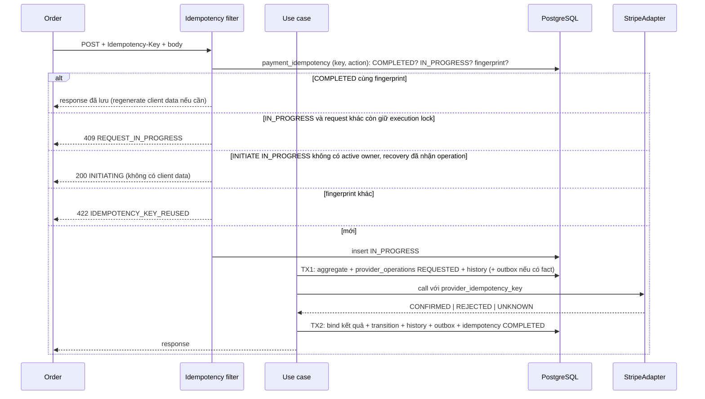

# Payment Service — Kiến trúc

> Kiến trúc mục tiêu của Payment Service: PostgreSQL-first, Stripe SDK direct,
> webhook async qua Kafka, outbox CDC, side effect provider durable. File này trả
> lời "thành phần nào, ranh giới nào, pattern nào, vì sao"; hành vi chi tiết ở
> `domain.md`/`workflows.md`, schema ở `data.md`, vận hành ở `operations.md`. Chưa có
> source path hoặc deployment config để đánh dấu `implemented`/`verified`.

## 1. Bối cảnh kiến trúc

### 1.1. Vị trí trong hệ thống

Payment là **authority duy nhất về trạng thái tiền** của một order. Nó nằm giữa
Order Service (chủ saga) và Stripe (provider), không có bề mặt public cho buyer:

- **Order → Payment (HTTP, sync):** initiate / cancel / refund / query / client-data
  qua Temporal Activity; interaction `order-initiates-payment` trong
  `contracts/catalog/interactions.yaml`.
- **Frontend → Stripe (trực tiếp):** Stripe Elements dùng `client_secret` do Payment
  cấp (Order relay). Payment không nhận request từ buyer.
- **Stripe → Payment (HTTPS webhook):** route public duy nhất của Payment, đi qua
  Gateway với middleware `stripe-webhook` (bypass JWT, giữ raw body, không retry).
- **Payment → Kafka → Order/Analytics:** financial fact v2 qua outbox CDC;
  interaction `payment-publishes-payment-events`.
- **Payment → Stripe (HTTPS egress):** qua mesh `ServiceEntry`, `REGISTRY_ONLY`.


### 1.2. Ranh giới tin cậy

| Ranh giới | Cơ chế | Điều Payment tin / không tin |
|---|---|---|
| Stripe → webhook endpoint | Gateway: rate limit, giữ nguyên raw body, bypass JWT. Payment: `Stripe-Signature` HMAC + cửa sổ 300s, verify ở worker | Không tin gì trước khi verify; candidate event ID chỉ dùng best-effort làm Kafka key, fallback SHA-256 raw body, không phải identity cho tới khi verify |
| Order → HTTP v1 | Mesh mTLS + `AuthorizationPolicy` (principal `ecommerce/order-service`); header `X-Service-Identity` chỉ để attribution | Tin identity mesh; **không** tin nội dung: fingerprint idempotency, `order_id` khớp transaction, amount ≤ paid |
| Payment → Stripe | Secret key từ Vault; egress chỉ qua `ServiceEntry` | Tin response Stripe là fact provider, nhưng chỉ sau khi bind vào `provider_operations` |
| Kafka out | Chỉ Debezium ghi topic; consumer tự dedup theo CloudEvents `id` | Payment không tin consumer đã nhận; at-least-once |
| Vận hành | Endpoint admin/DLQ/correction yêu cầu quyền quản trị, `actor` + `cause_ref` | Mọi thay đổi trạng thái thủ công đều là transition có audit |

Gateway matrix chỉ có route webhook cho Payment (`docs/gateway/runtime-contract.md`);
không có route `/api/payments/**` nào khác vì buyer đọc payment qua Order.
Gateway rewrite chính xác public `/api/payments/webhook/stripe` sang upstream
`/v1/payments/webhook/stripe`; rewrite chỉ đổi path, raw body và `Stripe-Signature`
phải được forward nguyên vẹn.

### 1.3. Quyết định định hình

Từ Phase 18 chỉ dùng Stripe: bỏ VNPay/MoMo/ZaloPay, COD và Provider Adapter/Factory
([ADR-003](./decisions/ADR-003-stripe-single-provider-direct-sdk.md)). Từ 2026-09:
side effect provider durable và cancel là fact
([ADR-012](./decisions/ADR-012-recoverable-initiation-and-cancel.md)); một OLTP
schema không partition ([ADR-013](./decisions/ADR-013-single-oltp-retention-no-partition.md));
decline phi terminal, terminal non-capture chỉ sau khi intent đã hủy
([ADR-014](./decisions/ADR-014-decline-non-terminal-and-canceled-intent-before-non-capture-terminal.md)).

## 2. Thành phần và trách nhiệm

### 2.1. Cấu trúc code (hexagonal)

```
com.platform.paymentservice
├── domain            # PaymentTransaction, RefundTransaction, ProviderOperation, ReviewCase,
│                     # FSM (Spring State Machine config), guard, policy decline, error
├── application       # use case: InitiatePayment, CancelPayment, InitiateRefund,
│                     # ApplyStripeEvent, ExpireSession, RecoverOperation, Reconcile,
│                     # PollRefund, ResolveReviewCase; port: PaymentProviderPort,
│                     # PaymentRepository, OutboxPort, IdempotencyPort, LockPort, ClockPort
├── adapter
│   ├── in.http       # HTTP v1 controllers, problem+json mapping, idempotency filter
│   ├── in.webhook    # endpoint dump raw → Kafka
│   ├── in.kafka      # Webhook Processor consumer
│   ├── in.scheduler  # @Scheduled entry points → use case
│   ├── out.persistence  # JPA/JDBC repositories, outbox insert, history insert
│   ├── out.redis     # idempotency pointer, Redisson lock
│   └── out.crypto    # envelope encryption client_secret (KMS/Vault)
└── stripe            # StripeAdapter (PaymentProviderPort), PaymentIntentClient,
                      # RefundClient, WebhookVerifier, StripeErrorMapper; duy nhất nơi
                      # import com.stripe.*
```

Package gốc theo quy ước repo (`com.platform.<service>`, như `promotion-service`); ADR-003
gọi package Stripe là `com.payment.stripe` — cùng một thứ, tên hiện hành là
`com.platform.paymentservice.stripe`.

Quy tắc phụ thuộc: `domain` không import gì ngoài JDK; `application` chỉ import
`domain`; `adapter.*` và `stripe` import `application`/`domain`, không import nhau.
Kiểm tra bằng ArchUnit trong CI (§7).

### 2.2. Thành phần runtime

| Thành phần | Trách nhiệm | Không được làm |
|---|---|---|
| HTTP v1 adapter | Xác thực workload, đọc header (`Idempotency-Key`, `X-Correlation-Id`), validate schema, chạy idempotency filter (`payment_idempotency` fingerprint + `IN_PROGRESS`), gọi use case, map lỗi domain → problem+json | Chứa FSM; gọi Stripe; đọc/ghi DB ngoài repository |
| Webhook endpoint | Reject `400` nếu thiếu body/`Stripe-Signature`; nếu đủ envelope thì nhận raw body + headers, best-effort lấy candidate event ID (fallback hash raw body), produce `t.payment.webhooks.raw`, trả `200` (hoặc `503` khi Kafka lỗi để Stripe retry) | Deserialize/validate business payload, verify chữ ký, ghi DB, gọi Stripe |
| Application/use case | Mở/đóng transaction (TX1/TX2, §3.4), gọi domain, ghi outbox + history trong cùng TX, gọi port provider **ngoài** TX | Publish Kafka trực tiếp; bỏ qua guard; suy luận trạng thái provider |
| Domain | Hai FSM, guard, policy decline, invariant; thuần, test không cần hạ tầng | Biết Stripe type, JPA, Spring |
| `com.platform.paymentservice.stripe` | `PaymentProviderPort` duy nhất; wrap `PaymentIntent.create/retrieve/cancel`, `Refund.create/retrieve`, `Webhook.constructEvent`; map lỗi Stripe → `ProviderOutcome` (`CONFIRMED`/`REJECTED`/`UNKNOWN`); một `StripeClient` singleton, API version pin | Chứa nghiệp vụ; lộ `com.stripe.*` ra ngoài; tự sinh idempotency key |
| Webhook Processor | Consume raw, verify, dedup, resolve, map event → use case `ApplyStripeEvent`, ack sau commit | Ack trước commit; bỏ verify khi retry |
| Expiration Scanner | `PENDING` quá hạn → `CANCEL` operation → cancel intent → `T4`/`T2` | Expire bằng suy luận; đụng `INITIATING`/`PROCESSING` |
| Provider-operation Recovery | Replay `REQUESTED`/`UNKNOWN` cùng key; bind hoặc review case | Sinh key mới; suy luận non-capture |
| Refund Status Poller | `Refund.retrieve` cho `PROCESSING` | Gọi khi không có lock; xử lý reversal (thuộc reconciliation) |
| Reconciliation | So DB ↔ Stripe theo cửa sổ; `CORR` khi không freeze; `reconciliation_runs` | Sửa ngoài transition hợp lệ; chạy nhiều instance |
| Webhook Auto-Retry / DLQ Replay | Re-verify, re-push; replay thủ công có audit | Bỏ `max_retries`; replay không dedup |
| Retention Trimmer | Xóa theo `data.md §7` | Xóa outbox trên CDC watermark; xóa bảng audit |
| PostgreSQL | Source of truth 9 bảng; một schema | Shared DB cho service khác |
| Redis | Replay pointer + lock TTL | Source of truth; cấp quyền side effect |
| Debezium/Kafka Connect | WAL → `t.payment.events.v2` qua outbox SMT | Được thay bằng polling worker |
| KMS/Vault | Secret Stripe; key mã hóa `client_secret` | Lưu plaintext secret ở app |

## 3. Mô hình xử lý

### 3.1. Ba pipeline

| Pipeline | Vào | Ra | Đặc tính |
|---|---|---|---|
| Command (sync) | HTTP từ Order | Response + outbox | Idempotent theo key; TX1 → provider → TX2 (§3.4); p95 ≤ 1.5s |
| Fact (async) | Stripe webhook → Kafka | Transition + outbox | At-least-once, dedup `stripe_event_id`, precedence theo `event_created_at`; ack sau commit |
| Scheduled | Clock | Transition/operation/outbox | Batch nhỏ, `SKIP LOCKED`, lock theo payment, singleton khi cần |

Cả ba pipeline hội tụ ở **cùng use case và cùng FSM**; không có đường "nhanh" bỏ
qua guard cho bất kỳ pipeline nào.

### 3.2. Command pipeline



`UNKNOWN` (timeout/ambiguous) kết thúc ở TX2 với operation `UNKNOWN`; request đã quan
sát ambiguity nhận `503 retryable`, idempotency vẫn `IN_PROGRESS` tới khi recovery
bind được. Request đồng thời chỉ nhận `409` khi còn active execution owner; replay
initiate sau khi owner đã nhả lock và recovery đã nhận operation có thể nhận
`200 INITIATING` để phân biệt với contention.

### 3.3. Fact pipeline

1. Endpoint: raw body + `Stripe-Signature` → Kafka; `200` sau khi producer ack.
2. Processor: verify → `INSERT webhook_logs ON CONFLICT DO NOTHING` → resolve
   object → guard amount/reference → `ApplyStripeEvent` → một transaction:
   transition + `financial_state_version` + history + outbox + review case (nếu có)
   + `webhook_logs.PROCESSED` → ack Kafka.
3. Lỗi tạm → `FAILED_PROCESSING` + `next_retry_at`; ack (không block partition); Auto-Retry
   đẩy lại. Lỗi vĩnh viễn (không map, sai amount) → `IGNORED`/review case; ack.

Vì sao async ([ADR-004](./decisions/ADR-004-async-webhook-processing-via-kafka.md)):
Stripe coi > 5s là fail và retry gây duplicate; DB down lúc webhook đến sẽ mất fact
vĩnh viễn nếu xử lý đồng bộ; Kafka giữ fact cho tới khi DB trở lại.

### 3.4. Pattern hai transaction quanh side effect provider

Mọi side effect Stripe (create/cancel/refund) tuân theo cùng một khung:

```
TX1  commit ProviderOperation{REQUESTED, provider_idempotency_key, fingerprint}
     (+ aggregate ở trạng thái "đang chờ provider": INITIATING / REFUNDING / ...)
---  ngoài transaction: gọi Stripe với đúng key đó; kết quả CONFIRMED | REJECTED | UNKNOWN
TX2  bind provider_object_id, transition FSM, history, outbox, operation status
```

Hệ quả kiến trúc:

- Không bao giờ giữ DB transaction mở trong lúc gọi Stripe (pool, lock).
- Crash giữa TX1 và TX2 để lại operation `REQUESTED`/`UNKNOWN` → Recovery replay
  **cùng key**; Stripe idempotency trả lại object cũ, không tạo side effect mới.
- Redis lock chỉ giảm số lần gọi song song; **quyền** gọi thuộc operation đã commit
  ([ADR-012](./decisions/ADR-012-recoverable-initiation-and-cancel.md)).
- Mọi terminal non-capture (`T3`/`T4`/`T5`) là một `CANCEL` operation đã
  `PROVIDER_CONFIRMED` — Order nhận `PAYMENT_FAILED/EXPIRED/CANCELED` là biết intent
  không thể capture ([ADR-014](./decisions/ADR-014-decline-non-terminal-and-canceled-intent-before-non-capture-terminal.md)).

### 3.5. Mapping Stripe event → FSM

| Stripe event | Transition | Financial fact |
|---|---|---|
| `payment_intent.processing` | `T1` | — |
| `payment_intent.succeeded` | `T2` | `PAYMENT_SUCCESS` |
| `payment_intent.payment_failed` | `T3a` (retryable) hoặc `CANCEL` op → `T3` (non-retryable/quá ngưỡng) | — / `PAYMENT_FAILED` |
| `payment_intent.canceled` | `T3`/`T4`/`T5` theo `CANCEL` operation đã ghi; thường no-op | `PAYMENT_FAILED`/`PAYMENT_EXPIRED`/`PAYMENT_CANCELED` nếu chưa áp |
| `charge.refunded` | `R2` + `T7` | `REFUND_SUCCESS` |
| `charge.refund.updated` / `refund.failed` (`status=failed`) | `R3` + `T8` (đang `PROCESSING`) hoặc `R5` + `T9` (đã `SUCCESS`) | `REFUND_FAILED` / `REFUND_REVERSED` |
| `charge.dispute.created` | — (review case `DISPUTE_OPENED`) | — |
| khác | `IGNORED` | — |

Chi tiết guard và precedence: `domain.md §6.4`, `interfaces.md §4`.

## 4. Mô hình nhất quán

| Phạm vi | Mô hình | Cơ chế | Ai là nguồn thật |
|---|---|---|---|
| Payment/Refund state + audit + outbox | Strong, local ACID | Một transaction cho mỗi transition | PostgreSQL Payment |
| Side effect Stripe ↔ DB | Eventual, có recovery | `provider_operations` + replay cùng key + reconciliation | Stripe cho trạng thái provider; Payment cho trạng thái nghiệp vụ |
| Stripe ↔ DB (drift) | Eventual, có correction | Webhook → poller → reconciliation hourly → `CORR` (khi không freeze) → review case | Stripe |
| Payment → Order | Eventual, at-least-once, ordered theo `order_id` | Outbox CDC; `financial_state_version` monotonic per transaction | Payment |
| Order đọc trực tiếp | Read-your-writes | `GET /v1/payments/{id}` đọc primary sau commit | Payment |
| Client data | Strong tại Payment | Mã hóa at rest; `usable` tính tại thời điểm đọc | Payment (Stripe giữ bản gốc) |
| Redis | Best-effort | TTL; mất Redis không đổi kết quả | — |
| Review case | Strong | Cùng transaction với transition mở case | Payment |

`financial_state_version` là **contract nhất quán** với Order: mọi fact của một
payment transaction mang version tăng đúng 1; Order lưu `last_financial_state_version`
và bỏ qua fact có version ≤ đã thấy. Partition order Kafka chỉ là tối ưu, không phải
guard.

## 5. Mô hình đồng thời và ordering

Bốn lớp guard, từ rẻ đến đắt, áp theo thứ tự:

1. **Unique constraint** (`(order_id, attempt)`, `provider_transaction_id`,
   `refund.order_id`, `provider_idempotency_key`, `stripe_event_id`, partial unique
   `CREATE`/`CANCEL` per payment, một review case mở/payment) — guard cuối, không
   phụ thuộc Redis.
2. **Optimistic lock `version`** trên aggregate — hai writer (webhook vs poller vs
   scanner) không ghi đè nhau; thua → retry/requeue
   ([ADR-006](./decisions/ADR-006-optimistic-lock-and-redis-lock-strategy.md)).
3. **State precedence** — FSM từ chối transition không hợp lệ; `event_created_at`
   quyết định khi hai fact mâu thuẫn; terminal không bị override; `succeeded` sau
   terminal non-capture → review case `CAPTURE_AFTER_CANCEL`.
4. **Redis lock** `payment:lock:{payment_transaction_id}` (TTL 30s) — chỉ để tránh
   gọi Stripe song song cho cùng payment; mất lock không mất đúng đắn.

Ordering:

- **Kafka raw webhook:** key `stripe_event_id` → cùng payment có thể ở partition
  khác; đúng đắn dựa vào lớp 2–3, không dựa vào partition.
- **Kafka fact out:** key `order_id` → mọi `PAYMENT_*`/`REFUND_*` của một order cùng
  partition ([ADR-007](./decisions/ADR-007-order-id-partition-key.md)); Order vẫn
  guard bằng `financial_state_version`.
- **Stripe:** idempotency key theo operation, không theo request; retry với cùng
  key + cùng payload; key với payload khác bị Stripe từ chối (`idempotency_error`)
  → operation `PROVIDER_REJECTED` + review case.
- **Scheduler nhiều instance:** `SELECT … FOR UPDATE SKIP LOCKED` trên batch +
  lock theo payment; reconciliation/trimmer singleton.

## 6. Mô hình triển khai

### 6.1. Process

| Process | Thành phần | Scale | Readiness |
|---|---|---|---|
| `payment-api` | HTTP v1 + webhook endpoint | Ngang, 2+ | Command: PostgreSQL + KMS; webhook: Kafka producer (probe riêng) |
| `payment-worker` | Webhook Processor + tất cả scheduler | Ngang tới số partition raw (6); scheduler dùng lock | PostgreSQL + Kafka consumer + Stripe key |

Có thể gộp hai process một image, tách bằng profile; tách process để scale và
deploy độc lập (worker restart không làm rớt webhook endpoint).

### 6.2. Mạng và policy

- Mesh `AuthorizationPolicy` cho `payment-service` cấp principal
  `ecommerce/order-service` đúng sáu operation Order-facing: `POST initiate/cancel/refund`
  và `GET payment/client-data/refund`; không dùng wildcard `POST /v1/payments/**` vì
  wildcard đó sẽ bao trùm webhook. Riêng `POST /v1/payments/webhook/stripe` chỉ từ
  `edge/traefik`; metrics từ `observability/prometheus` (bảng ở
  `docs/mesh/runtime-contract.md`).
- Mesh timeout `POST /v1/payments/**` 15s, **không retry** (caller sở hữu retry bằng
  idempotency key); gateway chờ header webhook 20s, không retry.
- Egress Stripe qua `ServiceEntry`; không egress nào khác.
- Gateway: chỉ `POST /api/payments/webhook/stripe` (`stripe-webhook`: bypass JWT,
  giữ raw body, rate limit theo IP), rewrite upstream sang
  `/v1/payments/webhook/stripe`; Payment không có route buyer.

### 6.3. Hạ tầng

PostgreSQL primary (+ replica cho `GET` dashboard/vận hành), Redis, Kafka (2 topic),
Debezium connector, Vault/KMS. Cấu hình và giá trị ở `operations.md §2`; dung lượng
và giả định tải ở `operations.md §6`.

## 7. Ràng buộc kiến trúc (kiểm tra được)

| # | Ràng buộc | Kiểm tra |
|---|---|---|
| A1 | Chỉ package `com.platform.paymentservice.stripe` import `com.stripe.*` | ArchUnit |
| A2 | `domain` không phụ thuộc Spring/JPA/Stripe; `application` không phụ thuộc `adapter` | ArchUnit |
| A3 | Không gọi `PaymentProviderPort` bên trong `@Transactional` | ArchUnit + test: adapter ném lỗi nếu có transaction đang mở |
| A4 | Mọi `PaymentProviderPort` call phải nhận `ProviderOperation` đã persist | Chữ ký port yêu cầu `operationId`; test |
| A5 | Không transition nào không insert `payment_status_history` + (khi là fact) `outbox_events` trong cùng transaction | Test FSM listener; assertion đếm row |
| A6 | `outbox_events` không có cột polling-style; không producer Kafka nào ghi `t.payment.events.v2` ngoài Debezium | Migration lint; ACL topic |
| A7 | Webhook endpoint không import repository/StripeAdapter | ArchUnit |
| A8 | Không service nào ghi DB Payment; Payment không đọc DB service khác; không consumer trên `t.order.events` | Network policy; code review |
| A9 | `client_secret` plaintext chỉ tồn tại trong response initiate/client-data | Test log/outbox không chứa `_secret_` |
| A10 | Terminal non-capture chỉ qua `CANCEL` operation `PROVIDER_CONFIRMED` hoặc webhook `canceled` đã verify | Test FSM guard (`INV-PAY-010`) |
| A11 | Refund chỉ từ HTTP command có `Idempotency-Key` + `inventory_evidence` | Contract test; không có consumer Order event |
| A12 | Boundary Refund rõ (`domain.refund`, `application.refund`) để tách service khi refund ratio > 5% | ArchUnit slice ([ADR-002](./decisions/ADR-002-refund-inside-payment-service.md)) |

## 8. Đánh đổi, phụ thuộc chéo và ADR

**Đánh đổi chính:**

- Hai transaction + operation table cho mỗi side effect: thêm một bảng và một
  worker, đổi lại không có side effect mồ côi và không suy luận non-capture.
- Cancel intent trước `EXPIRED`/`FAILED`: thêm một round-trip Stripe, đổi lại đóng
  race capture muộn và giữ contract Order đơn giản.
- Async webhook: thêm topic + độ trễ ~giây, đổi lại không mất fact khi DB down.
- Một OLTP schema: bảng tăng đơn điệu, đổi lại uniqueness/FK enforce được ở DB.
- Redis chỉ best-effort: thêm code fallback, đổi lại Redis không nằm trên đường
  đúng đắn.
- Stripe lock-in: đổi lại bỏ adapter pattern và toàn bộ edge case COD/multi-provider.

**Phụ thuộc chéo đã đồng bộ ngoài `docs/payment`:** `docs/mesh/runtime-contract.md`
(AuthorizationPolicy `GET`), `docs/gateway/runtime-contract.md` (chỉ route webhook),
`contracts/catalog/interactions.yaml`, `docs/order/data.md`.

**ADR liên quan:** [ADR-001](./decisions/ADR-001-java-spring-boot-runtime.md) runtime;
[ADR-002](./decisions/ADR-002-refund-inside-payment-service.md) refund trong Payment;
[ADR-003](./decisions/ADR-003-stripe-single-provider-direct-sdk.md) Stripe duy nhất;
[ADR-004](./decisions/ADR-004-async-webhook-processing-via-kafka.md) webhook async;
[ADR-005](./decisions/ADR-005-transactional-outbox-cdc.md) outbox CDC;
[ADR-006](./decisions/ADR-006-optimistic-lock-and-redis-lock-strategy.md) lock;
[ADR-007](./decisions/ADR-007-order-id-partition-key.md) partition key;
[ADR-008](./decisions/ADR-008-minimal-event-payload-phase-20.md) payload tối thiểu;
[ADR-010](./decisions/ADR-010-refund-only-by-explicit-order-command.md),
[ADR-011](./decisions/ADR-011-one-lifetime-order-refund.md) refund command/one-lifetime;
[ADR-012](./decisions/ADR-012-recoverable-initiation-and-cancel.md) provider operation;
[ADR-013](./decisions/ADR-013-single-oltp-retention-no-partition.md) một schema;
[ADR-014](./decisions/ADR-014-decline-non-terminal-and-canceled-intent-before-non-capture-terminal.md) decline.
