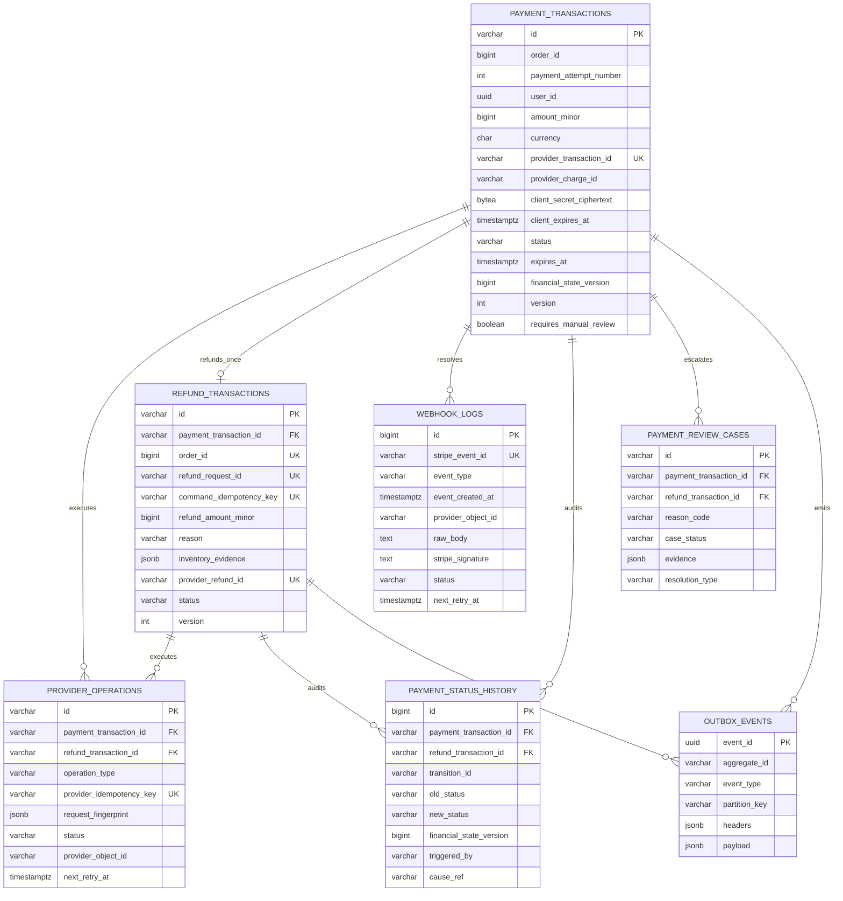

# Payment Service — Thiết kế dữ liệu

> Logical/physical design mục tiêu cho Payment Service. DDL dưới đây là bản mô tả
> chuẩn để viết migration, không phải migration đã tồn tại; chưa có code Payment
> để xác minh. Quy ước: id nghiệp vụ là string ULID có prefix (`TXN_`, `RFD_`,
> `POP_`, `PRC_`), tiền là `BIGINT amount_minor` + `CHAR(3) currency`, mọi mốc
> thời gian là `TIMESTAMPTZ`, enum của FSM enforce bằng `CHECK`.

## 1. Quyền sở hữu dữ liệu

| Store/đối tượng | Dữ liệu | Nguồn chân lý |
|---|---|---|
| PostgreSQL `payment_transactions` | Mỗi numbered payment attempt: trạng thái FSM, tham chiếu Stripe, client data mã hóa, `financial_state_version` | Payment Service |
| PostgreSQL `provider_operations` | Side effect Stripe durable (create/cancel/refund): key, fingerprint, outcome, recovery | Payment Service |
| PostgreSQL `refund_transactions` | Refund duy nhất trọn đời của một order: trạng thái FSM, Inventory evidence, tham chiếu Stripe Refund | Payment Service |
| PostgreSQL `webhook_logs` | Raw webhook Stripe nguyên byte, chữ ký, kết quả verify/xử lý | Payment Service |
| PostgreSQL `payment_status_history` | Audit trail mọi transition của hai FSM kèm nguyên nhân | Payment Service |
| PostgreSQL `outbox_events` | Integration event v2 chờ Debezium quan sát | Payment Service |
| PostgreSQL `payment_idempotency` | Fingerprint + response của command idempotent (`INITIATE`/`CANCEL`/`REFUND`) | Payment Service |
| PostgreSQL `payment_review_cases` | Case cần xử lý thủ công (refund failed/reversed, capture-after-cancel, drift, dispute) | Payment Service |
| PostgreSQL `reconciliation_runs` | Metadata từng lần chạy Reconciliation Worker, cờ freeze auto-correction | Payment Service |
| Redis | Idempotency pointer và distributed lock có TTL | Dữ liệu tạm; không là source of truth |
| Trạng thái PaymentIntent/Charge/Refund trên Stripe | Nguồn thật của provider | Stripe; Payment replicate, đối soát và mở review case khi lệch |

Payment hoạt động độc lập với Order: Order chỉ biết "đơn này cần thanh toán X
đồng"; Payment chịu trách nhiệm gọi Stripe và đồng bộ trạng thái. Service khác
không ghi database này. `order_id` và `user_id` là foreign key logic, không có FK
vật lý sang service khác. Không có tầng archive S3 hay tiered read
([ADR-013](./decisions/ADR-013-single-oltp-retention-no-partition.md)).

`client_secret` của PaymentIntent do **Payment lưu duy nhất** (mã hóa). Order
không giữ bản sao; khi cần trả cho buyer (reload trang thanh toán, recovery
Checkout), Order đọc qua Payment và Payment chỉ trả khi attempt còn dùng được.

## 2. Mô hình dữ liệu logic



Quan hệ nghiệp vụ:

- Một order có nhiều `payment_transactions` qua `payment_attempt_number` tăng đơn
  điệu. Một attempt là identity bất biến: retry cùng attempt/key luôn trả cùng
  transaction; attempt mới chỉ được Order mở sau fact terminal non-capture của
  attempt trước ([ADR-012](./decisions/ADR-012-recoverable-initiation-and-cancel.md)).
- Toàn bộ order có **tối đa một** `refund_transactions` trọn đời
  ([ADR-011](./decisions/ADR-011-one-lifetime-order-refund.md)); retry, webhook,
  poller, reconciliation đều tiếp tục transaction này. Refund gắn với đúng
  payment transaction đã `SUCCESS` (identity `captured_payment_transaction_id`
  phía Order).
- Mỗi side effect Stripe là một `provider_operations` row được commit **trước**
  khi gọi provider; một payment có đúng một `CREATE`, tối đa một `CANCEL`; một
  refund có đúng một `REFUND`.
- `payment_review_cases` là hàng chờ xử lý thủ công có audit; boolean
  `requires_manual_review` trên payment chỉ là cờ denormalized "đang có case mở".

## 3. Schema logic và field

### 3.1. `payment_transactions`

```sql
CREATE TABLE payment_transactions (
    id                        VARCHAR(64)  PRIMARY KEY,
    order_id                  BIGINT       NOT NULL,
    payment_attempt_number    INT          NOT NULL CHECK (payment_attempt_number >= 1),
    user_id                   UUID         NOT NULL,
    amount_minor              BIGINT       NOT NULL CHECK (amount_minor > 0),
    currency                  CHAR(3)      NOT NULL DEFAULT 'VND' CHECK (currency = 'VND'),
    provider                  VARCHAR(20)  NOT NULL DEFAULT 'STRIPE' CHECK (provider = 'STRIPE'),

    provider_transaction_id   VARCHAR(100),
    provider_charge_id        VARCHAR(100),
    provider_status_snapshot  VARCHAR(40),
    provider_synced_at        TIMESTAMPTZ,

    client_secret_ciphertext  BYTEA,
    client_secret_key_id      VARCHAR(64),
    client_expires_at         TIMESTAMPTZ,

    status                    VARCHAR(20)  NOT NULL CHECK (status IN
        ('INITIATING','PENDING','PROCESSING','SUCCESS','FAILED',
         'EXPIRED','CANCELED','REFUNDING','REFUNDED')),
    last_error_code           VARCHAR(64),
    last_error_message        VARCHAR(500),
    decline_count             INT          NOT NULL DEFAULT 0,

    expires_at                TIMESTAMPTZ  NOT NULL,
    succeeded_at              TIMESTAMPTZ,
    terminal_at               TIMESTAMPTZ,

    financial_state_version   BIGINT       NOT NULL DEFAULT 0,
    version                   INT          NOT NULL DEFAULT 0,
    requires_manual_review    BOOLEAN      NOT NULL DEFAULT FALSE,

    created_at                TIMESTAMPTZ  NOT NULL DEFAULT now(),
    updated_at                TIMESTAMPTZ  NOT NULL DEFAULT now(),

    CONSTRAINT uq_payment_attempt UNIQUE (order_id, payment_attempt_number),
    CONSTRAINT uq_payment_provider_txn UNIQUE (provider_transaction_id),
    CONSTRAINT ck_payment_pending_has_intent CHECK
        (status = 'INITIATING' OR provider_transaction_id IS NOT NULL)
);
```

| Cột | Ghi chú |
|---|---|
| `id` | `TXN_<ULID>`; đồng thời là metadata `payment_transaction_id` gửi lên Stripe để reconciliation bind ngược |
| `order_id`, `payment_attempt_number` | Identity attempt do Order cấp; `UNIQUE` là guard chống double-initiate khi Redis mất |
| `user_id` | UUID canonical toàn hệ thống; chỉ để filter/audit |
| `amount_minor`, `currency` | Integer VND. Với Stripe, VND là **zero-decimal currency**: `amount_minor` truyền nguyên sang `PaymentIntent.create`, không nhân/chia; chỉ Stripe adapter chịu trách nhiệm mapping |
| `provider_transaction_id` | `pi_xxx`; `NULL` chỉ khi `INITIATING`; `UNIQUE` chặn hai transaction bind cùng intent |
| `provider_charge_id` | `ch_xxx`, set khi `succeeded`; `charge.*` và dispute event tham chiếu charge chứ không phải intent |
| `provider_status_snapshot`, `provider_synced_at` | Trạng thái Stripe lần đọc gần nhất (webhook/poller/reconciliation) để phát hiện drift mà không gọi lại Stripe |
| `client_secret_ciphertext`, `client_secret_key_id` | `pi_xxx_secret_xxx` mã hóa envelope (KMS/Vault), `key_id` phục vụ rotation. Chỉ giải mã cho response initiate/client-data khi `status = 'PENDING'` và `now() < client_expires_at`; xóa (set `NULL`) khi rời `PENDING` |
| `client_expires_at` | Bằng `expires_at` trừ margin; sau mốc này API không trả secret dù row còn `PENDING` |
| `status` | Payment FSM (`domain.md §6.1`) |
| `last_error_code`, `last_error_message` | Decline gần nhất (`card_declined`, `insufficient_funds`, …). Decline là sự kiện phi terminal ([ADR-014](./decisions/ADR-014-decline-non-terminal-and-canceled-intent-before-non-capture-terminal.md)): ghi đè nhiều lần trên cùng intent, payment vẫn `PENDING` |
| `decline_count` | Số lần `payment_intent.payment_failed` trong phiên; vượt `max_declines_per_attempt` → Payment hủy intent và `FAILED` |
| `expires_at` | `created_at + payment_session_ttl` (15 phút); Expiration Scanner quét |
| `succeeded_at` | `paid_at` phát trong `PAYMENT_SUCCESS`; bất biến sau khi set |
| `terminal_at` | Thời điểm vào `FAILED`/`EXPIRED`/`CANCELED` |
| `financial_state_version` | Monotonic **theo payment transaction**: +1 cho **mỗi event** ghi vào `outbox_events` của payment này (kể cả `REFUND_*`); giá trị mới ghi vào history và outbox trong cùng transaction. Transition chỉ audit (`T3a`) không tăng. Khác `version`: `version` tăng ở mọi `UPDATE` (kể cả `provider_synced_at`) |
| `version` | Optimistic lock kỹ thuật (`@Version`) |
| `requires_manual_review` | Denormalized = tồn tại `payment_review_cases` `OPEN`/`IN_PROGRESS`; set/clear cùng transaction với case |

### 3.2. `provider_operations`

```sql
CREATE TABLE provider_operations (
    id                        VARCHAR(64)  PRIMARY KEY,
    payment_transaction_id    VARCHAR(64)  NOT NULL REFERENCES payment_transactions(id),
    refund_transaction_id     VARCHAR(64)  REFERENCES refund_transactions(id),
    operation_type            VARCHAR(10)  NOT NULL CHECK (operation_type IN ('CREATE','CANCEL','REFUND')),
    provider_idempotency_key  VARCHAR(255) NOT NULL,
    command_idempotency_key   VARCHAR(255),
    request_fingerprint       JSONB        NOT NULL,
    status                    VARCHAR(30)  NOT NULL CHECK (status IN
        ('REQUESTED','PROVIDER_CONFIRMED','PROVIDER_REJECTED','UNKNOWN','MANUAL_REVIEW_REQUIRED')),
    provider_object_id        VARCHAR(100),
    provider_result           JSONB,
    attempt_count             INT          NOT NULL DEFAULT 0,
    last_attempted_at         TIMESTAMPTZ,
    next_retry_at             TIMESTAMPTZ,
    created_at                TIMESTAMPTZ  NOT NULL DEFAULT now(),
    updated_at                TIMESTAMPTZ  NOT NULL DEFAULT now(),

    CONSTRAINT uq_provider_op_key UNIQUE (provider_idempotency_key),
    CONSTRAINT ck_provider_op_refund_link CHECK
        ((operation_type = 'REFUND') = (refund_transaction_id IS NOT NULL))
);
CREATE UNIQUE INDEX uq_provider_op_create
    ON provider_operations (payment_transaction_id) WHERE operation_type = 'CREATE';
CREATE UNIQUE INDEX uq_provider_op_cancel
    ON provider_operations (payment_transaction_id) WHERE operation_type = 'CANCEL';
```

| Cột | Ghi chú |
|---|---|
| `id` | `POP_<ULID>` |
| `operation_type` | `CREATE` = `PaymentIntent.create`; `CANCEL` = `PaymentIntent.cancel` (pre-capture, dùng cho cả ba đường terminal non-capture theo [ADR-014](./decisions/ADR-014-decline-non-terminal-and-canceled-intent-before-non-capture-terminal.md)); `REFUND` = `Refund.create` |
| `provider_idempotency_key` | Key truyền vào `RequestOptions.setIdempotencyKey`; sinh một lần, **không đổi** qua retry/recovery. Với `REFUND` bằng đúng `Idempotency-Key` Order gửi |
| `command_idempotency_key` | Key command HTTP đã sinh ra operation này, để trace ngược `payment_idempotency` |
| `request_fingerprint` | Canonical `{amount_minor, currency, metadata, reason}`; replay với payload khác bị reject. Với `CANCEL`, `reason` ∈ {`ORDER_COMMAND:<reason Order>`, `SESSION_EXPIRED`, `DECLINED_NON_RETRYABLE`, `DECLINE_LIMIT`} quyết định terminal đích (`CANCELED`/`EXPIRED`/`FAILED`) |
| `status` | `REQUESTED` (đã commit, sắp/đang gọi) → `PROVIDER_CONFIRMED` / `PROVIDER_REJECTED`; `UNKNOWN` khi timeout/ambiguous, recovery replay cùng key; `MANUAL_REVIEW_REQUIRED` khi replay + reconciliation không bind được |
| `provider_object_id` | `pi_xxx`/`re_xxx` đã chứng minh; copy sang `provider_transaction_id`/`provider_refund_id` trong cùng transaction |
| `provider_result` | Tối thiểu `{id, status, error_code, error_message}`; không lưu full response |
| `attempt_count`, `last_attempted_at`, `next_retry_at` | Recovery queue với backoff; `next_retry_at IS NULL` khi đã terminal |

Create persist trước `PaymentIntent.create`; cancel persist trước
`PaymentIntent.cancel`; refund persist trước `Refund.create`. Timeout provider
không thể để lại side effect không theo dõi: cùng operation/key được replay hoặc
reconcile tới khi bind được kết quả durable.

### 3.3. `refund_transactions`

```sql
CREATE TABLE refund_transactions (
    id                        VARCHAR(64)  PRIMARY KEY,
    payment_transaction_id    VARCHAR(64)  NOT NULL REFERENCES payment_transactions(id),
    order_id                  BIGINT       NOT NULL,
    refund_request_id         VARCHAR(128) NOT NULL,
    command_idempotency_key   VARCHAR(255) NOT NULL,
    refund_amount_minor       BIGINT       NOT NULL CHECK (refund_amount_minor > 0),
    currency                  CHAR(3)      NOT NULL DEFAULT 'VND' CHECK (currency = 'VND'),
    reason                    VARCHAR(50)  NOT NULL CHECK (reason IN
        ('CUSTOMER_RETURN_SELECTED_LINES','ADMIN_FORCE_REFUND_BEFORE_DISPATCH')),
    inventory_evidence        JSONB        NOT NULL,
    provider_refund_id        VARCHAR(100),
    provider_status_snapshot  VARCHAR(40),
    provider_failure_reason   VARCHAR(100),
    status                    VARCHAR(20)  NOT NULL CHECK (status IN
        ('PENDING','PROCESSING','SUCCESS','FAILED','REVERSED')),
    accepted_at               TIMESTAMPTZ,
    finalized_at              TIMESTAMPTZ,
    reversed_at               TIMESTAMPTZ,
    version                   INT          NOT NULL DEFAULT 0,
    created_at                TIMESTAMPTZ  NOT NULL DEFAULT now(),
    updated_at                TIMESTAMPTZ  NOT NULL DEFAULT now(),

    CONSTRAINT uq_refund_order   UNIQUE (order_id),
    CONSTRAINT uq_refund_request UNIQUE (refund_request_id),
    CONSTRAINT uq_refund_command UNIQUE (command_idempotency_key),
    CONSTRAINT uq_refund_provider UNIQUE (provider_refund_id)
);
```

| Cột | Ghi chú |
|---|---|
| `id` | `RFD_<ULID>`; là `refund_transaction_id` trong event v2 và trong `order_refund_cases.refund_transaction_id` |
| `order_id` `UNIQUE` | `INV-PAY-001`: một refund trọn đời/order, guard cuối cùng khi Redis/idempotency mất |
| `refund_request_id` | Identity refund case do Order sở hữu (`order_refund_cases.refund_request_id`) |
| `command_idempotency_key` | Header `Idempotency-Key` Order gửi; trùng key → trả cùng kết quả; key khác trên order đã có refund → `409 ORDER_REFUND_ALREADY_EXISTS` |
| `refund_amount_minor` | `<= payment.amount_minor` kiểm tra trong cùng transaction insert (không CHECK cross-table) |
| `reason` | Enum contract HTTP v1; `stripe_reason` luôn `requested_by_customer` nên không lưu |
| `inventory_evidence` | Bản sao evidence Order gửi (`RETURN_SCOPE_INSPECTION_COMPLETED{refund_scope_id, counters}` hoặc `COMMITTED_ORDER_RELEASED_BEFORE_DISPATCH{release_reference}`) — bằng chứng `RULE-PAY-006` cho audit |
| `provider_refund_id` | `re_xxx` |
| `provider_failure_reason` | `failure_reason` Stripe (`lost_or_stolen_card`, `expired_or_canceled_card`, …) khi `FAILED`/`REVERSED` |
| `status` | Refund FSM; `REVERSED` = đã từng `SUCCESS`, provider sau đó đảo chiều, tiền quay về merchant (`domain.md §6.2`) |
| `accepted_at` | Vào `PROCESSING` (Stripe nhận lệnh) |
| `finalized_at` | Vào `SUCCESS`/`FAILED` |
| `reversed_at` | Vào `REVERSED` |

Retry gọi Stripe không nằm ở bảng này mà ở `provider_operations` (`REFUND`).

### 3.4. `webhook_logs`

```sql
CREATE TABLE webhook_logs (
    id                        BIGSERIAL    PRIMARY KEY,
    provider                  VARCHAR(20)  NOT NULL DEFAULT 'STRIPE',
    stripe_event_id           VARCHAR(120),
    event_type                VARCHAR(100),
    event_created_at          TIMESTAMPTZ,
    api_version               VARCHAR(20),
    livemode                  BOOLEAN,
    provider_object_id        VARCHAR(100),
    payment_transaction_id    VARCHAR(64)  REFERENCES payment_transactions(id),
    refund_transaction_id     VARCHAR(64)  REFERENCES refund_transactions(id),
    raw_body                  TEXT         NOT NULL,
    raw_body_sha256           CHAR(64)     NOT NULL,
    stripe_signature          TEXT         NOT NULL,
    status                    VARCHAR(30)  NOT NULL CHECK (status IN
        ('UNPROCESSED','PROCESSED','FAILED_SIGNATURE','FAILED_PROCESSING','IGNORED','DUPLICATE')),
    processing_error          VARCHAR(500),
    retry_count               INT          NOT NULL DEFAULT 0,
    next_retry_at             TIMESTAMPTZ,
    received_at               TIMESTAMPTZ  NOT NULL,
    processed_at              TIMESTAMPTZ,

    CONSTRAINT uq_webhook_event UNIQUE (stripe_event_id)
);
```

| Cột | Ghi chú |
|---|---|
| `stripe_event_id` | `evt_xxx`; chỉ set **sau khi verify chữ ký thành công** — là dedup duy nhất. Row `FAILED_SIGNATURE` để `NULL` vì id trong body chưa đáng tin |
| `event_type`, `event_created_at`, `api_version`, `livemode` | Parse từ event đã verify; `event_created_at` dùng cho state precedence khi webhook out-of-order; `livemode = FALSE` ở test mode |
| `provider_object_id` | `data.object.id` (`pi_`/`ch_`/`re_`/`dp_`) |
| `payment_transaction_id`, `refund_transaction_id` | Resolve từ metadata/`payment_intent` của object; `NULL` + `IGNORED` khi không map được (`UNKNOWN_PROVIDER_REFERENCE`) |
| `raw_body` | Nguyên byte body (`TEXT`, không `JSONB`) vì `Webhook.constructEvent` cần đúng chuỗi gốc để re-verify sau khi đổi `whsec_` |
| `raw_body_sha256` | Dedup mềm cho row chưa verify, và kiểm tra toàn vẹn khi replay |
| `status` | `UNPROCESSED` → `PROCESSED`; `FAILED_SIGNATURE` (Auto-Retry Worker re-verify với secret hiện hành); `FAILED_PROCESSING` (lỗi tạm: lock, optimistic conflict, DB) → retry; `IGNORED` (event không liên quan/không map); `DUPLICATE` (row `FAILED_SIGNATURE` được re-verify nhưng `stripe_event_id` đã có ở row khác → đánh dấu, không xử lý). Webhook trùng ở đường chính bị `ON CONFLICT DO NOTHING` chặn, không tạo row |
| `retry_count`, `next_retry_at` | Auto-Retry Worker; dừng khi vượt `webhook_max_retries` và mở review case nếu event là financial |

Không còn unique `(provider, provider_transaction_id, event_type)`: Stripe hợp lệ
bắn nhiều `payment_intent.payment_failed` cho cùng một intent khi buyer thử thẻ
khác; dedup theo cặp đó sẽ nuốt lần fail sau.

### 3.5. `payment_status_history`

```sql
CREATE TABLE payment_status_history (
    id                        BIGSERIAL    PRIMARY KEY,
    payment_transaction_id    VARCHAR(64)  NOT NULL REFERENCES payment_transactions(id),
    refund_transaction_id     VARCHAR(64)  REFERENCES refund_transactions(id),
    transaction_type          VARCHAR(10)  NOT NULL CHECK (transaction_type IN ('PAYMENT','REFUND')),
    transition_id             VARCHAR(8)   NOT NULL,
    old_status                VARCHAR(20),
    new_status                VARCHAR(20)  NOT NULL,
    financial_state_version   BIGINT       NOT NULL,
    triggered_by              VARCHAR(20)  NOT NULL CHECK (triggered_by IN
        ('API','WEBHOOK','SCHEDULER','RECONCILIATION','MANUAL')),
    cause_ref                 VARCHAR(255),
    actor                     VARCHAR(128),
    provider_response         JSONB,
    created_at                TIMESTAMPTZ  NOT NULL DEFAULT now(),

    CONSTRAINT ck_history_refund_link CHECK
        ((transaction_type = 'REFUND') = (refund_transaction_id IS NOT NULL))
);
```

| Cột | Ghi chú |
|---|---|
| `transition_id` | `T0`…`T9` (kể cả `T3a` decline audit), `R1`…`R5` theo bảng FSM; `CORR` cho correction transition của Reconciliation |
| `financial_state_version` | Giá trị **sau** transition; bằng version trong event outbox cùng transaction |
| `triggered_by` | `API` (command Order), `WEBHOOK`, `SCHEDULER` (Expiration Scanner / Refund Poller / Recovery), `RECONCILIATION`, `MANUAL` (thao tác vận hành) |
| `cause_ref` | Nguyên nhân: `stripe_event_id`, `provider_operations.id`, `command_idempotency_key`, `payment_review_cases.id` hoặc `reconciliation_runs.id` |
| `actor` | Service principal hoặc user vận hành với `MANUAL` |
| `provider_response` | Đoạn response Stripe liên quan khi có, để debug dispute; không chứa PII thẻ |

Append-only; không `UPDATE`/`DELETE`.

### 3.6. `outbox_events`

```sql
CREATE TABLE outbox_events (
    event_id        UUID         PRIMARY KEY,
    aggregate_type  VARCHAR(50)  NOT NULL DEFAULT 'Payment',
    aggregate_id    VARCHAR(64)  NOT NULL,
    event_type      VARCHAR(50)  NOT NULL,
    partition_key   VARCHAR(64)  NOT NULL,
    schema_version  INT          NOT NULL DEFAULT 2,
    headers         JSONB        NOT NULL,
    payload         JSONB        NOT NULL,
    created_at      TIMESTAMPTZ  NOT NULL DEFAULT now()
);
```

| Cột | Ghi chú |
|---|---|
| `aggregate_type` | Cố định `Payment` cho cả `PAYMENT_*` và `REFUND_*`; Debezium route theo cột này |
| `aggregate_id` | `payment_transactions.id` cho `PAYMENT_*`, `refund_transactions.id` cho `REFUND_*` |
| `partition_key` | Canonical `order_id` ([ADR-007](./decisions/ADR-007-order-id-partition-key.md)) |
| `headers` | CloudEvents attributes (`id`, `type`, `source`, `subject`, `time`) + `correlation_id`/`traceparent`; Debezium outbox SMT map vào Kafka headers |
| `payload` | `data` theo envelope `interfaces.md §3`; **không** chứa `client_secret` |

Transactional outbox theo CDC ([ADR-005](./decisions/ADR-005-transactional-outbox-cdc.md)):
append-only, **cấm** cột polling-style (`published`, `retry_count`, …). Tên
canonical duy nhất là `outbox_events`.

### 3.7. `payment_idempotency`

```sql
CREATE TABLE payment_idempotency (
    idempotency_key     VARCHAR(255) NOT NULL,
    action              VARCHAR(30)  NOT NULL CHECK (action IN ('INITIATE','CANCEL','REFUND')),
    request_fingerprint CHAR(64)     NOT NULL,
    status              VARCHAR(20)  NOT NULL CHECK (status IN ('IN_PROGRESS','COMPLETED')),
    resource_id         VARCHAR(64),
    response_code       INT,
    response_body       JSONB,
    created_at          TIMESTAMPTZ  NOT NULL DEFAULT now(),
    completed_at        TIMESTAMPTZ,
    expires_at          TIMESTAMPTZ  NOT NULL,
    PRIMARY KEY (idempotency_key, action)
);
```

| Cột | Ghi chú |
|---|---|
| `PRIMARY KEY (idempotency_key, action)` | Một key không dùng cho hai action khác nhau |
| `request_fingerprint` | SHA-256 của body canonical; cùng key khác fingerprint → `422 IDEMPOTENCY_KEY_REUSED` |
| `status` | Insert `IN_PROGRESS` trước khi xử lý; request trùng key khi còn `IN_PROGRESS` → `409 REQUEST_IN_PROGRESS` (Order retry sau); `COMPLETED` → trả lại `response_code/body` |
| `resource_id` | `TXN_`/`RFD_` được tạo hoặc ảnh hưởng; dùng khi `response_body` cần regenerate (ví dụ initiate replay giải mã lại `client_secret` thay vì lưu secret trong response) |
| `expires_at` | Initiate: `expires_at` của phiên + 24h; cancel/refund: 7 ngày (khớp TTL Redis request mirror của Order) |

`response_body` của `INITIATE` **không** chứa `client_secret`; khi replay, Payment
đọc `resource_id` → giải mã `client_secret_ciphertext` nếu còn dùng được.

### 3.8. `payment_review_cases`

```sql
CREATE TABLE payment_review_cases (
    id                      VARCHAR(64)  PRIMARY KEY,
    payment_transaction_id  VARCHAR(64)  NOT NULL REFERENCES payment_transactions(id),
    refund_transaction_id   VARCHAR(64)  REFERENCES refund_transactions(id),
    reason_code             VARCHAR(50)  NOT NULL CHECK (reason_code IN
        ('REFUND_FAILED_AFTER_ACCEPT','REFUND_REVERSED','CAPTURE_AFTER_CANCEL',
         'AMOUNT_MISMATCH','PROVIDER_IDENTITY_UNBOUND','WEBHOOK_RETRY_EXHAUSTED',
         'RECONCILIATION_DRIFT','DISPUTE_OPENED')),
    case_status             VARCHAR(20)  NOT NULL CHECK (case_status IN
        ('OPEN','IN_PROGRESS','RESOLVED','ESCALATED')),
    evidence                JSONB        NOT NULL,
    resolution_type         VARCHAR(40)  CHECK (resolution_type IN
        ('CORRECTION_APPLIED','NO_ACTION_NEEDED','MANUAL_REFUND_OUTSIDE_SYSTEM',
         'ESCALATED_TO_ORDER','ESCALATED_TO_ACCOUNTING')),
    resolution_note         TEXT,
    opened_by               VARCHAR(20)  NOT NULL CHECK (opened_by IN
        ('WEBHOOK','SCHEDULER','RECONCILIATION','API')),
    opened_at               TIMESTAMPTZ  NOT NULL DEFAULT now(),
    assigned_to             VARCHAR(128),
    resolved_by             VARCHAR(128),
    resolved_at             TIMESTAMPTZ,

    CONSTRAINT ck_review_resolution CHECK
        ((case_status IN ('RESOLVED','ESCALATED')) = (resolution_type IS NOT NULL))
);
CREATE UNIQUE INDEX uq_review_open_per_payment
    ON payment_review_cases (payment_transaction_id)
    WHERE case_status IN ('OPEN','IN_PROGRESS');
```

| Cột | Ghi chú |
|---|---|
| `id` | `PRC_<ULID>` |
| `reason_code` | `REFUND_FAILED_AFTER_ACCEPT` (`T8`/`R3`), `REFUND_REVERSED` (`T9`/`R5`), `CAPTURE_AFTER_CANCEL` (`RULE-PAY-011`), `AMOUNT_MISMATCH` (`RULE-PAY-008`), `PROVIDER_IDENTITY_UNBOUND` (operation `MANUAL_REVIEW_REQUIRED`), `WEBHOOK_RETRY_EXHAUSTED`, `RECONCILIATION_DRIFT`, `DISPUTE_OPENED` |
| `evidence` | Snapshot `{db_status, provider_status, amounts, stripe_event_id/operation_id, observed_at}` tại thời điểm mở; bất biến |
| `resolution_type` | Bắt buộc khi đóng; `CORRECTION_APPLIED` đi kèm history `CORR` với `cause_ref = case id`; `MANUAL_REFUND_OUTSIDE_SYSTEM` ghi nhận hoàn tiền thủ công (chuyển khoản/voucher) vì hệ thống không tạo refund thứ hai |
| Partial unique | Một payment chỉ có một case đang mở; sự kiện mới cùng payment ghi thêm vào `evidence` (append JSON) thay vì mở case thứ hai |

Đối xứng với `order_financial_reconciliation_cases` của Order: Order escalate khi
thiếu bằng chứng nghiệp vụ, Payment escalate khi DB ↔ Stripe lệch; hai bên tham
chiếu nhau qua `payment_transaction_id`, không ghi chéo.

### 3.9. `reconciliation_runs`

```sql
CREATE TABLE reconciliation_runs (
    id                      BIGSERIAL   PRIMARY KEY,
    window_from             TIMESTAMPTZ NOT NULL,
    window_to               TIMESTAMPTZ NOT NULL,
    status                  VARCHAR(20) NOT NULL CHECK (status IN ('RUNNING','COMPLETED','FAILED')),
    auto_correction_frozen  BOOLEAN     NOT NULL DEFAULT FALSE,
    scanned_count           INT         NOT NULL DEFAULT 0,
    drift_count             INT         NOT NULL DEFAULT 0,
    corrected_count         INT         NOT NULL DEFAULT 0,
    review_opened_count     INT         NOT NULL DEFAULT 0,
    error_message           VARCHAR(500),
    started_at              TIMESTAMPTZ NOT NULL DEFAULT now(),
    finished_at             TIMESTAMPTZ
);
```

Mỗi lần Reconciliation Worker chạy ghi một row: cửa sổ đối soát, đếm drift/
correction/case mở, và cờ `auto_correction_frozen` phản ánh trạng thái freeze do
vận hành bật tại thời điểm chạy (khi freeze, drift chỉ mở review case, không phát
correction transition). Correction transition ghi history `CORR` với
`cause_ref = reconciliation_runs.id`.

## 4. Ràng buộc và chỉ mục

### 4.1. Ràng buộc nghiệp vụ enforce ở DB

| Ràng buộc | Mục đích |
|---|---|
| `payment_transactions UNIQUE (order_id, payment_attempt_number)` | Một durable transaction cho một numbered attempt; guard cuối khi Redis mất |
| `payment_transactions UNIQUE (provider_transaction_id)` | Hai transaction không thể bind cùng `pi_xxx` |
| `payment_transactions CHECK (status = 'INITIATING' OR provider_transaction_id IS NOT NULL)` | Rời `INITIATING` bắt buộc đã chứng minh intent (`T0.1`) |
| `provider_operations UNIQUE (provider_idempotency_key)` | Một side effect provider cho một key; retry không mint thêm |
| `provider_operations` partial unique `CREATE`/`CANCEL` per payment | Đúng một create, tối đa một cancel |
| `refund_transactions UNIQUE (order_id)` | `INV-PAY-001`: một refund trọn đời/order |
| `refund_transactions UNIQUE (refund_request_id)`, `UNIQUE (command_idempotency_key)`, `UNIQUE (provider_refund_id)` | Khóa identity case Order, key command và Stripe Refund |
| `webhook_logs UNIQUE (stripe_event_id)` | Dedup webhook duy nhất; `INSERT … ON CONFLICT DO NOTHING` |
| `payment_idempotency PRIMARY KEY (idempotency_key, action)` | Một key không dùng cho nhiều action |
| `payment_review_cases` partial unique open per payment | Một case mở/payment |
| `refund_amount_minor <= payment.amount_minor` | Check trong cùng transaction insert refund; không CHECK cross-table |
| Transition hợp lệ theo bảng FSM | Enforce ở Spring State Machine + optimistic lock, không ở DB |

### 4.2. Index theo query pattern

| Query pattern | Index |
|---|---|
| Expiration Scanner: `status IN ('PENDING','PROCESSING') AND expires_at <= now()` | `payment_transactions (expires_at) WHERE status IN ('PENDING','PROCESSING')` |
| Recovery create/cancel/refund: `status IN ('REQUESTED','UNKNOWN') AND next_retry_at <= now()` | `provider_operations (next_retry_at) WHERE status IN ('REQUESTED','UNKNOWN')` |
| Refund Poller: `status = 'PROCESSING' AND updated_at < now() - interval '1 minute'` | `refund_transactions (updated_at) WHERE status = 'PROCESSING'` |
| Webhook Auto-Retry: `status IN (...) AND next_retry_at <= now()` | `webhook_logs (next_retry_at) WHERE status IN ('UNPROCESSED','FAILED_SIGNATURE','FAILED_PROCESSING')` |
| Map webhook object → transaction | PK/unique `provider_transaction_id`; `payment_transactions (provider_charge_id)`; unique `provider_refund_id` |
| Order verify `GET /v1/payments/{id}` + refunds | PK; `refund_transactions (payment_transaction_id)` |
| Order query theo đơn | `payment_transactions (order_id)` (bao phủ bởi unique composite) |
| Manual review queue | `payment_review_cases (opened_at) WHERE case_status IN ('OPEN','IN_PROGRESS')` |
| Reconciliation theo cửa sổ | `payment_transactions (updated_at)`; `refund_transactions (updated_at)` |
| Audit timeline | `payment_status_history (payment_transaction_id, created_at)` |
| Webhook forensic theo object | `webhook_logs (provider_object_id, event_type)` |
| Outbox trimmer | `outbox_events (created_at)` |

Partial index giữ tập "đang hoạt động" nhỏ bất kể lịch sử tích lũy — đây là
cơ chế thay cho partition pruning của ADR-009 cũ.

## 5. Ranh giới transaction và xử lý đồng thời

- Một transition = **một transaction PostgreSQL** gồm: `UPDATE` aggregate (kiểm
  `version`, tăng `financial_state_version` nếu là financial fact) + `INSERT
  payment_status_history` + `INSERT outbox_events` (+ `INSERT/UPDATE
  payment_review_cases` và set `requires_manual_review` khi có).
- Optimistic lock `version` là guard mặc định cho mọi transition
  ([ADR-006](./decisions/ADR-006-optimistic-lock-and-redis-lock-strategy.md));
  conflict → requeue/retry, không bao giờ ghi đè.
- **Initiate:** transaction 1 insert `payment_transactions` `INITIATING` +
  `provider_operations CREATE REQUESTED` + `payment_idempotency IN_PROGRESS`
  → commit → gọi Stripe **ngoài** transaction → transaction 2 bind
  `provider_transaction_id`, `client_secret_ciphertext`, `T0.1` → `PENDING`,
  operation `PROVIDER_CONFIRMED`, idempotency `COMPLETED`, history, outbox
  `PAYMENT_INITIATED`. Timeout giữa hai transaction để operation ở
  `UNKNOWN` cho recovery.
- **Cancel / Refund:** cùng mẫu hai transaction; refund transaction 1 kiểm
  `payment.status = 'SUCCESS'`, `refund_amount_minor <= amount_minor`, insert
  `refund_transactions` (unique `order_id` là guard đồng thời cuối) và `T6`
  `REFUNDING`.
- **Webhook:** `INSERT webhook_logs ON CONFLICT (stripe_event_id) DO NOTHING`;
  0 row → ack, không làm gì. Có row → cùng transaction: resolve transaction, guard
  amount/reference, áp transition theo state precedence (dùng
  `event_created_at`), history, outbox, `webhook_logs.status = PROCESSED`.
- Side effect Stripe luôn nằm ngoài DB transaction và luôn đi sau một
  `provider_operations` row đã commit. Redis lock chỉ giảm đồng thời, không được
  dùng để cấp quyền cho side effect thứ hai.
- Isolation `READ COMMITTED` mặc định là đủ vì mọi guard đồng thời là unique
  constraint hoặc optimistic lock; không dùng `SERIALIZABLE`.

## 6. Redis, outbox và idempotency storage

| Key/nhóm | Mục đích | TTL | Fallback khi Redis mất |
|---|---|---|---|
| `payment:idem:{action}:{idempotency_key}` (SETNX → pointer `resource_id`) | Fast-path replay command | Initiate: 15 phút + 60s; cancel/refund: 7 ngày | `payment_idempotency` là authority |
| `payment:lock:{payment_transaction_id}` (Redisson) | Serialize side effect Stripe/scheduler trên cùng payment | 15–30s | Worker reject → retry cycle; unique constraint + optimistic lock vẫn bảo vệ |
| `payment:lock:reconciliation` (Redisson) | Singleton Reconciliation Worker | Bằng interval run | `reconciliation_runs.status = 'RUNNING'` + timeout |

Redis là request replay mirror và lock tạm thời, cùng phạm vi với Order
([Order ADR-012](../order/decisions/ADR-012-redis-request-mirror-scope.md)):
không sở hữu transition, không thay unique constraint. Read API và Reconciliation
không phụ thuộc Redis.

Outbox: append-only, Debezium đọc WAL, route `aggregate_type=Payment` →
`t.payment.events.v2`, key `partition_key`. Retention ở §7.

## 7. Vòng đời dữ liệu và retention

Không partition, không cold archive, không tiered read
([ADR-013](./decisions/ADR-013-single-oltp-retention-no-partition.md)).
Retention thực hiện bằng trimmer theo bảng, chạy hàng ngày ngoài giờ cao điểm,
xóa theo batch nhỏ (ví dụ 5.000 row/lượt) để không giữ lock lâu.

| Bảng | Retention | Điều kiện xóa |
|---|---|---|
| `payment_transactions` | Vô thời hạn | Không xóa (audit/CSKH/kế toán) |
| `refund_transactions` | Vô thời hạn | Không xóa |
| `provider_operations` | Vô thời hạn | Không xóa; là bằng chứng side effect |
| `payment_status_history` | Vô thời hạn | Không xóa; append-only |
| `payment_review_cases` | Vô thời hạn | Không xóa |
| `outbox_events` | 15 ngày | Chỉ xóa row có `created_at` cũ hơn **và** dưới CDC watermark (Debezium connector offset) — giống Order §8 |
| `payment_idempotency` | Theo `expires_at` | `expires_at < now()` |
| `webhook_logs` | 12 tháng | `received_at < now() - 12 tháng` **và** `status IN ('PROCESSED','IGNORED','DUPLICATE')`; row lỗi giữ tới khi review đóng |
| `reconciliation_runs` | 12 tháng | `finished_at < now() - 12 tháng` |

`client_secret_ciphertext` không theo retention bảng: xóa (set `NULL`) ngay khi
payment rời `PENDING` hoặc quá `client_expires_at`, bởi cùng transition hoặc bởi
Expiration Scanner.

Vận hành cần theo dõi: bloat/`autovacuum` trên `payment_status_history` và
`webhook_logs`, kích thước index partial (phải luôn nhỏ), thời gian scanner với
tổng row tăng dần. Backup/restore là PostgreSQL chuẩn, không có bước restore
từ S3.

### 7.1. Còn mở

- **Dispute/chargeback:** `charge.dispute.created` rút tiền khỏi merchant balance
  và là financial fact thật. Đề xuất bảng `payment_disputes`
  (`provider_dispute_id dp_xxx`, `payment_transaction_id`, `amount_minor`,
  `reason`, `status`, `evidence_due_by`) + mở `payment_review_cases`
  `DISPUTE_OPENED`; chưa có FSM/event cho dispute, cần ADR riêng.
- GDPR/data deletion cho `user_id` và `webhook_logs.raw_body` chưa mô tả.

## 8. Bảo mật và quyền riêng tư

- Stripe API key (`sk_...`) và webhook secret (`whsec_...`) lưu trong Vault/Secret
  Manager; không commit, không log. Test mode dùng sandbox riêng từng môi trường
  (`development.md §5`).
- `client_secret` mã hóa envelope tại application (`client_secret_ciphertext` +
  `client_secret_key_id`), giải mã chỉ trong response initiate/client-data cho
  Order workload khi attempt còn `PENDING` và chưa quá `client_expires_at`; **cấm**
  xuất hiện trong `outbox_events`, Kafka, `payment_status_history`,
  `payment_idempotency.response_body`, log.
- `webhook_logs.raw_body` và `stripe_signature` lưu nguyên vẹn để audit/forensic;
  Stripe event không chứa PAN, nhưng có thể chứa email/tên trong `billing_details`
  → access control cho vận hành, masking khi xuất ra log/dashboard.
- `user_id` là UUID; không lưu thông tin thẻ/ngân hàng (Stripe giữ).
- `payment_status_history`, `provider_operations`, `payment_review_cases` là audit
  trail compliance: append-only hoặc chỉ cập nhật trạng thái/resolution kèm
  `actor`; không xóa.
- Thao tác `MANUAL` (replay webhook, correction, đóng review case) yêu cầu quyền
  quản trị, ghi `actor` và `cause_ref`.
