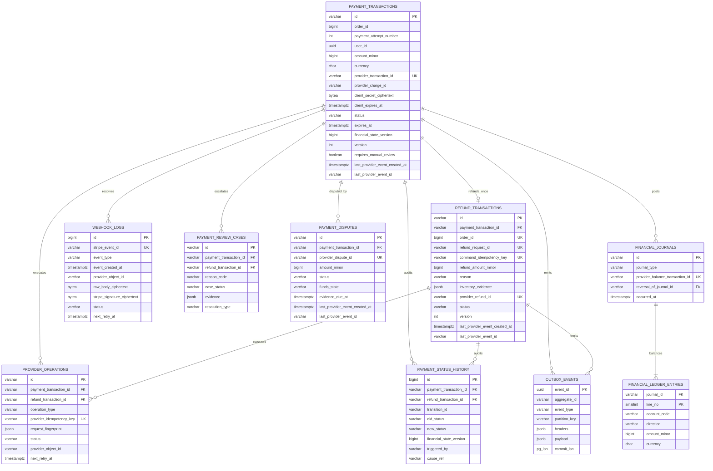

# Payment Service — Thiết kế dữ liệu

> **Đối chiếu runtime 2026-10-11:** xem [phạm vi hiện tại và năng lực chưa triển khai](./runtime-status.md)
> và [ADR-023](./decisions/ADR-023-reconciliation-ownership-and-audit-corrections.md). Các mục tiêu KMS, metric nghiệp vụ,
> heartbeat, health/DR/export và RBAC bên ngoài không phải bằng chứng đã được runtime hiện thực.

> Logical/physical design mục tiêu cho Payment Service. DDL dưới đây là nguồn chuẩn
> của Gate 2 baseline migration; migration và constraint đã được chạy bằng Flyway
> trên PostgreSQL 16 Testcontainers. Quy ước: id nghiệp vụ là string ULID có prefix (`TXN_`, `RFD_`,
> `POP_`, `PRC_`, `DSP_`, `FJN_`), tiền là `BIGINT amount_minor` + `CHAR(3) currency`, mọi mốc
> thời gian là `TIMESTAMPTZ`, enum của FSM enforce bằng `CHECK`.

## 1. Quyền sở hữu dữ liệu

| Store/đối tượng | Dữ liệu | Nguồn chân lý |
|---|---|---|
| PostgreSQL `payment_transactions` | Mỗi numbered payment attempt: trạng thái FSM, tham chiếu Stripe, client data mã hóa, `financial_state_version` | Payment Service |
| PostgreSQL `provider_operations` | Side effect Stripe durable (create/cancel/refund): key, fingerprint, outcome, recovery | Payment Service |
| PostgreSQL `refund_transactions` | Refund duy nhất trọn đời của một order: trạng thái FSM, Inventory evidence, tham chiếu Stripe Refund | Payment Service |
| PostgreSQL `webhook_logs` | Durable inbox delivery đã verify; raw/signature mã hóa có retention | Payment Service |
| PostgreSQL `payment_status_history` | Audit trail mọi transition của Payment, Refund và Dispute FSM kèm nguyên nhân | Payment Service |
| PostgreSQL `outbox_events` | Full CloudEvents structured JSON v2 chờ Debezium quan sát | Payment Service |
| PostgreSQL `payment_idempotency` | Fingerprint + response của buyer/Order command và internal operation idempotent | Payment Service |
| PostgreSQL `payment_review_cases` | Case cần xử lý thủ công (refund failed/reversed, capture-after-cancel, drift, dispute) | Payment Service |
| PostgreSQL `reconciliation_runs` | Metadata từng lần chạy Reconciliation Worker, cờ freeze auto-correction | Payment Service |
| PostgreSQL `payment_disputes` | Lifecycle chargeback/dispute và provider checkpoint | Payment Service |
| PostgreSQL `financial_journals`, `financial_ledger_entries` | Operational double-entry subledger cho capture/refund/reversal/dispute/fee/payout | Payment Service |
| Redis | Hạ tầng tùy chọn, Gate 3 chưa có adapter đọc/ghi | Không là source of truth và không nằm trên correctness path |
| Trạng thái PaymentIntent/Charge/Refund trên Stripe | Nguồn thật của provider | Stripe; Payment replicate, đối soát và mở review case khi lệch |

Payment hoạt động độc lập với Order: Order chỉ biết "đơn này cần thanh toán X
đồng"; Payment chịu trách nhiệm gọi Stripe và đồng bộ trạng thái. Service khác
không ghi database này. `order_id` và `user_id` là foreign key logic, không có FK
vật lý sang service khác. Không có tầng archive S3 hay tiered read
([ADR-013](./decisions/ADR-013-single-oltp-retention-no-partition.md)). Payment cũng
sở hữu subledger/dispute/settlement reconciliation; không có Ledger Service riêng
([ADR-019](./decisions/ADR-019-payment-owned-subledger-and-disputes.md)).

`client_secret` của PaymentIntent do **Payment lưu duy nhất** (mã hóa). Order
không giữ bản sao; khi cần trả cho buyer (reload trang thanh toán, recovery
Checkout), Order đọc qua Payment và Payment chỉ trả khi attempt còn dùng được.

## 2. Mô hình dữ liệu logic



Quan hệ nghiệp vụ:

- Một order có nhiều `payment_transactions` qua `payment_attempt_number` tăng đơn
  điệu. Một attempt là identity bất biến: retry cùng attempt/key luôn trả cùng
  transaction; attempt mới chỉ được Order mở sau fact terminal non-capture của
  attempt trước ([ADR-012](./decisions/ADR-012-recoverable-initiation-and-cancel.md)).
- Toàn bộ order có **tối đa một** `refund_transactions` trọn đời
  ([ADR-011](./decisions/ADR-011-one-lifetime-order-refund.md)); retry, webhook,
  poller, reconciliation đều tiếp tục transaction này. Refund gắn với đúng
  payment transaction đã `SUCCESS` (identity `captured_payment_transaction_id`
  phía Order).
- Mỗi side effect Stripe là một `provider_operations` row được commit **trước**
  khi gọi provider; một payment có đúng một `CREATE`, tối đa một `CANCEL`; một
  refund có đúng một `REFUND`.
- Mỗi provider money movement có đúng một `financial_journals` qua unique
  `provider_balance_transaction_id`; journal có ít nhất hai line và cân bằng debit/
  credit. Correction là reversal journal mới, không sửa ledger cũ.
- Một payment có thể có nhiều dispute theo thời gian; mỗi `dp_xxx` map đúng một
  `payment_disputes` và có lifecycle độc lập với status PaymentTransaction.
- `payment_review_cases` là hàng chờ xử lý thủ công có audit; boolean
  `requires_manual_review` trên payment chỉ là cờ denormalized "đang có case mở".

## 3. Schema logic và field

### 3.1. `payment_transactions`

```sql
CREATE TABLE payment_transactions (
    id                        VARCHAR(64)  PRIMARY KEY,
    order_id                  BIGINT       NOT NULL,
    payment_attempt_number    INT          NOT NULL CHECK (payment_attempt_number >= 1),
    user_id                   UUID         NOT NULL,
    amount_minor              BIGINT       NOT NULL CHECK (amount_minor > 0),
    currency                  CHAR(3)      NOT NULL DEFAULT 'VND' CHECK (currency = 'VND'),
    provider                  VARCHAR(20)  NOT NULL DEFAULT 'STRIPE' CHECK (provider = 'STRIPE'),

    provider_transaction_id   VARCHAR(100),
    provider_charge_id        VARCHAR(100),
    provider_status_snapshot  VARCHAR(40),
    provider_synced_at        TIMESTAMPTZ,
    last_provider_event_created_at TIMESTAMPTZ,
    last_provider_event_id    VARCHAR(120),

    client_secret_ciphertext  BYTEA,
    client_secret_key_id      VARCHAR(64),
    client_expires_at         TIMESTAMPTZ,

    status                    VARCHAR(20)  NOT NULL CHECK (status IN
        ('INITIATING','PENDING','PROCESSING','SUCCESS','FAILED',
         'EXPIRED','CANCELED','REFUNDING','REFUNDED')),
    last_error_code           VARCHAR(64),
    last_error_message        VARCHAR(500),
    decline_count             INT          NOT NULL DEFAULT 0,

    expires_at                TIMESTAMPTZ  NOT NULL,
    succeeded_at              TIMESTAMPTZ,
    terminal_at               TIMESTAMPTZ,

    financial_state_version   BIGINT       NOT NULL DEFAULT 0,
    version                   INT          NOT NULL DEFAULT 0,
    requires_manual_review    BOOLEAN      NOT NULL DEFAULT FALSE,
    legal_hold_until          TIMESTAMPTZ,
    financial_export_manifest_id VARCHAR(255),

    created_at                TIMESTAMPTZ  NOT NULL DEFAULT now(),
    updated_at                TIMESTAMPTZ  NOT NULL DEFAULT now(),

    CONSTRAINT uq_payment_attempt UNIQUE (order_id, payment_attempt_number),
    CONSTRAINT uq_payment_provider_txn UNIQUE (provider_transaction_id),
    CONSTRAINT ck_payment_pending_has_intent CHECK
        (status = 'INITIATING' OR provider_transaction_id IS NOT NULL),
    CONSTRAINT ck_payment_success_time CHECK
        ((status IN ('SUCCESS','REFUNDING','REFUNDED')) = (succeeded_at IS NOT NULL)),
    CONSTRAINT ck_payment_terminal_time CHECK
        ((status IN ('FAILED','EXPIRED','CANCELED')) = (terminal_at IS NOT NULL)),
    CONSTRAINT ck_payment_client_secret_fields CHECK
        ((client_secret_ciphertext IS NULL) = (client_secret_key_id IS NULL))
);
```

| Cột | Ghi chú |
|---|---|
| `id` | `TXN_<ULID>`; đồng thời là metadata `payment_transaction_id` gửi lên Stripe để reconciliation bind ngược |
| `order_id`, `payment_attempt_number` | Identity attempt do Order cấp; `UNIQUE` là guard chống concurrent/double-initiate |
| `user_id` | UUID canonical toàn hệ thống; chỉ để filter/audit |
| `amount_minor`, `currency` | Integer VND. Với Stripe, VND là **zero-decimal currency**: `amount_minor` truyền nguyên sang `PaymentIntent.create`, không nhân/chia; chỉ Stripe adapter chịu trách nhiệm mapping |
| `provider_transaction_id` | `pi_xxx`; `NULL` chỉ khi `INITIATING`; `UNIQUE` chặn hai transaction bind cùng intent |
| `provider_charge_id` | `ch_xxx`, set khi `succeeded`; `charge.*` và dispute event tham chiếu charge chứ không phải intent |
| `provider_status_snapshot`, `provider_synced_at` | Trạng thái Stripe lần đọc gần nhất (webhook/poller/reconciliation) để phát hiện drift mà không gọi lại Stripe |
| `last_provider_event_created_at`, `last_provider_event_id` | Checkpoint PaymentIntent theo ADR-018. Older event bị stale; cùng timestamp khác id/fact mâu thuẫn buộc retrieve object hiện hành |
| `client_secret_ciphertext`, `client_secret_key_id` | `pi_xxx_secret_xxx` mã hóa envelope (KMS/Vault), `key_id` phục vụ rotation. Chỉ giải mã cho response initiate/client-data khi `status = 'PENDING'` và `now() < client_expires_at`; xóa (set `NULL`) khi rời `PENDING` |
| `client_expires_at` | Bằng `expires_at` trừ margin; sau mốc này API không trả secret dù row còn `PENDING` |
| `status` | Payment FSM (`domain.md §6.1`) |
| `last_error_code`, `last_error_message` | Decline gần nhất (`card_declined`, `insufficient_funds`, …). Decline là sự kiện phi terminal ([ADR-014](./decisions/ADR-014-decline-non-terminal-and-canceled-intent-before-non-capture-terminal.md)): ghi đè nhiều lần trên cùng intent, payment vẫn `PENDING` |
| `decline_count` | Số lần `payment_intent.payment_failed` trong phiên; vượt `max_declines_per_attempt` → Payment hủy intent và `FAILED` |
| `expires_at` | `created_at + payment_session_ttl` (15 phút); Expiration Scanner quét |
| `succeeded_at` | `paid_at` phát trong `PAYMENT_SUCCESS`; bất biến sau khi set |
| `terminal_at` | Thời điểm vào `FAILED`/`EXPIRED`/`CANCELED` |
| `financial_state_version` | Monotonic **theo payment transaction**: +1 cho **mỗi event** ghi vào `outbox_events` của payment này (kể cả `REFUND_*`); giá trị mới ghi vào history và outbox trong cùng transaction. Transition chỉ audit (`T3a`) không tăng. Khác `version`: `version` tăng ở mọi `UPDATE` (kể cả `provider_synced_at`) |
| `version` | Optimistic lock kỹ thuật (`@Version`) |
| `requires_manual_review` | Denormalized = tồn tại `payment_review_cases` `OPEN`/`IN_PROGRESS`; set/clear cùng transaction với case |
| `legal_hold_until` | Finance Ops đặt mốc giữ hồ sơ; Trimmer fail closed và không xóa khi giá trị này còn hiệu lực |
| `financial_export_manifest_id` | Bằng chứng batch chứng từ đã export/đối soát trước khi xóa financial closure sau 7 năm; `NULL` luôn chặn xóa |

### 3.2. `provider_operations`

```sql
CREATE TABLE provider_operations (
    id                        VARCHAR(64)  PRIMARY KEY,
    payment_transaction_id    VARCHAR(64)  NOT NULL REFERENCES payment_transactions(id),
    refund_transaction_id     VARCHAR(64)  REFERENCES refund_transactions(id),
    operation_type            VARCHAR(10)  NOT NULL CHECK (operation_type IN ('CREATE','CANCEL','REFUND')),
    provider_idempotency_key  VARCHAR(255) NOT NULL,
    command_idempotency_key   VARCHAR(255),
    request_fingerprint       JSONB        NOT NULL,
    status                    VARCHAR(30)  NOT NULL CHECK (status IN
        ('REQUESTED','PROVIDER_CONFIRMED','PROVIDER_REJECTED','UNKNOWN','MANUAL_REVIEW_REQUIRED')),
    provider_object_id        VARCHAR(100),
    provider_result           JSONB,
    attempt_count             INT          NOT NULL DEFAULT 0,
    last_attempted_at         TIMESTAMPTZ,
    first_dispatched_at       TIMESTAMPTZ,
    last_dispatched_at        TIMESTAMPTZ,
    provider_request_id       VARCHAR(120),
    safe_replay_until         TIMESTAMPTZ,
    recovery_deadline_at      TIMESTAMPTZ NOT NULL,
    next_retry_at             TIMESTAMPTZ,
    lease_owner               VARCHAR(128),
    lease_token               BIGINT       NOT NULL DEFAULT 0 CHECK (lease_token >= 0),
    lease_expires_at          TIMESTAMPTZ,
    last_heartbeat_at         TIMESTAMPTZ,
    created_at                TIMESTAMPTZ  NOT NULL DEFAULT now(),
    updated_at                TIMESTAMPTZ  NOT NULL DEFAULT now(),

    CONSTRAINT uq_provider_op_key UNIQUE (provider_idempotency_key),
    CONSTRAINT ck_provider_op_refund_link CHECK
        ((operation_type = 'REFUND') = (refund_transaction_id IS NOT NULL))
);
CREATE UNIQUE INDEX uq_provider_op_create
    ON provider_operations (payment_transaction_id) WHERE operation_type = 'CREATE';
CREATE UNIQUE INDEX uq_provider_op_cancel
    ON provider_operations (payment_transaction_id) WHERE operation_type = 'CANCEL';
CREATE UNIQUE INDEX uq_provider_op_refund
    ON provider_operations (refund_transaction_id) WHERE operation_type = 'REFUND';
CREATE INDEX idx_provider_op_recovery
    ON provider_operations (next_retry_at, lease_expires_at)
    WHERE status IN ('REQUESTED','UNKNOWN');
```

| Cột | Ghi chú |
|---|---|
| `id` | `POP_<ULID>` |
| `operation_type` | `CREATE` = `PaymentIntent.create`; `CANCEL` = `PaymentIntent.cancel` (pre-capture, dùng cho cả ba đường terminal non-capture theo [ADR-014](./decisions/ADR-014-decline-non-terminal-and-canceled-intent-before-non-capture-terminal.md)); `REFUND` = `Refund.create` |
| `provider_idempotency_key` | Key truyền vào Stripe; sinh một lần, không đổi trong safety horizon. Định dạng `pay:create:{TXN}`, `pay:cancel:{TXN}`, `pay:refund:{RFD}`. Không truyền raw command key của Order sang Stripe |
| `command_idempotency_key` | Key command HTTP đã sinh ra operation này, để trace ngược `payment_idempotency` |
| `request_fingerprint` | Canonical `{amount_minor, currency, metadata, reason}`; replay với payload khác bị reject. Với `CANCEL`, `reason` ∈ {`ORDER_COMMAND:<reason Order>`, `SESSION_EXPIRED`, `DECLINED_NON_RETRYABLE`, `DECLINE_LIMIT`} quyết định terminal đích (`CANCELED`/`EXPIRED`/`FAILED`) |
| `status` | `REQUESTED` (đã commit, sắp/đang gọi) → `PROVIDER_CONFIRMED` / `PROVIDER_REJECTED`; `UNKNOWN` khi timeout/ambiguous, recovery replay cùng key; `MANUAL_REVIEW_REQUIRED` khi replay + reconciliation không bind được |
| `provider_object_id` | `pi_xxx`/`re_xxx` đã chứng minh; copy sang `provider_transaction_id`/`provider_refund_id` trong cùng transaction |
| `provider_result` | Tối thiểu `{id, status, error_code, error_message}`; không lưu full response |
| `attempt_count`, `last_attempted_at`, `next_retry_at` | Recovery queue với backoff; `next_retry_at IS NULL` khi đã terminal |
| `first_dispatched_at`, `last_dispatched_at`, `safe_replay_until` | `safe_replay_until = first_dispatched_at + 23h`; sau mốc này cấm blind create/refund, phải provider lookup rồi bind/review |
| `provider_request_id` | Stripe Request-Id gần nhất để forensic và support |
| `recovery_deadline_at` | Hết hạn automatic recovery; chuyển `MANUAL_REVIEW_REQUIRED` và mở case |
| `lease_owner`, `lease_token`, `lease_expires_at`, `last_heartbeat_at` | First-class operation execution ownership. TX1/Recovery claim atomic và tăng token; mọi TX2 bind/reject/unknown/review phải CAS đúng owner+token. Scheduler operation không mượn command idempotency lease |

Create persist trước `PaymentIntent.create`; cancel persist trước
`PaymentIntent.cancel`; refund persist trước `Refund.create`. Timeout provider
không thể để lại side effect không theo dõi: cùng operation/key được replay hoặc
reconcile tới khi bind được kết quả durable.

### 3.3. `refund_transactions`

```sql
CREATE TABLE refund_transactions (
    id                        VARCHAR(64)  PRIMARY KEY,
    payment_transaction_id    VARCHAR(64)  NOT NULL REFERENCES payment_transactions(id),
    order_id                  BIGINT       NOT NULL,
    refund_request_id         VARCHAR(128) NOT NULL,
    command_idempotency_key   VARCHAR(255) NOT NULL,
    refund_amount_minor       BIGINT       NOT NULL CHECK (refund_amount_minor > 0),
    currency                  CHAR(3)      NOT NULL DEFAULT 'VND' CHECK (currency = 'VND'),
    reason                    VARCHAR(50)  NOT NULL CHECK (reason IN
        ('CUSTOMER_RETURN_SELECTED_LINES','ADMIN_FORCE_REFUND_BEFORE_DISPATCH')),
    inventory_evidence        JSONB        NOT NULL,
    provider_refund_id        VARCHAR(100),
    provider_status_snapshot  VARCHAR(40),
    provider_synced_at        TIMESTAMPTZ,
    provider_failure_reason   VARCHAR(100),
    last_provider_event_created_at TIMESTAMPTZ,
    last_provider_event_id    VARCHAR(120),
    status                    VARCHAR(20)  NOT NULL CHECK (status IN
        ('PENDING','PROCESSING','SUCCESS','FAILED','REVERSED')),
    accepted_at               TIMESTAMPTZ,
    finalized_at              TIMESTAMPTZ,
    reversed_at               TIMESTAMPTZ,
    version                   INT          NOT NULL DEFAULT 0,
    created_at                TIMESTAMPTZ  NOT NULL DEFAULT now(),
    updated_at                TIMESTAMPTZ  NOT NULL DEFAULT now(),

    CONSTRAINT uq_refund_order   UNIQUE (order_id),
    CONSTRAINT uq_refund_request UNIQUE (refund_request_id),
    CONSTRAINT uq_refund_command UNIQUE (command_idempotency_key),
    CONSTRAINT uq_refund_provider UNIQUE (provider_refund_id)
);
```

| Cột | Ghi chú |
|---|---|
| `id` | `RFD_<ULID>`; là `refund_transaction_id` trong event v2 và trong `order_refund_cases.refund_transaction_id` |
| `order_id` `UNIQUE` | `INV-PAY-001`: một refund trọn đời/order, guard cuối cùng khi Redis/idempotency mất |
| `refund_request_id` | Identity refund case do Order sở hữu (`order_refund_cases.refund_request_id`) |
| `command_idempotency_key` | Header `Idempotency-Key` Order gửi; trùng key → trả cùng kết quả; key khác trên order đã có refund → `409 ORDER_REFUND_ALREADY_EXISTS` |
| `refund_amount_minor` | `<= payment.amount_minor` kiểm tra trong cùng transaction insert (không CHECK cross-table) |
| `reason` | Enum contract HTTP v1; `stripe_reason` luôn `requested_by_customer` nên không lưu |
| `inventory_evidence` | Bản sao evidence Order gửi: reason `CUSTOMER_RETURN_SELECTED_LINES` đi với `RETURN_SCOPE_INSPECTION_COMPLETED{refund_scope_id, expected, received, passed, failed}`; reason `ADMIN_FORCE_REFUND_BEFORE_DISPATCH` đi với `COMMITTED_ORDER_RELEASED_BEFORE_DISPATCH{release_reference}`. Counter là số nguyên không âm — bằng chứng `RULE-PAY-006` cho audit |
| `provider_refund_id` | `re_xxx` |
| `provider_status_snapshot`, `provider_synced_at` | Kết quả `Refund.retrieve` gần nhất từ webhook/poller/reconciliation; poll `pending` chỉ cập nhật hai field này và technical `version` |
| `provider_failure_reason` | `failure_reason` Stripe khi `FAILED`/`REVERSED`: `lost_or_stolen_card`, `expired_or_canceled_card`, `charge_for_pending_refund_disputed`, `declined`, `insufficient_funds`, `merchant_request`, `unknown`. Refund `canceled` ghi `merchant_request` |
| `status` | Refund FSM; `REVERSED` = đã từng `SUCCESS`, provider sau đó đảo chiều, tiền quay về merchant (`domain.md §6.2`) |
| `accepted_at` | Vào `PROCESSING` (Stripe nhận lệnh) |
| `finalized_at` | Vào `SUCCESS`/`FAILED` |
| `reversed_at` | Vào `REVERSED` |

Retry gọi Stripe không nằm ở bảng này mà ở `provider_operations` (`REFUND`).

### 3.4. `webhook_logs`

```sql
CREATE TABLE webhook_logs (
    id                        BIGSERIAL    PRIMARY KEY,
    provider                  VARCHAR(20)  NOT NULL DEFAULT 'STRIPE',
    stripe_event_id           VARCHAR(120) NOT NULL,
    event_type                VARCHAR(100) NOT NULL,
    event_created_at          TIMESTAMPTZ NOT NULL,
    api_version               VARCHAR(20),
    livemode                  BOOLEAN NOT NULL,
    provider_object_id        VARCHAR(100),
    payment_transaction_id    VARCHAR(64)  REFERENCES payment_transactions(id),
    refund_transaction_id     VARCHAR(64)  REFERENCES refund_transactions(id),
    dispute_transaction_id    VARCHAR(64)  REFERENCES payment_disputes(id),
    raw_body_ciphertext       BYTEA,
    raw_body_key_id           VARCHAR(64),
    raw_body_sha256           CHAR(64)     NOT NULL,
    stripe_signature_ciphertext BYTEA,
    signing_secret_id         VARCHAR(64)  NOT NULL,
    verified_at               TIMESTAMPTZ  NOT NULL,
    status                    VARCHAR(30)  NOT NULL CHECK (status IN
        ('RECEIVED','PROCESSING','PROCESSED','IGNORED','RETRY_WAIT','DEAD')),
    processing_error          VARCHAR(500),
    processing_attempts       INT          NOT NULL DEFAULT 0,
    next_retry_at             TIMESTAMPTZ,
    lease_owner               VARCHAR(128),
    lease_token               BIGINT       NOT NULL DEFAULT 0,
    lease_expires_at          TIMESTAMPTZ,
    replay_actor              VARCHAR(128),
    replay_approver           VARCHAR(128),
    replay_cause_ref          VARCHAR(255),
    received_at               TIMESTAMPTZ  NOT NULL,
    processed_at              TIMESTAMPTZ,

    CONSTRAINT uq_webhook_event UNIQUE (stripe_event_id),
    CONSTRAINT ck_webhook_ciphertext_lifecycle CHECK
      ((raw_body_ciphertext IS NULL AND raw_body_key_id IS NULL AND
        stripe_signature_ciphertext IS NULL) OR
       (raw_body_ciphertext IS NOT NULL AND raw_body_key_id IS NOT NULL AND
        stripe_signature_ciphertext IS NOT NULL))
);
```

| Cột | Ghi chú |
|---|---|
| `stripe_event_id` | `evt_xxx` đã được ingress verify; dedup duy nhất. Payload signature sai không có row |
| `event_type`, `event_created_at`, `api_version`, `livemode` | Parse tại ingress sau verify; worker đối chiếu lại với raw body. `event_created_at` đi qua checkpoint ADR-018 |
| `provider_object_id` | `data.object.id` (`pi_`/`ch_`/`re_`/`dp_`) |
| `payment_transaction_id`, `refund_transaction_id` | Resolve từ metadata/`payment_intent` của object; `NULL` + `IGNORED` khi không map được (`UNKNOWN_PROVIDER_REFERENCE`) |
| `raw_body_ciphertext`, `raw_body_key_id`, `stripe_signature_ciphertext` | Exact verified delivery được envelope-encrypt; crypto-shred sau 90 ngày theo ADR-020. Không lưu raw plaintext |
| `raw_body_sha256` | Kiểm tra toàn vẹn giữa ingress message, inbox và manual replay |
| `status` | Durable inbox ADR-016: `RECEIVED → PROCESSING → PROCESSED/IGNORED/RETRY_WAIT/DEAD`; chỉ `PROCESSED/IGNORED` là duplicate terminal |
| `lease_*` | Atomic claim + fencing. Stale owner không được commit transition/status |
| `processing_attempts`, `next_retry_at` | Retry Worker claim trực tiếp row; vượt max → `DEAD` + review case nếu đã resolve được payment |
| `replay_actor`, `replay_approver`, `replay_cause_ref` | Audit maker-checker của manual replay; actor và approver bắt buộc khác nhau. Không dùng các cột này để thay verification fact ban đầu |

Không có row `FAILED_SIGNATURE`: ingress trả `400`, Stripe retry delivery mới với
timestamp/signature mới. Không còn unique `(provider, provider_transaction_id, event_type)`: Stripe hợp lệ
bắn nhiều `payment_intent.payment_failed` cho cùng một intent khi buyer thử thẻ
khác; dedup theo cặp đó sẽ nuốt lần fail sau.

### 3.5. `payment_status_history`

```sql
CREATE TABLE payment_status_history (
    id                        BIGSERIAL    PRIMARY KEY,
    payment_transaction_id    VARCHAR(64)  NOT NULL REFERENCES payment_transactions(id),
    refund_transaction_id     VARCHAR(64)  REFERENCES refund_transactions(id),
    dispute_transaction_id    VARCHAR(64)  REFERENCES payment_disputes(id),
    transaction_type          VARCHAR(10)  NOT NULL CHECK (transaction_type IN ('PAYMENT','REFUND','DISPUTE')),
    transition_id             VARCHAR(8)   NOT NULL,
    old_status                VARCHAR(20),
    new_status                VARCHAR(20)  NOT NULL,
    financial_state_version   BIGINT       NOT NULL,
    triggered_by              VARCHAR(20)  NOT NULL CHECK (triggered_by IN
        ('API','WEBHOOK','SCHEDULER','RECONCILIATION','MANUAL')),
    cause_ref                 VARCHAR(255),
    actor                     VARCHAR(128),
    provider_response         JSONB,
    created_at                TIMESTAMPTZ  NOT NULL DEFAULT now(),

    CONSTRAINT ck_history_aggregate_link CHECK
      ((transaction_type = 'PAYMENT' AND refund_transaction_id IS NULL AND dispute_transaction_id IS NULL) OR
       (transaction_type = 'REFUND' AND refund_transaction_id IS NOT NULL AND dispute_transaction_id IS NULL) OR
       (transaction_type = 'DISPUTE' AND refund_transaction_id IS NULL AND dispute_transaction_id IS NOT NULL))
);
```

| Cột | Ghi chú |
|---|---|
| `transition_id` | `T0`…`T9`, `R1`…`R5`, `D1`…`D5`; `CORR` cho Reconciliation correction |
| `financial_state_version` | Giá trị **sau** transition; bằng version trong event outbox cùng transaction |
| `triggered_by` | `API` (command Order), `WEBHOOK`, `SCHEDULER` (Expiration Scanner / Refund Poller / Recovery), `RECONCILIATION`, `MANUAL` (thao tác vận hành) |
| `cause_ref` | Nguyên nhân: `stripe_event_id`, `provider_operations.id`, `command_idempotency_key`, `payment_review_cases.id` hoặc `reconciliation_runs.id` |
| `actor` | Service principal hoặc user vận hành với `MANUAL` |
| `provider_response` | Đoạn response Stripe liên quan khi có, để debug dispute; không chứa PII thẻ |

Append-only; không `UPDATE`/`DELETE`.

### 3.6. `outbox_events`

```sql
CREATE TABLE outbox_events (
    event_id        UUID         PRIMARY KEY,
    aggregate_type  VARCHAR(50)  NOT NULL DEFAULT 'Payment',
    aggregate_id    VARCHAR(64)  NOT NULL,
    event_type      VARCHAR(100) NOT NULL,
    partition_key   VARCHAR(64)  NOT NULL,
    schema_version  INT          NOT NULL DEFAULT 2,
    headers         JSONB        NOT NULL,
    payload         JSONB        NOT NULL,
    commit_lsn      PG_LSN       NOT NULL DEFAULT pg_current_wal_lsn(),
    created_at      TIMESTAMPTZ  NOT NULL DEFAULT now()
);
```

| Cột | Ghi chú |
|---|---|
| `aggregate_type` | Cố định `Payment` cho `PAYMENT_*`/`REFUND_*`/`DISPUTE_*`; Debezium route theo cột này |
| `aggregate_id` | Payment id cho `PAYMENT_*`, refund id cho `REFUND_*`, dispute id cho `DISPUTE_*` |
| `event_type` | Exact namespaced CloudEvents type, ví dụ `com.ecommerce.payment.transaction.succeeded.v2`; business alias viết hoa chỉ dùng trong domain/FSM |
| `partition_key` | Canonical `order_id` ([ADR-007](./decisions/ADR-007-order-id-partition-key.md)) |
| `headers` | Metadata mirror phục vụ observability (`event_id`, `event_type`, `correlationid`, `traceparent`) khi có. Không phải authority; consumer không được cần header để parse event |
| `payload` | **Toàn bộ CloudEvents structured JSON envelope** theo AsyncAPI, không chỉ `data`; Debezium chuyển value nguyên vẹn. Cấm `client_secret`, Stripe object ID, payment-method data, `user_id`, raw provider payload ([ADR-015](./decisions/ADR-015-canonical-asyncapi-and-structured-cloudevents.md)) |
| `commit_lsn` | WAL position thấp hơn hoặc bằng commit LSN của transaction; chỉ dùng làm lower-bound khi trimmer so với `pg_replication_slots.confirmed_flush_lsn` |

Transactional outbox theo CDC ([ADR-005](./decisions/ADR-005-transactional-outbox-cdc.md)):
append-only, **cấm** cột polling-style (`published`, `retry_count`, …). Tên
canonical duy nhất là `outbox_events`.

### 3.7. `payment_idempotency`

```sql
CREATE TABLE payment_idempotency (
    idempotency_key     VARCHAR(255) NOT NULL,
    action              VARCHAR(30)  NOT NULL CHECK (action IN
        ('INITIATE','CANCEL','REFUND','REVIEW_CLAIM','REVIEW_RESOLVE',
         'WEBHOOK_REPLAY','RECONCILE','FREEZE')),
    request_fingerprint CHAR(64)     NOT NULL,
    status              VARCHAR(20)  NOT NULL CHECK (status IN ('IN_PROGRESS','COMPLETED')),
    resource_id         VARCHAR(64),
    response_code       INT,
    response_body       JSONB,
    lease_owner         VARCHAR(128),
    lease_token         BIGINT       NOT NULL DEFAULT 0,
    lease_expires_at    TIMESTAMPTZ,
    last_heartbeat_at   TIMESTAMPTZ,
    created_at          TIMESTAMPTZ  NOT NULL DEFAULT now(),
    completed_at        TIMESTAMPTZ,
    expires_at          TIMESTAMPTZ  NOT NULL,
    PRIMARY KEY (idempotency_key, action),
    CONSTRAINT ck_idempotency_completion CHECK
      ((status = 'COMPLETED') =
       (completed_at IS NOT NULL AND response_code IS NOT NULL AND resource_id IS NOT NULL)),
    CONSTRAINT ck_idempotency_active_lease CHECK
      (status = 'COMPLETED' OR
       (lease_owner IS NOT NULL AND lease_expires_at IS NOT NULL))
);
```

| Cột | Ghi chú |
|---|---|
| `PRIMARY KEY (idempotency_key, action)` | Namespace idempotency là `(action, key)`; cùng raw key ở action khác là slot độc lập, dù caller nên sinh key riêng cho từng business command để trace rõ ràng |
| `request_fingerprint` | SHA-256 của command envelope canonical `{action, path_parameters, body}`; `transactionId` thuộc fingerprint của cancel/refund; cùng `(action, key)` khác fingerprint → `422 IDEMPOTENCY_KEY_REUSED` |
| `status` | `IN_PROGRESS` được claim bằng DB lease; chỉ lease còn hạn mới trả `409 REQUEST_IN_PROGRESS`. Lease hết hạn được takeover atomic. `COMPLETED` → replay response |
| `lease_owner`, `lease_token`, `lease_expires_at`, `last_heartbeat_at` | Execution ownership theo ADR-017. TX2 compare-and-set đúng token; stale owner không thể complete |
| `resource_id` | `TXN_`/`RFD_`/`PRC_`, reconciliation-run id, inbox-row id hoặc policy identifier được tạo/ảnh hưởng; dùng khi `response_body` cần regenerate (ví dụ initiate replay giải mã lại `client_secret` thay vì lưu secret trong response) |
| `expires_at` | Initiate: `expires_at` của phiên + 24h; cancel/refund: 7 ngày (khớp TTL Redis request mirror của Order); internal operation: 30 ngày để audit/replay ổn định |

`response_body` của `INITIATE` **không** chứa `client_secret`; khi replay, Payment
đọc `resource_id` → giải mã `client_secret_ciphertext` nếu còn dùng được.

Theo [ADR-024](./decisions/ADR-024-certified-create-non-acceptance.md), certified
no-create receipt lưu `response_code=422` và proof bất biến trong `response_body`;
replay không giải mã secret. `provider_operations` là `PROVIDER_REJECTED`, payment
audit vẫn `INITIATING`, `requires_manual_review=false`, financial version 0. Không
thêm enum/DDL, history hoặc outbox vì chưa có provider object hay financial fact.
Không áp dụng ngoại lệ này cho receipt `503` và review case đã tồn tại.

### 3.8. `payment_review_cases`

```sql
CREATE TABLE payment_review_cases (
    id                      VARCHAR(64)  PRIMARY KEY,
    payment_transaction_id  VARCHAR(64)  NOT NULL REFERENCES payment_transactions(id),
    refund_transaction_id   VARCHAR(64)  REFERENCES refund_transactions(id),
    reason_code             VARCHAR(50)  NOT NULL CHECK (reason_code IN
        ('REFUND_FAILED_AFTER_ACCEPT','REFUND_REVERSED','CAPTURE_AFTER_CANCEL',
         'AMOUNT_MISMATCH','PROVIDER_IDENTITY_UNBOUND','PROVIDER_CREATE_REJECTED',
         'WEBHOOK_RETRY_EXHAUSTED','PROVIDER_RETRIEVE_REJECTED',
         'DISPUTE_FUNDS_TIE_UNRESOLVED',
         'RECONCILIATION_DRIFT','DISPUTE_OPENED')),
    case_status             VARCHAR(20)  NOT NULL CHECK (case_status IN
        ('OPEN','IN_PROGRESS','RESOLVED','ESCALATED')),
    evidence                JSONB        NOT NULL,
    resolution_type         VARCHAR(40)  CHECK (resolution_type IN
        ('CORRECTION_APPLIED','NO_ACTION_NEEDED','MANUAL_REFUND_OUTSIDE_SYSTEM',
         'ESCALATED_TO_ORDER','ESCALATED_TO_ACCOUNTING')),
    resolution_note         TEXT,
    opened_by               VARCHAR(20)  NOT NULL CHECK (opened_by IN
        ('WEBHOOK','SCHEDULER','RECONCILIATION','API')),
    opened_at               TIMESTAMPTZ  NOT NULL DEFAULT now(),
    assigned_to             VARCHAR(128),
    resolved_by             VARCHAR(128),
    resolved_at             TIMESTAMPTZ,

    CONSTRAINT ck_review_resolution CHECK
        ((case_status IN ('RESOLVED','ESCALATED')) = (resolution_type IS NOT NULL))
);
CREATE UNIQUE INDEX uq_review_open_per_payment
    ON payment_review_cases (payment_transaction_id)
    WHERE case_status IN ('OPEN','IN_PROGRESS');
```

| Cột | Ghi chú |
|---|---|
| `id` | `PRC_<ULID>` |
| `reason_code` | `REFUND_FAILED_AFTER_ACCEPT` (`T8`/`R3`), `REFUND_REVERSED` (`T9`/`R5`), `CAPTURE_AFTER_CANCEL` (`RULE-PAY-011`), `AMOUNT_MISMATCH` (`RULE-PAY-008`), `PROVIDER_IDENTITY_UNBOUND` (operation `MANUAL_REVIEW_REQUIRED`), `PROVIDER_CREATE_REJECTED` (CREATE terminal reject, Payment vẫn `INITIATING`), `WEBHOOK_RETRY_EXHAUSTED`, `PROVIDER_RETRIEVE_REJECTED`, `DISPUTE_FUNDS_TIE_UNRESOLVED`, `RECONCILIATION_DRIFT` (gồm refund `requires_action`/`pending` bất thường), `DISPUTE_OPENED` (kèm `evidence.refund_overlap` khi payment đã có refund `PROCESSING`/`SUCCESS`) |
| `evidence` | JSON array append-only. Phần tử đầu là snapshot `{db_status, provider_status, amounts, stripe_event_id/operation_id, observed_at}` khi mở; sự kiện sau chỉ được nối thêm, cấm sửa/xóa phần tử cũ |
| `resolution_type` | Bắt buộc khi đóng; `CORRECTION_APPLIED` đi kèm history `CORR` với `cause_ref = case id`; `MANUAL_REFUND_OUTSIDE_SYSTEM` ghi nhận hoàn tiền thủ công (chuyển khoản/voucher) vì hệ thống không tạo refund thứ hai |
| Partial unique | Một payment chỉ có một case đang mở; sự kiện mới cùng payment ghi thêm vào `evidence` (append JSON) thay vì mở case thứ hai |

Đối xứng với `order_financial_reconciliation_cases` của Order: Order escalate khi
thiếu bằng chứng nghiệp vụ, Payment escalate khi DB ↔ Stripe lệch; hai bên tham
chiếu nhau qua `payment_transaction_id`, không ghi chéo.

### 3.9. `reconciliation_runs`

```sql
CREATE TABLE reconciliation_runs (
    id                      BIGSERIAL   PRIMARY KEY,
    lane                    VARCHAR(20) NOT NULL CHECK (lane IN ('OBJECT_STATE','BALANCE_LEDGER','CONTROL')),
    window_from             TIMESTAMPTZ NOT NULL,
    window_to               TIMESTAMPTZ NOT NULL,
    provider_cursor_from    VARCHAR(255),
    provider_cursor_to      VARCHAR(255),
    status                  VARCHAR(20) NOT NULL CHECK (status IN ('RUNNING','COMPLETED','FAILED')),
    auto_correction_frozen  BOOLEAN     NOT NULL DEFAULT FALSE,
    scanned_count           INT         NOT NULL DEFAULT 0,
    drift_count             INT         NOT NULL DEFAULT 0,
    corrected_count         INT         NOT NULL DEFAULT 0,
    review_opened_count     INT         NOT NULL DEFAULT 0,
    captured_amount_minor   BIGINT      NOT NULL DEFAULT 0,
    refunded_amount_minor   BIGINT      NOT NULL DEFAULT 0,
    disputed_amount_minor   BIGINT      NOT NULL DEFAULT 0,
    fee_amount_minor        BIGINT      NOT NULL DEFAULT 0,
    payout_amount_minor     BIGINT      NOT NULL DEFAULT 0,
    error_message           VARCHAR(500),
    requested_by            VARCHAR(128),
    cause_ref               VARCHAR(255),
    started_at              TIMESTAMPTZ NOT NULL DEFAULT now(),
    finished_at             TIMESTAMPTZ
);
```

Mỗi lần Reconciliation Worker chạy ghi một row. Lane `OBJECT_STATE` đối chiếu FSM;
lane `BALANCE_LEDGER` đọc hết trang của cửa sổ cố định, cursor null ở đầu mỗi
cửa sổ; metadata cursor của run trước chỉ dùng audit. Tổng capture/dispute/payout
là gross movement đã đọc, gồm duplicate đã xác minh; refund/fee là net sau
reversal/credit (có thể âm theo V3). Chỉ COMPLETED advance watermark; scheduler
đọc bù cửa sổ chưa hoàn tất. Freeze cho object lane quan sát/mở case, nhưng balance
FAILED/AUTO_CORRECTION_FROZEN và không ghi ledger. Chưa đối chiếu closing balance
với bank statement. Correction transition ghi
history `CORR` với `cause_ref = reconciliation_runs.id`; ledger không sửa bằng update.
Lane nội bộ `CONTROL` là audit row đã `COMPLETED` của thay đổi freeze qua Finance Ops
API; `requested_by` và `cause_ref` bắt buộc ở workflow này. Scheduler đọc row
`CONTROL` mới nhất trước mỗi run; default cấu hình chỉ dùng khi chưa từng có control row.

### 3.10. `payment_disputes`

```sql
CREATE TABLE payment_disputes (
    id                        VARCHAR(64) PRIMARY KEY,
    payment_transaction_id    VARCHAR(64) NOT NULL REFERENCES payment_transactions(id),
    order_id                  BIGINT NOT NULL,
    provider_dispute_id       VARCHAR(100) NOT NULL UNIQUE,
    amount_minor              BIGINT NOT NULL CHECK (amount_minor > 0),
    currency                  CHAR(3) NOT NULL DEFAULT 'VND' CHECK (currency = 'VND'),
    reason_code               VARCHAR(64) NOT NULL,
    status                    VARCHAR(20) NOT NULL CHECK (status IN
        ('OPEN','UNDER_REVIEW','WON','LOST','WARNING_CLOSED')),
    funds_state               VARCHAR(20) NOT NULL DEFAULT 'UNCHANGED' CHECK
        (funds_state IN ('UNCHANGED','WITHDRAWN','REINSTATED')),
    evidence_due_at           TIMESTAMPTZ,
    opened_at                 TIMESTAMPTZ NOT NULL,
    closed_at                 TIMESTAMPTZ,
    last_provider_event_created_at TIMESTAMPTZ NOT NULL,
    last_provider_event_id    VARCHAR(120) NOT NULL,
    version                   INT NOT NULL DEFAULT 0,
    created_at                TIMESTAMPTZ NOT NULL DEFAULT now(),
    updated_at                TIMESTAMPTZ NOT NULL DEFAULT now(),
    CONSTRAINT ck_dispute_closed_time CHECK
      ((status IN ('WON','LOST','WARNING_CLOSED')) = (closed_at IS NOT NULL))
);
```

Dispute là aggregate orthogonal: không đổi `payment_transactions.status`, nhưng mọi
fact dispute tăng `payment_transactions.financial_state_version`, ghi history/outbox
và đồng bộ `requires_manual_review`. `funds_state` chỉ đổi từ provider funds movement;
không suy ra từ status won/lost.

### 3.11. `financial_journals`

```sql
CREATE TABLE financial_journals (
    id                              VARCHAR(64) PRIMARY KEY,
    payment_transaction_id          VARCHAR(64) REFERENCES payment_transactions(id),
    refund_transaction_id           VARCHAR(64) REFERENCES refund_transactions(id),
    dispute_transaction_id          VARCHAR(64) REFERENCES payment_disputes(id),
    journal_type                    VARCHAR(30) NOT NULL CHECK (journal_type IN
      ('CAPTURE','REFUND','REFUND_REVERSAL','DISPUTE_WITHDRAWAL',
       'DISPUTE_REINSTATEMENT','PROCESSING_FEE','PAYOUT_SETTLEMENT','REVERSAL')),
    provider_balance_transaction_id VARCHAR(120) UNIQUE,
    source_type                     VARCHAR(30) NOT NULL,
    source_id                       VARCHAR(120) NOT NULL,
    reversal_of_journal_id          VARCHAR(64) REFERENCES financial_journals(id),
    amount_minor                    BIGINT NOT NULL CHECK (amount_minor > 0),
    currency                        CHAR(3) NOT NULL DEFAULT 'VND' CHECK (currency = 'VND'),
    occurred_at                     TIMESTAMPTZ NOT NULL,
    provider_observed_at            TIMESTAMPTZ NOT NULL,
    created_at                      TIMESTAMPTZ NOT NULL DEFAULT now(),
    CONSTRAINT uq_financial_journal_source UNIQUE (source_type, source_id),
    CONSTRAINT ck_financial_journal_reversal CHECK
      ((journal_type = 'REVERSAL') = (reversal_of_journal_id IS NOT NULL))
);
```

Journal header bất biến; `provider_balance_transaction_id` là dedup movement khi
Stripe cung cấp. `source_type/source_id` là fallback identity cho fact chưa có balance
transaction. Correction luôn thêm `REVERSAL`, không update/delete journal cũ.

Nguồn balance transaction của refund ([ADR-022](./decisions/ADR-022-refund-lifecycle-hardening.md)):
journal `REFUND` dùng `refund.balance_transaction`; journal `REFUND_REVERSAL` dùng
`refund.failure_balance_transaction` (khoản Stripe cộng lại vào balance khi refund thất bại).
Không dùng `balance_transaction` của charge object trong event `charge.refunded` — đó là
giao dịch capture, trùng với journal `CAPTURE`. Chưa có id thì dùng fallback
`source_type/source_id`. `REFUND_REVERSAL` (Stripe đảo chiều refund) khác `REVERSAL`
(bút toán sửa sai sổ cái).

### 3.12. `financial_ledger_entries`

```sql
CREATE TABLE financial_ledger_entries (
    journal_id     VARCHAR(64) NOT NULL REFERENCES financial_journals(id),
    line_no        SMALLINT NOT NULL CHECK (line_no >= 1),
    account_code   VARCHAR(40) NOT NULL CHECK (account_code IN
      ('PROVIDER_RECEIVABLE','CUSTOMER_PAYMENT_CLEARING','CUSTOMER_REFUND_CLEARING',
       'DISPUTE_HOLD_OR_LOSS','PROCESSING_FEE_EXPENSE','BANK_SETTLEMENT_CLEARING')),
    direction      VARCHAR(6) NOT NULL CHECK (direction IN ('DEBIT','CREDIT')),
    amount_minor   BIGINT NOT NULL CHECK (amount_minor > 0),
    currency       CHAR(3) NOT NULL DEFAULT 'VND' CHECK (currency = 'VND'),
    created_at     TIMESTAMPTZ NOT NULL DEFAULT now(),
    PRIMARY KEY (journal_id, line_no)
);
```

Mỗi journal có ít nhất hai line; tổng `DEBIT.amount_minor = CREDIT.amount_minor` theo
currency. Migration tạo cặp deferred constraint trigger
`ck_financial_journal_balanced_header`/`ck_financial_journal_balanced_lines` để
kiểm tra khi commit và từ chối update/delete trên hai bảng ledger. Application chỉ
gọi stored procedure `post_financial_journal(...)` để insert header + lines atomic.

| Journal type | Debit | Credit |
|---|---|---|
| `CAPTURE` | `PROVIDER_RECEIVABLE` | `CUSTOMER_PAYMENT_CLEARING` |
| `REFUND` | `CUSTOMER_REFUND_CLEARING` | `PROVIDER_RECEIVABLE` |
| `REFUND_REVERSAL` | `PROVIDER_RECEIVABLE` | `CUSTOMER_REFUND_CLEARING` |
| `DISPUTE_WITHDRAWAL` | `DISPUTE_HOLD_OR_LOSS` | `PROVIDER_RECEIVABLE` |
| `DISPUTE_REINSTATEMENT` | `PROVIDER_RECEIVABLE` | `DISPUTE_HOLD_OR_LOSS` |
| `PROCESSING_FEE` | `PROCESSING_FEE_EXPENSE` | `PROVIDER_RECEIVABLE` |
| `PAYOUT_SETTLEMENT` | `BANK_SETTLEMENT_CLEARING` | `PROVIDER_RECEIVABLE` |

`REVERSAL` đảo direction từng line của journal gốc với cùng amount/currency. Một
journal chỉ chứa một movement/source; cấm net capture với fee hay payout.

## 4. Ràng buộc và chỉ mục

### 4.1. Ràng buộc nghiệp vụ enforce ở DB

| Ràng buộc | Mục đích |
|---|---|
| `payment_transactions UNIQUE (order_id, payment_attempt_number)` | Một durable transaction cho một numbered attempt; guard đồng thời ở DB |
| `payment_transactions UNIQUE (provider_transaction_id)` | Hai transaction không thể bind cùng `pi_xxx` |
| `payment_transactions CHECK (status = 'INITIATING' OR provider_transaction_id IS NOT NULL)` | Rời `INITIATING` bắt buộc đã chứng minh intent (`T0.1`) |
| `provider_operations UNIQUE (provider_idempotency_key)` | Một side effect provider cho một key; retry không mint thêm |
| `provider_operations` partial unique `CREATE`/`CANCEL` per payment | Đúng một create, tối đa một cancel |
| `provider_operations` partial unique `REFUND` per refund | Đúng một provider refund cho refund transaction duy nhất |
| `refund_transactions UNIQUE (order_id)` | `INV-PAY-001`: một refund trọn đời/order |
| `refund_transactions UNIQUE (refund_request_id)`, `UNIQUE (command_idempotency_key)`, `UNIQUE (provider_refund_id)` | Khóa identity case Order, key command và Stripe Refund |
| `webhook_logs UNIQUE (stripe_event_id)` | Một durable inbox/event; duplicate terminal được ack, row retryable được claim lại thay vì bỏ qua |
| `payment_idempotency PRIMARY KEY (idempotency_key, action)` | Mỗi `(action, key)` có đúng một slot; cùng raw key ở action khác không xung đột |
| `payment_review_cases` partial unique open per payment | Một case mở/payment |
| `reconciliation_runs` partial unique `status = RUNNING` | Chỉ một reconciliation run toàn cục; đây là singleton guard hiện hành |
| `payment_disputes UNIQUE (provider_dispute_id)` | Một aggregate cho một Stripe Dispute; update đi qua provider checkpoint |
| `financial_journals UNIQUE (provider_balance_transaction_id)` | Một movement provider chỉ được post một lần |
| `financial_journals UNIQUE (source_type, source_id)` | Fallback dedup cho financial fact chưa có balance transaction |
| Deferred balanced-journal trigger | Mỗi journal có ít nhất hai line và tổng debit = credit theo currency tại commit |
| `refund_amount_minor <= payment.amount_minor` | Check trong cùng transaction insert refund; không CHECK cross-table |
| Transition hợp lệ theo bảng FSM | Enforce ở domain FSM thuần + optimistic lock, không ở DB |

### 4.2. Index theo query pattern

| Query pattern | Index |
|---|---|
| Expiration Scanner: `status IN ('PENDING','PROCESSING') AND expires_at <= now()` | `payment_transactions (expires_at) WHERE status IN ('PENDING','PROCESSING')` |
| Recovery create/cancel/refund: đến hạn và operation lease trống/hết hạn | `provider_operations (next_retry_at, lease_expires_at) WHERE status IN ('REQUESTED','UNKNOWN')` |
| Refund Poller: `status = 'PROCESSING' AND updated_at < now() - interval '1 minute'` | `refund_transactions (updated_at) WHERE status = 'PROCESSING'` |
| Webhook claim/retry | `webhook_logs (next_retry_at, lease_expires_at) WHERE status IN ('RECEIVED','RETRY_WAIT','PROCESSING')` |
| Map webhook object → transaction | PK/unique `provider_transaction_id`; `payment_transactions (provider_charge_id)`; unique `provider_refund_id` |
| Dispute queue/deadline | `payment_disputes (evidence_due_at) WHERE status IN ('OPEN','UNDER_REVIEW')` |
| Provider event ordering | Checkpoint columns trên payment/refund/dispute; unique `stripe_event_id` trên inbox |
| Balance reconciliation | Unique `provider_balance_transaction_id`; `financial_journals (occurred_at, journal_type)` |
| Order verify `GET /v1/payments/{id}` + refunds | PK; `refund_transactions (payment_transaction_id)` |
| Order query theo đơn | `payment_transactions (order_id)` (bao phủ bởi unique composite) |
| Manual review queue | `payment_review_cases (opened_at) WHERE case_status IN ('OPEN','IN_PROGRESS')` |
| Reconciliation theo cửa sổ | `payment_transactions (updated_at)`; `refund_transactions (updated_at)` |
| Reconciliation refund `SUCCESS` trong `refund-success-lookback` (`RULE-PAY-024`), quét `provider_synced_at` cũ nhất trước | `refund_transactions (provider_synced_at NULLS FIRST, finalized_at) WHERE status = 'SUCCESS'` |
| Audit timeline | `payment_status_history (payment_transaction_id, created_at)` |
| Webhook forensic theo object | `webhook_logs (provider_object_id, event_type)` |
| Outbox trimmer | `outbox_events (created_at)` |

Partial index giữ tập "đang hoạt động" nhỏ bất kể lịch sử tích lũy — đây là
cơ chế thay cho partition pruning của ADR-009 cũ.

## 5. Ranh giới transaction và xử lý đồng thời

- Một transition = **một transaction PostgreSQL** gồm: `UPDATE` aggregate (kiểm
  `version`, tăng `financial_state_version` nếu là financial fact) + `INSERT
  payment_status_history` + `INSERT outbox_events` (+ `INSERT/UPDATE
  payment_review_cases` và set `requires_manual_review` khi có). Transition tạo
  movement tiền phải đồng thời gọi `post_financial_journal(...)`; journal không
  cân bằng làm toàn bộ transaction rollback.
- Optimistic lock `version` là guard mặc định cho mọi transition
  ([ADR-006](./decisions/ADR-006-optimistic-lock-and-redis-lock-strategy.md));
  conflict → requeue/retry, không bao giờ ghi đè.
- **Initiate:** transaction 1 insert `payment_transactions` `INITIATING` +
  `provider_operations CREATE REQUESTED` + `payment_idempotency IN_PROGRESS`
  với execution lease → commit → gọi Stripe **ngoài** transaction bằng provider
  key đã lưu → transaction 2 compare-and-set đúng `lease_token`, bind
  `provider_transaction_id`, `client_secret_ciphertext`, `T0.1` → `PENDING`,
  operation `PROVIDER_CONFIRMED`, idempotency `COMPLETED`, history, outbox
  `PAYMENT_INITIATED`. Timeout giữa hai transaction để operation ở
  `UNKNOWN` cho recovery. Trước safety horizon, recovery dùng lại đúng key; sau
  horizon phải search/list/retrieve và bind duy nhất một candidate, không bao giờ
  blind-create.
- **Cancel / Refund:** cùng mẫu hai transaction; refund transaction 1 kiểm
  `payment.status = 'SUCCESS'`, `refund_amount_minor <= amount_minor`, insert
  `refund_transactions` (unique `order_id` là guard đồng thời cuối) và `T6`
  `REFUNDING`.
- **Webhook ingress:** verify chữ ký + recency trên exact request bytes, parse các
  field tối thiểu, encrypt raw delivery, rồi `INSERT ... ON CONFLICT` inbox và
  publish internal message. Duplicate chỉ ack ngay nếu row terminal
  `PROCESSED/IGNORED`; row `RECEIVED/RETRY_WAIT/PROCESSING` vẫn thuộc retry path.
- **Webhook worker/retry:** atomic claim đổi row sang `PROCESSING`, tăng
  `lease_token`; cùng transaction resolve aggregate, áp provider checkpoint,
  guard amount/reference, transition/history/outbox/journal và đặt terminal. Lỗi
  transient đặt `RETRY_WAIT`; retry worker claim trực tiếp DB row, không re-publish
  Kafka và không kiểm tra lại signature recency. Hết ngưỡng đặt `DEAD` + review.
- Side effect Stripe luôn nằm ngoài DB transaction và luôn đi sau một
  `provider_operations` row đã commit. Quyền thực thi đến từ DB lease/fencing của
  `payment_idempotency` và operation; Gate 3 không có Redis lock hay authority phụ.
- Isolation `READ COMMITTED` mặc định là đủ vì mọi guard đồng thời là unique
  constraint hoặc optimistic lock; không dùng `SERIALIZABLE`.

## 6. Redis, outbox và idempotency storage

Gate 3 không triển khai Redis adapter: mọi request replay, execution lease và worker
claim dùng PostgreSQL. Các key dưới đây chỉ là namespace đã dự trù nếu sau này cần
accelerator; thêm adapter không được thay đổi kết quả khi Redis mất.

| Key/nhóm | Mục đích | TTL | Fallback khi Redis mất |
|---|---|---|---|
| `payment:idem:{action}:{idempotency_key}` (dự trù SETNX → pointer) | Fast-path replay command/operation | Initiate: 15 phút + 60s; cancel/refund: 7 ngày; internal operation: 30 ngày | `payment_idempotency` là authority |
| `payment:lock:{payment_transaction_id}` (dự trù) | Giảm contention giữa side effect/scheduler trên cùng payment | 15–30s | DB lease/fencing + unique constraint + optimistic lock là authority |
| `payment:lock:reconciliation` (dự trù) | Giảm contention trước khi thử tạo run | Bằng interval run | `reconciliation_runs.status = 'RUNNING'` là authority |

Nếu được bổ sung, Redis chỉ là request replay mirror và lock tạm thời, cùng phạm vi với Order
([Order ADR-012](../order/decisions/ADR-012-redis-request-mirror-scope.md)):
không sở hữu transition, không thay unique constraint. Read API và Reconciliation
không phụ thuộc Redis.

Outbox: append-only, Debezium đọc WAL, route `aggregate_type=Payment` →
`t.payment.events.v2`, key `partition_key`, value nguyên `payload` full structured
CloudEvent. Connector không phát DELETE/tombstone cho cleanup outbox. Retention ở §7.

## 7. Vòng đời dữ liệu và retention

Không partition, không cold archive, không tiered read
([ADR-013](./decisions/ADR-013-single-oltp-retention-no-partition.md)); thời hạn
compliance, privacy và DR được chốt bởi
[ADR-020](./decisions/ADR-020-financial-retention-privacy-and-disaster-recovery.md).
Retention thực hiện bằng trimmer theo bảng, chạy hàng ngày ngoài giờ cao điểm,
xóa theo batch nhỏ (ví dụ 5.000 row/lượt) để không giữ lock lâu.

| Bảng | Retention | Điều kiện xóa |
|---|---|---|
| `payment_transactions`, `refund_transactions`, `payment_disputes` | 7 năm sau financial closure | Legal hold chặn xóa; trước khi xóa phải hết case/dispute đang hoạt động |
| `provider_operations`, `payment_status_history`, `payment_review_cases` | 7 năm sau financial closure | Bằng chứng side effect/audit; legal hold chặn xóa |
| `financial_journals`, `financial_ledger_entries` | 7 năm sau posting | Immutable; legal hold chặn xóa; xóa header + lines trong cùng batch sau export manifest |
| `outbox_events` | Tối thiểu 15 ngày | Chỉ xóa khi cũ hơn ngưỡng **và** `commit_lsn <= pg_replication_slots.confirmed_flush_lsn` của đúng slot, connector healthy. Không có slot/watermark → fail closed, không xóa |
| `payment_idempotency` | Theo `expires_at` | `expires_at < now()` |
| `webhook_logs` raw ciphertext/signature | 90 ngày | Crypto-shred data key + set ciphertext `NULL` sau khi terminal; legal hold có thời hạn riêng |
| `webhook_logs` metadata/hash | 12 tháng | Terminal `PROCESSED/IGNORED/DEAD`, review liên quan đã đóng; không có status `DUPLICATE` |
| `reconciliation_runs` | 12 tháng | `finished_at < now() - 12 tháng` |

`client_secret_ciphertext` không theo retention bảng: xóa (set `NULL`) ngay khi
payment rời `PENDING` hoặc quá `client_expires_at`, bởi cùng transition hoặc bởi
Expiration Scanner.

Trimmer hiện thực guard xóa tài chính như sau: payment phải ở trạng thái đóng,
financial closure cũ hơn 7 năm, có `financial_export_manifest_id`, không có legal
hold còn hiệu lực, không có review/dispute đang hoạt động. Nó bật
`SET LOCAL payment.retention_mode='on'` trong đúng transaction batch rồi xóa ledger,
history, review, webhook/provider-operation/refund/dispute và payment theo thứ tự FK.
Trigger append-only chỉ cho phép `DELETE` khi transaction chủ động bật mode cục bộ;
đây là guard chống xóa nhầm, không phải authorization boundary. Quyền truy cập DB
trực tiếp vẫn phải bị chặn bằng network/RBAC và mọi cleanup chỉ chạy qua Retention
adapter đã audit. Batch tối đa 5.000 row và `statement_timeout=60s`; bất kỳ lỗi nào
rollback cả batch.

Vận hành cần theo dõi: bloat/`autovacuum`, kích thước partial index, outbox slot
lag và scanner duration. PITR/restore tuân ADR-020: RPO 0 cho transaction đã commit
trong failure domain được thiết kế, RTO ≤ 60 phút, restore drill hàng tháng và
fail closed cho financial writes cho tới khi kiểm tra balance/checkpoint hoàn tất.

### 7.1. Privacy deletion và legal hold

Yêu cầu xóa tài khoản không xóa chứng từ tài chính đang trong retention. Khi không
còn payment/refund/dispute/review hoạt động, Payment thay `user_id` bằng UUID
pseudonymous ổn định trong phạm vi Payment; mapping re-identification bị hủy hoặc
tách quyền. Financial amount, order reference, journal và audit trail được giữ đủ
7 năm. Legal hold là cờ/registry do Finance Ops quản lý và luôn thắng trimmer.

## 8. Bảo mật và quyền riêng tư

- Stripe API key (`sk_...`) và webhook secret (`whsec_...`) lưu trong Vault/Secret
  Manager; không commit, không log. Test mode dùng sandbox riêng từng môi trường
  (`development.md §6`).
- `client_secret` mã hóa envelope tại application (`client_secret_ciphertext` +
  `client_secret_key_id`), giải mã chỉ trong response initiate/client-data cho
  Order workload khi attempt còn `PENDING` và chưa quá `client_expires_at`; **cấm**
  xuất hiện trong `outbox_events`, Kafka, `payment_status_history`,
  `payment_idempotency.response_body`, log.
- Exact webhook bytes và signature chỉ lưu **ciphertext** trong 90 ngày để
  audit/forensic; access qua break-glass, không đưa raw vào log/dashboard. Metadata
  + SHA-256 giữ 12 tháng.
- `user_id` là UUID và được pseudonymize theo §7.1; không lưu thông tin thẻ/ngân
  hàng (Stripe giữ).
- `payment_status_history`, `provider_operations`, `payment_review_cases` là audit
  trail compliance: append-only hoặc chỉ cập nhật trạng thái/resolution kèm
  `actor`; không xóa.
- Thao tác `MANUAL` (replay webhook, correction, đóng review case) yêu cầu quyền
  quản trị, ghi `actor` và `cause_ref`.

## Đồng bộ retention và ownership sau audit 2026-10-11

Giữ 12 bảng và V1/V2 đã áp dụng. V3 bỏ CHECK không âm trên refunded/fee reconciliation totals để lưu net reversal/credit; journal amount vẫn dương. Reconciliation dùng session advisory lock +
run-row fencing ngoài partial unique RUNNING; xem ADR-023. Retention giữ latest
CONTROL, latest completed BALANCE_LEDGER watermark và idempotency có active
REQUESTED/UNKNOWN provider operation. Thời điểm kiểm legal hold là clock của run.
Query payment/refund/disputes dùng cùng REPEATABLE READ snapshot trên primary.
