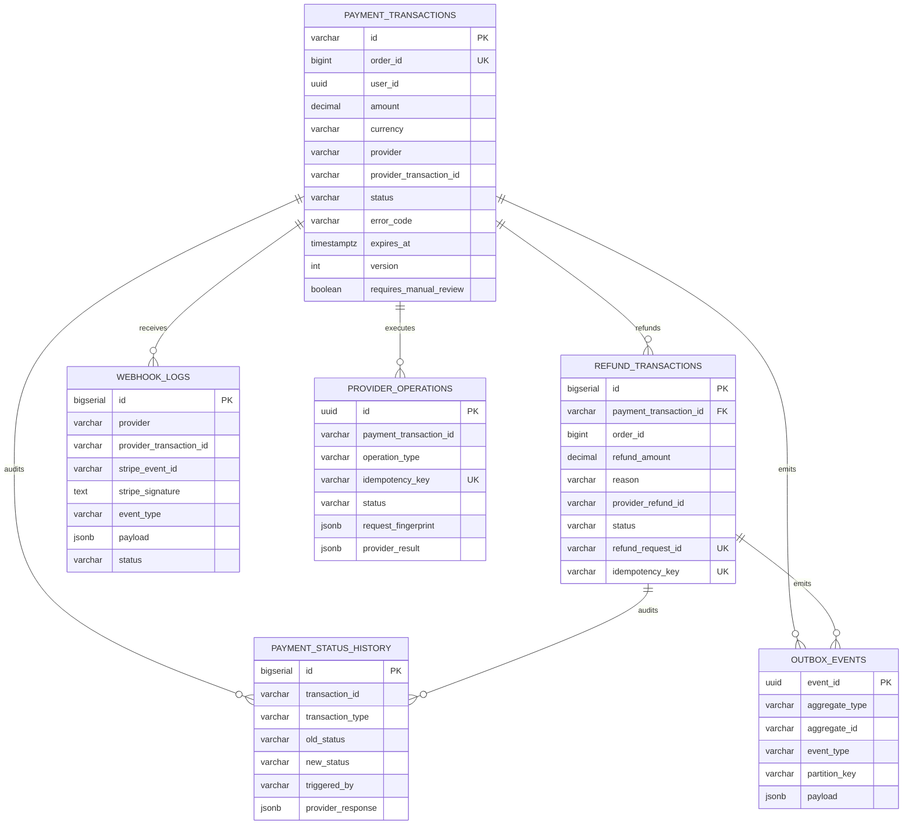

# Payment Service — Thiết kế dữ liệu

> Đây là logical/physical design được chuyển từ tài liệu DB design cũ. Các câu SQL
> minh họa không phải migration chuẩn; hiện chưa có migration Payment để xác minh.

## 1. Quyền sở hữu dữ liệu

| Store/đối tượng | Dữ liệu | Nguồn chân lý |
|---|---|---|
| PostgreSQL `payment_transactions` | Mỗi lần thanh toán, trạng thái FSM, tham chiếu Stripe, hạn phiên | Payment Service |
| PostgreSQL `refund_transactions` | Yêu cầu hoàn tiền, trạng thái FSM, tham chiếu Stripe Refund, idempotency key | Payment Service |
| PostgreSQL `webhook_logs` | Raw webhook Stripe, chữ ký, kết quả xử lý | Payment Service |
| PostgreSQL `payment_status_history` | Audit trail mọi transition của hai FSM | Payment Service |
| PostgreSQL `outbox_events` | Integration event chờ/đã được CDC quan sát | Payment Service |
| PostgreSQL `payment_idempotency` | Response đã lưu cho API command idempotent | Payment Service |
| PostgreSQL `provider_operations` | Durable create/cancel/refund provider-side operation, key và recovery outcome | Payment Service |
| Redis | Idempotency pointer và distributed lock có TTL | Dữ liệu tạm; không là source of truth |
| S3 archive | Partition `payment_transactions` > 6 tháng | Payment Service (cold tier) |
| Trạng thái PaymentIntent/Refund trên Stripe | Nguồn thật của provider | Stripe; Payment replicate và đối soát |

Payment hoạt động độc lập với Order: Order chỉ biết "đơn này cần thanh toán X
đồng"; Payment chịu trách nhiệm gọi Stripe và đồng bộ trạng thái. Service khác
không ghi database này. `order_id` và `user_id` là foreign key logic, không có FK
vật lý sang service khác.

## 2. Mô hình dữ liệu logic



Một order có thể có nhiều `payment_transactions` (thanh toán lỗi và thử lại).
Nhưng toàn bộ order có tối đa một `refund_transactions` trong vòng đời; retry,
webhook, poller và reconciliation đều tiếp tục transaction này thay vì tạo refund
thứ hai. `amount <= payment.amount` remains defense in depth.

## 3. Schema logic và field

### 3.1. `payment_transactions`

| Cột | Kiểu | Ghi chú |
|---|---|---|
| `id` | `VARCHAR(50)` PK | Sinh tự động, đóng vai trò `txn_ref` gửi lên Stripe (ví dụ `TNX12345ABC`/`TXN-ABC123`) |
| `order_id` | `BIGINT` | FK logic về Order Service |
| `user_id` | `UUID` | Canonical toàn hệ thống; dùng để filter, sharding sau này |
| `amount` | `DECIMAL` | Số tiền thực tế phải thanh toán |
| `currency` | `VARCHAR(10)` | Cố định `VND`; Stripe hỗ trợ VND ở VN region |
| `provider` | `VARCHAR(50)` NOT NULL DEFAULT `'STRIPE'` | `CHECK (provider = 'STRIPE')` — single provider |
| `provider_transaction_id` | `VARCHAR(100)` | Stripe PaymentIntent ID `pi_xxx`; đối soát với Stripe Dashboard |
| `status` | `VARCHAR(50)` | `INITIATING`, `PENDING`, `PROCESSING`, `SUCCESS`, `FAILED`, `EXPIRED`, `CANCELED`, `REFUNDING`, `REFUNDED`; schema `CHECK` phải khớp FSM. |
| `error_code`, `error_message` | `VARCHAR(255)` | Lưu lỗi khi thanh toán rớt để phân tích |
| `expires_at` | `TIMESTAMPTZ` | Hết hạn phiên (15 phút); Expiration Scanner quét |
| `version` | `INT` | Optimistic lock cho mọi transition (được FSM/workflow tham chiếu, DB design cũ chưa khai báo) |
| `requires_manual_review` | `BOOLEAN` | Bật ở `T8`/`T9` (được FSM tham chiếu, DB design cũ chưa khai báo) |
| `created_at`, `updated_at` | `TIMESTAMPTZ` | Partition key theo `created_at` |

### 3.1a. `provider_operations`

| Cột | Kiểu | Ghi chú |
|---|---|---|
| `id` | `UUID` PK | Identity của một side effect provider. |
| `payment_transaction_id` | `VARCHAR(50)` | FK logic về payment gốc. |
| `operation_type` | `VARCHAR(20)` | `CREATE`, `CANCEL` hoặc `REFUND`. |
| `idempotency_key` | `VARCHAR(255)` UNIQUE | Key ổn định truyền sang Stripe; không thay khi retry/recovery. |
| `request_fingerprint` | `JSONB` | Canonical amount/currency/metadata/reason; key đổi payload bị reject. |
| `status` | `VARCHAR(30)` | `REQUESTED`, `PROVIDER_CONFIRMED`, `UNKNOWN`, `MANUAL_REVIEW_REQUIRED`. |
| `provider_result` | `JSONB` | Provider ID/status/reference tối thiểu phục vụ replay/reconciliation. |
| `created_at`, `updated_at` | `TIMESTAMPTZ` | Audit/recovery scheduling. |

Create persists before `PaymentIntent.create`; cancel persists before
`PaymentIntent.cancel`. A provider timeout cannot leave an untracked side effect:
the same operation/key is replayed or reconciled until a durable result is bound.

### 3.2. `refund_transactions`

| Cột | Kiểu | Ghi chú |
|---|---|---|
| `id` | `BIGSERIAL` PK hoặc `UUID` | Event dùng dạng `RFD-DEF456` |
| `payment_transaction_id` | `VARCHAR(50)` | FK logic đến payment gốc |
| `order_id` | `BIGINT` | |
| `refund_request_id` | `VARCHAR(128)` UNIQUE | Identity của lifetime Order refund case |
| `refund_amount` | `DECIMAL` | |
| `reason` | `VARCHAR(255)` | `CUSTOMER_RETURN`, `ADMIN_FORCE_REFUND`, `OUT_OF_STOCK`, v.v. |
| `provider_refund_id` | `VARCHAR(100)` | Stripe Refund ID `re_xxx` |
| `status` | `VARCHAR(50)` | `PENDING`, `PROCESSING`, `SUCCESS`, `FAILED` |
| `idempotency_key` | `VARCHAR(255)` UNIQUE | Chống duplicate request từ Order |
| `created_at`, `updated_at` | `TIMESTAMPTZ` | Poller lọc `updated_at` > 1 phút |

### 3.3. `webhook_logs`

Cực kỳ quan trọng để debug khi Stripe báo đã trừ tiền nhưng app báo lỗi.

| Cột | Kiểu | Ghi chú |
|---|---|---|
| `id` | `BIGSERIAL` PK | |
| `provider` | `VARCHAR(50)` NOT NULL DEFAULT `'STRIPE'` | |
| `provider_transaction_id` | `VARCHAR(100)` | `pi_xxx` |
| `stripe_event_id` | `VARCHAR(120)` | `evt_xxx`; dedup khi Stripe retry cùng event |
| `stripe_signature` | `TEXT` | Toàn bộ header `Stripe-Signature` để audit |
| `event_type` | `VARCHAR(100)` | `payment_intent.succeeded`, `charge.refunded`, ... |
| `payload` | `JSONB` | Raw body nguyên vẹn để phục hồi dữ liệu |
| `status` | `VARCHAR(50)` | `UNPROCESSED`, `PROCESSED`, `FAILED_SIGNATURE`, `IGNORED` |
| `idempotency_key` | `VARCHAR(255)` | `stripe_event_id` + `event_type` để chặn xử lý đúp |
| `created_at` | `TIMESTAMPTZ` | |

Auto-Retry Worker tham chiếu `retry_count`/`max_retries` chưa có trong schema
(xem `README.md` §9).

### 3.4. `payment_status_history`

| Cột | Kiểu | Ghi chú |
|---|---|---|
| `id` | `BIGSERIAL` PK | |
| `transaction_id` | `VARCHAR(50)` | FK logic → `payment_transactions.id` hoặc `refund_transactions.id` |
| `transaction_type` | `VARCHAR(20)` | `PAYMENT`, `REFUND` |
| `old_status`, `new_status` | `VARCHAR(50)` | |
| `triggered_by` | `VARCHAR(50)` | `WEBHOOK`, `CRONJOB`, `API`, `TEMPORAL` |
| `provider_response` | `JSONB` | Raw response Stripe khi có — debug dispute |
| `created_at` | `TIMESTAMPTZ` | |

### 3.5. `outbox_events`

Transactional outbox theo canonical CDC Pattern (Debezium/Kafka Connect). **Cấm
cột polling-style** — retry/DLQ/backoff thuộc Kafka Connect runtime
([ADR-005](./decisions/ADR-005-transactional-outbox-cdc.md)).

| Cột | Kiểu | Ghi chú |
|---|---|---|
| `event_id` | `UUID` PK | |
| `schema_version` | `INT NOT NULL DEFAULT 2` | Version 2 carries financial identity/version fields required by Order recovery. |
| `aggregate_type` | `VARCHAR(100)` | Cố định `Payment` cho cả PAYMENT_* và REFUND_* |
| `aggregate_id` | `VARCHAR(50)` | `payment_transactions.id` cho PAYMENT_*, `refund_transactions.id` cho REFUND_* |
| `event_type` | `VARCHAR(100)` | `PAYMENT_SUCCESS`, `REFUND_INITIATED`, ... |
| `partition_key` | `VARCHAR(255) NOT NULL` | Canonical `order_id` để group mọi event cùng order |
| `payload` | `JSONB` | Event theo envelope trong `interfaces.md` §4 |
| `created_at` | `TIMESTAMPTZ NOT NULL` | |

Tài liệu workers cũ gọi bảng này là `payment_outbox` (xem `README.md` §9).

### 3.6. `payment_idempotency`

Chặn duplicate request từ Frontend (double-click) hoặc Kafka replay.

| Cột | Kiểu | Ghi chú |
|---|---|---|
| `key` | `VARCHAR(255)` | |
| `action` | `VARCHAR(100)` | |
| `response_code` | `INT` | |
| `response_body` | `JSONB` | |
| `created_at`, `expires_at` | `TIMESTAMPTZ` | |

`PRIMARY KEY (key, action)` để client không dùng lại một idempotency key cho nhiều
hành động khác nhau. Payment persists request fingerprint and response state; Redis
may cache the pointer but may not replace this recovery record.

## 4. Ràng buộc và chỉ mục

| Ràng buộc | Mục đích |
|---|---|
| `payment_transactions.provider CHECK (= 'STRIPE')` | Single provider Phase 18 |
| `refund_transactions.idempotency_key UNIQUE` | Refund đúng một lần theo key của Order; fallback khi Redis sập |
| `refund_transactions.order_id UNIQUE` | Không thể tạo refund transaction thứ hai cho một order, kể cả qua payment retry khác |
| `refund_transactions.refund_request_id UNIQUE` | Khóa identity case mà Order gửi sang Payment |
| `webhook_logs UNIQUE(provider, provider_transaction_id, event_type)` | DB-level từ chối duplicate webhook; `INSERT ... ON CONFLICT DO NOTHING` |
| `payment_idempotency PRIMARY KEY (key, action)` | Một key không dùng cho nhiều action |
| `provider_operations.idempotency_key UNIQUE` | One provider create/cancel/refund operation per stable Payment key; a retry cannot mint another side effect |
| `refund_amount <= payment.amount` | Check cùng transaction với unique-order insert; Order has one refund transaction, so no aggregate refund sum is needed |
| Transition hợp lệ theo bảng FSM | Enforce ở Spring State Machine + optimistic lock, không ở DB |

Index/query pattern (thiết kế cũ không liệt kê index cụ thể; suy ra từ query):

| Query pattern | Cột cần index |
|---|---|
| Expiration Scanner: `status IN (PENDING, PROCESSING) AND expires_at <= NOW()` trên partition hiện tại | `(status, expires_at)` theo partition; `INITIATING` has a separate recovery queue |
| Recover create/cancel operation | `provider_operations(status, updated_at)`, `payment_transactions(provider_transaction_id)` |
| Refund Poller: `status = PROCESSING AND updated_at < NOW() - 1 phút` | `refund_transactions(status, updated_at)` |
| Query detail + refunds | PK `payment_transactions.id`; `refund_transactions(payment_transaction_id)` |
| Map webhook `pi_xxx` → transaction | `payment_transactions(provider_transaction_id)` |
| Dedup webhook | Unique index ở trên; `webhook_logs(stripe_event_id)` |
| Reconciliation theo cửa sổ thời gian | `payment_transactions(created_at)` (partition) |
| Auto-retry: `webhook_logs.status IN (FAILED_SIGNATURE, UNPROCESSED)` | `webhook_logs(status)` |

## 5. Ranh giới transaction và xử lý đồng thời

- `@Transactional` gom `INSERT/UPDATE transaction` + `INSERT outbox_events` +
  `INSERT payment_status_history` trong một transaction PostgreSQL.
- Optimistic lock `@Version`/cột `version` trên bảng transaction là default guard
  cho mọi state transition; conflict → requeue/retry.
- Refund validation `amount <= paid_amount` và absence of a prior refund for the
  order are checked atomically with `INSERT refund_transactions` and payment
  `REFUNDING`. The order unique constraint is the final concurrency guard.
- Webhook: `INSERT webhook_logs ON CONFLICT DO NOTHING` + update transaction +
  outbox trong một ACID transaction; 0 rows từ insert → ack không làm gì.
- Side effect Stripe nằm ngoài DB transaction. Before every create/cancel/refund
  call, Payment commits `provider_operations` with a stable key and canonical
  fingerprint; retry/reconciliation uses that same key. Redis locks only reduce
  concurrency and cannot authorize a second provider side effect.
- Isolation level cụ thể chưa được thiết kế cũ chốt.

## 6. Redis, outbox và idempotency storage

| Key/nhóm | Mục đích | TTL | Fallback khi Redis mất |
|---|---|---|---|
| `payment:initiate:{order_id}` (SETNX) | Idempotency pointer cho initiate | 15 phút + 60s | Insert + unique check ở `payment_idempotency` |
| Idempotency-Key refund (SETNX) | Chặn refund trùng | Theo thiết kế; DB `refund_transactions.idempotency_key` là durable | Unique constraint DB |
| `lock:payment:{action}:{txn_id}` (Redisson) | Distributed lock cho side effect Stripe/cronjob | 15–30s | Worker reject → retry cycle/DLQ; API fallback DB |

Redis dùng Lettuce cho idempotency và Redisson cho distributed lock theo tech
stack cũ. Read API và Reconciliation không phụ thuộc Redis.

Outbox: append-only, Debezium đọc WAL, route `aggregate_type=Payment` →
`t.payment.events`, `partition_key=order_id`. Thiết kế cũ ghi Payment đang migrate
từ Outbox Polling (legacy) sang CDC; Outbox Polling Worker đã deprecated. Cleanup/
retention của outbox chưa được thiết kế cũ mô tả.

Consumer-side dedup: khuyến nghị bảng `consumed_events` (`event_id` PK,
`created_at`), insert cùng transaction với xử lý event.

## 7. Vòng đời dữ liệu, partition và archive

`payment_transactions` grow rất nhanh (mỗi lần thử thanh toán = 1 record). Chiến
lược partition + tiered storage theo nhu cầu retention riêng của Payment
([ADR-009](./decisions/ADR-009-monthly-partitioning-and-tiered-archive.md)).
Order Service đã bỏ Cold Data Archiving ở Phase 16; Payment giữ chiến lược riêng
do đặc thù retention lâu dài (> 6 tháng) cho transaction log phục vụ CSKH/audit,
quyết định này **không** phụ thuộc pattern của Order.

### 7.1. Partition theo tháng

```sql
ALTER TABLE payment_transactions RENAME TO payment_transactions_old;

CREATE TABLE payment_transactions (
    -- giữ nguyên schema §3.1
) PARTITION BY RANGE (created_at);

-- Auto-create monthly partitions bằng pg_partman, hoặc thủ công:
CREATE TABLE payment_transactions_2026_01
    PARTITION OF payment_transactions
    FOR VALUES FROM ('2026-01-01') TO ('2026-02-01');
```

Lợi ích: Expiration Scanner chỉ query partition hiện tại (giảm scan 10–50x);
archive dễ (detach partition > 6 tháng → `pg_dump` → S3 → DROP); index mỗi
partition nhỏ hơn. `refund_transactions`, `webhook_logs`,
`payment_status_history` cũng nên partition theo `created_at` khi volume cao; ưu
tiên `payment_transactions` trước.

### 7.2. Archival CronJob (weekly, Chủ nhật 3:00 AM)

1. Quét partition > 6 tháng tuổi.
2. `pg_dump` → `s3://payment-archive/YYYY/MM/payment_transactions_YYYY_MM.sql.gz`.
3. Verify checksum SHA-256.
4. `ALTER TABLE payment_transactions DETACH PARTITION payment_transactions_YYYY_MM`.
5. DROP partition chỉ sau khi verify S3 integrity pass.
6. Log archive event cho audit trail.

### 7.3. Tiered Read

API check DB (partition hiện tại) trước; miss → query S3/Athena (~2–5s); response
format giống nhau cho hot và cold data.

### 7.4. Còn thiếu

Retention cho `webhook_logs`, `payment_status_history`, `outbox_events`,
`payment_idempotency` (ngoài `expires_at`), backup/restore, migration/backfill
chưa được thiết kế cũ mô tả.

## 8. Bảo mật và quyền riêng tư

- Stripe API key (`sk_...`) và webhook secret (`whsec_...`) lưu trong Vault/Secret
  Manager; không commit, không log.
- `client_secret` được trả cho Order/Frontend và có trong `PAYMENT_INITIATED`
  payload; chỉ dùng phía client với `publishable_key`.
- `webhook_logs.payload` và `stripe_signature` lưu nguyên vẹn để audit/forensic;
  cần access control cho vận hành. Thiết kế cũ chưa mô tả masking.
- `user_id` là UUID; không lưu thông tin thẻ/ngân hàng (Stripe giữ).
- `payment_status_history` là audit trail compliance; `provider_response` JSONB
  dùng khi debug dispute.
- Replay DLQ/manual review có audit; GDPR/data deletion chưa được thiết kế cũ mô tả.
