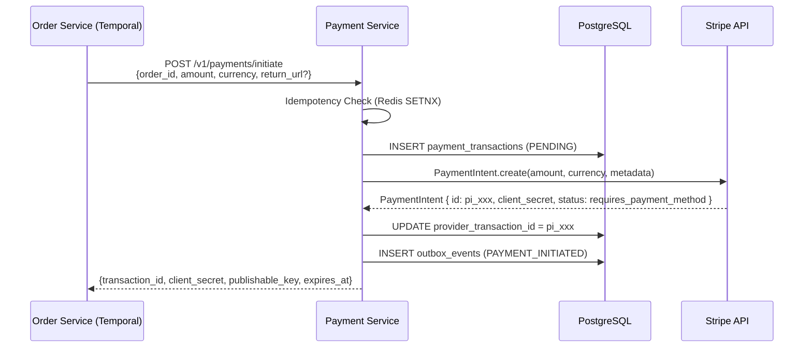
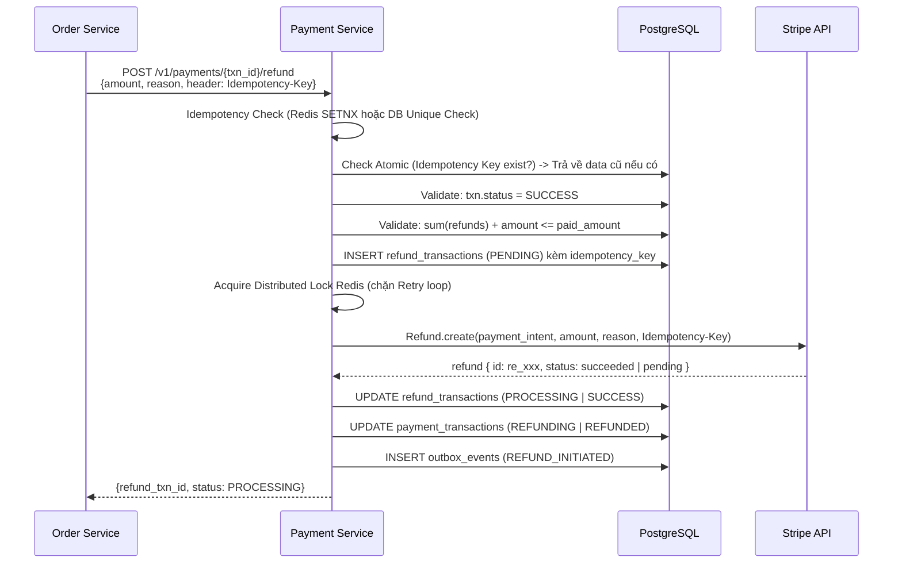

# Payment Service - Quy Trình Hoạt Động (Workflows & API Data Flow)

**Liên kết nhanh (Related Documents):**
*   [Database Schema](payment_db_design.md)
*   [State Machine](payment_state_machine.md)
*   [Background Workers & Jobs](payment_workers.md)
*   [Events Structure & Kafka Topics](payment_events.md)
*   [Refund Boundary Decision (ADR)](refund_boundary_decision.md)

**Cross-Service References:**
*   [Order Workflow](../order/order_workflow.md) — Order gọi Initiate Payment
*   [Order Temporal Saga](../order/temporal_saga_design.md) — Signal Payment Result

---

Tài liệu này mô tả toàn bộ Workflows (luồng xử lý) của Payment Service: API initiate, webhook processing, refund, và query status.

> [!IMPORTANT]
> **Phase 18 (Single Payment Provider):** Hệ thống chỉ dùng **Stripe** làm payment provider duy nhất. Bỏ hoàn toàn VNPay, MoMo, ZaloPay; bỏ Provider Adapter Pattern. Payment Service gọi trực tiếp `com.stripe:stripe-java` SDK. COD (Đặt hàng khi nhận được) **không được hỗ trợ**. Mọi đơn hàng đều thanh toán online qua Stripe trước khi giao hàng — Refund được xử lý hoàn toàn qua Stripe API (`Refund.create`).

Mỗi flow ghi rõ: `[PostgreSQL]`, `[Redis]`, `[Kafka]`, `[FSM]`, `[Stripe API]`.


---

## 1. API: Initiate Payment (`POST /v1/payments/initiate`)

**Ngữ cảnh:** Order Service (Temporal Activity `InitiatePaymentActivity`) gọi API này để tạo payment transaction.



### Bước Chi tiết:
1. **[Backend]** Nhận request (gRPC hoặc REST). `return_url` là optional (chỉ dùng cho redirect-based payment methods; với Stripe Elements + `confirmation_method=automatic` thì không cần):
   ```json
   {
     "order_id": 10001,
     "amount": 995000,
     "currency": "VND",
     "return_url": "https://app.domain.com/payment/result",
     "metadata": {"user_id": "550e8400-e29b-41d4-a716-446655440000", "description": "Thanh toán đơn #10001"}
   }
   ```
2. **[Redis]** Idempotency check: `SETNX payment:initiate:{order_id}` TTL = `payment_session_ttl` (15 phút) + 60 giây đệm mạng.
   - Nếu key đã tồn tại, backend **phải kiểm tra `expires_at` trong DB**.
   - Nếu transaction cũ đã `EXPIRED` hoặc `expires_at <= NOW()`, tạo transaction mới và ghi đè idempotency pointer.
   - Chỉ trả lại `transaction_id` + `client_secret` cũ khi transaction còn hiệu lực.
3. **[PostgreSQL - Transaction]**
   ```sql
   BEGIN;
   INSERT INTO payment_transactions (order_id, amount, currency, provider, status, expires_at, ...)
   VALUES (:order_id, :amount, 'VND', 'STRIPE', 'PENDING', NOW() + INTERVAL '15 minutes', ...);
   INSERT INTO outbox_events (aggregate_type, aggregate_id, event_type, payload, status)
   VALUES ('PAYMENT', :txn_id, 'PAYMENT_INITIATED', :payload, 'PENDING');
   COMMIT;
   ```
4. **[Stripe SDK — gọi trực tiếp]** Tạo `PaymentIntent` qua Stripe Java SDK (không qua Adapter):
   ```java
   PaymentIntentCreateParams params = PaymentIntentCreateParams.builder()
       .setAmount(amountInVndSubunit)        // VND theo Stripe zero-decimal rule: amount × 100
       .setCurrency("vnd")
       .putMetadata("order_id", String.valueOf(orderId))
       .putMetadata("user_id", userId)
       .setConfirmationMethod(PaymentIntentCreateParams.ConfirmationMethod.AUTOMATIC)
       .build();
   PaymentIntent intent = PaymentIntent.create(params);
   // intent.getId() = "pi_xxx" → lưu vào payment_transactions.provider_transaction_id
   // intent.getClientSecret() = "pi_xxx_secret_xxx" → trả cho frontend
   ```
5. **[Response]** Trả về cho Order Service:
   ```json
   {
     "transaction_id": "TXN-ABC123",
     "client_secret": "pi_xxx_secret_xxx",
     "publishable_key": "pk_test_xxx",
     "expires_at": "2026-02-28T10:20:00Z"
   }
   ```
   Frontend sẽ dùng `client_secret` + `publishable_key` để khởi tạo **Stripe Elements** hoặc **Stripe Checkout SDK** ở browser/app — KHÔNG redirect sang URL ngoài.

> [!NOTE]
> **Tại sao không còn Provider Adapter Pattern (Phase 18):** Hệ thống chỉ dùng 1 provider duy nhất (Stripe), nên không cần Strategy/Factory pattern. Toàn bộ Stripe-specific code encapsulate trong package `com.payment.stripe` (PaymentIntentClient, RefundClient, WebhookVerifier) để dễ refactor nếu sau này đổi provider.

---
## 2. API: Handle Webhook (`POST /v1/payments/webhook/stripe`)

**Ngữ cảnh:** Stripe callback sau khi user thanh toán (hoặc hủy) qua Stripe Elements / Stripe Checkout SDK.

### Bước Chi tiết:
1. **[API Endpoint]** Nhận raw body + headers từ Stripe. Endpoint cố định: `POST /v1/payments/webhook/stripe` (không còn path variable `{provider}`).
2. **[Trả 200 OK ngay lập tức]** Không xử lý logic tại đây — trả 200 trong < 500ms để tránh Stripe retry.
3. **[Kafka Producer]** Dump raw webhook vào topic nội bộ:
   ```
   Topic: t.payment.webhooks.raw
   Key: STRIPE: + stripe_event_id
   Value: { "provider": "STRIPE", "stripe_event_id": "evt_xxx", "raw_body": "...", "stripe_signature": "t=...,v1=...", "received_at": "..." }
   ```
4. **[Webhook Processor Worker]** Consume async (xem [Workers #2](payment_workers.md#2-webhook-processor-worker-kafka-consumer--internal)):
   - Verify `Stripe-Signature` header (HMAC-SHA256 với `whsec_...`, `|now - t| <= 300s`).
   - Map Stripe event type → FSM transition:
     - `payment_intent.succeeded` → T2 (PAYMENT_SUCCESS_CONFIRMED)
     - `payment_intent.payment_failed` → T3 (PAYMENT_FAILED_CONFIRMED)
     - `payment_intent.canceled` → T5 (PAYMENT_CANCELED)
     - `charge.refunded` → R2 (REFUND_SUCCESS_CONFIRMED)
   - Update DB + Outbox.

> [!WARNING]
> **Tại sao không xử lý trực tiếp?** Vì:
> 1. Stripe retry nếu response > 5s → duplicate processing (Stripe retry 3-5 lần với exponential backoff).
> 2. Nếu DB down lúc webhook đến → mất event vĩnh viễn.
> 3. Kafka đảm bảo At-Least-Once + Idempotency Worker → Không mất, không trùng.

---

## 3. API: Query Payment Status (`GET /v1/payments/{transactionId}`)

**Ngữ cảnh:** Client polling hoặc Order Service verify. Read đơn giản.

1. **[Backend]** Query PostgreSQL:
   ```sql
   SELECT pt.*, array_agg(rt.*) as refunds
   FROM payment_transactions pt
   LEFT JOIN refund_transactions rt ON rt.payment_transaction_id = pt.id
   WHERE pt.id = :transactionId;
   ```
2. **[Response]** `200 OK` + JSON transaction detail + attached refunds.

---

## 4. API: Initiate Refund (`POST /v1/payments/{transactionId}/refund`)

**Ngữ cảnh:** Order Service (`OrderRefundWorkflow`) gọi khi cần hoàn tiền cho đơn đã thanh toán (ví dụ: khách đổi trả hàng hoặc admin force refund) **sau khi đã nhận xác nhận từ Inventory rằng toàn bộ item trong refund scope đã được nhận về kho**.



### Bước Chi tiết:
1. **[Backend]** Nhận request: Bắt buộc kèm `Idempotency-Key` (Header).
   ```json
   {
     "amount": 995000,
     "reason": "CUSTOMER_RETURN",
     "order_id": 10001,
     "inventory_return_confirmed": true
   }
   ```
2. **[Validation & Idempotency]**
   - Check `Idempotency-Key` trên Redis và DB `refund_transactions`. Nếu trùng client key -> trả cùng kết quả cũ, ko gọi Stripe.
   - Nếu đang ở `PROCESSING` -> chờ/trả processing, tránh gửi request rút bù sang Stripe.
   - Payment transaction `status` phải là `SUCCESS`. Nếu không → `400 Bad Request`.
   - `existing_refunds + new_amount <= paid_amount`. Nếu vượt → `400 Bad Request`.
   - Refund request phải là explicit command từ Order sau gate Inventory-confirm (không suy luận từ bất kỳ shipping events nào).
3. **[PostgreSQL - Transaction]**
   ```sql
   BEGIN;
   INSERT INTO refund_transactions (payment_transaction_id, amount, reason, status, idempotency_key, ...)
   VALUES (:txn_id, :amount, :reason, 'PENDING', :idem_key, ...);
   UPDATE payment_transactions SET status = 'REFUNDING', version = version + 1
   WHERE id = :txn_id AND version = :expected_version;
   INSERT INTO outbox_events (...'REFUND_INITIATED'...);
   INSERT INTO payment_status_history (...);
   COMMIT;
   ```
4. **[Stripe SDK — gọi trực tiếp]** Acquire Distributed Lock (`lock:payment:refund_call:{txn_id}`) và gọi Stripe `Refund.create()` với `Idempotency-Key` header:
   ```java
   RefundCreateParams params = RefundCreateParams.builder()
       .setPaymentIntent(paymentIntentId)   // pi_xxx
       .setAmount(refundAmountInVndSubunit)
       .setReason(RefundCreateParams.Reason.REQUESTED_BY_CUSTOMER)
       .putMetadata("order_id", String.valueOf(orderId))
       .putMetadata("refund_request_id", refundRequestId)
       .build();
   RequestOptions options = RequestOptions.builder()
       .setIdempotencyKey(idempotencyKey)  // Order sinh key, stable across retry
       .build();
   Refund refund = Refund.create(params, options);
   // refund.getId() = "re_xxx" → lưu refund_transactions.provider_refund_id
   ```
5. **[Async Finalization]** Stripe refund có thể trả về `succeeded` ngay (vài giây) hoặc `pending` chờ xử lý từ issuing bank. Trạng thái cuối (`succeeded` / `failed` / `reversed`) đến qua webhook `charge.refunded`. [Refund Status Poller](payment_workers.md#5-refund-status-poller-cronjob) làm safety net khi webhook miss.

### 4.1. Chuẩn hóa Refund Lifecycle (theo thực tiễn quốc tế)

Để nhất quán với Stripe/Adyen/PayPal/Square/Amazon Pay, workflow Refund cần tuân thủ:

1.  **Accepted != Final:** Response `PROCESSING` chỉ là xác nhận đã nhận lệnh refund, không phải hoàn tiền thành công.
2.  **Asynchronous Finalization:** Kết quả cuối cùng phải đến từ webhook hoặc poller/reconcile fallback.
3.  **Duplicate-safe:** Webhook duplicate/retry/out-of-order không được làm đổi trạng thái sai (Stripe retry 3-5 lần).
4.  **Failure-after-accept:** Hệ thống phải chấp nhận case refund thất bại sau khi đã vào `PROCESSING`.
5.  **Provider variance (Stripe capability):** Stripe hỗ trợ reversal callback qua webhook `charge.refunded` với `status = failed` (reversal by provider, e.g. account invalid). Mapping này xử lý ở Webhook Processor Worker (xem [Workers #2](payment_workers.md#2-webhook-processor-worker-kafka-consumer--internal)).

### 4.2. API Contract bổ sung khuyến nghị

Ngoài endpoint khởi tạo refund, nên chuẩn hóa thêm endpoint đọc trạng thái refund độc lập:

*   `GET /v1/refunds/{refundTransactionId}`

Mục tiêu:

*   Tách đọc Refund khỏi read model Payment Transaction.
*   Chuẩn bị seam để tách `Refund Service` ở Phase 2 mà không đổi contract phía Order/CSKH.
*   Hỗ trợ query timeline khi reconciliation phát hiện chênh lệch.

### 4.3. Trigger chuyển sang Refund Service riêng

Workflow hiện tại giữ Refund trong Payment Service (Phase 1).

Chỉ cân nhắc tách service khi đạt ngưỡng trong ADR: [Refund Boundary Decision](refund_boundary_decision.md).

---

## TỔNG KẾT

Payment Service tuân thủ 5 nguyên tắc cốt lõi:
1. **Async Webhook Processing:** Không xử lý trực tiếp — dump vào Kafka → Worker xử lý. Đảm bảo không mất event.
2. **Stripe SDK Direct Call (Phase 18):** Gọi trực tiếp `com.stripe:stripe-java` SDK. Bỏ hoàn toàn Provider Adapter/Factory Pattern vì chỉ có 1 provider duy nhất. Stripe-specific code encapsulate trong package `com.payment.stripe`.
3. **Reconciliation as Safety Net:** Cronjob định kỳ dùng Stripe API đối soát DB ↔ Stripe — phát hiện sai lệch tự động.
4. **Online-Only Payment via Stripe:** Hệ thống chỉ chấp nhận thanh toán online qua Stripe. COD đã bị loại bỏ — giảm độ phức tạp của Refund flow và loại bỏ hàng loạt edge case (tiền mặt, giao hàng xác nhận COD).
5. **Stripe Webhook Signature Verification (Phase 18):** Verify `Stripe-Signature` header (HMAC-SHA256 với `whsec_...`, chống replay bằng timestamp window 300s) trước mọi state transition. Stripe retry 3-5 lần với exponential backoff; idempotency chịu được.

