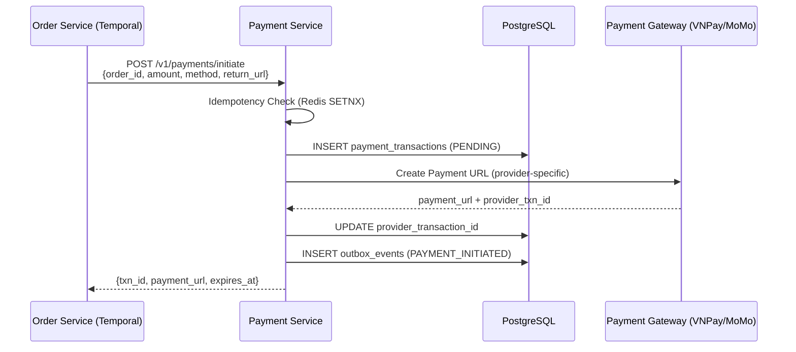
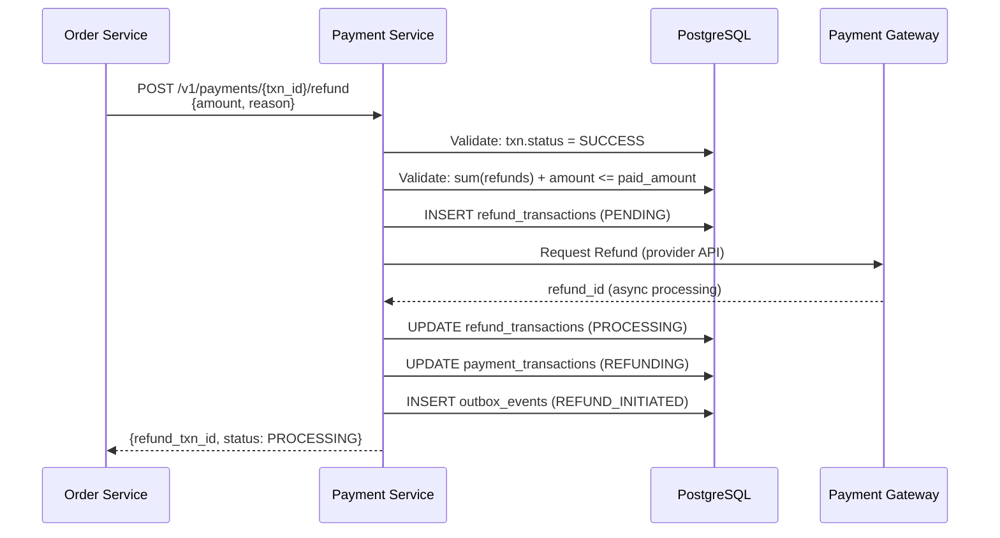

# Payment Service - Quy Trình Hoạt Động (Workflows & API Data Flow)

**Liên kết nhanh (Related Documents):**
*   [Database Schema](payment_db_design.md)
*   [State Machine](payment_state_machine.md)
*   [Background Workers & Jobs](payment_workers.md)
*   [Events Structure & Kafka Topics](payment_events.md)

**Cross-Service References:**
*   [Order Workflow](../order/order_workflow.md) — Order gọi Initiate Payment
*   [Order Temporal Saga](../order/temporal_saga_design.md) — Signal Payment Result

---

Tài liệu này mô tả toàn bộ Workflows (luồng xử lý) của Payment Service: API initiate, webhook processing, refund, và query status.

> [!IMPORTANT]
> Hệ thống chỉ hỗ trợ **Online Payment** (VNPAY, MoMo, ZaloPay). COD (Đặt hàng khi nhận được) **không được hỗ trợ**. Mọi đơn hàng đều thanh toán online trước khi giao hàng — Refund được xử lý hoàn toàn qua cổng thanh toán gốc, không cần xử lý tiền mặt.

Mỗi flow ghi rõ: `[PostgreSQL]`, `[Redis]`, `[Kafka]`, `[FSM]`, `[External Gateway]`.


---

## 1. API: Initiate Payment (`POST /v1/payments/initiate`)

**Ngữ cảnh:** Order Service (Temporal Activity `InitiatePaymentActivity`) gọi API này để tạo payment transaction.



### Bước Chi tiết:
1. **[Backend]** Nhận request (gRPC hoặc REST):
   ```json
   {
     "order_id": 10001,
     "amount": 995000,
     "currency": "VND",
     "payment_method": "VNPAY",
     "return_url": "https://app.domain.com/payment/result",
     "metadata": {"user_id": 999, "description": "Thanh toán đơn #10001"}
   }
   ```
2. **[Redis]** Idempotency check: `SETNX payment:initiate:{order_id}` TTL = `payment_session_ttl` (15 phút) + 60 giây đệm mạng.
   - Nếu key đã tồn tại, backend **phải kiểm tra `expires_at` trong DB**.
   - Nếu transaction cũ đã `EXPIRED` hoặc `expires_at <= NOW()`, tạo transaction mới và ghi đè idempotency pointer.
   - Chỉ trả lại `txn_id` + `payment_url` cũ khi transaction còn hiệu lực.
3. **[PostgreSQL - Transaction]**
   ```sql
   BEGIN;
   INSERT INTO payment_transactions (order_id, amount, currency, provider, status, expires_at, ...)
   VALUES (:order_id, :amount, 'VND', 'VNPAY', 'PENDING', NOW() + INTERVAL '15 minutes', ...);
   INSERT INTO outbox_events (aggregate_type, aggregate_id, event_type, payload, status)
   VALUES ('PAYMENT', :txn_id, 'PAYMENT_INITIATED', :payload, 'PENDING');
   COMMIT;
   ```
4. **[Provider Adapter]** Tạo payment URL theo từng cổng:
   - **VNPay:** Build `vnp_Url` + params (amount, txn_ref, ip_addr, ...) + HMAC-SHA512 hash.
   - **MoMo:** POST `/v2/gateway/api/create` body JSON + HMAC-SHA256 signature.
   - **ZaloPay:** POST `/v2/create` body JSON + HMAC-SHA256 mac.
5. **[Response]** Trả về cho Order Service:
   ```json
   {
     "transaction_id": "TXN-ABC123",
     "payment_url": "https://pay.vnpay.vn/checkout?token=xyz",
     "expires_at": "2026-02-28T10:20:00Z"
   }
   ```

> [!NOTE]
> **Provider Adapter Pattern:** Mỗi cổng thanh toán có adapter riêng implement interface `PaymentProviderAdapter`. Factory `PaymentProviderFactory.getAdapter(method)` trả về adapter phù hợp. Giúp thêm cổng mới dễ dàng.

---

## 2. API: Handle Webhook (`POST /v1/payments/webhook/{provider}`)

**Ngữ cảnh:** Cổng thanh toán callback sau khi user thanh toán (hoặc hủy).

### Bước Chi tiết:
1. **[API Endpoint]** Nhận raw body + headers từ 3PL.
2. **[Trả 200 OK ngay lập tức]** Không xử lý logic tại đây — trả 200 trong < 500ms để tránh cổng retry.
3. **[Kafka Producer]** Dump raw webhook vào topic nội bộ:
   ```
   Topic: t.payment.webhooks.raw
   Key: provider + ":" + provider_txn_id
   Value: { "provider": "VNPAY", "raw_body": "...", "headers": {...}, "received_at": "..." }
   ```
4. **[Webhook Processor Worker]** Consume async (xem [Workers #2](payment_workers.md#2-webhook-processor-worker-kafka-consumer--internal)):
   - Verify signature.
   - Map provider response → FSM event.
   - Update DB + Outbox.

> [!WARNING]
> **Tại sao không xử lý trực tiếp?** Vì:
> 1. Cổng retry nếu response > 5s → duplicate processing.
> 2. Nếu DB down lúc webhook đến → mất event vĩnh viễn.
> 3. Kafka đảm bảo At-Least-Once + Idempotency Worker → Không mất, không trùng.

---

## 3. API: Query Payment Status (`GET /v1/payments/{transactionId}`)

**Ngữ cảnh:** Client polling hoặc Order Service verify. Read đơn giản.

1. **[Backend]** Query PostgreSQL:
   ```sql
   SELECT pt.*, array_agg(rt.*) as refunds
   FROM payment_transactions pt
   LEFT JOIN refund_transactions rt ON rt.payment_transaction_id = pt.id
   WHERE pt.id = :transactionId;
   ```
2. **[Response]** `200 OK` + JSON transaction detail + attached refunds.

---

## 4. API: Initiate Refund (`POST /v1/payments/{transactionId}/refund`)

**Ngữ cảnh:** Order Service (Refund Workflow) gọi khi khách đổi trả hàng.



### Bước Chi tiết:
1. **[Backend]** Nhận request:
   ```json
   {
     "amount": 995000,
     "reason": "CUSTOMER_RETURN",
     "order_id": 10001
   }
   ```
2. **[Validation]**
   - Payment transaction `status` phải là `SUCCESS`. Nếu không → `400 Bad Request`.
   - `existing_refunds + new_amount <= paid_amount`. Nếu vượt → `400 Bad Request`.
3. **[PostgreSQL - Transaction]**
   ```sql
   BEGIN;
   INSERT INTO refund_transactions (payment_transaction_id, amount, reason, status, ...)
   VALUES (:txn_id, :amount, 'CUSTOMER_RETURN', 'PENDING', ...);
   UPDATE payment_transactions SET status = 'REFUNDING', version = version + 1
   WHERE id = :txn_id AND version = :expected_version;
   INSERT INTO outbox_events (...'REFUND_INITIATED'...);
   INSERT INTO payment_status_history (...);
   COMMIT;
   ```
4. **[Provider Adapter]** Gọi API refund:
   - VNPay: `POST /refund` endpoint.
   - MoMo: `POST /v2/gateway/api/refund`.
5. **[Async]** Hầu hết cổng xử lý refund **async** (3-7 ngày). [Refund Status Poller](payment_workers.md#5-refund-status-poller-cronjob) sẽ theo dõi và emit `REFUND_SUCCESS`/`REFUND_FAILED`.

---

## TỔNG KẾT

Payment Service tuân thủ 3 nguyên tắc cốt lõi:
1. **Async Webhook Processing:** Không xử lý trực tiếp — dump vào Kafka → Worker xử lý. Đảm bảo không mất event.
2. **Provider Adapter Pattern:** Mỗi cổng thanh toán là 1 adapter, thêm/đổi cổng dễ dàng mà không ảnh hưởng core logic.
3. **Reconciliation as Safety Net:** Daily CronJob đối soát đảm bảo DB luôn khớp với cổng — phát hiện sai lệch tự động.
4. **Online-Only Payment:** Chỉ chấp nhận VNPAY, MoMo, ZaloPay. COD đã bị loại bỏ — giảm độ phức tạp của Refund flow và loại bỏ hàng loạt edge case (tiền mặt, giao hàng xác nhận COD).

